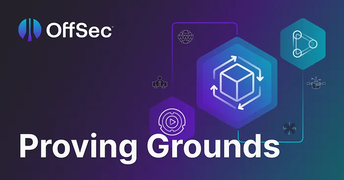

# Writeups for OffSec's proving grounds

Welcome to my writeups for proving grounds machines.

These writeups are mainly a documentation for myself but I hope others will benefit from them as well.

This repository is part of my evolving efforts to [build](https://www.buildingasecondbrain.com/) my [second](https://fortelabs.com/blog/basboverview/) [brain](https://fortelabs.com/blog/the-7-benefits-of-building-a-second-brain/).

## Types

- [PG Play](PG_Play/README.md)
- [PG Practice](PG_Practice/README.md)

## No flag spoilers

The solutions contains step-by-step walkthroughs but doesn't display the flags in plain text.  
Instead, the flags are displayd as `e<REDACTED>1` with only the first and last characters visible for verification purposes.

## When to use

These solutions can be used in two different scenarios:

**Scenario #1**:  
When you are stuck, have already tried different solutions on your own, and don't know how to continue.  
Don't look at them to soon though. It's always good to develop your ["Try harder"-mindset](https://www.offsec.com/blog/what-it-means-to-try-harder/)!

**Scenario #2**:  
When you have already solved the challenge on your own but want to see if you can learn different methods, tools or approaches.
Are there different and perhaps smarter ways to solve this challenge?

## Support my work

If you appreciate this repository and learn from it, please consider [giving it a star](https://docs.github.com/en/get-started/exploring-projects-on-github/saving-repositories-with-stars#starring-a-repository) to support me and spread the word.

## Language disclaimer

I'm not a native English speaker so please forgive any spelling mistakes or grammatical errors.

## Acknowledgements

Some of the solutions were inspired by writeups and walkthroughs from these guys:

- [0xRave](https://medium.com/@0xrave)
- [pika5164](https://github.com/pika5164/Offsec_Proving_Grounds)
